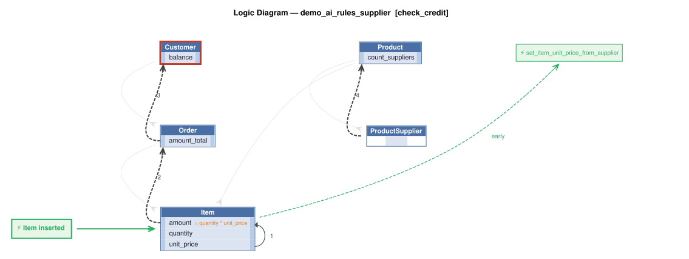
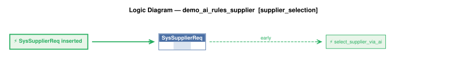
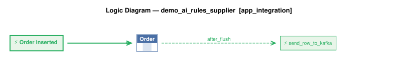
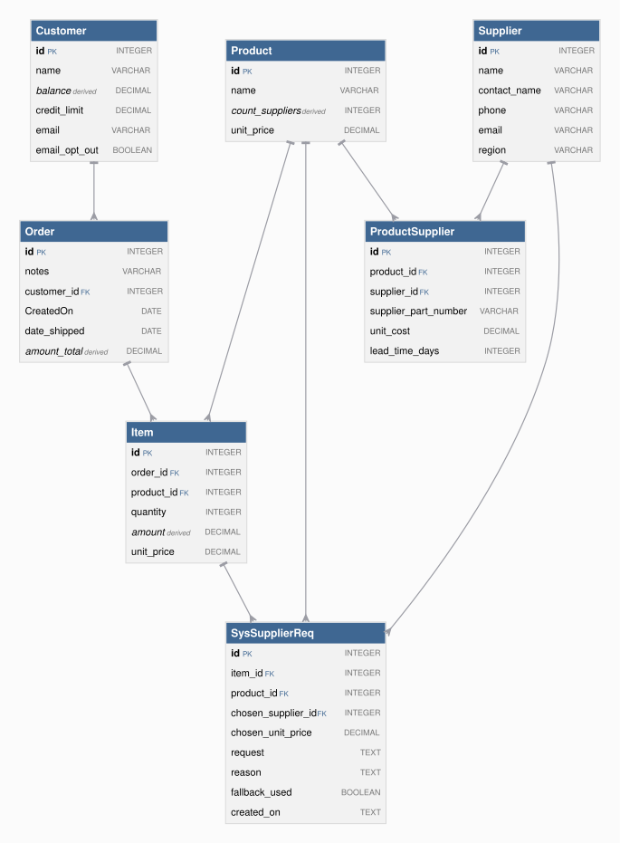

# Requirements Traceability Report

This report shows requirements, the rules created from them, and the tests created from those rules.

This project began as natural-language requirements, fleshed out by AI into a running system of business rules that are *executable documentation*. This report is how you govern the result.

A governable system is one you can **read**, **trust**, and **maintain**: each requirement is listed beside the rules that implement it (*read*); the tests and logic logs show those rules running (*trust*); re-run it after any change and it flags the gaps — an untested requirement, an untraced rule, a channel no test checks (*maintain*).

It is generated from the project's own files, nothing written by hand, so it is as current as the last run and covers the whole project, not a sample. Open **Background** (below the summary) for what the terms mean, how to read the report, and what it can and can't tell you.


**Project:** demo_ai_rules_supplier &nbsp;|&nbsp; **Generated:** November 10, 2026 17:42 &nbsp;|&nbsp; **Rules:** 9 &nbsp;|&nbsp; **Test scenarios:** 12 &nbsp;|&nbsp; **Generator:** requirements_traceability_report.py 2.15

**Last test run:** November 10, 2026 17:42, took 15.6 s (0m before this report; test results and logic logs below are from that run)


&nbsp;
&nbsp;

## At a Glance

**✅ 2 requirement(s), all implemented; 2 tested; 12 of 12 scenarios passed; last run 0m ago.**

| | |
|---|---|
| Requirements | 2 (2 implemented) |
| Tested | 2 of 2 |
| Last test run | ✅ 12 passed, 0 failed (November 10, 2026 17:42, 0m ago); took 15.6 s |
| Rules | 9 (5 declarative, 0 Python functions, 4 Python events) |
| Rules shown running in a test log | 6 of 9 |
| Security | not enabled; 10 role(s), 0 row-level grant(s) |
| Messages and APIs | 0 Kafka topic(s) in, 1 out; 0 HTTP endpoint(s) |
| Kafka | simulated, no broker: messages are tested through /consume_debug; live delivery not verified |

_Status: ✅ every requirement is implemented and tested, all scenarios pass, and the results are current. ⚠ a requirement is untested or unimplemented, there is no test run, or files changed since the last run. ❌ a scenario failed. This reports what was traced and tested, not that the system is correct._

<details markdown>
<summary>Background: what this report is, and how to read it</summary>

&nbsp;

<details markdown>
<summary>Requirements are business policies, expressed in natural language</summary>

<br>

A **requirement** is a statement of business behavior - how data is computed, validated, and transmitted - written in plain language. It lives in the project at `docs/requirements/<name>/requirements.md`.  For example:

&nbsp;

```
On Placing Orders, Check Credit
    1. The Customer's balance does not exceed the credit limit
    2. The Customer's balance is the sum of the unshipped Order amount_total
    3. The Order's amount_total is the sum of the Item amount
    4. The Item amount is the quantity * unit_price
    5. The Item unit_price is copied from the Product unit_price
```

</details>

&nbsp;

<details markdown>
<summary>Rules implement requirements</summary>

<br>

A requirement is written at a high level, and AI fills in details as it builds — as it should — so the requirement no longer says exactly what the system does. The rules do. That's a Goldilocks answer to the question of what you review:

* **Requirements say too little** — incomplete by design; AI fills in the details.
* **Code says too much** — business language in, hundreds of lines of procedural code out. The work moves from writing to reading, and if you can't read it, you can't govern it.
* **Rules are just right** — close to the requirement's own level, but complete and deterministic.

Code could be treated like machine language — never read, only trusted — if it were produced deterministically. Generation from natural language isn't. Rules restore that contract: a readable source, deterministically executed.

The requirements above become rules like this:

```
Rule.copy(derive=models.Item.unit_price, from_parent=models.Product.unit_price)
Rule.formula(derive=models.Item.amount,
             as_expression=lambda row: row.quantity * row.unit_price)
Rule.sum(derive=models.Order.amount_total, as_sum_of=models.Item.amount)
Rule.sum(derive=models.Customer.balance, as_sum_of=models.Order.amount_total,
         where=lambda row: row.date_shipped is None)
Rule.constraint(
    validate=models.Customer,
    as_condition=lambda row: row.balance <= row.credit_limit,
    error_msg="balance ({row.balance}) exceeds credit limit ({row.credit_limit})")
```

Rules are ***executable documentation*** that you can read and trust:

* **Read:** rules stay near the requirement's level, so this report can list them side by side and you can check one against the other. 5 rules vs. ~200 lines in our [A/B test](https://github.com/ApiLogicServer/ApiLogicServer-src/blob/main/api_logic_server_cli/prototypes/manager/samples/basic_demo_logic_gov/logic/procedural/declarative-vs-procedural-comparison.md) — **~40x less to review**, whether generated or hand-coded.
* **Trust:** the document is enforced, not just descriptive.
    * **What you read is what runs** — no drift between description and behavior.
    * **Dependencies:** with code, you analyze every execution path to know it runs at the right times. With rules: if the rule is there, it runs, in the right order.
    * **All sources and paths:** the engine hooks into every commit — API, UI or agent — insert, update and delete, including related rows. No bypass.
    * **Seeing is believing:** each scenario in *Tests and Results* below embeds its logic log — every rule that ran, in order, with old and new values.

Better AI makes generating code easier. It doesn't change what you have to read. The problem is the representation, not the capability. And governance is active, not just process: the engine enforces the rules on every transaction, and this report — regenerated from the project itself — shows it happening.

&nbsp;

</details>

&nbsp;

<details markdown>
<summary>Process overview: creation and iteration</summary>

<br>


In two phases. First, `genai-logic create` builds a working system from the database: API, Admin App, data model. Then behavior is added from requirements — the typical sequence, each step a request to an AI assistant:

1. Write each requirement in natural language, in `docs/requirements/<name>/requirements.md`.
2. `implement reqs <name>` — creates the rules, API endpoints and Kafka integrations.
3. `create tests from rules` — writes the test scenarios and steps.
4. `run the tests` — starts the server if needed, runs the suite, reports pass/fail.
5. `run the requirements traceability report` — regenerates this report.

Optional: `create logic diagram for each requirement` (needs Graphviz).

What makes steps 3–5 possible: rules are high-level enough that AI can read them too. The tests, the logic diagrams and this report are all generated by reading the same rules you review — where logic is Python code, the report can only quote its docstring.

The report connects the chain: requirement → rules and handlers → tests → logic log. How *this* project was actually built is recorded under Provenance.

</details>

&nbsp;

<details markdown>
<summary>How to read this report</summary>

<br>

| If you are...  | Start with                                                        | Look for                                                                                     |
| -------------- | ----------------------------------------------------------------- | -------------------------------------------------------------------------------------------- |
| Business owner | *Requirements in detail*                                          | The requirement text, then the **Tests** line under it: does a test exist, and did it pass?  |
| Auditor        | *Coverage summary*, *Rule coverage by tests*, *Messages and APIs* | Gaps (untested, untraced), the date of the last test run, and how each rule was shown to run |
| Developer      | *Tests and Results*                                               | Each scenario's logic log: every rule that ran, in order, with old and new values            |

</details>

&nbsp;

<details markdown>
<summary>What this report can and can't tell you</summary>

<br>

**It shows**

- Which files and rules implement each requirement, read from the project's source.
- Which scenarios ran in the last test run, and whether each passed.
- Which rules the engine logged as running in each scenario.

**It doesn't show**

- Whether the requirements are right or complete. It traces what was written down.
- Whether an event did anything. Events run on every commit of their class and decide for themselves whether to act, so appearing in the log doesn't mean the event had an effect.
- Whether a constraint works. A constraint appears in the log only when it rejects a transaction, so look for a scenario that makes it reject.
- Whether a message arrived. Unless a test step looks for it on the broker or endpoint, a passing scenario doesn't prove delivery. The *Messages and APIs* table flags channels no test mentions.
- Whether the results are current. They are as old as the last test run, shown in the header, which also warns if files changed since.
- Which version of a requirement the code was built from, or which clause of a requirement a given rule serves.

</details>

&nbsp;

<details markdown>
<summary>Terms</summary>

<br>

| Term        | Meaning                                                                                              |
| ----------- | ---------------------------------------------------------------------------------------------------- |
| Requirement | A statement of business behavior, in plain language; the unit this report traces.                    |
| Rule        | A declaration about data (sum, count, formula, copy, constraint) that the engine enforces at every commit. |
| Event       | Python code the engine calls when a row of a given class changes (for example, to publish a message). |
| Handler     | Code that serves an API endpoint or consumes a Kafka topic.                                          |
| Scenario    | One Behave test: a short Given / When / Then script run against the live API.                        |
| Logic log   | The engine's record of every rule it ran in a transaction, nested to show cascades (an Item change adjusts its Order, which adjusts its Customer). |
| Phase       | The step of a commit: ROW LOGIC (derivations, constraints), COMMIT LOGIC (checks that need finished totals), AFTER_FLUSH LOGIC (events that need database-assigned keys, such as publishing). |
| Seen        | The engine reported running the rule in that scenario's log.                                         |

</details>

</details>


&nbsp;
&nbsp;

## Contents

- [Requirements Coverage](#requirements-coverage)
- [Data Model](#data-model)
- [Security (RBAC)](#security-rbac)
- [Messages and APIs](#messages-and-apis)
- [Tests and Results](#tests-and-results)
- [Provenance](#provenance)


&nbsp;
&nbsp;

## Requirements Coverage

Every requirement should have rules that implement it, and tests that prove it. This section checks that chain in both directions: a requirement missing rules or tests is a gap, and rules or tests that belong to no requirement are flagged too. The matching uses the requirement names, `Feature:` names and `§N` tags that requirements, code and tests share. Requirements may be grouped into a use case (for example Place Order), read from the logic folder or the prompt; the level is optional.


&nbsp;

### Coverage summary

| Measure | Result |
|---|---|
| Requirements | 2 |
| Implemented (at least one file) | 2 of 2 |
| Tested (at least one scenario) | 2 of 2 |
| Use cases | 1: Place Order |
| Implementation not traced to a requirement | `security/declare_security.py`, `logic/logic_discovery/system/all_classes_stamping.py` |
| Tests not traced to a requirement | none |
| Test results (last run) | ✅ 12 passed, 0 failed; took 15.6 s |
| Scenarios with a logic log | 0 of 12 (plus the scaffold's shared log, which is included) |
| Rules seen in at least one scenario's log | 6 of 9 - not seen: `Customer: balance <= credit_limit`, `Product.count_suppliers = count(ProductSupplier)` (1 not counted: the engine's log does not name `all classes.early_row_event → handle_all()`, so it cannot be matched) |

_Test results are as current as the last run (see the header). A gap is any requirement with no implementation or no test._

<details markdown>
<summary>How to read this table</summary>

Test results are read from `logs/behave.log`, so they are only as current as that run. Not recorded here: which version of a requirement the code was built against, and which clause of a requirement a given rule serves.

</details>


&nbsp;

### Traceability matrix

| Use case | Requirement | Implemented by | Rules | Tests |
|---|---|---|---|---|
| Place Order | Check Credit | [logic/logic_discovery/place_order/check_credit.py](../../logic/logic_discovery/place_order/check_credit.py)<br>[logic/logic_discovery/place_order/ai_requests/supplier_selection.py](../../logic/logic_discovery/place_order/ai_requests/supplier_selection.py) | 7 | ✅ 10 scenario(s): 10 passed |
| Place Order | App Integration | [logic/logic_discovery/place_order/app_integration.py](../../logic/logic_discovery/place_order/app_integration.py) | 1 | ✅ 2 scenario(s): 2 passed |


&nbsp;

### Rule coverage by tests

| Rule | Requirement | Seen in |
|---|---|---|
| `SysSupplierReq.early_row_event → select_supplier_via_ai()` | Check Credit | 1: Transaction Processing (shared log) |
| `Order.after_flush_row_event → send_order_to_kafka()` | App Integration | 1: Transaction Processing (shared log) |
| `Customer: balance <= credit_limit` | Check Credit | ⚠ not seen in any scenario's log |
| `Customer.balance = sum(Order.amount_total) where date_shipped is None` | Check Credit | 1: Transaction Processing (shared log) |
| `Order.amount_total = sum(Item.amount)` | Check Credit | 1: Transaction Processing (shared log) |
| `Item.amount = quantity * unit_price` | Check Credit | 1: Transaction Processing (shared log) |
| `Product.count_suppliers = count(ProductSupplier)` | Check Credit | ⚠ not seen in any scenario's log |
| `Item.early_row_event → set_item_unit_price_from_supplier()` | Check Credit | 1: Transaction Processing (shared log) |
| `all classes.early_row_event → handle_all()` | (none) | n/a - cannot be matched to the engine's log |

_"Seen" means the engine's log shows the rule ran, not proof that it took effect._

<details markdown>
<summary>How to read this table</summary>

"Seen" means the engine reported running the rule in that scenario's logic log. A scenario can only contribute if it has a log (see the coverage summary): a test that does not open one writes into whichever log was open last, and its rules are then credited to that scenario, or to the shared log. An event's function runs on every commit of its class, and its own condition decides whether it acts, so seen does not mean it took effect. A constraint appears in the log only when it rejects a transaction, so it is seen only in scenarios that make it reject. "Not seen" therefore means no log shows it, not that no test ran it.

</details>


&nbsp;

### Requirements in detail

**9 rules** in 4 files: 5 declarative (sum, count, copy, formula and constraint expressions), 0 backed by a Python function, 4 events (Python).

_Declarative rules are read straight from their declarations. Functions and events are Python code, so for those the report shows the docstring — it does not analyze the code._

Each requirement is followed by the rules and handlers in the files that implement it. Logic diagrams are shown (click to expand) where they exist.

<details markdown>
<summary>How to create or refresh the logic diagrams</summary>

Needs Graphviz (`brew install graphviz`). Tell your AI assistant:

```
create logic diagram for each requirement
```

or run this from the Manager root (`genai-logic`):

```
python system/ApiLogicServer-Internal-Dev/logic_diagram_gv.py demo_ai_rules_supplier --each
```

Each diagram is saved under `docs/requirements/<name>/logic_diagrams/`. Then regenerate this report (`python requirements_traceability_report.py run`, from `test/api_logic_server_behave`).

</details>

&nbsp;


#### Check Credit

Use case: Place Order

Tests: ✅ 10 scenario(s): 10 passed

```
1. The Customer's balance is less than the credit limit
2. The Customer's balance is the sum of the Order amount_total where date_shipped is null
3. The Order's amount_total is the sum of the Item amount
4. The Item amount is the quantity * unit_price
5. The Product count suppliers is the sum of the Product Suppliers
6. Use AI to Set Item field unit_price by finding the optimal Product Supplier based on cost, lead time, and world conditions
```

| Rule / item | Type | Logic | Description | Where |
|---|---|---|---|---|
| `Customer: balance <= credit_limit` | constraint | declarative | Error: balance ({row.balance}) exceeds credit limit ({row.credit_limit}) | [check_credit.py](../../logic/logic_discovery/place_order/check_credit.py) |
| `Customer.balance = sum(Order.amount_total) where date_shipped is None` | sum | declarative |  | [check_credit.py](../../logic/logic_discovery/place_order/check_credit.py) |
| `Order.amount_total = sum(Item.amount)` | sum | declarative |  | [check_credit.py](../../logic/logic_discovery/place_order/check_credit.py) |
| `Item.amount = quantity * unit_price` | formula | declarative |  | [check_credit.py](../../logic/logic_discovery/place_order/check_credit.py) |
| `Product.count_suppliers = count(ProductSupplier)` | count | declarative |  | [check_credit.py](../../logic/logic_discovery/place_order/check_credit.py) |
| `Item.early_row_event → set_item_unit_price_from_supplier()` | early_row_event | event (Python) | Item event: sets unit_price by asking the AI (Request Pattern, audited in SysSupplierReq) to pick the optimal Product Supplier; products with no suppliers get Product.unit_price. Early, so Item.amount sees it. | [check_credit.py](../../logic/logic_discovery/place_order/check_credit.py) |
| `SysSupplierReq.early_row_event → select_supplier_via_ai()` | early_row_event | event (Python) | SysSupplierReq event: picks the optimal supplier via the LLM (world conditions from the test context), else the minimum-cost supplier; records request, reason, fallback_used and the chosen supplier and price. | [supplier_selection.py](../../logic/logic_discovery/place_order/ai_requests/supplier_selection.py) |

<details markdown>
<summary>Logic diagram: check_credit</summary>



</details>

<details markdown>
<summary>Logic diagram: supplier_selection</summary>



</details>

#### App Integration

Use case: Place Order

Tests: ✅ 2 scenario(s): 2 passed

```
1. Publish the Order to Kafka topic 'order_shipping' if the date_shipped is not None
```

| Rule / item | Type | Logic | Description | Where |
|---|---|---|---|---|
| `Order.after_flush_row_event → send_order_to_kafka()` | after_flush_row_event | event (Python) | Order publish: sends the Order to Kafka topic order_shipping when date_shipped is set and differs from its prior value (old_row is None on insert). | [app_integration.py](../../logic/logic_discovery/place_order/app_integration.py) |

<details markdown>
<summary>Logic diagram: app_integration</summary>



</details>

#### Rules not traced to a requirement

| Rule / item | Type | Logic | Description | Where |
|---|---|---|---|---|
| `all classes.early_row_event → handle_all()` | early_row_event_all_classes | event (Python) | Generic handler - executed for every row update across all classes. | [all_classes_stamping.py](../../logic/logic_discovery/system/all_classes_stamping.py) |


&nbsp;
&nbsp;

## Data Model

The tables the rules run over. Derived columns (in italics) are computed by rules — no code writes them. Tinted groups are the subtypes.



_Generated from `docs/db.dbml` (parents above children; shaded rows are derived by rules). To use your own layout, save it as `docs/db_diagram.png`._


&nbsp;

### Derived columns

| Table | Column | Rule | Definition |
|---|---|---|---|
| Customer | balance | sum | `Customer.balance = sum(Order.amount_total) where date_shipped is None` |
| Order | amount_total | sum | `Order.amount_total = sum(Item.amount)` |
| Item | amount | formula | `Item.amount = quantity * unit_price` |
| Product | count_suppliers | count | `Product.count_suppliers = count(ProductSupplier)` |


&nbsp;
&nbsp;

## Security (RBAC)

Who can do what: each role's permissions, and which rows each role can see.

**Security enabled: no** (`SECURITY_ENABLED` in `config/default.env`). The declarations below are not enforced until `genai-logic add-auth` is run.


&nbsp;

### Roles and CRUD (DefaultRolePermission)

| Role | Read | Insert | Update | Delete |
|---|---|---|---|---|
| sa | ✅ | ✅ | ✅ | ✅ |
| tenant | ✅ | — | — | ✅ |
| CS_ADMIN | ✅ | ✅ | ✅ | ✅ |
| manager | ✅ | ✅ | ✅ | — |
| teller | ✅ | ✅ | ✅ | — |
| customer | ✅ | ✅ | ✅ | — |
| readonly | ✅ | — | — | — |
| public | ✅ | — | — | — |
| default-roles-kcals | ✅ | ✅ | ✅ | — |
| uma_authorization | ✅ | ✅ | ✅ | — |


&nbsp;

### Row-level grants (Grant)

None declared (`Grant`).


&nbsp;
&nbsp;

## Messages and APIs

How data enters and leaves beyond the standard API: Kafka topics in and out, custom HTTP endpoints — and whether any test touches each one.

**Kafka mode: simulated (no broker).** `KAFKA_SERVER` is not set, so no Kafka consumer or producer runs. The tests deliver inbound messages by calling `/consume_debug`, which runs the same parse-and-save function the live consumer uses, so lookups, rules and the saved message are exercised, but Kafka delivery itself is not. Outbound messages are built and logged, not sent. To test with a real broker, set `KAFKA_SERVER` and `KAFKA_CONSUMER_GROUP` (see `integration/kafka/kafka_readme.md`).

| Direction | Channel | Name | Tests mention it | Handler | Tables created | Message shape | Requirement |
|---|---|---|---|---|---|---|---|
| ⬅ out | Kafka | `order_shipping` | ⚠ message checked in the log, not on the topic | Order.after_flush_row_event → send_order_to_kafka() - Order publish: sends the Order to Kafka topic order_shipping when date_shipped is set and differs from its prior value (old_row is None on insert). |  |  | App Integration |

_"Tests mention it" checks the test sources, not delivery._

<details markdown>
<summary>How to read this column</summary>

A passing scenario proves a message reached a topic or an endpoint only if its steps look for it there. A handler that ran (see the logic log) is weaker evidence than a step that consumes the message. Channels no test mentions are flagged.

</details>

<details markdown>
<summary>How to read this table</summary>

Topics and endpoints are read from the discovery folders. The condition that triggers an outbound message lives in Python (see the rules under each requirement); here it is described by the handler's docstring. "Tables created" lists rows the handler's code constructs, following its calls within the project; blank means none were found, not that none exist.

</details>


&nbsp;
&nbsp;

## Tests and Results

**✅ 12 scenario(s): 12 passed, 0 failed; took 15.6 s** (from the last run, `logs/behave.log`).

Each test drives the running system the way any client would — create an order, change a quantity, ship it — and checks the result.

**The logic log** is what makes them more than pass/fail. Business rules run inside the server on every commit, so the server records exactly what they did, and this report embeds that record for each scenario. Two things to look for:

1. **It shows every rule that runs.** Each line is one rule execution, with the row's state, old and new values. You see not just that a test passed, but which rules ran and what each one changed.
2. **The nesting shows multi-table chaining.** Indentation follows the cascade: a change to an Item adjusts its Order, which adjusts its Customer.

<details markdown>
<summary>How to read the logic log</summary>

Open a scenario's "Rules exercised and logic log" block to see it. The log is shown in full, attribute values included, because those values are what you diagnose from when a rule produces an unexpected result.

To read a log line:

```
....Order[16] {Update - Adjusting order: amount_total} id: 16, customer_id: 19, amount_total:  [0.0-->] 90.0

```

- The leading dots are the depth in the cascade: Item (2 dots), its Order (4), its Customer (6).
- `Order[16]` is the row; `{...}` is the rule or action that ran; the rest is the row's attribute values at that step.
- `[0.0-->] 90.0` marks a value the rules changed, with its old and new value.
- The log is in phases: **ROW LOGIC** (derivations and constraints, as rows change), **COMMIT LOGIC** (checks that need the finished aggregates), and **AFTER_FLUSH LOGIC** (events that need database-assigned keys, such as the Kafka publish).

More: [Logic Log](https://apilogicserver.github.io/Docs/Logic-Debug/#logic-log).

</details>

&nbsp;

<details markdown>
<summary>How to add more tests, and run them</summary>

**1. Have AI create them.** This project's context tells your AI assistant how (`.github/copilot-instructions.md`, `docs/training/testing.md`). Just say:

```

create tests from rules

```

The assistant reads `database/models.py`, the logic files and the custom APIs, then writes `.feature` files and step implementations under `test/api_logic_server_behave/features/`. Then say `run the tests` and `run the requirements traceability report` and the assistant does both.

Or, to have each requirement's tests linked in the Tests column above (it matches on `Feature:` name), say which names to use:

```

create tests from rules, one Feature per requirement, named exactly:
- Check Credit
- App Integration

```

_Tests with other names still run and appear below; they just aren't linked to a requirement._

**2. You can also define tests manually.** Add a `<name>.feature` file (Gherkin) under `test/api_logic_server_behave/features/` and its steps under `features/steps/`. The steps call the running API, so tests exercise the same rules as any client. See `docs/training/testing.md` for the patterns that keep tests repeatable.

**Or run them yourself** (server running, from `test/api_logic_server_behave`):

```

python behave_run.py --outfile=logs/behave.log
python requirements_traceability_report.py run

```

</details>

&nbsp;
&nbsp;

### Feature: App Integration  

&nbsp;
&nbsp;

#### Scenario: Shipping an Order Publishes to Kafka ✅ (1.6 s)
&emsp;  Scenario: Shipping an Order Publishes to Kafka  
&emsp;&emsp;    Given a customer with credit limit 5000  
&emsp;&emsp;    And an order is placed with 2 Egyptian Cotton Sheets  
&emsp;&emsp;    And the scenario logic log is started for "Order Publishes on Ship"  
&emsp;&emsp;    When the order is shipped  
&emsp;&emsp;    Then the logic log shows a publish to topic order_shipping  

_No logic log for this scenario: the test does not open one, so no rules are shown for it (see "How to add more tests")._

&nbsp;
&nbsp;

#### Scenario: Unshipped Order Does Not Publish ✅ (1.6 s)
&emsp;  Scenario: Unshipped Order Does Not Publish  
&emsp;&emsp;    Given a customer with credit limit 5000  
&emsp;&emsp;    And the scenario logic log is started for "Order Not Shipped No Publish"  
&emsp;&emsp;    When an order is placed with 2 Egyptian Cotton Sheets  
&emsp;&emsp;    Then the logic log shows no publish to topic order_shipping  

_No logic log for this scenario: the test does not open one, so no rules are shown for it (see "How to add more tests")._

&nbsp;
&nbsp;

### Feature: Check Credit  

&nbsp;
&nbsp;

#### Scenario: Good Order with AI supplier selection ✅ (1.8 s)
&emsp;  Scenario: Good Order with AI supplier selection  
&emsp;&emsp;    Given a customer with credit limit 5000  
&emsp;&emsp;    When an order is placed with 2 Egyptian Cotton Sheets  
&emsp;&emsp;    Then the item unit_price is one of the product's supplier costs  
&emsp;&emsp;    And an audit row exists linked to the item with a chosen supplier of that product  
&emsp;&emsp;    And the order amount_total is quantity times unit_price  
&emsp;&emsp;    And the customer balance equals the order amount_total  

_No logic log for this scenario: the test does not open one, so no rules are shown for it (see "How to add more tests")._

&nbsp;
&nbsp;

#### Scenario: Item Quantity Change ✅ (1.1 s)
&emsp;  Scenario: Item Quantity Change  
&emsp;&emsp;    Given a customer with credit limit 5000  
&emsp;&emsp;    And an order is placed with 2 Egyptian Cotton Sheets  
&emsp;&emsp;    When the item quantity is changed to 3  
&emsp;&emsp;    Then the order amount_total is quantity times unit_price  
&emsp;&emsp;    And the customer balance equals the order amount_total  

_No logic log for this scenario: the test does not open one, so no rules are shown for it (see "How to add more tests")._

&nbsp;
&nbsp;

#### Scenario: Delete Item ✅ (2.3 s)
&emsp;  Scenario: Delete Item  
&emsp;&emsp;    Given a customer with credit limit 5000  
&emsp;&emsp;    And an order is placed with 2 Egyptian Cotton Sheets  
&emsp;&emsp;    When the item is deleted  
&emsp;&emsp;    Then the order amount_total is 0  
&emsp;&emsp;    And the customer balance is 0  

_No logic log for this scenario: the test does not open one, so no rules are shown for it (see "How to add more tests")._

&nbsp;
&nbsp;

#### Scenario: Move Item to Another Order ✅ (1.2 s)
&emsp;  Scenario: Move Item to Another Order  
&emsp;&emsp;    Given a customer with credit limit 5000  
&emsp;&emsp;    And an order is placed with 2 Egyptian Cotton Sheets  
&emsp;&emsp;    And a second order for a second customer exists  
&emsp;&emsp;    When the item is moved to the second order  
&emsp;&emsp;    Then the first order amount_total is 0 and the first customer balance is 0  
&emsp;&emsp;    And the second customer balance equals the item amount  

_No logic log for this scenario: the test does not open one, so no rules are shown for it (see "How to add more tests")._

&nbsp;
&nbsp;

#### Scenario: Ship Order Leaves Balance ✅ (1.1 s)
&emsp;  Scenario: Ship Order Leaves Balance  
&emsp;&emsp;    Given a customer with credit limit 5000  
&emsp;&emsp;    And an order is placed with 2 Egyptian Cotton Sheets  
&emsp;&emsp;    When the order is shipped  
&emsp;&emsp;    Then the customer balance is 0  

_No logic log for this scenario: the test does not open one, so no rules are shown for it (see "How to add more tests")._

&nbsp;
&nbsp;

#### Scenario: Unship Order Enters Balance ✅ (1.4 s)
&emsp;  Scenario: Unship Order Enters Balance  
&emsp;&emsp;    Given a customer with credit limit 5000  
&emsp;&emsp;    And an order is placed with 2 Egyptian Cotton Sheets  
&emsp;&emsp;    And the order is shipped  
&emsp;&emsp;    When the order is unshipped  
&emsp;&emsp;    Then the customer balance equals the order amount_total  

_No logic log for this scenario: the test does not open one, so no rules are shown for it (see "How to add more tests")._

&nbsp;
&nbsp;

#### Scenario: Credit Limit Boundary Accepted ✅ (1.5 s)
&emsp;  Scenario: Credit Limit Boundary Accepted  
&emsp;&emsp;    Given a customer whose credit limit equals the cost of 2 Egyptian Cotton Sheets  
&emsp;&emsp;    When an order is placed with 2 Egyptian Cotton Sheets  
&emsp;&emsp;    Then the order is accepted  

_No logic log for this scenario: the test does not open one, so no rules are shown for it (see "How to add more tests")._

&nbsp;
&nbsp;

#### Scenario: Exceed Credit Rejected ✅ (1.8 s)
&emsp;  Scenario: Exceed Credit Rejected  
&emsp;&emsp;    Given a customer with credit limit 1  
&emsp;&emsp;    When an order is placed with 2 Egyptian Cotton Sheets  
&emsp;&emsp;    Then the item is rejected with "exceeds credit limit"  

_No logic log for this scenario: the test does not open one, so no rules are shown for it (see "How to add more tests")._

&nbsp;
&nbsp;

#### Scenario: Product Without Suppliers Uses Product Price ✅ (0.03 s)
&emsp;  Scenario: Product Without Suppliers Uses Product Price  
&emsp;&emsp;    Given a customer with credit limit 5000  
&emsp;&emsp;    When an order is placed with 2 Widget  
&emsp;&emsp;    Then the item unit_price equals the Widget product price  
&emsp;&emsp;    And no audit row exists for the item  

_No logic log for this scenario: the test does not open one, so no rules are shown for it (see "How to add more tests")._

&nbsp;
&nbsp;

#### Scenario: Supplier Count Adjusts ✅ (0.02 s)
&emsp;  Scenario: Supplier Count Adjusts  
&emsp;&emsp;    Given a new product with no suppliers  
&emsp;&emsp;    When a supplier is added to the new product  
&emsp;&emsp;    Then the product count_suppliers is 1  
&emsp;&emsp;    And when the product supplier is deleted the product count_suppliers is 0  

_No logic log for this scenario: the test does not open one, so no rules are shown for it (see "How to add more tests")._
&nbsp;&nbsp;  
/Users/val/dev/ApiLogicServer/ApiLogicServer-dev/build_and_test/genai-logic/demo_ai_rules_supplier/test/api_logic_server_behave/behave_run.py completed at November 10, 2026 17:42:05  
Behave run time: 15.572 s  


&nbsp;
&nbsp;

## Provenance

| | |
|---|---|
| Generated | November 10, 2026 17:42 |
| Generator | `requirements_traceability_report.py` 2.15 |
| Report text from | reports/Requirements Traceability Report Template.md (sha256 a19673a13fa0) |
| Tests last ran | November 10, 2026 17:42 |
| Project | demo_ai_rules_supplier |
| Project created | November 10, 2026 17:33:44 |
| Requirement files read | `docs/requirements/app_integration/requirements.md` (sha256 f1ca8662)<br>`docs/requirements/check_credit/requirements.md` (sha256 965d672e)<br>`docs/requirements/demo_ai_rules_supplier/requirements.md` (sha256 f3a7037e) |
| Regenerate | `python requirements_traceability_report.py run`, from `test/api_logic_server_behave` |

_The report is derived from the project's files and the last test run; nothing in it is stored anywhere else, so regenerating it always reflects the project as it is now._

