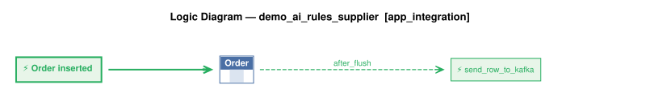

# Logic Flow — demo_ai_rules_supplier [app_integration]

> Scoped to requirement: **app_integration**

<table>
<tr valign="top">
<td width="65%">



</td>
<td width="35%">

### Rules

1. `Order` → `send_order_to_kafka` (after_flush) — Order publish: sends the Order to Kafka topic order_shipping when date_shipped is set

</td>
</tr>
</table>

## Requirements

```
Requirement: App Integration

1. Publish the Order to Kafka topic 'order_shipping' if the date_shipped is not None
```

---
_Generated 2026-11-10 17:34_
