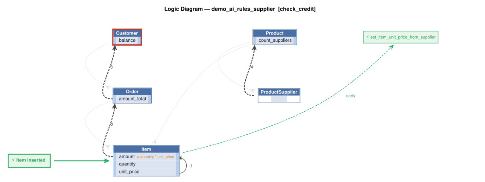

# Logic Flow — demo_ai_rules_supplier [check_credit]

> Scoped to requirement: **check_credit**

<table>
<tr valign="top">
<td width="65%">



</td>
<td width="35%">

### Rules

1. `amount = quantity * unit_price`<br>
2. `amount_total = sum(amount)`<br>
3. `balance = sum(amount_total where date_shipped)`<br>
4. `count_suppliers = count(ProductSupplier)`<br>
5. constraint: `Customer`<br>
6. `Item` → `set_item_unit_price_from_supplier` (early) — Item event: sets unit_price by asking the AI (Request Pattern, audited in SysSupplierReq) to pick the

</td>
</tr>
</table>

## Requirements

```
Requirement Check Credit:

1. The Customer's balance is less than the credit limit
2. The Customer's balance is the sum of the Order amount_total where date_shipped is null
3. The Order's amount_total is the sum of the Item amount
4. The Item amount is the quantity * unit_price
5. The Product count suppliers is the sum of the Product Suppliers
6. Use AI to Set Item field unit_price by finding the optimal Product Supplier based on cost, lead time, and world conditions
```

---
_Generated 2026-11-10 17:34_
