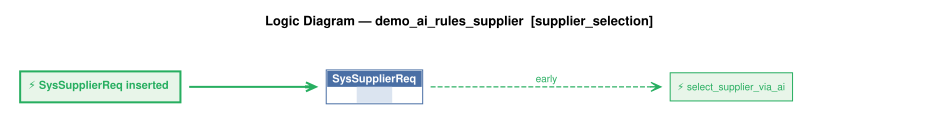

# Logic Flow — demo_ai_rules_supplier [supplier_selection]

> Scoped to requirement: **supplier_selection**

<table>
<tr valign="top">
<td width="65%">



</td>
<td width="35%">

### Rules

1. `SysSupplierReq` → `select_supplier_via_ai` (early) — SysSupplierReq event: picks the optimal supplier via the LLM (world conditions from the test context),

</td>
</tr>
</table>

## Requirements

```
AI Supplier Selection (Request Pattern): chooses the optimal Product Supplier from cost, lead time and
world conditions (config/ai_test_context.yaml). Every call is audited in SysSupplierReq. With no LLM
configured, or on an LLM error / invalid answer, falls back to the minimum-cost supplier (fallback_used).
```

---
_Generated 2026-11-10 17:34_
