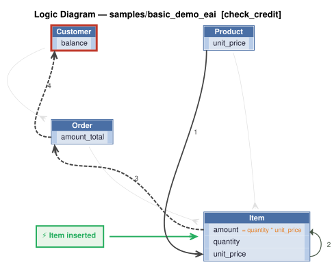
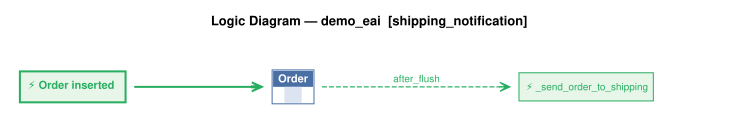

# Requirements Traceability Report

This report shows requirements, the rules created from them, and the tests created from those rules.

This project began as natural-language requirements, fleshed out by AI into a running system of business rules that are *executable documentation*. This report is how you govern the result.

A governable system is one you can **read**, **trust**, and **maintain**: each requirement is listed beside the rules that implement it (*read*); the tests and logic logs show those rules running (*trust*); re-run it after any change and it flags the gaps — an untested requirement, an untraced rule, a channel no test checks (*maintain*).

It is generated from the project's own files, nothing written by hand, so it is as current as the last run and covers the whole project, not a sample. Open **Background** (below the summary) for what the terms mean, how to read the report, and what it can and can't tell you.


**Project:** basic_demo_eai &nbsp;|&nbsp; **Generated:** November 22, 2026 17:17 &nbsp;|&nbsp; **Rules:** 18 &nbsp;|&nbsp; **Test scenarios:** 35 &nbsp;|&nbsp; **Generator:** requirements_traceability_report.py 2.17

**Last test run:** November 21, 2026 19:19, took 7.4 s (21h 58m before this report; test results and logic logs below are from that run)


&nbsp;
&nbsp;

## At a Glance

**✅ 6 requirement(s), all implemented; 6 tested; 35 of 35 scenarios passed; last run 21h 58m ago.**

| | |
|---|---|
| Requirements | 6 (6 implemented) |
| Tested | 6 of 6 |
| Last test run | ✅ 35 passed, 0 failed (November 21, 2026 19:19, 21h 58m ago); took 7.4 s |
| Rules | 18 (15 declarative, 0 Python functions, 3 Python events) |
| Rules shown running in a test log | 17 of 18 |
| Security | enabled (Keycloak provider); 11 role(s), 2 row-level grant(s) |
| Messages and APIs | 2 Kafka topic(s) in, 2 out; 5 HTTP endpoint(s) |
| Kafka | live (localhost:9092): subscribe tested through the broker; outbound messages checked in the log |

_Status: ✅ every requirement is implemented and tested, all scenarios pass, and the results are current. ⚠ a requirement is untested or unimplemented, there is no test run, or files changed since the last run. ❌ a scenario failed. This reports what was traced and tested, not that the system is correct._

<details markdown>
<summary>Background: what this report is, and how to read it</summary>

&nbsp;

<details markdown>
<summary>Requirements are business policies, expressed in natural language</summary>

<br>

A **requirement** is a statement of business behavior - how data is computed, validated, and transmitted - written in plain language. It lives in the project at `docs/requirements/<name>/requirements.md`.  For example:

&nbsp;

```
On Placing Orders, Check Credit
    1. The Customer's balance does not exceed the credit limit
    2. The Customer's balance is the sum of the unshipped Order amount_total
    3. The Order's amount_total is the sum of the Item amount
    4. The Item amount is the quantity * unit_price
    5. The Item unit_price is copied from the Product unit_price
```

</details>

&nbsp;

<details markdown>
<summary>Rules implement requirements</summary>

<br>

A requirement is written at a high level, and AI fills in details as it builds — as it should — so the requirement no longer says exactly what the system does. The rules do. That's a Goldilocks answer to the question of what you review:

* **Requirements say too little** — incomplete by design; AI fills in the details.
* **Code says too much** — business language in, hundreds of lines of procedural code out. The work moves from writing to reading, and if you can't read it, you can't govern it.
* **Rules are just right** — close to the requirement's own level, but complete and deterministic.

Code could be treated like machine language — never read, only trusted — if it were produced deterministically. Generation from natural language isn't. Rules restore that contract: a readable source, deterministically executed.

The requirements above become rules like this:

```
Rule.copy(derive=models.Item.unit_price, from_parent=models.Product.unit_price)
Rule.formula(derive=models.Item.amount,
             as_expression=lambda row: row.quantity * row.unit_price)
Rule.sum(derive=models.Order.amount_total, as_sum_of=models.Item.amount)
Rule.sum(derive=models.Customer.balance, as_sum_of=models.Order.amount_total,
         where=lambda row: row.date_shipped is None)
Rule.constraint(
    validate=models.Customer,
    as_condition=lambda row: row.balance <= row.credit_limit,
    error_msg="balance ({row.balance}) exceeds credit limit ({row.credit_limit})")
```

Rules are ***executable documentation*** that you can read and trust:

* **Read:** rules stay near the requirement's level, so this report can list them side by side and you can check one against the other. 5 rules vs. ~200 lines in our [A/B test](https://github.com/ApiLogicServer/ApiLogicServer-src/blob/main/api_logic_server_cli/prototypes/manager/samples/basic_demo_logic_gov/logic/procedural/declarative-vs-procedural-comparison.md) — **~40x less to review**, whether generated or hand-coded.
* **Trust:** the document is enforced, not just descriptive.
    * **What you read is what runs** — no drift between description and behavior.
    * **Dependencies:** with code, you analyze every execution path to know it runs at the right times. With rules: if the rule is there, it runs, in the right order.
    * **All sources and paths:** the engine hooks into every commit — API, UI or agent — insert, update and delete, including related rows. No bypass.
    * **Seeing is believing:** each scenario in *Tests and Results* below embeds its logic log — every rule that ran, in order, with old and new values.

Better AI makes generating code easier. It doesn't change what you have to read. The problem is the representation, not the capability. And governance is active, not just process: the engine enforces the rules on every transaction, and this report — regenerated from the project itself — shows it happening.

&nbsp;

</details>

&nbsp;

<details markdown>
<summary>Process overview: creation and iteration</summary>

<br>


In two phases. First, `genai-logic create` builds a working system from the database: API, Admin App, data model. Then behavior is added from requirements — the typical sequence, each step a request to an AI assistant:

1. Write each requirement in natural language, in `docs/requirements/<name>/requirements.md`.
2. `implement reqs <name>` — creates the rules, API endpoints and Kafka integrations.
3. `create tests from rules` — writes the test scenarios and steps.
4. `run the tests` — starts the server if needed, runs the suite, reports pass/fail.
5. `run the requirements traceability report` — regenerates this report.

Optional: `create logic diagram for each requirement` (needs Graphviz).

What makes steps 3–5 possible: rules are high-level enough that AI can read them too. The tests, the logic diagrams and this report are all generated by reading the same rules you review — where logic is Python code, the report can only quote its docstring.

The report connects the chain: requirement → rules and handlers → tests → logic log. How *this* project was actually built is recorded under Provenance.

</details>

&nbsp;

<details markdown>
<summary>How to read this report</summary>

<br>

| If you are...  | Start with                                                        | Look for                                                                                     |
| -------------- | ----------------------------------------------------------------- | -------------------------------------------------------------------------------------------- |
| Business owner | *Requirements in detail*                                          | The requirement text, then the **Tests** line under it: does a test exist, and did it pass?  |
| Auditor        | *Coverage summary*, *Rule coverage by tests*, *Messages and APIs* | Gaps (untested, untraced), the date of the last test run, and how each rule was shown to run |
| Developer      | *Tests and Results*                                               | Each scenario's logic log: every rule that ran, in order, with old and new values            |

</details>

&nbsp;

<details markdown>
<summary>What this report can and can't tell you</summary>

<br>

**It shows**

- Which files and rules implement each requirement, read from the project's source.
- Which scenarios ran in the last test run, and whether each passed.
- Which rules the engine logged as running in each scenario.

**It doesn't show**

- Whether the requirements are right or complete. It traces what was written down.
- Whether an event did anything. Events run on every commit of their class and decide for themselves whether to act, so appearing in the log doesn't mean the event had an effect.
- Whether a constraint works. A constraint appears in the log only when it rejects a transaction, so look for a scenario that makes it reject.
- Whether a message arrived. Unless a test step looks for it on the broker or endpoint, a passing scenario doesn't prove delivery. The *Messages and APIs* table flags channels no test mentions.
- Whether the results are current. They are as old as the last test run, shown in the header, which also warns if files changed since.
- Which version of a requirement the code was built from, or which clause of a requirement a given rule serves.

</details>

&nbsp;

<details markdown>
<summary>Terms</summary>

<br>

| Term        | Meaning                                                                                              |
| ----------- | ---------------------------------------------------------------------------------------------------- |
| Requirement | A statement of business behavior, in plain language; the unit this report traces.                    |
| Rule        | A declaration about data (sum, count, formula, copy, constraint) that the engine enforces at every commit. |
| Event       | Python code the engine calls when a row of a given class changes (for example, to publish a message). |
| Handler     | Code that serves an API endpoint or consumes a Kafka topic.                                          |
| Scenario    | One Behave test: a short Given / When / Then script run against the live API.                        |
| Logic log   | The engine's record of every rule it ran in a transaction, nested to show cascades (an Item change adjusts its Order, which adjusts its Customer). |
| Phase       | The step of a commit: ROW LOGIC (derivations, constraints), COMMIT LOGIC (checks that need finished totals), AFTER_FLUSH LOGIC (events that need database-assigned keys, such as publishing). |
| Seen        | The engine reported running the rule in that scenario's log.                                         |

</details>

</details>


&nbsp;
&nbsp;

## Contents

- [Requirements Coverage](#requirements-coverage)
- [Data Model](#data-model)
- [Security (RBAC)](#security-rbac)
- [Messages and APIs](#messages-and-apis)
- [Tests and Results](#tests-and-results)
- [Provenance](#provenance)


&nbsp;
&nbsp;

## Requirements Coverage

Every requirement should have rules that implement it, and tests that prove it. This section checks that chain in both directions: a requirement missing rules or tests is a gap, and rules or tests that belong to no requirement are flagged too. The matching uses the requirement names, `Feature:` names and `§N` tags that requirements, code and tests share. Requirements may be grouped into a use case (for example Place Order), read from the logic folder or the prompt; the level is optional.


&nbsp;

### Coverage summary

| Measure | Result |
|---|---|
| Requirements | 6 |
| Implemented (at least one file) | 6 of 6 |
| Tested (at least one scenario) | 6 of 6 |
| Implementation not traced to a requirement | none |
| Tests not traced to a requirement | none |
| Test results (last run) | ✅ 35 passed, 0 failed; took 7.4 s |
| Scenarios with a logic log | 33 of 35 |
| Rules seen in at least one scenario's log | 17 of 18 (1 not counted: the engine's log does not name `all classes.early_row_event → handle_all()`, so it cannot be matched) |

_Test results are as current as the last run (see the header). A gap is any requirement with no implementation or no test._

<details markdown>
<summary>How to read this table</summary>

Test results are read from `logs/behave.log`, so they are only as current as that run. Not recorded here: which version of a requirement the code was built against, and which clause of a requirement a given rule serves.

</details>


&nbsp;

### Traceability matrix

| Requirement | Implemented by | Rules | Tests |
|---|---|---|---|
| §1 Business Logic — Check Credit | [logic/logic_discovery/check_credit.py](../../logic/logic_discovery/check_credit.py) | 5 | ✅ 12 scenario(s): 12 passed |
| §2 B2B API — Accept orders from external partners | [api/api_discovery/order_b2b_service.py](../../api/api_discovery/order_b2b_service.py) | 0 | ✅ 3 scenario(s): 3 passed |
| §3 Kafka Subscribe — Inbound orders from sales channel | [logic/logic_discovery/order_b2b_consume.py](../../logic/logic_discovery/order_b2b_consume.py)<br>[integration/kafka/kafka_subscribe_discovery/order_b2b.py](../../integration/kafka/kafka_subscribe_discovery/order_b2b.py)<br>[integration/OrderB2bKafkaMapper.py](../../integration/OrderB2bKafkaMapper.py)<br>[api/api_discovery/order_b2b_kafka_consume_debug.py](../../api/api_discovery/order_b2b_kafka_consume_debug.py) | 1 | ✅ 3 scenario(s): 3 passed |
| §4 Kafka Publish — Notify shipping on dispatch | [logic/logic_discovery/shipping_notification.py](../../logic/logic_discovery/shipping_notification.py)<br>[integration/kafka/kafka_publish_discovery/order_shipping.py](../../integration/kafka/kafka_publish_discovery/order_shipping.py) | 1 | ✅ 3 scenario(s): 3 passed |
| §5 Security | [security/declare_security.py](../../security/declare_security.py) | 0 | ✅ 3 scenario(s): 3 passed |
| §6 Operations Dashboard — Order flow | [logic/logic_discovery/order_flow_dashboard.py](../../logic/logic_discovery/order_flow_dashboard.py)<br>[api/api_discovery/dashboard_services.py](../../api/api_discovery/dashboard_services.py) | 10 | ✅ 11 scenario(s): 11 passed |


&nbsp;

### Rule coverage by tests

| Rule | Requirement | Seen in |
|---|---|---|
| `Item.unit_price = copy of Product.unit_price` | §1 Business Logic — Check Credit | 25: Partner order is mapped and the request recorded as processed; Good order is priced and added to the balance; Changing an item quantity re-derives amount, total and balance; +22 more |
| `Item.amount = quantity * unit_price` | §1 Business Logic — Check Credit | 25: Partner order is mapped and the request recorded as processed; Good order is priced and added to the balance; Changing an item quantity re-derives amount, total and balance; +22 more |
| `Order.amount_total = sum(Item.amount)` | §1 Business Logic — Check Credit | 25: Partner order is mapped and the request recorded as processed; Good order is priced and added to the balance; Changing an item quantity re-derives amount, total and balance; +22 more |
| `Customer.balance = sum(Order.amount_total) where date_shipped is None` | §1 Business Logic — Check Credit | 25: Partner order is mapped and the request recorded as processed; Good order is priced and added to the balance; Changing an item quantity re-derives amount, total and balance; +22 more |
| `Customer: balance <= credit_limit` | §1 Business Logic — Check Credit | 2: Order over the credit limit is rejected; Raising a quantity over the credit limit is rejected |
| `OrderB2bMessage.after_flush_row_event → _publish_order_b2b()` | §3 Kafka Subscribe — Inbound orders from sales channel | 6: Order message for a known customer creates the order; Order message with an unknown product is rejected; Rejected message stays on the blob with its error (live Kafka only); +3 more |
| `DailyFlow.order_count = count(Order)` | §6 Operations Dashboard — Order flow | 25: Partner order is mapped and the request recorded as processed; Good order is priced and added to the balance; Changing an item quantity re-derives amount, total and balance; +22 more |
| `DailyFlow.order_amount = sum(Order.amount_total)` | §6 Operations Dashboard — Order flow | 25: Partner order is mapped and the request recorded as processed; Good order is priced and added to the balance; Changing an item quantity re-derives amount, total and balance; +22 more |
| `DailyFlow.message_received = count(OrderB2bMessage)` | §6 Operations Dashboard — Order flow | 6: Order message for a known customer creates the order; Order message with an unknown product is rejected; Rejected message stays on the blob with its error (live Kafka only); +3 more |
| `DailyFlow.message_processed = count(OrderB2bMessage) where is_processed == True` | §6 Operations Dashboard — Order flow | 6: Order message for a known customer creates the order; Order message with an unknown product is rejected; Rejected message stays on the blob with its error (live Kafka only); +3 more |
| `DailyFlow.message_rejected = count(OrderB2bMessage) where error_text is not None` | §6 Operations Dashboard — Order flow | 6: Order message for a known customer creates the order; Order message with an unknown product is rejected; Rejected message stays on the blob with its error (live Kafka only); +3 more |
| `DailyFlow.message_pending = (message_received or 0) - (message_processed or 0) - (message_rejected or 0)` | §6 Operations Dashboard — Order flow | 7: Partner order is mapped and the request recorded as processed; Order message for a known customer creates the order; Order message with an unknown product is rejected; +4 more |
| `DailyFlow.request_received = count(OrderB2bRequest)` | §6 Operations Dashboard — Order flow | 24: Partner order is mapped and the request recorded as processed; Partner order with an unknown product is rejected and the request recorded with its error; Partner order for an unknown account is rejected; +21 more |
| `DailyFlow.request_processed = count(OrderB2bRequest) where is_processed == True` | §6 Operations Dashboard — Order flow | 24: Partner order is mapped and the request recorded as processed; Partner order with an unknown product is rejected and the request recorded with its error; Partner order for an unknown account is rejected; +21 more |
| `DailyFlow.request_rejected = count(OrderB2bRequest) where error_text is not None` | §6 Operations Dashboard — Order flow | 24: Partner order is mapped and the request recorded as processed; Partner order with an unknown product is rejected and the request recorded with its error; Partner order for an unknown account is rejected; +21 more |
| `DailyFlow.request_pending = (request_received or 0) - (request_processed or 0) - (request_rejected or 0)` | §6 Operations Dashboard — Order flow | 24: Partner order is mapped and the request recorded as processed; Partner order with an unknown product is rejected and the request recorded with its error; Partner order for an unknown account is rejected; +21 more |
| `Order.after_flush_row_event → _send_order_to_shipping()` | §4 Kafka Publish — Notify shipping on dispatch | 24: Partner order is mapped and the request recorded as processed; Good order is priced and added to the balance; Changing an item quantity re-derives amount, total and balance; +21 more |
| `all classes.early_row_event → handle_all()` | (none) | n/a - cannot be matched to the engine's log |

_"Seen" means the engine's log shows the rule ran, not proof that it took effect._

<details markdown>
<summary>How to read this table</summary>

"Seen" means the engine reported running the rule in that scenario's logic log. A scenario can only contribute if it has a log (see the coverage summary): a test that does not open one writes into whichever log was open last, and its rules are then credited to that scenario, or to the shared log. An event's function runs on every commit of its class, and its own condition decides whether it acts, so seen does not mean it took effect. A constraint appears in the log only when it rejects a transaction, so it is seen only in scenarios that make it reject. "Not seen" therefore means no log shows it, not that no test ran it.

</details>


&nbsp;

### Requirements in detail

**18 rules** in 5 files: 15 declarative (sum, count, copy, formula and constraint expressions), 0 backed by a Python function, 3 events (Python).

_Declarative rules are read straight from their declarations. Functions and events are Python code, so for those the report shows the docstring — it does not analyze the code._

Each requirement is followed by the rules and handlers in the files that implement it. Logic diagrams are shown (click to expand) where they exist.

<details markdown>
<summary>How to create or refresh the logic diagrams</summary>

Needs Graphviz (`brew install graphviz`). Tell your AI assistant:

```
create logic diagram for each requirement
```

or run this from the Manager root (`manager`):

```
python system/ApiLogicServer-Internal-Dev/logic_diagram_gv.py samples/basic_demo_eai --each
```

Each diagram is saved under `docs/requirements/<name>/logic_diagrams/`. Then regenerate this report (`python requirements_traceability_report.py run`, from `test/api_logic_server_behave`).

</details>

&nbsp;


#### §1 Business Logic — Check Credit

Tests: ✅ 12 scenario(s): 12 passed

```
Feature: Check Credit

  Scenario: Place an order
    Given a customer with a credit limit
    When an order is placed
    Then copy the price from the product
    And multiply by quantity to get the item amount
    And sum item amounts to get the order total
    And sum unpaid order totals to get the customer balance
    And reject if balance exceeds the credit limit
```

| Rule / item | Type | Logic | Description | Where |
|---|---|---|---|---|
| `Item.unit_price = copy of Product.unit_price` | copy | declarative |  | [check_credit.py](../../logic/logic_discovery/check_credit.py) |
| `Item.amount = quantity * unit_price` | formula | declarative |  | [check_credit.py](../../logic/logic_discovery/check_credit.py) |
| `Order.amount_total = sum(Item.amount)` | sum | declarative |  | [check_credit.py](../../logic/logic_discovery/check_credit.py) |
| `Customer.balance = sum(Order.amount_total) where date_shipped is None` | sum | declarative |  | [check_credit.py](../../logic/logic_discovery/check_credit.py) |
| `Customer: balance <= credit_limit` | constraint | declarative | Error: Customer balance ({row.balance}) exceeds credit limit ({row.credit_limit}) | [check_credit.py](../../logic/logic_discovery/check_credit.py) |

<details markdown>
<summary>Logic diagram: check_credit</summary>

<table><tr valign="top">
<td width="65%">



</td>
<td width="35%">

**Rules**

1. `unit_price = copy(unit_price)`<br>
2. `amount = quantity * unit_price`<br>
3. `amount_total = sum(amount)`<br>
4. `balance = sum(amount_total where date_shipped)`<br>
5. constraint: `Customer`

</td>
</tr></table>

</details>

#### §2 B2B API — Accept orders from external partners

Tests: ✅ 3 scenario(s): 3 passed

```
Feature: B2B Order Integration

  Scenario: Accept order from external partner
    Given an inbound B2B order in partner format (message_formats/order_b2b.json)
    When the order is received via a Custom API endpoint named OrderB2B
    Then map Account to Customer by name
    And map Items.Name to Product by name
    And map Items.QuantityOrdered to Item.quantity
    And record each request, with its outcome, for the order flow dashboard
```

| Rule / item | Type | Logic | Description | Where |
|---|---|---|---|---|
| `HTTP in: POST /api/OrderB2B/OrderB2B` | http | handler (Python) | API service OrderB2B: accepts a partner order, records the request with its outcome, and creates the Order. | [order_b2b_service.py](../../api/api_discovery/order_b2b_service.py) |

#### §3 Kafka Subscribe — Inbound orders from sales channel

Tests: ✅ 3 scenario(s): 3 passed

```
Feature: Kafka Subscribe Order Integration

  Scenario: Accept inbound orders from sales channel
    Given an inbound order message in JSON format (message_formats/order_b2b.json)
    When the message is received from Kafka topic order_b2b
    Then map Account to Customer by name
    And map Items.Name to Product by name
    And map Items.QuantityOrdered to Item.quantity
```

| Rule / item | Type | Logic | Description | Where |
|---|---|---|---|---|
| `OrderB2bMessage.after_flush_row_event → _publish_order_b2b()` | after_flush_row_event | event (Python) | OrderB2bMessage event: publishes the raw blob to order_b2b_processed after Tx 1 commits, so consumer 2 can parse it in a clean Tx 2 (2-message pattern). | [order_b2b_consume.py](../../logic/logic_discovery/order_b2b_consume.py) |
| `Kafka in: order_b2b` | kafka | handler (Python) | Kafka subscribe order_b2b: consumer 1 saves the raw message as an OrderB2bMessage blob (Tx 1). | [order_b2b.py](../../integration/kafka/kafka_subscribe_discovery/order_b2b.py) |
| `Kafka in: order_b2b_processed` | kafka | handler (Python) | Kafka subscribe order_b2b_processed: consumer 2 parses the blob into Order + Items (Tx 2). | [order_b2b.py](../../integration/kafka/kafka_subscribe_discovery/order_b2b.py) |
| `OrderB2bKafkaMapper.py` | module |  | Feature: Kafka Subscribe Order Integration | [OrderB2bKafkaMapper.py](../../integration/OrderB2bKafkaMapper.py) |
| `HTTP in: GET /consume_debug/order_b2b` | http | handler (Python) | EAI debug (development only, no authentication): sends the message in ?file= to the topic, live through Kafka or simulated | [order_b2b_kafka_consume_debug.py](../../api/api_discovery/order_b2b_kafka_consume_debug.py) |
| `HTTP in: POST /consume_debug/order_b2b/reset` | http | handler (Python) | EAI debug (development only, destructive): purges the messages in the pipeline's topics | [order_b2b_kafka_consume_debug.py](../../api/api_discovery/order_b2b_kafka_consume_debug.py) |

<details markdown>
<summary>Logic diagram: order_b2b_consume</summary>

<table><tr valign="top">
<td width="65%">


</td>
<td width="35%">

**Rules**

1. `OrderB2bMessage` → `_publish_order_b2b` (after_flush) — OrderB2bMessage event: publishes the raw blob to order_b2b_processed after Tx 1 commits, so consumer 2

</td>
</tr></table>

</details>

#### §4 Kafka Publish — Notify shipping on dispatch

Tests: ✅ 3 scenario(s): 3 passed

```
Feature: Kafka Publish Shipping Notification

  Scenario: Notify shipping when an order is dispatched
    Given an Order exists
    When date_shipped is set
    Then publish to Kafka topic order_shipping
    And use message_formats/order_shipping.json as the message shape
    And use by-example publish rather than key-only publish
```

| Rule / item | Type | Logic | Description | Where |
|---|---|---|---|---|
| `Order.after_flush_row_event → _send_order_to_shipping()` | after_flush_row_event | event (Python) | Order publish: sends the Order to Kafka topic order_shipping when date_shipped is set (insert with a value, or an update that changes it), shaped by example from message_formats/order_shipping.json. | [shipping_notification.py](../../logic/logic_discovery/shipping_notification.py) |
| `order_shipping.py` | module |  | Feature: Kafka Publish Shipping Notification | [order_shipping.py](../../integration/kafka/kafka_publish_discovery/order_shipping.py) |

<details markdown>
<summary>Logic diagram: shipping_notification</summary>

<table><tr valign="top">
<td width="65%">



</td>
<td width="35%">

**Rules**

1. `Order` → `_send_order_to_shipping` (after_flush) — Order publish: sends the Order to Kafka topic order_shipping when date_shipped is set (insert with a value,

</td>
</tr></table>

</details>

#### §5 Security

Tests: ✅ 3 scenario(s): 3 passed

```
Feature: Row-Level Security
  Scenario: Sales role sees limited customers
    Given a user with the sales role
    When querying the Customer list
    Then only return customers where credit_limit >= 3000 or balance > 0
```

| Rule / item | Type | Logic | Description | Where |
|---|---|---|---|---|
| `Grant on Customer to role sales: credit_limit >= 3000` | grant | declarative |  | [declare_security.py](../../security/declare_security.py) |
| `Grant on Customer to role sales: balance > 0` | grant | declarative |  | [declare_security.py](../../security/declare_security.py) |

#### §6 Operations Dashboard — Order flow

Tests: ✅ 11 scenario(s): 11 passed

```
Feature: Order Flow Dashboard

  Scenario: Show that orders are flowing
    Given orders arrive through the B2B API and the Kafka topic order_b2b
    When an operator opens the Admin App home page
    Then maintain daily totals of orders (count and total amount), and of order_b2b messages and B2B requests
         (received, processed, rejected, and not yet done)
    And chart the daily totals for the last 30 days, showing a day with no activity as zero
    And date each Order, message and request when it arrives
    And show current data each time the page is opened
```

| Rule / item | Type | Logic | Description | Where |
|---|---|---|---|---|
| `DailyFlow.order_count = count(Order)` | count | declarative |  | [order_flow_dashboard.py](../../logic/logic_discovery/order_flow_dashboard.py) |
| `DailyFlow.order_amount = sum(Order.amount_total)` | sum | declarative |  | [order_flow_dashboard.py](../../logic/logic_discovery/order_flow_dashboard.py) |
| `DailyFlow.message_received = count(OrderB2bMessage)` | count | declarative |  | [order_flow_dashboard.py](../../logic/logic_discovery/order_flow_dashboard.py) |
| `DailyFlow.message_processed = count(OrderB2bMessage) where is_processed == True` | count | declarative |  | [order_flow_dashboard.py](../../logic/logic_discovery/order_flow_dashboard.py) |
| `DailyFlow.message_rejected = count(OrderB2bMessage) where error_text is not None` | count | declarative |  | [order_flow_dashboard.py](../../logic/logic_discovery/order_flow_dashboard.py) |
| `DailyFlow.message_pending = (message_received or 0) - (message_processed or 0) - (message_rejected or 0)` | formula | declarative |  | [order_flow_dashboard.py](../../logic/logic_discovery/order_flow_dashboard.py) |
| `DailyFlow.request_received = count(OrderB2bRequest)` | count | declarative |  | [order_flow_dashboard.py](../../logic/logic_discovery/order_flow_dashboard.py) |
| `DailyFlow.request_processed = count(OrderB2bRequest) where is_processed == True` | count | declarative |  | [order_flow_dashboard.py](../../logic/logic_discovery/order_flow_dashboard.py) |
| `DailyFlow.request_rejected = count(OrderB2bRequest) where error_text is not None` | count | declarative |  | [order_flow_dashboard.py](../../logic/logic_discovery/order_flow_dashboard.py) |
| `DailyFlow.request_pending = (request_received or 0) - (request_processed or 0) - (request_rejected or 0)` | formula | declarative |  | [order_flow_dashboard.py](../../logic/logic_discovery/order_flow_dashboard.py) |
| `HTTP in: GET /dashboard` | http | handler (Python) | API service dashboard: two order-flow charts side by side, each in its own iframe. | [dashboard_services.py](../../api/api_discovery/dashboard_services.py) |
| `HTTP in: GET /chart_graphics/<path:path>` | http | handler (Python) | API service dashboard: renders one chart as HTML - on EVERY request (never cached), so data is current. | [dashboard_services.py](../../api/api_discovery/dashboard_services.py) |

<details markdown>
<summary>Logic diagram: order_flow_dashboard</summary>

<table><tr valign="top">
<td width="65%">


</td>
<td width="35%">

**Rules**

1. `message_pending = (message_received or 0) - (message_processed or 0) - (message_rejected or 0)`<br>
2. `request_pending = (request_received or 0) - (request_processed or 0) - (request_rejected or 0)`<br>
3. `order_amount = sum(amount_total)`<br>
4. `order_count = count(Order)`<br>
5. `message_received = count(OrderB2bMessage)`<br>
6. `message_processed = count(OrderB2bMessage where is_processed)`<br>
7. `message_rejected = count(OrderB2bMessage where error_text)`<br>
8. `request_received = count(OrderB2bRequest)`<br>
9. `request_processed = count(OrderB2bRequest where is_processed)`<br>
10. `request_rejected = count(OrderB2bRequest where error_text)`

</td>
</tr></table>

</details>


&nbsp;
&nbsp;

## Data Model

The tables the rules run over. Derived columns (in italics) are computed by rules — no code writes them. Tinted groups are the subtypes.


_Generated from `docs/db.dbml` (parents above children; shaded rows are derived by rules). To use your own layout, save it as `docs/db_diagram.png`._


&nbsp;

### Derived columns

| Table | Column | Rule | Definition |
|---|---|---|---|
| Item | unit_price | copy | `Item.unit_price = copy of Product.unit_price` |
| Item | amount | formula | `Item.amount = quantity * unit_price` |
| Order | amount_total | sum | `Order.amount_total = sum(Item.amount)` |
| Customer | balance | sum | `Customer.balance = sum(Order.amount_total) where date_shipped is None` |
| DailyFlow | order_count | count | `DailyFlow.order_count = count(Order)` |
| DailyFlow | order_amount | sum | `DailyFlow.order_amount = sum(Order.amount_total)` |
| DailyFlow | message_received | count | `DailyFlow.message_received = count(OrderB2bMessage)` |
| DailyFlow | message_processed | count | `DailyFlow.message_processed = count(OrderB2bMessage) where is_processed == True` |
| DailyFlow | message_rejected | count | `DailyFlow.message_rejected = count(OrderB2bMessage) where error_text is not None` |
| DailyFlow | message_pending | formula | `DailyFlow.message_pending = (message_received or 0) - (message_processed or 0) - (message_rejected or 0)` |
| DailyFlow | request_received | count | `DailyFlow.request_received = count(OrderB2bRequest)` |
| DailyFlow | request_processed | count | `DailyFlow.request_processed = count(OrderB2bRequest) where is_processed == True` |
| DailyFlow | request_rejected | count | `DailyFlow.request_rejected = count(OrderB2bRequest) where error_text is not None` |
| DailyFlow | request_pending | formula | `DailyFlow.request_pending = (request_received or 0) - (request_processed or 0) - (request_rejected or 0)` |


&nbsp;
&nbsp;

## Security (RBAC)

Who can do what: each role's permissions, and which rows each role can see.

**Security enabled: yes** (`SECURITY_ENABLED` in `config/default.env`).


&nbsp;

### Roles and CRUD (DefaultRolePermission)

| Role | Read | Insert | Update | Delete |
|---|---|---|---|---|
| sa | ✅ | ✅ | ✅ | ✅ |
| tenant | ✅ | — | — | ✅ |
| CS_ADMIN | ✅ | ✅ | ✅ | ✅ |
| manager | ✅ | ✅ | ✅ | — |
| teller | ✅ | ✅ | ✅ | — |
| customer | ✅ | ✅ | ✅ | — |
| readonly | ✅ | — | — | — |
| public | ✅ | — | — | — |
| default-roles-kcals | ✅ | ✅ | ✅ | — |
| uma_authorization | ✅ | ✅ | ✅ | — |
| sales | ✅ | — | — | — |


&nbsp;

### Row-level grants (Grant)

| Table | Role | Filter | Requirement |
|---|---|---|---|
| Customer | sales | `credit_limit >= 3000` |  |
| Customer | sales | `balance > 0` |  |


&nbsp;
&nbsp;

## Messages and APIs

How data enters and leaves beyond the standard API: Kafka topics in and out, custom HTTP endpoints — and whether any test touches each one.

**Kafka mode: live (localhost:9092).** The tests sent inbound messages through a real broker: `/consume_debug` published them to topic `order_b2b`, the server's consumers processed them, and the tests then checked the results. Outbound `order_shipping` messages are checked in the server log, not read back from the topic.

| Direction | Channel | Name | Tests mention it | Handler | Tables created | Message shape | Requirement |
|---|---|---|---|---|---|---|---|
| ➡ in | Kafka | `order_b2b` | ✅ live | `order_b2b()` - Kafka subscribe order_b2b: consumer 1 saves the raw message as an OrderB2bMessage blob (Tx 1). | OrderB2bMessage | [order_b2b.json](../../integration/kafka/message_formats/order_b2b.json) | §3 Kafka Subscribe — Inbound orders from sales channel |
| ➡ in | Kafka | `order_b2b_processed` | ✅ live | `order_b2b_processed()` - Kafka subscribe order_b2b_processed: consumer 2 parses the blob into Order + Items (Tx 2). | Item, Order, OrderB2bMessage |  | §3 Kafka Subscribe — Inbound orders from sales channel |
| ⬅ out | Kafka | `order_b2b_processed` | ✅ live | OrderB2bMessage.after_flush_row_event → _publish_order_b2b() - OrderB2bMessage event: publishes the raw blob to order_b2b_processed after Tx 1 commits, so consumer 2 can parse it in a clean Tx 2 (2-message pattern). |  |  | §3 Kafka Subscribe — Inbound orders from sales channel |
| ⬅ out | Kafka | `order_shipping` | ⚠ message checked in the log, not on the topic | Order.after_flush_row_event → _send_order_to_shipping() - Order publish: sends the Order to Kafka topic order_shipping when date_shipped is set (insert with a value, or an update that changes it), shaped by example from message_formats/order_shipping.json. |  | [order_shipping.json](../../integration/kafka/message_formats/order_shipping.json) | §4 Kafka Publish — Notify shipping on dispatch |
| ➡ in | HTTP | `GET /dashboard` | ⚠ no test mentions it | `dashboard()` - API service dashboard: two order-flow charts side by side, each in its own iframe. |  |  | §6 Operations Dashboard — Order flow |
| ➡ in | HTTP | `GET /chart_graphics/<path:path>` | ⚠ no test mentions it | `chart_graphics()` - API service dashboard: renders one chart as HTML - on EVERY request (never cached), so data is current. |  |  | §6 Operations Dashboard — Order flow |
| ➡ in | HTTP | `GET /consume_debug/order_b2b` | ✅ | `register_consume_debug()` - EAI debug (development only, no authentication): sends the message in ?file= to the topic, live through Kafka or simulated |  |  | §3 Kafka Subscribe — Inbound orders from sales channel |
| ➡ in | HTTP | `POST /consume_debug/order_b2b/reset` | ⚠ no test mentions it | `register_queue_reset()` - EAI debug (development only, destructive): purges the messages in the pipeline's topics |  |  | §3 Kafka Subscribe — Inbound orders from sales channel |
| ➡ in | HTTP | `POST /api/OrderB2B/OrderB2B` | ✅ | `OrderB2B()` - API service OrderB2B: accepts a partner order, records the request with its outcome, and creates the Order. |  |  | §2 B2B API — Accept orders from external partners |

_"Tests mention it" checks the test sources, not delivery._

<details markdown>
<summary>How to read this column</summary>

A passing scenario proves a message reached a topic or an endpoint only if its steps look for it there. A handler that ran (see the logic log) is weaker evidence than a step that consumes the message. Channels no test mentions are flagged.

</details>

<details markdown>
<summary>How to read this table</summary>

Topics and endpoints are read from the discovery folders. The condition that triggers an outbound message lives in Python (see the rules under each requirement); here it is described by the handler's docstring. "Tables created" lists rows the handler's code constructs, following its calls within the project; blank means none were found, not that none exist.

</details>


<details markdown>
<summary>Message shape: order_b2b</summary>

```json
{
  "Account": "Alice",
  "Notes": "Kafka order from sales",
  "Items": [
    { "Name": "Widget",  "QuantityOrdered": 1 },
    { "Name": "Gadget",  "QuantityOrdered": 2 }
  ]
}
```
</details>

<details markdown>
<summary>Message shape: order_shipping</summary>

```json
{
  "order_id": 1,
  "order_date": "2026-04-06",
  "customer_name": "Alfreds Futterkiste",
  "total": 100.00,
  "items": [
    { "quantity": 2, "product_name": "Chai", "unit_price": 25.00 }
  ]
}
```
</details>


&nbsp;
&nbsp;

## Tests and Results

**✅ 35 scenario(s): 35 passed, 0 failed; took 7.4 s** (from the last run, `logs/behave.log`).

Each test drives the running system the way any client would — create an order, change a quantity, ship it — and checks the result.

**The logic log** is what makes them more than pass/fail. Business rules run inside the server on every commit, so the server records exactly what they did, and this report embeds that record for each scenario. Two things to look for:

1. **It shows every rule that runs.** Each line is one rule execution, with the row's state, old and new values. You see not just that a test passed, but which rules ran and what each one changed.
2. **The nesting shows multi-table chaining.** Indentation follows the cascade: a change to an Item adjusts its Order, which adjusts its Customer.

<details markdown>
<summary>How to read the logic log</summary>

Open a scenario's "Rules exercised and logic log" block to see it. The log is shown in full, attribute values included, because those values are what you diagnose from when a rule produces an unexpected result.

To read a log line:

```
....Order[16] {Update - Adjusting order: amount_total} id: 16, customer_id: 19, amount_total:  [0.0-->] 90.0

```

- The leading dots are the depth in the cascade: Item (2 dots), its Order (4), its Customer (6).
- `Order[16]` is the row; `{...}` is the rule or action that ran; the rest is the row's attribute values at that step.
- `[0.0-->] 90.0` marks a value the rules changed, with its old and new value.
- The log is in phases: **ROW LOGIC** (derivations and constraints, as rows change), **COMMIT LOGIC** (checks that need the finished aggregates), and **AFTER_FLUSH LOGIC** (events that need database-assigned keys, such as the Kafka publish).

More: [Logic Log](https://apilogicserver.github.io/Docs/Logic-Debug/#logic-log).

</details>

&nbsp;

<details markdown>
<summary>How to add more tests, and run them</summary>

**1. Have AI create them.** This project's context tells your AI assistant how (`.github/copilot-instructions.md`, `docs/training/testing.md`). Just say:

```

create tests from rules

```

The assistant reads `database/models.py`, the logic files and the custom APIs, then writes `.feature` files and step implementations under `test/api_logic_server_behave/features/`. Then say `run the tests` and `run the requirements traceability report` and the assistant does both.

Or, to have each requirement's tests linked in the Tests column above (it matches on `Feature:` name), say which names to use:

```

create tests from rules, one Feature per requirement, named exactly:
- Check Credit
- B2B Order Integration
- Kafka Subscribe Order Integration
- Kafka Publish Shipping Notification
- Row-Level Security
- Order Flow Dashboard

```

_Tests with other names still run and appear below; they just aren't linked to a requirement._

**2. You can also define tests manually.** Add a `<name>.feature` file (Gherkin) under `test/api_logic_server_behave/features/` and its steps under `features/steps/`. The steps call the running API, so tests exercise the same rules as any client. See `docs/training/testing.md` for the patterns that keep tests repeatable.

**Or run them yourself** (server running, from `test/api_logic_server_behave`):

```

python behave_run.py --outfile=logs/behave.log
python requirements_traceability_report.py run

```

</details>

&nbsp;
&nbsp;

### Feature: B2B Order Integration  

&nbsp;
&nbsp;

#### Scenario: Partner order is mapped and the request recorded as processed ✅ (0.08 s)
&emsp;  Scenario: Partner order is mapped and the request recorded as processed  
&emsp;&emsp;    Given a new customer "Partner Co" with credit limit 5000  
&emsp;&emsp;    When a B2B order is placed for "Partner Co" with 3 Widget and 2 Gadget  
&emsp;&emsp;    Then the order is accepted  
&emsp;&emsp;    And the order belongs to "Partner Co"  
&emsp;&emsp;    And the order items are 3 Widget and 2 Gadget  
&emsp;&emsp;    And the B2B request is recorded as processed  

<details markdown>
<summary>Rules exercised and logic log (2 transactions)</summary>


&nbsp;
&nbsp;


**Rules Used** in Scenario: Partner order is mapped and the request recorded as processed
```
  DailyFlow  
    1. Derive DailyFlow.request_pending as Formula (2): Rule.formula(derive=models.DailyFlow.request_pend [...]  
    2. Derive DailyFlow.message_pending as Formula (1): Rule.formula(derive=models.DailyFlow.message_pend [...]  
    3. Derive DailyFlow.request_processed as Count(OrderB2bRequest Where Rule.count(derive=models.DailyFlow.request_processed, as_count_of=models.OrderB2bRequest, where=lambda row: row.is_processed == True, insert_parent=True), insert_parent)  
    4. Derive DailyFlow.request_received as Count(OrderB2bRequest Where  - None, insert_parent)  
    5. Derive DailyFlow.request_rejected as Count(OrderB2bRequest Where Rule.count(derive=models.DailyFlow.request_rejected, as_count_of=models.OrderB2bRequest, where=lambda row: row.error_text is not None, insert_parent=True), insert_parent)  
    6. Derive DailyFlow.order_amount as Sum(Order.amount_total Where  - None, insert_parent)  
    7. Derive DailyFlow.order_count as Count(Order Where  - None, insert_parent)  
  Customer  
    8. Derive Customer.balance as Sum(Order.amount_total Where Rule.sum(derive=models.Customer.balance, as_sum_of=models.Order.amount_total, where=lambda row: row.date_shipped is None))  
  Item  
    9. Derive Item.unit_price as Copy(product.unit_price)  
    10. Derive Item.amount as Formula (1): Rule.formula(derive=models.Item.amount, as_expres [...]  
  Order  
    11. Derive Order.amount_total as Sum(Item.amount Where  - None)  
    12. RowEvent Order._send_order_to_shipping()  
```
**Logic Log** in Scenario: Partner order is mapped and the request recorded as processed (2 transactions)
```
Logic Phase:		ROW LOGIC		(session=0x10bf51950) (sqlalchemy before_flush)			 - 2026-11-21 19:19:08,004 - logic_logger - INFO
..OrderB2bRequest[None] {Insert - client} id: None, CreatedOn: None, CreatedOnDay: None, payload: {"Account": "Partner Co 1795317547953", "Notes": "behave test", "Items": [{"Name": "Widget", "QuantityOrdered": 3}, {"Name": "Gadget", "QuantityOrdered": 2}]}, is_processed: False, error_text: None  row: 0x10bdf8fd0  session: 0x10bf51950  ins_upd_dlt: ins, initial: ins - 2026-11-21 19:19:08,004 - logic_logger - INFO
..OrderB2bRequest[None] {early_row_event_all_classes - handle_all did stamping} id: None, CreatedOn: 2026-11-21 19:19:08.004343, CreatedOnDay: 2026-11-21, payload: {"Account": "Partner Co 1795317547953", "Notes": "behave test", "Items": [{"Name": "Widget", "QuantityOrdered": 3}, {"Name": "Gadget", "QuantityOrdered": 2}]}, is_processed: False, error_text: None  row: 0x10bdf8fd0  session: 0x10bf51950  ins_upd_dlt: ins, initial: ins - 2026-11-21 19:19:08,004 - logic_logger - INFO
..OrderB2bRequest[None] {Insert Parent: daily_flow} id: None, CreatedOn: 2026-11-21 19:19:08.004343, CreatedOnDay: 2026-11-21, payload: {"Account": "Partner Co 1795317547953", "Notes": "behave test", "Items": [{"Name": "Widget", "QuantityOrdered": 3}, {"Name": "Gadget", "QuantityOrdered": 2}]}, is_processed: False, error_text: None  row: 0x10bdf8fd0  session: 0x10bf51950  ins_upd_dlt: ins, initial: ins - 2026-11-21 19:19:08,004 - logic_logger - INFO
....DailyFlow[2026-11-21] {Insert - Insert Parent from OrderB2bRequest} day:  [None-->] 2026-11-21, order_count: None, order_amount: None, message_received: None, message_processed: None, message_rejected: None, message_pending: None, request_received: None, request_processed: None, request_rejected: None, request_pending: None  row: 0x10bf1c680  session: 0x10bf51950  ins_upd_dlt: ins, initial: ins - 2026-11-21 19:19:08,005 - logic_logger - INFO
....DailyFlow[2026-11-21] {server_defaults: order_count order_amount message_received message_processed message_rejected message_pending request_received request_processed request_rejected request_pending } day:  [None-->] 2026-11-21, order_count:  [None-->] 0, order_amount:  [None-->] 0, message_received:  [None-->] 0, message_processed:  [None-->] 0, message_rejected:  [None-->] 0, message_pending:  [None-->] 0, request_received:  [None-->] 0, request_processed:  [None-->] 0, request_rejected:  [None-->] 0, request_pending:  [None-->] 0  row: 0x10bf1c680  session: 0x10bf51950  ins_upd_dlt: ins, initial: ins - 2026-11-21 19:19:08,005 - logic_logger - INFO
....DailyFlow[2026-11-21] {server aggregate_defaults: order_count order_amount message_received message_processed message_rejected request_received request_processed request_rejected } day:  [None-->] 2026-11-21, order_count:  [None-->] 0, order_amount:  [None-->] 0, message_received:  [None-->] 0, message_processed:  [None-->] 0, message_rejected:  [None-->] 0, message_pending:  [None-->] 0, request_received:  [None-->] 0, request_processed:  [None-->] 0, request_rejected:  [None-->] 0, request_pending:  [None-->] 0  row: 0x10bf1c680  session: 0x10bf51950  ins_upd_dlt: ins, initial: ins - 2026-11-21 19:19:08,005 - logic_logger - INFO
....DailyFlow[2026-11-21] {Update - Adjusting daily_flow: request_received} day: 2026-11-21, order_count: 0, order_amount: 0, message_received: 0, message_processed: 0, message_rejected: 0, message_pending: 0, request_received:  [0-->] 1, request_processed: 0, request_rejected: 0, request_pending: 0  row: 0x10bf1c680  session: 0x10bf51950  ins_upd_dlt: upd, initial: upd - 2026-11-21 19:19:08,005 - logic_logger - INFO
....DailyFlow[2026-11-21] {Prune Formula: message_pending [['message_received', 'message_processed', 'message_rejected']]} day: 2026-11-21, order_count: 0, order_amount: 0, message_received: 0, message_processed: 0, message_rejected: 0, message_pending: 0, request_received:  [0-->] 1, request_processed: 0, request_rejected: 0, request_pending: 0  row: 0x10bf1c680  session: 0x10bf51950  ins_upd_dlt: upd, initial: upd - 2026-11-21 19:19:08,005 - logic_logger - INFO
....DailyFlow[2026-11-21] {Formula request_pending} day: 2026-11-21, order_count: 0, order_amount: 0, message_received: 0, message_processed: 0, message_rejected: 0, message_pending: 0, request_received:  [0-->] 1, request_processed: 0, request_rejected: 0, request_pending:  [0-->] 1  row: 0x10bf1c680  session: 0x10bf51950  ins_upd_dlt: upd, initial: upd - 2026-11-21 19:19:08,005 - logic_logger - INFO
Logic Phase:		COMMIT LOGIC		(session=0x10bf51950)   										 - 2026-11-21 19:19:08,005 - logic_logger - INFO
Logic Phase:		AFTER_FLUSH LOGIC	(session=0x10bf51950)   										 - 2026-11-21 19:19:08,007 - logic_logger - INFO


Logic Phase:		ROW LOGIC		(session=0x10bf51950) (sqlalchemy before_flush)			 - 2026-11-21 19:19:08,011 - logic_logger - INFO
..OrderB2bRequest[165] {Update - client} id: 165, CreatedOn: 2026-11-21 19:19:08.004343, CreatedOnDay: 2026-11-21, payload: {"Account": "Partner Co 1795317547953", "Notes": "behave test", "Items": [{"Name": "Widget", "QuantityOrdered": 3}, {"Name": "Gadget", "QuantityOrdered": 2}]}, is_processed:  [False-->] True, error_text: None  row: 0x10bdf8fd0  session: 0x10bf51950  ins_upd_dlt: upd, initial: upd - 2026-11-21 19:19:08,011 - logic_logger - INFO
....DailyFlow[2026-11-21] {Update - Adjusting daily_flow: request_processed} day: 2026-11-21, order_count: 0, order_amount: 0.00, message_received: 0, message_processed: 0, message_rejected: 0, message_pending: 0, request_received: 1, request_processed:  [0-->] 1, request_rejected: 0, request_pending: 1  row: 0x10bf1c680  session: 0x10bf51950  ins_upd_dlt: upd, initial: upd - 2026-11-21 19:19:08,011 - logic_logger - INFO
....DailyFlow[2026-11-21] {Prune Formula: message_pending [['message_received', 'message_processed', 'message_rejected']]} day: 2026-11-21, order_count: 0, order_amount: 0.00, message_received: 0, message_processed: 0, message_rejected: 0, message_pending: 0, request_received: 1, request_processed:  [0-->] 1, request_rejected: 0, request_pending: 1  row: 0x10bf1c680  session: 0x10bf51950  ins_upd_dlt: upd, initial: upd - 2026-11-21 19:19:08,011 - logic_logger - INFO
....DailyFlow[2026-11-21] {Formula request_pending} day: 2026-11-21, order_count: 0, order_amount: 0.00, message_received: 0, message_processed: 0, message_rejected: 0, message_pending: 0, request_received: 1, request_processed:  [0-->] 1, request_rejected: 0, request_pending:  [1-->] 0  row: 0x10bf1c680  session: 0x10bf51950  ins_upd_dlt: upd, initial: upd - 2026-11-21 19:19:08,011 - logic_logger - INFO
..Product[1] {Update - client} id: 1, name: Gadget, count_suppliers: 0, unit_price: 150.0000000000  row: 0x10bfc2040  session: 0x10bf51950  ins_upd_dlt: upd, initial: upd - 2026-11-21 19:19:08,012 - logic_logger - INFO
..Order[None] {Insert - client} id: None, notes: behave test, customer_id: 74, CreatedOn: None, date_shipped: None, amount_total: None, CreatedOnDay: None  row: 0x10bf09520  session: 0x10bf51950  ins_upd_dlt: ins, initial: ins - 2026-11-21 19:19:08,012 - logic_logger - INFO
..Order[None] {early_row_event_all_classes - handle_all did stamping} id: None, notes: behave test, customer_id: 74, CreatedOn: 2026-11-21, date_shipped: None, amount_total: None, CreatedOnDay: 2026-11-21  row: 0x10bf09520  session: 0x10bf51950  ins_upd_dlt: ins, initial: ins - 2026-11-21 19:19:08,012 - logic_logger - INFO
..Order[None] {server aggregate_defaults: amount_total } id: None, notes: behave test, customer_id: 74, CreatedOn: 2026-11-21, date_shipped: None, amount_total: 0, CreatedOnDay: 2026-11-21  row: 0x10bf09520  session: 0x10bf51950  ins_upd_dlt: ins, initial: ins - 2026-11-21 19:19:08,012 - logic_logger - INFO
....DailyFlow[2026-11-21] {Update - Adjusting daily_flow: order_count} day: 2026-11-21, order_count:  [0-->] 1, order_amount: 0.00, message_received: 0, message_processed: 0, message_rejected: 0, message_pending: 0, request_received: 1, request_processed: 1, request_rejected: 0, request_pending: 0  row: 0x10bf1c680  session: 0x10bf51950  ins_upd_dlt: upd, initial: upd - 2026-11-21 19:19:08,012 - logic_logger - INFO
....DailyFlow[2026-11-21] {Prune Formula: message_pending [['message_received', 'message_processed', 'message_rejected']]} day: 2026-11-21, order_count:  [0-->] 1, order_amount: 0.00, message_received: 0, message_processed: 0, message_rejected: 0, message_pending: 0, request_received: 1, request_processed: 1, request_rejected: 0, request_pending: 0  row: 0x10bf1c680  session: 0x10bf51950  ins_upd_dlt: upd, initial: upd - 2026-11-21 19:19:08,012 - logic_logger - INFO
....DailyFlow[2026-11-21] {Prune Formula: request_pending [['request_received', 'request_processed', 'request_rejected']]} day: 2026-11-21, order_count:  [0-->] 1, order_amount: 0.00, message_received: 0, message_processed: 0, message_rejected: 0, message_pending: 0, request_received: 1, request_processed: 1, request_rejected: 0, request_pending: 0  row: 0x10bf1c680  session: 0x10bf51950  ins_upd_dlt: upd, initial: upd - 2026-11-21 19:19:08,012 - logic_logger - INFO
..Item[None] {Insert - client} id: None, order_id: None, product_id: 2, quantity: 3, amount: None, unit_price: None  row: 0x10bede7d0  session: 0x10bf51950  ins_upd_dlt: ins, initial: ins - 2026-11-21 19:19:08,012 - logic_logger - INFO
..Item[None] {copy_rules for role: product - unit_price} id: None, order_id: None, product_id: 2, quantity: 3, amount: None, unit_price: 90.0000000000  row: 0x10bede7d0  session: 0x10bf51950  ins_upd_dlt: ins, initial: ins - 2026-11-21 19:19:08,013 - logic_logger - INFO
..Item[None] {Formula amount} id: None, order_id: None, product_id: 2, quantity: 3, amount: 270.0000000000, unit_price: 90.0000000000  row: 0x10bede7d0  session: 0x10bf51950  ins_upd_dlt: ins, initial: ins - 2026-11-21 19:19:08,013 - logic_logger - INFO
....Order[None] {Update - Adjusting order: amount_total} id: None, notes: behave test, customer_id: 74, CreatedOn: 2026-11-21, date_shipped: None, amount_total:  [0-->] 270.0000000000, CreatedOnDay: 2026-11-21  row: 0x10bf09520  session: 0x10bf51950  ins_upd_dlt: upd, initial: upd - 2026-11-21 19:19:08,013 - logic_logger - INFO
......DailyFlow[2026-11-21] {Update - Adjusting daily_flow: order_amount} day: 2026-11-21, order_count: 1, order_amount:  [0.00-->] 270.0000000000, message_received: 0, message_processed: 0, message_rejected: 0, message_pending: 0, request_received: 1, request_processed: 1, request_rejected: 0, request_pending: 0  row: 0x10bf1c680  session: 0x10bf51950  ins_upd_dlt: upd, initial: upd - 2026-11-21 19:19:08,013 - logic_logger - INFO
......DailyFlow[2026-11-21] {Prune Formula: message_pending [['message_received', 'message_processed', 'message_rejected']]} day: 2026-11-21, order_count: 1, order_amount:  [0.00-->] 270.0000000000, message_received: 0, message_processed: 0, message_rejected: 0, message_pending: 0, request_received: 1, request_processed: 1, request_rejected: 0, request_pending: 0  row: 0x10bf1c680  session: 0x10bf51950  ins_upd_dlt: upd, initial: upd - 2026-11-21 19:19:08,013 - logic_logger - INFO
......DailyFlow[2026-11-21] {Prune Formula: request_pending [['request_received', 'request_processed', 'request_rejected']]} day: 2026-11-21, order_count: 1, order_amount:  [0.00-->] 270.0000000000, message_received: 0, message_processed: 0, message_rejected: 0, message_pending: 0, request_received: 1, request_processed: 1, request_rejected: 0, request_pending: 0  row: 0x10bf1c680  session: 0x10bf51950  ins_upd_dlt: upd, initial: upd - 2026-11-21 19:19:08,013 - logic_logger - INFO
......Customer[74] {Update - Adjusting customer: balance} id: 74, name: Partner Co 1795317547953, balance:  [0E-10-->] 270.0000000000, credit_limit: 5000.0000000000, email: None, email_opt_out: None  row: 0x10bedc7d0  session: 0x10bf51950  ins_upd_dlt: upd, initial: upd - 2026-11-21 19:19:08,013 - logic_logger - INFO
..Item[None] {Insert - client} id: None, order_id: None, product_id: None, quantity: 2, amount: None, unit_price: None  row: 0x10bedfbd0  session: 0x10bf51950  ins_upd_dlt: ins, initial: ins - 2026-11-21 19:19:08,013 - logic_logger - INFO
..Item[None] {copy_rules for role: product - unit_price} id: None, order_id: None, product_id: None, quantity: 2, amount: None, unit_price: 150.0000000000  row: 0x10bedfbd0  session: 0x10bf51950  ins_upd_dlt: ins, initial: ins - 2026-11-21 19:19:08,013 - logic_logger - INFO
..Item[None] {Formula amount} id: None, order_id: None, product_id: None, quantity: 2, amount: 300.0000000000, unit_price: 150.0000000000  row: 0x10bedfbd0  session: 0x10bf51950  ins_upd_dlt: ins, initial: ins - 2026-11-21 19:19:08,013 - logic_logger - INFO
....Order[None] {Update - Adjusting order: amount_total} id: None, notes: behave test, customer_id: 74, CreatedOn: 2026-11-21, date_shipped: None, amount_total:  [270.0000000000-->] 570.0000000000, CreatedOnDay: 2026-11-21  row: 0x10bf09520  session: 0x10bf51950  ins_upd_dlt: upd, initial: upd - 2026-11-21 19:19:08,013 - logic_logger - INFO
......DailyFlow[2026-11-21] {Update - Adjusting daily_flow: order_amount} day: 2026-11-21, order_count: 1, order_amount:  [270.0000000000-->] 570.0000000000, message_received: 0, message_processed: 0, message_rejected: 0, message_pending: 0, request_received: 1, request_processed: 1, request_rejected: 0, request_pending: 0  row: 0x10bf1c680  session: 0x10bf51950  ins_upd_dlt: upd, initial: upd - 2026-11-21 19:19:08,013 - logic_logger - INFO
......DailyFlow[2026-11-21] {Prune Formula: message_pending [['message_received', 'message_processed', 'message_rejected']]} day: 2026-11-21, order_count: 1, order_amount:  [270.0000000000-->] 570.0000000000, message_received: 0, message_processed: 0, message_rejected: 0, message_pending: 0, request_received: 1, request_processed: 1, request_rejected: 0, request_pending: 0  row: 0x10bf1c680  session: 0x10bf51950  ins_upd_dlt: upd, initial: upd - 2026-11-21 19:19:08,013 - logic_logger - INFO
......DailyFlow[2026-11-21] {Prune Formula: request_pending [['request_received', 'request_processed', 'request_rejected']]} day: 2026-11-21, order_count: 1, order_amount:  [270.0000000000-->] 570.0000000000, message_received: 0, message_processed: 0, message_rejected: 0, message_pending: 0, request_received: 1, request_processed: 1, request_rejected: 0, request_pending: 0  row: 0x10bf1c680  session: 0x10bf51950  ins_upd_dlt: upd, initial: upd - 2026-11-21 19:19:08,013 - logic_logger - INFO
......Customer[74] {Update - Adjusting customer: balance} id: 74, name: Partner Co 1795317547953, balance:  [270.0000000000-->] 570.0000000000, credit_limit: 5000.0000000000, email: None, email_opt_out: None  row: 0x10bedc7d0  session: 0x10bf51950  ins_upd_dlt: upd, initial: upd - 2026-11-21 19:19:08,014 - logic_logger - INFO
Logic Phase:		COMMIT LOGIC		(session=0x10bf51950)   										 - 2026-11-21 19:19:08,014 - logic_logger - INFO
Logic Phase:		AFTER_FLUSH LOGIC	(session=0x10bf51950)   										 - 2026-11-21 19:19:08,015 - logic_logger - INFO
..Order[243] {AfterFlush Event} id: 243, notes: behave test, customer_id: 74, CreatedOn: 2026-11-21, date_shipped: None, amount_total: 570.0000000000, CreatedOnDay: 2026-11-21  row: 0x10bf09520  session: 0x10bf51950  ins_upd_dlt: ins, initial: ins - 2026-11-21 19:19:08,015 - logic_logger - INFO

```
</details>

&nbsp;
&nbsp;

#### Scenario: Partner order with an unknown product is rejected and the request recorded with its error ✅ (0.02 s)
&emsp;  Scenario: Partner order with an unknown product is rejected and the request recorded with its error  
&emsp;&emsp;    Given a new customer "Partner Bad" with credit limit 5000  
&emsp;&emsp;    When a B2B order is placed for "Partner Bad" with 1 Sprocket  
&emsp;&emsp;    Then the order is rejected with "Lookup failed"  
&emsp;&emsp;    And the B2B request is recorded with an error  
&emsp;&emsp;    And "Partner Bad" has no orders  

<details markdown>
<summary>Rules exercised and logic log (2 transactions)</summary>


&nbsp;
&nbsp;


**Rules Used** in Scenario: Partner order with an unknown product is rejected and the request recorded with its error
```
  DailyFlow  
    1. Derive DailyFlow.request_rejected as Count(OrderB2bRequest Where Rule.count(derive=models.DailyFlow.request_rejected, as_count_of=models.OrderB2bRequest, where=lambda row: row.error_text is not None, insert_parent=True), insert_parent)  
    2. Derive DailyFlow.request_pending as Formula (2): Rule.formula(derive=models.DailyFlow.request_pend [...]  
    3. Derive DailyFlow.request_received as Count(OrderB2bRequest Where  - None, insert_parent)  
    4. Derive DailyFlow.request_processed as Count(OrderB2bRequest Where Rule.count(derive=models.DailyFlow.request_processed, as_count_of=models.OrderB2bRequest, where=lambda row: row.is_processed == True, insert_parent=True), insert_parent)  
```
**Logic Log** in Scenario: Partner order with an unknown product is rejected and the request recorded with its error (2 transactions)
```
Logic Phase:		ROW LOGIC		(session=0x10bf16be0) (sqlalchemy before_flush)			 - 2026-11-21 19:19:08,038 - logic_logger - INFO
..OrderB2bRequest[None] {Insert - client} id: None, CreatedOn: None, CreatedOnDay: None, payload: {"Account": "Partner Bad 1795317548033", "Notes": "behave test", "Items": [{"Name": "Sprocket", "QuantityOrdered": 1}]}, is_processed: False, error_text: None  row: 0x10bedecd0  session: 0x10bf16be0  ins_upd_dlt: ins, initial: ins - 2026-11-21 19:19:08,038 - logic_logger - INFO
..OrderB2bRequest[None] {early_row_event_all_classes - handle_all did stamping} id: None, CreatedOn: 2026-11-21 19:19:08.038497, CreatedOnDay: 2026-11-21, payload: {"Account": "Partner Bad 1795317548033", "Notes": "behave test", "Items": [{"Name": "Sprocket", "QuantityOrdered": 1}]}, is_processed: False, error_text: None  row: 0x10bedecd0  session: 0x10bf16be0  ins_upd_dlt: ins, initial: ins - 2026-11-21 19:19:08,038 - logic_logger - INFO
....DailyFlow[2026-11-21] {Update - Adjusting daily_flow: request_received} day: 2026-11-21, order_count: 1, order_amount: 570.00, message_received: 0, message_processed: 0, message_rejected: 0, message_pending: 0, request_received:  [1-->] 2, request_processed: 1, request_rejected: 0, request_pending: 0  row: 0x10bf1c5d0  session: 0x10bf16be0  ins_upd_dlt: upd, initial: upd - 2026-11-21 19:19:08,038 - logic_logger - INFO
....DailyFlow[2026-11-21] {Prune Formula: message_pending [['message_received', 'message_processed', 'message_rejected']]} day: 2026-11-21, order_count: 1, order_amount: 570.00, message_received: 0, message_processed: 0, message_rejected: 0, message_pending: 0, request_received:  [1-->] 2, request_processed: 1, request_rejected: 0, request_pending: 0  row: 0x10bf1c5d0  session: 0x10bf16be0  ins_upd_dlt: upd, initial: upd - 2026-11-21 19:19:08,039 - logic_logger - INFO
....DailyFlow[2026-11-21] {Formula request_pending} day: 2026-11-21, order_count: 1, order_amount: 570.00, message_received: 0, message_processed: 0, message_rejected: 0, message_pending: 0, request_received:  [1-->] 2, request_processed: 1, request_rejected: 0, request_pending:  [0-->] 1  row: 0x10bf1c5d0  session: 0x10bf16be0  ins_upd_dlt: upd, initial: upd - 2026-11-21 19:19:08,039 - logic_logger - INFO
Logic Phase:		COMMIT LOGIC		(session=0x10bf16be0)   										 - 2026-11-21 19:19:08,039 - logic_logger - INFO
Logic Phase:		AFTER_FLUSH LOGIC	(session=0x10bf16be0)   										 - 2026-11-21 19:19:08,039 - logic_logger - INFO


Logic Phase:		ROW LOGIC		(session=0x10bf16be0) (sqlalchemy before_flush)			 - 2026-11-21 19:19:08,041 - logic_logger - INFO
..OrderB2bRequest[166] {Update - client} id: 166, CreatedOn: 2026-11-21 19:19:08.038497, CreatedOnDay: 2026-11-21, payload: {"Account": "Partner Bad 1795317548033", "Notes": "behave test", "Items": [{"Name": "Sprocket", "QuantityOrdered": 1}]}, is_processed: False, error_text:  [None-->] ('Lookup failed: missing parent', <Item (transient 4495853264)>, 'Product', "{'Name': 'Sprocket', 'QuantityOrdered': 1}")  row: 0x10bedecd0  session: 0x10bf16be0  ins_upd_dlt: upd, initial: upd - 2026-11-21 19:19:08,041 - logic_logger - INFO
....DailyFlow[2026-11-21] {Update - Adjusting daily_flow: request_rejected} day: 2026-11-21, order_count: 1, order_amount: 570.00, message_received: 0, message_processed: 0, message_rejected: 0, message_pending: 0, request_received: 2, request_processed: 1, request_rejected:  [0-->] 1, request_pending: 1  row: 0x10bf1c5d0  session: 0x10bf16be0  ins_upd_dlt: upd, initial: upd - 2026-11-21 19:19:08,042 - logic_logger - INFO
....DailyFlow[2026-11-21] {Prune Formula: message_pending [['message_received', 'message_processed', 'message_rejected']]} day: 2026-11-21, order_count: 1, order_amount: 570.00, message_received: 0, message_processed: 0, message_rejected: 0, message_pending: 0, request_received: 2, request_processed: 1, request_rejected:  [0-->] 1, request_pending: 1  row: 0x10bf1c5d0  session: 0x10bf16be0  ins_upd_dlt: upd, initial: upd - 2026-11-21 19:19:08,042 - logic_logger - INFO
....DailyFlow[2026-11-21] {Formula request_pending} day: 2026-11-21, order_count: 1, order_amount: 570.00, message_received: 0, message_processed: 0, message_rejected: 0, message_pending: 0, request_received: 2, request_processed: 1, request_rejected:  [0-->] 1, request_pending:  [1-->] 0  row: 0x10bf1c5d0  session: 0x10bf16be0  ins_upd_dlt: upd, initial: upd - 2026-11-21 19:19:08,042 - logic_logger - INFO
Logic Phase:		COMMIT LOGIC		(session=0x10bf16be0)   										 - 2026-11-21 19:19:08,042 - logic_logger - INFO
Logic Phase:		AFTER_FLUSH LOGIC	(session=0x10bf16be0)   										 - 2026-11-21 19:19:08,042 - logic_logger - INFO

```
</details>

&nbsp;
&nbsp;

#### Scenario: Partner order for an unknown account is rejected ✅ (0.01 s)
&emsp;  Scenario: Partner order for an unknown account is rejected  
&emsp;&emsp;    When a B2B order is placed for an unknown account  
&emsp;&emsp;    Then the order is rejected with "Lookup failed"  

<details markdown>
<summary>Rules exercised and logic log (2 transactions)</summary>


&nbsp;
&nbsp;


**Rules Used** in Scenario: Partner order for an unknown account is rejected
```
  DailyFlow  
    1. Derive DailyFlow.request_rejected as Count(OrderB2bRequest Where Rule.count(derive=models.DailyFlow.request_rejected, as_count_of=models.OrderB2bRequest, where=lambda row: row.error_text is not None, insert_parent=True), insert_parent)  
    2. Derive DailyFlow.request_pending as Formula (2): Rule.formula(derive=models.DailyFlow.request_pend [...]  
    3. Derive DailyFlow.request_received as Count(OrderB2bRequest Where  - None, insert_parent)  
    4. Derive DailyFlow.request_processed as Count(OrderB2bRequest Where Rule.count(derive=models.DailyFlow.request_processed, as_count_of=models.OrderB2bRequest, where=lambda row: row.is_processed == True, insert_parent=True), insert_parent)  
```
**Logic Log** in Scenario: Partner order for an unknown account is rejected (2 transactions)
```
Logic Phase:		ROW LOGIC		(session=0x10bf16cf0) (sqlalchemy before_flush)			 - 2026-11-21 19:19:08,058 - logic_logger - INFO
..OrderB2bRequest[None] {Insert - client} id: None, CreatedOn: None, CreatedOnDay: None, payload: {"Account": "Nobody 1795317548056", "Notes": "behave test", "Items": [{"Name": "Widget", "QuantityOrdered": 1}]}, is_processed: False, error_text: None  row: 0x10c206e50  session: 0x10bf16cf0  ins_upd_dlt: ins, initial: ins - 2026-11-21 19:19:08,058 - logic_logger - INFO
..OrderB2bRequest[None] {early_row_event_all_classes - handle_all did stamping} id: None, CreatedOn: 2026-11-21 19:19:08.058910, CreatedOnDay: 2026-11-21, payload: {"Account": "Nobody 1795317548056", "Notes": "behave test", "Items": [{"Name": "Widget", "QuantityOrdered": 1}]}, is_processed: False, error_text: None  row: 0x10c206e50  session: 0x10bf16cf0  ins_upd_dlt: ins, initial: ins - 2026-11-21 19:19:08,058 - logic_logger - INFO
....DailyFlow[2026-11-21] {Update - Adjusting daily_flow: request_received} day: 2026-11-21, order_count: 1, order_amount: 570.00, message_received: 0, message_processed: 0, message_rejected: 0, message_pending: 0, request_received:  [2-->] 3, request_processed: 1, request_rejected: 1, request_pending: 0  row: 0x10bf1c5d0  session: 0x10bf16cf0  ins_upd_dlt: upd, initial: upd - 2026-11-21 19:19:08,059 - logic_logger - INFO
....DailyFlow[2026-11-21] {Prune Formula: message_pending [['message_received', 'message_processed', 'message_rejected']]} day: 2026-11-21, order_count: 1, order_amount: 570.00, message_received: 0, message_processed: 0, message_rejected: 0, message_pending: 0, request_received:  [2-->] 3, request_processed: 1, request_rejected: 1, request_pending: 0  row: 0x10bf1c5d0  session: 0x10bf16cf0  ins_upd_dlt: upd, initial: upd - 2026-11-21 19:19:08,059 - logic_logger - INFO
....DailyFlow[2026-11-21] {Formula request_pending} day: 2026-11-21, order_count: 1, order_amount: 570.00, message_received: 0, message_processed: 0, message_rejected: 0, message_pending: 0, request_received:  [2-->] 3, request_processed: 1, request_rejected: 1, request_pending:  [0-->] 1  row: 0x10bf1c5d0  session: 0x10bf16cf0  ins_upd_dlt: upd, initial: upd - 2026-11-21 19:19:08,059 - logic_logger - INFO
Logic Phase:		COMMIT LOGIC		(session=0x10bf16cf0)   										 - 2026-11-21 19:19:08,059 - logic_logger - INFO
Logic Phase:		AFTER_FLUSH LOGIC	(session=0x10bf16cf0)   										 - 2026-11-21 19:19:08,059 - logic_logger - INFO


Logic Phase:		ROW LOGIC		(session=0x10bf16cf0) (sqlalchemy before_flush)			 - 2026-11-21 19:19:08,061 - logic_logger - INFO
..OrderB2bRequest[167] {Update - client} id: 167, CreatedOn: 2026-11-21 19:19:08.058910, CreatedOnDay: 2026-11-21, payload: {"Account": "Nobody 1795317548056", "Notes": "behave test", "Items": [{"Name": "Widget", "QuantityOrdered": 1}]}, is_processed: False, error_text:  [None-->] ('Lookup failed: missing parent', <Order (transient 4498350896)>, 'Customer', "{'Account': 'Nobody 1795317548056', 'Notes': 'behave test', 'Items': [{'Name': 'Widget', 'QuantityOrdered': 1}]}")  row: 0x10c206e50  session: 0x10bf16cf0  ins_upd_dlt: upd, initial: upd - 2026-11-21 19:19:08,061 - logic_logger - INFO
....DailyFlow[2026-11-21] {Update - Adjusting daily_flow: request_rejected} day: 2026-11-21, order_count: 1, order_amount: 570.00, message_received: 0, message_processed: 0, message_rejected: 0, message_pending: 0, request_received: 3, request_processed: 1, request_rejected:  [1-->] 2, request_pending: 1  row: 0x10bf1c5d0  session: 0x10bf16cf0  ins_upd_dlt: upd, initial: upd - 2026-11-21 19:19:08,061 - logic_logger - INFO
....DailyFlow[2026-11-21] {Prune Formula: message_pending [['message_received', 'message_processed', 'message_rejected']]} day: 2026-11-21, order_count: 1, order_amount: 570.00, message_received: 0, message_processed: 0, message_rejected: 0, message_pending: 0, request_received: 3, request_processed: 1, request_rejected:  [1-->] 2, request_pending: 1  row: 0x10bf1c5d0  session: 0x10bf16cf0  ins_upd_dlt: upd, initial: upd - 2026-11-21 19:19:08,061 - logic_logger - INFO
....DailyFlow[2026-11-21] {Formula request_pending} day: 2026-11-21, order_count: 1, order_amount: 570.00, message_received: 0, message_processed: 0, message_rejected: 0, message_pending: 0, request_received: 3, request_processed: 1, request_rejected:  [1-->] 2, request_pending:  [1-->] 0  row: 0x10bf1c5d0  session: 0x10bf16cf0  ins_upd_dlt: upd, initial: upd - 2026-11-21 19:19:08,061 - logic_logger - INFO
Logic Phase:		COMMIT LOGIC		(session=0x10bf16cf0)   										 - 2026-11-21 19:19:08,061 - logic_logger - INFO
Logic Phase:		AFTER_FLUSH LOGIC	(session=0x10bf16cf0)   										 - 2026-11-21 19:19:08,061 - logic_logger - INFO

```
</details>

&nbsp;
&nbsp;

### Feature: Check Credit  

&nbsp;
&nbsp;

#### Scenario: Good order is priced and added to the balance ✅ (0.03 s)
&emsp;  Scenario: Good order is priced and added to the balance  
&emsp;&emsp;    Given a new customer "Pat" with credit limit 1000  
&emsp;&emsp;    When a B2B order is placed for "Pat" with 2 Widget and 1 Gadget  
&emsp;&emsp;    Then the order is accepted  
&emsp;&emsp;    And the item prices are copied from the products  
&emsp;&emsp;    And each item amount is quantity times unit price  
&emsp;&emsp;    And the order total is 330  
&emsp;&emsp;    And the balance of "Pat" is 330  

<details markdown>
<summary>Rules exercised and logic log (2 transactions)</summary>


&nbsp;
&nbsp;


**Rules Used** in Scenario: Good order is priced and added to the balance
```
  DailyFlow  
    1. Derive DailyFlow.request_rejected as Count(OrderB2bRequest Where Rule.count(derive=models.DailyFlow.request_rejected, as_count_of=models.OrderB2bRequest, where=lambda row: row.error_text is not None, insert_parent=True), insert_parent)  
    2. Derive DailyFlow.request_pending as Formula (2): Rule.formula(derive=models.DailyFlow.request_pend [...]  
    3. Derive DailyFlow.request_received as Count(OrderB2bRequest Where  - None, insert_parent)  
    4. Derive DailyFlow.request_processed as Count(OrderB2bRequest Where Rule.count(derive=models.DailyFlow.request_processed, as_count_of=models.OrderB2bRequest, where=lambda row: row.is_processed == True, insert_parent=True), insert_parent)  
    5. Derive DailyFlow.order_amount as Sum(Order.amount_total Where  - None, insert_parent)  
    6. Derive DailyFlow.order_count as Count(Order Where  - None, insert_parent)  
  Customer  
    7. Derive Customer.balance as Sum(Order.amount_total Where Rule.sum(derive=models.Customer.balance, as_sum_of=models.Order.amount_total, where=lambda row: row.date_shipped is None))  
  Item  
    8. Derive Item.unit_price as Copy(product.unit_price)  
    9. Derive Item.amount as Formula (1): Rule.formula(derive=models.Item.amount, as_expres [...]  
  Order  
    10. Derive Order.amount_total as Sum(Item.amount Where  - None)  
    11. RowEvent Order._send_order_to_shipping()  
```
**Logic Log** in Scenario: Good order is priced and added to the balance (2 transactions)
```
Logic Phase:		ROW LOGIC		(session=0x10bf158c0) (sqlalchemy before_flush)			 - 2026-11-21 19:19:08,072 - logic_logger - INFO
..OrderB2bRequest[None] {Insert - client} id: None, CreatedOn: None, CreatedOnDay: None, payload: {"Account": "Pat 1795317548067", "Notes": "behave test", "Items": [{"Name": "Widget", "QuantityOrdered": 2}, {"Name": "Gadget", "QuantityOrdered": 1}]}, is_processed: False, error_text: None  row: 0x10bf95dd0  session: 0x10bf158c0  ins_upd_dlt: ins, initial: ins - 2026-11-21 19:19:08,072 - logic_logger - INFO
..OrderB2bRequest[None] {early_row_event_all_classes - handle_all did stamping} id: None, CreatedOn: 2026-11-21 19:19:08.072256, CreatedOnDay: 2026-11-21, payload: {"Account": "Pat 1795317548067", "Notes": "behave test", "Items": [{"Name": "Widget", "QuantityOrdered": 2}, {"Name": "Gadget", "QuantityOrdered": 1}]}, is_processed: False, error_text: None  row: 0x10bf95dd0  session: 0x10bf158c0  ins_upd_dlt: ins, initial: ins - 2026-11-21 19:19:08,072 - logic_logger - INFO
....DailyFlow[2026-11-21] {Update - Adjusting daily_flow: request_received} day: 2026-11-21, order_count: 1, order_amount: 570.00, message_received: 0, message_processed: 0, message_rejected: 0, message_pending: 0, request_received:  [3-->] 4, request_processed: 1, request_rejected: 2, request_pending: 0  row: 0x10bf1dd30  session: 0x10bf158c0  ins_upd_dlt: upd, initial: upd - 2026-11-21 19:19:08,072 - logic_logger - INFO
....DailyFlow[2026-11-21] {Prune Formula: message_pending [['message_received', 'message_processed', 'message_rejected']]} day: 2026-11-21, order_count: 1, order_amount: 570.00, message_received: 0, message_processed: 0, message_rejected: 0, message_pending: 0, request_received:  [3-->] 4, request_processed: 1, request_rejected: 2, request_pending: 0  row: 0x10bf1dd30  session: 0x10bf158c0  ins_upd_dlt: upd, initial: upd - 2026-11-21 19:19:08,072 - logic_logger - INFO
....DailyFlow[2026-11-21] {Formula request_pending} day: 2026-11-21, order_count: 1, order_amount: 570.00, message_received: 0, message_processed: 0, message_rejected: 0, message_pending: 0, request_received:  [3-->] 4, request_processed: 1, request_rejected: 2, request_pending:  [0-->] 1  row: 0x10bf1dd30  session: 0x10bf158c0  ins_upd_dlt: upd, initial: upd - 2026-11-21 19:19:08,072 - logic_logger - INFO
Logic Phase:		COMMIT LOGIC		(session=0x10bf158c0)   										 - 2026-11-21 19:19:08,072 - logic_logger - INFO
Logic Phase:		AFTER_FLUSH LOGIC	(session=0x10bf158c0)   										 - 2026-11-21 19:19:08,073 - logic_logger - INFO


Logic Phase:		ROW LOGIC		(session=0x10bf158c0) (sqlalchemy before_flush)			 - 2026-11-21 19:19:08,075 - logic_logger - INFO
..Product[1] {Update - client} id: 1, name: Gadget, count_suppliers: 0, unit_price: 150.0000000000  row: 0x10c2310f0  session: 0x10bf158c0  ins_upd_dlt: upd, initial: upd - 2026-11-21 19:19:08,075 - logic_logger - INFO
..OrderB2bRequest[168] {Update - client} id: 168, CreatedOn: 2026-11-21 19:19:08.072256, CreatedOnDay: 2026-11-21, payload: {"Account": "Pat 1795317548067", "Notes": "behave test", "Items": [{"Name": "Widget", "QuantityOrdered": 2}, {"Name": "Gadget", "QuantityOrdered": 1}]}, is_processed:  [False-->] True, error_text: None  row: 0x10bf95dd0  session: 0x10bf158c0  ins_upd_dlt: upd, initial: upd - 2026-11-21 19:19:08,075 - logic_logger - INFO
....DailyFlow[2026-11-21] {Update - Adjusting daily_flow: request_processed} day: 2026-11-21, order_count: 1, order_amount: 570.00, message_received: 0, message_processed: 0, message_rejected: 0, message_pending: 0, request_received: 4, request_processed:  [1-->] 2, request_rejected: 2, request_pending: 1  row: 0x10bf1dd30  session: 0x10bf158c0  ins_upd_dlt: upd, initial: upd - 2026-11-21 19:19:08,075 - logic_logger - INFO
....DailyFlow[2026-11-21] {Prune Formula: message_pending [['message_received', 'message_processed', 'message_rejected']]} day: 2026-11-21, order_count: 1, order_amount: 570.00, message_received: 0, message_processed: 0, message_rejected: 0, message_pending: 0, request_received: 4, request_processed:  [1-->] 2, request_rejected: 2, request_pending: 1  row: 0x10bf1dd30  session: 0x10bf158c0  ins_upd_dlt: upd, initial: upd - 2026-11-21 19:19:08,076 - logic_logger - INFO
....DailyFlow[2026-11-21] {Formula request_pending} day: 2026-11-21, order_count: 1, order_amount: 570.00, message_received: 0, message_processed: 0, message_rejected: 0, message_pending: 0, request_received: 4, request_processed:  [1-->] 2, request_rejected: 2, request_pending:  [1-->] 0  row: 0x10bf1dd30  session: 0x10bf158c0  ins_upd_dlt: upd, initial: upd - 2026-11-21 19:19:08,076 - logic_logger - INFO
..Order[None] {Insert - client} id: None, notes: behave test, customer_id: 76, CreatedOn: None, date_shipped: None, amount_total: None, CreatedOnDay: None  row: 0x10c1f6720  session: 0x10bf158c0  ins_upd_dlt: ins, initial: ins - 2026-11-21 19:19:08,076 - logic_logger - INFO
..Order[None] {early_row_event_all_classes - handle_all did stamping} id: None, notes: behave test, customer_id: 76, CreatedOn: 2026-11-21, date_shipped: None, amount_total: None, CreatedOnDay: 2026-11-21  row: 0x10c1f6720  session: 0x10bf158c0  ins_upd_dlt: ins, initial: ins - 2026-11-21 19:19:08,076 - logic_logger - INFO
..Order[None] {server aggregate_defaults: amount_total } id: None, notes: behave test, customer_id: 76, CreatedOn: 2026-11-21, date_shipped: None, amount_total: 0, CreatedOnDay: 2026-11-21  row: 0x10c1f6720  session: 0x10bf158c0  ins_upd_dlt: ins, initial: ins - 2026-11-21 19:19:08,076 - logic_logger - INFO
....DailyFlow[2026-11-21] {Update - Adjusting daily_flow: order_count} day: 2026-11-21, order_count:  [1-->] 2, order_amount: 570.00, message_received: 0, message_processed: 0, message_rejected: 0, message_pending: 0, request_received: 4, request_processed: 2, request_rejected: 2, request_pending: 0  row: 0x10bf1dd30  session: 0x10bf158c0  ins_upd_dlt: upd, initial: upd - 2026-11-21 19:19:08,076 - logic_logger - INFO
....DailyFlow[2026-11-21] {Prune Formula: message_pending [['message_received', 'message_processed', 'message_rejected']]} day: 2026-11-21, order_count:  [1-->] 2, order_amount: 570.00, message_received: 0, message_processed: 0, message_rejected: 0, message_pending: 0, request_received: 4, request_processed: 2, request_rejected: 2, request_pending: 0  row: 0x10bf1dd30  session: 0x10bf158c0  ins_upd_dlt: upd, initial: upd - 2026-11-21 19:19:08,076 - logic_logger - INFO
....DailyFlow[2026-11-21] {Prune Formula: request_pending [['request_received', 'request_processed', 'request_rejected']]} day: 2026-11-21, order_count:  [1-->] 2, order_amount: 570.00, message_received: 0, message_processed: 0, message_rejected: 0, message_pending: 0, request_received: 4, request_processed: 2, request_rejected: 2, request_pending: 0  row: 0x10bf1dd30  session: 0x10bf158c0  ins_upd_dlt: upd, initial: upd - 2026-11-21 19:19:08,076 - logic_logger - INFO
..Item[None] {Insert - client} id: None, order_id: None, product_id: 2, quantity: 2, amount: None, unit_price: None  row: 0x10bfc75d0  session: 0x10bf158c0  ins_upd_dlt: ins, initial: ins - 2026-11-21 19:19:08,076 - logic_logger - INFO
..Item[None] {copy_rules for role: product - unit_price} id: None, order_id: None, product_id: 2, quantity: 2, amount: None, unit_price: 90.0000000000  row: 0x10bfc75d0  session: 0x10bf158c0  ins_upd_dlt: ins, initial: ins - 2026-11-21 19:19:08,076 - logic_logger - INFO
..Item[None] {Formula amount} id: None, order_id: None, product_id: 2, quantity: 2, amount: 180.0000000000, unit_price: 90.0000000000  row: 0x10bfc75d0  session: 0x10bf158c0  ins_upd_dlt: ins, initial: ins - 2026-11-21 19:19:08,076 - logic_logger - INFO
....Order[None] {Update - Adjusting order: amount_total} id: None, notes: behave test, customer_id: 76, CreatedOn: 2026-11-21, date_shipped: None, amount_total:  [0-->] 180.0000000000, CreatedOnDay: 2026-11-21  row: 0x10c1f6720  session: 0x10bf158c0  ins_upd_dlt: upd, initial: upd - 2026-11-21 19:19:08,076 - logic_logger - INFO
......DailyFlow[2026-11-21] {Update - Adjusting daily_flow: order_amount} day: 2026-11-21, order_count: 2, order_amount:  [570.00-->] 750.0000000000, message_received: 0, message_processed: 0, message_rejected: 0, message_pending: 0, request_received: 4, request_processed: 2, request_rejected: 2, request_pending: 0  row: 0x10bf1dd30  session: 0x10bf158c0  ins_upd_dlt: upd, initial: upd - 2026-11-21 19:19:08,076 - logic_logger - INFO
......DailyFlow[2026-11-21] {Prune Formula: message_pending [['message_received', 'message_processed', 'message_rejected']]} day: 2026-11-21, order_count: 2, order_amount:  [570.00-->] 750.0000000000, message_received: 0, message_processed: 0, message_rejected: 0, message_pending: 0, request_received: 4, request_processed: 2, request_rejected: 2, request_pending: 0  row: 0x10bf1dd30  session: 0x10bf158c0  ins_upd_dlt: upd, initial: upd - 2026-11-21 19:19:08,076 - logic_logger - INFO
......DailyFlow[2026-11-21] {Prune Formula: request_pending [['request_received', 'request_processed', 'request_rejected']]} day: 2026-11-21, order_count: 2, order_amount:  [570.00-->] 750.0000000000, message_received: 0, message_processed: 0, message_rejected: 0, message_pending: 0, request_received: 4, request_processed: 2, request_rejected: 2, request_pending: 0  row: 0x10bf1dd30  session: 0x10bf158c0  ins_upd_dlt: upd, initial: upd - 2026-11-21 19:19:08,076 - logic_logger - INFO
......Customer[76] {Update - Adjusting customer: balance} id: 76, name: Pat 1795317548067, balance:  [0E-10-->] 180.0000000000, credit_limit: 1000.0000000000, email: None, email_opt_out: None  row: 0x10c207950  session: 0x10bf158c0  ins_upd_dlt: upd, initial: upd - 2026-11-21 19:19:08,076 - logic_logger - INFO
..Item[None] {Insert - client} id: None, order_id: None, product_id: None, quantity: 1, amount: None, unit_price: None  row: 0x10bfc67d0  session: 0x10bf158c0  ins_upd_dlt: ins, initial: ins - 2026-11-21 19:19:08,077 - logic_logger - INFO
..Item[None] {copy_rules for role: product - unit_price} id: None, order_id: None, product_id: None, quantity: 1, amount: None, unit_price: 150.0000000000  row: 0x10bfc67d0  session: 0x10bf158c0  ins_upd_dlt: ins, initial: ins - 2026-11-21 19:19:08,077 - logic_logger - INFO
..Item[None] {Formula amount} id: None, order_id: None, product_id: None, quantity: 1, amount: 150.0000000000, unit_price: 150.0000000000  row: 0x10bfc67d0  session: 0x10bf158c0  ins_upd_dlt: ins, initial: ins - 2026-11-21 19:19:08,077 - logic_logger - INFO
....Order[None] {Update - Adjusting order: amount_total} id: None, notes: behave test, customer_id: 76, CreatedOn: 2026-11-21, date_shipped: None, amount_total:  [180.0000000000-->] 330.0000000000, CreatedOnDay: 2026-11-21  row: 0x10c1f6720  session: 0x10bf158c0  ins_upd_dlt: upd, initial: upd - 2026-11-21 19:19:08,077 - logic_logger - INFO
......DailyFlow[2026-11-21] {Update - Adjusting daily_flow: order_amount} day: 2026-11-21, order_count: 2, order_amount:  [750.0000000000-->] 900.0000000000, message_received: 0, message_processed: 0, message_rejected: 0, message_pending: 0, request_received: 4, request_processed: 2, request_rejected: 2, request_pending: 0  row: 0x10bf1dd30  session: 0x10bf158c0  ins_upd_dlt: upd, initial: upd - 2026-11-21 19:19:08,077 - logic_logger - INFO
......DailyFlow[2026-11-21] {Prune Formula: message_pending [['message_received', 'message_processed', 'message_rejected']]} day: 2026-11-21, order_count: 2, order_amount:  [750.0000000000-->] 900.0000000000, message_received: 0, message_processed: 0, message_rejected: 0, message_pending: 0, request_received: 4, request_processed: 2, request_rejected: 2, request_pending: 0  row: 0x10bf1dd30  session: 0x10bf158c0  ins_upd_dlt: upd, initial: upd - 2026-11-21 19:19:08,077 - logic_logger - INFO
......DailyFlow[2026-11-21] {Prune Formula: request_pending [['request_received', 'request_processed', 'request_rejected']]} day: 2026-11-21, order_count: 2, order_amount:  [750.0000000000-->] 900.0000000000, message_received: 0, message_processed: 0, message_rejected: 0, message_pending: 0, request_received: 4, request_processed: 2, request_rejected: 2, request_pending: 0  row: 0x10bf1dd30  session: 0x10bf158c0  ins_upd_dlt: upd, initial: upd - 2026-11-21 19:19:08,077 - logic_logger - INFO
......Customer[76] {Update - Adjusting customer: balance} id: 76, name: Pat 1795317548067, balance:  [180.0000000000-->] 330.0000000000, credit_limit: 1000.0000000000, email: None, email_opt_out: None  row: 0x10c207950  session: 0x10bf158c0  ins_upd_dlt: upd, initial: upd - 2026-11-21 19:19:08,077 - logic_logger - INFO
Logic Phase:		COMMIT LOGIC		(session=0x10bf158c0)   										 - 2026-11-21 19:19:08,077 - logic_logger - INFO
Logic Phase:		AFTER_FLUSH LOGIC	(session=0x10bf158c0)   										 - 2026-11-21 19:19:08,078 - logic_logger - INFO
..Order[244] {AfterFlush Event} id: 244, notes: behave test, customer_id: 76, CreatedOn: 2026-11-21, date_shipped: None, amount_total: 330.0000000000, CreatedOnDay: 2026-11-21  row: 0x10c1f6720  session: 0x10bf158c0  ins_upd_dlt: ins, initial: ins - 2026-11-21 19:19:08,078 - logic_logger - INFO

```
</details>

&nbsp;
&nbsp;

#### Scenario: Changing an item quantity re-derives amount, total and balance ✅ (0.03 s)
&emsp;  Scenario: Changing an item quantity re-derives amount, total and balance  
&emsp;&emsp;    Given a new customer "Quinn" with credit limit 2000  
&emsp;&emsp;    And a B2B order is placed for "Quinn" with 2 Widget and 1 Gadget  
&emsp;&emsp;    When the quantity of the first item is changed to 5  
&emsp;&emsp;    Then the first item amount is 450  
&emsp;&emsp;    And the order total is 600  
&emsp;&emsp;    And the balance of "Quinn" is 600  

<details markdown>
<summary>Rules exercised and logic log (3 transactions)</summary>


&nbsp;
&nbsp;


**Rules Used** in Scenario: Changing an item quantity re-derives amount, total and balance
```
  DailyFlow  
    1. Derive DailyFlow.request_rejected as Count(OrderB2bRequest Where Rule.count(derive=models.DailyFlow.request_rejected, as_count_of=models.OrderB2bRequest, where=lambda row: row.error_text is not None, insert_parent=True), insert_parent)  
    2. Derive DailyFlow.request_pending as Formula (2): Rule.formula(derive=models.DailyFlow.request_pend [...]  
    3. Derive DailyFlow.request_received as Count(OrderB2bRequest Where  - None, insert_parent)  
    4. Derive DailyFlow.request_processed as Count(OrderB2bRequest Where Rule.count(derive=models.DailyFlow.request_processed, as_count_of=models.OrderB2bRequest, where=lambda row: row.is_processed == True, insert_parent=True), insert_parent)  
    5. Derive DailyFlow.order_amount as Sum(Order.amount_total Where  - None, insert_parent)  
    6. Derive DailyFlow.order_count as Count(Order Where  - None, insert_parent)  
  Customer  
    7. Derive Customer.balance as Sum(Order.amount_total Where Rule.sum(derive=models.Customer.balance, as_sum_of=models.Order.amount_total, where=lambda row: row.date_shipped is None))  
  Item  
    8. Derive Item.unit_price as Copy(product.unit_price)  
    9. Derive Item.amount as Formula (1): Rule.formula(derive=models.Item.amount, as_expres [...]  
  Order  
    10. Derive Order.amount_total as Sum(Item.amount Where  - None)  
    11. RowEvent Order._send_order_to_shipping()  
```
**Logic Log** in Scenario: Changing an item quantity re-derives amount, total and balance (3 transactions)
```
Logic Phase:		ROW LOGIC		(session=0x10bf15590) (sqlalchemy before_flush)			 - 2026-11-21 19:19:08,098 - logic_logger - INFO
..OrderB2bRequest[None] {Insert - client} id: None, CreatedOn: None, CreatedOnDay: None, payload: {"Account": "Quinn 1795317548094", "Notes": "behave test", "Items": [{"Name": "Widget", "QuantityOrdered": 2}, {"Name": "Gadget", "QuantityOrdered": 1}]}, is_processed: False, error_text: None  row: 0x10c1ba2d0  session: 0x10bf15590  ins_upd_dlt: ins, initial: ins - 2026-11-21 19:19:08,098 - logic_logger - INFO
..OrderB2bRequest[None] {early_row_event_all_classes - handle_all did stamping} id: None, CreatedOn: 2026-11-21 19:19:08.098654, CreatedOnDay: 2026-11-21, payload: {"Account": "Quinn 1795317548094", "Notes": "behave test", "Items": [{"Name": "Widget", "QuantityOrdered": 2}, {"Name": "Gadget", "QuantityOrdered": 1}]}, is_processed: False, error_text: None  row: 0x10c1ba2d0  session: 0x10bf15590  ins_upd_dlt: ins, initial: ins - 2026-11-21 19:19:08,098 - logic_logger - INFO
....DailyFlow[2026-11-21] {Update - Adjusting daily_flow: request_received} day: 2026-11-21, order_count: 2, order_amount: 900.00, message_received: 0, message_processed: 0, message_rejected: 0, message_pending: 0, request_received:  [4-->] 5, request_processed: 2, request_rejected: 2, request_pending: 0  row: 0x10bf1c5d0  session: 0x10bf15590  ins_upd_dlt: upd, initial: upd - 2026-11-21 19:19:08,099 - logic_logger - INFO
....DailyFlow[2026-11-21] {Prune Formula: message_pending [['message_received', 'message_processed', 'message_rejected']]} day: 2026-11-21, order_count: 2, order_amount: 900.00, message_received: 0, message_processed: 0, message_rejected: 0, message_pending: 0, request_received:  [4-->] 5, request_processed: 2, request_rejected: 2, request_pending: 0  row: 0x10bf1c5d0  session: 0x10bf15590  ins_upd_dlt: upd, initial: upd - 2026-11-21 19:19:08,099 - logic_logger - INFO
....DailyFlow[2026-11-21] {Formula request_pending} day: 2026-11-21, order_count: 2, order_amount: 900.00, message_received: 0, message_processed: 0, message_rejected: 0, message_pending: 0, request_received:  [4-->] 5, request_processed: 2, request_rejected: 2, request_pending:  [0-->] 1  row: 0x10bf1c5d0  session: 0x10bf15590  ins_upd_dlt: upd, initial: upd - 2026-11-21 19:19:08,099 - logic_logger - INFO
Logic Phase:		COMMIT LOGIC		(session=0x10bf15590)   										 - 2026-11-21 19:19:08,099 - logic_logger - INFO
Logic Phase:		AFTER_FLUSH LOGIC	(session=0x10bf15590)   										 - 2026-11-21 19:19:08,099 - logic_logger - INFO


Logic Phase:		ROW LOGIC		(session=0x10bf15590) (sqlalchemy before_flush)			 - 2026-11-21 19:19:08,102 - logic_logger - INFO
..OrderB2bRequest[169] {Update - client} id: 169, CreatedOn: 2026-11-21 19:19:08.098654, CreatedOnDay: 2026-11-21, payload: {"Account": "Quinn 1795317548094", "Notes": "behave test", "Items": [{"Name": "Widget", "QuantityOrdered": 2}, {"Name": "Gadget", "QuantityOrdered": 1}]}, is_processed:  [False-->] True, error_text: None  row: 0x10c1ba2d0  session: 0x10bf15590  ins_upd_dlt: upd, initial: upd - 2026-11-21 19:19:08,102 - logic_logger - INFO
....DailyFlow[2026-11-21] {Update - Adjusting daily_flow: request_processed} day: 2026-11-21, order_count: 2, order_amount: 900.00, message_received: 0, message_processed: 0, message_rejected: 0, message_pending: 0, request_received: 5, request_processed:  [2-->] 3, request_rejected: 2, request_pending: 1  row: 0x10bf1c5d0  session: 0x10bf15590  ins_upd_dlt: upd, initial: upd - 2026-11-21 19:19:08,102 - logic_logger - INFO
....DailyFlow[2026-11-21] {Prune Formula: message_pending [['message_received', 'message_processed', 'message_rejected']]} day: 2026-11-21, order_count: 2, order_amount: 900.00, message_received: 0, message_processed: 0, message_rejected: 0, message_pending: 0, request_received: 5, request_processed:  [2-->] 3, request_rejected: 2, request_pending: 1  row: 0x10bf1c5d0  session: 0x10bf15590  ins_upd_dlt: upd, initial: upd - 2026-11-21 19:19:08,102 - logic_logger - INFO
....DailyFlow[2026-11-21] {Formula request_pending} day: 2026-11-21, order_count: 2, order_amount: 900.00, message_received: 0, message_processed: 0, message_rejected: 0, message_pending: 0, request_received: 5, request_processed:  [2-->] 3, request_rejected: 2, request_pending:  [1-->] 0  row: 0x10bf1c5d0  session: 0x10bf15590  ins_upd_dlt: upd, initial: upd - 2026-11-21 19:19:08,102 - logic_logger - INFO
..Product[1] {Update - client} id: 1, name: Gadget, count_suppliers: 0, unit_price: 150.0000000000  row: 0x10c231400  session: 0x10bf15590  ins_upd_dlt: upd, initial: upd - 2026-11-21 19:19:08,102 - logic_logger - INFO
..Order[None] {Insert - client} id: None, notes: behave test, customer_id: 77, CreatedOn: None, date_shipped: None, amount_total: None, CreatedOnDay: None  row: 0x10c1f6de0  session: 0x10bf15590  ins_upd_dlt: ins, initial: ins - 2026-11-21 19:19:08,102 - logic_logger - INFO
..Order[None] {early_row_event_all_classes - handle_all did stamping} id: None, notes: behave test, customer_id: 77, CreatedOn: 2026-11-21, date_shipped: None, amount_total: None, CreatedOnDay: 2026-11-21  row: 0x10c1f6de0  session: 0x10bf15590  ins_upd_dlt: ins, initial: ins - 2026-11-21 19:19:08,102 - logic_logger - INFO
..Order[None] {server aggregate_defaults: amount_total } id: None, notes: behave test, customer_id: 77, CreatedOn: 2026-11-21, date_shipped: None, amount_total: 0, CreatedOnDay: 2026-11-21  row: 0x10c1f6de0  session: 0x10bf15590  ins_upd_dlt: ins, initial: ins - 2026-11-21 19:19:08,102 - logic_logger - INFO
....DailyFlow[2026-11-21] {Update - Adjusting daily_flow: order_count} day: 2026-11-21, order_count:  [2-->] 3, order_amount: 900.00, message_received: 0, message_processed: 0, message_rejected: 0, message_pending: 0, request_received: 5, request_processed: 3, request_rejected: 2, request_pending: 0  row: 0x10bf1c5d0  session: 0x10bf15590  ins_upd_dlt: upd, initial: upd - 2026-11-21 19:19:08,102 - logic_logger - INFO
....DailyFlow[2026-11-21] {Prune Formula: message_pending [['message_received', 'message_processed', 'message_rejected']]} day: 2026-11-21, order_count:  [2-->] 3, order_amount: 900.00, message_received: 0, message_processed: 0, message_rejected: 0, message_pending: 0, request_received: 5, request_processed: 3, request_rejected: 2, request_pending: 0  row: 0x10bf1c5d0  session: 0x10bf15590  ins_upd_dlt: upd, initial: upd - 2026-11-21 19:19:08,102 - logic_logger - INFO
....DailyFlow[2026-11-21] {Prune Formula: request_pending [['request_received', 'request_processed', 'request_rejected']]} day: 2026-11-21, order_count:  [2-->] 3, order_amount: 900.00, message_received: 0, message_processed: 0, message_rejected: 0, message_pending: 0, request_received: 5, request_processed: 3, request_rejected: 2, request_pending: 0  row: 0x10bf1c5d0  session: 0x10bf15590  ins_upd_dlt: upd, initial: upd - 2026-11-21 19:19:08,102 - logic_logger - INFO
..Item[None] {Insert - client} id: None, order_id: None, product_id: 2, quantity: 2, amount: None, unit_price: None  row: 0x10c2073d0  session: 0x10bf15590  ins_upd_dlt: ins, initial: ins - 2026-11-21 19:19:08,103 - logic_logger - INFO
..Item[None] {copy_rules for role: product - unit_price} id: None, order_id: None, product_id: 2, quantity: 2, amount: None, unit_price: 90.0000000000  row: 0x10c2073d0  session: 0x10bf15590  ins_upd_dlt: ins, initial: ins - 2026-11-21 19:19:08,103 - logic_logger - INFO
..Item[None] {Formula amount} id: None, order_id: None, product_id: 2, quantity: 2, amount: 180.0000000000, unit_price: 90.0000000000  row: 0x10c2073d0  session: 0x10bf15590  ins_upd_dlt: ins, initial: ins - 2026-11-21 19:19:08,103 - logic_logger - INFO
....Order[None] {Update - Adjusting order: amount_total} id: None, notes: behave test, customer_id: 77, CreatedOn: 2026-11-21, date_shipped: None, amount_total:  [0-->] 180.0000000000, CreatedOnDay: 2026-11-21  row: 0x10c1f6de0  session: 0x10bf15590  ins_upd_dlt: upd, initial: upd - 2026-11-21 19:19:08,103 - logic_logger - INFO
......DailyFlow[2026-11-21] {Update - Adjusting daily_flow: order_amount} day: 2026-11-21, order_count: 3, order_amount:  [900.00-->] 1080.0000000000, message_received: 0, message_processed: 0, message_rejected: 0, message_pending: 0, request_received: 5, request_processed: 3, request_rejected: 2, request_pending: 0  row: 0x10bf1c5d0  session: 0x10bf15590  ins_upd_dlt: upd, initial: upd - 2026-11-21 19:19:08,103 - logic_logger - INFO
......DailyFlow[2026-11-21] {Prune Formula: message_pending [['message_received', 'message_processed', 'message_rejected']]} day: 2026-11-21, order_count: 3, order_amount:  [900.00-->] 1080.0000000000, message_received: 0, message_processed: 0, message_rejected: 0, message_pending: 0, request_received: 5, request_processed: 3, request_rejected: 2, request_pending: 0  row: 0x10bf1c5d0  session: 0x10bf15590  ins_upd_dlt: upd, initial: upd - 2026-11-21 19:19:08,103 - logic_logger - INFO
......DailyFlow[2026-11-21] {Prune Formula: request_pending [['request_received', 'request_processed', 'request_rejected']]} day: 2026-11-21, order_count: 3, order_amount:  [900.00-->] 1080.0000000000, message_received: 0, message_processed: 0, message_rejected: 0, message_pending: 0, request_received: 5, request_processed: 3, request_rejected: 2, request_pending: 0  row: 0x10bf1c5d0  session: 0x10bf15590  ins_upd_dlt: upd, initial: upd - 2026-11-21 19:19:08,103 - logic_logger - INFO
......Customer[77] {Update - Adjusting customer: balance} id: 77, name: Quinn 1795317548094, balance:  [0E-10-->] 180.0000000000, credit_limit: 2000.0000000000, email: None, email_opt_out: None  row: 0x10c1b9dd0  session: 0x10bf15590  ins_upd_dlt: upd, initial: upd - 2026-11-21 19:19:08,103 - logic_logger - INFO
..Item[None] {Insert - client} id: None, order_id: None, product_id: None, quantity: 1, amount: None, unit_price: None  row: 0x10bfc74d0  session: 0x10bf15590  ins_upd_dlt: ins, initial: ins - 2026-11-21 19:19:08,103 - logic_logger - INFO
..Item[None] {copy_rules for role: product - unit_price} id: None, order_id: None, product_id: None, quantity: 1, amount: None, unit_price: 150.0000000000  row: 0x10bfc74d0  session: 0x10bf15590  ins_upd_dlt: ins, initial: ins - 2026-11-21 19:19:08,103 - logic_logger - INFO
..Item[None] {Formula amount} id: None, order_id: None, product_id: None, quantity: 1, amount: 150.0000000000, unit_price: 150.0000000000  row: 0x10bfc74d0  session: 0x10bf15590  ins_upd_dlt: ins, initial: ins - 2026-11-21 19:19:08,103 - logic_logger - INFO
....Order[None] {Update - Adjusting order: amount_total} id: None, notes: behave test, customer_id: 77, CreatedOn: 2026-11-21, date_shipped: None, amount_total:  [180.0000000000-->] 330.0000000000, CreatedOnDay: 2026-11-21  row: 0x10c1f6de0  session: 0x10bf15590  ins_upd_dlt: upd, initial: upd - 2026-11-21 19:19:08,103 - logic_logger - INFO
......DailyFlow[2026-11-21] {Update - Adjusting daily_flow: order_amount} day: 2026-11-21, order_count: 3, order_amount:  [1080.0000000000-->] 1230.0000000000, message_received: 0, message_processed: 0, message_rejected: 0, message_pending: 0, request_received: 5, request_processed: 3, request_rejected: 2, request_pending: 0  row: 0x10bf1c5d0  session: 0x10bf15590  ins_upd_dlt: upd, initial: upd - 2026-11-21 19:19:08,103 - logic_logger - INFO
......DailyFlow[2026-11-21] {Prune Formula: message_pending [['message_received', 'message_processed', 'message_rejected']]} day: 2026-11-21, order_count: 3, order_amount:  [1080.0000000000-->] 1230.0000000000, message_received: 0, message_processed: 0, message_rejected: 0, message_pending: 0, request_received: 5, request_processed: 3, request_rejected: 2, request_pending: 0  row: 0x10bf1c5d0  session: 0x10bf15590  ins_upd_dlt: upd, initial: upd - 2026-11-21 19:19:08,103 - logic_logger - INFO
......DailyFlow[2026-11-21] {Prune Formula: request_pending [['request_received', 'request_processed', 'request_rejected']]} day: 2026-11-21, order_count: 3, order_amount:  [1080.0000000000-->] 1230.0000000000, message_received: 0, message_processed: 0, message_rejected: 0, message_pending: 0, request_received: 5, request_processed: 3, request_rejected: 2, request_pending: 0  row: 0x10bf1c5d0  session: 0x10bf15590  ins_upd_dlt: upd, initial: upd - 2026-11-21 19:19:08,103 - logic_logger - INFO
......Customer[77] {Update - Adjusting customer: balance} id: 77, name: Quinn 1795317548094, balance:  [180.0000000000-->] 330.0000000000, credit_limit: 2000.0000000000, email: None, email_opt_out: None  row: 0x10c1b9dd0  session: 0x10bf15590  ins_upd_dlt: upd, initial: upd - 2026-11-21 19:19:08,103 - logic_logger - INFO
Logic Phase:		COMMIT LOGIC		(session=0x10bf15590)   										 - 2026-11-21 19:19:08,104 - logic_logger - INFO
Logic Phase:		AFTER_FLUSH LOGIC	(session=0x10bf15590)   										 - 2026-11-21 19:19:08,104 - logic_logger - INFO
..Order[245] {AfterFlush Event} id: 245, notes: behave test, customer_id: 77, CreatedOn: 2026-11-21, date_shipped: None, amount_total: 330.0000000000, CreatedOnDay: 2026-11-21  row: 0x10c1f6de0  session: 0x10bf15590  ins_upd_dlt: ins, initial: ins - 2026-11-21 19:19:08,104 - logic_logger - INFO


Logic Phase:		ROW LOGIC		(session=0x10bf16be0) (sqlalchemy before_flush)			 - 2026-11-21 19:19:08,110 - logic_logger - INFO
..Item[365] {Update - client} id: 365, order_id: 245, product_id: 2, quantity:  [2-->] 5, amount: 180.0000000000, unit_price: 90.0000000000  row: 0x10c22bbd0  session: 0x10bf16be0  ins_upd_dlt: upd, initial: upd - 2026-11-21 19:19:08,110 - logic_logger - INFO
..Item[365] {Formula amount} id: 365, order_id: 245, product_id: 2, quantity:  [2-->] 5, amount:  [180.0000000000-->] 450.0000000000, unit_price: 90.0000000000  row: 0x10c22bbd0  session: 0x10bf16be0  ins_upd_dlt: upd, initial: upd - 2026-11-21 19:19:08,110 - logic_logger - INFO
....Order[245] {Update - Adjusting order: amount_total} id: 245, notes: behave test, customer_id: 77, CreatedOn: 2026-11-21, date_shipped: None, amount_total:  [330.0000000000-->] 600.0000000000, CreatedOnDay: 2026-11-21  row: 0x10c1f7530  session: 0x10bf16be0  ins_upd_dlt: upd, initial: upd - 2026-11-21 19:19:08,111 - logic_logger - INFO
......DailyFlow[2026-11-21] {Update - Adjusting daily_flow: order_amount} day: 2026-11-21, order_count: 3, order_amount:  [1230.00-->] 1500.0000000000, message_received: 0, message_processed: 0, message_rejected: 0, message_pending: 0, request_received: 5, request_processed: 3, request_rejected: 2, request_pending: 0  row: 0x10bf1c730  session: 0x10bf16be0  ins_upd_dlt: upd, initial: upd - 2026-11-21 19:19:08,111 - logic_logger - INFO
......DailyFlow[2026-11-21] {Prune Formula: message_pending [['message_received', 'message_processed', 'message_rejected']]} day: 2026-11-21, order_count: 3, order_amount:  [1230.00-->] 1500.0000000000, message_received: 0, message_processed: 0, message_rejected: 0, message_pending: 0, request_received: 5, request_processed: 3, request_rejected: 2, request_pending: 0  row: 0x10bf1c730  session: 0x10bf16be0  ins_upd_dlt: upd, initial: upd - 2026-11-21 19:19:08,111 - logic_logger - INFO
......DailyFlow[2026-11-21] {Prune Formula: request_pending [['request_received', 'request_processed', 'request_rejected']]} day: 2026-11-21, order_count: 3, order_amount:  [1230.00-->] 1500.0000000000, message_received: 0, message_processed: 0, message_rejected: 0, message_pending: 0, request_received: 5, request_processed: 3, request_rejected: 2, request_pending: 0  row: 0x10bf1c730  session: 0x10bf16be0  ins_upd_dlt: upd, initial: upd - 2026-11-21 19:19:08,111 - logic_logger - INFO
......Customer[77] {Update - Adjusting customer: balance} id: 77, name: Quinn 1795317548094, balance:  [330.0000000000-->] 600.0000000000, credit_limit: 2000.0000000000, email: None, email_opt_out: None  row: 0x10c274550  session: 0x10bf16be0  ins_upd_dlt: upd, initial: upd - 2026-11-21 19:19:08,112 - logic_logger - INFO
Logic Phase:		COMMIT LOGIC		(session=0x10bf16be0)   										 - 2026-11-21 19:19:08,112 - logic_logger - INFO
Logic Phase:		AFTER_FLUSH LOGIC	(session=0x10bf16be0)   										 - 2026-11-21 19:19:08,113 - logic_logger - INFO
....Order[245] {AfterFlush Event} id: 245, notes: behave test, customer_id: 77, CreatedOn: 2026-11-21, date_shipped: None, amount_total:  [330.0000000000-->] 600.0000000000, CreatedOnDay: 2026-11-21  row: 0x10c1f7530  session: 0x10bf16be0  ins_upd_dlt: upd, initial: upd - 2026-11-21 19:19:08,113 - logic_logger - INFO

```
</details>

&nbsp;
&nbsp;

#### Scenario: Changing an item's product re-copies the price ✅ (0.03 s)
&emsp;  Scenario: Changing an item's product re-copies the price  
&emsp;&emsp;    Given a new customer "Ravi" with credit limit 2000  
&emsp;&emsp;    And a B2B order is placed for "Ravi" with 2 Widget  
&emsp;&emsp;    When the product of the first item is changed to Doodad  
&emsp;&emsp;    Then the first item unit price is 110  
&emsp;&emsp;    And the first item amount is 220  
&emsp;&emsp;    And the order total is 220  
&emsp;&emsp;    And the balance of "Ravi" is 220  

_No logic log for this scenario: the test does not open one, so no rules are shown for it (see "How to add more tests")._

&nbsp;
&nbsp;

#### Scenario: Deleting an item reduces the order total and balance ✅ (0.03 s)
&emsp;  Scenario: Deleting an item reduces the order total and balance  
&emsp;&emsp;    Given a new customer "Sam" with credit limit 2000  
&emsp;&emsp;    And a B2B order is placed for "Sam" with 2 Widget and 1 Gadget  
&emsp;&emsp;    When the first item is deleted  
&emsp;&emsp;    Then the order total is 150  
&emsp;&emsp;    And the balance of "Sam" is 150  

<details markdown>
<summary>Rules exercised and logic log (3 transactions)</summary>


&nbsp;
&nbsp;


**Rules Used** in Scenario: Deleting an item reduces the order total and balance
```
  DailyFlow  
    1. Derive DailyFlow.request_rejected as Count(OrderB2bRequest Where Rule.count(derive=models.DailyFlow.request_rejected, as_count_of=models.OrderB2bRequest, where=lambda row: row.error_text is not None, insert_parent=True), insert_parent)  
    2. Derive DailyFlow.request_pending as Formula (2): Rule.formula(derive=models.DailyFlow.request_pend [...]  
    3. Derive DailyFlow.request_received as Count(OrderB2bRequest Where  - None, insert_parent)  
    4. Derive DailyFlow.request_processed as Count(OrderB2bRequest Where Rule.count(derive=models.DailyFlow.request_processed, as_count_of=models.OrderB2bRequest, where=lambda row: row.is_processed == True, insert_parent=True), insert_parent)  
    5. Derive DailyFlow.order_amount as Sum(Order.amount_total Where  - None, insert_parent)  
    6. Derive DailyFlow.order_count as Count(Order Where  - None, insert_parent)  
  Customer  
    7. Derive Customer.balance as Sum(Order.amount_total Where Rule.sum(derive=models.Customer.balance, as_sum_of=models.Order.amount_total, where=lambda row: row.date_shipped is None))  
  Item  
    8. Derive Item.unit_price as Copy(product.unit_price)  
    9. Derive Item.amount as Formula (1): Rule.formula(derive=models.Item.amount, as_expres [...]  
  Order  
    10. Derive Order.amount_total as Sum(Item.amount Where  - None)  
    11. RowEvent Order._send_order_to_shipping()  
```
**Logic Log** in Scenario: Deleting an item reduces the order total and balance (3 transactions)
```
Logic Phase:		ROW LOGIC		(session=0x10bf17350) (sqlalchemy before_flush)			 - 2026-11-21 19:19:08,160 - logic_logger - INFO
..OrderB2bRequest[None] {Insert - client} id: None, CreatedOn: None, CreatedOnDay: None, payload: {"Account": "Sam 1795317548156", "Notes": "behave test", "Items": [{"Name": "Widget", "QuantityOrdered": 2}, {"Name": "Gadget", "QuantityOrdered": 1}]}, is_processed: False, error_text: None  row: 0x10bf95dd0  session: 0x10bf17350  ins_upd_dlt: ins, initial: ins - 2026-11-21 19:19:08,160 - logic_logger - INFO
..OrderB2bRequest[None] {early_row_event_all_classes - handle_all did stamping} id: None, CreatedOn: 2026-11-21 19:19:08.160087, CreatedOnDay: 2026-11-21, payload: {"Account": "Sam 1795317548156", "Notes": "behave test", "Items": [{"Name": "Widget", "QuantityOrdered": 2}, {"Name": "Gadget", "QuantityOrdered": 1}]}, is_processed: False, error_text: None  row: 0x10bf95dd0  session: 0x10bf17350  ins_upd_dlt: ins, initial: ins - 2026-11-21 19:19:08,160 - logic_logger - INFO
....DailyFlow[2026-11-21] {Update - Adjusting daily_flow: request_received} day: 2026-11-21, order_count: 4, order_amount: 1720.00, message_received: 0, message_processed: 0, message_rejected: 0, message_pending: 0, request_received:  [6-->] 7, request_processed: 4, request_rejected: 2, request_pending: 0  row: 0x10bf1dd30  session: 0x10bf17350  ins_upd_dlt: upd, initial: upd - 2026-11-21 19:19:08,160 - logic_logger - INFO
....DailyFlow[2026-11-21] {Prune Formula: message_pending [['message_received', 'message_processed', 'message_rejected']]} day: 2026-11-21, order_count: 4, order_amount: 1720.00, message_received: 0, message_processed: 0, message_rejected: 0, message_pending: 0, request_received:  [6-->] 7, request_processed: 4, request_rejected: 2, request_pending: 0  row: 0x10bf1dd30  session: 0x10bf17350  ins_upd_dlt: upd, initial: upd - 2026-11-21 19:19:08,160 - logic_logger - INFO
....DailyFlow[2026-11-21] {Formula request_pending} day: 2026-11-21, order_count: 4, order_amount: 1720.00, message_received: 0, message_processed: 0, message_rejected: 0, message_pending: 0, request_received:  [6-->] 7, request_processed: 4, request_rejected: 2, request_pending:  [0-->] 1  row: 0x10bf1dd30  session: 0x10bf17350  ins_upd_dlt: upd, initial: upd - 2026-11-21 19:19:08,160 - logic_logger - INFO
Logic Phase:		COMMIT LOGIC		(session=0x10bf17350)   										 - 2026-11-21 19:19:08,160 - logic_logger - INFO
Logic Phase:		AFTER_FLUSH LOGIC	(session=0x10bf17350)   										 - 2026-11-21 19:19:08,160 - logic_logger - INFO


Logic Phase:		ROW LOGIC		(session=0x10bf17350) (sqlalchemy before_flush)			 - 2026-11-21 19:19:08,163 - logic_logger - INFO
..Product[1] {Update - client} id: 1, name: Gadget, count_suppliers: 0, unit_price: 150.0000000000  row: 0x10c2323c0  session: 0x10bf17350  ins_upd_dlt: upd, initial: upd - 2026-11-21 19:19:08,163 - logic_logger - INFO
..OrderB2bRequest[171] {Update - client} id: 171, CreatedOn: 2026-11-21 19:19:08.160087, CreatedOnDay: 2026-11-21, payload: {"Account": "Sam 1795317548156", "Notes": "behave test", "Items": [{"Name": "Widget", "QuantityOrdered": 2}, {"Name": "Gadget", "QuantityOrdered": 1}]}, is_processed:  [False-->] True, error_text: None  row: 0x10bf95dd0  session: 0x10bf17350  ins_upd_dlt: upd, initial: upd - 2026-11-21 19:19:08,163 - logic_logger - INFO
....DailyFlow[2026-11-21] {Update - Adjusting daily_flow: request_processed} day: 2026-11-21, order_count: 4, order_amount: 1720.00, message_received: 0, message_processed: 0, message_rejected: 0, message_pending: 0, request_received: 7, request_processed:  [4-->] 5, request_rejected: 2, request_pending: 1  row: 0x10bf1dd30  session: 0x10bf17350  ins_upd_dlt: upd, initial: upd - 2026-11-21 19:19:08,163 - logic_logger - INFO
....DailyFlow[2026-11-21] {Prune Formula: message_pending [['message_received', 'message_processed', 'message_rejected']]} day: 2026-11-21, order_count: 4, order_amount: 1720.00, message_received: 0, message_processed: 0, message_rejected: 0, message_pending: 0, request_received: 7, request_processed:  [4-->] 5, request_rejected: 2, request_pending: 1  row: 0x10bf1dd30  session: 0x10bf17350  ins_upd_dlt: upd, initial: upd - 2026-11-21 19:19:08,163 - logic_logger - INFO
....DailyFlow[2026-11-21] {Formula request_pending} day: 2026-11-21, order_count: 4, order_amount: 1720.00, message_received: 0, message_processed: 0, message_rejected: 0, message_pending: 0, request_received: 7, request_processed:  [4-->] 5, request_rejected: 2, request_pending:  [1-->] 0  row: 0x10bf1dd30  session: 0x10bf17350  ins_upd_dlt: upd, initial: upd - 2026-11-21 19:19:08,163 - logic_logger - INFO
..Order[None] {Insert - client} id: None, notes: behave test, customer_id: 79, CreatedOn: None, date_shipped: None, amount_total: None, CreatedOnDay: None  row: 0x10c1f7a40  session: 0x10bf17350  ins_upd_dlt: ins, initial: ins - 2026-11-21 19:19:08,163 - logic_logger - INFO
..Order[None] {early_row_event_all_classes - handle_all did stamping} id: None, notes: behave test, customer_id: 79, CreatedOn: 2026-11-21, date_shipped: None, amount_total: None, CreatedOnDay: 2026-11-21  row: 0x10c1f7a40  session: 0x10bf17350  ins_upd_dlt: ins, initial: ins - 2026-11-21 19:19:08,163 - logic_logger - INFO
..Order[None] {server aggregate_defaults: amount_total } id: None, notes: behave test, customer_id: 79, CreatedOn: 2026-11-21, date_shipped: None, amount_total: 0, CreatedOnDay: 2026-11-21  row: 0x10c1f7a40  session: 0x10bf17350  ins_upd_dlt: ins, initial: ins - 2026-11-21 19:19:08,163 - logic_logger - INFO
....DailyFlow[2026-11-21] {Update - Adjusting daily_flow: order_count} day: 2026-11-21, order_count:  [4-->] 5, order_amount: 1720.00, message_received: 0, message_processed: 0, message_rejected: 0, message_pending: 0, request_received: 7, request_processed: 5, request_rejected: 2, request_pending: 0  row: 0x10bf1dd30  session: 0x10bf17350  ins_upd_dlt: upd, initial: upd - 2026-11-21 19:19:08,163 - logic_logger - INFO
....DailyFlow[2026-11-21] {Prune Formula: message_pending [['message_received', 'message_processed', 'message_rejected']]} day: 2026-11-21, order_count:  [4-->] 5, order_amount: 1720.00, message_received: 0, message_processed: 0, message_rejected: 0, message_pending: 0, request_received: 7, request_processed: 5, request_rejected: 2, request_pending: 0  row: 0x10bf1dd30  session: 0x10bf17350  ins_upd_dlt: upd, initial: upd - 2026-11-21 19:19:08,164 - logic_logger - INFO
....DailyFlow[2026-11-21] {Prune Formula: request_pending [['request_received', 'request_processed', 'request_rejected']]} day: 2026-11-21, order_count:  [4-->] 5, order_amount: 1720.00, message_received: 0, message_processed: 0, message_rejected: 0, message_pending: 0, request_received: 7, request_processed: 5, request_rejected: 2, request_pending: 0  row: 0x10bf1dd30  session: 0x10bf17350  ins_upd_dlt: upd, initial: upd - 2026-11-21 19:19:08,164 - logic_logger - INFO
..Item[None] {Insert - client} id: None, order_id: None, product_id: 2, quantity: 2, amount: None, unit_price: None  row: 0x10c1b94d0  session: 0x10bf17350  ins_upd_dlt: ins, initial: ins - 2026-11-21 19:19:08,164 - logic_logger - INFO
..Item[None] {copy_rules for role: product - unit_price} id: None, order_id: None, product_id: 2, quantity: 2, amount: None, unit_price: 90.0000000000  row: 0x10c1b94d0  session: 0x10bf17350  ins_upd_dlt: ins, initial: ins - 2026-11-21 19:19:08,164 - logic_logger - INFO
..Item[None] {Formula amount} id: None, order_id: None, product_id: 2, quantity: 2, amount: 180.0000000000, unit_price: 90.0000000000  row: 0x10c1b94d0  session: 0x10bf17350  ins_upd_dlt: ins, initial: ins - 2026-11-21 19:19:08,164 - logic_logger - INFO
....Order[None] {Update - Adjusting order: amount_total} id: None, notes: behave test, customer_id: 79, CreatedOn: 2026-11-21, date_shipped: None, amount_total:  [0-->] 180.0000000000, CreatedOnDay: 2026-11-21  row: 0x10c1f7a40  session: 0x10bf17350  ins_upd_dlt: upd, initial: upd - 2026-11-21 19:19:08,164 - logic_logger - INFO
......DailyFlow[2026-11-21] {Update - Adjusting daily_flow: order_amount} day: 2026-11-21, order_count: 5, order_amount:  [1720.00-->] 1900.0000000000, message_received: 0, message_processed: 0, message_rejected: 0, message_pending: 0, request_received: 7, request_processed: 5, request_rejected: 2, request_pending: 0  row: 0x10bf1dd30  session: 0x10bf17350  ins_upd_dlt: upd, initial: upd - 2026-11-21 19:19:08,164 - logic_logger - INFO
......DailyFlow[2026-11-21] {Prune Formula: message_pending [['message_received', 'message_processed', 'message_rejected']]} day: 2026-11-21, order_count: 5, order_amount:  [1720.00-->] 1900.0000000000, message_received: 0, message_processed: 0, message_rejected: 0, message_pending: 0, request_received: 7, request_processed: 5, request_rejected: 2, request_pending: 0  row: 0x10bf1dd30  session: 0x10bf17350  ins_upd_dlt: upd, initial: upd - 2026-11-21 19:19:08,164 - logic_logger - INFO
......DailyFlow[2026-11-21] {Prune Formula: request_pending [['request_received', 'request_processed', 'request_rejected']]} day: 2026-11-21, order_count: 5, order_amount:  [1720.00-->] 1900.0000000000, message_received: 0, message_processed: 0, message_rejected: 0, message_pending: 0, request_received: 7, request_processed: 5, request_rejected: 2, request_pending: 0  row: 0x10bf1dd30  session: 0x10bf17350  ins_upd_dlt: upd, initial: upd - 2026-11-21 19:19:08,164 - logic_logger - INFO
......Customer[79] {Update - Adjusting customer: balance} id: 79, name: Sam 1795317548156, balance:  [0E-10-->] 180.0000000000, credit_limit: 2000.0000000000, email: None, email_opt_out: None  row: 0x10c207e50  session: 0x10bf17350  ins_upd_dlt: upd, initial: upd - 2026-11-21 19:19:08,164 - logic_logger - INFO
..Item[None] {Insert - client} id: None, order_id: None, product_id: None, quantity: 1, amount: None, unit_price: None  row: 0x10bfc5550  session: 0x10bf17350  ins_upd_dlt: ins, initial: ins - 2026-11-21 19:19:08,164 - logic_logger - INFO
..Item[None] {copy_rules for role: product - unit_price} id: None, order_id: None, product_id: None, quantity: 1, amount: None, unit_price: 150.0000000000  row: 0x10bfc5550  session: 0x10bf17350  ins_upd_dlt: ins, initial: ins - 2026-11-21 19:19:08,164 - logic_logger - INFO
..Item[None] {Formula amount} id: None, order_id: None, product_id: None, quantity: 1, amount: 150.0000000000, unit_price: 150.0000000000  row: 0x10bfc5550  session: 0x10bf17350  ins_upd_dlt: ins, initial: ins - 2026-11-21 19:19:08,164 - logic_logger - INFO
....Order[None] {Update - Adjusting order: amount_total} id: None, notes: behave test, customer_id: 79, CreatedOn: 2026-11-21, date_shipped: None, amount_total:  [180.0000000000-->] 330.0000000000, CreatedOnDay: 2026-11-21  row: 0x10c1f7a40  session: 0x10bf17350  ins_upd_dlt: upd, initial: upd - 2026-11-21 19:19:08,164 - logic_logger - INFO
......DailyFlow[2026-11-21] {Update - Adjusting daily_flow: order_amount} day: 2026-11-21, order_count: 5, order_amount:  [1900.0000000000-->] 2050.0000000000, message_received: 0, message_processed: 0, message_rejected: 0, message_pending: 0, request_received: 7, request_processed: 5, request_rejected: 2, request_pending: 0  row: 0x10bf1dd30  session: 0x10bf17350  ins_upd_dlt: upd, initial: upd - 2026-11-21 19:19:08,164 - logic_logger - INFO
......DailyFlow[2026-11-21] {Prune Formula: message_pending [['message_received', 'message_processed', 'message_rejected']]} day: 2026-11-21, order_count: 5, order_amount:  [1900.0000000000-->] 2050.0000000000, message_received: 0, message_processed: 0, message_rejected: 0, message_pending: 0, request_received: 7, request_processed: 5, request_rejected: 2, request_pending: 0  row: 0x10bf1dd30  session: 0x10bf17350  ins_upd_dlt: upd, initial: upd - 2026-11-21 19:19:08,164 - logic_logger - INFO
......DailyFlow[2026-11-21] {Prune Formula: request_pending [['request_received', 'request_processed', 'request_rejected']]} day: 2026-11-21, order_count: 5, order_amount:  [1900.0000000000-->] 2050.0000000000, message_received: 0, message_processed: 0, message_rejected: 0, message_pending: 0, request_received: 7, request_processed: 5, request_rejected: 2, request_pending: 0  row: 0x10bf1dd30  session: 0x10bf17350  ins_upd_dlt: upd, initial: upd - 2026-11-21 19:19:08,164 - logic_logger - INFO
......Customer[79] {Update - Adjusting customer: balance} id: 79, name: Sam 1795317548156, balance:  [180.0000000000-->] 330.0000000000, credit_limit: 2000.0000000000, email: None, email_opt_out: None  row: 0x10c207e50  session: 0x10bf17350  ins_upd_dlt: upd, initial: upd - 2026-11-21 19:19:08,165 - logic_logger - INFO
Logic Phase:		COMMIT LOGIC		(session=0x10bf17350)   										 - 2026-11-21 19:19:08,165 - logic_logger - INFO
Logic Phase:		AFTER_FLUSH LOGIC	(session=0x10bf17350)   										 - 2026-11-21 19:19:08,165 - logic_logger - INFO
..Order[247] {AfterFlush Event} id: 247, notes: behave test, customer_id: 79, CreatedOn: 2026-11-21, date_shipped: None, amount_total: 330.0000000000, CreatedOnDay: 2026-11-21  row: 0x10c1f7a40  session: 0x10bf17350  ins_upd_dlt: ins, initial: ins - 2026-11-21 19:19:08,165 - logic_logger - INFO


Logic Phase:		ROW LOGIC		(session=0x10bf16f10) (sqlalchemy before_flush)			 - 2026-11-21 19:19:08,171 - logic_logger - INFO
..Item[368] {Delete - client} id: 368, order_id: 247, product_id: 2, quantity: 2, amount: 180.0000000000, unit_price: 90.0000000000  row: 0x10c2749d0  session: 0x10bf16f10  ins_upd_dlt: dlt, initial: dlt - 2026-11-21 19:19:08,171 - logic_logger - INFO
....Order[247] {Update - Adjusting order: amount_total} id: 247, notes: behave test, customer_id: 79, CreatedOn: 2026-11-21, date_shipped: None, amount_total:  [330.0000000000-->] 150.0000000000, CreatedOnDay: 2026-11-21  row: 0x10c1f7f50  session: 0x10bf16f10  ins_upd_dlt: upd, initial: upd - 2026-11-21 19:19:08,171 - logic_logger - INFO
......DailyFlow[2026-11-21] {Update - Adjusting daily_flow: order_amount} day: 2026-11-21, order_count: 5, order_amount:  [2050.00-->] 1870.0000000000, message_received: 0, message_processed: 0, message_rejected: 0, message_pending: 0, request_received: 7, request_processed: 5, request_rejected: 2, request_pending: 0  row: 0x10bf1cb50  session: 0x10bf16f10  ins_upd_dlt: upd, initial: upd - 2026-11-21 19:19:08,171 - logic_logger - INFO
......DailyFlow[2026-11-21] {Prune Formula: message_pending [['message_received', 'message_processed', 'message_rejected']]} day: 2026-11-21, order_count: 5, order_amount:  [2050.00-->] 1870.0000000000, message_received: 0, message_processed: 0, message_rejected: 0, message_pending: 0, request_received: 7, request_processed: 5, request_rejected: 2, request_pending: 0  row: 0x10bf1cb50  session: 0x10bf16f10  ins_upd_dlt: upd, initial: upd - 2026-11-21 19:19:08,171 - logic_logger - INFO
......DailyFlow[2026-11-21] {Prune Formula: request_pending [['request_received', 'request_processed', 'request_rejected']]} day: 2026-11-21, order_count: 5, order_amount:  [2050.00-->] 1870.0000000000, message_received: 0, message_processed: 0, message_rejected: 0, message_pending: 0, request_received: 7, request_processed: 5, request_rejected: 2, request_pending: 0  row: 0x10bf1cb50  session: 0x10bf16f10  ins_upd_dlt: upd, initial: upd - 2026-11-21 19:19:08,171 - logic_logger - INFO
......Customer[79] {Update - Adjusting customer: balance} id: 79, name: Sam 1795317548156, balance:  [330.0000000000-->] 150.0000000000, credit_limit: 2000.0000000000, email: None, email_opt_out: None  row: 0x10c2287d0  session: 0x10bf16f10  ins_upd_dlt: upd, initial: upd - 2026-11-21 19:19:08,172 - logic_logger - INFO
Logic Phase:		COMMIT LOGIC		(session=0x10bf16f10)   										 - 2026-11-21 19:19:08,172 - logic_logger - INFO
Logic Phase:		AFTER_FLUSH LOGIC	(session=0x10bf16f10)   										 - 2026-11-21 19:19:08,172 - logic_logger - INFO
....Order[247] {AfterFlush Event} id: 247, notes: behave test, customer_id: 79, CreatedOn: 2026-11-21, date_shipped: None, amount_total:  [330.0000000000-->] 150.0000000000, CreatedOnDay: 2026-11-21  row: 0x10c1f7f50  session: 0x10bf16f10  ins_upd_dlt: upd, initial: upd - 2026-11-21 19:19:08,173 - logic_logger - INFO

```
</details>

&nbsp;
&nbsp;

#### Scenario: Moving an item to another order adjusts both orders ✅ (0.04 s)
&emsp;  Scenario: Moving an item to another order adjusts both orders  
&emsp;&emsp;    Given a new customer "Tara" with credit limit 5000  
&emsp;&emsp;    And a B2B order is placed for "Tara" with 2 Widget and 1 Gadget  
&emsp;&emsp;    And a second B2B order is placed for "Tara" with 1 Doodad  
&emsp;&emsp;    When the first item of the first order is moved to the second order  
&emsp;&emsp;    Then the first order total is 150  
&emsp;&emsp;    And the second order total is 290  
&emsp;&emsp;    And the balance of "Tara" is 440  

<details markdown>
<summary>Rules exercised and logic log (5 transactions)</summary>


&nbsp;
&nbsp;


**Rules Used** in Scenario: Moving an item to another order adjusts both orders
```
  DailyFlow  
    1. Derive DailyFlow.request_rejected as Count(OrderB2bRequest Where Rule.count(derive=models.DailyFlow.request_rejected, as_count_of=models.OrderB2bRequest, where=lambda row: row.error_text is not None, insert_parent=True), insert_parent)  
    2. Derive DailyFlow.request_pending as Formula (2): Rule.formula(derive=models.DailyFlow.request_pend [...]  
    3. Derive DailyFlow.request_received as Count(OrderB2bRequest Where  - None, insert_parent)  
    4. Derive DailyFlow.request_processed as Count(OrderB2bRequest Where Rule.count(derive=models.DailyFlow.request_processed, as_count_of=models.OrderB2bRequest, where=lambda row: row.is_processed == True, insert_parent=True), insert_parent)  
    5. Derive DailyFlow.order_amount as Sum(Order.amount_total Where  - None, insert_parent)  
    6. Derive DailyFlow.order_count as Count(Order Where  - None, insert_parent)  
  Customer  
    7. Derive Customer.balance as Sum(Order.amount_total Where Rule.sum(derive=models.Customer.balance, as_sum_of=models.Order.amount_total, where=lambda row: row.date_shipped is None))  
  Item  
    8. Derive Item.unit_price as Copy(product.unit_price)  
    9. Derive Item.amount as Formula (1): Rule.formula(derive=models.Item.amount, as_expres [...]  
  Order  
    10. Derive Order.amount_total as Sum(Item.amount Where  - None)  
    11. RowEvent Order._send_order_to_shipping()  
```
**Logic Log** in Scenario: Moving an item to another order adjusts both orders (5 transactions)
```
Logic Phase:		ROW LOGIC		(session=0x10bf17570) (sqlalchemy before_flush)			 - 2026-11-21 19:19:08,185 - logic_logger - INFO
..OrderB2bRequest[None] {Insert - client} id: None, CreatedOn: None, CreatedOnDay: None, payload: {"Account": "Tara 1795317548181", "Notes": "behave test", "Items": [{"Name": "Widget", "QuantityOrdered": 2}, {"Name": "Gadget", "QuantityOrdered": 1}]}, is_processed: False, error_text: None  row: 0x10be9d6d0  session: 0x10bf17570  ins_upd_dlt: ins, initial: ins - 2026-11-21 19:19:08,185 - logic_logger - INFO
..OrderB2bRequest[None] {early_row_event_all_classes - handle_all did stamping} id: None, CreatedOn: 2026-11-21 19:19:08.185594, CreatedOnDay: 2026-11-21, payload: {"Account": "Tara 1795317548181", "Notes": "behave test", "Items": [{"Name": "Widget", "QuantityOrdered": 2}, {"Name": "Gadget", "QuantityOrdered": 1}]}, is_processed: False, error_text: None  row: 0x10be9d6d0  session: 0x10bf17570  ins_upd_dlt: ins, initial: ins - 2026-11-21 19:19:08,185 - logic_logger - INFO
....DailyFlow[2026-11-21] {Update - Adjusting daily_flow: request_received} day: 2026-11-21, order_count: 5, order_amount: 1870.00, message_received: 0, message_processed: 0, message_rejected: 0, message_pending: 0, request_received:  [7-->] 8, request_processed: 5, request_rejected: 2, request_pending: 0  row: 0x10bf1dd30  session: 0x10bf17570  ins_upd_dlt: upd, initial: upd - 2026-11-21 19:19:08,185 - logic_logger - INFO
....DailyFlow[2026-11-21] {Prune Formula: message_pending [['message_received', 'message_processed', 'message_rejected']]} day: 2026-11-21, order_count: 5, order_amount: 1870.00, message_received: 0, message_processed: 0, message_rejected: 0, message_pending: 0, request_received:  [7-->] 8, request_processed: 5, request_rejected: 2, request_pending: 0  row: 0x10bf1dd30  session: 0x10bf17570  ins_upd_dlt: upd, initial: upd - 2026-11-21 19:19:08,186 - logic_logger - INFO
....DailyFlow[2026-11-21] {Formula request_pending} day: 2026-11-21, order_count: 5, order_amount: 1870.00, message_received: 0, message_processed: 0, message_rejected: 0, message_pending: 0, request_received:  [7-->] 8, request_processed: 5, request_rejected: 2, request_pending:  [0-->] 1  row: 0x10bf1dd30  session: 0x10bf17570  ins_upd_dlt: upd, initial: upd - 2026-11-21 19:19:08,186 - logic_logger - INFO
Logic Phase:		COMMIT LOGIC		(session=0x10bf17570)   										 - 2026-11-21 19:19:08,186 - logic_logger - INFO
Logic Phase:		AFTER_FLUSH LOGIC	(session=0x10bf17570)   										 - 2026-11-21 19:19:08,186 - logic_logger - INFO


Logic Phase:		ROW LOGIC		(session=0x10bf17570) (sqlalchemy before_flush)			 - 2026-11-21 19:19:08,188 - logic_logger - INFO
..Product[1] {Update - client} id: 1, name: Gadget, count_suppliers: 0, unit_price: 150.0000000000  row: 0x10c231010  session: 0x10bf17570  ins_upd_dlt: upd, initial: upd - 2026-11-21 19:19:08,188 - logic_logger - INFO
..OrderB2bRequest[172] {Update - client} id: 172, CreatedOn: 2026-11-21 19:19:08.185594, CreatedOnDay: 2026-11-21, payload: {"Account": "Tara 1795317548181", "Notes": "behave test", "Items": [{"Name": "Widget", "QuantityOrdered": 2}, {"Name": "Gadget", "QuantityOrdered": 1}]}, is_processed:  [False-->] True, error_text: None  row: 0x10be9d6d0  session: 0x10bf17570  ins_upd_dlt: upd, initial: upd - 2026-11-21 19:19:08,189 - logic_logger - INFO
....DailyFlow[2026-11-21] {Update - Adjusting daily_flow: request_processed} day: 2026-11-21, order_count: 5, order_amount: 1870.00, message_received: 0, message_processed: 0, message_rejected: 0, message_pending: 0, request_received: 8, request_processed:  [5-->] 6, request_rejected: 2, request_pending: 1  row: 0x10bf1dd30  session: 0x10bf17570  ins_upd_dlt: upd, initial: upd - 2026-11-21 19:19:08,189 - logic_logger - INFO
....DailyFlow[2026-11-21] {Prune Formula: message_pending [['message_received', 'message_processed', 'message_rejected']]} day: 2026-11-21, order_count: 5, order_amount: 1870.00, message_received: 0, message_processed: 0, message_rejected: 0, message_pending: 0, request_received: 8, request_processed:  [5-->] 6, request_rejected: 2, request_pending: 1  row: 0x10bf1dd30  session: 0x10bf17570  ins_upd_dlt: upd, initial: upd - 2026-11-21 19:19:08,189 - logic_logger - INFO
....DailyFlow[2026-11-21] {Formula request_pending} day: 2026-11-21, order_count: 5, order_amount: 1870.00, message_received: 0, message_processed: 0, message_rejected: 0, message_pending: 0, request_received: 8, request_processed:  [5-->] 6, request_rejected: 2, request_pending:  [1-->] 0  row: 0x10bf1dd30  session: 0x10bf17570  ins_upd_dlt: upd, initial: upd - 2026-11-21 19:19:08,189 - logic_logger - INFO
..Order[None] {Insert - client} id: None, notes: behave test, customer_id: 80, CreatedOn: None, date_shipped: None, amount_total: None, CreatedOnDay: None  row: 0x10c1f7800  session: 0x10bf17570  ins_upd_dlt: ins, initial: ins - 2026-11-21 19:19:08,189 - logic_logger - INFO
..Order[None] {early_row_event_all_classes - handle_all did stamping} id: None, notes: behave test, customer_id: 80, CreatedOn: 2026-11-21, date_shipped: None, amount_total: None, CreatedOnDay: 2026-11-21  row: 0x10c1f7800  session: 0x10bf17570  ins_upd_dlt: ins, initial: ins - 2026-11-21 19:19:08,189 - logic_logger - INFO
..Order[None] {server aggregate_defaults: amount_total } id: None, notes: behave test, customer_id: 80, CreatedOn: 2026-11-21, date_shipped: None, amount_total: 0, CreatedOnDay: 2026-11-21  row: 0x10c1f7800  session: 0x10bf17570  ins_upd_dlt: ins, initial: ins - 2026-11-21 19:19:08,189 - logic_logger - INFO
....DailyFlow[2026-11-21] {Update - Adjusting daily_flow: order_count} day: 2026-11-21, order_count:  [5-->] 6, order_amount: 1870.00, message_received: 0, message_processed: 0, message_rejected: 0, message_pending: 0, request_received: 8, request_processed: 6, request_rejected: 2, request_pending: 0  row: 0x10bf1dd30  session: 0x10bf17570  ins_upd_dlt: upd, initial: upd - 2026-11-21 19:19:08,189 - logic_logger - INFO
....DailyFlow[2026-11-21] {Prune Formula: message_pending [['message_received', 'message_processed', 'message_rejected']]} day: 2026-11-21, order_count:  [5-->] 6, order_amount: 1870.00, message_received: 0, message_processed: 0, message_rejected: 0, message_pending: 0, request_received: 8, request_processed: 6, request_rejected: 2, request_pending: 0  row: 0x10bf1dd30  session: 0x10bf17570  ins_upd_dlt: upd, initial: upd - 2026-11-21 19:19:08,189 - logic_logger - INFO
....DailyFlow[2026-11-21] {Prune Formula: request_pending [['request_received', 'request_processed', 'request_rejected']]} day: 2026-11-21, order_count:  [5-->] 6, order_amount: 1870.00, message_received: 0, message_processed: 0, message_rejected: 0, message_pending: 0, request_received: 8, request_processed: 6, request_rejected: 2, request_pending: 0  row: 0x10bf1dd30  session: 0x10bf17570  ins_upd_dlt: upd, initial: upd - 2026-11-21 19:19:08,189 - logic_logger - INFO
..Item[None] {Insert - client} id: None, order_id: None, product_id: 2, quantity: 2, amount: None, unit_price: None  row: 0x10c276850  session: 0x10bf17570  ins_upd_dlt: ins, initial: ins - 2026-11-21 19:19:08,189 - logic_logger - INFO
..Item[None] {copy_rules for role: product - unit_price} id: None, order_id: None, product_id: 2, quantity: 2, amount: None, unit_price: 90.0000000000  row: 0x10c276850  session: 0x10bf17570  ins_upd_dlt: ins, initial: ins - 2026-11-21 19:19:08,189 - logic_logger - INFO
..Item[None] {Formula amount} id: None, order_id: None, product_id: 2, quantity: 2, amount: 180.0000000000, unit_price: 90.0000000000  row: 0x10c276850  session: 0x10bf17570  ins_upd_dlt: ins, initial: ins - 2026-11-21 19:19:08,189 - logic_logger - INFO
....Order[None] {Update - Adjusting order: amount_total} id: None, notes: behave test, customer_id: 80, CreatedOn: 2026-11-21, date_shipped: None, amount_total:  [0-->] 180.0000000000, CreatedOnDay: 2026-11-21  row: 0x10c1f7800  session: 0x10bf17570  ins_upd_dlt: upd, initial: upd - 2026-11-21 19:19:08,189 - logic_logger - INFO
......DailyFlow[2026-11-21] {Update - Adjusting daily_flow: order_amount} day: 2026-11-21, order_count: 6, order_amount:  [1870.00-->] 2050.0000000000, message_received: 0, message_processed: 0, message_rejected: 0, message_pending: 0, request_received: 8, request_processed: 6, request_rejected: 2, request_pending: 0  row: 0x10bf1dd30  session: 0x10bf17570  ins_upd_dlt: upd, initial: upd - 2026-11-21 19:19:08,190 - logic_logger - INFO
......DailyFlow[2026-11-21] {Prune Formula: message_pending [['message_received', 'message_processed', 'message_rejected']]} day: 2026-11-21, order_count: 6, order_amount:  [1870.00-->] 2050.0000000000, message_received: 0, message_processed: 0, message_rejected: 0, message_pending: 0, request_received: 8, request_processed: 6, request_rejected: 2, request_pending: 0  row: 0x10bf1dd30  session: 0x10bf17570  ins_upd_dlt: upd, initial: upd - 2026-11-21 19:19:08,190 - logic_logger - INFO
......DailyFlow[2026-11-21] {Prune Formula: request_pending [['request_received', 'request_processed', 'request_rejected']]} day: 2026-11-21, order_count: 6, order_amount:  [1870.00-->] 2050.0000000000, message_received: 0, message_processed: 0, message_rejected: 0, message_pending: 0, request_received: 8, request_processed: 6, request_rejected: 2, request_pending: 0  row: 0x10bf1dd30  session: 0x10bf17570  ins_upd_dlt: upd, initial: upd - 2026-11-21 19:19:08,190 - logic_logger - INFO
......Customer[80] {Update - Adjusting customer: balance} id: 80, name: Tara 1795317548181, balance:  [0E-10-->] 180.0000000000, credit_limit: 5000.0000000000, email: None, email_opt_out: None  row: 0x10c277950  session: 0x10bf17570  ins_upd_dlt: upd, initial: upd - 2026-11-21 19:19:08,190 - logic_logger - INFO
..Item[None] {Insert - client} id: None, order_id: None, product_id: None, quantity: 1, amount: None, unit_price: None  row: 0x10bf97950  session: 0x10bf17570  ins_upd_dlt: ins, initial: ins - 2026-11-21 19:19:08,190 - logic_logger - INFO
..Item[None] {copy_rules for role: product - unit_price} id: None, order_id: None, product_id: None, quantity: 1, amount: None, unit_price: 150.0000000000  row: 0x10bf97950  session: 0x10bf17570  ins_upd_dlt: ins, initial: ins - 2026-11-21 19:19:08,190 - logic_logger - INFO
..Item[None] {Formula amount} id: None, order_id: None, product_id: None, quantity: 1, amount: 150.0000000000, unit_price: 150.0000000000  row: 0x10bf97950  session: 0x10bf17570  ins_upd_dlt: ins, initial: ins - 2026-11-21 19:19:08,190 - logic_logger - INFO
....Order[None] {Update - Adjusting order: amount_total} id: None, notes: behave test, customer_id: 80, CreatedOn: 2026-11-21, date_shipped: None, amount_total:  [180.0000000000-->] 330.0000000000, CreatedOnDay: 2026-11-21  row: 0x10c1f7800  session: 0x10bf17570  ins_upd_dlt: upd, initial: upd - 2026-11-21 19:19:08,190 - logic_logger - INFO
......DailyFlow[2026-11-21] {Update - Adjusting daily_flow: order_amount} day: 2026-11-21, order_count: 6, order_amount:  [2050.0000000000-->] 2200.0000000000, message_received: 0, message_processed: 0, message_rejected: 0, message_pending: 0, request_received: 8, request_processed: 6, request_rejected: 2, request_pending: 0  row: 0x10bf1dd30  session: 0x10bf17570  ins_upd_dlt: upd, initial: upd - 2026-11-21 19:19:08,190 - logic_logger - INFO
......DailyFlow[2026-11-21] {Prune Formula: message_pending [['message_received', 'message_processed', 'message_rejected']]} day: 2026-11-21, order_count: 6, order_amount:  [2050.0000000000-->] 2200.0000000000, message_received: 0, message_processed: 0, message_rejected: 0, message_pending: 0, request_received: 8, request_processed: 6, request_rejected: 2, request_pending: 0  row: 0x10bf1dd30  session: 0x10bf17570  ins_upd_dlt: upd, initial: upd - 2026-11-21 19:19:08,190 - logic_logger - INFO
......DailyFlow[2026-11-21] {Prune Formula: request_pending [['request_received', 'request_processed', 'request_rejected']]} day: 2026-11-21, order_count: 6, order_amount:  [2050.0000000000-->] 2200.0000000000, message_received: 0, message_processed: 0, message_rejected: 0, message_pending: 0, request_received: 8, request_processed: 6, request_rejected: 2, request_pending: 0  row: 0x10bf1dd30  session: 0x10bf17570  ins_upd_dlt: upd, initial: upd - 2026-11-21 19:19:08,190 - logic_logger - INFO
......Customer[80] {Update - Adjusting customer: balance} id: 80, name: Tara 1795317548181, balance:  [180.0000000000-->] 330.0000000000, credit_limit: 5000.0000000000, email: None, email_opt_out: None  row: 0x10c277950  session: 0x10bf17570  ins_upd_dlt: upd, initial: upd - 2026-11-21 19:19:08,190 - logic_logger - INFO
Logic Phase:		COMMIT LOGIC		(session=0x10bf17570)   										 - 2026-11-21 19:19:08,190 - logic_logger - INFO
Logic Phase:		AFTER_FLUSH LOGIC	(session=0x10bf17570)   										 - 2026-11-21 19:19:08,191 - logic_logger - INFO
..Order[248] {AfterFlush Event} id: 248, notes: behave test, customer_id: 80, CreatedOn: 2026-11-21, date_shipped: None, amount_total: 330.0000000000, CreatedOnDay: 2026-11-21  row: 0x10c1f7800  session: 0x10bf17570  ins_upd_dlt: ins, initial: ins - 2026-11-21 19:19:08,191 - logic_logger - INFO


Logic Phase:		ROW LOGIC		(session=0x10bf17240) (sqlalchemy before_flush)			 - 2026-11-21 19:19:08,193 - logic_logger - INFO
..OrderB2bRequest[None] {Insert - client} id: None, CreatedOn: None, CreatedOnDay: None, payload: {"Account": "Tara 1795317548181", "Notes": "behave test", "Items": [{"Name": "Doodad", "QuantityOrdered": 1}]}, is_processed: False, error_text: None  row: 0x10c274250  session: 0x10bf17240  ins_upd_dlt: ins, initial: ins - 2026-11-21 19:19:08,193 - logic_logger - INFO
..OrderB2bRequest[None] {early_row_event_all_classes - handle_all did stamping} id: None, CreatedOn: 2026-11-21 19:19:08.193727, CreatedOnDay: 2026-11-21, payload: {"Account": "Tara 1795317548181", "Notes": "behave test", "Items": [{"Name": "Doodad", "QuantityOrdered": 1}]}, is_processed: False, error_text: None  row: 0x10c274250  session: 0x10bf17240  ins_upd_dlt: ins, initial: ins - 2026-11-21 19:19:08,193 - logic_logger - INFO
....DailyFlow[2026-11-21] {Update - Adjusting daily_flow: request_received} day: 2026-11-21, order_count: 6, order_amount: 2200.00, message_received: 0, message_processed: 0, message_rejected: 0, message_pending: 0, request_received:  [8-->] 9, request_processed: 6, request_rejected: 2, request_pending: 0  row: 0x10bf1d9c0  session: 0x10bf17240  ins_upd_dlt: upd, initial: upd - 2026-11-21 19:19:08,194 - logic_logger - INFO
....DailyFlow[2026-11-21] {Prune Formula: message_pending [['message_received', 'message_processed', 'message_rejected']]} day: 2026-11-21, order_count: 6, order_amount: 2200.00, message_received: 0, message_processed: 0, message_rejected: 0, message_pending: 0, request_received:  [8-->] 9, request_processed: 6, request_rejected: 2, request_pending: 0  row: 0x10bf1d9c0  session: 0x10bf17240  ins_upd_dlt: upd, initial: upd - 2026-11-21 19:19:08,194 - logic_logger - INFO
....DailyFlow[2026-11-21] {Formula request_pending} day: 2026-11-21, order_count: 6, order_amount: 2200.00, message_received: 0, message_processed: 0, message_rejected: 0, message_pending: 0, request_received:  [8-->] 9, request_processed: 6, request_rejected: 2, request_pending:  [0-->] 1  row: 0x10bf1d9c0  session: 0x10bf17240  ins_upd_dlt: upd, initial: upd - 2026-11-21 19:19:08,194 - logic_logger - INFO
Logic Phase:		COMMIT LOGIC		(session=0x10bf17240)   										 - 2026-11-21 19:19:08,194 - logic_logger - INFO
Logic Phase:		AFTER_FLUSH LOGIC	(session=0x10bf17240)   										 - 2026-11-21 19:19:08,194 - logic_logger - INFO


Logic Phase:		ROW LOGIC		(session=0x10bf17240) (sqlalchemy before_flush)			 - 2026-11-21 19:19:08,196 - logic_logger - INFO
..OrderB2bRequest[173] {Update - client} id: 173, CreatedOn: 2026-11-21 19:19:08.193727, CreatedOnDay: 2026-11-21, payload: {"Account": "Tara 1795317548181", "Notes": "behave test", "Items": [{"Name": "Doodad", "QuantityOrdered": 1}]}, is_processed:  [False-->] True, error_text: None  row: 0x10c274250  session: 0x10bf17240  ins_upd_dlt: upd, initial: upd - 2026-11-21 19:19:08,196 - logic_logger - INFO
....DailyFlow[2026-11-21] {Update - Adjusting daily_flow: request_processed} day: 2026-11-21, order_count: 6, order_amount: 2200.00, message_received: 0, message_processed: 0, message_rejected: 0, message_pending: 0, request_received: 9, request_processed:  [6-->] 7, request_rejected: 2, request_pending: 1  row: 0x10bf1d9c0  session: 0x10bf17240  ins_upd_dlt: upd, initial: upd - 2026-11-21 19:19:08,196 - logic_logger - INFO
....DailyFlow[2026-11-21] {Prune Formula: message_pending [['message_received', 'message_processed', 'message_rejected']]} day: 2026-11-21, order_count: 6, order_amount: 2200.00, message_received: 0, message_processed: 0, message_rejected: 0, message_pending: 0, request_received: 9, request_processed:  [6-->] 7, request_rejected: 2, request_pending: 1  row: 0x10bf1d9c0  session: 0x10bf17240  ins_upd_dlt: upd, initial: upd - 2026-11-21 19:19:08,196 - logic_logger - INFO
....DailyFlow[2026-11-21] {Formula request_pending} day: 2026-11-21, order_count: 6, order_amount: 2200.00, message_received: 0, message_processed: 0, message_rejected: 0, message_pending: 0, request_received: 9, request_processed:  [6-->] 7, request_rejected: 2, request_pending:  [1-->] 0  row: 0x10bf1d9c0  session: 0x10bf17240  ins_upd_dlt: upd, initial: upd - 2026-11-21 19:19:08,196 - logic_logger - INFO
..Product[4] {Update - client} id: 4, name: Doodad, count_suppliers: 0, unit_price: 110.0000000000  row: 0x10c2309f0  session: 0x10bf17240  ins_upd_dlt: upd, initial: upd - 2026-11-21 19:19:08,196 - logic_logger - INFO
..Order[None] {Insert - client} id: None, notes: behave test, customer_id: 80, CreatedOn: None, date_shipped: None, amount_total: None, CreatedOnDay: None  row: 0x10c1f7c80  session: 0x10bf17240  ins_upd_dlt: ins, initial: ins - 2026-11-21 19:19:08,196 - logic_logger - INFO
..Order[None] {early_row_event_all_classes - handle_all did stamping} id: None, notes: behave test, customer_id: 80, CreatedOn: 2026-11-21, date_shipped: None, amount_total: None, CreatedOnDay: 2026-11-21  row: 0x10c1f7c80  session: 0x10bf17240  ins_upd_dlt: ins, initial: ins - 2026-11-21 19:19:08,196 - logic_logger - INFO
..Order[None] {server aggregate_defaults: amount_total } id: None, notes: behave test, customer_id: 80, CreatedOn: 2026-11-21, date_shipped: None, amount_total: 0, CreatedOnDay: 2026-11-21  row: 0x10c1f7c80  session: 0x10bf17240  ins_upd_dlt: ins, initial: ins - 2026-11-21 19:19:08,196 - logic_logger - INFO
....DailyFlow[2026-11-21] {Update - Adjusting daily_flow: order_count} day: 2026-11-21, order_count:  [6-->] 7, order_amount: 2200.00, message_received: 0, message_processed: 0, message_rejected: 0, message_pending: 0, request_received: 9, request_processed: 7, request_rejected: 2, request_pending: 0  row: 0x10bf1d9c0  session: 0x10bf17240  ins_upd_dlt: upd, initial: upd - 2026-11-21 19:19:08,197 - logic_logger - INFO
....DailyFlow[2026-11-21] {Prune Formula: message_pending [['message_received', 'message_processed', 'message_rejected']]} day: 2026-11-21, order_count:  [6-->] 7, order_amount: 2200.00, message_received: 0, message_processed: 0, message_rejected: 0, message_pending: 0, request_received: 9, request_processed: 7, request_rejected: 2, request_pending: 0  row: 0x10bf1d9c0  session: 0x10bf17240  ins_upd_dlt: upd, initial: upd - 2026-11-21 19:19:08,197 - logic_logger - INFO
....DailyFlow[2026-11-21] {Prune Formula: request_pending [['request_received', 'request_processed', 'request_rejected']]} day: 2026-11-21, order_count:  [6-->] 7, order_amount: 2200.00, message_received: 0, message_processed: 0, message_rejected: 0, message_pending: 0, request_received: 9, request_processed: 7, request_rejected: 2, request_pending: 0  row: 0x10bf1d9c0  session: 0x10bf17240  ins_upd_dlt: upd, initial: upd - 2026-11-21 19:19:08,197 - logic_logger - INFO
..Item[None] {Insert - client} id: None, order_id: None, product_id: None, quantity: 1, amount: None, unit_price: None  row: 0x10c229bd0  session: 0x10bf17240  ins_upd_dlt: ins, initial: ins - 2026-11-21 19:19:08,197 - logic_logger - INFO
..Item[None] {copy_rules for role: product - unit_price} id: None, order_id: None, product_id: None, quantity: 1, amount: None, unit_price: 110.0000000000  row: 0x10c229bd0  session: 0x10bf17240  ins_upd_dlt: ins, initial: ins - 2026-11-21 19:19:08,197 - logic_logger - INFO
..Item[None] {Formula amount} id: None, order_id: None, product_id: None, quantity: 1, amount: 110.0000000000, unit_price: 110.0000000000  row: 0x10c229bd0  session: 0x10bf17240  ins_upd_dlt: ins, initial: ins - 2026-11-21 19:19:08,197 - logic_logger - INFO
....Order[None] {Update - Adjusting order: amount_total} id: None, notes: behave test, customer_id: 80, CreatedOn: 2026-11-21, date_shipped: None, amount_total:  [0-->] 110.0000000000, CreatedOnDay: 2026-11-21  row: 0x10c1f7c80  session: 0x10bf17240  ins_upd_dlt: upd, initial: upd - 2026-11-21 19:19:08,197 - logic_logger - INFO
......DailyFlow[2026-11-21] {Update - Adjusting daily_flow: order_amount} day: 2026-11-21, order_count: 7, order_amount:  [2200.00-->] 2310.0000000000, message_received: 0, message_processed: 0, message_rejected: 0, message_pending: 0, request_received: 9, request_processed: 7, request_rejected: 2, request_pending: 0  row: 0x10bf1d9c0  session: 0x10bf17240  ins_upd_dlt: upd, initial: upd - 2026-11-21 19:19:08,197 - logic_logger - INFO
......DailyFlow[2026-11-21] {Prune Formula: message_pending [['message_received', 'message_processed', 'message_rejected']]} day: 2026-11-21, order_count: 7, order_amount:  [2200.00-->] 2310.0000000000, message_received: 0, message_processed: 0, message_rejected: 0, message_pending: 0, request_received: 9, request_processed: 7, request_rejected: 2, request_pending: 0  row: 0x10bf1d9c0  session: 0x10bf17240  ins_upd_dlt: upd, initial: upd - 2026-11-21 19:19:08,197 - logic_logger - INFO
......DailyFlow[2026-11-21] {Prune Formula: request_pending [['request_received', 'request_processed', 'request_rejected']]} day: 2026-11-21, order_count: 7, order_amount:  [2200.00-->] 2310.0000000000, message_received: 0, message_processed: 0, message_rejected: 0, message_pending: 0, request_received: 9, request_processed: 7, request_rejected: 2, request_pending: 0  row: 0x10bf1d9c0  session: 0x10bf17240  ins_upd_dlt: upd, initial: upd - 2026-11-21 19:19:08,197 - logic_logger - INFO
......Customer[80] {Update - Adjusting customer: balance} id: 80, name: Tara 1795317548181, balance:  [330.0000000000-->] 440.0000000000, credit_limit: 5000.0000000000, email: None, email_opt_out: None  row: 0x10c22b150  session: 0x10bf17240  ins_upd_dlt: upd, initial: upd - 2026-11-21 19:19:08,197 - logic_logger - INFO
Logic Phase:		COMMIT LOGIC		(session=0x10bf17240)   										 - 2026-11-21 19:19:08,197 - logic_logger - INFO
Logic Phase:		AFTER_FLUSH LOGIC	(session=0x10bf17240)   										 - 2026-11-21 19:19:08,198 - logic_logger - INFO
..Order[249] {AfterFlush Event} id: 249, notes: behave test, customer_id: 80, CreatedOn: 2026-11-21, date_shipped: None, amount_total: 110.0000000000, CreatedOnDay: 2026-11-21  row: 0x10c1f7c80  session: 0x10bf17240  ins_upd_dlt: ins, initial: ins - 2026-11-21 19:19:08,198 - logic_logger - INFO


Logic Phase:		ROW LOGIC		(session=0x10bf17790) (sqlalchemy before_flush)			 - 2026-11-21 19:19:08,203 - logic_logger - INFO
..Item[370] {Update - client} id: 370, order_id:  [248-->] 249, product_id: 2, quantity: 2, amount: 180.0000000000, unit_price: 90.0000000000  row: 0x10c274450  session: 0x10bf17790  ins_upd_dlt: upd, initial: upd - 2026-11-21 19:19:08,203 - logic_logger - INFO
..Item[370] {Prune Formula: amount [['quantity', 'unit_price']]} id: 370, order_id:  [248-->] 249, product_id: 2, quantity: 2, amount: 180.0000000000, unit_price: 90.0000000000  row: 0x10c274450  session: 0x10bf17790  ins_upd_dlt: upd, initial: upd - 2026-11-21 19:19:08,203 - logic_logger - INFO
....Order[249] {Update - Adjusting order: amount_total, amount_total} id: 249, notes: behave test, customer_id: 80, CreatedOn: 2026-11-21, date_shipped: None, amount_total:  [110.0000000000-->] 290.0000000000, CreatedOnDay: 2026-11-21  row: 0x10c1f7140  session: 0x10bf17790  ins_upd_dlt: upd, initial: upd - 2026-11-21 19:19:08,204 - logic_logger - INFO
......DailyFlow[2026-11-21] {Update - Adjusting daily_flow: order_amount} day: 2026-11-21, order_count: 7, order_amount:  [2310.00-->] 2490.0000000000, message_received: 0, message_processed: 0, message_rejected: 0, message_pending: 0, request_received: 9, request_processed: 7, request_rejected: 2, request_pending: 0  row: 0x10bf1c5d0  session: 0x10bf17790  ins_upd_dlt: upd, initial: upd - 2026-11-21 19:19:08,204 - logic_logger - INFO
......DailyFlow[2026-11-21] {Prune Formula: message_pending [['message_received', 'message_processed', 'message_rejected']]} day: 2026-11-21, order_count: 7, order_amount:  [2310.00-->] 2490.0000000000, message_received: 0, message_processed: 0, message_rejected: 0, message_pending: 0, request_received: 9, request_processed: 7, request_rejected: 2, request_pending: 0  row: 0x10bf1c5d0  session: 0x10bf17790  ins_upd_dlt: upd, initial: upd - 2026-11-21 19:19:08,204 - logic_logger - INFO
......DailyFlow[2026-11-21] {Prune Formula: request_pending [['request_received', 'request_processed', 'request_rejected']]} day: 2026-11-21, order_count: 7, order_amount:  [2310.00-->] 2490.0000000000, message_received: 0, message_processed: 0, message_rejected: 0, message_pending: 0, request_received: 9, request_processed: 7, request_rejected: 2, request_pending: 0  row: 0x10bf1c5d0  session: 0x10bf17790  ins_upd_dlt: upd, initial: upd - 2026-11-21 19:19:08,204 - logic_logger - INFO
......Customer[80] {Update - Adjusting customer: balance} id: 80, name: Tara 1795317548181, balance:  [440.0000000000-->] 620.0000000000, credit_limit: 5000.0000000000, email: None, email_opt_out: None  row: 0x10c28f0d0  session: 0x10bf17790  ins_upd_dlt: upd, initial: upd - 2026-11-21 19:19:08,204 - logic_logger - INFO
....Order[248] {Update - Adjusting Old order} id: 248, notes: behave test, customer_id: 80, CreatedOn: 2026-11-21, date_shipped: None, amount_total:  [330.0000000000-->] 150.0000000000, CreatedOnDay: 2026-11-21  row: 0x10c1f70b0  session: 0x10bf17790  ins_upd_dlt: upd, initial: upd - 2026-11-21 19:19:08,204 - logic_logger - INFO
......DailyFlow[2026-11-21] {Update - Adjusting daily_flow: order_amount} day: 2026-11-21, order_count: 7, order_amount:  [2490.0000000000-->] 2310.0000000000, message_received: 0, message_processed: 0, message_rejected: 0, message_pending: 0, request_received: 9, request_processed: 7, request_rejected: 2, request_pending: 0  row: 0x10bf1c5d0  session: 0x10bf17790  ins_upd_dlt: upd, initial: upd - 2026-11-21 19:19:08,205 - logic_logger - INFO
......DailyFlow[2026-11-21] {Prune Formula: message_pending [['message_received', 'message_processed', 'message_rejected']]} day: 2026-11-21, order_count: 7, order_amount:  [2490.0000000000-->] 2310.0000000000, message_received: 0, message_processed: 0, message_rejected: 0, message_pending: 0, request_received: 9, request_processed: 7, request_rejected: 2, request_pending: 0  row: 0x10bf1c5d0  session: 0x10bf17790  ins_upd_dlt: upd, initial: upd - 2026-11-21 19:19:08,205 - logic_logger - INFO
......DailyFlow[2026-11-21] {Prune Formula: request_pending [['request_received', 'request_processed', 'request_rejected']]} day: 2026-11-21, order_count: 7, order_amount:  [2490.0000000000-->] 2310.0000000000, message_received: 0, message_processed: 0, message_rejected: 0, message_pending: 0, request_received: 9, request_processed: 7, request_rejected: 2, request_pending: 0  row: 0x10bf1c5d0  session: 0x10bf17790  ins_upd_dlt: upd, initial: upd - 2026-11-21 19:19:08,205 - logic_logger - INFO
......Customer[80] {Update - Adjusting customer: balance} id: 80, name: Tara 1795317548181, balance:  [620.0000000000-->] 440.0000000000, credit_limit: 5000.0000000000, email: None, email_opt_out: None  row: 0x10c28f0d0  session: 0x10bf17790  ins_upd_dlt: upd, initial: upd - 2026-11-21 19:19:08,205 - logic_logger - INFO
Logic Phase:		COMMIT LOGIC		(session=0x10bf17790)   										 - 2026-11-21 19:19:08,205 - logic_logger - INFO
Logic Phase:		AFTER_FLUSH LOGIC	(session=0x10bf17790)   										 - 2026-11-21 19:19:08,205 - logic_logger - INFO
....Order[249] {AfterFlush Event} id: 249, notes: behave test, customer_id: 80, CreatedOn: 2026-11-21, date_shipped: None, amount_total:  [110.0000000000-->] 290.0000000000, CreatedOnDay: 2026-11-21  row: 0x10c1f7140  session: 0x10bf17790  ins_upd_dlt: upd, initial: upd - 2026-11-21 19:19:08,206 - logic_logger - INFO
....Order[248] {AfterFlush Event} id: 248, notes: behave test, customer_id: 80, CreatedOn: 2026-11-21, date_shipped: None, amount_total:  [330.0000000000-->] 150.0000000000, CreatedOnDay: 2026-11-21  row: 0x10c1f70b0  session: 0x10bf17790  ins_upd_dlt: upd, initial: upd - 2026-11-21 19:19:08,206 - logic_logger - INFO

```
</details>

&nbsp;
&nbsp;

#### Scenario: Moving an order to another customer adjusts both balances ✅ (0.03 s)
&emsp;  Scenario: Moving an order to another customer adjusts both balances  
&emsp;&emsp;    Given a new customer "Uma" with credit limit 2000  
&emsp;&emsp;    And a new customer "Vic" with credit limit 2000  
&emsp;&emsp;    And a B2B order is placed for "Uma" with 2 Widget and 1 Gadget  
&emsp;&emsp;    When the order is moved to customer "Vic"  
&emsp;&emsp;    Then the balance of "Uma" is 0  
&emsp;&emsp;    And the balance of "Vic" is 330  

<details markdown>
<summary>Rules exercised and logic log (3 transactions)</summary>


&nbsp;
&nbsp;


**Rules Used** in Scenario: Moving an order to another customer adjusts both balances
```
  DailyFlow  
    1. Derive DailyFlow.request_rejected as Count(OrderB2bRequest Where Rule.count(derive=models.DailyFlow.request_rejected, as_count_of=models.OrderB2bRequest, where=lambda row: row.error_text is not None, insert_parent=True), insert_parent)  
    2. Derive DailyFlow.request_pending as Formula (2): Rule.formula(derive=models.DailyFlow.request_pend [...]  
    3. Derive DailyFlow.request_received as Count(OrderB2bRequest Where  - None, insert_parent)  
    4. Derive DailyFlow.request_processed as Count(OrderB2bRequest Where Rule.count(derive=models.DailyFlow.request_processed, as_count_of=models.OrderB2bRequest, where=lambda row: row.is_processed == True, insert_parent=True), insert_parent)  
    5. Derive DailyFlow.order_amount as Sum(Order.amount_total Where  - None, insert_parent)  
    6. Derive DailyFlow.order_count as Count(Order Where  - None, insert_parent)  
  Customer  
    7. Derive Customer.balance as Sum(Order.amount_total Where Rule.sum(derive=models.Customer.balance, as_sum_of=models.Order.amount_total, where=lambda row: row.date_shipped is None))  
  Item  
    8. Derive Item.unit_price as Copy(product.unit_price)  
    9. Derive Item.amount as Formula (1): Rule.formula(derive=models.Item.amount, as_expres [...]  
  Order  
    10. Derive Order.amount_total as Sum(Item.amount Where  - None)  
    11. RowEvent Order._send_order_to_shipping()  
```
**Logic Log** in Scenario: Moving an order to another customer adjusts both balances (3 transactions)
```
Logic Phase:		ROW LOGIC		(session=0x10cd25370) (sqlalchemy before_flush)			 - 2026-11-21 19:19:13,341 - logic_logger - INFO
..OrderB2bRequest[None] {Insert - client} id: None, CreatedOn: None, CreatedOnDay: None, payload: {"Account": "Flow Move 1795317553337", "Notes": "behave test", "Items": [{"Name": "Gadget", "QuantityOrdered": 1}]}, is_processed: False, error_text: None  row: 0x10c229850  session: 0x10cd25370  ins_upd_dlt: ins, initial: ins - 2026-11-21 19:19:13,341 - logic_logger - INFO
..OrderB2bRequest[None] {early_row_event_all_classes - handle_all did stamping} id: None, CreatedOn: 2026-11-21 19:19:13.341647, CreatedOnDay: 2026-11-21, payload: {"Account": "Flow Move 1795317553337", "Notes": "behave test", "Items": [{"Name": "Gadget", "QuantityOrdered": 1}]}, is_processed: False, error_text: None  row: 0x10c229850  session: 0x10cd25370  ins_upd_dlt: ins, initial: ins - 2026-11-21 19:19:13,341 - logic_logger - INFO
....DailyFlow[2026-11-21] {Update - Adjusting daily_flow: request_received} day: 2026-11-21, order_count: 18, order_amount: 5700.00, message_received: 3, message_processed: 1, message_rejected: 2, message_pending: 0, request_received:  [22-->] 23, request_processed: 19, request_rejected: 3, request_pending: 0  row: 0x10bf1f330  session: 0x10cd25370  ins_upd_dlt: upd, initial: upd - 2026-11-21 19:19:13,341 - logic_logger - INFO
....DailyFlow[2026-11-21] {Prune Formula: message_pending [['message_received', 'message_processed', 'message_rejected']]} day: 2026-11-21, order_count: 18, order_amount: 5700.00, message_received: 3, message_processed: 1, message_rejected: 2, message_pending: 0, request_received:  [22-->] 23, request_processed: 19, request_rejected: 3, request_pending: 0  row: 0x10bf1f330  session: 0x10cd25370  ins_upd_dlt: upd, initial: upd - 2026-11-21 19:19:13,342 - logic_logger - INFO
....DailyFlow[2026-11-21] {Formula request_pending} day: 2026-11-21, order_count: 18, order_amount: 5700.00, message_received: 3, message_processed: 1, message_rejected: 2, message_pending: 0, request_received:  [22-->] 23, request_processed: 19, request_rejected: 3, request_pending:  [0-->] 1  row: 0x10bf1f330  session: 0x10cd25370  ins_upd_dlt: upd, initial: upd - 2026-11-21 19:19:13,342 - logic_logger - INFO
Logic Phase:		COMMIT LOGIC		(session=0x10cd25370)   										 - 2026-11-21 19:19:13,342 - logic_logger - INFO
Logic Phase:		AFTER_FLUSH LOGIC	(session=0x10cd25370)   										 - 2026-11-21 19:19:13,342 - logic_logger - INFO


Logic Phase:		ROW LOGIC		(session=0x10cd25370) (sqlalchemy before_flush)			 - 2026-11-21 19:19:13,344 - logic_logger - INFO
..Product[1] {Update - client} id: 1, name: Gadget, count_suppliers: 0, unit_price: 150.0000000000  row: 0x10cd39940  session: 0x10cd25370  ins_upd_dlt: upd, initial: upd - 2026-11-21 19:19:13,344 - logic_logger - INFO
..OrderB2bRequest[187] {Update - client} id: 187, CreatedOn: 2026-11-21 19:19:13.341647, CreatedOnDay: 2026-11-21, payload: {"Account": "Flow Move 1795317553337", "Notes": "behave test", "Items": [{"Name": "Gadget", "QuantityOrdered": 1}]}, is_processed:  [False-->] True, error_text: None  row: 0x10c229850  session: 0x10cd25370  ins_upd_dlt: upd, initial: upd - 2026-11-21 19:19:13,344 - logic_logger - INFO
....DailyFlow[2026-11-21] {Update - Adjusting daily_flow: request_processed} day: 2026-11-21, order_count: 18, order_amount: 5700.00, message_received: 3, message_processed: 1, message_rejected: 2, message_pending: 0, request_received: 23, request_processed:  [19-->] 20, request_rejected: 3, request_pending: 1  row: 0x10bf1f330  session: 0x10cd25370  ins_upd_dlt: upd, initial: upd - 2026-11-21 19:19:13,344 - logic_logger - INFO
....DailyFlow[2026-11-21] {Prune Formula: message_pending [['message_received', 'message_processed', 'message_rejected']]} day: 2026-11-21, order_count: 18, order_amount: 5700.00, message_received: 3, message_processed: 1, message_rejected: 2, message_pending: 0, request_received: 23, request_processed:  [19-->] 20, request_rejected: 3, request_pending: 1  row: 0x10bf1f330  session: 0x10cd25370  ins_upd_dlt: upd, initial: upd - 2026-11-21 19:19:13,344 - logic_logger - INFO
....DailyFlow[2026-11-21] {Formula request_pending} day: 2026-11-21, order_count: 18, order_amount: 5700.00, message_received: 3, message_processed: 1, message_rejected: 2, message_pending: 0, request_received: 23, request_processed:  [19-->] 20, request_rejected: 3, request_pending:  [1-->] 0  row: 0x10bf1f330  session: 0x10cd25370  ins_upd_dlt: upd, initial: upd - 2026-11-21 19:19:13,344 - logic_logger - INFO
..Order[None] {Insert - client} id: None, notes: behave test, customer_id: 98, CreatedOn: None, date_shipped: None, amount_total: None, CreatedOnDay: None  row: 0x10cd359a0  session: 0x10cd25370  ins_upd_dlt: ins, initial: ins - 2026-11-21 19:19:13,344 - logic_logger - INFO
..Order[None] {early_row_event_all_classes - handle_all did stamping} id: None, notes: behave test, customer_id: 98, CreatedOn: 2026-11-21, date_shipped: None, amount_total: None, CreatedOnDay: 2026-11-21  row: 0x10cd359a0  session: 0x10cd25370  ins_upd_dlt: ins, initial: ins - 2026-11-21 19:19:13,344 - logic_logger - INFO
..Order[None] {server aggregate_defaults: amount_total } id: None, notes: behave test, customer_id: 98, CreatedOn: 2026-11-21, date_shipped: None, amount_total: 0, CreatedOnDay: 2026-11-21  row: 0x10cd359a0  session: 0x10cd25370  ins_upd_dlt: ins, initial: ins - 2026-11-21 19:19:13,344 - logic_logger - INFO
....DailyFlow[2026-11-21] {Update - Adjusting daily_flow: order_count} day: 2026-11-21, order_count:  [18-->] 19, order_amount: 5700.00, message_received: 3, message_processed: 1, message_rejected: 2, message_pending: 0, request_received: 23, request_processed: 20, request_rejected: 3, request_pending: 0  row: 0x10bf1f330  session: 0x10cd25370  ins_upd_dlt: upd, initial: upd - 2026-11-21 19:19:13,345 - logic_logger - INFO
....DailyFlow[2026-11-21] {Prune Formula: message_pending [['message_received', 'message_processed', 'message_rejected']]} day: 2026-11-21, order_count:  [18-->] 19, order_amount: 5700.00, message_received: 3, message_processed: 1, message_rejected: 2, message_pending: 0, request_received: 23, request_processed: 20, request_rejected: 3, request_pending: 0  row: 0x10bf1f330  session: 0x10cd25370  ins_upd_dlt: upd, initial: upd - 2026-11-21 19:19:13,345 - logic_logger - INFO
....DailyFlow[2026-11-21] {Prune Formula: request_pending [['request_received', 'request_processed', 'request_rejected']]} day: 2026-11-21, order_count:  [18-->] 19, order_amount: 5700.00, message_received: 3, message_processed: 1, message_rejected: 2, message_pending: 0, request_received: 23, request_processed: 20, request_rejected: 3, request_pending: 0  row: 0x10bf1f330  session: 0x10cd25370  ins_upd_dlt: upd, initial: upd - 2026-11-21 19:19:13,345 - logic_logger - INFO
..Item[None] {Insert - client} id: None, order_id: None, product_id: None, quantity: 1, amount: None, unit_price: None  row: 0x10c22a450  session: 0x10cd25370  ins_upd_dlt: ins, initial: ins - 2026-11-21 19:19:13,345 - logic_logger - INFO
..Item[None] {copy_rules for role: product - unit_price} id: None, order_id: None, product_id: None, quantity: 1, amount: None, unit_price: 150.0000000000  row: 0x10c22a450  session: 0x10cd25370  ins_upd_dlt: ins, initial: ins - 2026-11-21 19:19:13,345 - logic_logger - INFO
..Item[None] {Formula amount} id: None, order_id: None, product_id: None, quantity: 1, amount: 150.0000000000, unit_price: 150.0000000000  row: 0x10c22a450  session: 0x10cd25370  ins_upd_dlt: ins, initial: ins - 2026-11-21 19:19:13,345 - logic_logger - INFO
....Order[None] {Update - Adjusting order: amount_total} id: None, notes: behave test, customer_id: 98, CreatedOn: 2026-11-21, date_shipped: None, amount_total:  [0-->] 150.0000000000, CreatedOnDay: 2026-11-21  row: 0x10cd359a0  session: 0x10cd25370  ins_upd_dlt: upd, initial: upd - 2026-11-21 19:19:13,345 - logic_logger - INFO
......DailyFlow[2026-11-21] {Update - Adjusting daily_flow: order_amount} day: 2026-11-21, order_count: 19, order_amount:  [5700.00-->] 5850.0000000000, message_received: 3, message_processed: 1, message_rejected: 2, message_pending: 0, request_received: 23, request_processed: 20, request_rejected: 3, request_pending: 0  row: 0x10bf1f330  session: 0x10cd25370  ins_upd_dlt: upd, initial: upd - 2026-11-21 19:19:13,345 - logic_logger - INFO
......DailyFlow[2026-11-21] {Prune Formula: message_pending [['message_received', 'message_processed', 'message_rejected']]} day: 2026-11-21, order_count: 19, order_amount:  [5700.00-->] 5850.0000000000, message_received: 3, message_processed: 1, message_rejected: 2, message_pending: 0, request_received: 23, request_processed: 20, request_rejected: 3, request_pending: 0  row: 0x10bf1f330  session: 0x10cd25370  ins_upd_dlt: upd, initial: upd - 2026-11-21 19:19:13,345 - logic_logger - INFO
......DailyFlow[2026-11-21] {Prune Formula: request_pending [['request_received', 'request_processed', 'request_rejected']]} day: 2026-11-21, order_count: 19, order_amount:  [5700.00-->] 5850.0000000000, message_received: 3, message_processed: 1, message_rejected: 2, message_pending: 0, request_received: 23, request_processed: 20, request_rejected: 3, request_pending: 0  row: 0x10bf1f330  session: 0x10cd25370  ins_upd_dlt: upd, initial: upd - 2026-11-21 19:19:13,345 - logic_logger - INFO
......Customer[98] {Update - Adjusting customer: balance} id: 98, name: Flow Move 1795317553337, balance:  [0E-10-->] 150.0000000000, credit_limit: 5000.0000000000, email: None, email_opt_out: None  row: 0x10cd8e9d0  session: 0x10cd25370  ins_upd_dlt: upd, initial: upd - 2026-11-21 19:19:13,345 - logic_logger - INFO
Logic Phase:		COMMIT LOGIC		(session=0x10cd25370)   										 - 2026-11-21 19:19:13,345 - logic_logger - INFO
Logic Phase:		AFTER_FLUSH LOGIC	(session=0x10cd25370)   										 - 2026-11-21 19:19:13,346 - logic_logger - INFO
..Order[263] {AfterFlush Event} id: 263, notes: behave test, customer_id: 98, CreatedOn: 2026-11-21, date_shipped: None, amount_total: 150.0000000000, CreatedOnDay: 2026-11-21  row: 0x10cd359a0  session: 0x10cd25370  ins_upd_dlt: ins, initial: ins - 2026-11-21 19:19:13,346 - logic_logger - INFO


Logic Phase:		ROW LOGIC		(session=0x10cd248d0) (sqlalchemy before_flush)			 - 2026-11-21 19:19:13,352 - logic_logger - INFO
..Order[263] {Update - client} id: 263, notes: behave test, customer_id: 98, CreatedOn: 2026-11-21, date_shipped: None, amount_total: 150.0000000000, CreatedOnDay:  [2026-11-21-->] 2000-01-01  row: 0x10cd347a0  session: 0x10cd248d0  ins_upd_dlt: upd, initial: upd - 2026-11-21 19:19:13,352 - logic_logger - INFO
....DailyFlow[2000-01-01] {Update - Adjusting daily_flow: order_count, order_count, order_amount, order_amount} day: 2000-01-01, order_count:  [2-->] 3, order_amount:  [300.00-->] 450.0000000000, message_received: 0, message_processed: 0, message_rejected: 0, message_pending: 0, request_received: 0, request_processed: 0, request_rejected: 0, request_pending: 0  row: 0x10bf1f5f0  session: 0x10cd248d0  ins_upd_dlt: upd, initial: upd - 2026-11-21 19:19:13,352 - logic_logger - INFO
....DailyFlow[2000-01-01] {Prune Formula: message_pending [['message_received', 'message_processed', 'message_rejected']]} day: 2000-01-01, order_count:  [2-->] 3, order_amount:  [300.00-->] 450.0000000000, message_received: 0, message_processed: 0, message_rejected: 0, message_pending: 0, request_received: 0, request_processed: 0, request_rejected: 0, request_pending: 0  row: 0x10bf1f5f0  session: 0x10cd248d0  ins_upd_dlt: upd, initial: upd - 2026-11-21 19:19:13,353 - logic_logger - INFO
....DailyFlow[2000-01-01] {Prune Formula: request_pending [['request_received', 'request_processed', 'request_rejected']]} day: 2000-01-01, order_count:  [2-->] 3, order_amount:  [300.00-->] 450.0000000000, message_received: 0, message_processed: 0, message_rejected: 0, message_pending: 0, request_received: 0, request_processed: 0, request_rejected: 0, request_pending: 0  row: 0x10bf1f5f0  session: 0x10cd248d0  ins_upd_dlt: upd, initial: upd - 2026-11-21 19:19:13,353 - logic_logger - INFO
....DailyFlow[2026-11-21] {Update - Adjusting Old daily_flow} day: 2026-11-21, order_count:  [19-->] 18, order_amount:  [5850.00-->] 5700.0000000000, message_received: 3, message_processed: 1, message_rejected: 2, message_pending: 0, request_received: 23, request_processed: 20, request_rejected: 3, request_pending: 0  row: 0x10bf1f6a0  session: 0x10cd248d0  ins_upd_dlt: upd, initial: upd - 2026-11-21 19:19:13,353 - logic_logger - INFO
....DailyFlow[2026-11-21] {Prune Formula: message_pending [['message_received', 'message_processed', 'message_rejected']]} day: 2026-11-21, order_count:  [19-->] 18, order_amount:  [5850.00-->] 5700.0000000000, message_received: 3, message_processed: 1, message_rejected: 2, message_pending: 0, request_received: 23, request_processed: 20, request_rejected: 3, request_pending: 0  row: 0x10bf1f6a0  session: 0x10cd248d0  ins_upd_dlt: upd, initial: upd - 2026-11-21 19:19:13,353 - logic_logger - INFO
....DailyFlow[2026-11-21] {Prune Formula: request_pending [['request_received', 'request_processed', 'request_rejected']]} day: 2026-11-21, order_count:  [19-->] 18, order_amount:  [5850.00-->] 5700.0000000000, message_received: 3, message_processed: 1, message_rejected: 2, message_pending: 0, request_received: 23, request_processed: 20, request_rejected: 3, request_pending: 0  row: 0x10bf1f6a0  session: 0x10cd248d0  ins_upd_dlt: upd, initial: upd - 2026-11-21 19:19:13,353 - logic_logger - INFO
Logic Phase:		COMMIT LOGIC		(session=0x10cd248d0)   										 - 2026-11-21 19:19:13,353 - logic_logger - INFO
Logic Phase:		AFTER_FLUSH LOGIC	(session=0x10cd248d0)   										 - 2026-11-21 19:19:13,353 - logic_logger - INFO
..Order[263] {AfterFlush Event} id: 263, notes: behave test, customer_id: 98, CreatedOn: 2026-11-21, date_shipped: None, amount_total: 150.0000000000, CreatedOnDay:  [2026-11-21-->] 2000-01-01  row: 0x10cd347a0  session: 0x10cd248d0  ins_upd_dlt: upd, initial: upd - 2026-11-21 19:19:13,353 - logic_logger - INFO

```
</details>

&nbsp;
&nbsp;

#### Scenario: Deleting an order reduces the balance ✅ (0.02 s)
&emsp;  Scenario: Deleting an order reduces the balance  
&emsp;&emsp;    Given a new customer "Wen" with credit limit 2000  
&emsp;&emsp;    And a B2B order is placed for "Wen" with 1 Gadget  
&emsp;&emsp;    When the order is deleted  
&emsp;&emsp;    Then the balance of "Wen" is 0  

<details markdown>
<summary>Rules exercised and logic log (3 transactions)</summary>


&nbsp;
&nbsp;


**Rules Used** in Scenario: Deleting an order reduces the balance
```
  DailyFlow  
    1. Derive DailyFlow.request_rejected as Count(OrderB2bRequest Where Rule.count(derive=models.DailyFlow.request_rejected, as_count_of=models.OrderB2bRequest, where=lambda row: row.error_text is not None, insert_parent=True), insert_parent)  
    2. Derive DailyFlow.request_pending as Formula (2): Rule.formula(derive=models.DailyFlow.request_pend [...]  
    3. Derive DailyFlow.request_received as Count(OrderB2bRequest Where  - None, insert_parent)  
    4. Derive DailyFlow.request_processed as Count(OrderB2bRequest Where Rule.count(derive=models.DailyFlow.request_processed, as_count_of=models.OrderB2bRequest, where=lambda row: row.is_processed == True, insert_parent=True), insert_parent)  
    5. Derive DailyFlow.order_amount as Sum(Order.amount_total Where  - None, insert_parent)  
    6. Derive DailyFlow.order_count as Count(Order Where  - None, insert_parent)  
  Customer  
    7. Derive Customer.balance as Sum(Order.amount_total Where Rule.sum(derive=models.Customer.balance, as_sum_of=models.Order.amount_total, where=lambda row: row.date_shipped is None))  
  Item  
    8. Derive Item.unit_price as Copy(product.unit_price)  
    9. Derive Item.amount as Formula (1): Rule.formula(derive=models.Item.amount, as_expres [...]  
  Order  
    10. Derive Order.amount_total as Sum(Item.amount Where  - None)  
    11. RowEvent Order._send_order_to_shipping()  
```
**Logic Log** in Scenario: Deleting an order reduces the balance (3 transactions)
```
Logic Phase:		ROW LOGIC		(session=0x10bf16580) (sqlalchemy before_flush)			 - 2026-11-21 19:19:08,252 - logic_logger - INFO
..OrderB2bRequest[None] {Insert - client} id: None, CreatedOn: None, CreatedOnDay: None, payload: {"Account": "Wen 1795317548248", "Notes": "behave test", "Items": [{"Name": "Gadget", "QuantityOrdered": 1}]}, is_processed: False, error_text: None  row: 0x10bedfbd0  session: 0x10bf16580  ins_upd_dlt: ins, initial: ins - 2026-11-21 19:19:08,252 - logic_logger - INFO
..OrderB2bRequest[None] {early_row_event_all_classes - handle_all did stamping} id: None, CreatedOn: 2026-11-21 19:19:08.252631, CreatedOnDay: 2026-11-21, payload: {"Account": "Wen 1795317548248", "Notes": "behave test", "Items": [{"Name": "Gadget", "QuantityOrdered": 1}]}, is_processed: False, error_text: None  row: 0x10bedfbd0  session: 0x10bf16580  ins_upd_dlt: ins, initial: ins - 2026-11-21 19:19:08,252 - logic_logger - INFO
....DailyFlow[2026-11-21] {Update - Adjusting daily_flow: request_received} day: 2026-11-21, order_count: 8, order_amount: 2640.00, message_received: 0, message_processed: 0, message_rejected: 0, message_pending: 0, request_received:  [10-->] 11, request_processed: 8, request_rejected: 2, request_pending: 0  row: 0x10bf1dbd0  session: 0x10bf16580  ins_upd_dlt: upd, initial: upd - 2026-11-21 19:19:08,253 - logic_logger - INFO
....DailyFlow[2026-11-21] {Prune Formula: message_pending [['message_received', 'message_processed', 'message_rejected']]} day: 2026-11-21, order_count: 8, order_amount: 2640.00, message_received: 0, message_processed: 0, message_rejected: 0, message_pending: 0, request_received:  [10-->] 11, request_processed: 8, request_rejected: 2, request_pending: 0  row: 0x10bf1dbd0  session: 0x10bf16580  ins_upd_dlt: upd, initial: upd - 2026-11-21 19:19:08,253 - logic_logger - INFO
....DailyFlow[2026-11-21] {Formula request_pending} day: 2026-11-21, order_count: 8, order_amount: 2640.00, message_received: 0, message_processed: 0, message_rejected: 0, message_pending: 0, request_received:  [10-->] 11, request_processed: 8, request_rejected: 2, request_pending:  [0-->] 1  row: 0x10bf1dbd0  session: 0x10bf16580  ins_upd_dlt: upd, initial: upd - 2026-11-21 19:19:08,253 - logic_logger - INFO
Logic Phase:		COMMIT LOGIC		(session=0x10bf16580)   										 - 2026-11-21 19:19:08,253 - logic_logger - INFO
Logic Phase:		AFTER_FLUSH LOGIC	(session=0x10bf16580)   										 - 2026-11-21 19:19:08,253 - logic_logger - INFO


Logic Phase:		ROW LOGIC		(session=0x10bf16580) (sqlalchemy before_flush)			 - 2026-11-21 19:19:08,255 - logic_logger - INFO
..OrderB2bRequest[175] {Update - client} id: 175, CreatedOn: 2026-11-21 19:19:08.252631, CreatedOnDay: 2026-11-21, payload: {"Account": "Wen 1795317548248", "Notes": "behave test", "Items": [{"Name": "Gadget", "QuantityOrdered": 1}]}, is_processed:  [False-->] True, error_text: None  row: 0x10bedfbd0  session: 0x10bf16580  ins_upd_dlt: upd, initial: upd - 2026-11-21 19:19:08,255 - logic_logger - INFO
....DailyFlow[2026-11-21] {Update - Adjusting daily_flow: request_processed} day: 2026-11-21, order_count: 8, order_amount: 2640.00, message_received: 0, message_processed: 0, message_rejected: 0, message_pending: 0, request_received: 11, request_processed:  [8-->] 9, request_rejected: 2, request_pending: 1  row: 0x10bf1dbd0  session: 0x10bf16580  ins_upd_dlt: upd, initial: upd - 2026-11-21 19:19:08,255 - logic_logger - INFO
....DailyFlow[2026-11-21] {Prune Formula: message_pending [['message_received', 'message_processed', 'message_rejected']]} day: 2026-11-21, order_count: 8, order_amount: 2640.00, message_received: 0, message_processed: 0, message_rejected: 0, message_pending: 0, request_received: 11, request_processed:  [8-->] 9, request_rejected: 2, request_pending: 1  row: 0x10bf1dbd0  session: 0x10bf16580  ins_upd_dlt: upd, initial: upd - 2026-11-21 19:19:08,255 - logic_logger - INFO
....DailyFlow[2026-11-21] {Formula request_pending} day: 2026-11-21, order_count: 8, order_amount: 2640.00, message_received: 0, message_processed: 0, message_rejected: 0, message_pending: 0, request_received: 11, request_processed:  [8-->] 9, request_rejected: 2, request_pending:  [1-->] 0  row: 0x10bf1dbd0  session: 0x10bf16580  ins_upd_dlt: upd, initial: upd - 2026-11-21 19:19:08,255 - logic_logger - INFO
..Product[1] {Update - client} id: 1, name: Gadget, count_suppliers: 0, unit_price: 150.0000000000  row: 0x10c231710  session: 0x10bf16580  ins_upd_dlt: upd, initial: upd - 2026-11-21 19:19:08,255 - logic_logger - INFO
..Order[None] {Insert - client} id: None, notes: behave test, customer_id: 83, CreatedOn: None, date_shipped: None, amount_total: None, CreatedOnDay: None  row: 0x10c1f7800  session: 0x10bf16580  ins_upd_dlt: ins, initial: ins - 2026-11-21 19:19:08,255 - logic_logger - INFO
..Order[None] {early_row_event_all_classes - handle_all did stamping} id: None, notes: behave test, customer_id: 83, CreatedOn: 2026-11-21, date_shipped: None, amount_total: None, CreatedOnDay: 2026-11-21  row: 0x10c1f7800  session: 0x10bf16580  ins_upd_dlt: ins, initial: ins - 2026-11-21 19:19:08,255 - logic_logger - INFO
..Order[None] {server aggregate_defaults: amount_total } id: None, notes: behave test, customer_id: 83, CreatedOn: 2026-11-21, date_shipped: None, amount_total: 0, CreatedOnDay: 2026-11-21  row: 0x10c1f7800  session: 0x10bf16580  ins_upd_dlt: ins, initial: ins - 2026-11-21 19:19:08,255 - logic_logger - INFO
....DailyFlow[2026-11-21] {Update - Adjusting daily_flow: order_count} day: 2026-11-21, order_count:  [8-->] 9, order_amount: 2640.00, message_received: 0, message_processed: 0, message_rejected: 0, message_pending: 0, request_received: 11, request_processed: 9, request_rejected: 2, request_pending: 0  row: 0x10bf1dbd0  session: 0x10bf16580  ins_upd_dlt: upd, initial: upd - 2026-11-21 19:19:08,256 - logic_logger - INFO
....DailyFlow[2026-11-21] {Prune Formula: message_pending [['message_received', 'message_processed', 'message_rejected']]} day: 2026-11-21, order_count:  [8-->] 9, order_amount: 2640.00, message_received: 0, message_processed: 0, message_rejected: 0, message_pending: 0, request_received: 11, request_processed: 9, request_rejected: 2, request_pending: 0  row: 0x10bf1dbd0  session: 0x10bf16580  ins_upd_dlt: upd, initial: upd - 2026-11-21 19:19:08,256 - logic_logger - INFO
....DailyFlow[2026-11-21] {Prune Formula: request_pending [['request_received', 'request_processed', 'request_rejected']]} day: 2026-11-21, order_count:  [8-->] 9, order_amount: 2640.00, message_received: 0, message_processed: 0, message_rejected: 0, message_pending: 0, request_received: 11, request_processed: 9, request_rejected: 2, request_pending: 0  row: 0x10bf1dbd0  session: 0x10bf16580  ins_upd_dlt: upd, initial: upd - 2026-11-21 19:19:08,256 - logic_logger - INFO
..Item[None] {Insert - client} id: None, order_id: None, product_id: None, quantity: 1, amount: None, unit_price: None  row: 0x10bd1a8d0  session: 0x10bf16580  ins_upd_dlt: ins, initial: ins - 2026-11-21 19:19:08,256 - logic_logger - INFO
..Item[None] {copy_rules for role: product - unit_price} id: None, order_id: None, product_id: None, quantity: 1, amount: None, unit_price: 150.0000000000  row: 0x10bd1a8d0  session: 0x10bf16580  ins_upd_dlt: ins, initial: ins - 2026-11-21 19:19:08,256 - logic_logger - INFO
..Item[None] {Formula amount} id: None, order_id: None, product_id: None, quantity: 1, amount: 150.0000000000, unit_price: 150.0000000000  row: 0x10bd1a8d0  session: 0x10bf16580  ins_upd_dlt: ins, initial: ins - 2026-11-21 19:19:08,256 - logic_logger - INFO
....Order[None] {Update - Adjusting order: amount_total} id: None, notes: behave test, customer_id: 83, CreatedOn: 2026-11-21, date_shipped: None, amount_total:  [0-->] 150.0000000000, CreatedOnDay: 2026-11-21  row: 0x10c1f7800  session: 0x10bf16580  ins_upd_dlt: upd, initial: upd - 2026-11-21 19:19:08,256 - logic_logger - INFO
......DailyFlow[2026-11-21] {Update - Adjusting daily_flow: order_amount} day: 2026-11-21, order_count: 9, order_amount:  [2640.00-->] 2790.0000000000, message_received: 0, message_processed: 0, message_rejected: 0, message_pending: 0, request_received: 11, request_processed: 9, request_rejected: 2, request_pending: 0  row: 0x10bf1dbd0  session: 0x10bf16580  ins_upd_dlt: upd, initial: upd - 2026-11-21 19:19:08,256 - logic_logger - INFO
......DailyFlow[2026-11-21] {Prune Formula: message_pending [['message_received', 'message_processed', 'message_rejected']]} day: 2026-11-21, order_count: 9, order_amount:  [2640.00-->] 2790.0000000000, message_received: 0, message_processed: 0, message_rejected: 0, message_pending: 0, request_received: 11, request_processed: 9, request_rejected: 2, request_pending: 0  row: 0x10bf1dbd0  session: 0x10bf16580  ins_upd_dlt: upd, initial: upd - 2026-11-21 19:19:08,256 - logic_logger - INFO
......DailyFlow[2026-11-21] {Prune Formula: request_pending [['request_received', 'request_processed', 'request_rejected']]} day: 2026-11-21, order_count: 9, order_amount:  [2640.00-->] 2790.0000000000, message_received: 0, message_processed: 0, message_rejected: 0, message_pending: 0, request_received: 11, request_processed: 9, request_rejected: 2, request_pending: 0  row: 0x10bf1dbd0  session: 0x10bf16580  ins_upd_dlt: upd, initial: upd - 2026-11-21 19:19:08,256 - logic_logger - INFO
......Customer[83] {Update - Adjusting customer: balance} id: 83, name: Wen 1795317548248, balance:  [0E-10-->] 150.0000000000, credit_limit: 2000.0000000000, email: None, email_opt_out: None  row: 0x10be9c0d0  session: 0x10bf16580  ins_upd_dlt: upd, initial: upd - 2026-11-21 19:19:08,256 - logic_logger - INFO
Logic Phase:		COMMIT LOGIC		(session=0x10bf16580)   										 - 2026-11-21 19:19:08,256 - logic_logger - INFO
Logic Phase:		AFTER_FLUSH LOGIC	(session=0x10bf16580)   										 - 2026-11-21 19:19:08,257 - logic_logger - INFO
..Order[251] {AfterFlush Event} id: 251, notes: behave test, customer_id: 83, CreatedOn: 2026-11-21, date_shipped: None, amount_total: 150.0000000000, CreatedOnDay: 2026-11-21  row: 0x10c1f7800  session: 0x10bf16580  ins_upd_dlt: ins, initial: ins - 2026-11-21 19:19:08,257 - logic_logger - INFO


Logic Phase:		ROW LOGIC		(session=0x10bf16be0) (sqlalchemy before_flush)			 - 2026-11-21 19:19:08,260 - logic_logger - INFO
..Order[251] {Delete - client} id: 251, notes: behave test, customer_id: 83, CreatedOn: 2026-11-21, date_shipped: None, amount_total: 150.0000000000, CreatedOnDay: 2026-11-21  row: 0x10bf09520  session: 0x10bf16be0  ins_upd_dlt: dlt, initial: dlt - 2026-11-21 19:19:08,260 - logic_logger - INFO
....DailyFlow[2026-11-21] {Update - Adjusting daily_flow: order_count, order_amount} day: 2026-11-21, order_count:  [9-->] 8, order_amount:  [2790.00-->] 2640.0000000000, message_received: 0, message_processed: 0, message_rejected: 0, message_pending: 0, request_received: 11, request_processed: 9, request_rejected: 2, request_pending: 0  row: 0x10bf1d9c0  session: 0x10bf16be0  ins_upd_dlt: upd, initial: upd - 2026-11-21 19:19:08,260 - logic_logger - INFO
....DailyFlow[2026-11-21] {Prune Formula: message_pending [['message_received', 'message_processed', 'message_rejected']]} day: 2026-11-21, order_count:  [9-->] 8, order_amount:  [2790.00-->] 2640.0000000000, message_received: 0, message_processed: 0, message_rejected: 0, message_pending: 0, request_received: 11, request_processed: 9, request_rejected: 2, request_pending: 0  row: 0x10bf1d9c0  session: 0x10bf16be0  ins_upd_dlt: upd, initial: upd - 2026-11-21 19:19:08,260 - logic_logger - INFO
....DailyFlow[2026-11-21] {Prune Formula: request_pending [['request_received', 'request_processed', 'request_rejected']]} day: 2026-11-21, order_count:  [9-->] 8, order_amount:  [2790.00-->] 2640.0000000000, message_received: 0, message_processed: 0, message_rejected: 0, message_pending: 0, request_received: 11, request_processed: 9, request_rejected: 2, request_pending: 0  row: 0x10bf1d9c0  session: 0x10bf16be0  ins_upd_dlt: upd, initial: upd - 2026-11-21 19:19:08,260 - logic_logger - INFO
....Customer[83] {Update - Adjusting customer: balance} id: 83, name: Wen 1795317548248, balance:  [150.0000000000-->] 0E-10, credit_limit: 2000.0000000000, email: None, email_opt_out: None  row: 0x10c22bbd0  session: 0x10bf16be0  ins_upd_dlt: upd, initial: upd - 2026-11-21 19:19:08,260 - logic_logger - INFO
Logic Phase:		COMMIT LOGIC		(session=0x10bf16be0)   										 - 2026-11-21 19:19:08,260 - logic_logger - INFO
Logic Phase:		AFTER_FLUSH LOGIC	(session=0x10bf16be0)   										 - 2026-11-21 19:19:08,261 - logic_logger - INFO
..Order[251] {AfterFlush Event} id: 251, notes: behave test, customer_id: 83, CreatedOn: 2026-11-21, date_shipped: None, amount_total: 150.0000000000, CreatedOnDay: 2026-11-21  row: 0x10bf09520  session: 0x10bf16be0  ins_upd_dlt: dlt, initial: dlt - 2026-11-21 19:19:08,262 - logic_logger - INFO

```
</details>

&nbsp;
&nbsp;

#### Scenario: Shipping an order removes it from the balance ✅ (0.54 s)
&emsp;  Scenario: Shipping an order removes it from the balance  
&emsp;&emsp;    Given a new customer "Xia" with credit limit 2000  
&emsp;&emsp;    And a B2B order is placed for "Xia" with 2 Widget and 1 Gadget  
&emsp;&emsp;    When the order is shipped  
&emsp;&emsp;    Then the balance of "Xia" is 0  

<details markdown>
<summary>Rules exercised and logic log (3 transactions)</summary>


&nbsp;
&nbsp;


**Rules Used** in Scenario: Shipping an order removes it from the balance
```
  DailyFlow  
    1. Derive DailyFlow.request_rejected as Count(OrderB2bRequest Where Rule.count(derive=models.DailyFlow.request_rejected, as_count_of=models.OrderB2bRequest, where=lambda row: row.error_text is not None, insert_parent=True), insert_parent)  
    2. Derive DailyFlow.request_pending as Formula (2): Rule.formula(derive=models.DailyFlow.request_pend [...]  
    3. Derive DailyFlow.request_received as Count(OrderB2bRequest Where  - None, insert_parent)  
    4. Derive DailyFlow.request_processed as Count(OrderB2bRequest Where Rule.count(derive=models.DailyFlow.request_processed, as_count_of=models.OrderB2bRequest, where=lambda row: row.is_processed == True, insert_parent=True), insert_parent)  
    5. Derive DailyFlow.order_amount as Sum(Order.amount_total Where  - None, insert_parent)  
    6. Derive DailyFlow.order_count as Count(Order Where  - None, insert_parent)  
  Customer  
    7. Derive Customer.balance as Sum(Order.amount_total Where Rule.sum(derive=models.Customer.balance, as_sum_of=models.Order.amount_total, where=lambda row: row.date_shipped is None))  
  Item  
    8. Derive Item.unit_price as Copy(product.unit_price)  
    9. Derive Item.amount as Formula (1): Rule.formula(derive=models.Item.amount, as_expres [...]  
  Order  
    10. Derive Order.amount_total as Sum(Item.amount Where  - None)  
    11. RowEvent Order._send_order_to_shipping()  
```
**Logic Log** in Scenario: Shipping an order removes it from the balance (3 transactions)
```
Logic Phase:		ROW LOGIC		(session=0x10bf17570) (sqlalchemy before_flush)			 - 2026-11-21 19:19:08,272 - logic_logger - INFO
..OrderB2bRequest[None] {Insert - client} id: None, CreatedOn: None, CreatedOnDay: None, payload: {"Account": "Xia 1795317548268", "Notes": "behave test", "Items": [{"Name": "Widget", "QuantityOrdered": 2}, {"Name": "Gadget", "QuantityOrdered": 1}]}, is_processed: False, error_text: None  row: 0x10bda0ed0  session: 0x10bf17570  ins_upd_dlt: ins, initial: ins - 2026-11-21 19:19:08,272 - logic_logger - INFO
..OrderB2bRequest[None] {early_row_event_all_classes - handle_all did stamping} id: None, CreatedOn: 2026-11-21 19:19:08.273022, CreatedOnDay: 2026-11-21, payload: {"Account": "Xia 1795317548268", "Notes": "behave test", "Items": [{"Name": "Widget", "QuantityOrdered": 2}, {"Name": "Gadget", "QuantityOrdered": 1}]}, is_processed: False, error_text: None  row: 0x10bda0ed0  session: 0x10bf17570  ins_upd_dlt: ins, initial: ins - 2026-11-21 19:19:08,273 - logic_logger - INFO
....DailyFlow[2026-11-21] {Update - Adjusting daily_flow: request_received} day: 2026-11-21, order_count: 8, order_amount: 2640.00, message_received: 0, message_processed: 0, message_rejected: 0, message_pending: 0, request_received:  [11-->] 12, request_processed: 9, request_rejected: 2, request_pending: 0  row: 0x10bf1dd30  session: 0x10bf17570  ins_upd_dlt: upd, initial: upd - 2026-11-21 19:19:08,273 - logic_logger - INFO
....DailyFlow[2026-11-21] {Prune Formula: message_pending [['message_received', 'message_processed', 'message_rejected']]} day: 2026-11-21, order_count: 8, order_amount: 2640.00, message_received: 0, message_processed: 0, message_rejected: 0, message_pending: 0, request_received:  [11-->] 12, request_processed: 9, request_rejected: 2, request_pending: 0  row: 0x10bf1dd30  session: 0x10bf17570  ins_upd_dlt: upd, initial: upd - 2026-11-21 19:19:08,273 - logic_logger - INFO
....DailyFlow[2026-11-21] {Formula request_pending} day: 2026-11-21, order_count: 8, order_amount: 2640.00, message_received: 0, message_processed: 0, message_rejected: 0, message_pending: 0, request_received:  [11-->] 12, request_processed: 9, request_rejected: 2, request_pending:  [0-->] 1  row: 0x10bf1dd30  session: 0x10bf17570  ins_upd_dlt: upd, initial: upd - 2026-11-21 19:19:08,273 - logic_logger - INFO
Logic Phase:		COMMIT LOGIC		(session=0x10bf17570)   										 - 2026-11-21 19:19:08,273 - logic_logger - INFO
Logic Phase:		AFTER_FLUSH LOGIC	(session=0x10bf17570)   										 - 2026-11-21 19:19:08,273 - logic_logger - INFO


Logic Phase:		ROW LOGIC		(session=0x10bf17570) (sqlalchemy before_flush)			 - 2026-11-21 19:19:08,276 - logic_logger - INFO
..Product[1] {Update - client} id: 1, name: Gadget, count_suppliers: 0, unit_price: 150.0000000000  row: 0x10c232d60  session: 0x10bf17570  ins_upd_dlt: upd, initial: upd - 2026-11-21 19:19:08,276 - logic_logger - INFO
..OrderB2bRequest[176] {Update - client} id: 176, CreatedOn: 2026-11-21 19:19:08.273022, CreatedOnDay: 2026-11-21, payload: {"Account": "Xia 1795317548268", "Notes": "behave test", "Items": [{"Name": "Widget", "QuantityOrdered": 2}, {"Name": "Gadget", "QuantityOrdered": 1}]}, is_processed:  [False-->] True, error_text: None  row: 0x10bda0ed0  session: 0x10bf17570  ins_upd_dlt: upd, initial: upd - 2026-11-21 19:19:08,276 - logic_logger - INFO
....DailyFlow[2026-11-21] {Update - Adjusting daily_flow: request_processed} day: 2026-11-21, order_count: 8, order_amount: 2640.00, message_received: 0, message_processed: 0, message_rejected: 0, message_pending: 0, request_received: 12, request_processed:  [9-->] 10, request_rejected: 2, request_pending: 1  row: 0x10bf1dd30  session: 0x10bf17570  ins_upd_dlt: upd, initial: upd - 2026-11-21 19:19:08,276 - logic_logger - INFO
....DailyFlow[2026-11-21] {Prune Formula: message_pending [['message_received', 'message_processed', 'message_rejected']]} day: 2026-11-21, order_count: 8, order_amount: 2640.00, message_received: 0, message_processed: 0, message_rejected: 0, message_pending: 0, request_received: 12, request_processed:  [9-->] 10, request_rejected: 2, request_pending: 1  row: 0x10bf1dd30  session: 0x10bf17570  ins_upd_dlt: upd, initial: upd - 2026-11-21 19:19:08,276 - logic_logger - INFO
....DailyFlow[2026-11-21] {Formula request_pending} day: 2026-11-21, order_count: 8, order_amount: 2640.00, message_received: 0, message_processed: 0, message_rejected: 0, message_pending: 0, request_received: 12, request_processed:  [9-->] 10, request_rejected: 2, request_pending:  [1-->] 0  row: 0x10bf1dd30  session: 0x10bf17570  ins_upd_dlt: upd, initial: upd - 2026-11-21 19:19:08,276 - logic_logger - INFO
..Order[None] {Insert - client} id: None, notes: behave test, customer_id: 84, CreatedOn: None, date_shipped: None, amount_total: None, CreatedOnDay: None  row: 0x10c1f7c80  session: 0x10bf17570  ins_upd_dlt: ins, initial: ins - 2026-11-21 19:19:08,276 - logic_logger - INFO
..Order[None] {early_row_event_all_classes - handle_all did stamping} id: None, notes: behave test, customer_id: 84, CreatedOn: 2026-11-21, date_shipped: None, amount_total: None, CreatedOnDay: 2026-11-21  row: 0x10c1f7c80  session: 0x10bf17570  ins_upd_dlt: ins, initial: ins - 2026-11-21 19:19:08,276 - logic_logger - INFO
..Order[None] {server aggregate_defaults: amount_total } id: None, notes: behave test, customer_id: 84, CreatedOn: 2026-11-21, date_shipped: None, amount_total: 0, CreatedOnDay: 2026-11-21  row: 0x10c1f7c80  session: 0x10bf17570  ins_upd_dlt: ins, initial: ins - 2026-11-21 19:19:08,276 - logic_logger - INFO
....DailyFlow[2026-11-21] {Update - Adjusting daily_flow: order_count} day: 2026-11-21, order_count:  [8-->] 9, order_amount: 2640.00, message_received: 0, message_processed: 0, message_rejected: 0, message_pending: 0, request_received: 12, request_processed: 10, request_rejected: 2, request_pending: 0  row: 0x10bf1dd30  session: 0x10bf17570  ins_upd_dlt: upd, initial: upd - 2026-11-21 19:19:08,276 - logic_logger - INFO
....DailyFlow[2026-11-21] {Prune Formula: message_pending [['message_received', 'message_processed', 'message_rejected']]} day: 2026-11-21, order_count:  [8-->] 9, order_amount: 2640.00, message_received: 0, message_processed: 0, message_rejected: 0, message_pending: 0, request_received: 12, request_processed: 10, request_rejected: 2, request_pending: 0  row: 0x10bf1dd30  session: 0x10bf17570  ins_upd_dlt: upd, initial: upd - 2026-11-21 19:19:08,276 - logic_logger - INFO
....DailyFlow[2026-11-21] {Prune Formula: request_pending [['request_received', 'request_processed', 'request_rejected']]} day: 2026-11-21, order_count:  [8-->] 9, order_amount: 2640.00, message_received: 0, message_processed: 0, message_rejected: 0, message_pending: 0, request_received: 12, request_processed: 10, request_rejected: 2, request_pending: 0  row: 0x10bf1dd30  session: 0x10bf17570  ins_upd_dlt: upd, initial: upd - 2026-11-21 19:19:08,277 - logic_logger - INFO
..Item[None] {Insert - client} id: None, order_id: None, product_id: 2, quantity: 2, amount: None, unit_price: None  row: 0x10c206b50  session: 0x10bf17570  ins_upd_dlt: ins, initial: ins - 2026-11-21 19:19:08,277 - logic_logger - INFO
..Item[None] {copy_rules for role: product - unit_price} id: None, order_id: None, product_id: 2, quantity: 2, amount: None, unit_price: 90.0000000000  row: 0x10c206b50  session: 0x10bf17570  ins_upd_dlt: ins, initial: ins - 2026-11-21 19:19:08,277 - logic_logger - INFO
..Item[None] {Formula amount} id: None, order_id: None, product_id: 2, quantity: 2, amount: 180.0000000000, unit_price: 90.0000000000  row: 0x10c206b50  session: 0x10bf17570  ins_upd_dlt: ins, initial: ins - 2026-11-21 19:19:08,277 - logic_logger - INFO
....Order[None] {Update - Adjusting order: amount_total} id: None, notes: behave test, customer_id: 84, CreatedOn: 2026-11-21, date_shipped: None, amount_total:  [0-->] 180.0000000000, CreatedOnDay: 2026-11-21  row: 0x10c1f7c80  session: 0x10bf17570  ins_upd_dlt: upd, initial: upd - 2026-11-21 19:19:08,277 - logic_logger - INFO
......DailyFlow[2026-11-21] {Update - Adjusting daily_flow: order_amount} day: 2026-11-21, order_count: 9, order_amount:  [2640.00-->] 2820.0000000000, message_received: 0, message_processed: 0, message_rejected: 0, message_pending: 0, request_received: 12, request_processed: 10, request_rejected: 2, request_pending: 0  row: 0x10bf1dd30  session: 0x10bf17570  ins_upd_dlt: upd, initial: upd - 2026-11-21 19:19:08,277 - logic_logger - INFO
......DailyFlow[2026-11-21] {Prune Formula: message_pending [['message_received', 'message_processed', 'message_rejected']]} day: 2026-11-21, order_count: 9, order_amount:  [2640.00-->] 2820.0000000000, message_received: 0, message_processed: 0, message_rejected: 0, message_pending: 0, request_received: 12, request_processed: 10, request_rejected: 2, request_pending: 0  row: 0x10bf1dd30  session: 0x10bf17570  ins_upd_dlt: upd, initial: upd - 2026-11-21 19:19:08,277 - logic_logger - INFO
......DailyFlow[2026-11-21] {Prune Formula: request_pending [['request_received', 'request_processed', 'request_rejected']]} day: 2026-11-21, order_count: 9, order_amount:  [2640.00-->] 2820.0000000000, message_received: 0, message_processed: 0, message_rejected: 0, message_pending: 0, request_received: 12, request_processed: 10, request_rejected: 2, request_pending: 0  row: 0x10bf1dd30  session: 0x10bf17570  ins_upd_dlt: upd, initial: upd - 2026-11-21 19:19:08,277 - logic_logger - INFO
......Customer[84] {Update - Adjusting customer: balance} id: 84, name: Xia 1795317548268, balance:  [0E-10-->] 180.0000000000, credit_limit: 2000.0000000000, email: None, email_opt_out: None  row: 0x10be9c1d0  session: 0x10bf17570  ins_upd_dlt: upd, initial: upd - 2026-11-21 19:19:08,277 - logic_logger - INFO
..Item[None] {Insert - client} id: None, order_id: None, product_id: None, quantity: 1, amount: None, unit_price: None  row: 0x10bf95750  session: 0x10bf17570  ins_upd_dlt: ins, initial: ins - 2026-11-21 19:19:08,277 - logic_logger - INFO
..Item[None] {copy_rules for role: product - unit_price} id: None, order_id: None, product_id: None, quantity: 1, amount: None, unit_price: 150.0000000000  row: 0x10bf95750  session: 0x10bf17570  ins_upd_dlt: ins, initial: ins - 2026-11-21 19:19:08,277 - logic_logger - INFO
..Item[None] {Formula amount} id: None, order_id: None, product_id: None, quantity: 1, amount: 150.0000000000, unit_price: 150.0000000000  row: 0x10bf95750  session: 0x10bf17570  ins_upd_dlt: ins, initial: ins - 2026-11-21 19:19:08,277 - logic_logger - INFO
....Order[None] {Update - Adjusting order: amount_total} id: None, notes: behave test, customer_id: 84, CreatedOn: 2026-11-21, date_shipped: None, amount_total:  [180.0000000000-->] 330.0000000000, CreatedOnDay: 2026-11-21  row: 0x10c1f7c80  session: 0x10bf17570  ins_upd_dlt: upd, initial: upd - 2026-11-21 19:19:08,277 - logic_logger - INFO
......DailyFlow[2026-11-21] {Update - Adjusting daily_flow: order_amount} day: 2026-11-21, order_count: 9, order_amount:  [2820.0000000000-->] 2970.0000000000, message_received: 0, message_processed: 0, message_rejected: 0, message_pending: 0, request_received: 12, request_processed: 10, request_rejected: 2, request_pending: 0  row: 0x10bf1dd30  session: 0x10bf17570  ins_upd_dlt: upd, initial: upd - 2026-11-21 19:19:08,277 - logic_logger - INFO
......DailyFlow[2026-11-21] {Prune Formula: message_pending [['message_received', 'message_processed', 'message_rejected']]} day: 2026-11-21, order_count: 9, order_amount:  [2820.0000000000-->] 2970.0000000000, message_received: 0, message_processed: 0, message_rejected: 0, message_pending: 0, request_received: 12, request_processed: 10, request_rejected: 2, request_pending: 0  row: 0x10bf1dd30  session: 0x10bf17570  ins_upd_dlt: upd, initial: upd - 2026-11-21 19:19:08,277 - logic_logger - INFO
......DailyFlow[2026-11-21] {Prune Formula: request_pending [['request_received', 'request_processed', 'request_rejected']]} day: 2026-11-21, order_count: 9, order_amount:  [2820.0000000000-->] 2970.0000000000, message_received: 0, message_processed: 0, message_rejected: 0, message_pending: 0, request_received: 12, request_processed: 10, request_rejected: 2, request_pending: 0  row: 0x10bf1dd30  session: 0x10bf17570  ins_upd_dlt: upd, initial: upd - 2026-11-21 19:19:08,277 - logic_logger - INFO
......Customer[84] {Update - Adjusting customer: balance} id: 84, name: Xia 1795317548268, balance:  [180.0000000000-->] 330.0000000000, credit_limit: 2000.0000000000, email: None, email_opt_out: None  row: 0x10be9c1d0  session: 0x10bf17570  ins_upd_dlt: upd, initial: upd - 2026-11-21 19:19:08,278 - logic_logger - INFO
Logic Phase:		COMMIT LOGIC		(session=0x10bf17570)   										 - 2026-11-21 19:19:08,278 - logic_logger - INFO
Logic Phase:		AFTER_FLUSH LOGIC	(session=0x10bf17570)   										 - 2026-11-21 19:19:08,278 - logic_logger - INFO
..Order[252] {AfterFlush Event} id: 252, notes: behave test, customer_id: 84, CreatedOn: 2026-11-21, date_shipped: None, amount_total: 330.0000000000, CreatedOnDay: 2026-11-21  row: 0x10c1f7c80  session: 0x10bf17570  ins_upd_dlt: ins, initial: ins - 2026-11-21 19:19:08,278 - logic_logger - INFO


Logic Phase:		ROW LOGIC		(session=0x10bf17240) (sqlalchemy before_flush)			 - 2026-11-21 19:19:08,282 - logic_logger - INFO
..Order[252] {Update - client} id: 252, notes: behave test, customer_id: 84, CreatedOn: 2026-11-21, date_shipped:  [None-->] 2026-11-21 00:00:00, amount_total: 330.0000000000, CreatedOnDay: 2026-11-21  row: 0x10c1f7a40  session: 0x10bf17240  ins_upd_dlt: upd, initial: upd - 2026-11-21 19:19:08,282 - logic_logger - INFO
....Customer[84] {Update - Adjusting customer: balance} id: 84, name: Xia 1795317548268, balance:  [330.0000000000-->] 0E-10, credit_limit: 2000.0000000000, email: None, email_opt_out: None  row: 0x10c274350  session: 0x10bf17240  ins_upd_dlt: upd, initial: upd - 2026-11-21 19:19:08,282 - logic_logger - INFO
Logic Phase:		COMMIT LOGIC		(session=0x10bf17240)   										 - 2026-11-21 19:19:08,283 - logic_logger - INFO
Logic Phase:		AFTER_FLUSH LOGIC	(session=0x10bf17240)   										 - 2026-11-21 19:19:08,283 - logic_logger - INFO
..Order[252] {AfterFlush Event} id: 252, notes: behave test, customer_id: 84, CreatedOn: 2026-11-21, date_shipped:  [None-->] 2026-11-21 00:00:00, amount_total: 330.0000000000, CreatedOnDay: 2026-11-21  row: 0x10c1f7a40  session: 0x10bf17240  ins_upd_dlt: upd, initial: upd - 2026-11-21 19:19:08,283 - logic_logger - INFO
..Order[252] {publish_kafka_message: topic='order_shipping', key={'id': 252}} id: 252, notes: behave test, customer_id: 84, CreatedOn: 2026-11-21, date_shipped:  [None-->] 2026-11-21 00:00:00, amount_total: 330.0000000000, CreatedOnDay: 2026-11-21  row: 0x10c1f7a40  session: 0x10bf17240  ins_upd_dlt: upd, initial: upd - 2026-11-21 19:19:08,287 - logic_logger - INFO

```
</details>

&nbsp;
&nbsp;

#### Scenario: Unshipping an order adds it back to the balance ✅ (0.56 s)
&emsp;  Scenario: Unshipping an order adds it back to the balance  
&emsp;&emsp;    Given a new customer "Yan" with credit limit 2000  
&emsp;&emsp;    And a B2B order is placed for "Yan" with 2 Widget and 1 Gadget  
&emsp;&emsp;    And the order is shipped  
&emsp;&emsp;    When the order is unshipped  
&emsp;&emsp;    Then the balance of "Yan" is 330  

<details markdown>
<summary>Rules exercised and logic log (4 transactions)</summary>


&nbsp;
&nbsp;


**Rules Used** in Scenario: Unshipping an order adds it back to the balance
```
  DailyFlow  
    1. Derive DailyFlow.request_rejected as Count(OrderB2bRequest Where Rule.count(derive=models.DailyFlow.request_rejected, as_count_of=models.OrderB2bRequest, where=lambda row: row.error_text is not None, insert_parent=True), insert_parent)  
    2. Derive DailyFlow.request_pending as Formula (2): Rule.formula(derive=models.DailyFlow.request_pend [...]  
    3. Derive DailyFlow.request_received as Count(OrderB2bRequest Where  - None, insert_parent)  
    4. Derive DailyFlow.request_processed as Count(OrderB2bRequest Where Rule.count(derive=models.DailyFlow.request_processed, as_count_of=models.OrderB2bRequest, where=lambda row: row.is_processed == True, insert_parent=True), insert_parent)  
    5. Derive DailyFlow.order_amount as Sum(Order.amount_total Where  - None, insert_parent)  
    6. Derive DailyFlow.order_count as Count(Order Where  - None, insert_parent)  
  Customer  
    7. Derive Customer.balance as Sum(Order.amount_total Where Rule.sum(derive=models.Customer.balance, as_sum_of=models.Order.amount_total, where=lambda row: row.date_shipped is None))  
  Item  
    8. Derive Item.unit_price as Copy(product.unit_price)  
    9. Derive Item.amount as Formula (1): Rule.formula(derive=models.Item.amount, as_expres [...]  
  Order  
    10. Derive Order.amount_total as Sum(Item.amount Where  - None)  
    11. RowEvent Order._send_order_to_shipping()  
```
**Logic Log** in Scenario: Unshipping an order adds it back to the balance (4 transactions)
```
Logic Phase:		ROW LOGIC		(session=0x10bf15480) (sqlalchemy before_flush)			 - 2026-11-21 19:19:08,832 - logic_logger - INFO
..OrderB2bRequest[None] {Insert - client} id: None, CreatedOn: None, CreatedOnDay: None, payload: {"Account": "Yan 1795317548812", "Notes": "behave test", "Items": [{"Name": "Widget", "QuantityOrdered": 2}, {"Name": "Gadget", "QuantityOrdered": 1}]}, is_processed: False, error_text: None  row: 0x10c207550  session: 0x10bf15480  ins_upd_dlt: ins, initial: ins - 2026-11-21 19:19:08,832 - logic_logger - INFO
..OrderB2bRequest[None] {early_row_event_all_classes - handle_all did stamping} id: None, CreatedOn: 2026-11-21 19:19:08.832657, CreatedOnDay: 2026-11-21, payload: {"Account": "Yan 1795317548812", "Notes": "behave test", "Items": [{"Name": "Widget", "QuantityOrdered": 2}, {"Name": "Gadget", "QuantityOrdered": 1}]}, is_processed: False, error_text: None  row: 0x10c207550  session: 0x10bf15480  ins_upd_dlt: ins, initial: ins - 2026-11-21 19:19:08,832 - logic_logger - INFO
....DailyFlow[2026-11-21] {Update - Adjusting daily_flow: request_received} day: 2026-11-21, order_count: 9, order_amount: 2970.00, message_received: 0, message_processed: 0, message_rejected: 0, message_pending: 0, request_received:  [12-->] 13, request_processed: 10, request_rejected: 2, request_pending: 0  row: 0x10bf1db20  session: 0x10bf15480  ins_upd_dlt: upd, initial: upd - 2026-11-21 19:19:08,833 - logic_logger - INFO
....DailyFlow[2026-11-21] {Prune Formula: message_pending [['message_received', 'message_processed', 'message_rejected']]} day: 2026-11-21, order_count: 9, order_amount: 2970.00, message_received: 0, message_processed: 0, message_rejected: 0, message_pending: 0, request_received:  [12-->] 13, request_processed: 10, request_rejected: 2, request_pending: 0  row: 0x10bf1db20  session: 0x10bf15480  ins_upd_dlt: upd, initial: upd - 2026-11-21 19:19:08,833 - logic_logger - INFO
....DailyFlow[2026-11-21] {Formula request_pending} day: 2026-11-21, order_count: 9, order_amount: 2970.00, message_received: 0, message_processed: 0, message_rejected: 0, message_pending: 0, request_received:  [12-->] 13, request_processed: 10, request_rejected: 2, request_pending:  [0-->] 1  row: 0x10bf1db20  session: 0x10bf15480  ins_upd_dlt: upd, initial: upd - 2026-11-21 19:19:08,833 - logic_logger - INFO
Logic Phase:		COMMIT LOGIC		(session=0x10bf15480)   										 - 2026-11-21 19:19:08,833 - logic_logger - INFO
Logic Phase:		AFTER_FLUSH LOGIC	(session=0x10bf15480)   										 - 2026-11-21 19:19:08,834 - logic_logger - INFO


Logic Phase:		ROW LOGIC		(session=0x10bf15480) (sqlalchemy before_flush)			 - 2026-11-21 19:19:08,838 - logic_logger - INFO
..OrderB2bRequest[177] {Update - client} id: 177, CreatedOn: 2026-11-21 19:19:08.832657, CreatedOnDay: 2026-11-21, payload: {"Account": "Yan 1795317548812", "Notes": "behave test", "Items": [{"Name": "Widget", "QuantityOrdered": 2}, {"Name": "Gadget", "QuantityOrdered": 1}]}, is_processed:  [False-->] True, error_text: None  row: 0x10c207550  session: 0x10bf15480  ins_upd_dlt: upd, initial: upd - 2026-11-21 19:19:08,838 - logic_logger - INFO
....DailyFlow[2026-11-21] {Update - Adjusting daily_flow: request_processed} day: 2026-11-21, order_count: 9, order_amount: 2970.00, message_received: 0, message_processed: 0, message_rejected: 0, message_pending: 0, request_received: 13, request_processed:  [10-->] 11, request_rejected: 2, request_pending: 1  row: 0x10bf1db20  session: 0x10bf15480  ins_upd_dlt: upd, initial: upd - 2026-11-21 19:19:08,838 - logic_logger - INFO
....DailyFlow[2026-11-21] {Prune Formula: message_pending [['message_received', 'message_processed', 'message_rejected']]} day: 2026-11-21, order_count: 9, order_amount: 2970.00, message_received: 0, message_processed: 0, message_rejected: 0, message_pending: 0, request_received: 13, request_processed:  [10-->] 11, request_rejected: 2, request_pending: 1  row: 0x10bf1db20  session: 0x10bf15480  ins_upd_dlt: upd, initial: upd - 2026-11-21 19:19:08,838 - logic_logger - INFO
....DailyFlow[2026-11-21] {Formula request_pending} day: 2026-11-21, order_count: 9, order_amount: 2970.00, message_received: 0, message_processed: 0, message_rejected: 0, message_pending: 0, request_received: 13, request_processed:  [10-->] 11, request_rejected: 2, request_pending:  [1-->] 0  row: 0x10bf1db20  session: 0x10bf15480  ins_upd_dlt: upd, initial: upd - 2026-11-21 19:19:08,838 - logic_logger - INFO
..Product[1] {Update - client} id: 1, name: Gadget, count_suppliers: 0, unit_price: 150.0000000000  row: 0x10c230670  session: 0x10bf15480  ins_upd_dlt: upd, initial: upd - 2026-11-21 19:19:08,838 - logic_logger - INFO
..Order[None] {Insert - client} id: None, notes: behave test, customer_id: 85, CreatedOn: None, date_shipped: None, amount_total: None, CreatedOnDay: None  row: 0x10c1f7530  session: 0x10bf15480  ins_upd_dlt: ins, initial: ins - 2026-11-21 19:19:08,838 - logic_logger - INFO
..Order[None] {early_row_event_all_classes - handle_all did stamping} id: None, notes: behave test, customer_id: 85, CreatedOn: 2026-11-21, date_shipped: None, amount_total: None, CreatedOnDay: 2026-11-21  row: 0x10c1f7530  session: 0x10bf15480  ins_upd_dlt: ins, initial: ins - 2026-11-21 19:19:08,839 - logic_logger - INFO
..Order[None] {server aggregate_defaults: amount_total } id: None, notes: behave test, customer_id: 85, CreatedOn: 2026-11-21, date_shipped: None, amount_total: 0, CreatedOnDay: 2026-11-21  row: 0x10c1f7530  session: 0x10bf15480  ins_upd_dlt: ins, initial: ins - 2026-11-21 19:19:08,839 - logic_logger - INFO
....DailyFlow[2026-11-21] {Update - Adjusting daily_flow: order_count} day: 2026-11-21, order_count:  [9-->] 10, order_amount: 2970.00, message_received: 0, message_processed: 0, message_rejected: 0, message_pending: 0, request_received: 13, request_processed: 11, request_rejected: 2, request_pending: 0  row: 0x10bf1db20  session: 0x10bf15480  ins_upd_dlt: upd, initial: upd - 2026-11-21 19:19:08,839 - logic_logger - INFO
....DailyFlow[2026-11-21] {Prune Formula: message_pending [['message_received', 'message_processed', 'message_rejected']]} day: 2026-11-21, order_count:  [9-->] 10, order_amount: 2970.00, message_received: 0, message_processed: 0, message_rejected: 0, message_pending: 0, request_received: 13, request_processed: 11, request_rejected: 2, request_pending: 0  row: 0x10bf1db20  session: 0x10bf15480  ins_upd_dlt: upd, initial: upd - 2026-11-21 19:19:08,839 - logic_logger - INFO
....DailyFlow[2026-11-21] {Prune Formula: request_pending [['request_received', 'request_processed', 'request_rejected']]} day: 2026-11-21, order_count:  [9-->] 10, order_amount: 2970.00, message_received: 0, message_processed: 0, message_rejected: 0, message_pending: 0, request_received: 13, request_processed: 11, request_rejected: 2, request_pending: 0  row: 0x10bf1db20  session: 0x10bf15480  ins_upd_dlt: upd, initial: upd - 2026-11-21 19:19:08,839 - logic_logger - INFO
..Item[None] {Insert - client} id: None, order_id: None, product_id: 2, quantity: 2, amount: None, unit_price: None  row: 0x10c1ba050  session: 0x10bf15480  ins_upd_dlt: ins, initial: ins - 2026-11-21 19:19:08,839 - logic_logger - INFO
..Item[None] {copy_rules for role: product - unit_price} id: None, order_id: None, product_id: 2, quantity: 2, amount: None, unit_price: 90.0000000000  row: 0x10c1ba050  session: 0x10bf15480  ins_upd_dlt: ins, initial: ins - 2026-11-21 19:19:08,839 - logic_logger - INFO
..Item[None] {Formula amount} id: None, order_id: None, product_id: 2, quantity: 2, amount: 180.0000000000, unit_price: 90.0000000000  row: 0x10c1ba050  session: 0x10bf15480  ins_upd_dlt: ins, initial: ins - 2026-11-21 19:19:08,839 - logic_logger - INFO
....Order[None] {Update - Adjusting order: amount_total} id: None, notes: behave test, customer_id: 85, CreatedOn: 2026-11-21, date_shipped: None, amount_total:  [0-->] 180.0000000000, CreatedOnDay: 2026-11-21  row: 0x10c1f7530  session: 0x10bf15480  ins_upd_dlt: upd, initial: upd - 2026-11-21 19:19:08,839 - logic_logger - INFO
......DailyFlow[2026-11-21] {Update - Adjusting daily_flow: order_amount} day: 2026-11-21, order_count: 10, order_amount:  [2970.00-->] 3150.0000000000, message_received: 0, message_processed: 0, message_rejected: 0, message_pending: 0, request_received: 13, request_processed: 11, request_rejected: 2, request_pending: 0  row: 0x10bf1db20  session: 0x10bf15480  ins_upd_dlt: upd, initial: upd - 2026-11-21 19:19:08,839 - logic_logger - INFO
......DailyFlow[2026-11-21] {Prune Formula: message_pending [['message_received', 'message_processed', 'message_rejected']]} day: 2026-11-21, order_count: 10, order_amount:  [2970.00-->] 3150.0000000000, message_received: 0, message_processed: 0, message_rejected: 0, message_pending: 0, request_received: 13, request_processed: 11, request_rejected: 2, request_pending: 0  row: 0x10bf1db20  session: 0x10bf15480  ins_upd_dlt: upd, initial: upd - 2026-11-21 19:19:08,840 - logic_logger - INFO
......DailyFlow[2026-11-21] {Prune Formula: request_pending [['request_received', 'request_processed', 'request_rejected']]} day: 2026-11-21, order_count: 10, order_amount:  [2970.00-->] 3150.0000000000, message_received: 0, message_processed: 0, message_rejected: 0, message_pending: 0, request_received: 13, request_processed: 11, request_rejected: 2, request_pending: 0  row: 0x10bf1db20  session: 0x10bf15480  ins_upd_dlt: upd, initial: upd - 2026-11-21 19:19:08,840 - logic_logger - INFO
......Customer[85] {Update - Adjusting customer: balance} id: 85, name: Yan 1795317548812, balance:  [0E-10-->] 180.0000000000, credit_limit: 2000.0000000000, email: None, email_opt_out: None  row: 0x10c1b9dd0  session: 0x10bf15480  ins_upd_dlt: upd, initial: upd - 2026-11-21 19:19:08,840 - logic_logger - INFO
..Item[None] {Insert - client} id: None, order_id: None, product_id: None, quantity: 1, amount: None, unit_price: None  row: 0x10bfc61d0  session: 0x10bf15480  ins_upd_dlt: ins, initial: ins - 2026-11-21 19:19:08,840 - logic_logger - INFO
..Item[None] {copy_rules for role: product - unit_price} id: None, order_id: None, product_id: None, quantity: 1, amount: None, unit_price: 150.0000000000  row: 0x10bfc61d0  session: 0x10bf15480  ins_upd_dlt: ins, initial: ins - 2026-11-21 19:19:08,840 - logic_logger - INFO
..Item[None] {Formula amount} id: None, order_id: None, product_id: None, quantity: 1, amount: 150.0000000000, unit_price: 150.0000000000  row: 0x10bfc61d0  session: 0x10bf15480  ins_upd_dlt: ins, initial: ins - 2026-11-21 19:19:08,840 - logic_logger - INFO
....Order[None] {Update - Adjusting order: amount_total} id: None, notes: behave test, customer_id: 85, CreatedOn: 2026-11-21, date_shipped: None, amount_total:  [180.0000000000-->] 330.0000000000, CreatedOnDay: 2026-11-21  row: 0x10c1f7530  session: 0x10bf15480  ins_upd_dlt: upd, initial: upd - 2026-11-21 19:19:08,840 - logic_logger - INFO
......DailyFlow[2026-11-21] {Update - Adjusting daily_flow: order_amount} day: 2026-11-21, order_count: 10, order_amount:  [3150.0000000000-->] 3300.0000000000, message_received: 0, message_processed: 0, message_rejected: 0, message_pending: 0, request_received: 13, request_processed: 11, request_rejected: 2, request_pending: 0  row: 0x10bf1db20  session: 0x10bf15480  ins_upd_dlt: upd, initial: upd - 2026-11-21 19:19:08,840 - logic_logger - INFO
......DailyFlow[2026-11-21] {Prune Formula: message_pending [['message_received', 'message_processed', 'message_rejected']]} day: 2026-11-21, order_count: 10, order_amount:  [3150.0000000000-->] 3300.0000000000, message_received: 0, message_processed: 0, message_rejected: 0, message_pending: 0, request_received: 13, request_processed: 11, request_rejected: 2, request_pending: 0  row: 0x10bf1db20  session: 0x10bf15480  ins_upd_dlt: upd, initial: upd - 2026-11-21 19:19:08,840 - logic_logger - INFO
......DailyFlow[2026-11-21] {Prune Formula: request_pending [['request_received', 'request_processed', 'request_rejected']]} day: 2026-11-21, order_count: 10, order_amount:  [3150.0000000000-->] 3300.0000000000, message_received: 0, message_processed: 0, message_rejected: 0, message_pending: 0, request_received: 13, request_processed: 11, request_rejected: 2, request_pending: 0  row: 0x10bf1db20  session: 0x10bf15480  ins_upd_dlt: upd, initial: upd - 2026-11-21 19:19:08,840 - logic_logger - INFO
......Customer[85] {Update - Adjusting customer: balance} id: 85, name: Yan 1795317548812, balance:  [180.0000000000-->] 330.0000000000, credit_limit: 2000.0000000000, email: None, email_opt_out: None  row: 0x10c1b9dd0  session: 0x10bf15480  ins_upd_dlt: upd, initial: upd - 2026-11-21 19:19:08,840 - logic_logger - INFO
Logic Phase:		COMMIT LOGIC		(session=0x10bf15480)   										 - 2026-11-21 19:19:08,841 - logic_logger - INFO
Logic Phase:		AFTER_FLUSH LOGIC	(session=0x10bf15480)   										 - 2026-11-21 19:19:08,841 - logic_logger - INFO
..Order[253] {AfterFlush Event} id: 253, notes: behave test, customer_id: 85, CreatedOn: 2026-11-21, date_shipped: None, amount_total: 330.0000000000, CreatedOnDay: 2026-11-21  row: 0x10c1f7530  session: 0x10bf15480  ins_upd_dlt: ins, initial: ins - 2026-11-21 19:19:08,842 - logic_logger - INFO


Logic Phase:		ROW LOGIC		(session=0x10bf17df0) (sqlalchemy before_flush)			 - 2026-11-21 19:19:08,846 - logic_logger - INFO
..Order[253] {Update - client} id: 253, notes: behave test, customer_id: 85, CreatedOn: 2026-11-21, date_shipped:  [None-->] 2026-11-21 00:00:00, amount_total: 330.0000000000, CreatedOnDay: 2026-11-21  row: 0x10c1f6ba0  session: 0x10bf17df0  ins_upd_dlt: upd, initial: upd - 2026-11-21 19:19:08,846 - logic_logger - INFO
....Customer[85] {Update - Adjusting customer: balance} id: 85, name: Yan 1795317548812, balance:  [330.0000000000-->] 0E-10, credit_limit: 2000.0000000000, email: None, email_opt_out: None  row: 0x10c28d750  session: 0x10bf17df0  ins_upd_dlt: upd, initial: upd - 2026-11-21 19:19:08,846 - logic_logger - INFO
Logic Phase:		COMMIT LOGIC		(session=0x10bf17df0)   										 - 2026-11-21 19:19:08,846 - logic_logger - INFO
Logic Phase:		AFTER_FLUSH LOGIC	(session=0x10bf17df0)   										 - 2026-11-21 19:19:08,847 - logic_logger - INFO
..Order[253] {AfterFlush Event} id: 253, notes: behave test, customer_id: 85, CreatedOn: 2026-11-21, date_shipped:  [None-->] 2026-11-21 00:00:00, amount_total: 330.0000000000, CreatedOnDay: 2026-11-21  row: 0x10c1f6ba0  session: 0x10bf17df0  ins_upd_dlt: upd, initial: upd - 2026-11-21 19:19:08,847 - logic_logger - INFO
..Order[253] {publish_kafka_message: topic='order_shipping', key={'id': 253}} id: 253, notes: behave test, customer_id: 85, CreatedOn: 2026-11-21, date_shipped:  [None-->] 2026-11-21 00:00:00, amount_total: 330.0000000000, CreatedOnDay: 2026-11-21  row: 0x10c1f6ba0  session: 0x10bf17df0  ins_upd_dlt: upd, initial: upd - 2026-11-21 19:19:08,850 - logic_logger - INFO


Logic Phase:		ROW LOGIC		(session=0x10bf15480) (sqlalchemy before_flush)			 - 2026-11-21 19:19:09,357 - logic_logger - INFO
..Order[253] {Update - client} id: 253, notes: behave test, customer_id: 85, CreatedOn: 2026-11-21, date_shipped:  [2026-11-21-->] None, amount_total: 330.0000000000, CreatedOnDay: 2026-11-21  row: 0x10bf09520  session: 0x10bf15480  ins_upd_dlt: upd, initial: upd - 2026-11-21 19:19:09,358 - logic_logger - INFO
....Customer[85] {Update - Adjusting customer: balance} id: 85, name: Yan 1795317548812, balance:  [0E-10-->] 330.0000000000, credit_limit: 2000.0000000000, email: None, email_opt_out: None  row: 0x10c2754d0  session: 0x10bf15480  ins_upd_dlt: upd, initial: upd - 2026-11-21 19:19:09,358 - logic_logger - INFO
Logic Phase:		COMMIT LOGIC		(session=0x10bf15480)   										 - 2026-11-21 19:19:09,358 - logic_logger - INFO
Logic Phase:		AFTER_FLUSH LOGIC	(session=0x10bf15480)   										 - 2026-11-21 19:19:09,359 - logic_logger - INFO
..Order[253] {AfterFlush Event} id: 253, notes: behave test, customer_id: 85, CreatedOn: 2026-11-21, date_shipped:  [2026-11-21-->] None, amount_total: 330.0000000000, CreatedOnDay: 2026-11-21  row: 0x10bf09520  session: 0x10bf15480  ins_upd_dlt: upd, initial: upd - 2026-11-21 19:19:09,359 - logic_logger - INFO

```
</details>

&nbsp;
&nbsp;

#### Scenario: Order exactly at the credit limit is accepted ✅ (0.02 s)
&emsp;  Scenario: Order exactly at the credit limit is accepted  
&emsp;&emsp;    Given a new customer "Zed" with credit limit 300  
&emsp;&emsp;    When a B2B order is placed for "Zed" with 2 Gadget  
&emsp;&emsp;    Then the order is accepted  
&emsp;&emsp;    And the balance of "Zed" is 300  

<details markdown>
<summary>Rules exercised and logic log (2 transactions)</summary>


&nbsp;
&nbsp;


**Rules Used** in Scenario: Order exactly at the credit limit is accepted
```
  DailyFlow  
    1. Derive DailyFlow.request_rejected as Count(OrderB2bRequest Where Rule.count(derive=models.DailyFlow.request_rejected, as_count_of=models.OrderB2bRequest, where=lambda row: row.error_text is not None, insert_parent=True), insert_parent)  
    2. Derive DailyFlow.request_pending as Formula (2): Rule.formula(derive=models.DailyFlow.request_pend [...]  
    3. Derive DailyFlow.request_received as Count(OrderB2bRequest Where  - None, insert_parent)  
    4. Derive DailyFlow.request_processed as Count(OrderB2bRequest Where Rule.count(derive=models.DailyFlow.request_processed, as_count_of=models.OrderB2bRequest, where=lambda row: row.is_processed == True, insert_parent=True), insert_parent)  
    5. Derive DailyFlow.order_amount as Sum(Order.amount_total Where  - None, insert_parent)  
    6. Derive DailyFlow.order_count as Count(Order Where  - None, insert_parent)  
  Customer  
    7. Derive Customer.balance as Sum(Order.amount_total Where Rule.sum(derive=models.Customer.balance, as_sum_of=models.Order.amount_total, where=lambda row: row.date_shipped is None))  
  Item  
    8. Derive Item.unit_price as Copy(product.unit_price)  
    9. Derive Item.amount as Formula (1): Rule.formula(derive=models.Item.amount, as_expres [...]  
  Order  
    10. Derive Order.amount_total as Sum(Item.amount Where  - None)  
    11. RowEvent Order._send_order_to_shipping()  
```
**Logic Log** in Scenario: Order exactly at the credit limit is accepted (2 transactions)
```
Logic Phase:		ROW LOGIC		(session=0x10bf15590) (sqlalchemy before_flush)			 - 2026-11-21 19:19:09,377 - logic_logger - INFO
..OrderB2bRequest[None] {Insert - client} id: None, CreatedOn: None, CreatedOnDay: None, payload: {"Account": "Zed 1795317549371", "Notes": "behave test", "Items": [{"Name": "Gadget", "QuantityOrdered": 2}]}, is_processed: False, error_text: None  row: 0x10baddfd0  session: 0x10bf15590  ins_upd_dlt: ins, initial: ins - 2026-11-21 19:19:09,377 - logic_logger - INFO
..OrderB2bRequest[None] {early_row_event_all_classes - handle_all did stamping} id: None, CreatedOn: 2026-11-21 19:19:09.377520, CreatedOnDay: 2026-11-21, payload: {"Account": "Zed 1795317549371", "Notes": "behave test", "Items": [{"Name": "Gadget", "QuantityOrdered": 2}]}, is_processed: False, error_text: None  row: 0x10baddfd0  session: 0x10bf15590  ins_upd_dlt: ins, initial: ins - 2026-11-21 19:19:09,377 - logic_logger - INFO
....DailyFlow[2026-11-21] {Update - Adjusting daily_flow: request_received} day: 2026-11-21, order_count: 10, order_amount: 3300.00, message_received: 0, message_processed: 0, message_rejected: 0, message_pending: 0, request_received:  [13-->] 14, request_processed: 11, request_rejected: 2, request_pending: 0  row: 0x10bf1d9c0  session: 0x10bf15590  ins_upd_dlt: upd, initial: upd - 2026-11-21 19:19:09,378 - logic_logger - INFO
....DailyFlow[2026-11-21] {Prune Formula: message_pending [['message_received', 'message_processed', 'message_rejected']]} day: 2026-11-21, order_count: 10, order_amount: 3300.00, message_received: 0, message_processed: 0, message_rejected: 0, message_pending: 0, request_received:  [13-->] 14, request_processed: 11, request_rejected: 2, request_pending: 0  row: 0x10bf1d9c0  session: 0x10bf15590  ins_upd_dlt: upd, initial: upd - 2026-11-21 19:19:09,378 - logic_logger - INFO
....DailyFlow[2026-11-21] {Formula request_pending} day: 2026-11-21, order_count: 10, order_amount: 3300.00, message_received: 0, message_processed: 0, message_rejected: 0, message_pending: 0, request_received:  [13-->] 14, request_processed: 11, request_rejected: 2, request_pending:  [0-->] 1  row: 0x10bf1d9c0  session: 0x10bf15590  ins_upd_dlt: upd, initial: upd - 2026-11-21 19:19:09,378 - logic_logger - INFO
Logic Phase:		COMMIT LOGIC		(session=0x10bf15590)   										 - 2026-11-21 19:19:09,378 - logic_logger - INFO
Logic Phase:		AFTER_FLUSH LOGIC	(session=0x10bf15590)   										 - 2026-11-21 19:19:09,378 - logic_logger - INFO


Logic Phase:		ROW LOGIC		(session=0x10bf15590) (sqlalchemy before_flush)			 - 2026-11-21 19:19:09,381 - logic_logger - INFO
..OrderB2bRequest[178] {Update - client} id: 178, CreatedOn: 2026-11-21 19:19:09.377520, CreatedOnDay: 2026-11-21, payload: {"Account": "Zed 1795317549371", "Notes": "behave test", "Items": [{"Name": "Gadget", "QuantityOrdered": 2}]}, is_processed:  [False-->] True, error_text: None  row: 0x10baddfd0  session: 0x10bf15590  ins_upd_dlt: upd, initial: upd - 2026-11-21 19:19:09,381 - logic_logger - INFO
....DailyFlow[2026-11-21] {Update - Adjusting daily_flow: request_processed} day: 2026-11-21, order_count: 10, order_amount: 3300.00, message_received: 0, message_processed: 0, message_rejected: 0, message_pending: 0, request_received: 14, request_processed:  [11-->] 12, request_rejected: 2, request_pending: 1  row: 0x10bf1d9c0  session: 0x10bf15590  ins_upd_dlt: upd, initial: upd - 2026-11-21 19:19:09,381 - logic_logger - INFO
....DailyFlow[2026-11-21] {Prune Formula: message_pending [['message_received', 'message_processed', 'message_rejected']]} day: 2026-11-21, order_count: 10, order_amount: 3300.00, message_received: 0, message_processed: 0, message_rejected: 0, message_pending: 0, request_received: 14, request_processed:  [11-->] 12, request_rejected: 2, request_pending: 1  row: 0x10bf1d9c0  session: 0x10bf15590  ins_upd_dlt: upd, initial: upd - 2026-11-21 19:19:09,381 - logic_logger - INFO
....DailyFlow[2026-11-21] {Formula request_pending} day: 2026-11-21, order_count: 10, order_amount: 3300.00, message_received: 0, message_processed: 0, message_rejected: 0, message_pending: 0, request_received: 14, request_processed:  [11-->] 12, request_rejected: 2, request_pending:  [1-->] 0  row: 0x10bf1d9c0  session: 0x10bf15590  ins_upd_dlt: upd, initial: upd - 2026-11-21 19:19:09,381 - logic_logger - INFO
..Product[1] {Update - client} id: 1, name: Gadget, count_suppliers: 0, unit_price: 150.0000000000  row: 0x10c231d30  session: 0x10bf15590  ins_upd_dlt: upd, initial: upd - 2026-11-21 19:19:09,381 - logic_logger - INFO
..Order[None] {Insert - client} id: None, notes: behave test, customer_id: 86, CreatedOn: None, date_shipped: None, amount_total: None, CreatedOnDay: None  row: 0x10c1f7530  session: 0x10bf15590  ins_upd_dlt: ins, initial: ins - 2026-11-21 19:19:09,381 - logic_logger - INFO
..Order[None] {early_row_event_all_classes - handle_all did stamping} id: None, notes: behave test, customer_id: 86, CreatedOn: 2026-11-21, date_shipped: None, amount_total: None, CreatedOnDay: 2026-11-21  row: 0x10c1f7530  session: 0x10bf15590  ins_upd_dlt: ins, initial: ins - 2026-11-21 19:19:09,381 - logic_logger - INFO
..Order[None] {server aggregate_defaults: amount_total } id: None, notes: behave test, customer_id: 86, CreatedOn: 2026-11-21, date_shipped: None, amount_total: 0, CreatedOnDay: 2026-11-21  row: 0x10c1f7530  session: 0x10bf15590  ins_upd_dlt: ins, initial: ins - 2026-11-21 19:19:09,382 - logic_logger - INFO
....DailyFlow[2026-11-21] {Update - Adjusting daily_flow: order_count} day: 2026-11-21, order_count:  [10-->] 11, order_amount: 3300.00, message_received: 0, message_processed: 0, message_rejected: 0, message_pending: 0, request_received: 14, request_processed: 12, request_rejected: 2, request_pending: 0  row: 0x10bf1d9c0  session: 0x10bf15590  ins_upd_dlt: upd, initial: upd - 2026-11-21 19:19:09,382 - logic_logger - INFO
....DailyFlow[2026-11-21] {Prune Formula: message_pending [['message_received', 'message_processed', 'message_rejected']]} day: 2026-11-21, order_count:  [10-->] 11, order_amount: 3300.00, message_received: 0, message_processed: 0, message_rejected: 0, message_pending: 0, request_received: 14, request_processed: 12, request_rejected: 2, request_pending: 0  row: 0x10bf1d9c0  session: 0x10bf15590  ins_upd_dlt: upd, initial: upd - 2026-11-21 19:19:09,382 - logic_logger - INFO
....DailyFlow[2026-11-21] {Prune Formula: request_pending [['request_received', 'request_processed', 'request_rejected']]} day: 2026-11-21, order_count:  [10-->] 11, order_amount: 3300.00, message_received: 0, message_processed: 0, message_rejected: 0, message_pending: 0, request_received: 14, request_processed: 12, request_rejected: 2, request_pending: 0  row: 0x10bf1d9c0  session: 0x10bf15590  ins_upd_dlt: upd, initial: upd - 2026-11-21 19:19:09,382 - logic_logger - INFO
..Item[None] {Insert - client} id: None, order_id: None, product_id: None, quantity: 2, amount: None, unit_price: None  row: 0x10be82550  session: 0x10bf15590  ins_upd_dlt: ins, initial: ins - 2026-11-21 19:19:09,382 - logic_logger - INFO
..Item[None] {copy_rules for role: product - unit_price} id: None, order_id: None, product_id: None, quantity: 2, amount: None, unit_price: 150.0000000000  row: 0x10be82550  session: 0x10bf15590  ins_upd_dlt: ins, initial: ins - 2026-11-21 19:19:09,382 - logic_logger - INFO
..Item[None] {Formula amount} id: None, order_id: None, product_id: None, quantity: 2, amount: 300.0000000000, unit_price: 150.0000000000  row: 0x10be82550  session: 0x10bf15590  ins_upd_dlt: ins, initial: ins - 2026-11-21 19:19:09,382 - logic_logger - INFO
....Order[None] {Update - Adjusting order: amount_total} id: None, notes: behave test, customer_id: 86, CreatedOn: 2026-11-21, date_shipped: None, amount_total:  [0-->] 300.0000000000, CreatedOnDay: 2026-11-21  row: 0x10c1f7530  session: 0x10bf15590  ins_upd_dlt: upd, initial: upd - 2026-11-21 19:19:09,382 - logic_logger - INFO
......DailyFlow[2026-11-21] {Update - Adjusting daily_flow: order_amount} day: 2026-11-21, order_count: 11, order_amount:  [3300.00-->] 3600.0000000000, message_received: 0, message_processed: 0, message_rejected: 0, message_pending: 0, request_received: 14, request_processed: 12, request_rejected: 2, request_pending: 0  row: 0x10bf1d9c0  session: 0x10bf15590  ins_upd_dlt: upd, initial: upd - 2026-11-21 19:19:09,382 - logic_logger - INFO
......DailyFlow[2026-11-21] {Prune Formula: message_pending [['message_received', 'message_processed', 'message_rejected']]} day: 2026-11-21, order_count: 11, order_amount:  [3300.00-->] 3600.0000000000, message_received: 0, message_processed: 0, message_rejected: 0, message_pending: 0, request_received: 14, request_processed: 12, request_rejected: 2, request_pending: 0  row: 0x10bf1d9c0  session: 0x10bf15590  ins_upd_dlt: upd, initial: upd - 2026-11-21 19:19:09,382 - logic_logger - INFO
......DailyFlow[2026-11-21] {Prune Formula: request_pending [['request_received', 'request_processed', 'request_rejected']]} day: 2026-11-21, order_count: 11, order_amount:  [3300.00-->] 3600.0000000000, message_received: 0, message_processed: 0, message_rejected: 0, message_pending: 0, request_received: 14, request_processed: 12, request_rejected: 2, request_pending: 0  row: 0x10bf1d9c0  session: 0x10bf15590  ins_upd_dlt: upd, initial: upd - 2026-11-21 19:19:09,382 - logic_logger - INFO
......Customer[86] {Update - Adjusting customer: balance} id: 86, name: Zed 1795317549371, balance:  [0E-10-->] 300.0000000000, credit_limit: 300.0000000000, email: None, email_opt_out: None  row: 0x10bfc6bd0  session: 0x10bf15590  ins_upd_dlt: upd, initial: upd - 2026-11-21 19:19:09,382 - logic_logger - INFO
Logic Phase:		COMMIT LOGIC		(session=0x10bf15590)   										 - 2026-11-21 19:19:09,383 - logic_logger - INFO
Logic Phase:		AFTER_FLUSH LOGIC	(session=0x10bf15590)   										 - 2026-11-21 19:19:09,383 - logic_logger - INFO
..Order[254] {AfterFlush Event} id: 254, notes: behave test, customer_id: 86, CreatedOn: 2026-11-21, date_shipped: None, amount_total: 300.0000000000, CreatedOnDay: 2026-11-21  row: 0x10c1f7530  session: 0x10bf15590  ins_upd_dlt: ins, initial: ins - 2026-11-21 19:19:09,384 - logic_logger - INFO

```
</details>

&nbsp;
&nbsp;

#### Scenario: Order over the credit limit is rejected ✅ (0.02 s)
&emsp;  Scenario: Order over the credit limit is rejected  
&emsp;&emsp;    Given a new customer "Abe" with credit limit 299  
&emsp;&emsp;    When a B2B order is placed for "Abe" with 2 Gadget  
&emsp;&emsp;    Then the order is rejected with "exceeds credit limit"  
&emsp;&emsp;    And the balance of "Abe" is 0  

<details markdown>
<summary>Rules exercised and logic log (2 transactions)</summary>


&nbsp;
&nbsp;


**Rules Used** in Scenario: Order over the credit limit is rejected
```
  DailyFlow  
    1. Derive DailyFlow.request_rejected as Count(OrderB2bRequest Where Rule.count(derive=models.DailyFlow.request_rejected, as_count_of=models.OrderB2bRequest, where=lambda row: row.error_text is not None, insert_parent=True), insert_parent)  
    2. Derive DailyFlow.request_pending as Formula (2): Rule.formula(derive=models.DailyFlow.request_pend [...]  
    3. Derive DailyFlow.request_received as Count(OrderB2bRequest Where  - None, insert_parent)  
    4. Derive DailyFlow.request_processed as Count(OrderB2bRequest Where Rule.count(derive=models.DailyFlow.request_processed, as_count_of=models.OrderB2bRequest, where=lambda row: row.is_processed == True, insert_parent=True), insert_parent)  
    5. Derive DailyFlow.order_amount as Sum(Order.amount_total Where  - None, insert_parent)  
    6. Derive DailyFlow.order_count as Count(Order Where  - None, insert_parent)  
  Customer  
    7. Constraint Function: None  
    8. Derive Customer.balance as Sum(Order.amount_total Where Rule.sum(derive=models.Customer.balance, as_sum_of=models.Order.amount_total, where=lambda row: row.date_shipped is None))  
  Item  
    9. Derive Item.unit_price as Copy(product.unit_price)  
    10. Derive Item.amount as Formula (1): Rule.formula(derive=models.Item.amount, as_expres [...]  
  Order  
    11. Derive Order.amount_total as Sum(Item.amount Where  - None)  
```
**Logic Log** in Scenario: Order over the credit limit is rejected (2 transactions)
```
Logic Phase:		ROW LOGIC		(session=0x10bf16f10) (sqlalchemy before_flush)			 - 2026-11-21 19:19:09,397 - logic_logger - INFO
..OrderB2bRequest[None] {Insert - client} id: None, CreatedOn: None, CreatedOnDay: None, payload: {"Account": "Abe 1795317549392", "Notes": "behave test", "Items": [{"Name": "Gadget", "QuantityOrdered": 2}]}, is_processed: False, error_text: None  row: 0x10bdbe0d0  session: 0x10bf16f10  ins_upd_dlt: ins, initial: ins - 2026-11-21 19:19:09,397 - logic_logger - INFO
..OrderB2bRequest[None] {early_row_event_all_classes - handle_all did stamping} id: None, CreatedOn: 2026-11-21 19:19:09.398004, CreatedOnDay: 2026-11-21, payload: {"Account": "Abe 1795317549392", "Notes": "behave test", "Items": [{"Name": "Gadget", "QuantityOrdered": 2}]}, is_processed: False, error_text: None  row: 0x10bdbe0d0  session: 0x10bf16f10  ins_upd_dlt: ins, initial: ins - 2026-11-21 19:19:09,398 - logic_logger - INFO
....DailyFlow[2026-11-21] {Update - Adjusting daily_flow: request_received} day: 2026-11-21, order_count: 11, order_amount: 3600.00, message_received: 0, message_processed: 0, message_rejected: 0, message_pending: 0, request_received:  [14-->] 15, request_processed: 12, request_rejected: 2, request_pending: 0  row: 0x10bf1db20  session: 0x10bf16f10  ins_upd_dlt: upd, initial: upd - 2026-11-21 19:19:09,398 - logic_logger - INFO
....DailyFlow[2026-11-21] {Prune Formula: message_pending [['message_received', 'message_processed', 'message_rejected']]} day: 2026-11-21, order_count: 11, order_amount: 3600.00, message_received: 0, message_processed: 0, message_rejected: 0, message_pending: 0, request_received:  [14-->] 15, request_processed: 12, request_rejected: 2, request_pending: 0  row: 0x10bf1db20  session: 0x10bf16f10  ins_upd_dlt: upd, initial: upd - 2026-11-21 19:19:09,398 - logic_logger - INFO
....DailyFlow[2026-11-21] {Formula request_pending} day: 2026-11-21, order_count: 11, order_amount: 3600.00, message_received: 0, message_processed: 0, message_rejected: 0, message_pending: 0, request_received:  [14-->] 15, request_processed: 12, request_rejected: 2, request_pending:  [0-->] 1  row: 0x10bf1db20  session: 0x10bf16f10  ins_upd_dlt: upd, initial: upd - 2026-11-21 19:19:09,398 - logic_logger - INFO
Logic Phase:		COMMIT LOGIC		(session=0x10bf16f10)   										 - 2026-11-21 19:19:09,398 - logic_logger - INFO
Logic Phase:		AFTER_FLUSH LOGIC	(session=0x10bf16f10)   										 - 2026-11-21 19:19:09,399 - logic_logger - INFO


Logic Phase:		ROW LOGIC		(session=0x10bf16f10) (sqlalchemy before_flush)			 - 2026-11-21 19:19:09,401 - logic_logger - INFO
..OrderB2bRequest[179] {Update - client} id: 179, CreatedOn: 2026-11-21 19:19:09.398004, CreatedOnDay: 2026-11-21, payload: {"Account": "Abe 1795317549392", "Notes": "behave test", "Items": [{"Name": "Gadget", "QuantityOrdered": 2}]}, is_processed:  [False-->] True, error_text: None  row: 0x10bdbe0d0  session: 0x10bf16f10  ins_upd_dlt: upd, initial: upd - 2026-11-21 19:19:09,401 - logic_logger - INFO
....DailyFlow[2026-11-21] {Update - Adjusting daily_flow: request_processed} day: 2026-11-21, order_count: 11, order_amount: 3600.00, message_received: 0, message_processed: 0, message_rejected: 0, message_pending: 0, request_received: 15, request_processed:  [12-->] 13, request_rejected: 2, request_pending: 1  row: 0x10bf1db20  session: 0x10bf16f10  ins_upd_dlt: upd, initial: upd - 2026-11-21 19:19:09,401 - logic_logger - INFO
....DailyFlow[2026-11-21] {Prune Formula: message_pending [['message_received', 'message_processed', 'message_rejected']]} day: 2026-11-21, order_count: 11, order_amount: 3600.00, message_received: 0, message_processed: 0, message_rejected: 0, message_pending: 0, request_received: 15, request_processed:  [12-->] 13, request_rejected: 2, request_pending: 1  row: 0x10bf1db20  session: 0x10bf16f10  ins_upd_dlt: upd, initial: upd - 2026-11-21 19:19:09,401 - logic_logger - INFO
....DailyFlow[2026-11-21] {Formula request_pending} day: 2026-11-21, order_count: 11, order_amount: 3600.00, message_received: 0, message_processed: 0, message_rejected: 0, message_pending: 0, request_received: 15, request_processed:  [12-->] 13, request_rejected: 2, request_pending:  [1-->] 0  row: 0x10bf1db20  session: 0x10bf16f10  ins_upd_dlt: upd, initial: upd - 2026-11-21 19:19:09,401 - logic_logger - INFO
..Product[1] {Update - client} id: 1, name: Gadget, count_suppliers: 0, unit_price: 150.0000000000  row: 0x10c232f90  session: 0x10bf16f10  ins_upd_dlt: upd, initial: upd - 2026-11-21 19:19:09,401 - logic_logger - INFO
..Order[None] {Insert - client} id: None, notes: behave test, customer_id: 87, CreatedOn: None, date_shipped: None, amount_total: None, CreatedOnDay: None  row: 0x10c1f7890  session: 0x10bf16f10  ins_upd_dlt: ins, initial: ins - 2026-11-21 19:19:09,401 - logic_logger - INFO
..Order[None] {early_row_event_all_classes - handle_all did stamping} id: None, notes: behave test, customer_id: 87, CreatedOn: 2026-11-21, date_shipped: None, amount_total: None, CreatedOnDay: 2026-11-21  row: 0x10c1f7890  session: 0x10bf16f10  ins_upd_dlt: ins, initial: ins - 2026-11-21 19:19:09,401 - logic_logger - INFO
..Order[None] {server aggregate_defaults: amount_total } id: None, notes: behave test, customer_id: 87, CreatedOn: 2026-11-21, date_shipped: None, amount_total: 0, CreatedOnDay: 2026-11-21  row: 0x10c1f7890  session: 0x10bf16f10  ins_upd_dlt: ins, initial: ins - 2026-11-21 19:19:09,402 - logic_logger - INFO
....DailyFlow[2026-11-21] {Update - Adjusting daily_flow: order_count} day: 2026-11-21, order_count:  [11-->] 12, order_amount: 3600.00, message_received: 0, message_processed: 0, message_rejected: 0, message_pending: 0, request_received: 15, request_processed: 13, request_rejected: 2, request_pending: 0  row: 0x10bf1db20  session: 0x10bf16f10  ins_upd_dlt: upd, initial: upd - 2026-11-21 19:19:09,402 - logic_logger - INFO
....DailyFlow[2026-11-21] {Prune Formula: message_pending [['message_received', 'message_processed', 'message_rejected']]} day: 2026-11-21, order_count:  [11-->] 12, order_amount: 3600.00, message_received: 0, message_processed: 0, message_rejected: 0, message_pending: 0, request_received: 15, request_processed: 13, request_rejected: 2, request_pending: 0  row: 0x10bf1db20  session: 0x10bf16f10  ins_upd_dlt: upd, initial: upd - 2026-11-21 19:19:09,402 - logic_logger - INFO
....DailyFlow[2026-11-21] {Prune Formula: request_pending [['request_received', 'request_processed', 'request_rejected']]} day: 2026-11-21, order_count:  [11-->] 12, order_amount: 3600.00, message_received: 0, message_processed: 0, message_rejected: 0, message_pending: 0, request_received: 15, request_processed: 13, request_rejected: 2, request_pending: 0  row: 0x10bf1db20  session: 0x10bf16f10  ins_upd_dlt: upd, initial: upd - 2026-11-21 19:19:09,402 - logic_logger - INFO
..Item[None] {Insert - client} id: None, order_id: None, product_id: None, quantity: 2, amount: None, unit_price: None  row: 0x10bd1ac50  session: 0x10bf16f10  ins_upd_dlt: ins, initial: ins - 2026-11-21 19:19:09,402 - logic_logger - INFO
..Item[None] {copy_rules for role: product - unit_price} id: None, order_id: None, product_id: None, quantity: 2, amount: None, unit_price: 150.0000000000  row: 0x10bd1ac50  session: 0x10bf16f10  ins_upd_dlt: ins, initial: ins - 2026-11-21 19:19:09,402 - logic_logger - INFO
..Item[None] {Formula amount} id: None, order_id: None, product_id: None, quantity: 2, amount: 300.0000000000, unit_price: 150.0000000000  row: 0x10bd1ac50  session: 0x10bf16f10  ins_upd_dlt: ins, initial: ins - 2026-11-21 19:19:09,402 - logic_logger - INFO
....Order[None] {Update - Adjusting order: amount_total} id: None, notes: behave test, customer_id: 87, CreatedOn: 2026-11-21, date_shipped: None, amount_total:  [0-->] 300.0000000000, CreatedOnDay: 2026-11-21  row: 0x10c1f7890  session: 0x10bf16f10  ins_upd_dlt: upd, initial: upd - 2026-11-21 19:19:09,402 - logic_logger - INFO
......DailyFlow[2026-11-21] {Update - Adjusting daily_flow: order_amount} day: 2026-11-21, order_count: 12, order_amount:  [3600.00-->] 3900.0000000000, message_received: 0, message_processed: 0, message_rejected: 0, message_pending: 0, request_received: 15, request_processed: 13, request_rejected: 2, request_pending: 0  row: 0x10bf1db20  session: 0x10bf16f10  ins_upd_dlt: upd, initial: upd - 2026-11-21 19:19:09,402 - logic_logger - INFO
......DailyFlow[2026-11-21] {Prune Formula: message_pending [['message_received', 'message_processed', 'message_rejected']]} day: 2026-11-21, order_count: 12, order_amount:  [3600.00-->] 3900.0000000000, message_received: 0, message_processed: 0, message_rejected: 0, message_pending: 0, request_received: 15, request_processed: 13, request_rejected: 2, request_pending: 0  row: 0x10bf1db20  session: 0x10bf16f10  ins_upd_dlt: upd, initial: upd - 2026-11-21 19:19:09,402 - logic_logger - INFO
......DailyFlow[2026-11-21] {Prune Formula: request_pending [['request_received', 'request_processed', 'request_rejected']]} day: 2026-11-21, order_count: 12, order_amount:  [3600.00-->] 3900.0000000000, message_received: 0, message_processed: 0, message_rejected: 0, message_pending: 0, request_received: 15, request_processed: 13, request_rejected: 2, request_pending: 0  row: 0x10bf1db20  session: 0x10bf16f10  ins_upd_dlt: upd, initial: upd - 2026-11-21 19:19:09,402 - logic_logger - INFO
......Customer[87] {Update - Adjusting customer: balance} id: 87, name: Abe 1795317549392, balance:  [0E-10-->] 300.0000000000, credit_limit: 299.0000000000, email: None, email_opt_out: None  row: 0x10c2752d0  session: 0x10bf16f10  ins_upd_dlt: upd, initial: upd - 2026-11-21 19:19:09,402 - logic_logger - INFO
......Customer[87] {Constraint Failure: Customer balance (300.0000000000) exceeds credit limit (299.0000000000)} id: 87, name: Abe 1795317549392, balance:  [0E-10-->] 300.0000000000, credit_limit: 299.0000000000, email: None, email_opt_out: None  row: 0x10c2752d0  session: 0x10bf16f10  ins_upd_dlt: upd, initial: upd - 2026-11-21 19:19:09,402 - logic_logger - INFO

```
</details>

&nbsp;
&nbsp;

#### Scenario: Raising a quantity over the credit limit is rejected ✅ (0.03 s)
&emsp;  Scenario: Raising a quantity over the credit limit is rejected  
&emsp;&emsp;    Given a new customer "Bea" with credit limit 500  
&emsp;&emsp;    And a B2B order is placed for "Bea" with 2 Widget and 1 Gadget  
&emsp;&emsp;    When the quantity of the first item is changed to 10  
&emsp;&emsp;    Then the change is rejected with "exceeds credit limit"  
&emsp;&emsp;    And the first item amount is 180  
&emsp;&emsp;    And the balance of "Bea" is 330  

<details markdown>
<summary>Rules exercised and logic log (3 transactions)</summary>


&nbsp;
&nbsp;


**Rules Used** in Scenario: Raising a quantity over the credit limit is rejected
```
  DailyFlow  
    1. Derive DailyFlow.request_rejected as Count(OrderB2bRequest Where Rule.count(derive=models.DailyFlow.request_rejected, as_count_of=models.OrderB2bRequest, where=lambda row: row.error_text is not None, insert_parent=True), insert_parent)  
    2. Derive DailyFlow.request_pending as Formula (2): Rule.formula(derive=models.DailyFlow.request_pend [...]  
    3. Derive DailyFlow.request_received as Count(OrderB2bRequest Where  - None, insert_parent)  
    4. Derive DailyFlow.request_processed as Count(OrderB2bRequest Where Rule.count(derive=models.DailyFlow.request_processed, as_count_of=models.OrderB2bRequest, where=lambda row: row.is_processed == True, insert_parent=True), insert_parent)  
    5. Derive DailyFlow.order_amount as Sum(Order.amount_total Where  - None, insert_parent)  
    6. Derive DailyFlow.order_count as Count(Order Where  - None, insert_parent)  
  Customer  
    7. Derive Customer.balance as Sum(Order.amount_total Where Rule.sum(derive=models.Customer.balance, as_sum_of=models.Order.amount_total, where=lambda row: row.date_shipped is None))  
    8. Constraint Function: None  
  Item  
    9. Derive Item.unit_price as Copy(product.unit_price)  
    10. Derive Item.amount as Formula (1): Rule.formula(derive=models.Item.amount, as_expres [...]  
  Order  
    11. Derive Order.amount_total as Sum(Item.amount Where  - None)  
    12. RowEvent Order._send_order_to_shipping()  
```
**Logic Log** in Scenario: Raising a quantity over the credit limit is rejected (3 transactions)
```
Logic Phase:		ROW LOGIC		(session=0x10cd24490) (sqlalchemy before_flush)			 - 2026-11-21 19:19:09,420 - logic_logger - INFO
..OrderB2bRequest[None] {Insert - client} id: None, CreatedOn: None, CreatedOnDay: None, payload: {"Account": "Bea 1795317549415", "Notes": "behave test", "Items": [{"Name": "Widget", "QuantityOrdered": 2}, {"Name": "Gadget", "QuantityOrdered": 1}]}, is_processed: False, error_text: None  row: 0x10c206c50  session: 0x10cd24490  ins_upd_dlt: ins, initial: ins - 2026-11-21 19:19:09,421 - logic_logger - INFO
..OrderB2bRequest[None] {early_row_event_all_classes - handle_all did stamping} id: None, CreatedOn: 2026-11-21 19:19:09.421044, CreatedOnDay: 2026-11-21, payload: {"Account": "Bea 1795317549415", "Notes": "behave test", "Items": [{"Name": "Widget", "QuantityOrdered": 2}, {"Name": "Gadget", "QuantityOrdered": 1}]}, is_processed: False, error_text: None  row: 0x10c206c50  session: 0x10cd24490  ins_upd_dlt: ins, initial: ins - 2026-11-21 19:19:09,421 - logic_logger - INFO
....DailyFlow[2026-11-21] {Update - Adjusting daily_flow: request_received} day: 2026-11-21, order_count: 11, order_amount: 3600.00, message_received: 0, message_processed: 0, message_rejected: 0, message_pending: 0, request_received:  [15-->] 16, request_processed: 12, request_rejected: 3, request_pending: 0  row: 0x10bf1eaf0  session: 0x10cd24490  ins_upd_dlt: upd, initial: upd - 2026-11-21 19:19:09,421 - logic_logger - INFO
....DailyFlow[2026-11-21] {Prune Formula: message_pending [['message_received', 'message_processed', 'message_rejected']]} day: 2026-11-21, order_count: 11, order_amount: 3600.00, message_received: 0, message_processed: 0, message_rejected: 0, message_pending: 0, request_received:  [15-->] 16, request_processed: 12, request_rejected: 3, request_pending: 0  row: 0x10bf1eaf0  session: 0x10cd24490  ins_upd_dlt: upd, initial: upd - 2026-11-21 19:19:09,421 - logic_logger - INFO
....DailyFlow[2026-11-21] {Formula request_pending} day: 2026-11-21, order_count: 11, order_amount: 3600.00, message_received: 0, message_processed: 0, message_rejected: 0, message_pending: 0, request_received:  [15-->] 16, request_processed: 12, request_rejected: 3, request_pending:  [0-->] 1  row: 0x10bf1eaf0  session: 0x10cd24490  ins_upd_dlt: upd, initial: upd - 2026-11-21 19:19:09,421 - logic_logger - INFO
Logic Phase:		COMMIT LOGIC		(session=0x10cd24490)   										 - 2026-11-21 19:19:09,421 - logic_logger - INFO
Logic Phase:		AFTER_FLUSH LOGIC	(session=0x10cd24490)   										 - 2026-11-21 19:19:09,422 - logic_logger - INFO


Logic Phase:		ROW LOGIC		(session=0x10cd24490) (sqlalchemy before_flush)			 - 2026-11-21 19:19:09,424 - logic_logger - INFO
..OrderB2bRequest[180] {Update - client} id: 180, CreatedOn: 2026-11-21 19:19:09.421044, CreatedOnDay: 2026-11-21, payload: {"Account": "Bea 1795317549415", "Notes": "behave test", "Items": [{"Name": "Widget", "QuantityOrdered": 2}, {"Name": "Gadget", "QuantityOrdered": 1}]}, is_processed:  [False-->] True, error_text: None  row: 0x10c206c50  session: 0x10cd24490  ins_upd_dlt: upd, initial: upd - 2026-11-21 19:19:09,424 - logic_logger - INFO
....DailyFlow[2026-11-21] {Update - Adjusting daily_flow: request_processed} day: 2026-11-21, order_count: 11, order_amount: 3600.00, message_received: 0, message_processed: 0, message_rejected: 0, message_pending: 0, request_received: 16, request_processed:  [12-->] 13, request_rejected: 3, request_pending: 1  row: 0x10bf1eaf0  session: 0x10cd24490  ins_upd_dlt: upd, initial: upd - 2026-11-21 19:19:09,424 - logic_logger - INFO
....DailyFlow[2026-11-21] {Prune Formula: message_pending [['message_received', 'message_processed', 'message_rejected']]} day: 2026-11-21, order_count: 11, order_amount: 3600.00, message_received: 0, message_processed: 0, message_rejected: 0, message_pending: 0, request_received: 16, request_processed:  [12-->] 13, request_rejected: 3, request_pending: 1  row: 0x10bf1eaf0  session: 0x10cd24490  ins_upd_dlt: upd, initial: upd - 2026-11-21 19:19:09,425 - logic_logger - INFO
....DailyFlow[2026-11-21] {Formula request_pending} day: 2026-11-21, order_count: 11, order_amount: 3600.00, message_received: 0, message_processed: 0, message_rejected: 0, message_pending: 0, request_received: 16, request_processed:  [12-->] 13, request_rejected: 3, request_pending:  [1-->] 0  row: 0x10bf1eaf0  session: 0x10cd24490  ins_upd_dlt: upd, initial: upd - 2026-11-21 19:19:09,425 - logic_logger - INFO
..Product[1] {Update - client} id: 1, name: Gadget, count_suppliers: 0, unit_price: 150.0000000000  row: 0x10cd1c3d0  session: 0x10cd24490  ins_upd_dlt: upd, initial: upd - 2026-11-21 19:19:09,425 - logic_logger - INFO
..Order[None] {Insert - client} id: None, notes: behave test, customer_id: 88, CreatedOn: None, date_shipped: None, amount_total: None, CreatedOnDay: None  row: 0x10cd12690  session: 0x10cd24490  ins_upd_dlt: ins, initial: ins - 2026-11-21 19:19:09,425 - logic_logger - INFO
..Order[None] {early_row_event_all_classes - handle_all did stamping} id: None, notes: behave test, customer_id: 88, CreatedOn: 2026-11-21, date_shipped: None, amount_total: None, CreatedOnDay: 2026-11-21  row: 0x10cd12690  session: 0x10cd24490  ins_upd_dlt: ins, initial: ins - 2026-11-21 19:19:09,425 - logic_logger - INFO
..Order[None] {server aggregate_defaults: amount_total } id: None, notes: behave test, customer_id: 88, CreatedOn: 2026-11-21, date_shipped: None, amount_total: 0, CreatedOnDay: 2026-11-21  row: 0x10cd12690  session: 0x10cd24490  ins_upd_dlt: ins, initial: ins - 2026-11-21 19:19:09,425 - logic_logger - INFO
....DailyFlow[2026-11-21] {Update - Adjusting daily_flow: order_count} day: 2026-11-21, order_count:  [11-->] 12, order_amount: 3600.00, message_received: 0, message_processed: 0, message_rejected: 0, message_pending: 0, request_received: 16, request_processed: 13, request_rejected: 3, request_pending: 0  row: 0x10bf1eaf0  session: 0x10cd24490  ins_upd_dlt: upd, initial: upd - 2026-11-21 19:19:09,425 - logic_logger - INFO
....DailyFlow[2026-11-21] {Prune Formula: message_pending [['message_received', 'message_processed', 'message_rejected']]} day: 2026-11-21, order_count:  [11-->] 12, order_amount: 3600.00, message_received: 0, message_processed: 0, message_rejected: 0, message_pending: 0, request_received: 16, request_processed: 13, request_rejected: 3, request_pending: 0  row: 0x10bf1eaf0  session: 0x10cd24490  ins_upd_dlt: upd, initial: upd - 2026-11-21 19:19:09,425 - logic_logger - INFO
....DailyFlow[2026-11-21] {Prune Formula: request_pending [['request_received', 'request_processed', 'request_rejected']]} day: 2026-11-21, order_count:  [11-->] 12, order_amount: 3600.00, message_received: 0, message_processed: 0, message_rejected: 0, message_pending: 0, request_received: 16, request_processed: 13, request_rejected: 3, request_pending: 0  row: 0x10bf1eaf0  session: 0x10cd24490  ins_upd_dlt: upd, initial: upd - 2026-11-21 19:19:09,425 - logic_logger - INFO
..Item[None] {Insert - client} id: None, order_id: None, product_id: 2, quantity: 2, amount: None, unit_price: None  row: 0x10c22b4d0  session: 0x10cd24490  ins_upd_dlt: ins, initial: ins - 2026-11-21 19:19:09,425 - logic_logger - INFO
..Item[None] {copy_rules for role: product - unit_price} id: None, order_id: None, product_id: 2, quantity: 2, amount: None, unit_price: 90.0000000000  row: 0x10c22b4d0  session: 0x10cd24490  ins_upd_dlt: ins, initial: ins - 2026-11-21 19:19:09,425 - logic_logger - INFO
..Item[None] {Formula amount} id: None, order_id: None, product_id: 2, quantity: 2, amount: 180.0000000000, unit_price: 90.0000000000  row: 0x10c22b4d0  session: 0x10cd24490  ins_upd_dlt: ins, initial: ins - 2026-11-21 19:19:09,425 - logic_logger - INFO
....Order[None] {Update - Adjusting order: amount_total} id: None, notes: behave test, customer_id: 88, CreatedOn: 2026-11-21, date_shipped: None, amount_total:  [0-->] 180.0000000000, CreatedOnDay: 2026-11-21  row: 0x10cd12690  session: 0x10cd24490  ins_upd_dlt: upd, initial: upd - 2026-11-21 19:19:09,425 - logic_logger - INFO
......DailyFlow[2026-11-21] {Update - Adjusting daily_flow: order_amount} day: 2026-11-21, order_count: 12, order_amount:  [3600.00-->] 3780.0000000000, message_received: 0, message_processed: 0, message_rejected: 0, message_pending: 0, request_received: 16, request_processed: 13, request_rejected: 3, request_pending: 0  row: 0x10bf1eaf0  session: 0x10cd24490  ins_upd_dlt: upd, initial: upd - 2026-11-21 19:19:09,425 - logic_logger - INFO
......DailyFlow[2026-11-21] {Prune Formula: message_pending [['message_received', 'message_processed', 'message_rejected']]} day: 2026-11-21, order_count: 12, order_amount:  [3600.00-->] 3780.0000000000, message_received: 0, message_processed: 0, message_rejected: 0, message_pending: 0, request_received: 16, request_processed: 13, request_rejected: 3, request_pending: 0  row: 0x10bf1eaf0  session: 0x10cd24490  ins_upd_dlt: upd, initial: upd - 2026-11-21 19:19:09,426 - logic_logger - INFO
......DailyFlow[2026-11-21] {Prune Formula: request_pending [['request_received', 'request_processed', 'request_rejected']]} day: 2026-11-21, order_count: 12, order_amount:  [3600.00-->] 3780.0000000000, message_received: 0, message_processed: 0, message_rejected: 0, message_pending: 0, request_received: 16, request_processed: 13, request_rejected: 3, request_pending: 0  row: 0x10bf1eaf0  session: 0x10cd24490  ins_upd_dlt: upd, initial: upd - 2026-11-21 19:19:09,426 - logic_logger - INFO
......Customer[88] {Update - Adjusting customer: balance} id: 88, name: Bea 1795317549415, balance:  [0E-10-->] 180.0000000000, credit_limit: 500.0000000000, email: None, email_opt_out: None  row: 0x10c22a850  session: 0x10cd24490  ins_upd_dlt: upd, initial: upd - 2026-11-21 19:19:09,426 - logic_logger - INFO
..Item[None] {Insert - client} id: None, order_id: None, product_id: None, quantity: 1, amount: None, unit_price: None  row: 0x10bfc6fd0  session: 0x10cd24490  ins_upd_dlt: ins, initial: ins - 2026-11-21 19:19:09,426 - logic_logger - INFO
..Item[None] {copy_rules for role: product - unit_price} id: None, order_id: None, product_id: None, quantity: 1, amount: None, unit_price: 150.0000000000  row: 0x10bfc6fd0  session: 0x10cd24490  ins_upd_dlt: ins, initial: ins - 2026-11-21 19:19:09,426 - logic_logger - INFO
..Item[None] {Formula amount} id: None, order_id: None, product_id: None, quantity: 1, amount: 150.0000000000, unit_price: 150.0000000000  row: 0x10bfc6fd0  session: 0x10cd24490  ins_upd_dlt: ins, initial: ins - 2026-11-21 19:19:09,426 - logic_logger - INFO
....Order[None] {Update - Adjusting order: amount_total} id: None, notes: behave test, customer_id: 88, CreatedOn: 2026-11-21, date_shipped: None, amount_total:  [180.0000000000-->] 330.0000000000, CreatedOnDay: 2026-11-21  row: 0x10cd12690  session: 0x10cd24490  ins_upd_dlt: upd, initial: upd - 2026-11-21 19:19:09,426 - logic_logger - INFO
......DailyFlow[2026-11-21] {Update - Adjusting daily_flow: order_amount} day: 2026-11-21, order_count: 12, order_amount:  [3780.0000000000-->] 3930.0000000000, message_received: 0, message_processed: 0, message_rejected: 0, message_pending: 0, request_received: 16, request_processed: 13, request_rejected: 3, request_pending: 0  row: 0x10bf1eaf0  session: 0x10cd24490  ins_upd_dlt: upd, initial: upd - 2026-11-21 19:19:09,426 - logic_logger - INFO
......DailyFlow[2026-11-21] {Prune Formula: message_pending [['message_received', 'message_processed', 'message_rejected']]} day: 2026-11-21, order_count: 12, order_amount:  [3780.0000000000-->] 3930.0000000000, message_received: 0, message_processed: 0, message_rejected: 0, message_pending: 0, request_received: 16, request_processed: 13, request_rejected: 3, request_pending: 0  row: 0x10bf1eaf0  session: 0x10cd24490  ins_upd_dlt: upd, initial: upd - 2026-11-21 19:19:09,426 - logic_logger - INFO
......DailyFlow[2026-11-21] {Prune Formula: request_pending [['request_received', 'request_processed', 'request_rejected']]} day: 2026-11-21, order_count: 12, order_amount:  [3780.0000000000-->] 3930.0000000000, message_received: 0, message_processed: 0, message_rejected: 0, message_pending: 0, request_received: 16, request_processed: 13, request_rejected: 3, request_pending: 0  row: 0x10bf1eaf0  session: 0x10cd24490  ins_upd_dlt: upd, initial: upd - 2026-11-21 19:19:09,426 - logic_logger - INFO
......Customer[88] {Update - Adjusting customer: balance} id: 88, name: Bea 1795317549415, balance:  [180.0000000000-->] 330.0000000000, credit_limit: 500.0000000000, email: None, email_opt_out: None  row: 0x10c22a850  session: 0x10cd24490  ins_upd_dlt: upd, initial: upd - 2026-11-21 19:19:09,426 - logic_logger - INFO
Logic Phase:		COMMIT LOGIC		(session=0x10cd24490)   										 - 2026-11-21 19:19:09,426 - logic_logger - INFO
Logic Phase:		AFTER_FLUSH LOGIC	(session=0x10cd24490)   										 - 2026-11-21 19:19:09,428 - logic_logger - INFO
..Order[255] {AfterFlush Event} id: 255, notes: behave test, customer_id: 88, CreatedOn: 2026-11-21, date_shipped: None, amount_total: 330.0000000000, CreatedOnDay: 2026-11-21  row: 0x10cd12690  session: 0x10cd24490  ins_upd_dlt: ins, initial: ins - 2026-11-21 19:19:09,428 - logic_logger - INFO


Logic Phase:		ROW LOGIC		(session=0x10bf16f10) (sqlalchemy before_flush)			 - 2026-11-21 19:19:09,434 - logic_logger - INFO
..Item[381] {Update - client} id: 381, order_id: 255, product_id: 2, quantity:  [2-->] 10, amount: 180.0000000000, unit_price: 90.0000000000  row: 0x10bfc74d0  session: 0x10bf16f10  ins_upd_dlt: upd, initial: upd - 2026-11-21 19:19:09,434 - logic_logger - INFO
..Item[381] {Formula amount} id: 381, order_id: 255, product_id: 2, quantity:  [2-->] 10, amount:  [180.0000000000-->] 900.0000000000, unit_price: 90.0000000000  row: 0x10bfc74d0  session: 0x10bf16f10  ins_upd_dlt: upd, initial: upd - 2026-11-21 19:19:09,435 - logic_logger - INFO
....Order[255] {Update - Adjusting order: amount_total} id: 255, notes: behave test, customer_id: 88, CreatedOn: 2026-11-21, date_shipped: None, amount_total:  [330.0000000000-->] 1050.0000000000, CreatedOnDay: 2026-11-21  row: 0x10cd12600  session: 0x10bf16f10  ins_upd_dlt: upd, initial: upd - 2026-11-21 19:19:09,435 - logic_logger - INFO
......DailyFlow[2026-11-21] {Update - Adjusting daily_flow: order_amount} day: 2026-11-21, order_count: 12, order_amount:  [3930.00-->] 4650.0000000000, message_received: 0, message_processed: 0, message_rejected: 0, message_pending: 0, request_received: 16, request_processed: 13, request_rejected: 3, request_pending: 0  row: 0x10bf1eba0  session: 0x10bf16f10  ins_upd_dlt: upd, initial: upd - 2026-11-21 19:19:09,435 - logic_logger - INFO
......DailyFlow[2026-11-21] {Prune Formula: message_pending [['message_received', 'message_processed', 'message_rejected']]} day: 2026-11-21, order_count: 12, order_amount:  [3930.00-->] 4650.0000000000, message_received: 0, message_processed: 0, message_rejected: 0, message_pending: 0, request_received: 16, request_processed: 13, request_rejected: 3, request_pending: 0  row: 0x10bf1eba0  session: 0x10bf16f10  ins_upd_dlt: upd, initial: upd - 2026-11-21 19:19:09,435 - logic_logger - INFO
......DailyFlow[2026-11-21] {Prune Formula: request_pending [['request_received', 'request_processed', 'request_rejected']]} day: 2026-11-21, order_count: 12, order_amount:  [3930.00-->] 4650.0000000000, message_received: 0, message_processed: 0, message_rejected: 0, message_pending: 0, request_received: 16, request_processed: 13, request_rejected: 3, request_pending: 0  row: 0x10bf1eba0  session: 0x10bf16f10  ins_upd_dlt: upd, initial: upd - 2026-11-21 19:19:09,435 - logic_logger - INFO
......Customer[88] {Update - Adjusting customer: balance} id: 88, name: Bea 1795317549415, balance:  [330.0000000000-->] 1050.0000000000, credit_limit: 500.0000000000, email: None, email_opt_out: None  row: 0x10bda0ed0  session: 0x10bf16f10  ins_upd_dlt: upd, initial: upd - 2026-11-21 19:19:09,435 - logic_logger - INFO
......Customer[88] {Constraint Failure: Customer balance (1050.0000000000) exceeds credit limit (500.0000000000)} id: 88, name: Bea 1795317549415, balance:  [330.0000000000-->] 1050.0000000000, credit_limit: 500.0000000000, email: None, email_opt_out: None  row: 0x10bda0ed0  session: 0x10bf16f10  ins_upd_dlt: upd, initial: upd - 2026-11-21 19:19:09,435 - logic_logger - INFO

```
</details>

&nbsp;
&nbsp;

### Feature: Kafka Publish Shipping Notification  

&nbsp;
&nbsp;

#### Scenario: Shipping an order publishes the shipping message ✅ (0.53 s)
&emsp;  Scenario: Shipping an order publishes the shipping message  
&emsp;&emsp;    Given a new customer "Ship Cust" with credit limit 2000  
&emsp;&emsp;    And a B2B order is placed for "Ship Cust" with 2 Widget and 1 Gadget  
&emsp;&emsp;    When the order is shipped  
&emsp;&emsp;    Then an order_shipping message is published for the order  
&emsp;&emsp;    And the message has the order_shipping shape with total 330 and 2 items  

<details markdown>
<summary>Rules exercised and logic log (3 transactions)</summary>


&nbsp;
&nbsp;


**Rules Used** in Scenario: Shipping an order publishes the shipping message
```
  DailyFlow  
    1. Derive DailyFlow.request_rejected as Count(OrderB2bRequest Where Rule.count(derive=models.DailyFlow.request_rejected, as_count_of=models.OrderB2bRequest, where=lambda row: row.error_text is not None, insert_parent=True), insert_parent)  
    2. Derive DailyFlow.request_pending as Formula (2): Rule.formula(derive=models.DailyFlow.request_pend [...]  
    3. Derive DailyFlow.request_received as Count(OrderB2bRequest Where  - None, insert_parent)  
    4. Derive DailyFlow.request_processed as Count(OrderB2bRequest Where Rule.count(derive=models.DailyFlow.request_processed, as_count_of=models.OrderB2bRequest, where=lambda row: row.is_processed == True, insert_parent=True), insert_parent)  
    5. Derive DailyFlow.order_amount as Sum(Order.amount_total Where  - None, insert_parent)  
    6. Derive DailyFlow.order_count as Count(Order Where  - None, insert_parent)  
  Customer  
    7. Derive Customer.balance as Sum(Order.amount_total Where Rule.sum(derive=models.Customer.balance, as_sum_of=models.Order.amount_total, where=lambda row: row.date_shipped is None))  
  Item  
    8. Derive Item.unit_price as Copy(product.unit_price)  
    9. Derive Item.amount as Formula (1): Rule.formula(derive=models.Item.amount, as_expres [...]  
  Order  
    10. Derive Order.amount_total as Sum(Item.amount Where  - None)  
    11. RowEvent Order._send_order_to_shipping()  
```
**Logic Log** in Scenario: Shipping an order publishes the shipping message (3 transactions)
```
Logic Phase:		ROW LOGIC		(session=0x10bf15590) (sqlalchemy before_flush)			 - 2026-11-21 19:19:09,452 - logic_logger - INFO
..OrderB2bRequest[None] {Insert - client} id: None, CreatedOn: None, CreatedOnDay: None, payload: {"Account": "Ship Cust 1795317549448", "Notes": "behave test", "Items": [{"Name": "Widget", "QuantityOrdered": 2}, {"Name": "Gadget", "QuantityOrdered": 1}]}, is_processed: False, error_text: None  row: 0x10cd1a7d0  session: 0x10bf15590  ins_upd_dlt: ins, initial: ins - 2026-11-21 19:19:09,452 - logic_logger - INFO
..OrderB2bRequest[None] {early_row_event_all_classes - handle_all did stamping} id: None, CreatedOn: 2026-11-21 19:19:09.452795, CreatedOnDay: 2026-11-21, payload: {"Account": "Ship Cust 1795317549448", "Notes": "behave test", "Items": [{"Name": "Widget", "QuantityOrdered": 2}, {"Name": "Gadget", "QuantityOrdered": 1}]}, is_processed: False, error_text: None  row: 0x10cd1a7d0  session: 0x10bf15590  ins_upd_dlt: ins, initial: ins - 2026-11-21 19:19:09,452 - logic_logger - INFO
....DailyFlow[2026-11-21] {Update - Adjusting daily_flow: request_received} day: 2026-11-21, order_count: 12, order_amount: 3930.00, message_received: 0, message_processed: 0, message_rejected: 0, message_pending: 0, request_received:  [16-->] 17, request_processed: 13, request_rejected: 3, request_pending: 0  row: 0x10bf1f1d0  session: 0x10bf15590  ins_upd_dlt: upd, initial: upd - 2026-11-21 19:19:09,453 - logic_logger - INFO
....DailyFlow[2026-11-21] {Prune Formula: message_pending [['message_received', 'message_processed', 'message_rejected']]} day: 2026-11-21, order_count: 12, order_amount: 3930.00, message_received: 0, message_processed: 0, message_rejected: 0, message_pending: 0, request_received:  [16-->] 17, request_processed: 13, request_rejected: 3, request_pending: 0  row: 0x10bf1f1d0  session: 0x10bf15590  ins_upd_dlt: upd, initial: upd - 2026-11-21 19:19:09,453 - logic_logger - INFO
....DailyFlow[2026-11-21] {Formula request_pending} day: 2026-11-21, order_count: 12, order_amount: 3930.00, message_received: 0, message_processed: 0, message_rejected: 0, message_pending: 0, request_received:  [16-->] 17, request_processed: 13, request_rejected: 3, request_pending:  [0-->] 1  row: 0x10bf1f1d0  session: 0x10bf15590  ins_upd_dlt: upd, initial: upd - 2026-11-21 19:19:09,453 - logic_logger - INFO
Logic Phase:		COMMIT LOGIC		(session=0x10bf15590)   										 - 2026-11-21 19:19:09,453 - logic_logger - INFO
Logic Phase:		AFTER_FLUSH LOGIC	(session=0x10bf15590)   										 - 2026-11-21 19:19:09,453 - logic_logger - INFO


Logic Phase:		ROW LOGIC		(session=0x10bf15590) (sqlalchemy before_flush)			 - 2026-11-21 19:19:09,456 - logic_logger - INFO
..OrderB2bRequest[181] {Update - client} id: 181, CreatedOn: 2026-11-21 19:19:09.452795, CreatedOnDay: 2026-11-21, payload: {"Account": "Ship Cust 1795317549448", "Notes": "behave test", "Items": [{"Name": "Widget", "QuantityOrdered": 2}, {"Name": "Gadget", "QuantityOrdered": 1}]}, is_processed:  [False-->] True, error_text: None  row: 0x10cd1a7d0  session: 0x10bf15590  ins_upd_dlt: upd, initial: upd - 2026-11-21 19:19:09,456 - logic_logger - INFO
....DailyFlow[2026-11-21] {Update - Adjusting daily_flow: request_processed} day: 2026-11-21, order_count: 12, order_amount: 3930.00, message_received: 0, message_processed: 0, message_rejected: 0, message_pending: 0, request_received: 17, request_processed:  [13-->] 14, request_rejected: 3, request_pending: 1  row: 0x10bf1f1d0  session: 0x10bf15590  ins_upd_dlt: upd, initial: upd - 2026-11-21 19:19:09,456 - logic_logger - INFO
....DailyFlow[2026-11-21] {Prune Formula: message_pending [['message_received', 'message_processed', 'message_rejected']]} day: 2026-11-21, order_count: 12, order_amount: 3930.00, message_received: 0, message_processed: 0, message_rejected: 0, message_pending: 0, request_received: 17, request_processed:  [13-->] 14, request_rejected: 3, request_pending: 1  row: 0x10bf1f1d0  session: 0x10bf15590  ins_upd_dlt: upd, initial: upd - 2026-11-21 19:19:09,456 - logic_logger - INFO
....DailyFlow[2026-11-21] {Formula request_pending} day: 2026-11-21, order_count: 12, order_amount: 3930.00, message_received: 0, message_processed: 0, message_rejected: 0, message_pending: 0, request_received: 17, request_processed:  [13-->] 14, request_rejected: 3, request_pending:  [1-->] 0  row: 0x10bf1f1d0  session: 0x10bf15590  ins_upd_dlt: upd, initial: upd - 2026-11-21 19:19:09,456 - logic_logger - INFO
..Product[1] {Update - client} id: 1, name: Gadget, count_suppliers: 0, unit_price: 150.0000000000  row: 0x10cd39a20  session: 0x10bf15590  ins_upd_dlt: upd, initial: upd - 2026-11-21 19:19:09,457 - logic_logger - INFO
..Order[None] {Insert - client} id: None, notes: behave test, customer_id: 89, CreatedOn: None, date_shipped: None, amount_total: None, CreatedOnDay: None  row: 0x10cd34b90  session: 0x10bf15590  ins_upd_dlt: ins, initial: ins - 2026-11-21 19:19:09,457 - logic_logger - INFO
..Order[None] {early_row_event_all_classes - handle_all did stamping} id: None, notes: behave test, customer_id: 89, CreatedOn: 2026-11-21, date_shipped: None, amount_total: None, CreatedOnDay: 2026-11-21  row: 0x10cd34b90  session: 0x10bf15590  ins_upd_dlt: ins, initial: ins - 2026-11-21 19:19:09,457 - logic_logger - INFO
..Order[None] {server aggregate_defaults: amount_total } id: None, notes: behave test, customer_id: 89, CreatedOn: 2026-11-21, date_shipped: None, amount_total: 0, CreatedOnDay: 2026-11-21  row: 0x10cd34b90  session: 0x10bf15590  ins_upd_dlt: ins, initial: ins - 2026-11-21 19:19:09,457 - logic_logger - INFO
....DailyFlow[2026-11-21] {Update - Adjusting daily_flow: order_count} day: 2026-11-21, order_count:  [12-->] 13, order_amount: 3930.00, message_received: 0, message_processed: 0, message_rejected: 0, message_pending: 0, request_received: 17, request_processed: 14, request_rejected: 3, request_pending: 0  row: 0x10bf1f1d0  session: 0x10bf15590  ins_upd_dlt: upd, initial: upd - 2026-11-21 19:19:09,457 - logic_logger - INFO
....DailyFlow[2026-11-21] {Prune Formula: message_pending [['message_received', 'message_processed', 'message_rejected']]} day: 2026-11-21, order_count:  [12-->] 13, order_amount: 3930.00, message_received: 0, message_processed: 0, message_rejected: 0, message_pending: 0, request_received: 17, request_processed: 14, request_rejected: 3, request_pending: 0  row: 0x10bf1f1d0  session: 0x10bf15590  ins_upd_dlt: upd, initial: upd - 2026-11-21 19:19:09,457 - logic_logger - INFO
....DailyFlow[2026-11-21] {Prune Formula: request_pending [['request_received', 'request_processed', 'request_rejected']]} day: 2026-11-21, order_count:  [12-->] 13, order_amount: 3930.00, message_received: 0, message_processed: 0, message_rejected: 0, message_pending: 0, request_received: 17, request_processed: 14, request_rejected: 3, request_pending: 0  row: 0x10bf1f1d0  session: 0x10bf15590  ins_upd_dlt: upd, initial: upd - 2026-11-21 19:19:09,457 - logic_logger - INFO
..Item[None] {Insert - client} id: None, order_id: None, product_id: 2, quantity: 2, amount: None, unit_price: None  row: 0x10be8fcd0  session: 0x10bf15590  ins_upd_dlt: ins, initial: ins - 2026-11-21 19:19:09,457 - logic_logger - INFO
..Item[None] {copy_rules for role: product - unit_price} id: None, order_id: None, product_id: 2, quantity: 2, amount: None, unit_price: 90.0000000000  row: 0x10be8fcd0  session: 0x10bf15590  ins_upd_dlt: ins, initial: ins - 2026-11-21 19:19:09,457 - logic_logger - INFO
..Item[None] {Formula amount} id: None, order_id: None, product_id: 2, quantity: 2, amount: 180.0000000000, unit_price: 90.0000000000  row: 0x10be8fcd0  session: 0x10bf15590  ins_upd_dlt: ins, initial: ins - 2026-11-21 19:19:09,457 - logic_logger - INFO
....Order[None] {Update - Adjusting order: amount_total} id: None, notes: behave test, customer_id: 89, CreatedOn: 2026-11-21, date_shipped: None, amount_total:  [0-->] 180.0000000000, CreatedOnDay: 2026-11-21  row: 0x10cd34b90  session: 0x10bf15590  ins_upd_dlt: upd, initial: upd - 2026-11-21 19:19:09,457 - logic_logger - INFO
......DailyFlow[2026-11-21] {Update - Adjusting daily_flow: order_amount} day: 2026-11-21, order_count: 13, order_amount:  [3930.00-->] 4110.0000000000, message_received: 0, message_processed: 0, message_rejected: 0, message_pending: 0, request_received: 17, request_processed: 14, request_rejected: 3, request_pending: 0  row: 0x10bf1f1d0  session: 0x10bf15590  ins_upd_dlt: upd, initial: upd - 2026-11-21 19:19:09,457 - logic_logger - INFO
......DailyFlow[2026-11-21] {Prune Formula: message_pending [['message_received', 'message_processed', 'message_rejected']]} day: 2026-11-21, order_count: 13, order_amount:  [3930.00-->] 4110.0000000000, message_received: 0, message_processed: 0, message_rejected: 0, message_pending: 0, request_received: 17, request_processed: 14, request_rejected: 3, request_pending: 0  row: 0x10bf1f1d0  session: 0x10bf15590  ins_upd_dlt: upd, initial: upd - 2026-11-21 19:19:09,457 - logic_logger - INFO
......DailyFlow[2026-11-21] {Prune Formula: request_pending [['request_received', 'request_processed', 'request_rejected']]} day: 2026-11-21, order_count: 13, order_amount:  [3930.00-->] 4110.0000000000, message_received: 0, message_processed: 0, message_rejected: 0, message_pending: 0, request_received: 17, request_processed: 14, request_rejected: 3, request_pending: 0  row: 0x10bf1f1d0  session: 0x10bf15590  ins_upd_dlt: upd, initial: upd - 2026-11-21 19:19:09,457 - logic_logger - INFO
......Customer[89] {Update - Adjusting customer: balance} id: 89, name: Ship Cust 1795317549448, balance:  [0E-10-->] 180.0000000000, credit_limit: 2000.0000000000, email: None, email_opt_out: None  row: 0x10c206b50  session: 0x10bf15590  ins_upd_dlt: upd, initial: upd - 2026-11-21 19:19:09,458 - logic_logger - INFO
..Item[None] {Insert - client} id: None, order_id: None, product_id: None, quantity: 1, amount: None, unit_price: None  row: 0x10be9e3d0  session: 0x10bf15590  ins_upd_dlt: ins, initial: ins - 2026-11-21 19:19:09,458 - logic_logger - INFO
..Item[None] {copy_rules for role: product - unit_price} id: None, order_id: None, product_id: None, quantity: 1, amount: None, unit_price: 150.0000000000  row: 0x10be9e3d0  session: 0x10bf15590  ins_upd_dlt: ins, initial: ins - 2026-11-21 19:19:09,458 - logic_logger - INFO
..Item[None] {Formula amount} id: None, order_id: None, product_id: None, quantity: 1, amount: 150.0000000000, unit_price: 150.0000000000  row: 0x10be9e3d0  session: 0x10bf15590  ins_upd_dlt: ins, initial: ins - 2026-11-21 19:19:09,458 - logic_logger - INFO
....Order[None] {Update - Adjusting order: amount_total} id: None, notes: behave test, customer_id: 89, CreatedOn: 2026-11-21, date_shipped: None, amount_total:  [180.0000000000-->] 330.0000000000, CreatedOnDay: 2026-11-21  row: 0x10cd34b90  session: 0x10bf15590  ins_upd_dlt: upd, initial: upd - 2026-11-21 19:19:09,458 - logic_logger - INFO
......DailyFlow[2026-11-21] {Update - Adjusting daily_flow: order_amount} day: 2026-11-21, order_count: 13, order_amount:  [4110.0000000000-->] 4260.0000000000, message_received: 0, message_processed: 0, message_rejected: 0, message_pending: 0, request_received: 17, request_processed: 14, request_rejected: 3, request_pending: 0  row: 0x10bf1f1d0  session: 0x10bf15590  ins_upd_dlt: upd, initial: upd - 2026-11-21 19:19:09,458 - logic_logger - INFO
......DailyFlow[2026-11-21] {Prune Formula: message_pending [['message_received', 'message_processed', 'message_rejected']]} day: 2026-11-21, order_count: 13, order_amount:  [4110.0000000000-->] 4260.0000000000, message_received: 0, message_processed: 0, message_rejected: 0, message_pending: 0, request_received: 17, request_processed: 14, request_rejected: 3, request_pending: 0  row: 0x10bf1f1d0  session: 0x10bf15590  ins_upd_dlt: upd, initial: upd - 2026-11-21 19:19:09,458 - logic_logger - INFO
......DailyFlow[2026-11-21] {Prune Formula: request_pending [['request_received', 'request_processed', 'request_rejected']]} day: 2026-11-21, order_count: 13, order_amount:  [4110.0000000000-->] 4260.0000000000, message_received: 0, message_processed: 0, message_rejected: 0, message_pending: 0, request_received: 17, request_processed: 14, request_rejected: 3, request_pending: 0  row: 0x10bf1f1d0  session: 0x10bf15590  ins_upd_dlt: upd, initial: upd - 2026-11-21 19:19:09,458 - logic_logger - INFO
......Customer[89] {Update - Adjusting customer: balance} id: 89, name: Ship Cust 1795317549448, balance:  [180.0000000000-->] 330.0000000000, credit_limit: 2000.0000000000, email: None, email_opt_out: None  row: 0x10c206b50  session: 0x10bf15590  ins_upd_dlt: upd, initial: upd - 2026-11-21 19:19:09,458 - logic_logger - INFO
Logic Phase:		COMMIT LOGIC		(session=0x10bf15590)   										 - 2026-11-21 19:19:09,458 - logic_logger - INFO
Logic Phase:		AFTER_FLUSH LOGIC	(session=0x10bf15590)   										 - 2026-11-21 19:19:09,459 - logic_logger - INFO
..Order[256] {AfterFlush Event} id: 256, notes: behave test, customer_id: 89, CreatedOn: 2026-11-21, date_shipped: None, amount_total: 330.0000000000, CreatedOnDay: 2026-11-21  row: 0x10cd34b90  session: 0x10bf15590  ins_upd_dlt: ins, initial: ins - 2026-11-21 19:19:09,459 - logic_logger - INFO


Logic Phase:		ROW LOGIC		(session=0x10bf15480) (sqlalchemy before_flush)			 - 2026-11-21 19:19:09,462 - logic_logger - INFO
..Order[256] {Update - client} id: 256, notes: behave test, customer_id: 89, CreatedOn: 2026-11-21, date_shipped:  [None-->] 2026-11-21 00:00:00, amount_total: 330.0000000000, CreatedOnDay: 2026-11-21  row: 0x10cd12600  session: 0x10bf15480  ins_upd_dlt: upd, initial: upd - 2026-11-21 19:19:09,462 - logic_logger - INFO
....Customer[89] {Update - Adjusting customer: balance} id: 89, name: Ship Cust 1795317549448, balance:  [330.0000000000-->] 0E-10, credit_limit: 2000.0000000000, email: None, email_opt_out: None  row: 0x10c2298d0  session: 0x10bf15480  ins_upd_dlt: upd, initial: upd - 2026-11-21 19:19:09,463 - logic_logger - INFO
Logic Phase:		COMMIT LOGIC		(session=0x10bf15480)   										 - 2026-11-21 19:19:09,463 - logic_logger - INFO
Logic Phase:		AFTER_FLUSH LOGIC	(session=0x10bf15480)   										 - 2026-11-21 19:19:09,463 - logic_logger - INFO
..Order[256] {AfterFlush Event} id: 256, notes: behave test, customer_id: 89, CreatedOn: 2026-11-21, date_shipped:  [None-->] 2026-11-21 00:00:00, amount_total: 330.0000000000, CreatedOnDay: 2026-11-21  row: 0x10cd12600  session: 0x10bf15480  ins_upd_dlt: upd, initial: upd - 2026-11-21 19:19:09,463 - logic_logger - INFO
..Order[256] {publish_kafka_message: topic='order_shipping', key={'id': 256}} id: 256, notes: behave test, customer_id: 89, CreatedOn: 2026-11-21, date_shipped:  [None-->] 2026-11-21 00:00:00, amount_total: 330.0000000000, CreatedOnDay: 2026-11-21  row: 0x10cd12600  session: 0x10bf15480  ins_upd_dlt: upd, initial: upd - 2026-11-21 19:19:09,465 - logic_logger - INFO

```
</details>

&nbsp;
&nbsp;

#### Scenario: Changing an order without shipping it publishes nothing ✅ (0.54 s)
&emsp;  Scenario: Changing an order without shipping it publishes nothing  
&emsp;&emsp;    Given a new customer "Noship Cust" with credit limit 2000  
&emsp;&emsp;    And a B2B order is placed for "Noship Cust" with 1 Gadget  
&emsp;&emsp;    When the order notes are changed  
&emsp;&emsp;    Then no order_shipping message is published for the order  

<details markdown>
<summary>Rules exercised and logic log (3 transactions)</summary>


&nbsp;
&nbsp;


**Rules Used** in Scenario: Changing an order without shipping it publishes nothing
```
  DailyFlow  
    1. Derive DailyFlow.request_rejected as Count(OrderB2bRequest Where Rule.count(derive=models.DailyFlow.request_rejected, as_count_of=models.OrderB2bRequest, where=lambda row: row.error_text is not None, insert_parent=True), insert_parent)  
    2. Derive DailyFlow.request_pending as Formula (2): Rule.formula(derive=models.DailyFlow.request_pend [...]  
    3. Derive DailyFlow.request_received as Count(OrderB2bRequest Where  - None, insert_parent)  
    4. Derive DailyFlow.request_processed as Count(OrderB2bRequest Where Rule.count(derive=models.DailyFlow.request_processed, as_count_of=models.OrderB2bRequest, where=lambda row: row.is_processed == True, insert_parent=True), insert_parent)  
    5. Derive DailyFlow.order_amount as Sum(Order.amount_total Where  - None, insert_parent)  
    6. Derive DailyFlow.order_count as Count(Order Where  - None, insert_parent)  
  Customer  
    7. Derive Customer.balance as Sum(Order.amount_total Where Rule.sum(derive=models.Customer.balance, as_sum_of=models.Order.amount_total, where=lambda row: row.date_shipped is None))  
  Item  
    8. Derive Item.unit_price as Copy(product.unit_price)  
    9. Derive Item.amount as Formula (1): Rule.formula(derive=models.Item.amount, as_expres [...]  
  Order  
    10. Derive Order.amount_total as Sum(Item.amount Where  - None)  
    11. RowEvent Order._send_order_to_shipping()  
```
**Logic Log** in Scenario: Changing an order without shipping it publishes nothing (3 transactions)
```
Logic Phase:		ROW LOGIC		(session=0x10bf16f10) (sqlalchemy before_flush)			 - 2026-11-21 19:19:09,991 - logic_logger - INFO
..OrderB2bRequest[None] {Insert - client} id: None, CreatedOn: None, CreatedOnDay: None, payload: {"Account": "Noship Cust 1795317549981", "Notes": "behave test", "Items": [{"Name": "Gadget", "QuantityOrdered": 1}]}, is_processed: False, error_text: None  row: 0x10c207e50  session: 0x10bf16f10  ins_upd_dlt: ins, initial: ins - 2026-11-21 19:19:09,991 - logic_logger - INFO
..OrderB2bRequest[None] {early_row_event_all_classes - handle_all did stamping} id: None, CreatedOn: 2026-11-21 19:19:09.991767, CreatedOnDay: 2026-11-21, payload: {"Account": "Noship Cust 1795317549981", "Notes": "behave test", "Items": [{"Name": "Gadget", "QuantityOrdered": 1}]}, is_processed: False, error_text: None  row: 0x10c207e50  session: 0x10bf16f10  ins_upd_dlt: ins, initial: ins - 2026-11-21 19:19:09,991 - logic_logger - INFO
....DailyFlow[2026-11-21] {Update - Adjusting daily_flow: request_received} day: 2026-11-21, order_count: 13, order_amount: 4260.00, message_received: 0, message_processed: 0, message_rejected: 0, message_pending: 0, request_received:  [17-->] 18, request_processed: 14, request_rejected: 3, request_pending: 0  row: 0x10bf1f280  session: 0x10bf16f10  ins_upd_dlt: upd, initial: upd - 2026-11-21 19:19:09,992 - logic_logger - INFO
....DailyFlow[2026-11-21] {Prune Formula: message_pending [['message_received', 'message_processed', 'message_rejected']]} day: 2026-11-21, order_count: 13, order_amount: 4260.00, message_received: 0, message_processed: 0, message_rejected: 0, message_pending: 0, request_received:  [17-->] 18, request_processed: 14, request_rejected: 3, request_pending: 0  row: 0x10bf1f280  session: 0x10bf16f10  ins_upd_dlt: upd, initial: upd - 2026-11-21 19:19:09,992 - logic_logger - INFO
....DailyFlow[2026-11-21] {Formula request_pending} day: 2026-11-21, order_count: 13, order_amount: 4260.00, message_received: 0, message_processed: 0, message_rejected: 0, message_pending: 0, request_received:  [17-->] 18, request_processed: 14, request_rejected: 3, request_pending:  [0-->] 1  row: 0x10bf1f280  session: 0x10bf16f10  ins_upd_dlt: upd, initial: upd - 2026-11-21 19:19:09,992 - logic_logger - INFO
Logic Phase:		COMMIT LOGIC		(session=0x10bf16f10)   										 - 2026-11-21 19:19:09,992 - logic_logger - INFO
Logic Phase:		AFTER_FLUSH LOGIC	(session=0x10bf16f10)   										 - 2026-11-21 19:19:09,993 - logic_logger - INFO


Logic Phase:		ROW LOGIC		(session=0x10bf16f10) (sqlalchemy before_flush)			 - 2026-11-21 19:19:09,996 - logic_logger - INFO
..OrderB2bRequest[182] {Update - client} id: 182, CreatedOn: 2026-11-21 19:19:09.991767, CreatedOnDay: 2026-11-21, payload: {"Account": "Noship Cust 1795317549981", "Notes": "behave test", "Items": [{"Name": "Gadget", "QuantityOrdered": 1}]}, is_processed:  [False-->] True, error_text: None  row: 0x10c207e50  session: 0x10bf16f10  ins_upd_dlt: upd, initial: upd - 2026-11-21 19:19:09,996 - logic_logger - INFO
....DailyFlow[2026-11-21] {Update - Adjusting daily_flow: request_processed} day: 2026-11-21, order_count: 13, order_amount: 4260.00, message_received: 0, message_processed: 0, message_rejected: 0, message_pending: 0, request_received: 18, request_processed:  [14-->] 15, request_rejected: 3, request_pending: 1  row: 0x10bf1f280  session: 0x10bf16f10  ins_upd_dlt: upd, initial: upd - 2026-11-21 19:19:09,997 - logic_logger - INFO
....DailyFlow[2026-11-21] {Prune Formula: message_pending [['message_received', 'message_processed', 'message_rejected']]} day: 2026-11-21, order_count: 13, order_amount: 4260.00, message_received: 0, message_processed: 0, message_rejected: 0, message_pending: 0, request_received: 18, request_processed:  [14-->] 15, request_rejected: 3, request_pending: 1  row: 0x10bf1f280  session: 0x10bf16f10  ins_upd_dlt: upd, initial: upd - 2026-11-21 19:19:09,997 - logic_logger - INFO
....DailyFlow[2026-11-21] {Formula request_pending} day: 2026-11-21, order_count: 13, order_amount: 4260.00, message_received: 0, message_processed: 0, message_rejected: 0, message_pending: 0, request_received: 18, request_processed:  [14-->] 15, request_rejected: 3, request_pending:  [1-->] 0  row: 0x10bf1f280  session: 0x10bf16f10  ins_upd_dlt: upd, initial: upd - 2026-11-21 19:19:09,997 - logic_logger - INFO
..Product[1] {Update - client} id: 1, name: Gadget, count_suppliers: 0, unit_price: 150.0000000000  row: 0x10c2329e0  session: 0x10bf16f10  ins_upd_dlt: upd, initial: upd - 2026-11-21 19:19:09,997 - logic_logger - INFO
..Order[None] {Insert - client} id: None, notes: behave test, customer_id: 90, CreatedOn: None, date_shipped: None, amount_total: None, CreatedOnDay: None  row: 0x10bf0b2f0  session: 0x10bf16f10  ins_upd_dlt: ins, initial: ins - 2026-11-21 19:19:09,997 - logic_logger - INFO
..Order[None] {early_row_event_all_classes - handle_all did stamping} id: None, notes: behave test, customer_id: 90, CreatedOn: 2026-11-21, date_shipped: None, amount_total: None, CreatedOnDay: 2026-11-21  row: 0x10bf0b2f0  session: 0x10bf16f10  ins_upd_dlt: ins, initial: ins - 2026-11-21 19:19:09,997 - logic_logger - INFO
..Order[None] {server aggregate_defaults: amount_total } id: None, notes: behave test, customer_id: 90, CreatedOn: 2026-11-21, date_shipped: None, amount_total: 0, CreatedOnDay: 2026-11-21  row: 0x10bf0b2f0  session: 0x10bf16f10  ins_upd_dlt: ins, initial: ins - 2026-11-21 19:19:09,997 - logic_logger - INFO
....DailyFlow[2026-11-21] {Update - Adjusting daily_flow: order_count} day: 2026-11-21, order_count:  [13-->] 14, order_amount: 4260.00, message_received: 0, message_processed: 0, message_rejected: 0, message_pending: 0, request_received: 18, request_processed: 15, request_rejected: 3, request_pending: 0  row: 0x10bf1f280  session: 0x10bf16f10  ins_upd_dlt: upd, initial: upd - 2026-11-21 19:19:09,998 - logic_logger - INFO
....DailyFlow[2026-11-21] {Prune Formula: message_pending [['message_received', 'message_processed', 'message_rejected']]} day: 2026-11-21, order_count:  [13-->] 14, order_amount: 4260.00, message_received: 0, message_processed: 0, message_rejected: 0, message_pending: 0, request_received: 18, request_processed: 15, request_rejected: 3, request_pending: 0  row: 0x10bf1f280  session: 0x10bf16f10  ins_upd_dlt: upd, initial: upd - 2026-11-21 19:19:09,998 - logic_logger - INFO
....DailyFlow[2026-11-21] {Prune Formula: request_pending [['request_received', 'request_processed', 'request_rejected']]} day: 2026-11-21, order_count:  [13-->] 14, order_amount: 4260.00, message_received: 0, message_processed: 0, message_rejected: 0, message_pending: 0, request_received: 18, request_processed: 15, request_rejected: 3, request_pending: 0  row: 0x10bf1f280  session: 0x10bf16f10  ins_upd_dlt: upd, initial: upd - 2026-11-21 19:19:09,998 - logic_logger - INFO
..Item[None] {Insert - client} id: None, order_id: None, product_id: None, quantity: 1, amount: None, unit_price: None  row: 0x10bdbe0d0  session: 0x10bf16f10  ins_upd_dlt: ins, initial: ins - 2026-11-21 19:19:09,998 - logic_logger - INFO
..Item[None] {copy_rules for role: product - unit_price} id: None, order_id: None, product_id: None, quantity: 1, amount: None, unit_price: 150.0000000000  row: 0x10bdbe0d0  session: 0x10bf16f10  ins_upd_dlt: ins, initial: ins - 2026-11-21 19:19:09,998 - logic_logger - INFO
..Item[None] {Formula amount} id: None, order_id: None, product_id: None, quantity: 1, amount: 150.0000000000, unit_price: 150.0000000000  row: 0x10bdbe0d0  session: 0x10bf16f10  ins_upd_dlt: ins, initial: ins - 2026-11-21 19:19:09,998 - logic_logger - INFO
....Order[None] {Update - Adjusting order: amount_total} id: None, notes: behave test, customer_id: 90, CreatedOn: 2026-11-21, date_shipped: None, amount_total:  [0-->] 150.0000000000, CreatedOnDay: 2026-11-21  row: 0x10bf0b2f0  session: 0x10bf16f10  ins_upd_dlt: upd, initial: upd - 2026-11-21 19:19:09,998 - logic_logger - INFO
......DailyFlow[2026-11-21] {Update - Adjusting daily_flow: order_amount} day: 2026-11-21, order_count: 14, order_amount:  [4260.00-->] 4410.0000000000, message_received: 0, message_processed: 0, message_rejected: 0, message_pending: 0, request_received: 18, request_processed: 15, request_rejected: 3, request_pending: 0  row: 0x10bf1f280  session: 0x10bf16f10  ins_upd_dlt: upd, initial: upd - 2026-11-21 19:19:09,998 - logic_logger - INFO
......DailyFlow[2026-11-21] {Prune Formula: message_pending [['message_received', 'message_processed', 'message_rejected']]} day: 2026-11-21, order_count: 14, order_amount:  [4260.00-->] 4410.0000000000, message_received: 0, message_processed: 0, message_rejected: 0, message_pending: 0, request_received: 18, request_processed: 15, request_rejected: 3, request_pending: 0  row: 0x10bf1f280  session: 0x10bf16f10  ins_upd_dlt: upd, initial: upd - 2026-11-21 19:19:09,998 - logic_logger - INFO
......DailyFlow[2026-11-21] {Prune Formula: request_pending [['request_received', 'request_processed', 'request_rejected']]} day: 2026-11-21, order_count: 14, order_amount:  [4260.00-->] 4410.0000000000, message_received: 0, message_processed: 0, message_rejected: 0, message_pending: 0, request_received: 18, request_processed: 15, request_rejected: 3, request_pending: 0  row: 0x10bf1f280  session: 0x10bf16f10  ins_upd_dlt: upd, initial: upd - 2026-11-21 19:19:09,998 - logic_logger - INFO
......Customer[90] {Update - Adjusting customer: balance} id: 90, name: Noship Cust 1795317549981, balance:  [0E-10-->] 150.0000000000, credit_limit: 2000.0000000000, email: None, email_opt_out: None  row: 0x10c1b98d0  session: 0x10bf16f10  ins_upd_dlt: upd, initial: upd - 2026-11-21 19:19:09,999 - logic_logger - INFO
Logic Phase:		COMMIT LOGIC		(session=0x10bf16f10)   										 - 2026-11-21 19:19:09,999 - logic_logger - INFO
Logic Phase:		AFTER_FLUSH LOGIC	(session=0x10bf16f10)   										 - 2026-11-21 19:19:10,000 - logic_logger - INFO
..Order[257] {AfterFlush Event} id: 257, notes: behave test, customer_id: 90, CreatedOn: 2026-11-21, date_shipped: None, amount_total: 150.0000000000, CreatedOnDay: 2026-11-21  row: 0x10bf0b2f0  session: 0x10bf16f10  ins_upd_dlt: ins, initial: ins - 2026-11-21 19:19:10,000 - logic_logger - INFO


Logic Phase:		ROW LOGIC		(session=0x10bf17f00) (sqlalchemy before_flush)			 - 2026-11-21 19:19:10,007 - logic_logger - INFO
..Order[257] {Update - client} id: 257, notes:  [behave test-->] edited 1795317550004, customer_id: 90, CreatedOn: 2026-11-21, date_shipped: None, amount_total: 150.0000000000, CreatedOnDay: 2026-11-21  row: 0x10c1f7a40  session: 0x10bf17f00  ins_upd_dlt: upd, initial: upd - 2026-11-21 19:19:10,007 - logic_logger - INFO
Logic Phase:		COMMIT LOGIC		(session=0x10bf17f00)   										 - 2026-11-21 19:19:10,007 - logic_logger - INFO
Logic Phase:		AFTER_FLUSH LOGIC	(session=0x10bf17f00)   										 - 2026-11-21 19:19:10,008 - logic_logger - INFO
..Order[257] {AfterFlush Event} id: 257, notes:  [behave test-->] edited 1795317550004, customer_id: 90, CreatedOn: 2026-11-21, date_shipped: None, amount_total: 150.0000000000, CreatedOnDay: 2026-11-21  row: 0x10c1f7a40  session: 0x10bf17f00  ins_upd_dlt: upd, initial: upd - 2026-11-21 19:19:10,008 - logic_logger - INFO

```
</details>

&nbsp;
&nbsp;

#### Scenario: Changing an already shipped order does not publish again ✅ (1.1 s)
&emsp;  Scenario: Changing an already shipped order does not publish again  
&emsp;&emsp;    Given a new customer "Reship Cust" with credit limit 2000  
&emsp;&emsp;    And a B2B order is placed for "Reship Cust" with 1 Gadget  
&emsp;&emsp;    And the order is shipped  
&emsp;&emsp;    When the order notes are changed  
&emsp;&emsp;    Then exactly one order_shipping message is published for the order  

<details markdown>
<summary>Rules exercised and logic log (4 transactions)</summary>


&nbsp;
&nbsp;


**Rules Used** in Scenario: Changing an already shipped order does not publish again
```
  DailyFlow  
    1. Derive DailyFlow.request_rejected as Count(OrderB2bRequest Where Rule.count(derive=models.DailyFlow.request_rejected, as_count_of=models.OrderB2bRequest, where=lambda row: row.error_text is not None, insert_parent=True), insert_parent)  
    2. Derive DailyFlow.request_pending as Formula (2): Rule.formula(derive=models.DailyFlow.request_pend [...]  
    3. Derive DailyFlow.request_received as Count(OrderB2bRequest Where  - None, insert_parent)  
    4. Derive DailyFlow.request_processed as Count(OrderB2bRequest Where Rule.count(derive=models.DailyFlow.request_processed, as_count_of=models.OrderB2bRequest, where=lambda row: row.is_processed == True, insert_parent=True), insert_parent)  
    5. Derive DailyFlow.order_amount as Sum(Order.amount_total Where  - None, insert_parent)  
    6. Derive DailyFlow.order_count as Count(Order Where  - None, insert_parent)  
  Customer  
    7. Derive Customer.balance as Sum(Order.amount_total Where Rule.sum(derive=models.Customer.balance, as_sum_of=models.Order.amount_total, where=lambda row: row.date_shipped is None))  
  Item  
    8. Derive Item.unit_price as Copy(product.unit_price)  
    9. Derive Item.amount as Formula (1): Rule.formula(derive=models.Item.amount, as_expres [...]  
  Order  
    10. Derive Order.amount_total as Sum(Item.amount Where  - None)  
    11. RowEvent Order._send_order_to_shipping()  
```
**Logic Log** in Scenario: Changing an already shipped order does not publish again (4 transactions)
```
Logic Phase:		ROW LOGIC		(session=0x10cd247c0) (sqlalchemy before_flush)			 - 2026-11-21 19:19:10,532 - logic_logger - INFO
..OrderB2bRequest[None] {Insert - client} id: None, CreatedOn: None, CreatedOnDay: None, payload: {"Account": "Reship Cust 1795317550522", "Notes": "behave test", "Items": [{"Name": "Gadget", "QuantityOrdered": 1}]}, is_processed: False, error_text: None  row: 0x10c1b92d0  session: 0x10cd247c0  ins_upd_dlt: ins, initial: ins - 2026-11-21 19:19:10,532 - logic_logger - INFO
..OrderB2bRequest[None] {early_row_event_all_classes - handle_all did stamping} id: None, CreatedOn: 2026-11-21 19:19:10.532504, CreatedOnDay: 2026-11-21, payload: {"Account": "Reship Cust 1795317550522", "Notes": "behave test", "Items": [{"Name": "Gadget", "QuantityOrdered": 1}]}, is_processed: False, error_text: None  row: 0x10c1b92d0  session: 0x10cd247c0  ins_upd_dlt: ins, initial: ins - 2026-11-21 19:19:10,532 - logic_logger - INFO
....DailyFlow[2026-11-21] {Update - Adjusting daily_flow: request_received} day: 2026-11-21, order_count: 14, order_amount: 4410.00, message_received: 0, message_processed: 0, message_rejected: 0, message_pending: 0, request_received:  [18-->] 19, request_processed: 15, request_rejected: 3, request_pending: 0  row: 0x10bf1db20  session: 0x10cd247c0  ins_upd_dlt: upd, initial: upd - 2026-11-21 19:19:10,533 - logic_logger - INFO
....DailyFlow[2026-11-21] {Prune Formula: message_pending [['message_received', 'message_processed', 'message_rejected']]} day: 2026-11-21, order_count: 14, order_amount: 4410.00, message_received: 0, message_processed: 0, message_rejected: 0, message_pending: 0, request_received:  [18-->] 19, request_processed: 15, request_rejected: 3, request_pending: 0  row: 0x10bf1db20  session: 0x10cd247c0  ins_upd_dlt: upd, initial: upd - 2026-11-21 19:19:10,533 - logic_logger - INFO
....DailyFlow[2026-11-21] {Formula request_pending} day: 2026-11-21, order_count: 14, order_amount: 4410.00, message_received: 0, message_processed: 0, message_rejected: 0, message_pending: 0, request_received:  [18-->] 19, request_processed: 15, request_rejected: 3, request_pending:  [0-->] 1  row: 0x10bf1db20  session: 0x10cd247c0  ins_upd_dlt: upd, initial: upd - 2026-11-21 19:19:10,533 - logic_logger - INFO
Logic Phase:		COMMIT LOGIC		(session=0x10cd247c0)   										 - 2026-11-21 19:19:10,533 - logic_logger - INFO
Logic Phase:		AFTER_FLUSH LOGIC	(session=0x10cd247c0)   										 - 2026-11-21 19:19:10,534 - logic_logger - INFO


Logic Phase:		ROW LOGIC		(session=0x10cd247c0) (sqlalchemy before_flush)			 - 2026-11-21 19:19:10,537 - logic_logger - INFO
..Product[1] {Update - client} id: 1, name: Gadget, count_suppliers: 0, unit_price: 150.0000000000  row: 0x10cd397f0  session: 0x10cd247c0  ins_upd_dlt: upd, initial: upd - 2026-11-21 19:19:10,537 - logic_logger - INFO
..OrderB2bRequest[183] {Update - client} id: 183, CreatedOn: 2026-11-21 19:19:10.532504, CreatedOnDay: 2026-11-21, payload: {"Account": "Reship Cust 1795317550522", "Notes": "behave test", "Items": [{"Name": "Gadget", "QuantityOrdered": 1}]}, is_processed:  [False-->] True, error_text: None  row: 0x10c1b92d0  session: 0x10cd247c0  ins_upd_dlt: upd, initial: upd - 2026-11-21 19:19:10,538 - logic_logger - INFO
....DailyFlow[2026-11-21] {Update - Adjusting daily_flow: request_processed} day: 2026-11-21, order_count: 14, order_amount: 4410.00, message_received: 0, message_processed: 0, message_rejected: 0, message_pending: 0, request_received: 19, request_processed:  [15-->] 16, request_rejected: 3, request_pending: 1  row: 0x10bf1db20  session: 0x10cd247c0  ins_upd_dlt: upd, initial: upd - 2026-11-21 19:19:10,538 - logic_logger - INFO
....DailyFlow[2026-11-21] {Prune Formula: message_pending [['message_received', 'message_processed', 'message_rejected']]} day: 2026-11-21, order_count: 14, order_amount: 4410.00, message_received: 0, message_processed: 0, message_rejected: 0, message_pending: 0, request_received: 19, request_processed:  [15-->] 16, request_rejected: 3, request_pending: 1  row: 0x10bf1db20  session: 0x10cd247c0  ins_upd_dlt: upd, initial: upd - 2026-11-21 19:19:10,538 - logic_logger - INFO
....DailyFlow[2026-11-21] {Formula request_pending} day: 2026-11-21, order_count: 14, order_amount: 4410.00, message_received: 0, message_processed: 0, message_rejected: 0, message_pending: 0, request_received: 19, request_processed:  [15-->] 16, request_rejected: 3, request_pending:  [1-->] 0  row: 0x10bf1db20  session: 0x10cd247c0  ins_upd_dlt: upd, initial: upd - 2026-11-21 19:19:10,538 - logic_logger - INFO
..Order[None] {Insert - client} id: None, notes: behave test, customer_id: 91, CreatedOn: None, date_shipped: None, amount_total: None, CreatedOnDay: None  row: 0x10c1f7da0  session: 0x10cd247c0  ins_upd_dlt: ins, initial: ins - 2026-11-21 19:19:10,538 - logic_logger - INFO
..Order[None] {early_row_event_all_classes - handle_all did stamping} id: None, notes: behave test, customer_id: 91, CreatedOn: 2026-11-21, date_shipped: None, amount_total: None, CreatedOnDay: 2026-11-21  row: 0x10c1f7da0  session: 0x10cd247c0  ins_upd_dlt: ins, initial: ins - 2026-11-21 19:19:10,538 - logic_logger - INFO
..Order[None] {server aggregate_defaults: amount_total } id: None, notes: behave test, customer_id: 91, CreatedOn: 2026-11-21, date_shipped: None, amount_total: 0, CreatedOnDay: 2026-11-21  row: 0x10c1f7da0  session: 0x10cd247c0  ins_upd_dlt: ins, initial: ins - 2026-11-21 19:19:10,539 - logic_logger - INFO
....DailyFlow[2026-11-21] {Update - Adjusting daily_flow: order_count} day: 2026-11-21, order_count:  [14-->] 15, order_amount: 4410.00, message_received: 0, message_processed: 0, message_rejected: 0, message_pending: 0, request_received: 19, request_processed: 16, request_rejected: 3, request_pending: 0  row: 0x10bf1db20  session: 0x10cd247c0  ins_upd_dlt: upd, initial: upd - 2026-11-21 19:19:10,539 - logic_logger - INFO
....DailyFlow[2026-11-21] {Prune Formula: message_pending [['message_received', 'message_processed', 'message_rejected']]} day: 2026-11-21, order_count:  [14-->] 15, order_amount: 4410.00, message_received: 0, message_processed: 0, message_rejected: 0, message_pending: 0, request_received: 19, request_processed: 16, request_rejected: 3, request_pending: 0  row: 0x10bf1db20  session: 0x10cd247c0  ins_upd_dlt: upd, initial: upd - 2026-11-21 19:19:10,539 - logic_logger - INFO
....DailyFlow[2026-11-21] {Prune Formula: request_pending [['request_received', 'request_processed', 'request_rejected']]} day: 2026-11-21, order_count:  [14-->] 15, order_amount: 4410.00, message_received: 0, message_processed: 0, message_rejected: 0, message_pending: 0, request_received: 19, request_processed: 16, request_rejected: 3, request_pending: 0  row: 0x10bf1db20  session: 0x10cd247c0  ins_upd_dlt: upd, initial: upd - 2026-11-21 19:19:10,539 - logic_logger - INFO
..Item[None] {Insert - client} id: None, order_id: None, product_id: None, quantity: 1, amount: None, unit_price: None  row: 0x10cd199d0  session: 0x10cd247c0  ins_upd_dlt: ins, initial: ins - 2026-11-21 19:19:10,539 - logic_logger - INFO
..Item[None] {copy_rules for role: product - unit_price} id: None, order_id: None, product_id: None, quantity: 1, amount: None, unit_price: 150.0000000000  row: 0x10cd199d0  session: 0x10cd247c0  ins_upd_dlt: ins, initial: ins - 2026-11-21 19:19:10,539 - logic_logger - INFO
..Item[None] {Formula amount} id: None, order_id: None, product_id: None, quantity: 1, amount: 150.0000000000, unit_price: 150.0000000000  row: 0x10cd199d0  session: 0x10cd247c0  ins_upd_dlt: ins, initial: ins - 2026-11-21 19:19:10,539 - logic_logger - INFO
....Order[None] {Update - Adjusting order: amount_total} id: None, notes: behave test, customer_id: 91, CreatedOn: 2026-11-21, date_shipped: None, amount_total:  [0-->] 150.0000000000, CreatedOnDay: 2026-11-21  row: 0x10c1f7da0  session: 0x10cd247c0  ins_upd_dlt: upd, initial: upd - 2026-11-21 19:19:10,539 - logic_logger - INFO
......DailyFlow[2026-11-21] {Update - Adjusting daily_flow: order_amount} day: 2026-11-21, order_count: 15, order_amount:  [4410.00-->] 4560.0000000000, message_received: 0, message_processed: 0, message_rejected: 0, message_pending: 0, request_received: 19, request_processed: 16, request_rejected: 3, request_pending: 0  row: 0x10bf1db20  session: 0x10cd247c0  ins_upd_dlt: upd, initial: upd - 2026-11-21 19:19:10,539 - logic_logger - INFO
......DailyFlow[2026-11-21] {Prune Formula: message_pending [['message_received', 'message_processed', 'message_rejected']]} day: 2026-11-21, order_count: 15, order_amount:  [4410.00-->] 4560.0000000000, message_received: 0, message_processed: 0, message_rejected: 0, message_pending: 0, request_received: 19, request_processed: 16, request_rejected: 3, request_pending: 0  row: 0x10bf1db20  session: 0x10cd247c0  ins_upd_dlt: upd, initial: upd - 2026-11-21 19:19:10,539 - logic_logger - INFO
......DailyFlow[2026-11-21] {Prune Formula: request_pending [['request_received', 'request_processed', 'request_rejected']]} day: 2026-11-21, order_count: 15, order_amount:  [4410.00-->] 4560.0000000000, message_received: 0, message_processed: 0, message_rejected: 0, message_pending: 0, request_received: 19, request_processed: 16, request_rejected: 3, request_pending: 0  row: 0x10bf1db20  session: 0x10cd247c0  ins_upd_dlt: upd, initial: upd - 2026-11-21 19:19:10,540 - logic_logger - INFO
......Customer[91] {Update - Adjusting customer: balance} id: 91, name: Reship Cust 1795317550522, balance:  [0E-10-->] 150.0000000000, credit_limit: 2000.0000000000, email: None, email_opt_out: None  row: 0x10c22a0d0  session: 0x10cd247c0  ins_upd_dlt: upd, initial: upd - 2026-11-21 19:19:10,540 - logic_logger - INFO
Logic Phase:		COMMIT LOGIC		(session=0x10cd247c0)   										 - 2026-11-21 19:19:10,540 - logic_logger - INFO
Logic Phase:		AFTER_FLUSH LOGIC	(session=0x10cd247c0)   										 - 2026-11-21 19:19:10,541 - logic_logger - INFO
..Order[258] {AfterFlush Event} id: 258, notes: behave test, customer_id: 91, CreatedOn: 2026-11-21, date_shipped: None, amount_total: 150.0000000000, CreatedOnDay: 2026-11-21  row: 0x10c1f7da0  session: 0x10cd247c0  ins_upd_dlt: ins, initial: ins - 2026-11-21 19:19:10,541 - logic_logger - INFO


Logic Phase:		ROW LOGIC		(session=0x10cd24050) (sqlalchemy before_flush)			 - 2026-11-21 19:19:10,545 - logic_logger - INFO
..Order[258] {Update - client} id: 258, notes: behave test, customer_id: 91, CreatedOn: 2026-11-21, date_shipped:  [None-->] 2026-11-21 00:00:00, amount_total: 150.0000000000, CreatedOnDay: 2026-11-21  row: 0x10c1f7890  session: 0x10cd24050  ins_upd_dlt: upd, initial: upd - 2026-11-21 19:19:10,546 - logic_logger - INFO
....Customer[91] {Update - Adjusting customer: balance} id: 91, name: Reship Cust 1795317550522, balance:  [150.0000000000-->] 0E-10, credit_limit: 2000.0000000000, email: None, email_opt_out: None  row: 0x10cd581d0  session: 0x10cd24050  ins_upd_dlt: upd, initial: upd - 2026-11-21 19:19:10,546 - logic_logger - INFO
Logic Phase:		COMMIT LOGIC		(session=0x10cd24050)   										 - 2026-11-21 19:19:10,546 - logic_logger - INFO
Logic Phase:		AFTER_FLUSH LOGIC	(session=0x10cd24050)   										 - 2026-11-21 19:19:10,547 - logic_logger - INFO
..Order[258] {AfterFlush Event} id: 258, notes: behave test, customer_id: 91, CreatedOn: 2026-11-21, date_shipped:  [None-->] 2026-11-21 00:00:00, amount_total: 150.0000000000, CreatedOnDay: 2026-11-21  row: 0x10c1f7890  session: 0x10cd24050  ins_upd_dlt: upd, initial: upd - 2026-11-21 19:19:10,547 - logic_logger - INFO
..Order[258] {publish_kafka_message: topic='order_shipping', key={'id': 258}} id: 258, notes: behave test, customer_id: 91, CreatedOn: 2026-11-21, date_shipped:  [None-->] 2026-11-21 00:00:00, amount_total: 150.0000000000, CreatedOnDay: 2026-11-21  row: 0x10c1f7890  session: 0x10cd24050  ins_upd_dlt: upd, initial: upd - 2026-11-21 19:19:10,549 - logic_logger - INFO


Logic Phase:		ROW LOGIC		(session=0x10cd24af0) (sqlalchemy before_flush)			 - 2026-11-21 19:19:11,062 - logic_logger - INFO
..Order[258] {Update - client} id: 258, notes:  [behave test-->] edited 1795317551057, customer_id: 91, CreatedOn: 2026-11-21, date_shipped: 2026-11-21, amount_total: 150.0000000000, CreatedOnDay: 2026-11-21  row: 0x10c1f7530  session: 0x10cd24af0  ins_upd_dlt: upd, initial: upd - 2026-11-21 19:19:11,063 - logic_logger - INFO
Logic Phase:		COMMIT LOGIC		(session=0x10cd24af0)   										 - 2026-11-21 19:19:11,063 - logic_logger - INFO
Logic Phase:		AFTER_FLUSH LOGIC	(session=0x10cd24af0)   										 - 2026-11-21 19:19:11,064 - logic_logger - INFO
..Order[258] {AfterFlush Event} id: 258, notes:  [behave test-->] edited 1795317551057, customer_id: 91, CreatedOn: 2026-11-21, date_shipped: 2026-11-21, amount_total: 150.0000000000, CreatedOnDay: 2026-11-21  row: 0x10c1f7530  session: 0x10cd24af0  ins_upd_dlt: upd, initial: upd - 2026-11-21 19:19:11,064 - logic_logger - INFO

```
</details>

&nbsp;
&nbsp;

### Feature: Kafka Subscribe Order Integration  

&nbsp;
&nbsp;

#### Scenario: Order message for a known customer creates the order ✅ (0.57 s)
&emsp;  Scenario: Order message for a known customer creates the order  
&emsp;&emsp;    Given a new customer "Kafka Cust" with credit limit 5000  
&emsp;&emsp;    When an order message for "Kafka Cust" with 1 Widget and 2 Gadget is delivered to topic order_b2b  
&emsp;&emsp;    Then the message is processed  
&emsp;&emsp;    And "Kafka Cust" has one order with total 390  
&emsp;&emsp;    And the order items are 1 Widget and 2 Gadget  

<details markdown>
<summary>Rules exercised and logic log (3 transactions)</summary>


&nbsp;
&nbsp;


**Rules Used** in Scenario: Order message for a known customer creates the order
```
  DailyFlow  
    1. Derive DailyFlow.message_rejected as Count(OrderB2bMessage Where Rule.count(derive=models.DailyFlow.message_rejected, as_count_of=models.OrderB2bMessage, where=lambda row: row.error_text is not None, insert_parent=True), insert_parent)  
    2. Derive DailyFlow.message_processed as Count(OrderB2bMessage Where Rule.count(derive=models.DailyFlow.message_processed, as_count_of=models.OrderB2bMessage, where=lambda row: row.is_processed == True, insert_parent=True), insert_parent)  
    3. Derive DailyFlow.message_received as Count(OrderB2bMessage Where  - None, insert_parent)  
    4. Derive DailyFlow.message_pending as Formula (1): Rule.formula(derive=models.DailyFlow.message_pend [...]  
    5. Derive DailyFlow.order_amount as Sum(Order.amount_total Where  - None, insert_parent)  
    6. Derive DailyFlow.order_count as Count(Order Where  - None, insert_parent)  
  OrderB2bMessage  
    7. RowEvent OrderB2bMessage._publish_order_b2b()  
  Customer  
    8. Derive Customer.balance as Sum(Order.amount_total Where Rule.sum(derive=models.Customer.balance, as_sum_of=models.Order.amount_total, where=lambda row: row.date_shipped is None))  
  Item  
    9. Derive Item.unit_price as Copy(product.unit_price)  
    10. Derive Item.amount as Formula (1): Rule.formula(derive=models.Item.amount, as_expres [...]  
  Order  
    11. Derive Order.amount_total as Sum(Item.amount Where  - None)  
    12. RowEvent Order._send_order_to_shipping()  
```
**Logic Log** in Scenario: Order message for a known customer creates the order (3 transactions)
```
Logic Phase:		ROW LOGIC		(session=0x10cd25040) (sqlalchemy before_flush)			 - 2026-11-21 19:19:11,602 - logic_logger - INFO
..OrderB2bMessage[None] {Insert - client} id: None, CreatedOn: None, CreatedOnDay: None, payload: {..., is_processed: False, error_text: None  row: 0x10be9eed0  session: 0x10cd25040  ins_upd_dlt: ins, initial: ins - 2026-11-21 19:19:11,602 - logic_logger - INFO
..OrderB2bMessage[None] {early_row_event_all_classes - handle_all did stamping} id: None, CreatedOn: 2026-11-21 19:19:11.602498, CreatedOnDay: 2026-11-21, payload: {..., is_processed: False, error_text: None  row: 0x10be9eed0  session: 0x10cd25040  ins_upd_dlt: ins, initial: ins - 2026-11-21 19:19:11,602 - logic_logger - INFO
....DailyFlow[2026-11-21] {Update - Adjusting daily_flow: message_received} day: 2026-11-21, order_count: 15, order_amount: 4560.00, message_received:  [0-->] 1, message_processed: 0, message_rejected: 0, message_pending: 0, request_received: 19, request_processed: 16, request_rejected: 3, request_pending: 0  row: 0x10bf1db20  session: 0x10cd25040  ins_upd_dlt: upd, initial: upd - 2026-11-21 19:19:11,606 - logic_logger - INFO
....DailyFlow[2026-11-21] {Formula message_pending} day: 2026-11-21, order_count: 15, order_amount: 4560.00, message_received:  [0-->] 1, message_processed: 0, message_rejected: 0, message_pending:  [0-->] 1, request_received: 19, request_processed: 16, request_rejected: 3, request_pending: 0  row: 0x10bf1db20  session: 0x10cd25040  ins_upd_dlt: upd, initial: upd - 2026-11-21 19:19:11,607 - logic_logger - INFO
....DailyFlow[2026-11-21] {Prune Formula: request_pending [['request_received', 'request_processed', 'request_rejected']]} day: 2026-11-21, order_count: 15, order_amount: 4560.00, message_received:  [0-->] 1, message_processed: 0, message_rejected: 0, message_pending:  [0-->] 1, request_received: 19, request_processed: 16, request_rejected: 3, request_pending: 0  row: 0x10bf1db20  session: 0x10cd25040  ins_upd_dlt: upd, initial: upd - 2026-11-21 19:19:11,607 - logic_logger - INFO
Logic Phase:		COMMIT LOGIC		(session=0x10cd25040)   										 - 2026-11-21 19:19:11,608 - logic_logger - INFO
Logic Phase:		AFTER_FLUSH LOGIC	(session=0x10cd25040)   										 - 2026-11-21 19:19:11,613 - logic_logger - INFO
..OrderB2bMessage[99] {AfterFlush Event} id: 99, CreatedOn: 2026-11-21 19:19:11.602498, CreatedOnDay: 2026-11-21, payload: {..., is_processed: False, error_text: None  row: 0x10be9eed0  session: 0x10cd25040  ins_upd_dlt: ins, initial: ins - 2026-11-21 19:19:11,613 - logic_logger - INFO


Logic Phase:		ROW LOGIC		(session=0x10bf15480) (sqlalchemy before_flush)			 - 2026-11-21 19:19:11,621 - logic_logger - INFO
..Order[None] {Insert - client} id: None, notes: behave kafka message, customer_id: 92, CreatedOn: None, date_shipped: None, amount_total: None, CreatedOnDay: None  row: 0x10cd34dd0  session: 0x10bf15480  ins_upd_dlt: ins, initial: ins - 2026-11-21 19:19:11,621 - logic_logger - INFO
..Order[None] {early_row_event_all_classes - handle_all did stamping} id: None, notes: behave kafka message, customer_id: 92, CreatedOn: 2026-11-21, date_shipped: None, amount_total: None, CreatedOnDay: 2026-11-21  row: 0x10cd34dd0  session: 0x10bf15480  ins_upd_dlt: ins, initial: ins - 2026-11-21 19:19:11,621 - logic_logger - INFO
..Order[None] {server aggregate_defaults: amount_total } id: None, notes: behave kafka message, customer_id: 92, CreatedOn: 2026-11-21, date_shipped: None, amount_total: 0, CreatedOnDay: 2026-11-21  row: 0x10cd34dd0  session: 0x10bf15480  ins_upd_dlt: ins, initial: ins - 2026-11-21 19:19:11,621 - logic_logger - INFO
....DailyFlow[2026-11-21] {Update - Adjusting daily_flow: order_count} day: 2026-11-21, order_count:  [15-->] 16, order_amount: 4560.00, message_received: 1, message_processed: 0, message_rejected: 0, message_pending: 1, request_received: 19, request_processed: 16, request_rejected: 3, request_pending: 0  row: 0x10bf1eba0  session: 0x10bf15480  ins_upd_dlt: upd, initial: upd - 2026-11-21 19:19:11,622 - logic_logger - INFO
....DailyFlow[2026-11-21] {Prune Formula: message_pending [['message_received', 'message_processed', 'message_rejected']]} day: 2026-11-21, order_count:  [15-->] 16, order_amount: 4560.00, message_received: 1, message_processed: 0, message_rejected: 0, message_pending: 1, request_received: 19, request_processed: 16, request_rejected: 3, request_pending: 0  row: 0x10bf1eba0  session: 0x10bf15480  ins_upd_dlt: upd, initial: upd - 2026-11-21 19:19:11,622 - logic_logger - INFO
....DailyFlow[2026-11-21] {Prune Formula: request_pending [['request_received', 'request_processed', 'request_rejected']]} day: 2026-11-21, order_count:  [15-->] 16, order_amount: 4560.00, message_received: 1, message_processed: 0, message_rejected: 0, message_pending: 1, request_received: 19, request_processed: 16, request_rejected: 3, request_pending: 0  row: 0x10bf1eba0  session: 0x10bf15480  ins_upd_dlt: upd, initial: upd - 2026-11-21 19:19:11,622 - logic_logger - INFO
..Item[None] {Insert - client} id: None, order_id: None, product_id: 2, quantity: 1, amount: None, unit_price: None  row: 0x10be81fd0  session: 0x10bf15480  ins_upd_dlt: ins, initial: ins - 2026-11-21 19:19:11,622 - logic_logger - INFO
..Item[None] {copy_rules for role: product - unit_price} id: None, order_id: None, product_id: 2, quantity: 1, amount: None, unit_price: 90.0000000000  row: 0x10be81fd0  session: 0x10bf15480  ins_upd_dlt: ins, initial: ins - 2026-11-21 19:19:11,623 - logic_logger - INFO
..Item[None] {Formula amount} id: None, order_id: None, product_id: 2, quantity: 1, amount: 90.0000000000, unit_price: 90.0000000000  row: 0x10be81fd0  session: 0x10bf15480  ins_upd_dlt: ins, initial: ins - 2026-11-21 19:19:11,623 - logic_logger - INFO
....Order[None] {Update - Adjusting order: amount_total} id: None, notes: behave kafka message, customer_id: 92, CreatedOn: 2026-11-21, date_shipped: None, amount_total:  [0-->] 90.0000000000, CreatedOnDay: 2026-11-21  row: 0x10cd34dd0  session: 0x10bf15480  ins_upd_dlt: upd, initial: upd - 2026-11-21 19:19:11,623 - logic_logger - INFO
......DailyFlow[2026-11-21] {Update - Adjusting daily_flow: order_amount} day: 2026-11-21, order_count: 16, order_amount:  [4560.00-->] 4650.0000000000, message_received: 1, message_processed: 0, message_rejected: 0, message_pending: 1, request_received: 19, request_processed: 16, request_rejected: 3, request_pending: 0  row: 0x10bf1eba0  session: 0x10bf15480  ins_upd_dlt: upd, initial: upd - 2026-11-21 19:19:11,623 - logic_logger - INFO
......DailyFlow[2026-11-21] {Prune Formula: message_pending [['message_received', 'message_processed', 'message_rejected']]} day: 2026-11-21, order_count: 16, order_amount:  [4560.00-->] 4650.0000000000, message_received: 1, message_processed: 0, message_rejected: 0, message_pending: 1, request_received: 19, request_processed: 16, request_rejected: 3, request_pending: 0  row: 0x10bf1eba0  session: 0x10bf15480  ins_upd_dlt: upd, initial: upd - 2026-11-21 19:19:11,623 - logic_logger - INFO
......DailyFlow[2026-11-21] {Prune Formula: request_pending [['request_received', 'request_processed', 'request_rejected']]} day: 2026-11-21, order_count: 16, order_amount:  [4560.00-->] 4650.0000000000, message_received: 1, message_processed: 0, message_rejected: 0, message_pending: 1, request_received: 19, request_processed: 16, request_rejected: 3, request_pending: 0  row: 0x10bf1eba0  session: 0x10bf15480  ins_upd_dlt: upd, initial: upd - 2026-11-21 19:19:11,623 - logic_logger - INFO
......Customer[92] {Update - Adjusting customer: balance} id: 92, name: Kafka Cust 1795317551584, balance:  [0E-10-->] 90.0000000000, credit_limit: 5000.0000000000, email: None, email_opt_out: None  row: 0x10bfc7e50  session: 0x10bf15480  ins_upd_dlt: upd, initial: upd - 2026-11-21 19:19:11,623 - logic_logger - INFO
..Item[None] {Insert - client} id: None, order_id: None, product_id: 1, quantity: 2, amount: None, unit_price: None  row: 0x10cd446d0  session: 0x10bf15480  ins_upd_dlt: ins, initial: ins - 2026-11-21 19:19:11,623 - logic_logger - INFO
..Item[None] {copy_rules for role: product - unit_price} id: None, order_id: None, product_id: 1, quantity: 2, amount: None, unit_price: 150.0000000000  row: 0x10cd446d0  session: 0x10bf15480  ins_upd_dlt: ins, initial: ins - 2026-11-21 19:19:11,624 - logic_logger - INFO
..Item[None] {Formula amount} id: None, order_id: None, product_id: 1, quantity: 2, amount: 300.0000000000, unit_price: 150.0000000000  row: 0x10cd446d0  session: 0x10bf15480  ins_upd_dlt: ins, initial: ins - 2026-11-21 19:19:11,624 - logic_logger - INFO
....Order[None] {Update - Adjusting order: amount_total} id: None, notes: behave kafka message, customer_id: 92, CreatedOn: 2026-11-21, date_shipped: None, amount_total:  [90.0000000000-->] 390.0000000000, CreatedOnDay: 2026-11-21  row: 0x10cd34dd0  session: 0x10bf15480  ins_upd_dlt: upd, initial: upd - 2026-11-21 19:19:11,624 - logic_logger - INFO
......DailyFlow[2026-11-21] {Update - Adjusting daily_flow: order_amount} day: 2026-11-21, order_count: 16, order_amount:  [4650.0000000000-->] 4950.0000000000, message_received: 1, message_processed: 0, message_rejected: 0, message_pending: 1, request_received: 19, request_processed: 16, request_rejected: 3, request_pending: 0  row: 0x10bf1eba0  session: 0x10bf15480  ins_upd_dlt: upd, initial: upd - 2026-11-21 19:19:11,624 - logic_logger - INFO
......DailyFlow[2026-11-21] {Prune Formula: message_pending [['message_received', 'message_processed', 'message_rejected']]} day: 2026-11-21, order_count: 16, order_amount:  [4650.0000000000-->] 4950.0000000000, message_received: 1, message_processed: 0, message_rejected: 0, message_pending: 1, request_received: 19, request_processed: 16, request_rejected: 3, request_pending: 0  row: 0x10bf1eba0  session: 0x10bf15480  ins_upd_dlt: upd, initial: upd - 2026-11-21 19:19:11,624 - logic_logger - INFO
......DailyFlow[2026-11-21] {Prune Formula: request_pending [['request_received', 'request_processed', 'request_rejected']]} day: 2026-11-21, order_count: 16, order_amount:  [4650.0000000000-->] 4950.0000000000, message_received: 1, message_processed: 0, message_rejected: 0, message_pending: 1, request_received: 19, request_processed: 16, request_rejected: 3, request_pending: 0  row: 0x10bf1eba0  session: 0x10bf15480  ins_upd_dlt: upd, initial: upd - 2026-11-21 19:19:11,624 - logic_logger - INFO
......Customer[92] {Update - Adjusting customer: balance} id: 92, name: Kafka Cust 1795317551584, balance:  [90.0000000000-->] 390.0000000000, credit_limit: 5000.0000000000, email: None, email_opt_out: None  row: 0x10bfc7e50  session: 0x10bf15480  ins_upd_dlt: upd, initial: upd - 2026-11-21 19:19:11,624 - logic_logger - INFO
Logic Phase:		COMMIT LOGIC		(session=0x10bf15480)   										 - 2026-11-21 19:19:11,624 - logic_logger - INFO
Logic Phase:		AFTER_FLUSH LOGIC	(session=0x10bf15480)   										 - 2026-11-21 19:19:11,625 - logic_logger - INFO
..Order[259] {AfterFlush Event} id: 259, notes: behave kafka message, customer_id: 92, CreatedOn: 2026-11-21, date_shipped: None, amount_total: 390.0000000000, CreatedOnDay: 2026-11-21  row: 0x10cd34dd0  session: 0x10bf15480  ins_upd_dlt: ins, initial: ins - 2026-11-21 19:19:11,626 - logic_logger - INFO


Logic Phase:		ROW LOGIC		(session=0x10bf15480) (sqlalchemy before_flush)			 - 2026-11-21 19:19:11,626 - logic_logger - INFO
..OrderB2bMessage[99] {Update - client} id: 99, CreatedOn: 2026-11-21 19:19:11.602498, CreatedOnDay: 2026-11-21, payload: {..., is_processed:  [False-->] True, error_text: None  row: 0x10cd478d0  session: 0x10bf15480  ins_upd_dlt: upd, initial: upd - 2026-11-21 19:19:11,627 - logic_logger - INFO
....DailyFlow[2026-11-21] {Update - Adjusting daily_flow: message_processed} day: 2026-11-21, order_count: 16, order_amount: 4950.0000000000, message_received: 1, message_processed:  [0-->] 1, message_rejected: 0, message_pending: 1, request_received: 19, request_processed: 16, request_rejected: 3, request_pending: 0  row: 0x10bf1eba0  session: 0x10bf15480  ins_upd_dlt: upd, initial: upd - 2026-11-21 19:19:11,627 - logic_logger - INFO
....DailyFlow[2026-11-21] {Formula message_pending} day: 2026-11-21, order_count: 16, order_amount: 4950.0000000000, message_received: 1, message_processed:  [0-->] 1, message_rejected: 0, message_pending:  [1-->] 0, request_received: 19, request_processed: 16, request_rejected: 3, request_pending: 0  row: 0x10bf1eba0  session: 0x10bf15480  ins_upd_dlt: upd, initial: upd - 2026-11-21 19:19:11,627 - logic_logger - INFO
....DailyFlow[2026-11-21] {Prune Formula: request_pending [['request_received', 'request_processed', 'request_rejected']]} day: 2026-11-21, order_count: 16, order_amount: 4950.0000000000, message_received: 1, message_processed:  [0-->] 1, message_rejected: 0, message_pending:  [1-->] 0, request_received: 19, request_processed: 16, request_rejected: 3, request_pending: 0  row: 0x10bf1eba0  session: 0x10bf15480  ins_upd_dlt: upd, initial: upd - 2026-11-21 19:19:11,627 - logic_logger - INFO
Logic Phase:		COMMIT LOGIC		(session=0x10bf15480)   										 - 2026-11-21 19:19:11,627 - logic_logger - INFO
Logic Phase:		AFTER_FLUSH LOGIC	(session=0x10bf15480)   										 - 2026-11-21 19:19:11,628 - logic_logger - INFO
..OrderB2bMessage[99] {AfterFlush Event} id: 99, CreatedOn: 2026-11-21 19:19:11.602498, CreatedOnDay: 2026-11-21, payload: {..., is_processed:  [False-->] True, error_text: None  row: 0x10cd478d0  session: 0x10bf15480  ins_upd_dlt: upd, initial: upd - 2026-11-21 19:19:11,628 - logic_logger - INFO

```
</details>

&nbsp;
&nbsp;

#### Scenario: Order message with an unknown product is rejected ✅ (0.55 s)
&emsp;  Scenario: Order message with an unknown product is rejected  
&emsp;&emsp;    Given a new customer "Kafka Bad" with credit limit 5000  
&emsp;&emsp;    When an order message for "Kafka Bad" with 1 Sprocket is delivered to topic order_b2b  
&emsp;&emsp;    Then the message is rejected with "Product"  
&emsp;&emsp;    And "Kafka Bad" has no orders  

<details markdown>
<summary>Rules exercised and logic log (2 transactions)</summary>


&nbsp;
&nbsp;


**Rules Used** in Scenario: Order message with an unknown product is rejected
```
  DailyFlow  
    1. Derive DailyFlow.message_rejected as Count(OrderB2bMessage Where Rule.count(derive=models.DailyFlow.message_rejected, as_count_of=models.OrderB2bMessage, where=lambda row: row.error_text is not None, insert_parent=True), insert_parent)  
    2. Derive DailyFlow.message_processed as Count(OrderB2bMessage Where Rule.count(derive=models.DailyFlow.message_processed, as_count_of=models.OrderB2bMessage, where=lambda row: row.is_processed == True, insert_parent=True), insert_parent)  
    3. Derive DailyFlow.message_received as Count(OrderB2bMessage Where  - None, insert_parent)  
    4. Derive DailyFlow.message_pending as Formula (1): Rule.formula(derive=models.DailyFlow.message_pend [...]  
  OrderB2bMessage  
    5. RowEvent OrderB2bMessage._publish_order_b2b()  
```
**Logic Log** in Scenario: Order message with an unknown product is rejected (2 transactions)
```
Logic Phase:		ROW LOGIC		(session=0x10bf179b0) (sqlalchemy before_flush)			 - 2026-11-21 19:19:12,163 - logic_logger - INFO
..OrderB2bMessage[None] {Insert - client} id: None, CreatedOn: None, CreatedOnDay: None, payload: {..., is_processed: False, error_text: None  row: 0x10bda0ed0  session: 0x10bf179b0  ins_upd_dlt: ins, initial: ins - 2026-11-21 19:19:12,163 - logic_logger - INFO
..OrderB2bMessage[None] {early_row_event_all_classes - handle_all did stamping} id: None, CreatedOn: 2026-11-21 19:19:12.163963, CreatedOnDay: 2026-11-21, payload: {..., is_processed: False, error_text: None  row: 0x10bda0ed0  session: 0x10bf179b0  ins_upd_dlt: ins, initial: ins - 2026-11-21 19:19:12,164 - logic_logger - INFO
....DailyFlow[2026-11-21] {Update - Adjusting daily_flow: message_received} day: 2026-11-21, order_count: 16, order_amount: 4950.00, message_received:  [1-->] 2, message_processed: 1, message_rejected: 0, message_pending: 0, request_received: 19, request_processed: 16, request_rejected: 3, request_pending: 0  row: 0x10bf1f330  session: 0x10bf179b0  ins_upd_dlt: upd, initial: upd - 2026-11-21 19:19:12,164 - logic_logger - INFO
....DailyFlow[2026-11-21] {Formula message_pending} day: 2026-11-21, order_count: 16, order_amount: 4950.00, message_received:  [1-->] 2, message_processed: 1, message_rejected: 0, message_pending:  [0-->] 1, request_received: 19, request_processed: 16, request_rejected: 3, request_pending: 0  row: 0x10bf1f330  session: 0x10bf179b0  ins_upd_dlt: upd, initial: upd - 2026-11-21 19:19:12,164 - logic_logger - INFO
....DailyFlow[2026-11-21] {Prune Formula: request_pending [['request_received', 'request_processed', 'request_rejected']]} day: 2026-11-21, order_count: 16, order_amount: 4950.00, message_received:  [1-->] 2, message_processed: 1, message_rejected: 0, message_pending:  [0-->] 1, request_received: 19, request_processed: 16, request_rejected: 3, request_pending: 0  row: 0x10bf1f330  session: 0x10bf179b0  ins_upd_dlt: upd, initial: upd - 2026-11-21 19:19:12,164 - logic_logger - INFO
Logic Phase:		COMMIT LOGIC		(session=0x10bf179b0)   										 - 2026-11-21 19:19:12,164 - logic_logger - INFO
Logic Phase:		AFTER_FLUSH LOGIC	(session=0x10bf179b0)   										 - 2026-11-21 19:19:12,169 - logic_logger - INFO
..OrderB2bMessage[100] {AfterFlush Event} id: 100, CreatedOn: 2026-11-21 19:19:12.163963, CreatedOnDay: 2026-11-21, payload: {..., is_processed: False, error_text: None  row: 0x10bda0ed0  session: 0x10bf179b0  ins_upd_dlt: ins, initial: ins - 2026-11-21 19:19:12,169 - logic_logger - INFO


Logic Phase:		ROW LOGIC		(session=0x10bf16be0) (sqlalchemy before_flush)			 - 2026-11-21 19:19:12,176 - logic_logger - INFO
..OrderB2bMessage[100] {Update - client} id: 100, CreatedOn: 2026-11-21 19:19:12.163963, CreatedOnDay: 2026-11-21, payload: {..., is_processed: False, error_text:  [None-->] resolve_lookups: no Product found for fk_col='product_id' from source fields  row: 0x10cd1ae50  session: 0x10bf16be0  ins_upd_dlt: upd, initial: upd - 2026-11-21 19:19:12,176 - logic_logger - INFO
....DailyFlow[2026-11-21] {Update - Adjusting daily_flow: message_rejected} day: 2026-11-21, order_count: 16, order_amount: 4950.00, message_received: 2, message_processed: 1, message_rejected:  [0-->] 1, message_pending: 1, request_received: 19, request_processed: 16, request_rejected: 3, request_pending: 0  row: 0x10bf1f8b0  session: 0x10bf16be0  ins_upd_dlt: upd, initial: upd - 2026-11-21 19:19:12,176 - logic_logger - INFO
....DailyFlow[2026-11-21] {Formula message_pending} day: 2026-11-21, order_count: 16, order_amount: 4950.00, message_received: 2, message_processed: 1, message_rejected:  [0-->] 1, message_pending:  [1-->] 0, request_received: 19, request_processed: 16, request_rejected: 3, request_pending: 0  row: 0x10bf1f8b0  session: 0x10bf16be0  ins_upd_dlt: upd, initial: upd - 2026-11-21 19:19:12,177 - logic_logger - INFO
....DailyFlow[2026-11-21] {Prune Formula: request_pending [['request_received', 'request_processed', 'request_rejected']]} day: 2026-11-21, order_count: 16, order_amount: 4950.00, message_received: 2, message_processed: 1, message_rejected:  [0-->] 1, message_pending:  [1-->] 0, request_received: 19, request_processed: 16, request_rejected: 3, request_pending: 0  row: 0x10bf1f8b0  session: 0x10bf16be0  ins_upd_dlt: upd, initial: upd - 2026-11-21 19:19:12,177 - logic_logger - INFO
Logic Phase:		COMMIT LOGIC		(session=0x10bf16be0)   										 - 2026-11-21 19:19:12,177 - logic_logger - INFO
Logic Phase:		AFTER_FLUSH LOGIC	(session=0x10bf16be0)   										 - 2026-11-21 19:19:12,177 - logic_logger - INFO
..OrderB2bMessage[100] {AfterFlush Event} id: 100, CreatedOn: 2026-11-21 19:19:12.163963, CreatedOnDay: 2026-11-21, payload: {..., is_processed: False, error_text:  [None-->] resolve_lookups: no Product found for fk_col='product_id' from source fields  row: 0x10cd1ae50  session: 0x10bf16be0  ins_upd_dlt: upd, initial: upd - 2026-11-21 19:19:12,177 - logic_logger - INFO

```
</details>

&nbsp;
&nbsp;

#### Scenario: Rejected message stays on the blob with its error (live Kafka only) ✅ (0.55 s)
&emsp;  Scenario: Rejected message stays on the blob with its error (live Kafka only)  
&emsp;&emsp;    Given a new customer "Kafka Live Bad" with credit limit 5000  
&emsp;&emsp;    When an order message for "Kafka Live Bad" with 1 Sprocket is delivered live to topic order_b2b  
&emsp;&emsp;    Then the message blob is not processed and has error text  

<details markdown>
<summary>Rules exercised and logic log (2 transactions)</summary>


&nbsp;
&nbsp;


**Rules Used** in Scenario: Rejected message stays on the blob with its error (live Kafka only)
```
  DailyFlow  
    1. Derive DailyFlow.message_rejected as Count(OrderB2bMessage Where Rule.count(derive=models.DailyFlow.message_rejected, as_count_of=models.OrderB2bMessage, where=lambda row: row.error_text is not None, insert_parent=True), insert_parent)  
    2. Derive DailyFlow.message_processed as Count(OrderB2bMessage Where Rule.count(derive=models.DailyFlow.message_processed, as_count_of=models.OrderB2bMessage, where=lambda row: row.is_processed == True, insert_parent=True), insert_parent)  
    3. Derive DailyFlow.message_received as Count(OrderB2bMessage Where  - None, insert_parent)  
    4. Derive DailyFlow.message_pending as Formula (1): Rule.formula(derive=models.DailyFlow.message_pend [...]  
  OrderB2bMessage  
    5. RowEvent OrderB2bMessage._publish_order_b2b()  
```
**Logic Log** in Scenario: Rejected message stays on the blob with its error (live Kafka only) (2 transactions)
```
Logic Phase:		ROW LOGIC		(session=0x10bf17350) (sqlalchemy before_flush)			 - 2026-11-21 19:19:12,713 - logic_logger - INFO
..OrderB2bMessage[None] {Insert - client} id: None, CreatedOn: None, CreatedOnDay: None, payload: {..., is_processed: False, error_text: None  row: 0x10bda0ed0  session: 0x10bf17350  ins_upd_dlt: ins, initial: ins - 2026-11-21 19:19:12,713 - logic_logger - INFO
..OrderB2bMessage[None] {early_row_event_all_classes - handle_all did stamping} id: None, CreatedOn: 2026-11-21 19:19:12.713913, CreatedOnDay: 2026-11-21, payload: {..., is_processed: False, error_text: None  row: 0x10bda0ed0  session: 0x10bf17350  ins_upd_dlt: ins, initial: ins - 2026-11-21 19:19:12,713 - logic_logger - INFO
....DailyFlow[2026-11-21] {Update - Adjusting daily_flow: message_received} day: 2026-11-21, order_count: 16, order_amount: 4950.00, message_received:  [2-->] 3, message_processed: 1, message_rejected: 1, message_pending: 0, request_received: 19, request_processed: 16, request_rejected: 3, request_pending: 0  row: 0x10bf1f120  session: 0x10bf17350  ins_upd_dlt: upd, initial: upd - 2026-11-21 19:19:12,714 - logic_logger - INFO
....DailyFlow[2026-11-21] {Formula message_pending} day: 2026-11-21, order_count: 16, order_amount: 4950.00, message_received:  [2-->] 3, message_processed: 1, message_rejected: 1, message_pending:  [0-->] 1, request_received: 19, request_processed: 16, request_rejected: 3, request_pending: 0  row: 0x10bf1f120  session: 0x10bf17350  ins_upd_dlt: upd, initial: upd - 2026-11-21 19:19:12,715 - logic_logger - INFO
....DailyFlow[2026-11-21] {Prune Formula: request_pending [['request_received', 'request_processed', 'request_rejected']]} day: 2026-11-21, order_count: 16, order_amount: 4950.00, message_received:  [2-->] 3, message_processed: 1, message_rejected: 1, message_pending:  [0-->] 1, request_received: 19, request_processed: 16, request_rejected: 3, request_pending: 0  row: 0x10bf1f120  session: 0x10bf17350  ins_upd_dlt: upd, initial: upd - 2026-11-21 19:19:12,715 - logic_logger - INFO
Logic Phase:		COMMIT LOGIC		(session=0x10bf17350)   										 - 2026-11-21 19:19:12,715 - logic_logger - INFO
Logic Phase:		AFTER_FLUSH LOGIC	(session=0x10bf17350)   										 - 2026-11-21 19:19:12,718 - logic_logger - INFO
..OrderB2bMessage[101] {AfterFlush Event} id: 101, CreatedOn: 2026-11-21 19:19:12.713913, CreatedOnDay: 2026-11-21, payload: {..., is_processed: False, error_text: None  row: 0x10bda0ed0  session: 0x10bf17350  ins_upd_dlt: ins, initial: ins - 2026-11-21 19:19:12,718 - logic_logger - INFO


Logic Phase:		ROW LOGIC		(session=0x10bf157b0) (sqlalchemy before_flush)			 - 2026-11-21 19:19:12,727 - logic_logger - INFO
..OrderB2bMessage[101] {Update - client} id: 101, CreatedOn: 2026-11-21 19:19:12.713913, CreatedOnDay: 2026-11-21, payload: {..., is_processed: False, error_text:  [None-->] resolve_lookups: no Product found for fk_col='product_id' from source fields  row: 0x10cd44e50  session: 0x10bf157b0  ins_upd_dlt: upd, initial: upd - 2026-11-21 19:19:12,727 - logic_logger - INFO
....DailyFlow[2026-11-21] {Update - Adjusting daily_flow: message_rejected} day: 2026-11-21, order_count: 16, order_amount: 4950.00, message_received: 3, message_processed: 1, message_rejected:  [1-->] 2, message_pending: 1, request_received: 19, request_processed: 16, request_rejected: 3, request_pending: 0  row: 0x10bf1f5f0  session: 0x10bf157b0  ins_upd_dlt: upd, initial: upd - 2026-11-21 19:19:12,727 - logic_logger - INFO
....DailyFlow[2026-11-21] {Formula message_pending} day: 2026-11-21, order_count: 16, order_amount: 4950.00, message_received: 3, message_processed: 1, message_rejected:  [1-->] 2, message_pending:  [1-->] 0, request_received: 19, request_processed: 16, request_rejected: 3, request_pending: 0  row: 0x10bf1f5f0  session: 0x10bf157b0  ins_upd_dlt: upd, initial: upd - 2026-11-21 19:19:12,728 - logic_logger - INFO
....DailyFlow[2026-11-21] {Prune Formula: request_pending [['request_received', 'request_processed', 'request_rejected']]} day: 2026-11-21, order_count: 16, order_amount: 4950.00, message_received: 3, message_processed: 1, message_rejected:  [1-->] 2, message_pending:  [1-->] 0, request_received: 19, request_processed: 16, request_rejected: 3, request_pending: 0  row: 0x10bf1f5f0  session: 0x10bf157b0  ins_upd_dlt: upd, initial: upd - 2026-11-21 19:19:12,728 - logic_logger - INFO
Logic Phase:		COMMIT LOGIC		(session=0x10bf157b0)   										 - 2026-11-21 19:19:12,728 - logic_logger - INFO
Logic Phase:		AFTER_FLUSH LOGIC	(session=0x10bf157b0)   										 - 2026-11-21 19:19:12,728 - logic_logger - INFO
..OrderB2bMessage[101] {AfterFlush Event} id: 101, CreatedOn: 2026-11-21 19:19:12.713913, CreatedOnDay: 2026-11-21, payload: {..., is_processed: False, error_text:  [None-->] resolve_lookups: no Product found for fk_col='product_id' from source fields  row: 0x10cd44e50  session: 0x10bf157b0  ins_upd_dlt: upd, initial: upd - 2026-11-21 19:19:12,728 - logic_logger - INFO

```
</details>

&nbsp;
&nbsp;

### Feature: Order Flow Dashboard  

&nbsp;
&nbsp;

#### Scenario: A new order is dated today and counted in today's totals ✅ (0.04 s)
&emsp;  Scenario: A new order is dated today and counted in today's totals  
&emsp;&emsp;    Given a new customer "Flow Cust" with credit limit 5000  
&emsp;&emsp;    And today's totals are noted  
&emsp;&emsp;    When a B2B order is placed for "Flow Cust" with 2 Widget and 1 Gadget  
&emsp;&emsp;    Then the order is dated today  
&emsp;&emsp;    And today's order count rose by 1 and order amount by 330  

<details markdown>
<summary>Rules exercised and logic log (2 transactions)</summary>


&nbsp;
&nbsp;


**Rules Used** in Scenario: A new order is dated today and counted in today's totals
```
  DailyFlow  
    1. Derive DailyFlow.request_rejected as Count(OrderB2bRequest Where Rule.count(derive=models.DailyFlow.request_rejected, as_count_of=models.OrderB2bRequest, where=lambda row: row.error_text is not None, insert_parent=True), insert_parent)  
    2. Derive DailyFlow.request_pending as Formula (2): Rule.formula(derive=models.DailyFlow.request_pend [...]  
    3. Derive DailyFlow.request_received as Count(OrderB2bRequest Where  - None, insert_parent)  
    4. Derive DailyFlow.request_processed as Count(OrderB2bRequest Where Rule.count(derive=models.DailyFlow.request_processed, as_count_of=models.OrderB2bRequest, where=lambda row: row.is_processed == True, insert_parent=True), insert_parent)  
    5. Derive DailyFlow.order_amount as Sum(Order.amount_total Where  - None, insert_parent)  
    6. Derive DailyFlow.order_count as Count(Order Where  - None, insert_parent)  
  Customer  
    7. Derive Customer.balance as Sum(Order.amount_total Where Rule.sum(derive=models.Customer.balance, as_sum_of=models.Order.amount_total, where=lambda row: row.date_shipped is None))  
  Item  
    8. Derive Item.unit_price as Copy(product.unit_price)  
    9. Derive Item.amount as Formula (1): Rule.formula(derive=models.Item.amount, as_expres [...]  
  Order  
    10. Derive Order.amount_total as Sum(Item.amount Where  - None)  
    11. RowEvent Order._send_order_to_shipping()  
```
**Logic Log** in Scenario: A new order is dated today and counted in today's totals (2 transactions)
```
Logic Phase:		ROW LOGIC		(session=0x10bf179b0) (sqlalchemy before_flush)			 - 2026-11-21 19:19:13,263 - logic_logger - INFO
..OrderB2bRequest[None] {Insert - client} id: None, CreatedOn: None, CreatedOnDay: None, payload: {"Account": "Flow Cust 1795317553249", "Notes": "behave test", "Items": [{"Name": "Widget", "QuantityOrdered": 2}, {"Name": "Gadget", "QuantityOrdered": 1}]}, is_processed: False, error_text: None  row: 0x10c207cd0  session: 0x10bf179b0  ins_upd_dlt: ins, initial: ins - 2026-11-21 19:19:13,264 - logic_logger - INFO
..OrderB2bRequest[None] {early_row_event_all_classes - handle_all did stamping} id: None, CreatedOn: 2026-11-21 19:19:13.264135, CreatedOnDay: 2026-11-21, payload: {"Account": "Flow Cust 1795317553249", "Notes": "behave test", "Items": [{"Name": "Widget", "QuantityOrdered": 2}, {"Name": "Gadget", "QuantityOrdered": 1}]}, is_processed: False, error_text: None  row: 0x10c207cd0  session: 0x10bf179b0  ins_upd_dlt: ins, initial: ins - 2026-11-21 19:19:13,264 - logic_logger - INFO
....DailyFlow[2026-11-21] {Update - Adjusting daily_flow: request_received} day: 2026-11-21, order_count: 16, order_amount: 4950.00, message_received: 3, message_processed: 1, message_rejected: 2, message_pending: 0, request_received:  [19-->] 20, request_processed: 16, request_rejected: 3, request_pending: 0  row: 0x10bf1f120  session: 0x10bf179b0  ins_upd_dlt: upd, initial: upd - 2026-11-21 19:19:13,264 - logic_logger - INFO
....DailyFlow[2026-11-21] {Prune Formula: message_pending [['message_received', 'message_processed', 'message_rejected']]} day: 2026-11-21, order_count: 16, order_amount: 4950.00, message_received: 3, message_processed: 1, message_rejected: 2, message_pending: 0, request_received:  [19-->] 20, request_processed: 16, request_rejected: 3, request_pending: 0  row: 0x10bf1f120  session: 0x10bf179b0  ins_upd_dlt: upd, initial: upd - 2026-11-21 19:19:13,264 - logic_logger - INFO
....DailyFlow[2026-11-21] {Formula request_pending} day: 2026-11-21, order_count: 16, order_amount: 4950.00, message_received: 3, message_processed: 1, message_rejected: 2, message_pending: 0, request_received:  [19-->] 20, request_processed: 16, request_rejected: 3, request_pending:  [0-->] 1  row: 0x10bf1f120  session: 0x10bf179b0  ins_upd_dlt: upd, initial: upd - 2026-11-21 19:19:13,264 - logic_logger - INFO
Logic Phase:		COMMIT LOGIC		(session=0x10bf179b0)   										 - 2026-11-21 19:19:13,264 - logic_logger - INFO
Logic Phase:		AFTER_FLUSH LOGIC	(session=0x10bf179b0)   										 - 2026-11-21 19:19:13,265 - logic_logger - INFO


Logic Phase:		ROW LOGIC		(session=0x10bf179b0) (sqlalchemy before_flush)			 - 2026-11-21 19:19:13,269 - logic_logger - INFO
..Product[1] {Update - client} id: 1, name: Gadget, count_suppliers: 0, unit_price: 150.0000000000  row: 0x10cd3bbd0  session: 0x10bf179b0  ins_upd_dlt: upd, initial: upd - 2026-11-21 19:19:13,269 - logic_logger - INFO
..OrderB2bRequest[184] {Update - client} id: 184, CreatedOn: 2026-11-21 19:19:13.264135, CreatedOnDay: 2026-11-21, payload: {"Account": "Flow Cust 1795317553249", "Notes": "behave test", "Items": [{"Name": "Widget", "QuantityOrdered": 2}, {"Name": "Gadget", "QuantityOrdered": 1}]}, is_processed:  [False-->] True, error_text: None  row: 0x10c207cd0  session: 0x10bf179b0  ins_upd_dlt: upd, initial: upd - 2026-11-21 19:19:13,269 - logic_logger - INFO
....DailyFlow[2026-11-21] {Update - Adjusting daily_flow: request_processed} day: 2026-11-21, order_count: 16, order_amount: 4950.00, message_received: 3, message_processed: 1, message_rejected: 2, message_pending: 0, request_received: 20, request_processed:  [16-->] 17, request_rejected: 3, request_pending: 1  row: 0x10bf1f120  session: 0x10bf179b0  ins_upd_dlt: upd, initial: upd - 2026-11-21 19:19:13,269 - logic_logger - INFO
....DailyFlow[2026-11-21] {Prune Formula: message_pending [['message_received', 'message_processed', 'message_rejected']]} day: 2026-11-21, order_count: 16, order_amount: 4950.00, message_received: 3, message_processed: 1, message_rejected: 2, message_pending: 0, request_received: 20, request_processed:  [16-->] 17, request_rejected: 3, request_pending: 1  row: 0x10bf1f120  session: 0x10bf179b0  ins_upd_dlt: upd, initial: upd - 2026-11-21 19:19:13,269 - logic_logger - INFO
....DailyFlow[2026-11-21] {Formula request_pending} day: 2026-11-21, order_count: 16, order_amount: 4950.00, message_received: 3, message_processed: 1, message_rejected: 2, message_pending: 0, request_received: 20, request_processed:  [16-->] 17, request_rejected: 3, request_pending:  [1-->] 0  row: 0x10bf1f120  session: 0x10bf179b0  ins_upd_dlt: upd, initial: upd - 2026-11-21 19:19:13,270 - logic_logger - INFO
..Order[None] {Insert - client} id: None, notes: behave test, customer_id: 95, CreatedOn: None, date_shipped: None, amount_total: None, CreatedOnDay: None  row: 0x10bf0b2f0  session: 0x10bf179b0  ins_upd_dlt: ins, initial: ins - 2026-11-21 19:19:13,270 - logic_logger - INFO
..Order[None] {early_row_event_all_classes - handle_all did stamping} id: None, notes: behave test, customer_id: 95, CreatedOn: 2026-11-21, date_shipped: None, amount_total: None, CreatedOnDay: 2026-11-21  row: 0x10bf0b2f0  session: 0x10bf179b0  ins_upd_dlt: ins, initial: ins - 2026-11-21 19:19:13,270 - logic_logger - INFO
..Order[None] {server aggregate_defaults: amount_total } id: None, notes: behave test, customer_id: 95, CreatedOn: 2026-11-21, date_shipped: None, amount_total: 0, CreatedOnDay: 2026-11-21  row: 0x10bf0b2f0  session: 0x10bf179b0  ins_upd_dlt: ins, initial: ins - 2026-11-21 19:19:13,270 - logic_logger - INFO
....DailyFlow[2026-11-21] {Update - Adjusting daily_flow: order_count} day: 2026-11-21, order_count:  [16-->] 17, order_amount: 4950.00, message_received: 3, message_processed: 1, message_rejected: 2, message_pending: 0, request_received: 20, request_processed: 17, request_rejected: 3, request_pending: 0  row: 0x10bf1f120  session: 0x10bf179b0  ins_upd_dlt: upd, initial: upd - 2026-11-21 19:19:13,270 - logic_logger - INFO
....DailyFlow[2026-11-21] {Prune Formula: message_pending [['message_received', 'message_processed', 'message_rejected']]} day: 2026-11-21, order_count:  [16-->] 17, order_amount: 4950.00, message_received: 3, message_processed: 1, message_rejected: 2, message_pending: 0, request_received: 20, request_processed: 17, request_rejected: 3, request_pending: 0  row: 0x10bf1f120  session: 0x10bf179b0  ins_upd_dlt: upd, initial: upd - 2026-11-21 19:19:13,270 - logic_logger - INFO
....DailyFlow[2026-11-21] {Prune Formula: request_pending [['request_received', 'request_processed', 'request_rejected']]} day: 2026-11-21, order_count:  [16-->] 17, order_amount: 4950.00, message_received: 3, message_processed: 1, message_rejected: 2, message_pending: 0, request_received: 20, request_processed: 17, request_rejected: 3, request_pending: 0  row: 0x10bf1f120  session: 0x10bf179b0  ins_upd_dlt: upd, initial: upd - 2026-11-21 19:19:13,270 - logic_logger - INFO
..Item[None] {Insert - client} id: None, order_id: None, product_id: 2, quantity: 2, amount: None, unit_price: None  row: 0x10c207550  session: 0x10bf179b0  ins_upd_dlt: ins, initial: ins - 2026-11-21 19:19:13,270 - logic_logger - INFO
..Item[None] {copy_rules for role: product - unit_price} id: None, order_id: None, product_id: 2, quantity: 2, amount: None, unit_price: 90.0000000000  row: 0x10c207550  session: 0x10bf179b0  ins_upd_dlt: ins, initial: ins - 2026-11-21 19:19:13,270 - logic_logger - INFO
..Item[None] {Formula amount} id: None, order_id: None, product_id: 2, quantity: 2, amount: 180.0000000000, unit_price: 90.0000000000  row: 0x10c207550  session: 0x10bf179b0  ins_upd_dlt: ins, initial: ins - 2026-11-21 19:19:13,270 - logic_logger - INFO
....Order[None] {Update - Adjusting order: amount_total} id: None, notes: behave test, customer_id: 95, CreatedOn: 2026-11-21, date_shipped: None, amount_total:  [0-->] 180.0000000000, CreatedOnDay: 2026-11-21  row: 0x10bf0b2f0  session: 0x10bf179b0  ins_upd_dlt: upd, initial: upd - 2026-11-21 19:19:13,270 - logic_logger - INFO
......DailyFlow[2026-11-21] {Update - Adjusting daily_flow: order_amount} day: 2026-11-21, order_count: 17, order_amount:  [4950.00-->] 5130.0000000000, message_received: 3, message_processed: 1, message_rejected: 2, message_pending: 0, request_received: 20, request_processed: 17, request_rejected: 3, request_pending: 0  row: 0x10bf1f120  session: 0x10bf179b0  ins_upd_dlt: upd, initial: upd - 2026-11-21 19:19:13,271 - logic_logger - INFO
......DailyFlow[2026-11-21] {Prune Formula: message_pending [['message_received', 'message_processed', 'message_rejected']]} day: 2026-11-21, order_count: 17, order_amount:  [4950.00-->] 5130.0000000000, message_received: 3, message_processed: 1, message_rejected: 2, message_pending: 0, request_received: 20, request_processed: 17, request_rejected: 3, request_pending: 0  row: 0x10bf1f120  session: 0x10bf179b0  ins_upd_dlt: upd, initial: upd - 2026-11-21 19:19:13,271 - logic_logger - INFO
......DailyFlow[2026-11-21] {Prune Formula: request_pending [['request_received', 'request_processed', 'request_rejected']]} day: 2026-11-21, order_count: 17, order_amount:  [4950.00-->] 5130.0000000000, message_received: 3, message_processed: 1, message_rejected: 2, message_pending: 0, request_received: 20, request_processed: 17, request_rejected: 3, request_pending: 0  row: 0x10bf1f120  session: 0x10bf179b0  ins_upd_dlt: upd, initial: upd - 2026-11-21 19:19:13,271 - logic_logger - INFO
......Customer[95] {Update - Adjusting customer: balance} id: 95, name: Flow Cust 1795317553249, balance:  [0E-10-->] 180.0000000000, credit_limit: 5000.0000000000, email: None, email_opt_out: None  row: 0x10bfc4f50  session: 0x10bf179b0  ins_upd_dlt: upd, initial: upd - 2026-11-21 19:19:13,271 - logic_logger - INFO
..Item[None] {Insert - client} id: None, order_id: None, product_id: None, quantity: 1, amount: None, unit_price: None  row: 0x10bfc71d0  session: 0x10bf179b0  ins_upd_dlt: ins, initial: ins - 2026-11-21 19:19:13,271 - logic_logger - INFO
..Item[None] {copy_rules for role: product - unit_price} id: None, order_id: None, product_id: None, quantity: 1, amount: None, unit_price: 150.0000000000  row: 0x10bfc71d0  session: 0x10bf179b0  ins_upd_dlt: ins, initial: ins - 2026-11-21 19:19:13,271 - logic_logger - INFO
..Item[None] {Formula amount} id: None, order_id: None, product_id: None, quantity: 1, amount: 150.0000000000, unit_price: 150.0000000000  row: 0x10bfc71d0  session: 0x10bf179b0  ins_upd_dlt: ins, initial: ins - 2026-11-21 19:19:13,271 - logic_logger - INFO
....Order[None] {Update - Adjusting order: amount_total} id: None, notes: behave test, customer_id: 95, CreatedOn: 2026-11-21, date_shipped: None, amount_total:  [180.0000000000-->] 330.0000000000, CreatedOnDay: 2026-11-21  row: 0x10bf0b2f0  session: 0x10bf179b0  ins_upd_dlt: upd, initial: upd - 2026-11-21 19:19:13,271 - logic_logger - INFO
......DailyFlow[2026-11-21] {Update - Adjusting daily_flow: order_amount} day: 2026-11-21, order_count: 17, order_amount:  [5130.0000000000-->] 5280.0000000000, message_received: 3, message_processed: 1, message_rejected: 2, message_pending: 0, request_received: 20, request_processed: 17, request_rejected: 3, request_pending: 0  row: 0x10bf1f120  session: 0x10bf179b0  ins_upd_dlt: upd, initial: upd - 2026-11-21 19:19:13,271 - logic_logger - INFO
......DailyFlow[2026-11-21] {Prune Formula: message_pending [['message_received', 'message_processed', 'message_rejected']]} day: 2026-11-21, order_count: 17, order_amount:  [5130.0000000000-->] 5280.0000000000, message_received: 3, message_processed: 1, message_rejected: 2, message_pending: 0, request_received: 20, request_processed: 17, request_rejected: 3, request_pending: 0  row: 0x10bf1f120  session: 0x10bf179b0  ins_upd_dlt: upd, initial: upd - 2026-11-21 19:19:13,271 - logic_logger - INFO
......DailyFlow[2026-11-21] {Prune Formula: request_pending [['request_received', 'request_processed', 'request_rejected']]} day: 2026-11-21, order_count: 17, order_amount:  [5130.0000000000-->] 5280.0000000000, message_received: 3, message_processed: 1, message_rejected: 2, message_pending: 0, request_received: 20, request_processed: 17, request_rejected: 3, request_pending: 0  row: 0x10bf1f120  session: 0x10bf179b0  ins_upd_dlt: upd, initial: upd - 2026-11-21 19:19:13,271 - logic_logger - INFO
......Customer[95] {Update - Adjusting customer: balance} id: 95, name: Flow Cust 1795317553249, balance:  [180.0000000000-->] 330.0000000000, credit_limit: 5000.0000000000, email: None, email_opt_out: None  row: 0x10bfc4f50  session: 0x10bf179b0  ins_upd_dlt: upd, initial: upd - 2026-11-21 19:19:13,271 - logic_logger - INFO
Logic Phase:		COMMIT LOGIC		(session=0x10bf179b0)   										 - 2026-11-21 19:19:13,272 - logic_logger - INFO
Logic Phase:		AFTER_FLUSH LOGIC	(session=0x10bf179b0)   										 - 2026-11-21 19:19:13,273 - logic_logger - INFO
..Order[260] {AfterFlush Event} id: 260, notes: behave test, customer_id: 95, CreatedOn: 2026-11-21, date_shipped: None, amount_total: 330.0000000000, CreatedOnDay: 2026-11-21  row: 0x10bf0b2f0  session: 0x10bf179b0  ins_upd_dlt: ins, initial: ins - 2026-11-21 19:19:13,273 - logic_logger - INFO

```
</details>

&nbsp;
&nbsp;

#### Scenario: Changing an order's value adjusts today's order amount ✅ (0.03 s)
&emsp;  Scenario: Changing an order's value adjusts today's order amount  
&emsp;&emsp;    Given a new customer "Flow Change" with credit limit 5000  
&emsp;&emsp;    And a B2B order is placed for "Flow Change" with 2 Widget and 1 Gadget  
&emsp;&emsp;    And today's totals are noted  
&emsp;&emsp;    When the quantity of the first item is changed to 3  
&emsp;&emsp;    Then today's order count rose by 0 and order amount by 90  

_No logic log for this scenario: the test does not open one, so no rules are shown for it (see "How to add more tests")._

&nbsp;
&nbsp;

#### Scenario: Deleting an order removes it from today's totals ✅ (0.02 s)
&emsp;  Scenario: Deleting an order removes it from today's totals  
&emsp;&emsp;    Given a new customer "Flow Delete" with credit limit 5000  
&emsp;&emsp;    And a B2B order is placed for "Flow Delete" with 1 Gadget  
&emsp;&emsp;    And today's totals are noted  
&emsp;&emsp;    When the order is deleted  
&emsp;&emsp;    Then today's order count rose by -1 and order amount by -150  

<details markdown>
<summary>Rules exercised and logic log (3 transactions)</summary>


&nbsp;
&nbsp;


**Rules Used** in Scenario: Deleting an order removes it from today's totals
```
  DailyFlow  
    1. Derive DailyFlow.request_rejected as Count(OrderB2bRequest Where Rule.count(derive=models.DailyFlow.request_rejected, as_count_of=models.OrderB2bRequest, where=lambda row: row.error_text is not None, insert_parent=True), insert_parent)  
    2. Derive DailyFlow.request_pending as Formula (2): Rule.formula(derive=models.DailyFlow.request_pend [...]  
    3. Derive DailyFlow.request_received as Count(OrderB2bRequest Where  - None, insert_parent)  
    4. Derive DailyFlow.request_processed as Count(OrderB2bRequest Where Rule.count(derive=models.DailyFlow.request_processed, as_count_of=models.OrderB2bRequest, where=lambda row: row.is_processed == True, insert_parent=True), insert_parent)  
    5. Derive DailyFlow.order_amount as Sum(Order.amount_total Where  - None, insert_parent)  
    6. Derive DailyFlow.order_count as Count(Order Where  - None, insert_parent)  
  Customer  
    7. Derive Customer.balance as Sum(Order.amount_total Where Rule.sum(derive=models.Customer.balance, as_sum_of=models.Order.amount_total, where=lambda row: row.date_shipped is None))  
  Item  
    8. Derive Item.unit_price as Copy(product.unit_price)  
    9. Derive Item.amount as Formula (1): Rule.formula(derive=models.Item.amount, as_expres [...]  
  Order  
    10. Derive Order.amount_total as Sum(Item.amount Where  - None)  
    11. RowEvent Order._send_order_to_shipping()  
```
**Logic Log** in Scenario: Deleting an order removes it from today's totals (3 transactions)
```
Logic Phase:		ROW LOGIC		(session=0x10bf16be0) (sqlalchemy before_flush)			 - 2026-11-21 19:19:13,319 - logic_logger - INFO
..OrderB2bRequest[None] {Insert - client} id: None, CreatedOn: None, CreatedOnDay: None, payload: {"Account": "Flow Delete 1795317553315", "Notes": "behave test", "Items": [{"Name": "Gadget", "QuantityOrdered": 1}]}, is_processed: False, error_text: None  row: 0x10bda0ed0  session: 0x10bf16be0  ins_upd_dlt: ins, initial: ins - 2026-11-21 19:19:13,319 - logic_logger - INFO
..OrderB2bRequest[None] {early_row_event_all_classes - handle_all did stamping} id: None, CreatedOn: 2026-11-21 19:19:13.319844, CreatedOnDay: 2026-11-21, payload: {"Account": "Flow Delete 1795317553315", "Notes": "behave test", "Items": [{"Name": "Gadget", "QuantityOrdered": 1}]}, is_processed: False, error_text: None  row: 0x10bda0ed0  session: 0x10bf16be0  ins_upd_dlt: ins, initial: ins - 2026-11-21 19:19:13,319 - logic_logger - INFO
....DailyFlow[2026-11-21] {Update - Adjusting daily_flow: request_received} day: 2026-11-21, order_count: 18, order_amount: 5700.00, message_received: 3, message_processed: 1, message_rejected: 2, message_pending: 0, request_received:  [21-->] 22, request_processed: 18, request_rejected: 3, request_pending: 0  row: 0x10bf1f540  session: 0x10bf16be0  ins_upd_dlt: upd, initial: upd - 2026-11-21 19:19:13,320 - logic_logger - INFO
....DailyFlow[2026-11-21] {Prune Formula: message_pending [['message_received', 'message_processed', 'message_rejected']]} day: 2026-11-21, order_count: 18, order_amount: 5700.00, message_received: 3, message_processed: 1, message_rejected: 2, message_pending: 0, request_received:  [21-->] 22, request_processed: 18, request_rejected: 3, request_pending: 0  row: 0x10bf1f540  session: 0x10bf16be0  ins_upd_dlt: upd, initial: upd - 2026-11-21 19:19:13,320 - logic_logger - INFO
....DailyFlow[2026-11-21] {Formula request_pending} day: 2026-11-21, order_count: 18, order_amount: 5700.00, message_received: 3, message_processed: 1, message_rejected: 2, message_pending: 0, request_received:  [21-->] 22, request_processed: 18, request_rejected: 3, request_pending:  [0-->] 1  row: 0x10bf1f540  session: 0x10bf16be0  ins_upd_dlt: upd, initial: upd - 2026-11-21 19:19:13,320 - logic_logger - INFO
Logic Phase:		COMMIT LOGIC		(session=0x10bf16be0)   										 - 2026-11-21 19:19:13,320 - logic_logger - INFO
Logic Phase:		AFTER_FLUSH LOGIC	(session=0x10bf16be0)   										 - 2026-11-21 19:19:13,320 - logic_logger - INFO


Logic Phase:		ROW LOGIC		(session=0x10bf16be0) (sqlalchemy before_flush)			 - 2026-11-21 19:19:13,322 - logic_logger - INFO
..OrderB2bRequest[186] {Update - client} id: 186, CreatedOn: 2026-11-21 19:19:13.319844, CreatedOnDay: 2026-11-21, payload: {"Account": "Flow Delete 1795317553315", "Notes": "behave test", "Items": [{"Name": "Gadget", "QuantityOrdered": 1}]}, is_processed:  [False-->] True, error_text: None  row: 0x10bda0ed0  session: 0x10bf16be0  ins_upd_dlt: upd, initial: upd - 2026-11-21 19:19:13,322 - logic_logger - INFO
....DailyFlow[2026-11-21] {Update - Adjusting daily_flow: request_processed} day: 2026-11-21, order_count: 18, order_amount: 5700.00, message_received: 3, message_processed: 1, message_rejected: 2, message_pending: 0, request_received: 22, request_processed:  [18-->] 19, request_rejected: 3, request_pending: 1  row: 0x10bf1f540  session: 0x10bf16be0  ins_upd_dlt: upd, initial: upd - 2026-11-21 19:19:13,323 - logic_logger - INFO
....DailyFlow[2026-11-21] {Prune Formula: message_pending [['message_received', 'message_processed', 'message_rejected']]} day: 2026-11-21, order_count: 18, order_amount: 5700.00, message_received: 3, message_processed: 1, message_rejected: 2, message_pending: 0, request_received: 22, request_processed:  [18-->] 19, request_rejected: 3, request_pending: 1  row: 0x10bf1f540  session: 0x10bf16be0  ins_upd_dlt: upd, initial: upd - 2026-11-21 19:19:13,323 - logic_logger - INFO
....DailyFlow[2026-11-21] {Formula request_pending} day: 2026-11-21, order_count: 18, order_amount: 5700.00, message_received: 3, message_processed: 1, message_rejected: 2, message_pending: 0, request_received: 22, request_processed:  [18-->] 19, request_rejected: 3, request_pending:  [1-->] 0  row: 0x10bf1f540  session: 0x10bf16be0  ins_upd_dlt: upd, initial: upd - 2026-11-21 19:19:13,323 - logic_logger - INFO
..Product[1] {Update - client} id: 1, name: Gadget, count_suppliers: 0, unit_price: 150.0000000000  row: 0x10cd3b770  session: 0x10bf16be0  ins_upd_dlt: upd, initial: upd - 2026-11-21 19:19:13,323 - logic_logger - INFO
..Order[None] {Insert - client} id: None, notes: behave test, customer_id: 97, CreatedOn: None, date_shipped: None, amount_total: None, CreatedOnDay: None  row: 0x10cd357f0  session: 0x10bf16be0  ins_upd_dlt: ins, initial: ins - 2026-11-21 19:19:13,323 - logic_logger - INFO
..Order[None] {early_row_event_all_classes - handle_all did stamping} id: None, notes: behave test, customer_id: 97, CreatedOn: 2026-11-21, date_shipped: None, amount_total: None, CreatedOnDay: 2026-11-21  row: 0x10cd357f0  session: 0x10bf16be0  ins_upd_dlt: ins, initial: ins - 2026-11-21 19:19:13,323 - logic_logger - INFO
..Order[None] {server aggregate_defaults: amount_total } id: None, notes: behave test, customer_id: 97, CreatedOn: 2026-11-21, date_shipped: None, amount_total: 0, CreatedOnDay: 2026-11-21  row: 0x10cd357f0  session: 0x10bf16be0  ins_upd_dlt: ins, initial: ins - 2026-11-21 19:19:13,323 - logic_logger - INFO
....DailyFlow[2026-11-21] {Update - Adjusting daily_flow: order_count} day: 2026-11-21, order_count:  [18-->] 19, order_amount: 5700.00, message_received: 3, message_processed: 1, message_rejected: 2, message_pending: 0, request_received: 22, request_processed: 19, request_rejected: 3, request_pending: 0  row: 0x10bf1f540  session: 0x10bf16be0  ins_upd_dlt: upd, initial: upd - 2026-11-21 19:19:13,323 - logic_logger - INFO
....DailyFlow[2026-11-21] {Prune Formula: message_pending [['message_received', 'message_processed', 'message_rejected']]} day: 2026-11-21, order_count:  [18-->] 19, order_amount: 5700.00, message_received: 3, message_processed: 1, message_rejected: 2, message_pending: 0, request_received: 22, request_processed: 19, request_rejected: 3, request_pending: 0  row: 0x10bf1f540  session: 0x10bf16be0  ins_upd_dlt: upd, initial: upd - 2026-11-21 19:19:13,323 - logic_logger - INFO
....DailyFlow[2026-11-21] {Prune Formula: request_pending [['request_received', 'request_processed', 'request_rejected']]} day: 2026-11-21, order_count:  [18-->] 19, order_amount: 5700.00, message_received: 3, message_processed: 1, message_rejected: 2, message_pending: 0, request_received: 22, request_processed: 19, request_rejected: 3, request_pending: 0  row: 0x10bf1f540  session: 0x10bf16be0  ins_upd_dlt: upd, initial: upd - 2026-11-21 19:19:13,323 - logic_logger - INFO
..Item[None] {Insert - client} id: None, order_id: None, product_id: None, quantity: 1, amount: None, unit_price: None  row: 0x10bde4050  session: 0x10bf16be0  ins_upd_dlt: ins, initial: ins - 2026-11-21 19:19:13,323 - logic_logger - INFO
..Item[None] {copy_rules for role: product - unit_price} id: None, order_id: None, product_id: None, quantity: 1, amount: None, unit_price: 150.0000000000  row: 0x10bde4050  session: 0x10bf16be0  ins_upd_dlt: ins, initial: ins - 2026-11-21 19:19:13,324 - logic_logger - INFO
..Item[None] {Formula amount} id: None, order_id: None, product_id: None, quantity: 1, amount: 150.0000000000, unit_price: 150.0000000000  row: 0x10bde4050  session: 0x10bf16be0  ins_upd_dlt: ins, initial: ins - 2026-11-21 19:19:13,324 - logic_logger - INFO
....Order[None] {Update - Adjusting order: amount_total} id: None, notes: behave test, customer_id: 97, CreatedOn: 2026-11-21, date_shipped: None, amount_total:  [0-->] 150.0000000000, CreatedOnDay: 2026-11-21  row: 0x10cd357f0  session: 0x10bf16be0  ins_upd_dlt: upd, initial: upd - 2026-11-21 19:19:13,324 - logic_logger - INFO
......DailyFlow[2026-11-21] {Update - Adjusting daily_flow: order_amount} day: 2026-11-21, order_count: 19, order_amount:  [5700.00-->] 5850.0000000000, message_received: 3, message_processed: 1, message_rejected: 2, message_pending: 0, request_received: 22, request_processed: 19, request_rejected: 3, request_pending: 0  row: 0x10bf1f540  session: 0x10bf16be0  ins_upd_dlt: upd, initial: upd - 2026-11-21 19:19:13,324 - logic_logger - INFO
......DailyFlow[2026-11-21] {Prune Formula: message_pending [['message_received', 'message_processed', 'message_rejected']]} day: 2026-11-21, order_count: 19, order_amount:  [5700.00-->] 5850.0000000000, message_received: 3, message_processed: 1, message_rejected: 2, message_pending: 0, request_received: 22, request_processed: 19, request_rejected: 3, request_pending: 0  row: 0x10bf1f540  session: 0x10bf16be0  ins_upd_dlt: upd, initial: upd - 2026-11-21 19:19:13,324 - logic_logger - INFO
......DailyFlow[2026-11-21] {Prune Formula: request_pending [['request_received', 'request_processed', 'request_rejected']]} day: 2026-11-21, order_count: 19, order_amount:  [5700.00-->] 5850.0000000000, message_received: 3, message_processed: 1, message_rejected: 2, message_pending: 0, request_received: 22, request_processed: 19, request_rejected: 3, request_pending: 0  row: 0x10bf1f540  session: 0x10bf16be0  ins_upd_dlt: upd, initial: upd - 2026-11-21 19:19:13,324 - logic_logger - INFO
......Customer[97] {Update - Adjusting customer: balance} id: 97, name: Flow Delete 1795317553315, balance:  [0E-10-->] 150.0000000000, credit_limit: 5000.0000000000, email: None, email_opt_out: None  row: 0x10c1b9a50  session: 0x10bf16be0  ins_upd_dlt: upd, initial: upd - 2026-11-21 19:19:13,324 - logic_logger - INFO
Logic Phase:		COMMIT LOGIC		(session=0x10bf16be0)   										 - 2026-11-21 19:19:13,324 - logic_logger - INFO
Logic Phase:		AFTER_FLUSH LOGIC	(session=0x10bf16be0)   										 - 2026-11-21 19:19:13,325 - logic_logger - INFO
..Order[262] {AfterFlush Event} id: 262, notes: behave test, customer_id: 97, CreatedOn: 2026-11-21, date_shipped: None, amount_total: 150.0000000000, CreatedOnDay: 2026-11-21  row: 0x10cd357f0  session: 0x10bf16be0  ins_upd_dlt: ins, initial: ins - 2026-11-21 19:19:13,325 - logic_logger - INFO


Logic Phase:		ROW LOGIC		(session=0x10bf179b0) (sqlalchemy before_flush)			 - 2026-11-21 19:19:13,329 - logic_logger - INFO
..Order[262] {Delete - client} id: 262, notes: behave test, customer_id: 97, CreatedOn: 2026-11-21, date_shipped: None, amount_total: 150.0000000000, CreatedOnDay: 2026-11-21  row: 0x10cd34830  session: 0x10bf179b0  ins_upd_dlt: dlt, initial: dlt - 2026-11-21 19:19:13,329 - logic_logger - INFO
....DailyFlow[2026-11-21] {Update - Adjusting daily_flow: order_count, order_amount} day: 2026-11-21, order_count:  [19-->] 18, order_amount:  [5850.00-->] 5700.0000000000, message_received: 3, message_processed: 1, message_rejected: 2, message_pending: 0, request_received: 22, request_processed: 19, request_rejected: 3, request_pending: 0  row: 0x10bf1f120  session: 0x10bf179b0  ins_upd_dlt: upd, initial: upd - 2026-11-21 19:19:13,330 - logic_logger - INFO
....DailyFlow[2026-11-21] {Prune Formula: message_pending [['message_received', 'message_processed', 'message_rejected']]} day: 2026-11-21, order_count:  [19-->] 18, order_amount:  [5850.00-->] 5700.0000000000, message_received: 3, message_processed: 1, message_rejected: 2, message_pending: 0, request_received: 22, request_processed: 19, request_rejected: 3, request_pending: 0  row: 0x10bf1f120  session: 0x10bf179b0  ins_upd_dlt: upd, initial: upd - 2026-11-21 19:19:13,330 - logic_logger - INFO
....DailyFlow[2026-11-21] {Prune Formula: request_pending [['request_received', 'request_processed', 'request_rejected']]} day: 2026-11-21, order_count:  [19-->] 18, order_amount:  [5850.00-->] 5700.0000000000, message_received: 3, message_processed: 1, message_rejected: 2, message_pending: 0, request_received: 22, request_processed: 19, request_rejected: 3, request_pending: 0  row: 0x10bf1f120  session: 0x10bf179b0  ins_upd_dlt: upd, initial: upd - 2026-11-21 19:19:13,330 - logic_logger - INFO
....Customer[97] {Update - Adjusting customer: balance} id: 97, name: Flow Delete 1795317553315, balance:  [150.0000000000-->] 0E-10, credit_limit: 5000.0000000000, email: None, email_opt_out: None  row: 0x10cd44350  session: 0x10bf179b0  ins_upd_dlt: upd, initial: upd - 2026-11-21 19:19:13,330 - logic_logger - INFO
Logic Phase:		COMMIT LOGIC		(session=0x10bf179b0)   										 - 2026-11-21 19:19:13,330 - logic_logger - INFO
Logic Phase:		AFTER_FLUSH LOGIC	(session=0x10bf179b0)   										 - 2026-11-21 19:19:13,331 - logic_logger - INFO
..Order[262] {AfterFlush Event} id: 262, notes: behave test, customer_id: 97, CreatedOn: 2026-11-21, date_shipped: None, amount_total: 150.0000000000, CreatedOnDay: 2026-11-21  row: 0x10cd34830  session: 0x10bf179b0  ins_upd_dlt: dlt, initial: dlt - 2026-11-21 19:19:13,331 - logic_logger - INFO

```
</details>

&nbsp;
&nbsp;

#### Scenario: Moving an order to another day adjusts both days ✅ (0.03 s)
&emsp;  Scenario: Moving an order to another day adjusts both days  
&emsp;&emsp;    Given a new customer "Flow Move" with credit limit 5000  
&emsp;&emsp;    And a B2B order is placed for "Flow Move" with 1 Gadget  
&emsp;&emsp;    And today's totals are noted  
&emsp;&emsp;    And the totals of day "2000-01-01" are noted  
&emsp;&emsp;    When the order is moved to day "2000-01-01"  
&emsp;&emsp;    Then today's order count rose by -1 and order amount by -150  
&emsp;&emsp;    And day "2000-01-01" order count rose by 1 and order amount by 150  

<details markdown>
<summary>Rules exercised and logic log (3 transactions)</summary>


&nbsp;
&nbsp;


**Rules Used** in Scenario: Moving an order to another day adjusts both days
```
  DailyFlow  
    1. Derive DailyFlow.request_rejected as Count(OrderB2bRequest Where Rule.count(derive=models.DailyFlow.request_rejected, as_count_of=models.OrderB2bRequest, where=lambda row: row.error_text is not None, insert_parent=True), insert_parent)  
    2. Derive DailyFlow.request_pending as Formula (2): Rule.formula(derive=models.DailyFlow.request_pend [...]  
    3. Derive DailyFlow.request_received as Count(OrderB2bRequest Where  - None, insert_parent)  
    4. Derive DailyFlow.request_processed as Count(OrderB2bRequest Where Rule.count(derive=models.DailyFlow.request_processed, as_count_of=models.OrderB2bRequest, where=lambda row: row.is_processed == True, insert_parent=True), insert_parent)  
    5. Derive DailyFlow.order_amount as Sum(Order.amount_total Where  - None, insert_parent)  
    6. Derive DailyFlow.order_count as Count(Order Where  - None, insert_parent)  
  Customer  
    7. Derive Customer.balance as Sum(Order.amount_total Where Rule.sum(derive=models.Customer.balance, as_sum_of=models.Order.amount_total, where=lambda row: row.date_shipped is None))  
  Item  
    8. Derive Item.unit_price as Copy(product.unit_price)  
    9. Derive Item.amount as Formula (1): Rule.formula(derive=models.Item.amount, as_expres [...]  
  Order  
    10. Derive Order.amount_total as Sum(Item.amount Where  - None)  
    11. RowEvent Order._send_order_to_shipping()  
```
**Logic Log** in Scenario: Moving an order to another day adjusts both days (3 transactions)
```
Logic Phase:		ROW LOGIC		(session=0x10cd25370) (sqlalchemy before_flush)			 - 2026-11-21 19:19:13,341 - logic_logger - INFO
..OrderB2bRequest[None] {Insert - client} id: None, CreatedOn: None, CreatedOnDay: None, payload: {"Account": "Flow Move 1795317553337", "Notes": "behave test", "Items": [{"Name": "Gadget", "QuantityOrdered": 1}]}, is_processed: False, error_text: None  row: 0x10c229850  session: 0x10cd25370  ins_upd_dlt: ins, initial: ins - 2026-11-21 19:19:13,341 - logic_logger - INFO
..OrderB2bRequest[None] {early_row_event_all_classes - handle_all did stamping} id: None, CreatedOn: 2026-11-21 19:19:13.341647, CreatedOnDay: 2026-11-21, payload: {"Account": "Flow Move 1795317553337", "Notes": "behave test", "Items": [{"Name": "Gadget", "QuantityOrdered": 1}]}, is_processed: False, error_text: None  row: 0x10c229850  session: 0x10cd25370  ins_upd_dlt: ins, initial: ins - 2026-11-21 19:19:13,341 - logic_logger - INFO
....DailyFlow[2026-11-21] {Update - Adjusting daily_flow: request_received} day: 2026-11-21, order_count: 18, order_amount: 5700.00, message_received: 3, message_processed: 1, message_rejected: 2, message_pending: 0, request_received:  [22-->] 23, request_processed: 19, request_rejected: 3, request_pending: 0  row: 0x10bf1f330  session: 0x10cd25370  ins_upd_dlt: upd, initial: upd - 2026-11-21 19:19:13,341 - logic_logger - INFO
....DailyFlow[2026-11-21] {Prune Formula: message_pending [['message_received', 'message_processed', 'message_rejected']]} day: 2026-11-21, order_count: 18, order_amount: 5700.00, message_received: 3, message_processed: 1, message_rejected: 2, message_pending: 0, request_received:  [22-->] 23, request_processed: 19, request_rejected: 3, request_pending: 0  row: 0x10bf1f330  session: 0x10cd25370  ins_upd_dlt: upd, initial: upd - 2026-11-21 19:19:13,342 - logic_logger - INFO
....DailyFlow[2026-11-21] {Formula request_pending} day: 2026-11-21, order_count: 18, order_amount: 5700.00, message_received: 3, message_processed: 1, message_rejected: 2, message_pending: 0, request_received:  [22-->] 23, request_processed: 19, request_rejected: 3, request_pending:  [0-->] 1  row: 0x10bf1f330  session: 0x10cd25370  ins_upd_dlt: upd, initial: upd - 2026-11-21 19:19:13,342 - logic_logger - INFO
Logic Phase:		COMMIT LOGIC		(session=0x10cd25370)   										 - 2026-11-21 19:19:13,342 - logic_logger - INFO
Logic Phase:		AFTER_FLUSH LOGIC	(session=0x10cd25370)   										 - 2026-11-21 19:19:13,342 - logic_logger - INFO


Logic Phase:		ROW LOGIC		(session=0x10cd25370) (sqlalchemy before_flush)			 - 2026-11-21 19:19:13,344 - logic_logger - INFO
..Product[1] {Update - client} id: 1, name: Gadget, count_suppliers: 0, unit_price: 150.0000000000  row: 0x10cd39940  session: 0x10cd25370  ins_upd_dlt: upd, initial: upd - 2026-11-21 19:19:13,344 - logic_logger - INFO
..OrderB2bRequest[187] {Update - client} id: 187, CreatedOn: 2026-11-21 19:19:13.341647, CreatedOnDay: 2026-11-21, payload: {"Account": "Flow Move 1795317553337", "Notes": "behave test", "Items": [{"Name": "Gadget", "QuantityOrdered": 1}]}, is_processed:  [False-->] True, error_text: None  row: 0x10c229850  session: 0x10cd25370  ins_upd_dlt: upd, initial: upd - 2026-11-21 19:19:13,344 - logic_logger - INFO
....DailyFlow[2026-11-21] {Update - Adjusting daily_flow: request_processed} day: 2026-11-21, order_count: 18, order_amount: 5700.00, message_received: 3, message_processed: 1, message_rejected: 2, message_pending: 0, request_received: 23, request_processed:  [19-->] 20, request_rejected: 3, request_pending: 1  row: 0x10bf1f330  session: 0x10cd25370  ins_upd_dlt: upd, initial: upd - 2026-11-21 19:19:13,344 - logic_logger - INFO
....DailyFlow[2026-11-21] {Prune Formula: message_pending [['message_received', 'message_processed', 'message_rejected']]} day: 2026-11-21, order_count: 18, order_amount: 5700.00, message_received: 3, message_processed: 1, message_rejected: 2, message_pending: 0, request_received: 23, request_processed:  [19-->] 20, request_rejected: 3, request_pending: 1  row: 0x10bf1f330  session: 0x10cd25370  ins_upd_dlt: upd, initial: upd - 2026-11-21 19:19:13,344 - logic_logger - INFO
....DailyFlow[2026-11-21] {Formula request_pending} day: 2026-11-21, order_count: 18, order_amount: 5700.00, message_received: 3, message_processed: 1, message_rejected: 2, message_pending: 0, request_received: 23, request_processed:  [19-->] 20, request_rejected: 3, request_pending:  [1-->] 0  row: 0x10bf1f330  session: 0x10cd25370  ins_upd_dlt: upd, initial: upd - 2026-11-21 19:19:13,344 - logic_logger - INFO
..Order[None] {Insert - client} id: None, notes: behave test, customer_id: 98, CreatedOn: None, date_shipped: None, amount_total: None, CreatedOnDay: None  row: 0x10cd359a0  session: 0x10cd25370  ins_upd_dlt: ins, initial: ins - 2026-11-21 19:19:13,344 - logic_logger - INFO
..Order[None] {early_row_event_all_classes - handle_all did stamping} id: None, notes: behave test, customer_id: 98, CreatedOn: 2026-11-21, date_shipped: None, amount_total: None, CreatedOnDay: 2026-11-21  row: 0x10cd359a0  session: 0x10cd25370  ins_upd_dlt: ins, initial: ins - 2026-11-21 19:19:13,344 - logic_logger - INFO
..Order[None] {server aggregate_defaults: amount_total } id: None, notes: behave test, customer_id: 98, CreatedOn: 2026-11-21, date_shipped: None, amount_total: 0, CreatedOnDay: 2026-11-21  row: 0x10cd359a0  session: 0x10cd25370  ins_upd_dlt: ins, initial: ins - 2026-11-21 19:19:13,344 - logic_logger - INFO
....DailyFlow[2026-11-21] {Update - Adjusting daily_flow: order_count} day: 2026-11-21, order_count:  [18-->] 19, order_amount: 5700.00, message_received: 3, message_processed: 1, message_rejected: 2, message_pending: 0, request_received: 23, request_processed: 20, request_rejected: 3, request_pending: 0  row: 0x10bf1f330  session: 0x10cd25370  ins_upd_dlt: upd, initial: upd - 2026-11-21 19:19:13,345 - logic_logger - INFO
....DailyFlow[2026-11-21] {Prune Formula: message_pending [['message_received', 'message_processed', 'message_rejected']]} day: 2026-11-21, order_count:  [18-->] 19, order_amount: 5700.00, message_received: 3, message_processed: 1, message_rejected: 2, message_pending: 0, request_received: 23, request_processed: 20, request_rejected: 3, request_pending: 0  row: 0x10bf1f330  session: 0x10cd25370  ins_upd_dlt: upd, initial: upd - 2026-11-21 19:19:13,345 - logic_logger - INFO
....DailyFlow[2026-11-21] {Prune Formula: request_pending [['request_received', 'request_processed', 'request_rejected']]} day: 2026-11-21, order_count:  [18-->] 19, order_amount: 5700.00, message_received: 3, message_processed: 1, message_rejected: 2, message_pending: 0, request_received: 23, request_processed: 20, request_rejected: 3, request_pending: 0  row: 0x10bf1f330  session: 0x10cd25370  ins_upd_dlt: upd, initial: upd - 2026-11-21 19:19:13,345 - logic_logger - INFO
..Item[None] {Insert - client} id: None, order_id: None, product_id: None, quantity: 1, amount: None, unit_price: None  row: 0x10c22a450  session: 0x10cd25370  ins_upd_dlt: ins, initial: ins - 2026-11-21 19:19:13,345 - logic_logger - INFO
..Item[None] {copy_rules for role: product - unit_price} id: None, order_id: None, product_id: None, quantity: 1, amount: None, unit_price: 150.0000000000  row: 0x10c22a450  session: 0x10cd25370  ins_upd_dlt: ins, initial: ins - 2026-11-21 19:19:13,345 - logic_logger - INFO
..Item[None] {Formula amount} id: None, order_id: None, product_id: None, quantity: 1, amount: 150.0000000000, unit_price: 150.0000000000  row: 0x10c22a450  session: 0x10cd25370  ins_upd_dlt: ins, initial: ins - 2026-11-21 19:19:13,345 - logic_logger - INFO
....Order[None] {Update - Adjusting order: amount_total} id: None, notes: behave test, customer_id: 98, CreatedOn: 2026-11-21, date_shipped: None, amount_total:  [0-->] 150.0000000000, CreatedOnDay: 2026-11-21  row: 0x10cd359a0  session: 0x10cd25370  ins_upd_dlt: upd, initial: upd - 2026-11-21 19:19:13,345 - logic_logger - INFO
......DailyFlow[2026-11-21] {Update - Adjusting daily_flow: order_amount} day: 2026-11-21, order_count: 19, order_amount:  [5700.00-->] 5850.0000000000, message_received: 3, message_processed: 1, message_rejected: 2, message_pending: 0, request_received: 23, request_processed: 20, request_rejected: 3, request_pending: 0  row: 0x10bf1f330  session: 0x10cd25370  ins_upd_dlt: upd, initial: upd - 2026-11-21 19:19:13,345 - logic_logger - INFO
......DailyFlow[2026-11-21] {Prune Formula: message_pending [['message_received', 'message_processed', 'message_rejected']]} day: 2026-11-21, order_count: 19, order_amount:  [5700.00-->] 5850.0000000000, message_received: 3, message_processed: 1, message_rejected: 2, message_pending: 0, request_received: 23, request_processed: 20, request_rejected: 3, request_pending: 0  row: 0x10bf1f330  session: 0x10cd25370  ins_upd_dlt: upd, initial: upd - 2026-11-21 19:19:13,345 - logic_logger - INFO
......DailyFlow[2026-11-21] {Prune Formula: request_pending [['request_received', 'request_processed', 'request_rejected']]} day: 2026-11-21, order_count: 19, order_amount:  [5700.00-->] 5850.0000000000, message_received: 3, message_processed: 1, message_rejected: 2, message_pending: 0, request_received: 23, request_processed: 20, request_rejected: 3, request_pending: 0  row: 0x10bf1f330  session: 0x10cd25370  ins_upd_dlt: upd, initial: upd - 2026-11-21 19:19:13,345 - logic_logger - INFO
......Customer[98] {Update - Adjusting customer: balance} id: 98, name: Flow Move 1795317553337, balance:  [0E-10-->] 150.0000000000, credit_limit: 5000.0000000000, email: None, email_opt_out: None  row: 0x10cd8e9d0  session: 0x10cd25370  ins_upd_dlt: upd, initial: upd - 2026-11-21 19:19:13,345 - logic_logger - INFO
Logic Phase:		COMMIT LOGIC		(session=0x10cd25370)   										 - 2026-11-21 19:19:13,345 - logic_logger - INFO
Logic Phase:		AFTER_FLUSH LOGIC	(session=0x10cd25370)   										 - 2026-11-21 19:19:13,346 - logic_logger - INFO
..Order[263] {AfterFlush Event} id: 263, notes: behave test, customer_id: 98, CreatedOn: 2026-11-21, date_shipped: None, amount_total: 150.0000000000, CreatedOnDay: 2026-11-21  row: 0x10cd359a0  session: 0x10cd25370  ins_upd_dlt: ins, initial: ins - 2026-11-21 19:19:13,346 - logic_logger - INFO


Logic Phase:		ROW LOGIC		(session=0x10cd248d0) (sqlalchemy before_flush)			 - 2026-11-21 19:19:13,352 - logic_logger - INFO
..Order[263] {Update - client} id: 263, notes: behave test, customer_id: 98, CreatedOn: 2026-11-21, date_shipped: None, amount_total: 150.0000000000, CreatedOnDay:  [2026-11-21-->] 2000-01-01  row: 0x10cd347a0  session: 0x10cd248d0  ins_upd_dlt: upd, initial: upd - 2026-11-21 19:19:13,352 - logic_logger - INFO
....DailyFlow[2000-01-01] {Update - Adjusting daily_flow: order_count, order_count, order_amount, order_amount} day: 2000-01-01, order_count:  [2-->] 3, order_amount:  [300.00-->] 450.0000000000, message_received: 0, message_processed: 0, message_rejected: 0, message_pending: 0, request_received: 0, request_processed: 0, request_rejected: 0, request_pending: 0  row: 0x10bf1f5f0  session: 0x10cd248d0  ins_upd_dlt: upd, initial: upd - 2026-11-21 19:19:13,352 - logic_logger - INFO
....DailyFlow[2000-01-01] {Prune Formula: message_pending [['message_received', 'message_processed', 'message_rejected']]} day: 2000-01-01, order_count:  [2-->] 3, order_amount:  [300.00-->] 450.0000000000, message_received: 0, message_processed: 0, message_rejected: 0, message_pending: 0, request_received: 0, request_processed: 0, request_rejected: 0, request_pending: 0  row: 0x10bf1f5f0  session: 0x10cd248d0  ins_upd_dlt: upd, initial: upd - 2026-11-21 19:19:13,353 - logic_logger - INFO
....DailyFlow[2000-01-01] {Prune Formula: request_pending [['request_received', 'request_processed', 'request_rejected']]} day: 2000-01-01, order_count:  [2-->] 3, order_amount:  [300.00-->] 450.0000000000, message_received: 0, message_processed: 0, message_rejected: 0, message_pending: 0, request_received: 0, request_processed: 0, request_rejected: 0, request_pending: 0  row: 0x10bf1f5f0  session: 0x10cd248d0  ins_upd_dlt: upd, initial: upd - 2026-11-21 19:19:13,353 - logic_logger - INFO
....DailyFlow[2026-11-21] {Update - Adjusting Old daily_flow} day: 2026-11-21, order_count:  [19-->] 18, order_amount:  [5850.00-->] 5700.0000000000, message_received: 3, message_processed: 1, message_rejected: 2, message_pending: 0, request_received: 23, request_processed: 20, request_rejected: 3, request_pending: 0  row: 0x10bf1f6a0  session: 0x10cd248d0  ins_upd_dlt: upd, initial: upd - 2026-11-21 19:19:13,353 - logic_logger - INFO
....DailyFlow[2026-11-21] {Prune Formula: message_pending [['message_received', 'message_processed', 'message_rejected']]} day: 2026-11-21, order_count:  [19-->] 18, order_amount:  [5850.00-->] 5700.0000000000, message_received: 3, message_processed: 1, message_rejected: 2, message_pending: 0, request_received: 23, request_processed: 20, request_rejected: 3, request_pending: 0  row: 0x10bf1f6a0  session: 0x10cd248d0  ins_upd_dlt: upd, initial: upd - 2026-11-21 19:19:13,353 - logic_logger - INFO
....DailyFlow[2026-11-21] {Prune Formula: request_pending [['request_received', 'request_processed', 'request_rejected']]} day: 2026-11-21, order_count:  [19-->] 18, order_amount:  [5850.00-->] 5700.0000000000, message_received: 3, message_processed: 1, message_rejected: 2, message_pending: 0, request_received: 23, request_processed: 20, request_rejected: 3, request_pending: 0  row: 0x10bf1f6a0  session: 0x10cd248d0  ins_upd_dlt: upd, initial: upd - 2026-11-21 19:19:13,353 - logic_logger - INFO
Logic Phase:		COMMIT LOGIC		(session=0x10cd248d0)   										 - 2026-11-21 19:19:13,353 - logic_logger - INFO
Logic Phase:		AFTER_FLUSH LOGIC	(session=0x10cd248d0)   										 - 2026-11-21 19:19:13,353 - logic_logger - INFO
..Order[263] {AfterFlush Event} id: 263, notes: behave test, customer_id: 98, CreatedOn: 2026-11-21, date_shipped: None, amount_total: 150.0000000000, CreatedOnDay:  [2026-11-21-->] 2000-01-01  row: 0x10cd347a0  session: 0x10cd248d0  ins_upd_dlt: upd, initial: upd - 2026-11-21 19:19:13,353 - logic_logger - INFO

```
</details>

&nbsp;
&nbsp;

#### Scenario: Accepted and rejected B2B requests are counted ✅ (0.03 s)
&emsp;  Scenario: Accepted and rejected B2B requests are counted  
&emsp;&emsp;    Given a new customer "Flow Req" with credit limit 5000  
&emsp;&emsp;    And today's totals are noted  
&emsp;&emsp;    When a B2B order is placed for "Flow Req" with 1 Widget  
&emsp;&emsp;    And a B2B order is placed for "Flow Req" with 1 Sprocket  
&emsp;&emsp;    Then today's requests rose by 2 received, 1 processed, 1 rejected and 0 not yet done  
&emsp;&emsp;    And the B2B request is dated today  

<details markdown>
<summary>Rules exercised and logic log (4 transactions)</summary>


&nbsp;
&nbsp;


**Rules Used** in Scenario: Accepted and rejected B2B requests are counted
```
  DailyFlow  
    1. Derive DailyFlow.request_rejected as Count(OrderB2bRequest Where Rule.count(derive=models.DailyFlow.request_rejected, as_count_of=models.OrderB2bRequest, where=lambda row: row.error_text is not None, insert_parent=True), insert_parent)  
    2. Derive DailyFlow.request_pending as Formula (2): Rule.formula(derive=models.DailyFlow.request_pend [...]  
    3. Derive DailyFlow.request_received as Count(OrderB2bRequest Where  - None, insert_parent)  
    4. Derive DailyFlow.request_processed as Count(OrderB2bRequest Where Rule.count(derive=models.DailyFlow.request_processed, as_count_of=models.OrderB2bRequest, where=lambda row: row.is_processed == True, insert_parent=True), insert_parent)  
    5. Derive DailyFlow.order_amount as Sum(Order.amount_total Where  - None, insert_parent)  
    6. Derive DailyFlow.order_count as Count(Order Where  - None, insert_parent)  
  Customer  
    7. Derive Customer.balance as Sum(Order.amount_total Where Rule.sum(derive=models.Customer.balance, as_sum_of=models.Order.amount_total, where=lambda row: row.date_shipped is None))  
  Item  
    8. Derive Item.unit_price as Copy(product.unit_price)  
    9. Derive Item.amount as Formula (1): Rule.formula(derive=models.Item.amount, as_expres [...]  
  Order  
    10. Derive Order.amount_total as Sum(Item.amount Where  - None)  
    11. RowEvent Order._send_order_to_shipping()  
```
**Logic Log** in Scenario: Accepted and rejected B2B requests are counted (4 transactions)
```
Logic Phase:		ROW LOGIC		(session=0x10bf179b0) (sqlalchemy before_flush)			 - 2026-11-21 19:19:13,370 - logic_logger - INFO
..OrderB2bRequest[None] {Insert - client} id: None, CreatedOn: None, CreatedOnDay: None, payload: {"Account": "Flow Req 1795317553364", "Notes": "behave test", "Items": [{"Name": "Widget", "QuantityOrdered": 1}]}, is_processed: False, error_text: None  row: 0x10bdbf550  session: 0x10bf179b0  ins_upd_dlt: ins, initial: ins - 2026-11-21 19:19:13,370 - logic_logger - INFO
..OrderB2bRequest[None] {early_row_event_all_classes - handle_all did stamping} id: None, CreatedOn: 2026-11-21 19:19:13.370473, CreatedOnDay: 2026-11-21, payload: {"Account": "Flow Req 1795317553364", "Notes": "behave test", "Items": [{"Name": "Widget", "QuantityOrdered": 1}]}, is_processed: False, error_text: None  row: 0x10bdbf550  session: 0x10bf179b0  ins_upd_dlt: ins, initial: ins - 2026-11-21 19:19:13,370 - logic_logger - INFO
....DailyFlow[2026-11-21] {Update - Adjusting daily_flow: request_received} day: 2026-11-21, order_count: 18, order_amount: 5700.00, message_received: 3, message_processed: 1, message_rejected: 2, message_pending: 0, request_received:  [23-->] 24, request_processed: 20, request_rejected: 3, request_pending: 0  row: 0x10bf1f330  session: 0x10bf179b0  ins_upd_dlt: upd, initial: upd - 2026-11-21 19:19:13,370 - logic_logger - INFO
....DailyFlow[2026-11-21] {Prune Formula: message_pending [['message_received', 'message_processed', 'message_rejected']]} day: 2026-11-21, order_count: 18, order_amount: 5700.00, message_received: 3, message_processed: 1, message_rejected: 2, message_pending: 0, request_received:  [23-->] 24, request_processed: 20, request_rejected: 3, request_pending: 0  row: 0x10bf1f330  session: 0x10bf179b0  ins_upd_dlt: upd, initial: upd - 2026-11-21 19:19:13,371 - logic_logger - INFO
....DailyFlow[2026-11-21] {Formula request_pending} day: 2026-11-21, order_count: 18, order_amount: 5700.00, message_received: 3, message_processed: 1, message_rejected: 2, message_pending: 0, request_received:  [23-->] 24, request_processed: 20, request_rejected: 3, request_pending:  [0-->] 1  row: 0x10bf1f330  session: 0x10bf179b0  ins_upd_dlt: upd, initial: upd - 2026-11-21 19:19:13,371 - logic_logger - INFO
Logic Phase:		COMMIT LOGIC		(session=0x10bf179b0)   										 - 2026-11-21 19:19:13,371 - logic_logger - INFO
Logic Phase:		AFTER_FLUSH LOGIC	(session=0x10bf179b0)   										 - 2026-11-21 19:19:13,371 - logic_logger - INFO


Logic Phase:		ROW LOGIC		(session=0x10bf179b0) (sqlalchemy before_flush)			 - 2026-11-21 19:19:13,373 - logic_logger - INFO
..OrderB2bRequest[188] {Update - client} id: 188, CreatedOn: 2026-11-21 19:19:13.370473, CreatedOnDay: 2026-11-21, payload: {"Account": "Flow Req 1795317553364", "Notes": "behave test", "Items": [{"Name": "Widget", "QuantityOrdered": 1}]}, is_processed:  [False-->] True, error_text: None  row: 0x10bdbf550  session: 0x10bf179b0  ins_upd_dlt: upd, initial: upd - 2026-11-21 19:19:13,373 - logic_logger - INFO
....DailyFlow[2026-11-21] {Update - Adjusting daily_flow: request_processed} day: 2026-11-21, order_count: 18, order_amount: 5700.00, message_received: 3, message_processed: 1, message_rejected: 2, message_pending: 0, request_received: 24, request_processed:  [20-->] 21, request_rejected: 3, request_pending: 1  row: 0x10bf1f330  session: 0x10bf179b0  ins_upd_dlt: upd, initial: upd - 2026-11-21 19:19:13,374 - logic_logger - INFO
....DailyFlow[2026-11-21] {Prune Formula: message_pending [['message_received', 'message_processed', 'message_rejected']]} day: 2026-11-21, order_count: 18, order_amount: 5700.00, message_received: 3, message_processed: 1, message_rejected: 2, message_pending: 0, request_received: 24, request_processed:  [20-->] 21, request_rejected: 3, request_pending: 1  row: 0x10bf1f330  session: 0x10bf179b0  ins_upd_dlt: upd, initial: upd - 2026-11-21 19:19:13,374 - logic_logger - INFO
....DailyFlow[2026-11-21] {Formula request_pending} day: 2026-11-21, order_count: 18, order_amount: 5700.00, message_received: 3, message_processed: 1, message_rejected: 2, message_pending: 0, request_received: 24, request_processed:  [20-->] 21, request_rejected: 3, request_pending:  [1-->] 0  row: 0x10bf1f330  session: 0x10bf179b0  ins_upd_dlt: upd, initial: upd - 2026-11-21 19:19:13,374 - logic_logger - INFO
..Product[2] {Update - client} id: 2, name: Widget, count_suppliers: 0, unit_price: 90.0000000000  row: 0x10cd39780  session: 0x10bf179b0  ins_upd_dlt: upd, initial: upd - 2026-11-21 19:19:13,374 - logic_logger - INFO
..Order[None] {Insert - client} id: None, notes: behave test, customer_id: 99, CreatedOn: None, date_shipped: None, amount_total: None, CreatedOnDay: None  row: 0x10bf0b2f0  session: 0x10bf179b0  ins_upd_dlt: ins, initial: ins - 2026-11-21 19:19:13,374 - logic_logger - INFO
..Order[None] {early_row_event_all_classes - handle_all did stamping} id: None, notes: behave test, customer_id: 99, CreatedOn: 2026-11-21, date_shipped: None, amount_total: None, CreatedOnDay: 2026-11-21  row: 0x10bf0b2f0  session: 0x10bf179b0  ins_upd_dlt: ins, initial: ins - 2026-11-21 19:19:13,374 - logic_logger - INFO
..Order[None] {server aggregate_defaults: amount_total } id: None, notes: behave test, customer_id: 99, CreatedOn: 2026-11-21, date_shipped: None, amount_total: 0, CreatedOnDay: 2026-11-21  row: 0x10bf0b2f0  session: 0x10bf179b0  ins_upd_dlt: ins, initial: ins - 2026-11-21 19:19:13,374 - logic_logger - INFO
....DailyFlow[2026-11-21] {Update - Adjusting daily_flow: order_count} day: 2026-11-21, order_count:  [18-->] 19, order_amount: 5700.00, message_received: 3, message_processed: 1, message_rejected: 2, message_pending: 0, request_received: 24, request_processed: 21, request_rejected: 3, request_pending: 0  row: 0x10bf1f330  session: 0x10bf179b0  ins_upd_dlt: upd, initial: upd - 2026-11-21 19:19:13,374 - logic_logger - INFO
....DailyFlow[2026-11-21] {Prune Formula: message_pending [['message_received', 'message_processed', 'message_rejected']]} day: 2026-11-21, order_count:  [18-->] 19, order_amount: 5700.00, message_received: 3, message_processed: 1, message_rejected: 2, message_pending: 0, request_received: 24, request_processed: 21, request_rejected: 3, request_pending: 0  row: 0x10bf1f330  session: 0x10bf179b0  ins_upd_dlt: upd, initial: upd - 2026-11-21 19:19:13,374 - logic_logger - INFO
....DailyFlow[2026-11-21] {Prune Formula: request_pending [['request_received', 'request_processed', 'request_rejected']]} day: 2026-11-21, order_count:  [18-->] 19, order_amount: 5700.00, message_received: 3, message_processed: 1, message_rejected: 2, message_pending: 0, request_received: 24, request_processed: 21, request_rejected: 3, request_pending: 0  row: 0x10bf1f330  session: 0x10bf179b0  ins_upd_dlt: upd, initial: upd - 2026-11-21 19:19:13,374 - logic_logger - INFO
..Item[None] {Insert - client} id: None, order_id: None, product_id: None, quantity: 1, amount: None, unit_price: None  row: 0x10cd454d0  session: 0x10bf179b0  ins_upd_dlt: ins, initial: ins - 2026-11-21 19:19:13,374 - logic_logger - INFO
..Item[None] {copy_rules for role: product - unit_price} id: None, order_id: None, product_id: None, quantity: 1, amount: None, unit_price: 90.0000000000  row: 0x10cd454d0  session: 0x10bf179b0  ins_upd_dlt: ins, initial: ins - 2026-11-21 19:19:13,374 - logic_logger - INFO
..Item[None] {Formula amount} id: None, order_id: None, product_id: None, quantity: 1, amount: 90.0000000000, unit_price: 90.0000000000  row: 0x10cd454d0  session: 0x10bf179b0  ins_upd_dlt: ins, initial: ins - 2026-11-21 19:19:13,374 - logic_logger - INFO
....Order[None] {Update - Adjusting order: amount_total} id: None, notes: behave test, customer_id: 99, CreatedOn: 2026-11-21, date_shipped: None, amount_total:  [0-->] 90.0000000000, CreatedOnDay: 2026-11-21  row: 0x10bf0b2f0  session: 0x10bf179b0  ins_upd_dlt: upd, initial: upd - 2026-11-21 19:19:13,374 - logic_logger - INFO
......DailyFlow[2026-11-21] {Update - Adjusting daily_flow: order_amount} day: 2026-11-21, order_count: 19, order_amount:  [5700.00-->] 5790.0000000000, message_received: 3, message_processed: 1, message_rejected: 2, message_pending: 0, request_received: 24, request_processed: 21, request_rejected: 3, request_pending: 0  row: 0x10bf1f330  session: 0x10bf179b0  ins_upd_dlt: upd, initial: upd - 2026-11-21 19:19:13,375 - logic_logger - INFO
......DailyFlow[2026-11-21] {Prune Formula: message_pending [['message_received', 'message_processed', 'message_rejected']]} day: 2026-11-21, order_count: 19, order_amount:  [5700.00-->] 5790.0000000000, message_received: 3, message_processed: 1, message_rejected: 2, message_pending: 0, request_received: 24, request_processed: 21, request_rejected: 3, request_pending: 0  row: 0x10bf1f330  session: 0x10bf179b0  ins_upd_dlt: upd, initial: upd - 2026-11-21 19:19:13,375 - logic_logger - INFO
......DailyFlow[2026-11-21] {Prune Formula: request_pending [['request_received', 'request_processed', 'request_rejected']]} day: 2026-11-21, order_count: 19, order_amount:  [5700.00-->] 5790.0000000000, message_received: 3, message_processed: 1, message_rejected: 2, message_pending: 0, request_received: 24, request_processed: 21, request_rejected: 3, request_pending: 0  row: 0x10bf1f330  session: 0x10bf179b0  ins_upd_dlt: upd, initial: upd - 2026-11-21 19:19:13,375 - logic_logger - INFO
......Customer[99] {Update - Adjusting customer: balance} id: 99, name: Flow Req 1795317553364, balance:  [0E-10-->] 90.0000000000, credit_limit: 5000.0000000000, email: None, email_opt_out: None  row: 0x10cd46150  session: 0x10bf179b0  ins_upd_dlt: upd, initial: upd - 2026-11-21 19:19:13,375 - logic_logger - INFO
Logic Phase:		COMMIT LOGIC		(session=0x10bf179b0)   										 - 2026-11-21 19:19:13,375 - logic_logger - INFO
Logic Phase:		AFTER_FLUSH LOGIC	(session=0x10bf179b0)   										 - 2026-11-21 19:19:13,375 - logic_logger - INFO
..Order[264] {AfterFlush Event} id: 264, notes: behave test, customer_id: 99, CreatedOn: 2026-11-21, date_shipped: None, amount_total: 90.0000000000, CreatedOnDay: 2026-11-21  row: 0x10bf0b2f0  session: 0x10bf179b0  ins_upd_dlt: ins, initial: ins - 2026-11-21 19:19:13,375 - logic_logger - INFO


Logic Phase:		ROW LOGIC		(session=0x10bf16be0) (sqlalchemy before_flush)			 - 2026-11-21 19:19:13,378 - logic_logger - INFO
..OrderB2bRequest[None] {Insert - client} id: None, CreatedOn: None, CreatedOnDay: None, payload: {"Account": "Flow Req 1795317553364", "Notes": "behave test", "Items": [{"Name": "Sprocket", "QuantityOrdered": 1}]}, is_processed: False, error_text: None  row: 0x10bdbd7d0  session: 0x10bf16be0  ins_upd_dlt: ins, initial: ins - 2026-11-21 19:19:13,378 - logic_logger - INFO
..OrderB2bRequest[None] {early_row_event_all_classes - handle_all did stamping} id: None, CreatedOn: 2026-11-21 19:19:13.378180, CreatedOnDay: 2026-11-21, payload: {"Account": "Flow Req 1795317553364", "Notes": "behave test", "Items": [{"Name": "Sprocket", "QuantityOrdered": 1}]}, is_processed: False, error_text: None  row: 0x10bdbd7d0  session: 0x10bf16be0  ins_upd_dlt: ins, initial: ins - 2026-11-21 19:19:13,378 - logic_logger - INFO
....DailyFlow[2026-11-21] {Update - Adjusting daily_flow: request_received} day: 2026-11-21, order_count: 19, order_amount: 5790.00, message_received: 3, message_processed: 1, message_rejected: 2, message_pending: 0, request_received:  [24-->] 25, request_processed: 21, request_rejected: 3, request_pending: 0  row: 0x10bf1f5f0  session: 0x10bf16be0  ins_upd_dlt: upd, initial: upd - 2026-11-21 19:19:13,378 - logic_logger - INFO
....DailyFlow[2026-11-21] {Prune Formula: message_pending [['message_received', 'message_processed', 'message_rejected']]} day: 2026-11-21, order_count: 19, order_amount: 5790.00, message_received: 3, message_processed: 1, message_rejected: 2, message_pending: 0, request_received:  [24-->] 25, request_processed: 21, request_rejected: 3, request_pending: 0  row: 0x10bf1f5f0  session: 0x10bf16be0  ins_upd_dlt: upd, initial: upd - 2026-11-21 19:19:13,378 - logic_logger - INFO
....DailyFlow[2026-11-21] {Formula request_pending} day: 2026-11-21, order_count: 19, order_amount: 5790.00, message_received: 3, message_processed: 1, message_rejected: 2, message_pending: 0, request_received:  [24-->] 25, request_processed: 21, request_rejected: 3, request_pending:  [0-->] 1  row: 0x10bf1f5f0  session: 0x10bf16be0  ins_upd_dlt: upd, initial: upd - 2026-11-21 19:19:13,378 - logic_logger - INFO
Logic Phase:		COMMIT LOGIC		(session=0x10bf16be0)   										 - 2026-11-21 19:19:13,378 - logic_logger - INFO
Logic Phase:		AFTER_FLUSH LOGIC	(session=0x10bf16be0)   										 - 2026-11-21 19:19:13,379 - logic_logger - INFO


Logic Phase:		ROW LOGIC		(session=0x10bf16be0) (sqlalchemy before_flush)			 - 2026-11-21 19:19:13,381 - logic_logger - INFO
..OrderB2bRequest[189] {Update - client} id: 189, CreatedOn: 2026-11-21 19:19:13.378180, CreatedOnDay: 2026-11-21, payload: {"Account": "Flow Req 1795317553364", "Notes": "behave test", "Items": [{"Name": "Sprocket", "QuantityOrdered": 1}]}, is_processed: False, error_text:  [None-->] ('Lookup failed: missing parent', <Item (transient 4498102480)>, 'Product', "{'Name': 'Sprocket', 'QuantityOrdered': 1}")  row: 0x10bdbd7d0  session: 0x10bf16be0  ins_upd_dlt: upd, initial: upd - 2026-11-21 19:19:13,381 - logic_logger - INFO
....DailyFlow[2026-11-21] {Update - Adjusting daily_flow: request_rejected} day: 2026-11-21, order_count: 19, order_amount: 5790.00, message_received: 3, message_processed: 1, message_rejected: 2, message_pending: 0, request_received: 25, request_processed: 21, request_rejected:  [3-->] 4, request_pending: 1  row: 0x10bf1f5f0  session: 0x10bf16be0  ins_upd_dlt: upd, initial: upd - 2026-11-21 19:19:13,381 - logic_logger - INFO
....DailyFlow[2026-11-21] {Prune Formula: message_pending [['message_received', 'message_processed', 'message_rejected']]} day: 2026-11-21, order_count: 19, order_amount: 5790.00, message_received: 3, message_processed: 1, message_rejected: 2, message_pending: 0, request_received: 25, request_processed: 21, request_rejected:  [3-->] 4, request_pending: 1  row: 0x10bf1f5f0  session: 0x10bf16be0  ins_upd_dlt: upd, initial: upd - 2026-11-21 19:19:13,381 - logic_logger - INFO
....DailyFlow[2026-11-21] {Formula request_pending} day: 2026-11-21, order_count: 19, order_amount: 5790.00, message_received: 3, message_processed: 1, message_rejected: 2, message_pending: 0, request_received: 25, request_processed: 21, request_rejected:  [3-->] 4, request_pending:  [1-->] 0  row: 0x10bf1f5f0  session: 0x10bf16be0  ins_upd_dlt: upd, initial: upd - 2026-11-21 19:19:13,381 - logic_logger - INFO
Logic Phase:		COMMIT LOGIC		(session=0x10bf16be0)   										 - 2026-11-21 19:19:13,381 - logic_logger - INFO
Logic Phase:		AFTER_FLUSH LOGIC	(session=0x10bf16be0)   										 - 2026-11-21 19:19:13,381 - logic_logger - INFO

```
</details>

&nbsp;
&nbsp;

#### Scenario: A request set back to not processed counts as not yet done ✅ (0.02 s)
&emsp;  Scenario: A request set back to not processed counts as not yet done  
&emsp;&emsp;    Given a new customer "Flow Req Undo" with credit limit 5000  
&emsp;&emsp;    And a B2B order is placed for "Flow Req Undo" with 1 Widget  
&emsp;&emsp;    And today's totals are noted  
&emsp;&emsp;    When the B2B request is set back to not processed  
&emsp;&emsp;    Then today's requests rose by 0 received, -1 processed, 0 rejected and 1 not yet done  

<details markdown>
<summary>Rules exercised and logic log (3 transactions)</summary>


&nbsp;
&nbsp;


**Rules Used** in Scenario: A request set back to not processed counts as not yet done
```
  DailyFlow  
    1. Derive DailyFlow.request_rejected as Count(OrderB2bRequest Where Rule.count(derive=models.DailyFlow.request_rejected, as_count_of=models.OrderB2bRequest, where=lambda row: row.error_text is not None, insert_parent=True), insert_parent)  
    2. Derive DailyFlow.request_pending as Formula (2): Rule.formula(derive=models.DailyFlow.request_pend [...]  
    3. Derive DailyFlow.request_received as Count(OrderB2bRequest Where  - None, insert_parent)  
    4. Derive DailyFlow.request_processed as Count(OrderB2bRequest Where Rule.count(derive=models.DailyFlow.request_processed, as_count_of=models.OrderB2bRequest, where=lambda row: row.is_processed == True, insert_parent=True), insert_parent)  
    5. Derive DailyFlow.order_amount as Sum(Order.amount_total Where  - None, insert_parent)  
    6. Derive DailyFlow.order_count as Count(Order Where  - None, insert_parent)  
  Customer  
    7. Derive Customer.balance as Sum(Order.amount_total Where Rule.sum(derive=models.Customer.balance, as_sum_of=models.Order.amount_total, where=lambda row: row.date_shipped is None))  
  Item  
    8. Derive Item.unit_price as Copy(product.unit_price)  
    9. Derive Item.amount as Formula (1): Rule.formula(derive=models.Item.amount, as_expres [...]  
  Order  
    10. Derive Order.amount_total as Sum(Item.amount Where  - None)  
    11. RowEvent Order._send_order_to_shipping()  
```
**Logic Log** in Scenario: A request set back to not processed counts as not yet done (3 transactions)
```
Logic Phase:		ROW LOGIC		(session=0x10bf16cf0) (sqlalchemy before_flush)			 - 2026-11-21 19:19:13,397 - logic_logger - INFO
..OrderB2bRequest[None] {Insert - client} id: None, CreatedOn: None, CreatedOnDay: None, payload: {"Account": "Flow Req Undo 1795317553393", "Notes": "behave test", "Items": [{"Name": "Widget", "QuantityOrdered": 1}]}, is_processed: False, error_text: None  row: 0x10cd1af50  session: 0x10bf16cf0  ins_upd_dlt: ins, initial: ins - 2026-11-21 19:19:13,397 - logic_logger - INFO
..OrderB2bRequest[None] {early_row_event_all_classes - handle_all did stamping} id: None, CreatedOn: 2026-11-21 19:19:13.397629, CreatedOnDay: 2026-11-21, payload: {"Account": "Flow Req Undo 1795317553393", "Notes": "behave test", "Items": [{"Name": "Widget", "QuantityOrdered": 1}]}, is_processed: False, error_text: None  row: 0x10cd1af50  session: 0x10bf16cf0  ins_upd_dlt: ins, initial: ins - 2026-11-21 19:19:13,397 - logic_logger - INFO
....DailyFlow[2026-11-21] {Update - Adjusting daily_flow: request_received} day: 2026-11-21, order_count: 19, order_amount: 5790.00, message_received: 3, message_processed: 1, message_rejected: 2, message_pending: 0, request_received:  [25-->] 26, request_processed: 21, request_rejected: 4, request_pending: 0  row: 0x10bf1fb70  session: 0x10bf16cf0  ins_upd_dlt: upd, initial: upd - 2026-11-21 19:19:13,398 - logic_logger - INFO
....DailyFlow[2026-11-21] {Prune Formula: message_pending [['message_received', 'message_processed', 'message_rejected']]} day: 2026-11-21, order_count: 19, order_amount: 5790.00, message_received: 3, message_processed: 1, message_rejected: 2, message_pending: 0, request_received:  [25-->] 26, request_processed: 21, request_rejected: 4, request_pending: 0  row: 0x10bf1fb70  session: 0x10bf16cf0  ins_upd_dlt: upd, initial: upd - 2026-11-21 19:19:13,398 - logic_logger - INFO
....DailyFlow[2026-11-21] {Formula request_pending} day: 2026-11-21, order_count: 19, order_amount: 5790.00, message_received: 3, message_processed: 1, message_rejected: 2, message_pending: 0, request_received:  [25-->] 26, request_processed: 21, request_rejected: 4, request_pending:  [0-->] 1  row: 0x10bf1fb70  session: 0x10bf16cf0  ins_upd_dlt: upd, initial: upd - 2026-11-21 19:19:13,398 - logic_logger - INFO
Logic Phase:		COMMIT LOGIC		(session=0x10bf16cf0)   										 - 2026-11-21 19:19:13,398 - logic_logger - INFO
Logic Phase:		AFTER_FLUSH LOGIC	(session=0x10bf16cf0)   										 - 2026-11-21 19:19:13,398 - logic_logger - INFO


Logic Phase:		ROW LOGIC		(session=0x10bf16cf0) (sqlalchemy before_flush)			 - 2026-11-21 19:19:13,400 - logic_logger - INFO
..Product[2] {Update - client} id: 2, name: Widget, count_suppliers: 0, unit_price: 90.0000000000  row: 0x10cda91d0  session: 0x10bf16cf0  ins_upd_dlt: upd, initial: upd - 2026-11-21 19:19:13,400 - logic_logger - INFO
..OrderB2bRequest[190] {Update - client} id: 190, CreatedOn: 2026-11-21 19:19:13.397629, CreatedOnDay: 2026-11-21, payload: {"Account": "Flow Req Undo 1795317553393", "Notes": "behave test", "Items": [{"Name": "Widget", "QuantityOrdered": 1}]}, is_processed:  [False-->] True, error_text: None  row: 0x10cd1af50  session: 0x10bf16cf0  ins_upd_dlt: upd, initial: upd - 2026-11-21 19:19:13,400 - logic_logger - INFO
....DailyFlow[2026-11-21] {Update - Adjusting daily_flow: request_processed} day: 2026-11-21, order_count: 19, order_amount: 5790.00, message_received: 3, message_processed: 1, message_rejected: 2, message_pending: 0, request_received: 26, request_processed:  [21-->] 22, request_rejected: 4, request_pending: 1  row: 0x10bf1fb70  session: 0x10bf16cf0  ins_upd_dlt: upd, initial: upd - 2026-11-21 19:19:13,400 - logic_logger - INFO
....DailyFlow[2026-11-21] {Prune Formula: message_pending [['message_received', 'message_processed', 'message_rejected']]} day: 2026-11-21, order_count: 19, order_amount: 5790.00, message_received: 3, message_processed: 1, message_rejected: 2, message_pending: 0, request_received: 26, request_processed:  [21-->] 22, request_rejected: 4, request_pending: 1  row: 0x10bf1fb70  session: 0x10bf16cf0  ins_upd_dlt: upd, initial: upd - 2026-11-21 19:19:13,400 - logic_logger - INFO
....DailyFlow[2026-11-21] {Formula request_pending} day: 2026-11-21, order_count: 19, order_amount: 5790.00, message_received: 3, message_processed: 1, message_rejected: 2, message_pending: 0, request_received: 26, request_processed:  [21-->] 22, request_rejected: 4, request_pending:  [1-->] 0  row: 0x10bf1fb70  session: 0x10bf16cf0  ins_upd_dlt: upd, initial: upd - 2026-11-21 19:19:13,400 - logic_logger - INFO
..Order[None] {Insert - client} id: None, notes: behave test, customer_id: 100, CreatedOn: None, date_shipped: None, amount_total: None, CreatedOnDay: None  row: 0x10cd36b10  session: 0x10bf16cf0  ins_upd_dlt: ins, initial: ins - 2026-11-21 19:19:13,400 - logic_logger - INFO
..Order[None] {early_row_event_all_classes - handle_all did stamping} id: None, notes: behave test, customer_id: 100, CreatedOn: 2026-11-21, date_shipped: None, amount_total: None, CreatedOnDay: 2026-11-21  row: 0x10cd36b10  session: 0x10bf16cf0  ins_upd_dlt: ins, initial: ins - 2026-11-21 19:19:13,400 - logic_logger - INFO
..Order[None] {server aggregate_defaults: amount_total } id: None, notes: behave test, customer_id: 100, CreatedOn: 2026-11-21, date_shipped: None, amount_total: 0, CreatedOnDay: 2026-11-21  row: 0x10cd36b10  session: 0x10bf16cf0  ins_upd_dlt: ins, initial: ins - 2026-11-21 19:19:13,400 - logic_logger - INFO
....DailyFlow[2026-11-21] {Update - Adjusting daily_flow: order_count} day: 2026-11-21, order_count:  [19-->] 20, order_amount: 5790.00, message_received: 3, message_processed: 1, message_rejected: 2, message_pending: 0, request_received: 26, request_processed: 22, request_rejected: 4, request_pending: 0  row: 0x10bf1fb70  session: 0x10bf16cf0  ins_upd_dlt: upd, initial: upd - 2026-11-21 19:19:13,401 - logic_logger - INFO
....DailyFlow[2026-11-21] {Prune Formula: message_pending [['message_received', 'message_processed', 'message_rejected']]} day: 2026-11-21, order_count:  [19-->] 20, order_amount: 5790.00, message_received: 3, message_processed: 1, message_rejected: 2, message_pending: 0, request_received: 26, request_processed: 22, request_rejected: 4, request_pending: 0  row: 0x10bf1fb70  session: 0x10bf16cf0  ins_upd_dlt: upd, initial: upd - 2026-11-21 19:19:13,401 - logic_logger - INFO
....DailyFlow[2026-11-21] {Prune Formula: request_pending [['request_received', 'request_processed', 'request_rejected']]} day: 2026-11-21, order_count:  [19-->] 20, order_amount: 5790.00, message_received: 3, message_processed: 1, message_rejected: 2, message_pending: 0, request_received: 26, request_processed: 22, request_rejected: 4, request_pending: 0  row: 0x10bf1fb70  session: 0x10bf16cf0  ins_upd_dlt: upd, initial: upd - 2026-11-21 19:19:13,401 - logic_logger - INFO
..Item[None] {Insert - client} id: None, order_id: None, product_id: None, quantity: 1, amount: None, unit_price: None  row: 0x10c22a0d0  session: 0x10bf16cf0  ins_upd_dlt: ins, initial: ins - 2026-11-21 19:19:13,401 - logic_logger - INFO
..Item[None] {copy_rules for role: product - unit_price} id: None, order_id: None, product_id: None, quantity: 1, amount: None, unit_price: 90.0000000000  row: 0x10c22a0d0  session: 0x10bf16cf0  ins_upd_dlt: ins, initial: ins - 2026-11-21 19:19:13,401 - logic_logger - INFO
..Item[None] {Formula amount} id: None, order_id: None, product_id: None, quantity: 1, amount: 90.0000000000, unit_price: 90.0000000000  row: 0x10c22a0d0  session: 0x10bf16cf0  ins_upd_dlt: ins, initial: ins - 2026-11-21 19:19:13,401 - logic_logger - INFO
....Order[None] {Update - Adjusting order: amount_total} id: None, notes: behave test, customer_id: 100, CreatedOn: 2026-11-21, date_shipped: None, amount_total:  [0-->] 90.0000000000, CreatedOnDay: 2026-11-21  row: 0x10cd36b10  session: 0x10bf16cf0  ins_upd_dlt: upd, initial: upd - 2026-11-21 19:19:13,401 - logic_logger - INFO
......DailyFlow[2026-11-21] {Update - Adjusting daily_flow: order_amount} day: 2026-11-21, order_count: 20, order_amount:  [5790.00-->] 5880.0000000000, message_received: 3, message_processed: 1, message_rejected: 2, message_pending: 0, request_received: 26, request_processed: 22, request_rejected: 4, request_pending: 0  row: 0x10bf1fb70  session: 0x10bf16cf0  ins_upd_dlt: upd, initial: upd - 2026-11-21 19:19:13,401 - logic_logger - INFO
......DailyFlow[2026-11-21] {Prune Formula: message_pending [['message_received', 'message_processed', 'message_rejected']]} day: 2026-11-21, order_count: 20, order_amount:  [5790.00-->] 5880.0000000000, message_received: 3, message_processed: 1, message_rejected: 2, message_pending: 0, request_received: 26, request_processed: 22, request_rejected: 4, request_pending: 0  row: 0x10bf1fb70  session: 0x10bf16cf0  ins_upd_dlt: upd, initial: upd - 2026-11-21 19:19:13,401 - logic_logger - INFO
......DailyFlow[2026-11-21] {Prune Formula: request_pending [['request_received', 'request_processed', 'request_rejected']]} day: 2026-11-21, order_count: 20, order_amount:  [5790.00-->] 5880.0000000000, message_received: 3, message_processed: 1, message_rejected: 2, message_pending: 0, request_received: 26, request_processed: 22, request_rejected: 4, request_pending: 0  row: 0x10bf1fb70  session: 0x10bf16cf0  ins_upd_dlt: upd, initial: upd - 2026-11-21 19:19:13,401 - logic_logger - INFO
......Customer[100] {Update - Adjusting customer: balance} id: 100, name: Flow Req Undo 1795317553393, balance:  [0E-10-->] 90.0000000000, credit_limit: 5000.0000000000, email: None, email_opt_out: None  row: 0x10cd44850  session: 0x10bf16cf0  ins_upd_dlt: upd, initial: upd - 2026-11-21 19:19:13,401 - logic_logger - INFO
Logic Phase:		COMMIT LOGIC		(session=0x10bf16cf0)   										 - 2026-11-21 19:19:13,401 - logic_logger - INFO
Logic Phase:		AFTER_FLUSH LOGIC	(session=0x10bf16cf0)   										 - 2026-11-21 19:19:13,402 - logic_logger - INFO
..Order[265] {AfterFlush Event} id: 265, notes: behave test, customer_id: 100, CreatedOn: 2026-11-21, date_shipped: None, amount_total: 90.0000000000, CreatedOnDay: 2026-11-21  row: 0x10cd36b10  session: 0x10bf16cf0  ins_upd_dlt: ins, initial: ins - 2026-11-21 19:19:13,402 - logic_logger - INFO


Logic Phase:		ROW LOGIC		(session=0x10cd249e0) (sqlalchemy before_flush)			 - 2026-11-21 19:19:13,407 - logic_logger - INFO
..OrderB2bRequest[190] {Update - client} id: 190, CreatedOn: 2026-11-21 19:19:13.397629, CreatedOnDay: 2026-11-21, payload: {"Account": "Flow Req Undo 1795317553393", "Notes": "behave test", "Items": [{"Name": "Widget", "QuantityOrdered": 1}]}, is_processed:  [True-->] False, error_text: None  row: 0x10c228f50  session: 0x10cd249e0  ins_upd_dlt: upd, initial: upd - 2026-11-21 19:19:13,407 - logic_logger - INFO
....DailyFlow[2026-11-21] {Update - Adjusting daily_flow: request_processed} day: 2026-11-21, order_count: 20, order_amount: 5880.00, message_received: 3, message_processed: 1, message_rejected: 2, message_pending: 0, request_received: 26, request_processed:  [22-->] 21, request_rejected: 4, request_pending: 0  row: 0x10bf1fa10  session: 0x10cd249e0  ins_upd_dlt: upd, initial: upd - 2026-11-21 19:19:13,407 - logic_logger - INFO
....DailyFlow[2026-11-21] {Prune Formula: message_pending [['message_received', 'message_processed', 'message_rejected']]} day: 2026-11-21, order_count: 20, order_amount: 5880.00, message_received: 3, message_processed: 1, message_rejected: 2, message_pending: 0, request_received: 26, request_processed:  [22-->] 21, request_rejected: 4, request_pending: 0  row: 0x10bf1fa10  session: 0x10cd249e0  ins_upd_dlt: upd, initial: upd - 2026-11-21 19:19:13,407 - logic_logger - INFO
....DailyFlow[2026-11-21] {Formula request_pending} day: 2026-11-21, order_count: 20, order_amount: 5880.00, message_received: 3, message_processed: 1, message_rejected: 2, message_pending: 0, request_received: 26, request_processed:  [22-->] 21, request_rejected: 4, request_pending:  [0-->] 1  row: 0x10bf1fa10  session: 0x10cd249e0  ins_upd_dlt: upd, initial: upd - 2026-11-21 19:19:13,407 - logic_logger - INFO
Logic Phase:		COMMIT LOGIC		(session=0x10cd249e0)   										 - 2026-11-21 19:19:13,407 - logic_logger - INFO
Logic Phase:		AFTER_FLUSH LOGIC	(session=0x10cd249e0)   										 - 2026-11-21 19:19:13,408 - logic_logger - INFO

```
</details>

&nbsp;
&nbsp;

#### Scenario: An accepted message is counted ✅ (0.54 s)
&emsp;  Scenario: An accepted message is counted  
&emsp;&emsp;    Given a new customer "Flow Msg" with credit limit 5000  
&emsp;&emsp;    And today's totals are noted  
&emsp;&emsp;    When an order message for "Flow Msg" with 1 Widget and 2 Gadget is delivered to topic order_b2b  
&emsp;&emsp;    Then the message is processed  
&emsp;&emsp;    And today's messages rose by 1 received, 1 processed, 0 rejected and 0 not yet done  
&emsp;&emsp;    And the message is dated today  

<details markdown>
<summary>Rules exercised and logic log (3 transactions)</summary>


&nbsp;
&nbsp;


**Rules Used** in Scenario: An accepted message is counted
```
  DailyFlow  
    1. Derive DailyFlow.message_rejected as Count(OrderB2bMessage Where Rule.count(derive=models.DailyFlow.message_rejected, as_count_of=models.OrderB2bMessage, where=lambda row: row.error_text is not None, insert_parent=True), insert_parent)  
    2. Derive DailyFlow.message_processed as Count(OrderB2bMessage Where Rule.count(derive=models.DailyFlow.message_processed, as_count_of=models.OrderB2bMessage, where=lambda row: row.is_processed == True, insert_parent=True), insert_parent)  
    3. Derive DailyFlow.message_received as Count(OrderB2bMessage Where  - None, insert_parent)  
    4. Derive DailyFlow.message_pending as Formula (1): Rule.formula(derive=models.DailyFlow.message_pend [...]  
    5. Derive DailyFlow.order_amount as Sum(Order.amount_total Where  - None, insert_parent)  
    6. Derive DailyFlow.order_count as Count(Order Where  - None, insert_parent)  
  OrderB2bMessage  
    7. RowEvent OrderB2bMessage._publish_order_b2b()  
  Customer  
    8. Derive Customer.balance as Sum(Order.amount_total Where Rule.sum(derive=models.Customer.balance, as_sum_of=models.Order.amount_total, where=lambda row: row.date_shipped is None))  
  Item  
    9. Derive Item.unit_price as Copy(product.unit_price)  
    10. Derive Item.amount as Formula (1): Rule.formula(derive=models.Item.amount, as_expres [...]  
  Order  
    11. Derive Order.amount_total as Sum(Item.amount Where  - None)  
    12. RowEvent Order._send_order_to_shipping()  
```
**Logic Log** in Scenario: An accepted message is counted (3 transactions)
```
Logic Phase:		ROW LOGIC		(session=0x10bf15e10) (sqlalchemy before_flush)			 - 2026-11-21 19:19:13,424 - logic_logger - INFO
..OrderB2bMessage[None] {Insert - client} id: None, CreatedOn: None, CreatedOnDay: None, payload: {..., is_processed: False, error_text: None  row: 0x10bede7d0  session: 0x10bf15e10  ins_upd_dlt: ins, initial: ins - 2026-11-21 19:19:13,424 - logic_logger - INFO
..OrderB2bMessage[None] {early_row_event_all_classes - handle_all did stamping} id: None, CreatedOn: 2026-11-21 19:19:13.424123, CreatedOnDay: 2026-11-21, payload: {..., is_processed: False, error_text: None  row: 0x10bede7d0  session: 0x10bf15e10  ins_upd_dlt: ins, initial: ins - 2026-11-21 19:19:13,424 - logic_logger - INFO
....DailyFlow[2026-11-21] {Update - Adjusting daily_flow: message_received} day: 2026-11-21, order_count: 20, order_amount: 5880.00, message_received:  [3-->] 4, message_processed: 1, message_rejected: 2, message_pending: 0, request_received: 26, request_processed: 21, request_rejected: 4, request_pending: 1  row: 0x10bf1f6a0  session: 0x10bf15e10  ins_upd_dlt: upd, initial: upd - 2026-11-21 19:19:13,424 - logic_logger - INFO
....DailyFlow[2026-11-21] {Formula message_pending} day: 2026-11-21, order_count: 20, order_amount: 5880.00, message_received:  [3-->] 4, message_processed: 1, message_rejected: 2, message_pending:  [0-->] 1, request_received: 26, request_processed: 21, request_rejected: 4, request_pending: 1  row: 0x10bf1f6a0  session: 0x10bf15e10  ins_upd_dlt: upd, initial: upd - 2026-11-21 19:19:13,425 - logic_logger - INFO
....DailyFlow[2026-11-21] {Prune Formula: request_pending [['request_received', 'request_processed', 'request_rejected']]} day: 2026-11-21, order_count: 20, order_amount: 5880.00, message_received:  [3-->] 4, message_processed: 1, message_rejected: 2, message_pending:  [0-->] 1, request_received: 26, request_processed: 21, request_rejected: 4, request_pending: 1  row: 0x10bf1f6a0  session: 0x10bf15e10  ins_upd_dlt: upd, initial: upd - 2026-11-21 19:19:13,425 - logic_logger - INFO
Logic Phase:		COMMIT LOGIC		(session=0x10bf15e10)   										 - 2026-11-21 19:19:13,425 - logic_logger - INFO
Logic Phase:		AFTER_FLUSH LOGIC	(session=0x10bf15e10)   										 - 2026-11-21 19:19:13,426 - logic_logger - INFO
..OrderB2bMessage[102] {AfterFlush Event} id: 102, CreatedOn: 2026-11-21 19:19:13.424123, CreatedOnDay: 2026-11-21, payload: {..., is_processed: False, error_text: None  row: 0x10bede7d0  session: 0x10bf15e10  ins_upd_dlt: ins, initial: ins - 2026-11-21 19:19:13,426 - logic_logger - INFO


Logic Phase:		ROW LOGIC		(session=0x10bf16be0) (sqlalchemy before_flush)			 - 2026-11-21 19:19:13,430 - logic_logger - INFO
..Order[None] {Insert - client} id: None, notes: behave kafka message, customer_id: 101, CreatedOn: None, date_shipped: None, amount_total: None, CreatedOnDay: None  row: 0x10cd36cc0  session: 0x10bf16be0  ins_upd_dlt: ins, initial: ins - 2026-11-21 19:19:13,430 - logic_logger - INFO
..Order[None] {early_row_event_all_classes - handle_all did stamping} id: None, notes: behave kafka message, customer_id: 101, CreatedOn: 2026-11-21, date_shipped: None, amount_total: None, CreatedOnDay: 2026-11-21  row: 0x10cd36cc0  session: 0x10bf16be0  ins_upd_dlt: ins, initial: ins - 2026-11-21 19:19:13,431 - logic_logger - INFO
..Order[None] {server aggregate_defaults: amount_total } id: None, notes: behave kafka message, customer_id: 101, CreatedOn: 2026-11-21, date_shipped: None, amount_total: 0, CreatedOnDay: 2026-11-21  row: 0x10cd36cc0  session: 0x10bf16be0  ins_upd_dlt: ins, initial: ins - 2026-11-21 19:19:13,431 - logic_logger - INFO
....DailyFlow[2026-11-21] {Update - Adjusting daily_flow: order_count} day: 2026-11-21, order_count:  [20-->] 21, order_amount: 5880.00, message_received: 4, message_processed: 1, message_rejected: 2, message_pending: 1, request_received: 26, request_processed: 21, request_rejected: 4, request_pending: 1  row: 0x10bf1f540  session: 0x10bf16be0  ins_upd_dlt: upd, initial: upd - 2026-11-21 19:19:13,431 - logic_logger - INFO
....DailyFlow[2026-11-21] {Prune Formula: message_pending [['message_received', 'message_processed', 'message_rejected']]} day: 2026-11-21, order_count:  [20-->] 21, order_amount: 5880.00, message_received: 4, message_processed: 1, message_rejected: 2, message_pending: 1, request_received: 26, request_processed: 21, request_rejected: 4, request_pending: 1  row: 0x10bf1f540  session: 0x10bf16be0  ins_upd_dlt: upd, initial: upd - 2026-11-21 19:19:13,431 - logic_logger - INFO
....DailyFlow[2026-11-21] {Prune Formula: request_pending [['request_received', 'request_processed', 'request_rejected']]} day: 2026-11-21, order_count:  [20-->] 21, order_amount: 5880.00, message_received: 4, message_processed: 1, message_rejected: 2, message_pending: 1, request_received: 26, request_processed: 21, request_rejected: 4, request_pending: 1  row: 0x10bf1f540  session: 0x10bf16be0  ins_upd_dlt: upd, initial: upd - 2026-11-21 19:19:13,431 - logic_logger - INFO
..Item[None] {Insert - client} id: None, order_id: None, product_id: 2, quantity: 1, amount: None, unit_price: None  row: 0x10c1b9dd0  session: 0x10bf16be0  ins_upd_dlt: ins, initial: ins - 2026-11-21 19:19:13,431 - logic_logger - INFO
..Item[None] {copy_rules for role: product - unit_price} id: None, order_id: None, product_id: 2, quantity: 1, amount: None, unit_price: 90.0000000000  row: 0x10c1b9dd0  session: 0x10bf16be0  ins_upd_dlt: ins, initial: ins - 2026-11-21 19:19:13,431 - logic_logger - INFO
..Item[None] {Formula amount} id: None, order_id: None, product_id: 2, quantity: 1, amount: 90.0000000000, unit_price: 90.0000000000  row: 0x10c1b9dd0  session: 0x10bf16be0  ins_upd_dlt: ins, initial: ins - 2026-11-21 19:19:13,431 - logic_logger - INFO
....Order[None] {Update - Adjusting order: amount_total} id: None, notes: behave kafka message, customer_id: 101, CreatedOn: 2026-11-21, date_shipped: None, amount_total:  [0-->] 90.0000000000, CreatedOnDay: 2026-11-21  row: 0x10cd36cc0  session: 0x10bf16be0  ins_upd_dlt: upd, initial: upd - 2026-11-21 19:19:13,431 - logic_logger - INFO
......DailyFlow[2026-11-21] {Update - Adjusting daily_flow: order_amount} day: 2026-11-21, order_count: 21, order_amount:  [5880.00-->] 5970.0000000000, message_received: 4, message_processed: 1, message_rejected: 2, message_pending: 1, request_received: 26, request_processed: 21, request_rejected: 4, request_pending: 1  row: 0x10bf1f540  session: 0x10bf16be0  ins_upd_dlt: upd, initial: upd - 2026-11-21 19:19:13,432 - logic_logger - INFO
......DailyFlow[2026-11-21] {Prune Formula: message_pending [['message_received', 'message_processed', 'message_rejected']]} day: 2026-11-21, order_count: 21, order_amount:  [5880.00-->] 5970.0000000000, message_received: 4, message_processed: 1, message_rejected: 2, message_pending: 1, request_received: 26, request_processed: 21, request_rejected: 4, request_pending: 1  row: 0x10bf1f540  session: 0x10bf16be0  ins_upd_dlt: upd, initial: upd - 2026-11-21 19:19:13,432 - logic_logger - INFO
......DailyFlow[2026-11-21] {Prune Formula: request_pending [['request_received', 'request_processed', 'request_rejected']]} day: 2026-11-21, order_count: 21, order_amount:  [5880.00-->] 5970.0000000000, message_received: 4, message_processed: 1, message_rejected: 2, message_pending: 1, request_received: 26, request_processed: 21, request_rejected: 4, request_pending: 1  row: 0x10bf1f540  session: 0x10bf16be0  ins_upd_dlt: upd, initial: upd - 2026-11-21 19:19:13,432 - logic_logger - INFO
......Customer[101] {Update - Adjusting customer: balance} id: 101, name: Flow Msg 1795317553416, balance:  [0E-10-->] 90.0000000000, credit_limit: 5000.0000000000, email: None, email_opt_out: None  row: 0x10cd46150  session: 0x10bf16be0  ins_upd_dlt: upd, initial: upd - 2026-11-21 19:19:13,432 - logic_logger - INFO
..Item[None] {Insert - client} id: None, order_id: None, product_id: 1, quantity: 2, amount: None, unit_price: None  row: 0x10cd1a450  session: 0x10bf16be0  ins_upd_dlt: ins, initial: ins - 2026-11-21 19:19:13,432 - logic_logger - INFO
..Item[None] {copy_rules for role: product - unit_price} id: None, order_id: None, product_id: 1, quantity: 2, amount: None, unit_price: 150.0000000000  row: 0x10cd1a450  session: 0x10bf16be0  ins_upd_dlt: ins, initial: ins - 2026-11-21 19:19:13,432 - logic_logger - INFO
..Item[None] {Formula amount} id: None, order_id: None, product_id: 1, quantity: 2, amount: 300.0000000000, unit_price: 150.0000000000  row: 0x10cd1a450  session: 0x10bf16be0  ins_upd_dlt: ins, initial: ins - 2026-11-21 19:19:13,432 - logic_logger - INFO
....Order[None] {Update - Adjusting order: amount_total} id: None, notes: behave kafka message, customer_id: 101, CreatedOn: 2026-11-21, date_shipped: None, amount_total:  [90.0000000000-->] 390.0000000000, CreatedOnDay: 2026-11-21  row: 0x10cd36cc0  session: 0x10bf16be0  ins_upd_dlt: upd, initial: upd - 2026-11-21 19:19:13,432 - logic_logger - INFO
......DailyFlow[2026-11-21] {Update - Adjusting daily_flow: order_amount} day: 2026-11-21, order_count: 21, order_amount:  [5970.0000000000-->] 6270.0000000000, message_received: 4, message_processed: 1, message_rejected: 2, message_pending: 1, request_received: 26, request_processed: 21, request_rejected: 4, request_pending: 1  row: 0x10bf1f540  session: 0x10bf16be0  ins_upd_dlt: upd, initial: upd - 2026-11-21 19:19:13,432 - logic_logger - INFO
......DailyFlow[2026-11-21] {Prune Formula: message_pending [['message_received', 'message_processed', 'message_rejected']]} day: 2026-11-21, order_count: 21, order_amount:  [5970.0000000000-->] 6270.0000000000, message_received: 4, message_processed: 1, message_rejected: 2, message_pending: 1, request_received: 26, request_processed: 21, request_rejected: 4, request_pending: 1  row: 0x10bf1f540  session: 0x10bf16be0  ins_upd_dlt: upd, initial: upd - 2026-11-21 19:19:13,432 - logic_logger - INFO
......DailyFlow[2026-11-21] {Prune Formula: request_pending [['request_received', 'request_processed', 'request_rejected']]} day: 2026-11-21, order_count: 21, order_amount:  [5970.0000000000-->] 6270.0000000000, message_received: 4, message_processed: 1, message_rejected: 2, message_pending: 1, request_received: 26, request_processed: 21, request_rejected: 4, request_pending: 1  row: 0x10bf1f540  session: 0x10bf16be0  ins_upd_dlt: upd, initial: upd - 2026-11-21 19:19:13,432 - logic_logger - INFO
......Customer[101] {Update - Adjusting customer: balance} id: 101, name: Flow Msg 1795317553416, balance:  [90.0000000000-->] 390.0000000000, credit_limit: 5000.0000000000, email: None, email_opt_out: None  row: 0x10cd46150  session: 0x10bf16be0  ins_upd_dlt: upd, initial: upd - 2026-11-21 19:19:13,432 - logic_logger - INFO
Logic Phase:		COMMIT LOGIC		(session=0x10bf16be0)   										 - 2026-11-21 19:19:13,432 - logic_logger - INFO
Logic Phase:		AFTER_FLUSH LOGIC	(session=0x10bf16be0)   										 - 2026-11-21 19:19:13,433 - logic_logger - INFO
..Order[266] {AfterFlush Event} id: 266, notes: behave kafka message, customer_id: 101, CreatedOn: 2026-11-21, date_shipped: None, amount_total: 390.0000000000, CreatedOnDay: 2026-11-21  row: 0x10cd36cc0  session: 0x10bf16be0  ins_upd_dlt: ins, initial: ins - 2026-11-21 19:19:13,433 - logic_logger - INFO


Logic Phase:		ROW LOGIC		(session=0x10bf16be0) (sqlalchemy before_flush)			 - 2026-11-21 19:19:13,434 - logic_logger - INFO
..OrderB2bMessage[102] {Update - client} id: 102, CreatedOn: 2026-11-21 19:19:13.424123, CreatedOnDay: 2026-11-21, payload: {..., is_processed:  [False-->] True, error_text: None  row: 0x10cd8ecd0  session: 0x10bf16be0  ins_upd_dlt: upd, initial: upd - 2026-11-21 19:19:13,434 - logic_logger - INFO
....DailyFlow[2026-11-21] {Update - Adjusting daily_flow: message_processed} day: 2026-11-21, order_count: 21, order_amount: 6270.0000000000, message_received: 4, message_processed:  [1-->] 2, message_rejected: 2, message_pending: 1, request_received: 26, request_processed: 21, request_rejected: 4, request_pending: 1  row: 0x10bf1f540  session: 0x10bf16be0  ins_upd_dlt: upd, initial: upd - 2026-11-21 19:19:13,434 - logic_logger - INFO
....DailyFlow[2026-11-21] {Formula message_pending} day: 2026-11-21, order_count: 21, order_amount: 6270.0000000000, message_received: 4, message_processed:  [1-->] 2, message_rejected: 2, message_pending:  [1-->] 0, request_received: 26, request_processed: 21, request_rejected: 4, request_pending: 1  row: 0x10bf1f540  session: 0x10bf16be0  ins_upd_dlt: upd, initial: upd - 2026-11-21 19:19:13,434 - logic_logger - INFO
....DailyFlow[2026-11-21] {Prune Formula: request_pending [['request_received', 'request_processed', 'request_rejected']]} day: 2026-11-21, order_count: 21, order_amount: 6270.0000000000, message_received: 4, message_processed:  [1-->] 2, message_rejected: 2, message_pending:  [1-->] 0, request_received: 26, request_processed: 21, request_rejected: 4, request_pending: 1  row: 0x10bf1f540  session: 0x10bf16be0  ins_upd_dlt: upd, initial: upd - 2026-11-21 19:19:13,434 - logic_logger - INFO
Logic Phase:		COMMIT LOGIC		(session=0x10bf16be0)   										 - 2026-11-21 19:19:13,434 - logic_logger - INFO
Logic Phase:		AFTER_FLUSH LOGIC	(session=0x10bf16be0)   										 - 2026-11-21 19:19:13,434 - logic_logger - INFO
..OrderB2bMessage[102] {AfterFlush Event} id: 102, CreatedOn: 2026-11-21 19:19:13.424123, CreatedOnDay: 2026-11-21, payload: {..., is_processed:  [False-->] True, error_text: None  row: 0x10cd8ecd0  session: 0x10bf16be0  ins_upd_dlt: upd, initial: upd - 2026-11-21 19:19:13,434 - logic_logger - INFO

```
</details>

&nbsp;
&nbsp;

#### Scenario: A message set back to not processed counts as not yet done ✅ (0.56 s)
&emsp;  Scenario: A message set back to not processed counts as not yet done  
&emsp;&emsp;    Given a new customer "Flow Msg Undo" with credit limit 5000  
&emsp;&emsp;    And an order message for "Flow Msg Undo" with 1 Widget and 2 Gadget is delivered to topic order_b2b  
&emsp;&emsp;    And today's totals are noted  
&emsp;&emsp;    When the message is set back to not processed  
&emsp;&emsp;    Then today's messages rose by 0 received, -1 processed, 0 rejected and 1 not yet done  

<details markdown>
<summary>Rules exercised and logic log (4 transactions)</summary>


&nbsp;
&nbsp;


**Rules Used** in Scenario: A message set back to not processed counts as not yet done
```
  DailyFlow  
    1. Derive DailyFlow.message_rejected as Count(OrderB2bMessage Where Rule.count(derive=models.DailyFlow.message_rejected, as_count_of=models.OrderB2bMessage, where=lambda row: row.error_text is not None, insert_parent=True), insert_parent)  
    2. Derive DailyFlow.message_processed as Count(OrderB2bMessage Where Rule.count(derive=models.DailyFlow.message_processed, as_count_of=models.OrderB2bMessage, where=lambda row: row.is_processed == True, insert_parent=True), insert_parent)  
    3. Derive DailyFlow.message_received as Count(OrderB2bMessage Where  - None, insert_parent)  
    4. Derive DailyFlow.message_pending as Formula (1): Rule.formula(derive=models.DailyFlow.message_pend [...]  
    5. Derive DailyFlow.order_amount as Sum(Order.amount_total Where  - None, insert_parent)  
    6. Derive DailyFlow.order_count as Count(Order Where  - None, insert_parent)  
  OrderB2bMessage  
    7. RowEvent OrderB2bMessage._publish_order_b2b()  
  Customer  
    8. Derive Customer.balance as Sum(Order.amount_total Where Rule.sum(derive=models.Customer.balance, as_sum_of=models.Order.amount_total, where=lambda row: row.date_shipped is None))  
  Item  
    9. Derive Item.unit_price as Copy(product.unit_price)  
    10. Derive Item.amount as Formula (1): Rule.formula(derive=models.Item.amount, as_expres [...]  
  Order  
    11. Derive Order.amount_total as Sum(Item.amount Where  - None)  
    12. RowEvent Order._send_order_to_shipping()  
```
**Logic Log** in Scenario: A message set back to not processed counts as not yet done (4 transactions)
```
Logic Phase:		ROW LOGIC		(session=0x10cd24af0) (sqlalchemy before_flush)			 - 2026-11-21 19:19:13,973 - logic_logger - INFO
..OrderB2bMessage[None] {Insert - client} id: None, CreatedOn: None, CreatedOnDay: None, payload: {..., is_processed: False, error_text: None  row: 0x10c1b9550  session: 0x10cd24af0  ins_upd_dlt: ins, initial: ins - 2026-11-21 19:19:13,973 - logic_logger - INFO
..OrderB2bMessage[None] {early_row_event_all_classes - handle_all did stamping} id: None, CreatedOn: 2026-11-21 19:19:13.973406, CreatedOnDay: 2026-11-21, payload: {..., is_processed: False, error_text: None  row: 0x10c1b9550  session: 0x10cd24af0  ins_upd_dlt: ins, initial: ins - 2026-11-21 19:19:13,973 - logic_logger - INFO
....DailyFlow[2026-11-21] {Update - Adjusting daily_flow: message_received} day: 2026-11-21, order_count: 21, order_amount: 6270.00, message_received:  [4-->] 5, message_processed: 2, message_rejected: 2, message_pending: 0, request_received: 26, request_processed: 21, request_rejected: 4, request_pending: 1  row: 0x10bf1f5f0  session: 0x10cd24af0  ins_upd_dlt: upd, initial: upd - 2026-11-21 19:19:13,974 - logic_logger - INFO
....DailyFlow[2026-11-21] {Formula message_pending} day: 2026-11-21, order_count: 21, order_amount: 6270.00, message_received:  [4-->] 5, message_processed: 2, message_rejected: 2, message_pending:  [0-->] 1, request_received: 26, request_processed: 21, request_rejected: 4, request_pending: 1  row: 0x10bf1f5f0  session: 0x10cd24af0  ins_upd_dlt: upd, initial: upd - 2026-11-21 19:19:13,974 - logic_logger - INFO
....DailyFlow[2026-11-21] {Prune Formula: request_pending [['request_received', 'request_processed', 'request_rejected']]} day: 2026-11-21, order_count: 21, order_amount: 6270.00, message_received:  [4-->] 5, message_processed: 2, message_rejected: 2, message_pending:  [0-->] 1, request_received: 26, request_processed: 21, request_rejected: 4, request_pending: 1  row: 0x10bf1f5f0  session: 0x10cd24af0  ins_upd_dlt: upd, initial: upd - 2026-11-21 19:19:13,974 - logic_logger - INFO
Logic Phase:		COMMIT LOGIC		(session=0x10cd24af0)   										 - 2026-11-21 19:19:13,974 - logic_logger - INFO
Logic Phase:		AFTER_FLUSH LOGIC	(session=0x10cd24af0)   										 - 2026-11-21 19:19:13,978 - logic_logger - INFO
..OrderB2bMessage[103] {AfterFlush Event} id: 103, CreatedOn: 2026-11-21 19:19:13.973406, CreatedOnDay: 2026-11-21, payload: {..., is_processed: False, error_text: None  row: 0x10c1b9550  session: 0x10cd24af0  ins_upd_dlt: ins, initial: ins - 2026-11-21 19:19:13,979 - logic_logger - INFO


Logic Phase:		ROW LOGIC		(session=0x10bf17f00) (sqlalchemy before_flush)			 - 2026-11-21 19:19:13,985 - logic_logger - INFO
..Order[None] {Insert - client} id: None, notes: behave kafka message, customer_id: 102, CreatedOn: None, date_shipped: None, amount_total: None, CreatedOnDay: None  row: 0x10cd36960  session: 0x10bf17f00  ins_upd_dlt: ins, initial: ins - 2026-11-21 19:19:13,985 - logic_logger - INFO
..Order[None] {early_row_event_all_classes - handle_all did stamping} id: None, notes: behave kafka message, customer_id: 102, CreatedOn: 2026-11-21, date_shipped: None, amount_total: None, CreatedOnDay: 2026-11-21  row: 0x10cd36960  session: 0x10bf17f00  ins_upd_dlt: ins, initial: ins - 2026-11-21 19:19:13,985 - logic_logger - INFO
..Order[None] {server aggregate_defaults: amount_total } id: None, notes: behave kafka message, customer_id: 102, CreatedOn: 2026-11-21, date_shipped: None, amount_total: 0, CreatedOnDay: 2026-11-21  row: 0x10cd36960  session: 0x10bf17f00  ins_upd_dlt: ins, initial: ins - 2026-11-21 19:19:13,985 - logic_logger - INFO
....DailyFlow[2026-11-21] {Update - Adjusting daily_flow: order_count} day: 2026-11-21, order_count:  [21-->] 22, order_amount: 6270.00, message_received: 5, message_processed: 2, message_rejected: 2, message_pending: 1, request_received: 26, request_processed: 21, request_rejected: 4, request_pending: 1  row: 0x10bf1f120  session: 0x10bf17f00  ins_upd_dlt: upd, initial: upd - 2026-11-21 19:19:13,986 - logic_logger - INFO
....DailyFlow[2026-11-21] {Prune Formula: message_pending [['message_received', 'message_processed', 'message_rejected']]} day: 2026-11-21, order_count:  [21-->] 22, order_amount: 6270.00, message_received: 5, message_processed: 2, message_rejected: 2, message_pending: 1, request_received: 26, request_processed: 21, request_rejected: 4, request_pending: 1  row: 0x10bf1f120  session: 0x10bf17f00  ins_upd_dlt: upd, initial: upd - 2026-11-21 19:19:13,986 - logic_logger - INFO
....DailyFlow[2026-11-21] {Prune Formula: request_pending [['request_received', 'request_processed', 'request_rejected']]} day: 2026-11-21, order_count:  [21-->] 22, order_amount: 6270.00, message_received: 5, message_processed: 2, message_rejected: 2, message_pending: 1, request_received: 26, request_processed: 21, request_rejected: 4, request_pending: 1  row: 0x10bf1f120  session: 0x10bf17f00  ins_upd_dlt: upd, initial: upd - 2026-11-21 19:19:13,986 - logic_logger - INFO
..Item[None] {Insert - client} id: None, order_id: None, product_id: 2, quantity: 1, amount: None, unit_price: None  row: 0x10cd8e4d0  session: 0x10bf17f00  ins_upd_dlt: ins, initial: ins - 2026-11-21 19:19:13,986 - logic_logger - INFO
..Item[None] {copy_rules for role: product - unit_price} id: None, order_id: None, product_id: 2, quantity: 1, amount: None, unit_price: 90.0000000000  row: 0x10cd8e4d0  session: 0x10bf17f00  ins_upd_dlt: ins, initial: ins - 2026-11-21 19:19:13,987 - logic_logger - INFO
..Item[None] {Formula amount} id: None, order_id: None, product_id: 2, quantity: 1, amount: 90.0000000000, unit_price: 90.0000000000  row: 0x10cd8e4d0  session: 0x10bf17f00  ins_upd_dlt: ins, initial: ins - 2026-11-21 19:19:13,987 - logic_logger - INFO
....Order[None] {Update - Adjusting order: amount_total} id: None, notes: behave kafka message, customer_id: 102, CreatedOn: 2026-11-21, date_shipped: None, amount_total:  [0-->] 90.0000000000, CreatedOnDay: 2026-11-21  row: 0x10cd36960  session: 0x10bf17f00  ins_upd_dlt: upd, initial: upd - 2026-11-21 19:19:13,987 - logic_logger - INFO
......DailyFlow[2026-11-21] {Update - Adjusting daily_flow: order_amount} day: 2026-11-21, order_count: 22, order_amount:  [6270.00-->] 6360.0000000000, message_received: 5, message_processed: 2, message_rejected: 2, message_pending: 1, request_received: 26, request_processed: 21, request_rejected: 4, request_pending: 1  row: 0x10bf1f120  session: 0x10bf17f00  ins_upd_dlt: upd, initial: upd - 2026-11-21 19:19:13,987 - logic_logger - INFO
......DailyFlow[2026-11-21] {Prune Formula: message_pending [['message_received', 'message_processed', 'message_rejected']]} day: 2026-11-21, order_count: 22, order_amount:  [6270.00-->] 6360.0000000000, message_received: 5, message_processed: 2, message_rejected: 2, message_pending: 1, request_received: 26, request_processed: 21, request_rejected: 4, request_pending: 1  row: 0x10bf1f120  session: 0x10bf17f00  ins_upd_dlt: upd, initial: upd - 2026-11-21 19:19:13,987 - logic_logger - INFO
......DailyFlow[2026-11-21] {Prune Formula: request_pending [['request_received', 'request_processed', 'request_rejected']]} day: 2026-11-21, order_count: 22, order_amount:  [6270.00-->] 6360.0000000000, message_received: 5, message_processed: 2, message_rejected: 2, message_pending: 1, request_received: 26, request_processed: 21, request_rejected: 4, request_pending: 1  row: 0x10bf1f120  session: 0x10bf17f00  ins_upd_dlt: upd, initial: upd - 2026-11-21 19:19:13,987 - logic_logger - INFO
......Customer[102] {Update - Adjusting customer: balance} id: 102, name: Flow Msg Undo 1795317553960, balance:  [0E-10-->] 90.0000000000, credit_limit: 5000.0000000000, email: None, email_opt_out: None  row: 0x10bdbe0d0  session: 0x10bf17f00  ins_upd_dlt: upd, initial: upd - 2026-11-21 19:19:13,987 - logic_logger - INFO
..Item[None] {Insert - client} id: None, order_id: None, product_id: 1, quantity: 2, amount: None, unit_price: None  row: 0x10cd8d9d0  session: 0x10bf17f00  ins_upd_dlt: ins, initial: ins - 2026-11-21 19:19:13,987 - logic_logger - INFO
..Item[None] {copy_rules for role: product - unit_price} id: None, order_id: None, product_id: 1, quantity: 2, amount: None, unit_price: 150.0000000000  row: 0x10cd8d9d0  session: 0x10bf17f00  ins_upd_dlt: ins, initial: ins - 2026-11-21 19:19:13,988 - logic_logger - INFO
..Item[None] {Formula amount} id: None, order_id: None, product_id: 1, quantity: 2, amount: 300.0000000000, unit_price: 150.0000000000  row: 0x10cd8d9d0  session: 0x10bf17f00  ins_upd_dlt: ins, initial: ins - 2026-11-21 19:19:13,988 - logic_logger - INFO
....Order[None] {Update - Adjusting order: amount_total} id: None, notes: behave kafka message, customer_id: 102, CreatedOn: 2026-11-21, date_shipped: None, amount_total:  [90.0000000000-->] 390.0000000000, CreatedOnDay: 2026-11-21  row: 0x10cd36960  session: 0x10bf17f00  ins_upd_dlt: upd, initial: upd - 2026-11-21 19:19:13,988 - logic_logger - INFO
......DailyFlow[2026-11-21] {Update - Adjusting daily_flow: order_amount} day: 2026-11-21, order_count: 22, order_amount:  [6360.0000000000-->] 6660.0000000000, message_received: 5, message_processed: 2, message_rejected: 2, message_pending: 1, request_received: 26, request_processed: 21, request_rejected: 4, request_pending: 1  row: 0x10bf1f120  session: 0x10bf17f00  ins_upd_dlt: upd, initial: upd - 2026-11-21 19:19:13,988 - logic_logger - INFO
......DailyFlow[2026-11-21] {Prune Formula: message_pending [['message_received', 'message_processed', 'message_rejected']]} day: 2026-11-21, order_count: 22, order_amount:  [6360.0000000000-->] 6660.0000000000, message_received: 5, message_processed: 2, message_rejected: 2, message_pending: 1, request_received: 26, request_processed: 21, request_rejected: 4, request_pending: 1  row: 0x10bf1f120  session: 0x10bf17f00  ins_upd_dlt: upd, initial: upd - 2026-11-21 19:19:13,988 - logic_logger - INFO
......DailyFlow[2026-11-21] {Prune Formula: request_pending [['request_received', 'request_processed', 'request_rejected']]} day: 2026-11-21, order_count: 22, order_amount:  [6360.0000000000-->] 6660.0000000000, message_received: 5, message_processed: 2, message_rejected: 2, message_pending: 1, request_received: 26, request_processed: 21, request_rejected: 4, request_pending: 1  row: 0x10bf1f120  session: 0x10bf17f00  ins_upd_dlt: upd, initial: upd - 2026-11-21 19:19:13,988 - logic_logger - INFO
......Customer[102] {Update - Adjusting customer: balance} id: 102, name: Flow Msg Undo 1795317553960, balance:  [90.0000000000-->] 390.0000000000, credit_limit: 5000.0000000000, email: None, email_opt_out: None  row: 0x10bdbe0d0  session: 0x10bf17f00  ins_upd_dlt: upd, initial: upd - 2026-11-21 19:19:13,988 - logic_logger - INFO
Logic Phase:		COMMIT LOGIC		(session=0x10bf17f00)   										 - 2026-11-21 19:19:13,988 - logic_logger - INFO
Logic Phase:		AFTER_FLUSH LOGIC	(session=0x10bf17f00)   										 - 2026-11-21 19:19:13,989 - logic_logger - INFO
..Order[267] {AfterFlush Event} id: 267, notes: behave kafka message, customer_id: 102, CreatedOn: 2026-11-21, date_shipped: None, amount_total: 390.0000000000, CreatedOnDay: 2026-11-21  row: 0x10cd36960  session: 0x10bf17f00  ins_upd_dlt: ins, initial: ins - 2026-11-21 19:19:13,989 - logic_logger - INFO


Logic Phase:		ROW LOGIC		(session=0x10bf17f00) (sqlalchemy before_flush)			 - 2026-11-21 19:19:13,990 - logic_logger - INFO
..OrderB2bMessage[103] {Update - client} id: 103, CreatedOn: 2026-11-21 19:19:13.973406, CreatedOnDay: 2026-11-21, payload: {..., is_processed:  [False-->] True, error_text: None  row: 0x10be837d0  session: 0x10bf17f00  ins_upd_dlt: upd, initial: upd - 2026-11-21 19:19:13,990 - logic_logger - INFO
....DailyFlow[2026-11-21] {Update - Adjusting daily_flow: message_processed} day: 2026-11-21, order_count: 22, order_amount: 6660.0000000000, message_received: 5, message_processed:  [2-->] 3, message_rejected: 2, message_pending: 1, request_received: 26, request_processed: 21, request_rejected: 4, request_pending: 1  row: 0x10bf1f120  session: 0x10bf17f00  ins_upd_dlt: upd, initial: upd - 2026-11-21 19:19:13,990 - logic_logger - INFO
....DailyFlow[2026-11-21] {Formula message_pending} day: 2026-11-21, order_count: 22, order_amount: 6660.0000000000, message_received: 5, message_processed:  [2-->] 3, message_rejected: 2, message_pending:  [1-->] 0, request_received: 26, request_processed: 21, request_rejected: 4, request_pending: 1  row: 0x10bf1f120  session: 0x10bf17f00  ins_upd_dlt: upd, initial: upd - 2026-11-21 19:19:13,990 - logic_logger - INFO
....DailyFlow[2026-11-21] {Prune Formula: request_pending [['request_received', 'request_processed', 'request_rejected']]} day: 2026-11-21, order_count: 22, order_amount: 6660.0000000000, message_received: 5, message_processed:  [2-->] 3, message_rejected: 2, message_pending:  [1-->] 0, request_received: 26, request_processed: 21, request_rejected: 4, request_pending: 1  row: 0x10bf1f120  session: 0x10bf17f00  ins_upd_dlt: upd, initial: upd - 2026-11-21 19:19:13,990 - logic_logger - INFO
Logic Phase:		COMMIT LOGIC		(session=0x10bf17f00)   										 - 2026-11-21 19:19:13,990 - logic_logger - INFO
Logic Phase:		AFTER_FLUSH LOGIC	(session=0x10bf17f00)   										 - 2026-11-21 19:19:13,990 - logic_logger - INFO
..OrderB2bMessage[103] {AfterFlush Event} id: 103, CreatedOn: 2026-11-21 19:19:13.973406, CreatedOnDay: 2026-11-21, payload: {..., is_processed:  [False-->] True, error_text: None  row: 0x10be837d0  session: 0x10bf17f00  ins_upd_dlt: upd, initial: upd - 2026-11-21 19:19:13,990 - logic_logger - INFO


Logic Phase:		ROW LOGIC		(session=0x10bf17680) (sqlalchemy before_flush)			 - 2026-11-21 19:19:14,503 - logic_logger - INFO
..OrderB2bMessage[103] {Update - client} id: 103, CreatedOn: 2026-11-21 19:19:13.973406, CreatedOnDay: 2026-11-21, payload: {..., is_processed:  [True-->] False, error_text: None  row: 0x10cd8ced0  session: 0x10bf17680  ins_upd_dlt: upd, initial: upd - 2026-11-21 19:19:14,503 - logic_logger - INFO
....DailyFlow[2026-11-21] {Update - Adjusting daily_flow: message_processed} day: 2026-11-21, order_count: 22, order_amount: 6660.00, message_received: 5, message_processed:  [3-->] 2, message_rejected: 2, message_pending: 0, request_received: 26, request_processed: 21, request_rejected: 4, request_pending: 1  row: 0x10bf1fcd0  session: 0x10bf17680  ins_upd_dlt: upd, initial: upd - 2026-11-21 19:19:14,503 - logic_logger - INFO
....DailyFlow[2026-11-21] {Formula message_pending} day: 2026-11-21, order_count: 22, order_amount: 6660.00, message_received: 5, message_processed:  [3-->] 2, message_rejected: 2, message_pending:  [0-->] 1, request_received: 26, request_processed: 21, request_rejected: 4, request_pending: 1  row: 0x10bf1fcd0  session: 0x10bf17680  ins_upd_dlt: upd, initial: upd - 2026-11-21 19:19:14,504 - logic_logger - INFO
....DailyFlow[2026-11-21] {Prune Formula: request_pending [['request_received', 'request_processed', 'request_rejected']]} day: 2026-11-21, order_count: 22, order_amount: 6660.00, message_received: 5, message_processed:  [3-->] 2, message_rejected: 2, message_pending:  [0-->] 1, request_received: 26, request_processed: 21, request_rejected: 4, request_pending: 1  row: 0x10bf1fcd0  session: 0x10bf17680  ins_upd_dlt: upd, initial: upd - 2026-11-21 19:19:14,504 - logic_logger - INFO
Logic Phase:		COMMIT LOGIC		(session=0x10bf17680)   										 - 2026-11-21 19:19:14,504 - logic_logger - INFO
Logic Phase:		AFTER_FLUSH LOGIC	(session=0x10bf17680)   										 - 2026-11-21 19:19:14,504 - logic_logger - INFO
..OrderB2bMessage[103] {AfterFlush Event} id: 103, CreatedOn: 2026-11-21 19:19:13.973406, CreatedOnDay: 2026-11-21, payload: {..., is_processed:  [True-->] False, error_text: None  row: 0x10cd8ced0  session: 0x10bf17680  ins_upd_dlt: upd, initial: upd - 2026-11-21 19:19:14,505 - logic_logger - INFO

```
</details>

&nbsp;
&nbsp;

#### Scenario: A rejected message is counted (live Kafka only) ✅ (0.55 s)
&emsp;  Scenario: A rejected message is counted (live Kafka only)  
&emsp;&emsp;    Given a new customer "Flow Msg Bad" with credit limit 5000  
&emsp;&emsp;    And today's totals are noted  
&emsp;&emsp;    When an order message for "Flow Msg Bad" with 1 Sprocket is delivered live to topic order_b2b  
&emsp;&emsp;    Then today's messages rose by 1 received, 0 processed, 1 rejected and 0 not yet done  

<details markdown>
<summary>Rules exercised and logic log (2 transactions)</summary>


&nbsp;
&nbsp;


**Rules Used** in Scenario: A rejected message is counted (live Kafka only)
```
  DailyFlow  
    1. Derive DailyFlow.message_rejected as Count(OrderB2bMessage Where Rule.count(derive=models.DailyFlow.message_rejected, as_count_of=models.OrderB2bMessage, where=lambda row: row.error_text is not None, insert_parent=True), insert_parent)  
    2. Derive DailyFlow.message_processed as Count(OrderB2bMessage Where Rule.count(derive=models.DailyFlow.message_processed, as_count_of=models.OrderB2bMessage, where=lambda row: row.is_processed == True, insert_parent=True), insert_parent)  
    3. Derive DailyFlow.message_received as Count(OrderB2bMessage Where  - None, insert_parent)  
    4. Derive DailyFlow.message_pending as Formula (1): Rule.formula(derive=models.DailyFlow.message_pend [...]  
  OrderB2bMessage  
    5. RowEvent OrderB2bMessage._publish_order_b2b()  
```
**Logic Log** in Scenario: A rejected message is counted (live Kafka only) (2 transactions)
```
Logic Phase:		ROW LOGIC		(session=0x10bf15e10) (sqlalchemy before_flush)			 - 2026-11-21 19:19:14,531 - logic_logger - INFO
..OrderB2bMessage[None] {Insert - client} id: None, CreatedOn: None, CreatedOnDay: None, payload: {..., is_processed: False, error_text: None  row: 0x10bd19fd0  session: 0x10bf15e10  ins_upd_dlt: ins, initial: ins - 2026-11-21 19:19:14,531 - logic_logger - INFO
..OrderB2bMessage[None] {early_row_event_all_classes - handle_all did stamping} id: None, CreatedOn: 2026-11-21 19:19:14.532075, CreatedOnDay: 2026-11-21, payload: {..., is_processed: False, error_text: None  row: 0x10bd19fd0  session: 0x10bf15e10  ins_upd_dlt: ins, initial: ins - 2026-11-21 19:19:14,532 - logic_logger - INFO
....DailyFlow[2026-11-21] {Update - Adjusting daily_flow: message_received} day: 2026-11-21, order_count: 22, order_amount: 6660.00, message_received:  [5-->] 6, message_processed: 2, message_rejected: 2, message_pending: 1, request_received: 26, request_processed: 21, request_rejected: 4, request_pending: 1  row: 0x10bf1f330  session: 0x10bf15e10  ins_upd_dlt: upd, initial: upd - 2026-11-21 19:19:14,532 - logic_logger - INFO
....DailyFlow[2026-11-21] {Formula message_pending} day: 2026-11-21, order_count: 22, order_amount: 6660.00, message_received:  [5-->] 6, message_processed: 2, message_rejected: 2, message_pending:  [1-->] 2, request_received: 26, request_processed: 21, request_rejected: 4, request_pending: 1  row: 0x10bf1f330  session: 0x10bf15e10  ins_upd_dlt: upd, initial: upd - 2026-11-21 19:19:14,532 - logic_logger - INFO
....DailyFlow[2026-11-21] {Prune Formula: request_pending [['request_received', 'request_processed', 'request_rejected']]} day: 2026-11-21, order_count: 22, order_amount: 6660.00, message_received:  [5-->] 6, message_processed: 2, message_rejected: 2, message_pending:  [1-->] 2, request_received: 26, request_processed: 21, request_rejected: 4, request_pending: 1  row: 0x10bf1f330  session: 0x10bf15e10  ins_upd_dlt: upd, initial: upd - 2026-11-21 19:19:14,532 - logic_logger - INFO
Logic Phase:		COMMIT LOGIC		(session=0x10bf15e10)   										 - 2026-11-21 19:19:14,533 - logic_logger - INFO
Logic Phase:		AFTER_FLUSH LOGIC	(session=0x10bf15e10)   										 - 2026-11-21 19:19:14,535 - logic_logger - INFO
..OrderB2bMessage[104] {AfterFlush Event} id: 104, CreatedOn: 2026-11-21 19:19:14.532075, CreatedOnDay: 2026-11-21, payload: {..., is_processed: False, error_text: None  row: 0x10bd19fd0  session: 0x10bf15e10  ins_upd_dlt: ins, initial: ins - 2026-11-21 19:19:14,536 - logic_logger - INFO


Logic Phase:		ROW LOGIC		(session=0x10bf179b0) (sqlalchemy before_flush)			 - 2026-11-21 19:19:14,542 - logic_logger - INFO
..OrderB2bMessage[104] {Update - client} id: 104, CreatedOn: 2026-11-21 19:19:14.532075, CreatedOnDay: 2026-11-21, payload: {..., is_processed: False, error_text:  [None-->] resolve_lookups: no Product found for fk_col='product_id' from source fields  row: 0x10be9e3d0  session: 0x10bf179b0  ins_upd_dlt: upd, initial: upd - 2026-11-21 19:19:14,542 - logic_logger - INFO
....DailyFlow[2026-11-21] {Update - Adjusting daily_flow: message_rejected} day: 2026-11-21, order_count: 22, order_amount: 6660.00, message_received: 6, message_processed: 2, message_rejected:  [2-->] 3, message_pending: 2, request_received: 26, request_processed: 21, request_rejected: 4, request_pending: 1  row: 0x10bf1f8b0  session: 0x10bf179b0  ins_upd_dlt: upd, initial: upd - 2026-11-21 19:19:14,543 - logic_logger - INFO
....DailyFlow[2026-11-21] {Formula message_pending} day: 2026-11-21, order_count: 22, order_amount: 6660.00, message_received: 6, message_processed: 2, message_rejected:  [2-->] 3, message_pending:  [2-->] 1, request_received: 26, request_processed: 21, request_rejected: 4, request_pending: 1  row: 0x10bf1f8b0  session: 0x10bf179b0  ins_upd_dlt: upd, initial: upd - 2026-11-21 19:19:14,543 - logic_logger - INFO
....DailyFlow[2026-11-21] {Prune Formula: request_pending [['request_received', 'request_processed', 'request_rejected']]} day: 2026-11-21, order_count: 22, order_amount: 6660.00, message_received: 6, message_processed: 2, message_rejected:  [2-->] 3, message_pending:  [2-->] 1, request_received: 26, request_processed: 21, request_rejected: 4, request_pending: 1  row: 0x10bf1f8b0  session: 0x10bf179b0  ins_upd_dlt: upd, initial: upd - 2026-11-21 19:19:14,543 - logic_logger - INFO
Logic Phase:		COMMIT LOGIC		(session=0x10bf179b0)   										 - 2026-11-21 19:19:14,543 - logic_logger - INFO
Logic Phase:		AFTER_FLUSH LOGIC	(session=0x10bf179b0)   										 - 2026-11-21 19:19:14,543 - logic_logger - INFO
..OrderB2bMessage[104] {AfterFlush Event} id: 104, CreatedOn: 2026-11-21 19:19:14.532075, CreatedOnDay: 2026-11-21, payload: {..., is_processed: False, error_text:  [None-->] resolve_lookups: no Product found for fk_col='product_id' from source fields  row: 0x10be9e3d0  session: 0x10bf179b0  ins_upd_dlt: upd, initial: upd - 2026-11-21 19:19:14,543 - logic_logger - INFO

```
</details>

&nbsp;
&nbsp;

#### Scenario: The chart shows the last 30 days with quiet days as zero ✅ (0.02 s)
&emsp;  Scenario: The chart shows the last 30 days with quiet days as zero  
&emsp;&emsp;    When the order volume chart is opened  
&emsp;&emsp;    Then the chart shows 31 days ending today  
&emsp;&emsp;    And every day with no totals shows zero  

_No rules fired in this scenario's logic log._

&nbsp;
&nbsp;

#### Scenario: The chart shows current data each time it is opened ✅ (0.03 s)
&emsp;  Scenario: The chart shows current data each time it is opened  
&emsp;&emsp;    Given a new customer "Flow Chart" with credit limit 5000  
&emsp;&emsp;    And the order volume chart is opened  
&emsp;&emsp;    When a B2B order is placed for "Flow Chart" with 1 Gadget  
&emsp;&emsp;    And the order volume chart is opened again  
&emsp;&emsp;    Then the chart's value for today rose by 1 and matches today's order count  

<details markdown>
<summary>Rules exercised and logic log (2 transactions)</summary>


&nbsp;
&nbsp;


**Rules Used** in Scenario: The chart shows current data each time it is opened
```
  DailyFlow  
    1. Derive DailyFlow.request_rejected as Count(OrderB2bRequest Where Rule.count(derive=models.DailyFlow.request_rejected, as_count_of=models.OrderB2bRequest, where=lambda row: row.error_text is not None, insert_parent=True), insert_parent)  
    2. Derive DailyFlow.request_pending as Formula (2): Rule.formula(derive=models.DailyFlow.request_pend [...]  
    3. Derive DailyFlow.request_received as Count(OrderB2bRequest Where  - None, insert_parent)  
    4. Derive DailyFlow.request_processed as Count(OrderB2bRequest Where Rule.count(derive=models.DailyFlow.request_processed, as_count_of=models.OrderB2bRequest, where=lambda row: row.is_processed == True, insert_parent=True), insert_parent)  
    5. Derive DailyFlow.order_amount as Sum(Order.amount_total Where  - None, insert_parent)  
    6. Derive DailyFlow.order_count as Count(Order Where  - None, insert_parent)  
  Customer  
    7. Derive Customer.balance as Sum(Order.amount_total Where Rule.sum(derive=models.Customer.balance, as_sum_of=models.Order.amount_total, where=lambda row: row.date_shipped is None))  
  Item  
    8. Derive Item.unit_price as Copy(product.unit_price)  
    9. Derive Item.amount as Formula (1): Rule.formula(derive=models.Item.amount, as_expres [...]  
  Order  
    10. Derive Order.amount_total as Sum(Item.amount Where  - None)  
    11. RowEvent Order._send_order_to_shipping()  
```
**Logic Log** in Scenario: The chart shows current data each time it is opened (2 transactions)
```
Logic Phase:		ROW LOGIC		(session=0x10bf17bd0) (sqlalchemy before_flush)			 - 2026-11-21 19:19:15,096 - logic_logger - INFO
..OrderB2bRequest[None] {Insert - client} id: None, CreatedOn: None, CreatedOnDay: None, payload: {"Account": "Flow Chart 1795317555086", "Notes": "behave test", "Items": [{"Name": "Gadget", "QuantityOrdered": 1}]}, is_processed: False, error_text: None  row: 0x10c22a5d0  session: 0x10bf17bd0  ins_upd_dlt: ins, initial: ins - 2026-11-21 19:19:15,096 - logic_logger - INFO
..OrderB2bRequest[None] {early_row_event_all_classes - handle_all did stamping} id: None, CreatedOn: 2026-11-21 19:19:15.096282, CreatedOnDay: 2026-11-21, payload: {"Account": "Flow Chart 1795317555086", "Notes": "behave test", "Items": [{"Name": "Gadget", "QuantityOrdered": 1}]}, is_processed: False, error_text: None  row: 0x10c22a5d0  session: 0x10bf17bd0  ins_upd_dlt: ins, initial: ins - 2026-11-21 19:19:15,096 - logic_logger - INFO
....DailyFlow[2026-11-21] {Update - Adjusting daily_flow: request_received} day: 2026-11-21, order_count: 22, order_amount: 6660.00, message_received: 6, message_processed: 2, message_rejected: 3, message_pending: 1, request_received:  [26-->] 27, request_processed: 21, request_rejected: 4, request_pending: 1  row: 0x10bf1f120  session: 0x10bf17bd0  ins_upd_dlt: upd, initial: upd - 2026-11-21 19:19:15,096 - logic_logger - INFO
....DailyFlow[2026-11-21] {Prune Formula: message_pending [['message_received', 'message_processed', 'message_rejected']]} day: 2026-11-21, order_count: 22, order_amount: 6660.00, message_received: 6, message_processed: 2, message_rejected: 3, message_pending: 1, request_received:  [26-->] 27, request_processed: 21, request_rejected: 4, request_pending: 1  row: 0x10bf1f120  session: 0x10bf17bd0  ins_upd_dlt: upd, initial: upd - 2026-11-21 19:19:15,096 - logic_logger - INFO
....DailyFlow[2026-11-21] {Formula request_pending} day: 2026-11-21, order_count: 22, order_amount: 6660.00, message_received: 6, message_processed: 2, message_rejected: 3, message_pending: 1, request_received:  [26-->] 27, request_processed: 21, request_rejected: 4, request_pending:  [1-->] 2  row: 0x10bf1f120  session: 0x10bf17bd0  ins_upd_dlt: upd, initial: upd - 2026-11-21 19:19:15,097 - logic_logger - INFO
Logic Phase:		COMMIT LOGIC		(session=0x10bf17bd0)   										 - 2026-11-21 19:19:15,097 - logic_logger - INFO
Logic Phase:		AFTER_FLUSH LOGIC	(session=0x10bf17bd0)   										 - 2026-11-21 19:19:15,097 - logic_logger - INFO


Logic Phase:		ROW LOGIC		(session=0x10bf17bd0) (sqlalchemy before_flush)			 - 2026-11-21 19:19:15,100 - logic_logger - INFO
..Product[1] {Update - client} id: 1, name: Gadget, count_suppliers: 0, unit_price: 150.0000000000  row: 0x10c231710  session: 0x10bf17bd0  ins_upd_dlt: upd, initial: upd - 2026-11-21 19:19:15,100 - logic_logger - INFO
..OrderB2bRequest[191] {Update - client} id: 191, CreatedOn: 2026-11-21 19:19:15.096282, CreatedOnDay: 2026-11-21, payload: {"Account": "Flow Chart 1795317555086", "Notes": "behave test", "Items": [{"Name": "Gadget", "QuantityOrdered": 1}]}, is_processed:  [False-->] True, error_text: None  row: 0x10c22a5d0  session: 0x10bf17bd0  ins_upd_dlt: upd, initial: upd - 2026-11-21 19:19:15,100 - logic_logger - INFO
....DailyFlow[2026-11-21] {Update - Adjusting daily_flow: request_processed} day: 2026-11-21, order_count: 22, order_amount: 6660.00, message_received: 6, message_processed: 2, message_rejected: 3, message_pending: 1, request_received: 27, request_processed:  [21-->] 22, request_rejected: 4, request_pending: 2  row: 0x10bf1f120  session: 0x10bf17bd0  ins_upd_dlt: upd, initial: upd - 2026-11-21 19:19:15,100 - logic_logger - INFO
....DailyFlow[2026-11-21] {Prune Formula: message_pending [['message_received', 'message_processed', 'message_rejected']]} day: 2026-11-21, order_count: 22, order_amount: 6660.00, message_received: 6, message_processed: 2, message_rejected: 3, message_pending: 1, request_received: 27, request_processed:  [21-->] 22, request_rejected: 4, request_pending: 2  row: 0x10bf1f120  session: 0x10bf17bd0  ins_upd_dlt: upd, initial: upd - 2026-11-21 19:19:15,100 - logic_logger - INFO
....DailyFlow[2026-11-21] {Formula request_pending} day: 2026-11-21, order_count: 22, order_amount: 6660.00, message_received: 6, message_processed: 2, message_rejected: 3, message_pending: 1, request_received: 27, request_processed:  [21-->] 22, request_rejected: 4, request_pending:  [2-->] 1  row: 0x10bf1f120  session: 0x10bf17bd0  ins_upd_dlt: upd, initial: upd - 2026-11-21 19:19:15,100 - logic_logger - INFO
..Order[None] {Insert - client} id: None, notes: behave test, customer_id: 104, CreatedOn: None, date_shipped: None, amount_total: None, CreatedOnDay: None  row: 0x10cd34b00  session: 0x10bf17bd0  ins_upd_dlt: ins, initial: ins - 2026-11-21 19:19:15,100 - logic_logger - INFO
..Order[None] {early_row_event_all_classes - handle_all did stamping} id: None, notes: behave test, customer_id: 104, CreatedOn: 2026-11-21, date_shipped: None, amount_total: None, CreatedOnDay: 2026-11-21  row: 0x10cd34b00  session: 0x10bf17bd0  ins_upd_dlt: ins, initial: ins - 2026-11-21 19:19:15,100 - logic_logger - INFO
..Order[None] {server aggregate_defaults: amount_total } id: None, notes: behave test, customer_id: 104, CreatedOn: 2026-11-21, date_shipped: None, amount_total: 0, CreatedOnDay: 2026-11-21  row: 0x10cd34b00  session: 0x10bf17bd0  ins_upd_dlt: ins, initial: ins - 2026-11-21 19:19:15,100 - logic_logger - INFO
....DailyFlow[2026-11-21] {Update - Adjusting daily_flow: order_count} day: 2026-11-21, order_count:  [22-->] 23, order_amount: 6660.00, message_received: 6, message_processed: 2, message_rejected: 3, message_pending: 1, request_received: 27, request_processed: 22, request_rejected: 4, request_pending: 1  row: 0x10bf1f120  session: 0x10bf17bd0  ins_upd_dlt: upd, initial: upd - 2026-11-21 19:19:15,101 - logic_logger - INFO
....DailyFlow[2026-11-21] {Prune Formula: message_pending [['message_received', 'message_processed', 'message_rejected']]} day: 2026-11-21, order_count:  [22-->] 23, order_amount: 6660.00, message_received: 6, message_processed: 2, message_rejected: 3, message_pending: 1, request_received: 27, request_processed: 22, request_rejected: 4, request_pending: 1  row: 0x10bf1f120  session: 0x10bf17bd0  ins_upd_dlt: upd, initial: upd - 2026-11-21 19:19:15,101 - logic_logger - INFO
....DailyFlow[2026-11-21] {Prune Formula: request_pending [['request_received', 'request_processed', 'request_rejected']]} day: 2026-11-21, order_count:  [22-->] 23, order_amount: 6660.00, message_received: 6, message_processed: 2, message_rejected: 3, message_pending: 1, request_received: 27, request_processed: 22, request_rejected: 4, request_pending: 1  row: 0x10bf1f120  session: 0x10bf17bd0  ins_upd_dlt: upd, initial: upd - 2026-11-21 19:19:15,101 - logic_logger - INFO
..Item[None] {Insert - client} id: None, order_id: None, product_id: None, quantity: 1, amount: None, unit_price: None  row: 0x10c28edd0  session: 0x10bf17bd0  ins_upd_dlt: ins, initial: ins - 2026-11-21 19:19:15,101 - logic_logger - INFO
..Item[None] {copy_rules for role: product - unit_price} id: None, order_id: None, product_id: None, quantity: 1, amount: None, unit_price: 150.0000000000  row: 0x10c28edd0  session: 0x10bf17bd0  ins_upd_dlt: ins, initial: ins - 2026-11-21 19:19:15,101 - logic_logger - INFO
..Item[None] {Formula amount} id: None, order_id: None, product_id: None, quantity: 1, amount: 150.0000000000, unit_price: 150.0000000000  row: 0x10c28edd0  session: 0x10bf17bd0  ins_upd_dlt: ins, initial: ins - 2026-11-21 19:19:15,101 - logic_logger - INFO
....Order[None] {Update - Adjusting order: amount_total} id: None, notes: behave test, customer_id: 104, CreatedOn: 2026-11-21, date_shipped: None, amount_total:  [0-->] 150.0000000000, CreatedOnDay: 2026-11-21  row: 0x10cd34b00  session: 0x10bf17bd0  ins_upd_dlt: upd, initial: upd - 2026-11-21 19:19:15,101 - logic_logger - INFO
......DailyFlow[2026-11-21] {Update - Adjusting daily_flow: order_amount} day: 2026-11-21, order_count: 23, order_amount:  [6660.00-->] 6810.0000000000, message_received: 6, message_processed: 2, message_rejected: 3, message_pending: 1, request_received: 27, request_processed: 22, request_rejected: 4, request_pending: 1  row: 0x10bf1f120  session: 0x10bf17bd0  ins_upd_dlt: upd, initial: upd - 2026-11-21 19:19:15,101 - logic_logger - INFO
......DailyFlow[2026-11-21] {Prune Formula: message_pending [['message_received', 'message_processed', 'message_rejected']]} day: 2026-11-21, order_count: 23, order_amount:  [6660.00-->] 6810.0000000000, message_received: 6, message_processed: 2, message_rejected: 3, message_pending: 1, request_received: 27, request_processed: 22, request_rejected: 4, request_pending: 1  row: 0x10bf1f120  session: 0x10bf17bd0  ins_upd_dlt: upd, initial: upd - 2026-11-21 19:19:15,101 - logic_logger - INFO
......DailyFlow[2026-11-21] {Prune Formula: request_pending [['request_received', 'request_processed', 'request_rejected']]} day: 2026-11-21, order_count: 23, order_amount:  [6660.00-->] 6810.0000000000, message_received: 6, message_processed: 2, message_rejected: 3, message_pending: 1, request_received: 27, request_processed: 22, request_rejected: 4, request_pending: 1  row: 0x10bf1f120  session: 0x10bf17bd0  ins_upd_dlt: upd, initial: upd - 2026-11-21 19:19:15,101 - logic_logger - INFO
......Customer[104] {Update - Adjusting customer: balance} id: 104, name: Flow Chart 1795317555086, balance:  [0E-10-->] 150.0000000000, credit_limit: 5000.0000000000, email: None, email_opt_out: None  row: 0x10cd8e050  session: 0x10bf17bd0  ins_upd_dlt: upd, initial: upd - 2026-11-21 19:19:15,101 - logic_logger - INFO
Logic Phase:		COMMIT LOGIC		(session=0x10bf17bd0)   										 - 2026-11-21 19:19:15,101 - logic_logger - INFO
Logic Phase:		AFTER_FLUSH LOGIC	(session=0x10bf17bd0)   										 - 2026-11-21 19:19:15,102 - logic_logger - INFO
..Order[268] {AfterFlush Event} id: 268, notes: behave test, customer_id: 104, CreatedOn: 2026-11-21, date_shipped: None, amount_total: 150.0000000000, CreatedOnDay: 2026-11-21  row: 0x10cd34b00  session: 0x10bf17bd0  ins_upd_dlt: ins, initial: ins - 2026-11-21 19:19:15,102 - logic_logger - INFO

```
</details>

&nbsp;
&nbsp;

### Feature: Row-Level Security  

&nbsp;
&nbsp;

#### Scenario: Sales sees a customer with a credit limit of 3000 or more ✅ (0.05 s)
&emsp;  Scenario: Sales sees a customer with a credit limit of 3000 or more  
&emsp;&emsp;    Given a new customer "Sec High" with credit limit 5000  
&emsp;&emsp;    When a sales user queries the Customer list  
&emsp;&emsp;    Then the sales user sees "Sec High"  

_No rules fired in this scenario's logic log._

&nbsp;
&nbsp;

#### Scenario: Sales sees a low-limit customer who has a balance ✅ (0.02 s)
&emsp;  Scenario: Sales sees a low-limit customer who has a balance  
&emsp;&emsp;    Given a new customer "Sec Owing" with credit limit 1000  
&emsp;&emsp;    And a B2B order is placed for "Sec Owing" with 1 Widget  
&emsp;&emsp;    When a sales user queries the Customer list  
&emsp;&emsp;    Then the sales user sees "Sec Owing"  

<details markdown>
<summary>Rules exercised and logic log (2 transactions)</summary>


&nbsp;
&nbsp;


**Rules Used** in Scenario: Sales sees a low-limit customer who has a balance
```
  DailyFlow  
    1. Derive DailyFlow.request_rejected as Count(OrderB2bRequest Where Rule.count(derive=models.DailyFlow.request_rejected, as_count_of=models.OrderB2bRequest, where=lambda row: row.error_text is not None, insert_parent=True), insert_parent)  
    2. Derive DailyFlow.request_pending as Formula (2): Rule.formula(derive=models.DailyFlow.request_pend [...]  
    3. Derive DailyFlow.request_received as Count(OrderB2bRequest Where  - None, insert_parent)  
    4. Derive DailyFlow.request_processed as Count(OrderB2bRequest Where Rule.count(derive=models.DailyFlow.request_processed, as_count_of=models.OrderB2bRequest, where=lambda row: row.is_processed == True, insert_parent=True), insert_parent)  
    5. Derive DailyFlow.order_amount as Sum(Order.amount_total Where  - None, insert_parent)  
    6. Derive DailyFlow.order_count as Count(Order Where  - None, insert_parent)  
  Customer  
    7. Derive Customer.balance as Sum(Order.amount_total Where Rule.sum(derive=models.Customer.balance, as_sum_of=models.Order.amount_total, where=lambda row: row.date_shipped is None))  
  Item  
    8. Derive Item.unit_price as Copy(product.unit_price)  
    9. Derive Item.amount as Formula (1): Rule.formula(derive=models.Item.amount, as_expres [...]  
  Order  
    10. Derive Order.amount_total as Sum(Item.amount Where  - None)  
    11. RowEvent Order._send_order_to_shipping()  
```
**Logic Log** in Scenario: Sales sees a low-limit customer who has a balance (2 transactions)
```
Logic Phase:		ROW LOGIC		(session=0x10bf16f10) (sqlalchemy before_flush)			 - 2026-11-21 19:19:15,168 - logic_logger - INFO
..OrderB2bRequest[None] {Insert - client} id: None, CreatedOn: None, CreatedOnDay: None, payload: {"Account": "Sec Owing 1795317555162", "Notes": "behave test", "Items": [{"Name": "Widget", "QuantityOrdered": 1}]}, is_processed: False, error_text: None  row: 0x10be9e3d0  session: 0x10bf16f10  ins_upd_dlt: ins, initial: ins - 2026-11-21 19:19:15,168 - logic_logger - INFO
..OrderB2bRequest[None] {early_row_event_all_classes - handle_all did stamping} id: None, CreatedOn: 2026-11-21 19:19:15.168628, CreatedOnDay: 2026-11-21, payload: {"Account": "Sec Owing 1795317555162", "Notes": "behave test", "Items": [{"Name": "Widget", "QuantityOrdered": 1}]}, is_processed: False, error_text: None  row: 0x10be9e3d0  session: 0x10bf16f10  ins_upd_dlt: ins, initial: ins - 2026-11-21 19:19:15,168 - logic_logger - INFO
....DailyFlow[2026-11-21] {Update - Adjusting daily_flow: request_received} day: 2026-11-21, order_count: 23, order_amount: 6810.00, message_received: 6, message_processed: 2, message_rejected: 3, message_pending: 1, request_received:  [27-->] 28, request_processed: 22, request_rejected: 4, request_pending: 1  row: 0x10bf1fee0  session: 0x10bf16f10  ins_upd_dlt: upd, initial: upd - 2026-11-21 19:19:15,169 - logic_logger - INFO
....DailyFlow[2026-11-21] {Prune Formula: message_pending [['message_received', 'message_processed', 'message_rejected']]} day: 2026-11-21, order_count: 23, order_amount: 6810.00, message_received: 6, message_processed: 2, message_rejected: 3, message_pending: 1, request_received:  [27-->] 28, request_processed: 22, request_rejected: 4, request_pending: 1  row: 0x10bf1fee0  session: 0x10bf16f10  ins_upd_dlt: upd, initial: upd - 2026-11-21 19:19:15,169 - logic_logger - INFO
....DailyFlow[2026-11-21] {Formula request_pending} day: 2026-11-21, order_count: 23, order_amount: 6810.00, message_received: 6, message_processed: 2, message_rejected: 3, message_pending: 1, request_received:  [27-->] 28, request_processed: 22, request_rejected: 4, request_pending:  [1-->] 2  row: 0x10bf1fee0  session: 0x10bf16f10  ins_upd_dlt: upd, initial: upd - 2026-11-21 19:19:15,169 - logic_logger - INFO
Logic Phase:		COMMIT LOGIC		(session=0x10bf16f10)   										 - 2026-11-21 19:19:15,169 - logic_logger - INFO
Logic Phase:		AFTER_FLUSH LOGIC	(session=0x10bf16f10)   										 - 2026-11-21 19:19:15,170 - logic_logger - INFO


Logic Phase:		ROW LOGIC		(session=0x10bf16f10) (sqlalchemy before_flush)			 - 2026-11-21 19:19:15,172 - logic_logger - INFO
..Product[2] {Update - client} id: 2, name: Widget, count_suppliers: 0, unit_price: 90.0000000000  row: 0x10c233690  session: 0x10bf16f10  ins_upd_dlt: upd, initial: upd - 2026-11-21 19:19:15,172 - logic_logger - INFO
..OrderB2bRequest[192] {Update - client} id: 192, CreatedOn: 2026-11-21 19:19:15.168628, CreatedOnDay: 2026-11-21, payload: {"Account": "Sec Owing 1795317555162", "Notes": "behave test", "Items": [{"Name": "Widget", "QuantityOrdered": 1}]}, is_processed:  [False-->] True, error_text: None  row: 0x10be9e3d0  session: 0x10bf16f10  ins_upd_dlt: upd, initial: upd - 2026-11-21 19:19:15,172 - logic_logger - INFO
....DailyFlow[2026-11-21] {Update - Adjusting daily_flow: request_processed} day: 2026-11-21, order_count: 23, order_amount: 6810.00, message_received: 6, message_processed: 2, message_rejected: 3, message_pending: 1, request_received: 28, request_processed:  [22-->] 23, request_rejected: 4, request_pending: 2  row: 0x10bf1fee0  session: 0x10bf16f10  ins_upd_dlt: upd, initial: upd - 2026-11-21 19:19:15,173 - logic_logger - INFO
....DailyFlow[2026-11-21] {Prune Formula: message_pending [['message_received', 'message_processed', 'message_rejected']]} day: 2026-11-21, order_count: 23, order_amount: 6810.00, message_received: 6, message_processed: 2, message_rejected: 3, message_pending: 1, request_received: 28, request_processed:  [22-->] 23, request_rejected: 4, request_pending: 2  row: 0x10bf1fee0  session: 0x10bf16f10  ins_upd_dlt: upd, initial: upd - 2026-11-21 19:19:15,173 - logic_logger - INFO
....DailyFlow[2026-11-21] {Formula request_pending} day: 2026-11-21, order_count: 23, order_amount: 6810.00, message_received: 6, message_processed: 2, message_rejected: 3, message_pending: 1, request_received: 28, request_processed:  [22-->] 23, request_rejected: 4, request_pending:  [2-->] 1  row: 0x10bf1fee0  session: 0x10bf16f10  ins_upd_dlt: upd, initial: upd - 2026-11-21 19:19:15,173 - logic_logger - INFO
..Order[None] {Insert - client} id: None, notes: behave test, customer_id: 106, CreatedOn: None, date_shipped: None, amount_total: None, CreatedOnDay: None  row: 0x10cd34b00  session: 0x10bf16f10  ins_upd_dlt: ins, initial: ins - 2026-11-21 19:19:15,173 - logic_logger - INFO
..Order[None] {early_row_event_all_classes - handle_all did stamping} id: None, notes: behave test, customer_id: 106, CreatedOn: 2026-11-21, date_shipped: None, amount_total: None, CreatedOnDay: 2026-11-21  row: 0x10cd34b00  session: 0x10bf16f10  ins_upd_dlt: ins, initial: ins - 2026-11-21 19:19:15,173 - logic_logger - INFO
..Order[None] {server aggregate_defaults: amount_total } id: None, notes: behave test, customer_id: 106, CreatedOn: 2026-11-21, date_shipped: None, amount_total: 0, CreatedOnDay: 2026-11-21  row: 0x10cd34b00  session: 0x10bf16f10  ins_upd_dlt: ins, initial: ins - 2026-11-21 19:19:15,173 - logic_logger - INFO
....DailyFlow[2026-11-21] {Update - Adjusting daily_flow: order_count} day: 2026-11-21, order_count:  [23-->] 24, order_amount: 6810.00, message_received: 6, message_processed: 2, message_rejected: 3, message_pending: 1, request_received: 28, request_processed: 23, request_rejected: 4, request_pending: 1  row: 0x10bf1fee0  session: 0x10bf16f10  ins_upd_dlt: upd, initial: upd - 2026-11-21 19:19:15,173 - logic_logger - INFO
....DailyFlow[2026-11-21] {Prune Formula: message_pending [['message_received', 'message_processed', 'message_rejected']]} day: 2026-11-21, order_count:  [23-->] 24, order_amount: 6810.00, message_received: 6, message_processed: 2, message_rejected: 3, message_pending: 1, request_received: 28, request_processed: 23, request_rejected: 4, request_pending: 1  row: 0x10bf1fee0  session: 0x10bf16f10  ins_upd_dlt: upd, initial: upd - 2026-11-21 19:19:15,173 - logic_logger - INFO
....DailyFlow[2026-11-21] {Prune Formula: request_pending [['request_received', 'request_processed', 'request_rejected']]} day: 2026-11-21, order_count:  [23-->] 24, order_amount: 6810.00, message_received: 6, message_processed: 2, message_rejected: 3, message_pending: 1, request_received: 28, request_processed: 23, request_rejected: 4, request_pending: 1  row: 0x10bf1fee0  session: 0x10bf16f10  ins_upd_dlt: upd, initial: upd - 2026-11-21 19:19:15,173 - logic_logger - INFO
..Item[None] {Insert - client} id: None, order_id: None, product_id: None, quantity: 1, amount: None, unit_price: None  row: 0x10be9d9d0  session: 0x10bf16f10  ins_upd_dlt: ins, initial: ins - 2026-11-21 19:19:15,173 - logic_logger - INFO
..Item[None] {copy_rules for role: product - unit_price} id: None, order_id: None, product_id: None, quantity: 1, amount: None, unit_price: 90.0000000000  row: 0x10be9d9d0  session: 0x10bf16f10  ins_upd_dlt: ins, initial: ins - 2026-11-21 19:19:15,173 - logic_logger - INFO
..Item[None] {Formula amount} id: None, order_id: None, product_id: None, quantity: 1, amount: 90.0000000000, unit_price: 90.0000000000  row: 0x10be9d9d0  session: 0x10bf16f10  ins_upd_dlt: ins, initial: ins - 2026-11-21 19:19:15,173 - logic_logger - INFO
....Order[None] {Update - Adjusting order: amount_total} id: None, notes: behave test, customer_id: 106, CreatedOn: 2026-11-21, date_shipped: None, amount_total:  [0-->] 90.0000000000, CreatedOnDay: 2026-11-21  row: 0x10cd34b00  session: 0x10bf16f10  ins_upd_dlt: upd, initial: upd - 2026-11-21 19:19:15,173 - logic_logger - INFO
......DailyFlow[2026-11-21] {Update - Adjusting daily_flow: order_amount} day: 2026-11-21, order_count: 24, order_amount:  [6810.00-->] 6900.0000000000, message_received: 6, message_processed: 2, message_rejected: 3, message_pending: 1, request_received: 28, request_processed: 23, request_rejected: 4, request_pending: 1  row: 0x10bf1fee0  session: 0x10bf16f10  ins_upd_dlt: upd, initial: upd - 2026-11-21 19:19:15,174 - logic_logger - INFO
......DailyFlow[2026-11-21] {Prune Formula: message_pending [['message_received', 'message_processed', 'message_rejected']]} day: 2026-11-21, order_count: 24, order_amount:  [6810.00-->] 6900.0000000000, message_received: 6, message_processed: 2, message_rejected: 3, message_pending: 1, request_received: 28, request_processed: 23, request_rejected: 4, request_pending: 1  row: 0x10bf1fee0  session: 0x10bf16f10  ins_upd_dlt: upd, initial: upd - 2026-11-21 19:19:15,174 - logic_logger - INFO
......DailyFlow[2026-11-21] {Prune Formula: request_pending [['request_received', 'request_processed', 'request_rejected']]} day: 2026-11-21, order_count: 24, order_amount:  [6810.00-->] 6900.0000000000, message_received: 6, message_processed: 2, message_rejected: 3, message_pending: 1, request_received: 28, request_processed: 23, request_rejected: 4, request_pending: 1  row: 0x10bf1fee0  session: 0x10bf16f10  ins_upd_dlt: upd, initial: upd - 2026-11-21 19:19:15,174 - logic_logger - INFO
......Customer[106] {Update - Adjusting customer: balance} id: 106, name: Sec Owing 1795317555162, balance:  [0E-10-->] 90.0000000000, credit_limit: 1000.0000000000, email: None, email_opt_out: None  row: 0x10be81fd0  session: 0x10bf16f10  ins_upd_dlt: upd, initial: upd - 2026-11-21 19:19:15,174 - logic_logger - INFO
Logic Phase:		COMMIT LOGIC		(session=0x10bf16f10)   										 - 2026-11-21 19:19:15,174 - logic_logger - INFO
Logic Phase:		AFTER_FLUSH LOGIC	(session=0x10bf16f10)   										 - 2026-11-21 19:19:15,175 - logic_logger - INFO
..Order[269] {AfterFlush Event} id: 269, notes: behave test, customer_id: 106, CreatedOn: 2026-11-21, date_shipped: None, amount_total: 90.0000000000, CreatedOnDay: 2026-11-21  row: 0x10cd34b00  session: 0x10bf16f10  ins_upd_dlt: ins, initial: ins - 2026-11-21 19:19:15,175 - logic_logger - INFO

```
</details>

&nbsp;
&nbsp;

#### Scenario: Sales does not see a low-limit customer with no balance ✅ (0.02 s)
&emsp;  Scenario: Sales does not see a low-limit customer with no balance  
&emsp;&emsp;    Given a new customer "Sec Low" with credit limit 1000  
&emsp;&emsp;    When a sales user queries the Customer list  
&emsp;&emsp;    Then the sales user does not see "Sec Low"  
&emsp;&emsp;    And an admin user sees "Sec Low"  

_No rules fired in this scenario's logic log._
&nbsp;&nbsp;  
/Users/val/dev/genai-logic/ApiLogicServer-dev/build_and_test/genai-logic/samples/basic_demo_eai/test/api_logic_server_behave/behave_run.py completed at November 21, 2026 19:19:15  
Behave run time: 7.443 s  


&nbsp;
&nbsp;

## Provenance

| | |
|---|---|
| Generated | November 22, 2026 17:17 |
| Generator | `requirements_traceability_report.py` 2.17 |
| Report text from | reports/Requirements Traceability Report Template.md (sha256 a19673a13fa0) |
| Tests last ran | November 21, 2026 19:19 |
| Project | basic_demo_eai |
| Source commit | b02aa153 (uncommitted changes) |
| Project created | November 19, 2026 18:49:15 |
| Requirement files read | `docs/requirements/check_credit/requirements.md` (sha256 3ed113d5)<br>`docs/requirements/demo_eai/requirements.md` (sha256 5f955924)<br>`docs/requirements/order_b2b_consume/requirements.md` (sha256 8aa5249b)<br>`docs/requirements/order_flow_dashboard/requirements.md` (sha256 e5d1d5fa)<br>`docs/requirements/shipping_notification/requirements.md` (sha256 ebe2f99c) |
| Regenerate | `python requirements_traceability_report.py run`, from `test/api_logic_server_behave` |

_The report is derived from the project's files and the last test run; nothing in it is stored anywhere else, so regenerating it always reflects the project as it is now._

