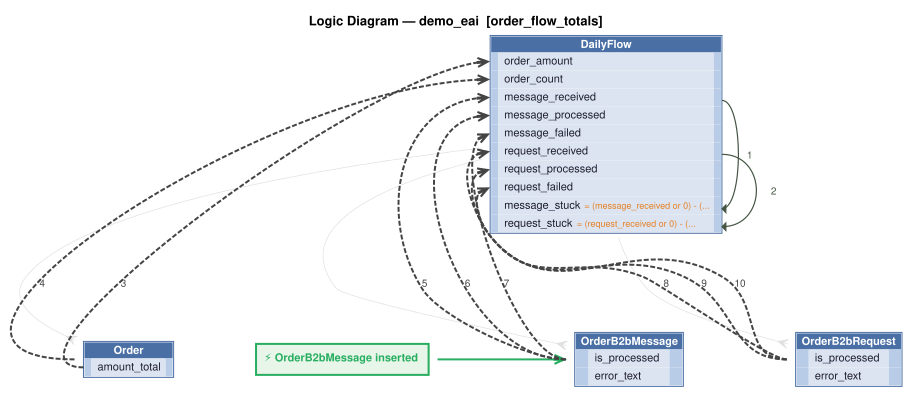
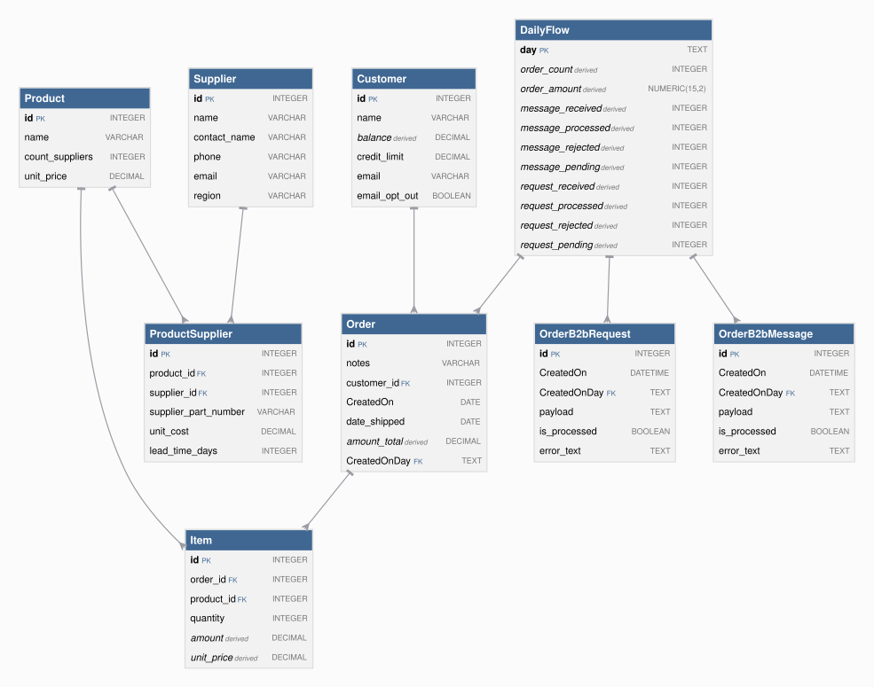

# Requirements Traceability Report

This report shows requirements, the rules created from them, and the tests created from those rules.

This project began as natural-language requirements, fleshed out by AI into a running system of business rules that are *executable documentation*. This report is how you govern the result.

A governable system is one you can **read**, **trust**, and **maintain**: each requirement is listed beside the rules that implement it (*read*); the tests and logic logs show those rules running (*trust*); re-run it after any change and it flags the gaps — an untested requirement, an untraced rule, a channel no test checks (*maintain*).

It is generated from the project's own files, nothing written by hand, so it is as current as the last run and covers the whole project, not a sample. Open **Background** (below the summary) for what the terms mean, how to read the report, and what it can and can't tell you.


**Project:** basic_demo_eai &nbsp;|&nbsp; **Generated:** November 19, 2026 18:42 &nbsp;|&nbsp; **Rules:** 18 &nbsp;|&nbsp; **Test scenarios:** 30 &nbsp;|&nbsp; **Generator:** requirements_traceability_report.py 2.15

**Last test run:** November 19, 2026 18:42, took 5.0 s (0m before this report; test results and logic logs below are from that run)


&nbsp;
&nbsp;

## At a Glance

**✅ 6 requirement(s), all implemented; 6 tested; 30 of 30 scenarios passed; last run 0m ago.**

| | |
|---|---|
| Requirements | 6 (6 implemented) |
| Tested | 6 of 6 |
| Last test run | ✅ 30 passed, 0 failed (November 19, 2026 18:42, 0m ago); took 5.0 s |
| Rules | 18 (15 declarative, 0 Python functions, 3 Python events) |
| Rules shown running in a test log | 17 of 18 |
| Security | enabled (Keycloak provider); 11 role(s), 2 row-level grant(s) |
| Messages and APIs | 2 Kafka topic(s) in, 2 out; 6 HTTP endpoint(s) |
| Kafka | live (localhost:9092): subscribe tested through the broker; outbound messages checked in the log |

_Status: ✅ every requirement is implemented and tested, all scenarios pass, and the results are current. ⚠ a requirement is untested or unimplemented, there is no test run, or files changed since the last run. ❌ a scenario failed. This reports what was traced and tested, not that the system is correct._

**About this project** _(from [readme.md](../../readme.md))_

This app illustrates using IntegrationServices for B2B push-style integrations with APIs, and internal integration with messages.

**This sample** is a single API Logic Server providing APIs *and logic* — it both
subscribes and publishes, so there's no second project to stand up:

1. **Order Logic:** enforcing database integrity (Check Credit) and application
   integration (notify shipping)

2. A **Custom API** (`OrderB2B`), matching an agreed-upon format for B2B partners

3. **Kafka Subscribe:** listens on topic `order_b2b` for inbound orders from a
   message broker

4. **Kafka Publish:** publishes to topic `order_shipping` when an order ships —
   consumed by whatever downstream shipping system you plug in (not part of this
   demo)

5. **Standard APIs** for ad-hoc integration, user interfaces, etc

<details markdown>
<summary>Background: what this report is, and how to read it</summary>

&nbsp;

<details markdown>
<summary>Requirements are business policies, expressed in natural language</summary>

<br>

A **requirement** is a statement of business behavior - how data is computed, validated, and transmitted - written in plain language. It lives in the project at `docs/requirements/<name>/requirements.md`.  For example:

&nbsp;

```
On Placing Orders, Check Credit
    1. The Customer's balance does not exceed the credit limit
    2. The Customer's balance is the sum of the unshipped Order amount_total
    3. The Order's amount_total is the sum of the Item amount
    4. The Item amount is the quantity * unit_price
    5. The Item unit_price is copied from the Product unit_price
```

</details>

&nbsp;

<details markdown>
<summary>Rules implement requirements</summary>

<br>

A requirement is written at a high level, and AI fills in details as it builds — as it should — so the requirement no longer says exactly what the system does. The rules do. That's a Goldilocks answer to the question of what you review:

* **Requirements say too little** — incomplete by design; AI fills in the details.
* **Code says too much** — business language in, hundreds of lines of procedural code out. The work moves from writing to reading, and if you can't read it, you can't govern it.
* **Rules are just right** — close to the requirement's own level, but complete and deterministic.

Code could be treated like machine language — never read, only trusted — if it were produced deterministically. Generation from natural language isn't. Rules restore that contract: a readable source, deterministically executed.

The requirements above become rules like this:

```
Rule.copy(derive=models.Item.unit_price, from_parent=models.Product.unit_price)
Rule.formula(derive=models.Item.amount,
             as_expression=lambda row: row.quantity * row.unit_price)
Rule.sum(derive=models.Order.amount_total, as_sum_of=models.Item.amount)
Rule.sum(derive=models.Customer.balance, as_sum_of=models.Order.amount_total,
         where=lambda row: row.date_shipped is None)
Rule.constraint(
    validate=models.Customer,
    as_condition=lambda row: row.balance <= row.credit_limit,
    error_msg="balance ({row.balance}) exceeds credit limit ({row.credit_limit})")
```

Rules are ***executable documentation*** that you can read and trust:

* **Read:** rules stay near the requirement's level, so this report can list them side by side and you can check one against the other. 5 rules vs. ~200 lines in our [A/B test](https://github.com/ApiLogicServer/ApiLogicServer-src/blob/main/api_logic_server_cli/prototypes/manager/samples/basic_demo_logic_gov/logic/procedural/declarative-vs-procedural-comparison.md) — **~40x less to review**, whether generated or hand-coded.
* **Trust:** the document is enforced, not just descriptive.
    * **What you read is what runs** — no drift between description and behavior.
    * **Dependencies:** with code, you analyze every execution path to know it runs at the right times. With rules: if the rule is there, it runs, in the right order.
    * **All sources and paths:** the engine hooks into every commit — API, UI or agent — insert, update and delete, including related rows. No bypass.
    * **Seeing is believing:** each scenario in *Tests and Results* below embeds its logic log — every rule that ran, in order, with old and new values.

Better AI makes generating code easier. It doesn't change what you have to read. The problem is the representation, not the capability. And governance is active, not just process: the engine enforces the rules on every transaction, and this report — regenerated from the project itself — shows it happening.

&nbsp;

</details>

&nbsp;

<details markdown>
<summary>Process overview: creation and iteration</summary>

<br>


In two phases. First, `genai-logic create` builds a working system from the database: API, Admin App, data model. Then behavior is added from requirements — the typical sequence, each step a request to an AI assistant:

1. Write each requirement in natural language, in `docs/requirements/<name>/requirements.md`.
2. `implement reqs <name>` — creates the rules, API endpoints and Kafka integrations.
3. `create tests from rules` — writes the test scenarios and steps.
4. `run the tests` — starts the server if needed, runs the suite, reports pass/fail.
5. `run the requirements traceability report` — regenerates this report.

Optional: `create logic diagram for each requirement` (needs Graphviz).

What makes steps 3–5 possible: rules are high-level enough that AI can read them too. The tests, the logic diagrams and this report are all generated by reading the same rules you review — where logic is Python code, the report can only quote its docstring.

The report connects the chain: requirement → rules and handlers → tests → logic log. How *this* project was actually built is recorded under Provenance.

</details>

&nbsp;

<details markdown>
<summary>How to read this report</summary>

<br>

| If you are...  | Start with                                                        | Look for                                                                                     |
| -------------- | ----------------------------------------------------------------- | -------------------------------------------------------------------------------------------- |
| Business owner | *Requirements in detail*                                          | The requirement text, then the **Tests** line under it: does a test exist, and did it pass?  |
| Auditor        | *Coverage summary*, *Rule coverage by tests*, *Messages and APIs* | Gaps (untested, untraced), the date of the last test run, and how each rule was shown to run |
| Developer      | *Tests and Results*                                               | Each scenario's logic log: every rule that ran, in order, with old and new values            |

</details>

&nbsp;

<details markdown>
<summary>What this report can and can't tell you</summary>

<br>

**It shows**

- Which files and rules implement each requirement, read from the project's source.
- Which scenarios ran in the last test run, and whether each passed.
- Which rules the engine logged as running in each scenario.

**It doesn't show**

- Whether the requirements are right or complete. It traces what was written down.
- Whether an event did anything. Events run on every commit of their class and decide for themselves whether to act, so appearing in the log doesn't mean the event had an effect.
- Whether a constraint works. A constraint appears in the log only when it rejects a transaction, so look for a scenario that makes it reject.
- Whether a message arrived. Unless a test step looks for it on the broker or endpoint, a passing scenario doesn't prove delivery. The *Messages and APIs* table flags channels no test mentions.
- Whether the results are current. They are as old as the last test run, shown in the header, which also warns if files changed since.
- Which version of a requirement the code was built from, or which clause of a requirement a given rule serves.

</details>

&nbsp;

<details markdown>
<summary>Terms</summary>

<br>

| Term        | Meaning                                                                                              |
| ----------- | ---------------------------------------------------------------------------------------------------- |
| Requirement | A statement of business behavior, in plain language; the unit this report traces.                    |
| Rule        | A declaration about data (sum, count, formula, copy, constraint) that the engine enforces at every commit. |
| Event       | Python code the engine calls when a row of a given class changes (for example, to publish a message). |
| Handler     | Code that serves an API endpoint or consumes a Kafka topic.                                          |
| Scenario    | One Behave test: a short Given / When / Then script run against the live API.                        |
| Logic log   | The engine's record of every rule it ran in a transaction, nested to show cascades (an Item change adjusts its Order, which adjusts its Customer). |
| Phase       | The step of a commit: ROW LOGIC (derivations, constraints), COMMIT LOGIC (checks that need finished totals), AFTER_FLUSH LOGIC (events that need database-assigned keys, such as publishing). |
| Seen        | The engine reported running the rule in that scenario's log.                                         |

</details>

</details>


&nbsp;
&nbsp;

## Contents

- [Requirements Coverage](#requirements-coverage)
- [Data Model](#data-model)
- [Security (RBAC)](#security-rbac)
- [Messages and APIs](#messages-and-apis)
- [Tests and Results](#tests-and-results)
- [Provenance](#provenance)


&nbsp;
&nbsp;

## Requirements Coverage

Every requirement should have rules that implement it, and tests that prove it. This section checks that chain in both directions: a requirement missing rules or tests is a gap, and rules or tests that belong to no requirement are flagged too. The matching uses the requirement names, `Feature:` names and `§N` tags that requirements, code and tests share. Requirements may be grouped into a use case (for example Place Order), read from the logic folder or the prompt; the level is optional.


&nbsp;

### Coverage summary

| Measure | Result |
|---|---|
| Requirements | 6 |
| Implemented (at least one file) | 6 of 6 |
| Tested (at least one scenario) | 6 of 6 |
| Implementation not traced to a requirement | `logic/logic_discovery/system/all_classes_stamping.py` |
| Tests not traced to a requirement | none |
| Test results (last run) | ✅ 30 passed, 0 failed; took 5.0 s |
| Scenarios with a logic log | 30 of 30 |
| Rules seen in at least one scenario's log | 17 of 18 (1 not counted: the engine's log does not name `all classes.early_row_event → handle_all()`, so it cannot be matched) |

_Test results are as current as the last run (see the header). A gap is any requirement with no implementation or no test._

<details markdown>
<summary>How to read this table</summary>

Test results are read from `logs/behave.log`, so they are only as current as that run. Not recorded here: which version of a requirement the code was built against, and which clause of a requirement a given rule serves.

</details>


&nbsp;

### Traceability matrix

| Requirement | Implemented by | Rules | Tests |
|---|---|---|---|
| §1 Business Logic — Check Credit | [logic/logic_discovery/check_credit.py](../../logic/logic_discovery/check_credit.py) | 5 | ✅ 11 scenario(s): 11 passed |
| §2 B2B API — Accept orders from external partners | [api/api_discovery/order_b2b_service.py](../../api/api_discovery/order_b2b_service.py) | 0 | ✅ 4 scenario(s): 4 passed |
| §3 Kafka Subscribe — Inbound orders from sales channel | [logic/logic_discovery/order_b2b_consume.py](../../logic/logic_discovery/order_b2b_consume.py)<br>[integration/kafka/kafka_subscribe_discovery/order_b2b.py](../../integration/kafka/kafka_subscribe_discovery/order_b2b.py)<br>[integration/OrderB2bMapper.py](../../integration/OrderB2bMapper.py)<br>[api/api_discovery/order_b2b_kafka_consume_debug.py](../../api/api_discovery/order_b2b_kafka_consume_debug.py) | 1 | ✅ 3 scenario(s): 3 passed |
| §4 Kafka Publish — Notify shipping on dispatch | [logic/logic_discovery/order_shipping_publish.py](../../logic/logic_discovery/order_shipping_publish.py)<br>[integration/kafka/kafka_publish_discovery/order_shipping.py](../../integration/kafka/kafka_publish_discovery/order_shipping.py) | 1 | ✅ 2 scenario(s): 2 passed |
| §5 Security | [security/declare_security.py](../../security/declare_security.py) | 0 | ✅ 1 scenario(s): 1 passed |
| §6 Operations Dashboard — Order flow | [logic/logic_discovery/order_flow_totals.py](../../logic/logic_discovery/order_flow_totals.py)<br>[api/api_discovery/dashboard_services.py](../../api/api_discovery/dashboard_services.py) | 10 | ✅ 9 scenario(s): 9 passed |


&nbsp;

### Rule coverage by tests

| Rule | Requirement | Seen in |
|---|---|---|
| `Customer: credit_limit is None or balance is None or balance <= credit_limit` | §1 Business Logic — Check Credit | 2: Rejected Request Is Recorded; Order Exceeding Credit Rejected |
| `Customer.balance = sum(Order.amount_total) where date_shipped is None` | §1 Business Logic — Check Credit | 26: Partner Order Accepted; Accepted Request Is Recorded; Rejected Request Is Recorded; +23 more |
| `Order.amount_total = sum(Item.amount)` | §1 Business Logic — Check Credit | 25: Partner Order Accepted; Accepted Request Is Recorded; Rejected Request Is Recorded; +22 more |
| `Item.amount = quantity * unit_price` | §1 Business Logic — Check Credit | 25: Partner Order Accepted; Accepted Request Is Recorded; Rejected Request Is Recorded; +22 more |
| `Item.unit_price = copy of Product.unit_price` | §1 Business Logic — Check Credit | 25: Partner Order Accepted; Accepted Request Is Recorded; Rejected Request Is Recorded; +22 more |
| `OrderB2bMessage.after_flush_row_event → _publish_order_b2b()` | §3 Kafka Subscribe — Inbound orders from sales channel | 5: Order Message Delivered; Unknown Account Message Rejected; Rejected Message Keeps Its Error (live Kafka only); +2 more |
| `DailyFlow.order_count = count(Order)` | §6 Operations Dashboard — Order flow | 26: Partner Order Accepted; Accepted Request Is Recorded; Rejected Request Is Recorded; +23 more |
| `DailyFlow.order_amount = sum(Order.amount_total)` | §6 Operations Dashboard — Order flow | 26: Partner Order Accepted; Accepted Request Is Recorded; Rejected Request Is Recorded; +23 more |
| `DailyFlow.message_received = count(OrderB2bMessage)` | §6 Operations Dashboard — Order flow | 5: Order Message Delivered; Unknown Account Message Rejected; Rejected Message Keeps Its Error (live Kafka only); +2 more |
| `DailyFlow.message_processed = count(OrderB2bMessage) where is_processed == True` | §6 Operations Dashboard — Order flow | 5: Order Message Delivered; Unknown Account Message Rejected; Rejected Message Keeps Its Error (live Kafka only); +2 more |
| `DailyFlow.message_failed = count(OrderB2bMessage) where error_text is not None` | §6 Operations Dashboard — Order flow | 5: Order Message Delivered; Unknown Account Message Rejected; Rejected Message Keeps Its Error (live Kafka only); +2 more |
| `DailyFlow.message_stuck = (message_received or 0) - (message_processed or 0) - (message_failed or 0)` | §6 Operations Dashboard — Order flow | 5: Order Message Delivered; Unknown Account Message Rejected; Rejected Message Keeps Its Error (live Kafka only); +2 more |
| `DailyFlow.request_received = count(OrderB2bRequest)` | §6 Operations Dashboard — Order flow | 24: Partner Order Accepted; Unknown Account Rejected; Accepted Request Is Recorded; +21 more |
| `DailyFlow.request_processed = count(OrderB2bRequest) where is_processed == True` | §6 Operations Dashboard — Order flow | 24: Partner Order Accepted; Unknown Account Rejected; Accepted Request Is Recorded; +21 more |
| `DailyFlow.request_failed = count(OrderB2bRequest) where error_text is not None` | §6 Operations Dashboard — Order flow | 24: Partner Order Accepted; Unknown Account Rejected; Accepted Request Is Recorded; +21 more |
| `DailyFlow.request_stuck = (request_received or 0) - (request_processed or 0) - (request_failed or 0)` | §6 Operations Dashboard — Order flow | 24: Partner Order Accepted; Unknown Account Rejected; Accepted Request Is Recorded; +21 more |
| `Order.after_flush_row_event → _send_order_to_shipping()` | §4 Kafka Publish — Notify shipping on dispatch | 24: Partner Order Accepted; Accepted Request Is Recorded; Good Order Placed; +21 more |
| `all classes.early_row_event → handle_all()` | (none) | n/a - cannot be matched to the engine's log |

_"Seen" means the engine's log shows the rule ran, not proof that it took effect._

<details markdown>
<summary>How to read this table</summary>

"Seen" means the engine reported running the rule in that scenario's logic log. A scenario can only contribute if it has a log (see the coverage summary): a test that does not open one writes into whichever log was open last, and its rules are then credited to that scenario, or to the shared log. An event's function runs on every commit of its class, and its own condition decides whether it acts, so seen does not mean it took effect. A constraint appears in the log only when it rejects a transaction, so it is seen only in scenarios that make it reject. "Not seen" therefore means no log shows it, not that no test ran it.

</details>


&nbsp;

### Requirements in detail

**18 rules** in 5 files: 15 declarative (sum, count, copy, formula and constraint expressions), 0 backed by a Python function, 3 events (Python).

_Declarative rules are read straight from their declarations. Functions and events are Python code, so for those the report shows the docstring — it does not analyze the code._

Each requirement is followed by the rules and handlers in the files that implement it. Logic diagrams are shown (click to expand) where they exist.

<details markdown>
<summary>How to create or refresh the logic diagrams</summary>

Needs Graphviz (`brew install graphviz`). Tell your AI assistant:

```
create logic diagram for each requirement
```

or run this from the Manager root (`manager`):

```
python system/ApiLogicServer-Internal-Dev/logic_diagram_gv.py samples/basic_demo_eai --each
```

Each diagram is saved under `docs/requirements/<name>/logic_diagrams/`. Then regenerate this report (`python requirements_traceability_report.py run`, from `test/api_logic_server_behave`).

</details>

&nbsp;


#### §1 Business Logic — Check Credit

Tests: ✅ 11 scenario(s): 11 passed

```
Feature: Check Credit

  Scenario: Place an order
    Given a customer with a credit limit
    When an order is placed
    Then copy the price from the product
    And multiply by quantity to get the item amount
    And sum item amounts to get the order total
    And sum unpaid order totals to get the customer balance
    And reject if balance exceeds the credit limit
```

| Rule / item | Type | Logic | Description | Where |
|---|---|---|---|---|
| `Customer: credit_limit is None or balance is None or balance <= credit_limit` | constraint | declarative | Error: Customer balance ({row.balance}) exceeds credit limit ({row.credit_limit}) | [check_credit.py](../../logic/logic_discovery/check_credit.py) |
| `Customer.balance = sum(Order.amount_total) where date_shipped is None` | sum | declarative |  | [check_credit.py](../../logic/logic_discovery/check_credit.py) |
| `Order.amount_total = sum(Item.amount)` | sum | declarative |  | [check_credit.py](../../logic/logic_discovery/check_credit.py) |
| `Item.amount = quantity * unit_price` | formula | declarative |  | [check_credit.py](../../logic/logic_discovery/check_credit.py) |
| `Item.unit_price = copy of Product.unit_price` | copy | declarative |  | [check_credit.py](../../logic/logic_discovery/check_credit.py) |

<details markdown>
<summary>Logic diagram: check_credit</summary>

<table><tr valign="top">
<td width="65%">


</td>
<td width="35%">

**Rules**

1. `unit_price = copy(unit_price)`<br>
2. `amount = quantity * unit_price`<br>
3. `amount_total = sum(amount)`<br>
4. `balance = sum(amount_total where date_shipped)`<br>
5. constraint: `Customer`

</td>
</tr></table>

</details>

#### §2 B2B API — Accept orders from external partners

Tests: ✅ 4 scenario(s): 4 passed

```
Feature: B2B Order Integration

  Scenario: Accept order from external partner
    Given an inbound B2B order in partner format (message_formats/order_b2b.json)
    When the order is received via a Custom API endpoint named OrderB2B
    Then map Account to Customer by name
    And map Items.Name to Product by name
    And map Items.QuantityOrdered to Item.quantity
    And record each request, with its outcome, for the order flow dashboard
```

| Rule / item | Type | Logic | Description | Where |
|---|---|---|---|---|
| `HTTP in: POST /api/OrderB2B/OrderB2B` | http | handler (Python) | API service OrderB2B: records the request, creates the Order and its Items (the rules derive the rest), and records the outcome on the request row. | [order_b2b_service.py](../../api/api_discovery/order_b2b_service.py) |

#### §3 Kafka Subscribe — Inbound orders from sales channel

Tests: ✅ 3 scenario(s): 3 passed

```
Feature: Kafka Subscribe Order Integration

  Scenario: Accept inbound orders from sales channel
    Given an inbound order message in JSON format (message_formats/order_b2b.json)
    When the message is received from Kafka topic order_b2b
    Then map Account to Customer by name
    And map Items.Name to Product by name
    And map Items.QuantityOrdered to Item.quantity
```

| Rule / item | Type | Logic | Description | Where |
|---|---|---|---|---|
| `OrderB2bMessage.after_flush_row_event → _publish_order_b2b()` | after_flush_row_event | event (Python) | OrderB2bMessage event: publishes the raw blob to order_b2b_processed after Tx 1 commits, so Consumer 2 parses it in a clean Tx 2 (2-message pattern). | [order_b2b_consume.py](../../logic/logic_discovery/order_b2b_consume.py) |
| `Kafka in: order_b2b` | kafka | handler (Python) | Kafka subscribe order_b2b: Consumer 1 - save the raw blob and commit (Tx 1); the row event publishes it on. | [order_b2b.py](../../integration/kafka/kafka_subscribe_discovery/order_b2b.py) |
| `Kafka in: order_b2b_processed` | kafka | handler (Python) | Kafka subscribe order_b2b_processed: Consumer 2 - parse + persist the Order (Tx 2); a failure is recorded on the blob. | [order_b2b.py](../../integration/kafka/kafka_subscribe_discovery/order_b2b.py) |
| `OrderB2bMapper.py` | module |  | Feature: Kafka Subscribe Order Integration | [OrderB2bMapper.py](../../integration/OrderB2bMapper.py) |
| `HTTP in: GET /consume_debug/order_b2b` | http | handler (Python) | EAI debug (development only, no authentication): sends the message in ?file= to the topic, live through Kafka or simulated | [order_b2b_kafka_consume_debug.py](../../api/api_discovery/order_b2b_kafka_consume_debug.py) |
| `HTTP in: POST /consume_debug/order_b2b/reset` | http | handler (Python) | EAI debug (development only, destructive): purges the messages in the pipeline's topics | [order_b2b_kafka_consume_debug.py](../../api/api_discovery/order_b2b_kafka_consume_debug.py) |

<details markdown>
<summary>Logic diagram: order_b2b_consume</summary>

<table><tr valign="top">
<td width="65%">


</td>
<td width="35%">

**Rules**

1. `OrderB2bMessage` → `_publish_order_b2b` (after_flush) — OrderB2bMessage event: publishes the raw blob to order_b2b_processed after Tx 1 commits, so Consumer 2

</td>
</tr></table>

</details>

#### §4 Kafka Publish — Notify shipping on dispatch

Tests: ✅ 2 scenario(s): 2 passed

```
Feature: Kafka Publish Shipping Notification

  Scenario: Notify shipping when an order is dispatched
    Given an Order exists
    When date_shipped is set
    Then publish to Kafka topic order_shipping
    And use message_formats/order_shipping.json as the message shape
    And use by-example publish rather than key-only publish
```

| Rule / item | Type | Logic | Description | Where |
|---|---|---|---|---|
| `Order.after_flush_row_event → _send_order_to_shipping()` | after_flush_row_event | event (Python) | Order publish: sends the Order to Kafka topic order_shipping when date_shipped is set and differs from its prior value (old_row is None on insert), shaped by example as message_formats/order_shipping.json. | [order_shipping_publish.py](../../logic/logic_discovery/order_shipping_publish.py) |
| `order_shipping.py` | module |  | Feature: Kafka Publish Shipping Notification | [order_shipping.py](../../integration/kafka/kafka_publish_discovery/order_shipping.py) |

<details markdown>
<summary>Logic diagram: order_shipping_publish</summary>

<table><tr valign="top">
<td width="65%">


</td>
<td width="35%">

**Rules**

1. `Order` → `_send_order_to_shipping` (after_flush) — Order publish: sends the Order to Kafka topic order_shipping when date_shipped is set and differs from its prior

</td>
</tr></table>

</details>

#### §5 Security

Tests: ✅ 1 scenario(s): 1 passed

```
Feature: Row-Level Security
  Scenario: Sales role sees limited customers
    Given a user with the sales role
    When querying the Customer list
    Then only return customers where credit_limit >= 3000 or balance > 0
```

| Rule / item | Type | Logic | Description | Where |
|---|---|---|---|---|
| `Grant on Customer to role sales: credit_limit >= 3000` | grant | declarative |  | [declare_security.py](../../security/declare_security.py) |
| `Grant on Customer to role sales: balance > 0` | grant | declarative |  | [declare_security.py](../../security/declare_security.py) |

#### §6 Operations Dashboard — Order flow

Tests: ✅ 9 scenario(s): 9 passed

```
Feature: Order Flow Dashboard

  Scenario: Show that orders are flowing
    Given orders arrive through the B2B API and the Kafka topic order_b2b
    When an operator opens the Admin App home page
    Then maintain daily totals of orders (count and total amount), and of order_b2b messages and B2B requests
         (received, processed, rejected, and not yet done)
    And chart the daily totals for the last 30 days, showing a day with no activity as zero
    And date each Order, message and request when it arrives
    And show current data each time the page is opened
```

| Rule / item | Type | Logic | Description | Where |
|---|---|---|---|---|
| `DailyFlow.order_count = count(Order)` | count | declarative |  | [order_flow_totals.py](../../logic/logic_discovery/order_flow_totals.py) |
| `DailyFlow.order_amount = sum(Order.amount_total)` | sum | declarative |  | [order_flow_totals.py](../../logic/logic_discovery/order_flow_totals.py) |
| `DailyFlow.message_received = count(OrderB2bMessage)` | count | declarative |  | [order_flow_totals.py](../../logic/logic_discovery/order_flow_totals.py) |
| `DailyFlow.message_processed = count(OrderB2bMessage) where is_processed == True` | count | declarative |  | [order_flow_totals.py](../../logic/logic_discovery/order_flow_totals.py) |
| `DailyFlow.message_failed = count(OrderB2bMessage) where error_text is not None` | count | declarative |  | [order_flow_totals.py](../../logic/logic_discovery/order_flow_totals.py) |
| `DailyFlow.message_stuck = (message_received or 0) - (message_processed or 0) - (message_failed or 0)` | formula | declarative |  | [order_flow_totals.py](../../logic/logic_discovery/order_flow_totals.py) |
| `DailyFlow.request_received = count(OrderB2bRequest)` | count | declarative |  | [order_flow_totals.py](../../logic/logic_discovery/order_flow_totals.py) |
| `DailyFlow.request_processed = count(OrderB2bRequest) where is_processed == True` | count | declarative |  | [order_flow_totals.py](../../logic/logic_discovery/order_flow_totals.py) |
| `DailyFlow.request_failed = count(OrderB2bRequest) where error_text is not None` | count | declarative |  | [order_flow_totals.py](../../logic/logic_discovery/order_flow_totals.py) |
| `DailyFlow.request_stuck = (request_received or 0) - (request_processed or 0) - (request_failed or 0)` | formula | declarative |  | [order_flow_totals.py](../../logic/logic_discovery/order_flow_totals.py) |
| `HTTP in: GET /order_flow/daily` | http | handler (Python) | API service order flow: the daily totals for the last 30 days, as JSON (dashboard, tests, custom UIs). | [dashboard_services.py](../../api/api_discovery/dashboard_services.py) |
| `HTTP in: GET /dashboard` | http | handler (Python) | API service order flow: the dashboard iframes, embedded at the top of ui/admin/home.js. | [dashboard_services.py](../../api/api_discovery/dashboard_services.py) |
| `HTTP in: GET /chart_graphics/<path:path>` | http | handler (Python) | API service order flow: one chart, rendered on every request (never cached) so it shows current data. | [dashboard_services.py](../../api/api_discovery/dashboard_services.py) |

<details markdown>
<summary>Logic diagram: order_flow_totals</summary>

<table><tr valign="top">
<td width="65%">



</td>
<td width="35%">

**Rules**

1. `message_stuck = (message_received or 0) - (message_processed or 0) - (message_failed or 0)`<br>
2. `request_stuck = (request_received or 0) - (request_processed or 0) - (request_failed or 0)`<br>
3. `order_amount = sum(amount_total)`<br>
4. `order_count = count(Order)`<br>
5. `message_received = count(OrderB2bMessage)`<br>
6. `message_processed = count(OrderB2bMessage where is_processed)`<br>
7. `message_failed = count(OrderB2bMessage where error_text)`<br>
8. `request_received = count(OrderB2bRequest)`<br>
9. `request_processed = count(OrderB2bRequest where is_processed)`<br>
10. `request_failed = count(OrderB2bRequest where error_text)`

</td>
</tr></table>

</details>

#### Rules not traced to a requirement

| Rule / item | Type | Logic | Description | Where |
|---|---|---|---|---|
| `all classes.early_row_event → handle_all()` | early_row_event_all_classes | event (Python) | Generic handler - executed for every row update across all classes. | [all_classes_stamping.py](../../logic/logic_discovery/system/all_classes_stamping.py) |


&nbsp;
&nbsp;

## Data Model

The tables the rules run over. Derived columns (in italics) are computed by rules — no code writes them. Tinted groups are the subtypes.



_Generated from `docs/db.dbml` (parents above children; shaded rows are derived by rules). To use your own layout, save it as `docs/db_diagram.png`._


&nbsp;

### Derived columns

| Table | Column | Rule | Definition |
|---|---|---|---|
| Customer | balance | sum | `Customer.balance = sum(Order.amount_total) where date_shipped is None` |
| Order | amount_total | sum | `Order.amount_total = sum(Item.amount)` |
| Item | amount | formula | `Item.amount = quantity * unit_price` |
| Item | unit_price | copy | `Item.unit_price = copy of Product.unit_price` |
| DailyFlow | order_count | count | `DailyFlow.order_count = count(Order)` |
| DailyFlow | order_amount | sum | `DailyFlow.order_amount = sum(Order.amount_total)` |
| DailyFlow | message_received | count | `DailyFlow.message_received = count(OrderB2bMessage)` |
| DailyFlow | message_processed | count | `DailyFlow.message_processed = count(OrderB2bMessage) where is_processed == True` |
| DailyFlow | message_failed | count | `DailyFlow.message_failed = count(OrderB2bMessage) where error_text is not None` |
| DailyFlow | message_stuck | formula | `DailyFlow.message_stuck = (message_received or 0) - (message_processed or 0) - (message_failed or 0)` |
| DailyFlow | request_received | count | `DailyFlow.request_received = count(OrderB2bRequest)` |
| DailyFlow | request_processed | count | `DailyFlow.request_processed = count(OrderB2bRequest) where is_processed == True` |
| DailyFlow | request_failed | count | `DailyFlow.request_failed = count(OrderB2bRequest) where error_text is not None` |
| DailyFlow | request_stuck | formula | `DailyFlow.request_stuck = (request_received or 0) - (request_processed or 0) - (request_failed or 0)` |


&nbsp;
&nbsp;

## Security (RBAC)

Who can do what: each role's permissions, and which rows each role can see.

**Security enabled: yes** (`SECURITY_ENABLED` in `config/default.env`).


&nbsp;

### Roles and CRUD (DefaultRolePermission)

| Role | Read | Insert | Update | Delete |
|---|---|---|---|---|
| sa | ✅ | ✅ | ✅ | ✅ |
| tenant | ✅ | — | — | ✅ |
| CS_ADMIN | ✅ | ✅ | ✅ | ✅ |
| manager | ✅ | ✅ | ✅ | — |
| teller | ✅ | ✅ | ✅ | — |
| customer | ✅ | ✅ | ✅ | — |
| readonly | ✅ | — | — | — |
| public | ✅ | — | — | — |
| default-roles-kcals | ✅ | ✅ | ✅ | — |
| uma_authorization | ✅ | ✅ | ✅ | — |
| sales | ✅ | — | — | — |


&nbsp;

### Row-level grants (Grant)

| Table | Role | Filter | Requirement |
|---|---|---|---|
| Customer | sales | `credit_limit >= 3000` |  |
| Customer | sales | `balance > 0` |  |


&nbsp;
&nbsp;

## Messages and APIs

How data enters and leaves beyond the standard API: Kafka topics in and out, custom HTTP endpoints — and whether any test touches each one.

**Kafka mode: live (localhost:9092).** The tests sent inbound messages through a real broker: `/consume_debug` published them to topic `order_b2b`, the server's consumers processed them, and the tests then checked the results. Outbound `order_shipping` messages are checked in the server log, not read back from the topic.

| Direction | Channel | Name | Tests mention it | Handler | Tables created | Message shape | Requirement |
|---|---|---|---|---|---|---|---|
| ➡ in | Kafka | `order_b2b` | ✅ live | `order_b2b()` - Kafka subscribe order_b2b: Consumer 1 - save the raw blob and commit (Tx 1); the row event publishes it on. | OrderB2bMessage | [order_b2b.json](../../integration/kafka/message_formats/order_b2b.json) | §3 Kafka Subscribe — Inbound orders from sales channel |
| ➡ in | Kafka | `order_b2b_processed` | ✅ live | `order_b2b_processed()` - Kafka subscribe order_b2b_processed: Consumer 2 - parse + persist the Order (Tx 2); a failure is recorded on the blob. | Item, Order, OrderB2bMessage |  | §3 Kafka Subscribe — Inbound orders from sales channel |
| ⬅ out | Kafka | `order_b2b_processed` | ✅ live | OrderB2bMessage.after_flush_row_event → _publish_order_b2b() - OrderB2bMessage event: publishes the raw blob to order_b2b_processed after Tx 1 commits, so Consumer 2 parses it in a clean Tx 2 (2-message pattern). |  |  | §3 Kafka Subscribe — Inbound orders from sales channel |
| ⬅ out | Kafka | `order_shipping` | ⚠ message checked in the log, not on the topic | Order.after_flush_row_event → _send_order_to_shipping() - Order publish: sends the Order to Kafka topic order_shipping when date_shipped is set and differs from its prior value (old_row is None on insert), shaped by example as message_formats/order_shipping.json. |  | [order_shipping.json](../../integration/kafka/message_formats/order_shipping.json) | §4 Kafka Publish — Notify shipping on dispatch |
| ➡ in | HTTP | `GET /order_flow/daily` | ✅ | `order_flow_daily()` - API service order flow: the daily totals for the last 30 days, as JSON (dashboard, tests, custom UIs). |  |  | §6 Operations Dashboard — Order flow |
| ➡ in | HTTP | `GET /dashboard` | ✅ | `dashboard()` - API service order flow: the dashboard iframes, embedded at the top of ui/admin/home.js. |  |  | §6 Operations Dashboard — Order flow |
| ➡ in | HTTP | `GET /chart_graphics/<path:path>` | ⚠ no test mentions it | `chart_graphics()` - API service order flow: one chart, rendered on every request (never cached) so it shows current data. |  |  | §6 Operations Dashboard — Order flow |
| ➡ in | HTTP | `GET /consume_debug/order_b2b` | ✅ | `register_consume_debug()` - EAI debug (development only, no authentication): sends the message in ?file= to the topic, live through Kafka or simulated |  |  | §3 Kafka Subscribe — Inbound orders from sales channel |
| ➡ in | HTTP | `POST /consume_debug/order_b2b/reset` | ⚠ no test mentions it | `register_queue_reset()` - EAI debug (development only, destructive): purges the messages in the pipeline's topics |  |  | §3 Kafka Subscribe — Inbound orders from sales channel |
| ➡ in | HTTP | `POST /api/OrderB2B/OrderB2B` | ✅ | `OrderB2B()` - API service OrderB2B: records the request, creates the Order and its Items (the rules derive the rest), and records the outcome on the request row. |  |  | §2 B2B API — Accept orders from external partners |

_"Tests mention it" checks the test sources, not delivery._

<details markdown>
<summary>How to read this column</summary>

A passing scenario proves a message reached a topic or an endpoint only if its steps look for it there. A handler that ran (see the logic log) is weaker evidence than a step that consumes the message. Channels no test mentions are flagged.

</details>

<details markdown>
<summary>How to read this table</summary>

Topics and endpoints are read from the discovery folders. The condition that triggers an outbound message lives in Python (see the rules under each requirement); here it is described by the handler's docstring. "Tables created" lists rows the handler's code constructs, following its calls within the project; blank means none were found, not that none exist.

</details>


<details markdown>
<summary>Message shape: order_b2b</summary>

```json
{
  "Account": "Alice",
  "Notes": "Kafka order from sales",
  "Items": [
    { "Name": "Widget",  "QuantityOrdered": 1 },
    { "Name": "Gadget",  "QuantityOrdered": 2 }
  ]
}
```
</details>

<details markdown>
<summary>Message shape: order_shipping</summary>

```json
{
  "order_id": 1,
  "order_date": "2026-04-06",
  "customer_name": "Alfreds Futterkiste",
  "total": 100.00,
  "items": [
    { "quantity": 2, "product_name": "Chai", "unit_price": 25.00 }
  ]
}
```
</details>


&nbsp;
&nbsp;

## Tests and Results

**✅ 30 scenario(s): 30 passed, 0 failed; took 5.0 s** (from the last run, `logs/behave.log`).

Each test drives the running system the way any client would — create an order, change a quantity, ship it — and checks the result.

**The logic log** is what makes them more than pass/fail. Business rules run inside the server on every commit, so the server records exactly what they did, and this report embeds that record for each scenario. Two things to look for:

1. **It shows every rule that runs.** Each line is one rule execution, with the row's state, old and new values. You see not just that a test passed, but which rules ran and what each one changed.
2. **The nesting shows multi-table chaining.** Indentation follows the cascade: a change to an Item adjusts its Order, which adjusts its Customer.

<details markdown>
<summary>How to read the logic log</summary>

Open a scenario's "Rules exercised and logic log" block to see it. The log is shown in full, attribute values included, because those values are what you diagnose from when a rule produces an unexpected result.

To read a log line:

```
....Order[16] {Update - Adjusting order: amount_total} id: 16, customer_id: 19, amount_total:  [0.0-->] 90.0

```

- The leading dots are the depth in the cascade: Item (2 dots), its Order (4), its Customer (6).
- `Order[16]` is the row; `{...}` is the rule or action that ran; the rest is the row's attribute values at that step.
- `[0.0-->] 90.0` marks a value the rules changed, with its old and new value.
- The log is in phases: **ROW LOGIC** (derivations and constraints, as rows change), **COMMIT LOGIC** (checks that need the finished aggregates), and **AFTER_FLUSH LOGIC** (events that need database-assigned keys, such as the Kafka publish).

More: [Logic Log](https://apilogicserver.github.io/Docs/Logic-Debug/#logic-log).

</details>

&nbsp;

<details markdown>
<summary>How to add more tests, and run them</summary>

**1. Have AI create them.** This project's context tells your AI assistant how (`.github/copilot-instructions.md`, `docs/training/testing.md`). Just say:

```

create tests from rules

```

The assistant reads `database/models.py`, the logic files and the custom APIs, then writes `.feature` files and step implementations under `test/api_logic_server_behave/features/`. Then say `run the tests` and `run the requirements traceability report` and the assistant does both.

Or, to have each requirement's tests linked in the Tests column above (it matches on `Feature:` name), say which names to use:

```

create tests from rules, one Feature per requirement, named exactly:
- Check Credit
- B2B Order Integration
- Kafka Subscribe Order Integration
- Kafka Publish Shipping Notification
- Row-Level Security
- Order Flow Dashboard

```

_Tests with other names still run and appear below; they just aren't linked to a requirement._

**2. You can also define tests manually.** Add a `<name>.feature` file (Gherkin) under `test/api_logic_server_behave/features/` and its steps under `features/steps/`. The steps call the running API, so tests exercise the same rules as any client. See `docs/training/testing.md` for the patterns that keep tests repeatable.

**Or run them yourself** (server running, from `test/api_logic_server_behave`):

```

python behave_run.py --outfile=logs/behave.log
python requirements_traceability_report.py run

```

</details>

&nbsp;
&nbsp;

### Feature: B2B Order Integration  

&nbsp;
&nbsp;

#### Scenario: Partner Order Accepted ✅ (0.06 s)
&emsp;  Scenario: Partner Order Accepted  
&emsp;&emsp;    Given Customer "Pat" with credit limit 5000  
&emsp;&emsp;    When B2B order placed for "Pat" with 1 Widget and 2 Gadget  
&emsp;&emsp;    Then the partner order is accepted with 2 items  
&emsp;&emsp;    And Order amount_total should be 390  
&emsp;&emsp;    And Customer balance should be 390  

<details markdown>
<summary>Rules exercised and logic log (2 transactions)</summary>


&nbsp;
&nbsp;


**Rules Used** in Scenario: Partner Order Accepted
```
  DailyFlow  
    1. Derive DailyFlow.request_processed as Count(OrderB2bRequest Where Rule.count(derive=models.DailyFlow.request_processed, as_count_of=models.OrderB2bRequest, where=lambda row: row.is_processed == True, insert_parent=True), insert_parent)  
    2. Derive DailyFlow.request_stuck as Formula (2): Rule.formula(derive=models.DailyFlow.request_stuc [...]  
    3. Derive DailyFlow.request_failed as Count(OrderB2bRequest Where Rule.count(derive=models.DailyFlow.request_failed, as_count_of=models.OrderB2bRequest, where=lambda row: row.error_text is not None, insert_parent=True), insert_parent)  
    4. Derive DailyFlow.request_received as Count(OrderB2bRequest Where  - None, insert_parent)  
    5. Derive DailyFlow.order_amount as Sum(Order.amount_total Where  - None, insert_parent)  
    6. Derive DailyFlow.order_count as Count(Order Where  - None, insert_parent)  
  Customer  
    7. Derive Customer.balance as Sum(Order.amount_total Where Rule.sum(derive=models.Customer.balance, as_sum_of=models.Order.amount_total, where=lambda row: row.date_shipped is None))  
  Item  
    8. Derive Item.amount as Formula (1): Rule.formula(derive=models.Item.amount, as_expres [...]  
    9. Derive Item.unit_price as Copy(product.unit_price)  
  Order  
    10. RowEvent Order._send_order_to_shipping()  
    11. Derive Order.amount_total as Sum(Item.amount Where  - None)  
```
**Logic Log** in Scenario: Partner Order Accepted (2 transactions)
```
Logic Phase:		ROW LOGIC		(session=0x10c3d3ed0) (sqlalchemy before_flush)			 - 2026-11-19 18:42:22,994 - logic_logger - INFO
..OrderB2bRequest[None] {Insert - client} id: None, CreatedOn: None, CreatedOnDay: None, payload: {"Account": "Pat 1795142542948", "Notes": "behave test", "Items": [{"Name": "Widget", "QuantityOrdered": 1}, {"Name": "Gadget", "QuantityOrdered": 2}]}, is_processed: False, error_text: None  row: 0x10c5cb1d0  session: 0x10c3d3ed0  ins_upd_dlt: ins, initial: ins - 2026-11-19 18:42:22,994 - logic_logger - INFO
..OrderB2bRequest[None] {early_row_event_all_classes - handle_all did stamping} id: None, CreatedOn: 2026-11-19 18:42:22.994584, CreatedOnDay: 2026-11-19, payload: {"Account": "Pat 1795142542948", "Notes": "behave test", "Items": [{"Name": "Widget", "QuantityOrdered": 1}, {"Name": "Gadget", "QuantityOrdered": 2}]}, is_processed: False, error_text: None  row: 0x10c5cb1d0  session: 0x10c3d3ed0  ins_upd_dlt: ins, initial: ins - 2026-11-19 18:42:22,994 - logic_logger - INFO
....DailyFlow[2026-11-19] {Update - Adjusting daily_flow: request_received} day: 2026-11-19, order_count: 22, order_amount: 4530.00, message_received: 6, message_processed: 3, message_failed: 3, message_stuck: 0, request_received:  [25-->] 26, request_processed: 22, request_failed: 3, request_stuck: 0  row: 0x10c3aa6d0  session: 0x10c3d3ed0  ins_upd_dlt: upd, initial: upd - 2026-11-19 18:42:22,995 - logic_logger - INFO
....DailyFlow[2026-11-19] {Prune Formula: message_stuck [['message_received', 'message_processed', 'message_failed']]} day: 2026-11-19, order_count: 22, order_amount: 4530.00, message_received: 6, message_processed: 3, message_failed: 3, message_stuck: 0, request_received:  [25-->] 26, request_processed: 22, request_failed: 3, request_stuck: 0  row: 0x10c3aa6d0  session: 0x10c3d3ed0  ins_upd_dlt: upd, initial: upd - 2026-11-19 18:42:22,995 - logic_logger - INFO
....DailyFlow[2026-11-19] {Formula request_stuck} day: 2026-11-19, order_count: 22, order_amount: 4530.00, message_received: 6, message_processed: 3, message_failed: 3, message_stuck: 0, request_received:  [25-->] 26, request_processed: 22, request_failed: 3, request_stuck:  [0-->] 1  row: 0x10c3aa6d0  session: 0x10c3d3ed0  ins_upd_dlt: upd, initial: upd - 2026-11-19 18:42:22,995 - logic_logger - INFO
Logic Phase:		COMMIT LOGIC		(session=0x10c3d3ed0)   										 - 2026-11-19 18:42:22,995 - logic_logger - INFO
Logic Phase:		AFTER_FLUSH LOGIC	(session=0x10c3d3ed0)   										 - 2026-11-19 18:42:22,996 - logic_logger - INFO


Logic Phase:		ROW LOGIC		(session=0x10c3d3ed0) (sqlalchemy before_flush)			 - 2026-11-19 18:42:23,000 - logic_logger - INFO
..Product[1] {Update - client} id: 1, name: Gadget, count_suppliers: 0, unit_price: 150.0000000000  row: 0x10c6a09f0  session: 0x10c3d3ed0  ins_upd_dlt: upd, initial: upd - 2026-11-19 18:42:23,000 - logic_logger - INFO
..OrderB2bRequest[86] {Update - client} id: 86, CreatedOn: 2026-11-19 18:42:22.994584, CreatedOnDay: 2026-11-19, payload: {"Account": "Pat 1795142542948", "Notes": "behave test", "Items": [{"Name": "Widget", "QuantityOrdered": 1}, {"Name": "Gadget", "QuantityOrdered": 2}]}, is_processed:  [False-->] True, error_text: None  row: 0x10c5cb1d0  session: 0x10c3d3ed0  ins_upd_dlt: upd, initial: upd - 2026-11-19 18:42:23,000 - logic_logger - INFO
....DailyFlow[2026-11-19] {Update - Adjusting daily_flow: request_processed} day: 2026-11-19, order_count: 22, order_amount: 4530.00, message_received: 6, message_processed: 3, message_failed: 3, message_stuck: 0, request_received: 26, request_processed:  [22-->] 23, request_failed: 3, request_stuck: 1  row: 0x10c3aa6d0  session: 0x10c3d3ed0  ins_upd_dlt: upd, initial: upd - 2026-11-19 18:42:23,001 - logic_logger - INFO
....DailyFlow[2026-11-19] {Prune Formula: message_stuck [['message_received', 'message_processed', 'message_failed']]} day: 2026-11-19, order_count: 22, order_amount: 4530.00, message_received: 6, message_processed: 3, message_failed: 3, message_stuck: 0, request_received: 26, request_processed:  [22-->] 23, request_failed: 3, request_stuck: 1  row: 0x10c3aa6d0  session: 0x10c3d3ed0  ins_upd_dlt: upd, initial: upd - 2026-11-19 18:42:23,001 - logic_logger - INFO
....DailyFlow[2026-11-19] {Formula request_stuck} day: 2026-11-19, order_count: 22, order_amount: 4530.00, message_received: 6, message_processed: 3, message_failed: 3, message_stuck: 0, request_received: 26, request_processed:  [22-->] 23, request_failed: 3, request_stuck:  [1-->] 0  row: 0x10c3aa6d0  session: 0x10c3d3ed0  ins_upd_dlt: upd, initial: upd - 2026-11-19 18:42:23,001 - logic_logger - INFO
..Order[None] {Insert - client} id: None, notes: behave test, customer_id: 39, CreatedOn: None, date_shipped: None, amount_total: None, CreatedOnDay: None  row: 0x10c5e5d00  session: 0x10c3d3ed0  ins_upd_dlt: ins, initial: ins - 2026-11-19 18:42:23,001 - logic_logger - INFO
..Order[None] {early_row_event_all_classes - handle_all did stamping} id: None, notes: behave test, customer_id: 39, CreatedOn: 2026-11-19, date_shipped: None, amount_total: None, CreatedOnDay: 2026-11-19  row: 0x10c5e5d00  session: 0x10c3d3ed0  ins_upd_dlt: ins, initial: ins - 2026-11-19 18:42:23,001 - logic_logger - INFO
..Order[None] {server aggregate_defaults: amount_total } id: None, notes: behave test, customer_id: 39, CreatedOn: 2026-11-19, date_shipped: None, amount_total: 0, CreatedOnDay: 2026-11-19  row: 0x10c5e5d00  session: 0x10c3d3ed0  ins_upd_dlt: ins, initial: ins - 2026-11-19 18:42:23,001 - logic_logger - INFO
....DailyFlow[2026-11-19] {Update - Adjusting daily_flow: order_count} day: 2026-11-19, order_count:  [22-->] 23, order_amount: 4530.00, message_received: 6, message_processed: 3, message_failed: 3, message_stuck: 0, request_received: 26, request_processed: 23, request_failed: 3, request_stuck: 0  row: 0x10c3aa6d0  session: 0x10c3d3ed0  ins_upd_dlt: upd, initial: upd - 2026-11-19 18:42:23,001 - logic_logger - INFO
....DailyFlow[2026-11-19] {Prune Formula: message_stuck [['message_received', 'message_processed', 'message_failed']]} day: 2026-11-19, order_count:  [22-->] 23, order_amount: 4530.00, message_received: 6, message_processed: 3, message_failed: 3, message_stuck: 0, request_received: 26, request_processed: 23, request_failed: 3, request_stuck: 0  row: 0x10c3aa6d0  session: 0x10c3d3ed0  ins_upd_dlt: upd, initial: upd - 2026-11-19 18:42:23,001 - logic_logger - INFO
....DailyFlow[2026-11-19] {Prune Formula: request_stuck [['request_received', 'request_processed', 'request_failed']]} day: 2026-11-19, order_count:  [22-->] 23, order_amount: 4530.00, message_received: 6, message_processed: 3, message_failed: 3, message_stuck: 0, request_received: 26, request_processed: 23, request_failed: 3, request_stuck: 0  row: 0x10c3aa6d0  session: 0x10c3d3ed0  ins_upd_dlt: upd, initial: upd - 2026-11-19 18:42:23,001 - logic_logger - INFO
..Item[None] {Insert - client} id: None, order_id: None, product_id: 2, quantity: 1, amount: None, unit_price: None  row: 0x10c5a2bd0  session: 0x10c3d3ed0  ins_upd_dlt: ins, initial: ins - 2026-11-19 18:42:23,001 - logic_logger - INFO
..Item[None] {copy_rules for role: product - unit_price} id: None, order_id: None, product_id: 2, quantity: 1, amount: None, unit_price: 90.0000000000  row: 0x10c5a2bd0  session: 0x10c3d3ed0  ins_upd_dlt: ins, initial: ins - 2026-11-19 18:42:23,002 - logic_logger - INFO
..Item[None] {Formula amount} id: None, order_id: None, product_id: 2, quantity: 1, amount: 90.0000000000, unit_price: 90.0000000000  row: 0x10c5a2bd0  session: 0x10c3d3ed0  ins_upd_dlt: ins, initial: ins - 2026-11-19 18:42:23,002 - logic_logger - INFO
....Order[None] {Update - Adjusting order: amount_total} id: None, notes: behave test, customer_id: 39, CreatedOn: 2026-11-19, date_shipped: None, amount_total:  [0-->] 90.0000000000, CreatedOnDay: 2026-11-19  row: 0x10c5e5d00  session: 0x10c3d3ed0  ins_upd_dlt: upd, initial: upd - 2026-11-19 18:42:23,002 - logic_logger - INFO
......DailyFlow[2026-11-19] {Update - Adjusting daily_flow: order_amount} day: 2026-11-19, order_count: 23, order_amount:  [4530.00-->] 4620.0000000000, message_received: 6, message_processed: 3, message_failed: 3, message_stuck: 0, request_received: 26, request_processed: 23, request_failed: 3, request_stuck: 0  row: 0x10c3aa6d0  session: 0x10c3d3ed0  ins_upd_dlt: upd, initial: upd - 2026-11-19 18:42:23,002 - logic_logger - INFO
......DailyFlow[2026-11-19] {Prune Formula: message_stuck [['message_received', 'message_processed', 'message_failed']]} day: 2026-11-19, order_count: 23, order_amount:  [4530.00-->] 4620.0000000000, message_received: 6, message_processed: 3, message_failed: 3, message_stuck: 0, request_received: 26, request_processed: 23, request_failed: 3, request_stuck: 0  row: 0x10c3aa6d0  session: 0x10c3d3ed0  ins_upd_dlt: upd, initial: upd - 2026-11-19 18:42:23,002 - logic_logger - INFO
......DailyFlow[2026-11-19] {Prune Formula: request_stuck [['request_received', 'request_processed', 'request_failed']]} day: 2026-11-19, order_count: 23, order_amount:  [4530.00-->] 4620.0000000000, message_received: 6, message_processed: 3, message_failed: 3, message_stuck: 0, request_received: 26, request_processed: 23, request_failed: 3, request_stuck: 0  row: 0x10c3aa6d0  session: 0x10c3d3ed0  ins_upd_dlt: upd, initial: upd - 2026-11-19 18:42:23,002 - logic_logger - INFO
......Customer[39] {Update - Adjusting customer: balance} id: 39, name: Pat 1795142542948, balance:  [0E-10-->] 90.0000000000, credit_limit: 5000.0000000000, email: None, email_opt_out: None  row: 0x10c5de850  session: 0x10c3d3ed0  ins_upd_dlt: upd, initial: upd - 2026-11-19 18:42:23,002 - logic_logger - INFO
..Item[None] {Insert - client} id: None, order_id: None, product_id: None, quantity: 2, amount: None, unit_price: None  row: 0x10c5df6d0  session: 0x10c3d3ed0  ins_upd_dlt: ins, initial: ins - 2026-11-19 18:42:23,002 - logic_logger - INFO
..Item[None] {copy_rules for role: product - unit_price} id: None, order_id: None, product_id: None, quantity: 2, amount: None, unit_price: 150.0000000000  row: 0x10c5df6d0  session: 0x10c3d3ed0  ins_upd_dlt: ins, initial: ins - 2026-11-19 18:42:23,002 - logic_logger - INFO
..Item[None] {Formula amount} id: None, order_id: None, product_id: None, quantity: 2, amount: 300.0000000000, unit_price: 150.0000000000  row: 0x10c5df6d0  session: 0x10c3d3ed0  ins_upd_dlt: ins, initial: ins - 2026-11-19 18:42:23,002 - logic_logger - INFO
....Order[None] {Update - Adjusting order: amount_total} id: None, notes: behave test, customer_id: 39, CreatedOn: 2026-11-19, date_shipped: None, amount_total:  [90.0000000000-->] 390.0000000000, CreatedOnDay: 2026-11-19  row: 0x10c5e5d00  session: 0x10c3d3ed0  ins_upd_dlt: upd, initial: upd - 2026-11-19 18:42:23,002 - logic_logger - INFO
......DailyFlow[2026-11-19] {Update - Adjusting daily_flow: order_amount} day: 2026-11-19, order_count: 23, order_amount:  [4620.0000000000-->] 4920.0000000000, message_received: 6, message_processed: 3, message_failed: 3, message_stuck: 0, request_received: 26, request_processed: 23, request_failed: 3, request_stuck: 0  row: 0x10c3aa6d0  session: 0x10c3d3ed0  ins_upd_dlt: upd, initial: upd - 2026-11-19 18:42:23,002 - logic_logger - INFO
......DailyFlow[2026-11-19] {Prune Formula: message_stuck [['message_received', 'message_processed', 'message_failed']]} day: 2026-11-19, order_count: 23, order_amount:  [4620.0000000000-->] 4920.0000000000, message_received: 6, message_processed: 3, message_failed: 3, message_stuck: 0, request_received: 26, request_processed: 23, request_failed: 3, request_stuck: 0  row: 0x10c3aa6d0  session: 0x10c3d3ed0  ins_upd_dlt: upd, initial: upd - 2026-11-19 18:42:23,003 - logic_logger - INFO
......DailyFlow[2026-11-19] {Prune Formula: request_stuck [['request_received', 'request_processed', 'request_failed']]} day: 2026-11-19, order_count: 23, order_amount:  [4620.0000000000-->] 4920.0000000000, message_received: 6, message_processed: 3, message_failed: 3, message_stuck: 0, request_received: 26, request_processed: 23, request_failed: 3, request_stuck: 0  row: 0x10c3aa6d0  session: 0x10c3d3ed0  ins_upd_dlt: upd, initial: upd - 2026-11-19 18:42:23,003 - logic_logger - INFO
......Customer[39] {Update - Adjusting customer: balance} id: 39, name: Pat 1795142542948, balance:  [90.0000000000-->] 390.0000000000, credit_limit: 5000.0000000000, email: None, email_opt_out: None  row: 0x10c5de850  session: 0x10c3d3ed0  ins_upd_dlt: upd, initial: upd - 2026-11-19 18:42:23,003 - logic_logger - INFO
Logic Phase:		COMMIT LOGIC		(session=0x10c3d3ed0)   										 - 2026-11-19 18:42:23,003 - logic_logger - INFO
Logic Phase:		AFTER_FLUSH LOGIC	(session=0x10c3d3ed0)   										 - 2026-11-19 18:42:23,004 - logic_logger - INFO
..Order[184] {AfterFlush Event} id: 184, notes: behave test, customer_id: 39, CreatedOn: 2026-11-19, date_shipped: None, amount_total: 390.0000000000, CreatedOnDay: 2026-11-19  row: 0x10c5e5d00  session: 0x10c3d3ed0  ins_upd_dlt: ins, initial: ins - 2026-11-19 18:42:23,004 - logic_logger - INFO

```
</details>

&nbsp;
&nbsp;

#### Scenario: Unknown Account Rejected ✅ (0.01 s)
&emsp;  Scenario: Unknown Account Rejected  
&emsp;&emsp;    When B2B order placed for unknown account "Nobody"  
&emsp;&emsp;    Then the order is rejected for an unknown customer  

<details markdown>
<summary>Rules exercised and logic log (2 transactions)</summary>


&nbsp;
&nbsp;


**Rules Used** in Scenario: Unknown Account Rejected
```
  DailyFlow  
    1. Derive DailyFlow.request_processed as Count(OrderB2bRequest Where Rule.count(derive=models.DailyFlow.request_processed, as_count_of=models.OrderB2bRequest, where=lambda row: row.is_processed == True, insert_parent=True), insert_parent)  
    2. Derive DailyFlow.request_stuck as Formula (2): Rule.formula(derive=models.DailyFlow.request_stuc [...]  
    3. Derive DailyFlow.request_failed as Count(OrderB2bRequest Where Rule.count(derive=models.DailyFlow.request_failed, as_count_of=models.OrderB2bRequest, where=lambda row: row.error_text is not None, insert_parent=True), insert_parent)  
    4. Derive DailyFlow.request_received as Count(OrderB2bRequest Where  - None, insert_parent)  
```
**Logic Log** in Scenario: Unknown Account Rejected (2 transactions)
```
Logic Phase:		ROW LOGIC		(session=0x10c236330) (sqlalchemy before_flush)			 - 2026-11-19 18:42:23,013 - logic_logger - INFO
..OrderB2bRequest[None] {Insert - client} id: None, CreatedOn: None, CreatedOnDay: None, payload: {"Account": "Nobody 1795142543012", "Notes": "behave test", "Items": [{"Name": "Widget", "QuantityOrdered": 1}]}, is_processed: False, error_text: None  row: 0x10c5dfe50  session: 0x10c236330  ins_upd_dlt: ins, initial: ins - 2026-11-19 18:42:23,013 - logic_logger - INFO
..OrderB2bRequest[None] {early_row_event_all_classes - handle_all did stamping} id: None, CreatedOn: 2026-11-19 18:42:23.013178, CreatedOnDay: 2026-11-19, payload: {"Account": "Nobody 1795142543012", "Notes": "behave test", "Items": [{"Name": "Widget", "QuantityOrdered": 1}]}, is_processed: False, error_text: None  row: 0x10c5dfe50  session: 0x10c236330  ins_upd_dlt: ins, initial: ins - 2026-11-19 18:42:23,013 - logic_logger - INFO
....DailyFlow[2026-11-19] {Update - Adjusting daily_flow: request_received} day: 2026-11-19, order_count: 23, order_amount: 4920.00, message_received: 6, message_processed: 3, message_failed: 3, message_stuck: 0, request_received:  [26-->] 27, request_processed: 23, request_failed: 3, request_stuck: 0  row: 0x10c3ab1d0  session: 0x10c236330  ins_upd_dlt: upd, initial: upd - 2026-11-19 18:42:23,013 - logic_logger - INFO
....DailyFlow[2026-11-19] {Prune Formula: message_stuck [['message_received', 'message_processed', 'message_failed']]} day: 2026-11-19, order_count: 23, order_amount: 4920.00, message_received: 6, message_processed: 3, message_failed: 3, message_stuck: 0, request_received:  [26-->] 27, request_processed: 23, request_failed: 3, request_stuck: 0  row: 0x10c3ab1d0  session: 0x10c236330  ins_upd_dlt: upd, initial: upd - 2026-11-19 18:42:23,013 - logic_logger - INFO
....DailyFlow[2026-11-19] {Formula request_stuck} day: 2026-11-19, order_count: 23, order_amount: 4920.00, message_received: 6, message_processed: 3, message_failed: 3, message_stuck: 0, request_received:  [26-->] 27, request_processed: 23, request_failed: 3, request_stuck:  [0-->] 1  row: 0x10c3ab1d0  session: 0x10c236330  ins_upd_dlt: upd, initial: upd - 2026-11-19 18:42:23,013 - logic_logger - INFO
Logic Phase:		COMMIT LOGIC		(session=0x10c236330)   										 - 2026-11-19 18:42:23,013 - logic_logger - INFO
Logic Phase:		AFTER_FLUSH LOGIC	(session=0x10c236330)   										 - 2026-11-19 18:42:23,014 - logic_logger - INFO


Logic Phase:		ROW LOGIC		(session=0x10c236330) (sqlalchemy before_flush)			 - 2026-11-19 18:42:23,015 - logic_logger - INFO
..OrderB2bRequest[87] {Update - client} id: 87, CreatedOn: 2026-11-19 18:42:23.013178, CreatedOnDay: 2026-11-19, payload: {"Account": "Nobody 1795142543012", "Notes": "behave test", "Items": [{"Name": "Widget", "QuantityOrdered": 1}]}, is_processed: False, error_text:  [None-->] ('Lookup failed: missing parent', <Order (transient 4502483696)>, 'Customer', "{'Account': 'Nobody 1795142543012', 'Notes': 'behave test', 'Items': [{'Name': 'Widget', 'QuantityOrdered': 1}]}")  row: 0x10c5dfe50  session: 0x10c236330  ins_upd_dlt: upd, initial: upd - 2026-11-19 18:42:23,015 - logic_logger - INFO
....DailyFlow[2026-11-19] {Update - Adjusting daily_flow: request_failed} day: 2026-11-19, order_count: 23, order_amount: 4920.00, message_received: 6, message_processed: 3, message_failed: 3, message_stuck: 0, request_received: 27, request_processed: 23, request_failed:  [3-->] 4, request_stuck: 1  row: 0x10c3ab1d0  session: 0x10c236330  ins_upd_dlt: upd, initial: upd - 2026-11-19 18:42:23,015 - logic_logger - INFO
....DailyFlow[2026-11-19] {Prune Formula: message_stuck [['message_received', 'message_processed', 'message_failed']]} day: 2026-11-19, order_count: 23, order_amount: 4920.00, message_received: 6, message_processed: 3, message_failed: 3, message_stuck: 0, request_received: 27, request_processed: 23, request_failed:  [3-->] 4, request_stuck: 1  row: 0x10c3ab1d0  session: 0x10c236330  ins_upd_dlt: upd, initial: upd - 2026-11-19 18:42:23,016 - logic_logger - INFO
....DailyFlow[2026-11-19] {Formula request_stuck} day: 2026-11-19, order_count: 23, order_amount: 4920.00, message_received: 6, message_processed: 3, message_failed: 3, message_stuck: 0, request_received: 27, request_processed: 23, request_failed:  [3-->] 4, request_stuck:  [1-->] 0  row: 0x10c3ab1d0  session: 0x10c236330  ins_upd_dlt: upd, initial: upd - 2026-11-19 18:42:23,016 - logic_logger - INFO
Logic Phase:		COMMIT LOGIC		(session=0x10c236330)   										 - 2026-11-19 18:42:23,016 - logic_logger - INFO
Logic Phase:		AFTER_FLUSH LOGIC	(session=0x10c236330)   										 - 2026-11-19 18:42:23,016 - logic_logger - INFO

```
</details>

&nbsp;
&nbsp;

#### Scenario: Accepted Request Is Recorded ✅ (0.02 s)
&emsp;  Scenario: Accepted Request Is Recorded  
&emsp;&emsp;    Given Customer "Pia" with credit limit 5000  
&emsp;&emsp;    And the daily totals are read  
&emsp;&emsp;    When B2B order placed for "Pia" with 1 Widget  
&emsp;&emsp;    Then the B2B request is recorded as processed  
&emsp;&emsp;    And today's request_received and request_processed rise by 1  

<details markdown>
<summary>Rules exercised and logic log (2 transactions)</summary>


&nbsp;
&nbsp;


**Rules Used** in Scenario: Accepted Request Is Recorded
```
  DailyFlow  
    1. Derive DailyFlow.request_processed as Count(OrderB2bRequest Where Rule.count(derive=models.DailyFlow.request_processed, as_count_of=models.OrderB2bRequest, where=lambda row: row.is_processed == True, insert_parent=True), insert_parent)  
    2. Derive DailyFlow.request_stuck as Formula (2): Rule.formula(derive=models.DailyFlow.request_stuc [...]  
    3. Derive DailyFlow.request_failed as Count(OrderB2bRequest Where Rule.count(derive=models.DailyFlow.request_failed, as_count_of=models.OrderB2bRequest, where=lambda row: row.error_text is not None, insert_parent=True), insert_parent)  
    4. Derive DailyFlow.request_received as Count(OrderB2bRequest Where  - None, insert_parent)  
    5. Derive DailyFlow.order_amount as Sum(Order.amount_total Where  - None, insert_parent)  
    6. Derive DailyFlow.order_count as Count(Order Where  - None, insert_parent)  
  Customer  
    7. Derive Customer.balance as Sum(Order.amount_total Where Rule.sum(derive=models.Customer.balance, as_sum_of=models.Order.amount_total, where=lambda row: row.date_shipped is None))  
  Item  
    8. Derive Item.amount as Formula (1): Rule.formula(derive=models.Item.amount, as_expres [...]  
    9. Derive Item.unit_price as Copy(product.unit_price)  
  Order  
    10. RowEvent Order._send_order_to_shipping()  
    11. Derive Order.amount_total as Sum(Item.amount Where  - None)  
```
**Logic Log** in Scenario: Accepted Request Is Recorded (2 transactions)
```
Logic Phase:		ROW LOGIC		(session=0x10c659d00) (sqlalchemy before_flush)			 - 2026-11-19 18:42:23,026 - logic_logger - INFO
..OrderB2bRequest[None] {Insert - client} id: None, CreatedOn: None, CreatedOnDay: None, payload: {"Account": "Pia 1795142543020", "Notes": "behave test", "Items": [{"Name": "Widget", "QuantityOrdered": 1}]}, is_processed: False, error_text: None  row: 0x10c6ebf50  session: 0x10c659d00  ins_upd_dlt: ins, initial: ins - 2026-11-19 18:42:23,026 - logic_logger - INFO
..OrderB2bRequest[None] {early_row_event_all_classes - handle_all did stamping} id: None, CreatedOn: 2026-11-19 18:42:23.026203, CreatedOnDay: 2026-11-19, payload: {"Account": "Pia 1795142543020", "Notes": "behave test", "Items": [{"Name": "Widget", "QuantityOrdered": 1}]}, is_processed: False, error_text: None  row: 0x10c6ebf50  session: 0x10c659d00  ins_upd_dlt: ins, initial: ins - 2026-11-19 18:42:23,026 - logic_logger - INFO
....DailyFlow[2026-11-19] {Update - Adjusting daily_flow: request_received} day: 2026-11-19, order_count: 23, order_amount: 4920.00, message_received: 6, message_processed: 3, message_failed: 3, message_stuck: 0, request_received:  [27-->] 28, request_processed: 23, request_failed: 4, request_stuck: 0  row: 0x10c788100  session: 0x10c659d00  ins_upd_dlt: upd, initial: upd - 2026-11-19 18:42:23,026 - logic_logger - INFO
....DailyFlow[2026-11-19] {Prune Formula: message_stuck [['message_received', 'message_processed', 'message_failed']]} day: 2026-11-19, order_count: 23, order_amount: 4920.00, message_received: 6, message_processed: 3, message_failed: 3, message_stuck: 0, request_received:  [27-->] 28, request_processed: 23, request_failed: 4, request_stuck: 0  row: 0x10c788100  session: 0x10c659d00  ins_upd_dlt: upd, initial: upd - 2026-11-19 18:42:23,026 - logic_logger - INFO
....DailyFlow[2026-11-19] {Formula request_stuck} day: 2026-11-19, order_count: 23, order_amount: 4920.00, message_received: 6, message_processed: 3, message_failed: 3, message_stuck: 0, request_received:  [27-->] 28, request_processed: 23, request_failed: 4, request_stuck:  [0-->] 1  row: 0x10c788100  session: 0x10c659d00  ins_upd_dlt: upd, initial: upd - 2026-11-19 18:42:23,026 - logic_logger - INFO
Logic Phase:		COMMIT LOGIC		(session=0x10c659d00)   										 - 2026-11-19 18:42:23,026 - logic_logger - INFO
Logic Phase:		AFTER_FLUSH LOGIC	(session=0x10c659d00)   										 - 2026-11-19 18:42:23,027 - logic_logger - INFO


Logic Phase:		ROW LOGIC		(session=0x10c659d00) (sqlalchemy before_flush)			 - 2026-11-19 18:42:23,028 - logic_logger - INFO
..Product[2] {Update - client} id: 2, name: Widget, count_suppliers: 0, unit_price: 90.0000000000  row: 0x10c6f5fd0  session: 0x10c659d00  ins_upd_dlt: upd, initial: upd - 2026-11-19 18:42:23,028 - logic_logger - INFO
..OrderB2bRequest[88] {Update - client} id: 88, CreatedOn: 2026-11-19 18:42:23.026203, CreatedOnDay: 2026-11-19, payload: {"Account": "Pia 1795142543020", "Notes": "behave test", "Items": [{"Name": "Widget", "QuantityOrdered": 1}]}, is_processed:  [False-->] True, error_text: None  row: 0x10c6ebf50  session: 0x10c659d00  ins_upd_dlt: upd, initial: upd - 2026-11-19 18:42:23,029 - logic_logger - INFO
....DailyFlow[2026-11-19] {Update - Adjusting daily_flow: request_processed} day: 2026-11-19, order_count: 23, order_amount: 4920.00, message_received: 6, message_processed: 3, message_failed: 3, message_stuck: 0, request_received: 28, request_processed:  [23-->] 24, request_failed: 4, request_stuck: 1  row: 0x10c788100  session: 0x10c659d00  ins_upd_dlt: upd, initial: upd - 2026-11-19 18:42:23,029 - logic_logger - INFO
....DailyFlow[2026-11-19] {Prune Formula: message_stuck [['message_received', 'message_processed', 'message_failed']]} day: 2026-11-19, order_count: 23, order_amount: 4920.00, message_received: 6, message_processed: 3, message_failed: 3, message_stuck: 0, request_received: 28, request_processed:  [23-->] 24, request_failed: 4, request_stuck: 1  row: 0x10c788100  session: 0x10c659d00  ins_upd_dlt: upd, initial: upd - 2026-11-19 18:42:23,029 - logic_logger - INFO
....DailyFlow[2026-11-19] {Formula request_stuck} day: 2026-11-19, order_count: 23, order_amount: 4920.00, message_received: 6, message_processed: 3, message_failed: 3, message_stuck: 0, request_received: 28, request_processed:  [23-->] 24, request_failed: 4, request_stuck:  [1-->] 0  row: 0x10c788100  session: 0x10c659d00  ins_upd_dlt: upd, initial: upd - 2026-11-19 18:42:23,029 - logic_logger - INFO
..Order[None] {Insert - client} id: None, notes: behave test, customer_id: 40, CreatedOn: None, date_shipped: None, amount_total: None, CreatedOnDay: None  row: 0x10c6d99a0  session: 0x10c659d00  ins_upd_dlt: ins, initial: ins - 2026-11-19 18:42:23,029 - logic_logger - INFO
..Order[None] {early_row_event_all_classes - handle_all did stamping} id: None, notes: behave test, customer_id: 40, CreatedOn: 2026-11-19, date_shipped: None, amount_total: None, CreatedOnDay: 2026-11-19  row: 0x10c6d99a0  session: 0x10c659d00  ins_upd_dlt: ins, initial: ins - 2026-11-19 18:42:23,029 - logic_logger - INFO
..Order[None] {server aggregate_defaults: amount_total } id: None, notes: behave test, customer_id: 40, CreatedOn: 2026-11-19, date_shipped: None, amount_total: 0, CreatedOnDay: 2026-11-19  row: 0x10c6d99a0  session: 0x10c659d00  ins_upd_dlt: ins, initial: ins - 2026-11-19 18:42:23,029 - logic_logger - INFO
....DailyFlow[2026-11-19] {Update - Adjusting daily_flow: order_count} day: 2026-11-19, order_count:  [23-->] 24, order_amount: 4920.00, message_received: 6, message_processed: 3, message_failed: 3, message_stuck: 0, request_received: 28, request_processed: 24, request_failed: 4, request_stuck: 0  row: 0x10c788100  session: 0x10c659d00  ins_upd_dlt: upd, initial: upd - 2026-11-19 18:42:23,029 - logic_logger - INFO
....DailyFlow[2026-11-19] {Prune Formula: message_stuck [['message_received', 'message_processed', 'message_failed']]} day: 2026-11-19, order_count:  [23-->] 24, order_amount: 4920.00, message_received: 6, message_processed: 3, message_failed: 3, message_stuck: 0, request_received: 28, request_processed: 24, request_failed: 4, request_stuck: 0  row: 0x10c788100  session: 0x10c659d00  ins_upd_dlt: upd, initial: upd - 2026-11-19 18:42:23,029 - logic_logger - INFO
....DailyFlow[2026-11-19] {Prune Formula: request_stuck [['request_received', 'request_processed', 'request_failed']]} day: 2026-11-19, order_count:  [23-->] 24, order_amount: 4920.00, message_received: 6, message_processed: 3, message_failed: 3, message_stuck: 0, request_received: 28, request_processed: 24, request_failed: 4, request_stuck: 0  row: 0x10c788100  session: 0x10c659d00  ins_upd_dlt: upd, initial: upd - 2026-11-19 18:42:23,029 - logic_logger - INFO
..Item[None] {Insert - client} id: None, order_id: None, product_id: None, quantity: 1, amount: None, unit_price: None  row: 0x10c6728d0  session: 0x10c659d00  ins_upd_dlt: ins, initial: ins - 2026-11-19 18:42:23,029 - logic_logger - INFO
..Item[None] {copy_rules for role: product - unit_price} id: None, order_id: None, product_id: None, quantity: 1, amount: None, unit_price: 90.0000000000  row: 0x10c6728d0  session: 0x10c659d00  ins_upd_dlt: ins, initial: ins - 2026-11-19 18:42:23,029 - logic_logger - INFO
..Item[None] {Formula amount} id: None, order_id: None, product_id: None, quantity: 1, amount: 90.0000000000, unit_price: 90.0000000000  row: 0x10c6728d0  session: 0x10c659d00  ins_upd_dlt: ins, initial: ins - 2026-11-19 18:42:23,029 - logic_logger - INFO
....Order[None] {Update - Adjusting order: amount_total} id: None, notes: behave test, customer_id: 40, CreatedOn: 2026-11-19, date_shipped: None, amount_total:  [0-->] 90.0000000000, CreatedOnDay: 2026-11-19  row: 0x10c6d99a0  session: 0x10c659d00  ins_upd_dlt: upd, initial: upd - 2026-11-19 18:42:23,029 - logic_logger - INFO
......DailyFlow[2026-11-19] {Update - Adjusting daily_flow: order_amount} day: 2026-11-19, order_count: 24, order_amount:  [4920.00-->] 5010.0000000000, message_received: 6, message_processed: 3, message_failed: 3, message_stuck: 0, request_received: 28, request_processed: 24, request_failed: 4, request_stuck: 0  row: 0x10c788100  session: 0x10c659d00  ins_upd_dlt: upd, initial: upd - 2026-11-19 18:42:23,030 - logic_logger - INFO
......DailyFlow[2026-11-19] {Prune Formula: message_stuck [['message_received', 'message_processed', 'message_failed']]} day: 2026-11-19, order_count: 24, order_amount:  [4920.00-->] 5010.0000000000, message_received: 6, message_processed: 3, message_failed: 3, message_stuck: 0, request_received: 28, request_processed: 24, request_failed: 4, request_stuck: 0  row: 0x10c788100  session: 0x10c659d00  ins_upd_dlt: upd, initial: upd - 2026-11-19 18:42:23,030 - logic_logger - INFO
......DailyFlow[2026-11-19] {Prune Formula: request_stuck [['request_received', 'request_processed', 'request_failed']]} day: 2026-11-19, order_count: 24, order_amount:  [4920.00-->] 5010.0000000000, message_received: 6, message_processed: 3, message_failed: 3, message_stuck: 0, request_received: 28, request_processed: 24, request_failed: 4, request_stuck: 0  row: 0x10c788100  session: 0x10c659d00  ins_upd_dlt: upd, initial: upd - 2026-11-19 18:42:23,030 - logic_logger - INFO
......Customer[40] {Update - Adjusting customer: balance} id: 40, name: Pia 1795142543020, balance:  [0E-10-->] 90.0000000000, credit_limit: 5000.0000000000, email: None, email_opt_out: None  row: 0x10c6eba50  session: 0x10c659d00  ins_upd_dlt: upd, initial: upd - 2026-11-19 18:42:23,030 - logic_logger - INFO
Logic Phase:		COMMIT LOGIC		(session=0x10c659d00)   										 - 2026-11-19 18:42:23,030 - logic_logger - INFO
Logic Phase:		AFTER_FLUSH LOGIC	(session=0x10c659d00)   										 - 2026-11-19 18:42:23,030 - logic_logger - INFO
..Order[185] {AfterFlush Event} id: 185, notes: behave test, customer_id: 40, CreatedOn: 2026-11-19, date_shipped: None, amount_total: 90.0000000000, CreatedOnDay: 2026-11-19  row: 0x10c6d99a0  session: 0x10c659d00  ins_upd_dlt: ins, initial: ins - 2026-11-19 18:42:23,031 - logic_logger - INFO

```
</details>

&nbsp;
&nbsp;

#### Scenario: Rejected Request Is Recorded ✅ (0.02 s)
&emsp;  Scenario: Rejected Request Is Recorded  
&emsp;&emsp;    Given Customer "Rex" with credit limit 100  
&emsp;&emsp;    And the daily totals are read  
&emsp;&emsp;    When B2B order placed for "Rex" with 2 Widget  
&emsp;&emsp;    Then the B2B request is recorded with the error "exceeds credit limit"  
&emsp;&emsp;    And today's request_received and request_failed rise by 1  

<details markdown>
<summary>Rules exercised and logic log (2 transactions)</summary>


&nbsp;
&nbsp;


**Rules Used** in Scenario: Rejected Request Is Recorded
```
  DailyFlow  
    1. Derive DailyFlow.request_processed as Count(OrderB2bRequest Where Rule.count(derive=models.DailyFlow.request_processed, as_count_of=models.OrderB2bRequest, where=lambda row: row.is_processed == True, insert_parent=True), insert_parent)  
    2. Derive DailyFlow.request_stuck as Formula (2): Rule.formula(derive=models.DailyFlow.request_stuc [...]  
    3. Derive DailyFlow.request_failed as Count(OrderB2bRequest Where Rule.count(derive=models.DailyFlow.request_failed, as_count_of=models.OrderB2bRequest, where=lambda row: row.error_text is not None, insert_parent=True), insert_parent)  
    4. Derive DailyFlow.request_received as Count(OrderB2bRequest Where  - None, insert_parent)  
    5. Derive DailyFlow.order_amount as Sum(Order.amount_total Where  - None, insert_parent)  
    6. Derive DailyFlow.order_count as Count(Order Where  - None, insert_parent)  
  Customer  
    7. Constraint Function: None  
    8. Derive Customer.balance as Sum(Order.amount_total Where Rule.sum(derive=models.Customer.balance, as_sum_of=models.Order.amount_total, where=lambda row: row.date_shipped is None))  
  Item  
    9. Derive Item.amount as Formula (1): Rule.formula(derive=models.Item.amount, as_expres [...]  
    10. Derive Item.unit_price as Copy(product.unit_price)  
  Order  
    11. Derive Order.amount_total as Sum(Item.amount Where  - None)  
```
**Logic Log** in Scenario: Rejected Request Is Recorded (2 transactions)
```
Logic Phase:		ROW LOGIC		(session=0x10c6596a0) (sqlalchemy before_flush)			 - 2026-11-19 18:42:23,045 - logic_logger - INFO
..OrderB2bRequest[None] {Insert - client} id: None, CreatedOn: None, CreatedOnDay: None, payload: {"Account": "Rex 1795142543040", "Notes": "behave test", "Items": [{"Name": "Widget", "QuantityOrdered": 2}]}, is_processed: False, error_text: None  row: 0x10c5b52d0  session: 0x10c6596a0  ins_upd_dlt: ins, initial: ins - 2026-11-19 18:42:23,045 - logic_logger - INFO
..OrderB2bRequest[None] {early_row_event_all_classes - handle_all did stamping} id: None, CreatedOn: 2026-11-19 18:42:23.045607, CreatedOnDay: 2026-11-19, payload: {"Account": "Rex 1795142543040", "Notes": "behave test", "Items": [{"Name": "Widget", "QuantityOrdered": 2}]}, is_processed: False, error_text: None  row: 0x10c5b52d0  session: 0x10c6596a0  ins_upd_dlt: ins, initial: ins - 2026-11-19 18:42:23,045 - logic_logger - INFO
....DailyFlow[2026-11-19] {Update - Adjusting daily_flow: request_received} day: 2026-11-19, order_count: 24, order_amount: 5010.00, message_received: 6, message_processed: 3, message_failed: 3, message_stuck: 0, request_received:  [28-->] 29, request_processed: 24, request_failed: 4, request_stuck: 0  row: 0x10c7ac1b0  session: 0x10c6596a0  ins_upd_dlt: upd, initial: upd - 2026-11-19 18:42:23,045 - logic_logger - INFO
....DailyFlow[2026-11-19] {Prune Formula: message_stuck [['message_received', 'message_processed', 'message_failed']]} day: 2026-11-19, order_count: 24, order_amount: 5010.00, message_received: 6, message_processed: 3, message_failed: 3, message_stuck: 0, request_received:  [28-->] 29, request_processed: 24, request_failed: 4, request_stuck: 0  row: 0x10c7ac1b0  session: 0x10c6596a0  ins_upd_dlt: upd, initial: upd - 2026-11-19 18:42:23,045 - logic_logger - INFO
....DailyFlow[2026-11-19] {Formula request_stuck} day: 2026-11-19, order_count: 24, order_amount: 5010.00, message_received: 6, message_processed: 3, message_failed: 3, message_stuck: 0, request_received:  [28-->] 29, request_processed: 24, request_failed: 4, request_stuck:  [0-->] 1  row: 0x10c7ac1b0  session: 0x10c6596a0  ins_upd_dlt: upd, initial: upd - 2026-11-19 18:42:23,046 - logic_logger - INFO
Logic Phase:		COMMIT LOGIC		(session=0x10c6596a0)   										 - 2026-11-19 18:42:23,046 - logic_logger - INFO
Logic Phase:		AFTER_FLUSH LOGIC	(session=0x10c6596a0)   										 - 2026-11-19 18:42:23,046 - logic_logger - INFO


Logic Phase:		ROW LOGIC		(session=0x10c6596a0) (sqlalchemy before_flush)			 - 2026-11-19 18:42:23,048 - logic_logger - INFO
..OrderB2bRequest[89] {Update - client} id: 89, CreatedOn: 2026-11-19 18:42:23.045607, CreatedOnDay: 2026-11-19, payload: {"Account": "Rex 1795142543040", "Notes": "behave test", "Items": [{"Name": "Widget", "QuantityOrdered": 2}]}, is_processed:  [False-->] True, error_text: None  row: 0x10c5b52d0  session: 0x10c6596a0  ins_upd_dlt: upd, initial: upd - 2026-11-19 18:42:23,048 - logic_logger - INFO
....DailyFlow[2026-11-19] {Update - Adjusting daily_flow: request_processed} day: 2026-11-19, order_count: 24, order_amount: 5010.00, message_received: 6, message_processed: 3, message_failed: 3, message_stuck: 0, request_received: 29, request_processed:  [24-->] 25, request_failed: 4, request_stuck: 1  row: 0x10c7ac1b0  session: 0x10c6596a0  ins_upd_dlt: upd, initial: upd - 2026-11-19 18:42:23,048 - logic_logger - INFO
....DailyFlow[2026-11-19] {Prune Formula: message_stuck [['message_received', 'message_processed', 'message_failed']]} day: 2026-11-19, order_count: 24, order_amount: 5010.00, message_received: 6, message_processed: 3, message_failed: 3, message_stuck: 0, request_received: 29, request_processed:  [24-->] 25, request_failed: 4, request_stuck: 1  row: 0x10c7ac1b0  session: 0x10c6596a0  ins_upd_dlt: upd, initial: upd - 2026-11-19 18:42:23,048 - logic_logger - INFO
....DailyFlow[2026-11-19] {Formula request_stuck} day: 2026-11-19, order_count: 24, order_amount: 5010.00, message_received: 6, message_processed: 3, message_failed: 3, message_stuck: 0, request_received: 29, request_processed:  [24-->] 25, request_failed: 4, request_stuck:  [1-->] 0  row: 0x10c7ac1b0  session: 0x10c6596a0  ins_upd_dlt: upd, initial: upd - 2026-11-19 18:42:23,048 - logic_logger - INFO
..Product[2] {Update - client} id: 2, name: Widget, count_suppliers: 0, unit_price: 90.0000000000  row: 0x10c6f69e0  session: 0x10c6596a0  ins_upd_dlt: upd, initial: upd - 2026-11-19 18:42:23,048 - logic_logger - INFO
..Order[None] {Insert - client} id: None, notes: behave test, customer_id: 41, CreatedOn: None, date_shipped: None, amount_total: None, CreatedOnDay: None  row: 0x10c6d9880  session: 0x10c6596a0  ins_upd_dlt: ins, initial: ins - 2026-11-19 18:42:23,048 - logic_logger - INFO
..Order[None] {early_row_event_all_classes - handle_all did stamping} id: None, notes: behave test, customer_id: 41, CreatedOn: 2026-11-19, date_shipped: None, amount_total: None, CreatedOnDay: 2026-11-19  row: 0x10c6d9880  session: 0x10c6596a0  ins_upd_dlt: ins, initial: ins - 2026-11-19 18:42:23,048 - logic_logger - INFO
..Order[None] {server aggregate_defaults: amount_total } id: None, notes: behave test, customer_id: 41, CreatedOn: 2026-11-19, date_shipped: None, amount_total: 0, CreatedOnDay: 2026-11-19  row: 0x10c6d9880  session: 0x10c6596a0  ins_upd_dlt: ins, initial: ins - 2026-11-19 18:42:23,048 - logic_logger - INFO
....DailyFlow[2026-11-19] {Update - Adjusting daily_flow: order_count} day: 2026-11-19, order_count:  [24-->] 25, order_amount: 5010.00, message_received: 6, message_processed: 3, message_failed: 3, message_stuck: 0, request_received: 29, request_processed: 25, request_failed: 4, request_stuck: 0  row: 0x10c7ac1b0  session: 0x10c6596a0  ins_upd_dlt: upd, initial: upd - 2026-11-19 18:42:23,049 - logic_logger - INFO
....DailyFlow[2026-11-19] {Prune Formula: message_stuck [['message_received', 'message_processed', 'message_failed']]} day: 2026-11-19, order_count:  [24-->] 25, order_amount: 5010.00, message_received: 6, message_processed: 3, message_failed: 3, message_stuck: 0, request_received: 29, request_processed: 25, request_failed: 4, request_stuck: 0  row: 0x10c7ac1b0  session: 0x10c6596a0  ins_upd_dlt: upd, initial: upd - 2026-11-19 18:42:23,049 - logic_logger - INFO
....DailyFlow[2026-11-19] {Prune Formula: request_stuck [['request_received', 'request_processed', 'request_failed']]} day: 2026-11-19, order_count:  [24-->] 25, order_amount: 5010.00, message_received: 6, message_processed: 3, message_failed: 3, message_stuck: 0, request_received: 29, request_processed: 25, request_failed: 4, request_stuck: 0  row: 0x10c7ac1b0  session: 0x10c6596a0  ins_upd_dlt: upd, initial: upd - 2026-11-19 18:42:23,049 - logic_logger - INFO
..Item[None] {Insert - client} id: None, order_id: None, product_id: None, quantity: 2, amount: None, unit_price: None  row: 0x10c6c0950  session: 0x10c6596a0  ins_upd_dlt: ins, initial: ins - 2026-11-19 18:42:23,049 - logic_logger - INFO
..Item[None] {copy_rules for role: product - unit_price} id: None, order_id: None, product_id: None, quantity: 2, amount: None, unit_price: 90.0000000000  row: 0x10c6c0950  session: 0x10c6596a0  ins_upd_dlt: ins, initial: ins - 2026-11-19 18:42:23,049 - logic_logger - INFO
..Item[None] {Formula amount} id: None, order_id: None, product_id: None, quantity: 2, amount: 180.0000000000, unit_price: 90.0000000000  row: 0x10c6c0950  session: 0x10c6596a0  ins_upd_dlt: ins, initial: ins - 2026-11-19 18:42:23,049 - logic_logger - INFO
....Order[None] {Update - Adjusting order: amount_total} id: None, notes: behave test, customer_id: 41, CreatedOn: 2026-11-19, date_shipped: None, amount_total:  [0-->] 180.0000000000, CreatedOnDay: 2026-11-19  row: 0x10c6d9880  session: 0x10c6596a0  ins_upd_dlt: upd, initial: upd - 2026-11-19 18:42:23,049 - logic_logger - INFO
......DailyFlow[2026-11-19] {Update - Adjusting daily_flow: order_amount} day: 2026-11-19, order_count: 25, order_amount:  [5010.00-->] 5190.0000000000, message_received: 6, message_processed: 3, message_failed: 3, message_stuck: 0, request_received: 29, request_processed: 25, request_failed: 4, request_stuck: 0  row: 0x10c7ac1b0  session: 0x10c6596a0  ins_upd_dlt: upd, initial: upd - 2026-11-19 18:42:23,049 - logic_logger - INFO
......DailyFlow[2026-11-19] {Prune Formula: message_stuck [['message_received', 'message_processed', 'message_failed']]} day: 2026-11-19, order_count: 25, order_amount:  [5010.00-->] 5190.0000000000, message_received: 6, message_processed: 3, message_failed: 3, message_stuck: 0, request_received: 29, request_processed: 25, request_failed: 4, request_stuck: 0  row: 0x10c7ac1b0  session: 0x10c6596a0  ins_upd_dlt: upd, initial: upd - 2026-11-19 18:42:23,049 - logic_logger - INFO
......DailyFlow[2026-11-19] {Prune Formula: request_stuck [['request_received', 'request_processed', 'request_failed']]} day: 2026-11-19, order_count: 25, order_amount:  [5010.00-->] 5190.0000000000, message_received: 6, message_processed: 3, message_failed: 3, message_stuck: 0, request_received: 29, request_processed: 25, request_failed: 4, request_stuck: 0  row: 0x10c7ac1b0  session: 0x10c6596a0  ins_upd_dlt: upd, initial: upd - 2026-11-19 18:42:23,049 - logic_logger - INFO
......Customer[41] {Update - Adjusting customer: balance} id: 41, name: Rex 1795142543040, balance:  [0E-10-->] 180.0000000000, credit_limit: 100.0000000000, email: None, email_opt_out: None  row: 0x10c707d50  session: 0x10c6596a0  ins_upd_dlt: upd, initial: upd - 2026-11-19 18:42:23,049 - logic_logger - INFO
......Customer[41] {Constraint Failure: Customer balance (180.0000000000) exceeds credit limit (100.0000000000)} id: 41, name: Rex 1795142543040, balance:  [0E-10-->] 180.0000000000, credit_limit: 100.0000000000, email: None, email_opt_out: None  row: 0x10c707d50  session: 0x10c6596a0  ins_upd_dlt: upd, initial: upd - 2026-11-19 18:42:23,049 - logic_logger - INFO

```
</details>

&nbsp;
&nbsp;

### Feature: Check Credit  

&nbsp;
&nbsp;

#### Scenario: Good Order Placed ✅ (0.01 s)
&emsp;  Scenario: Good Order Placed  
&emsp;&emsp;    Given Customer "Alice" with credit limit 5000  
&emsp;&emsp;    When B2B order placed for "Alice" with 2 Widget  
&emsp;&emsp;    Then Customer balance should be 180  
&emsp;&emsp;    And Order amount_total should be 180  

<details markdown>
<summary>Rules exercised and logic log (2 transactions)</summary>


&nbsp;
&nbsp;


**Rules Used** in Scenario: Good Order Placed
```
  DailyFlow  
    1. Derive DailyFlow.request_processed as Count(OrderB2bRequest Where Rule.count(derive=models.DailyFlow.request_processed, as_count_of=models.OrderB2bRequest, where=lambda row: row.is_processed == True, insert_parent=True), insert_parent)  
    2. Derive DailyFlow.request_stuck as Formula (2): Rule.formula(derive=models.DailyFlow.request_stuc [...]  
    3. Derive DailyFlow.request_failed as Count(OrderB2bRequest Where Rule.count(derive=models.DailyFlow.request_failed, as_count_of=models.OrderB2bRequest, where=lambda row: row.error_text is not None, insert_parent=True), insert_parent)  
    4. Derive DailyFlow.request_received as Count(OrderB2bRequest Where  - None, insert_parent)  
    5. Derive DailyFlow.order_amount as Sum(Order.amount_total Where  - None, insert_parent)  
    6. Derive DailyFlow.order_count as Count(Order Where  - None, insert_parent)  
  Customer  
    7. Derive Customer.balance as Sum(Order.amount_total Where Rule.sum(derive=models.Customer.balance, as_sum_of=models.Order.amount_total, where=lambda row: row.date_shipped is None))  
  Item  
    8. Derive Item.amount as Formula (1): Rule.formula(derive=models.Item.amount, as_expres [...]  
    9. Derive Item.unit_price as Copy(product.unit_price)  
  Order  
    10. RowEvent Order._send_order_to_shipping()  
    11. Derive Order.amount_total as Sum(Item.amount Where  - None)  
```
**Logic Log** in Scenario: Good Order Placed (2 transactions)
```
Logic Phase:		ROW LOGIC		(session=0x10c65a250) (sqlalchemy before_flush)			 - 2026-11-19 18:42:23,063 - logic_logger - INFO
..OrderB2bRequest[None] {Insert - client} id: None, CreatedOn: None, CreatedOnDay: None, payload: {"Account": "Alice 1795142543060", "Notes": "behave test", "Items": [{"Name": "Widget", "QuantityOrdered": 2}]}, is_processed: False, error_text: None  row: 0x10c707450  session: 0x10c65a250  ins_upd_dlt: ins, initial: ins - 2026-11-19 18:42:23,064 - logic_logger - INFO
..OrderB2bRequest[None] {early_row_event_all_classes - handle_all did stamping} id: None, CreatedOn: 2026-11-19 18:42:23.064042, CreatedOnDay: 2026-11-19, payload: {"Account": "Alice 1795142543060", "Notes": "behave test", "Items": [{"Name": "Widget", "QuantityOrdered": 2}]}, is_processed: False, error_text: None  row: 0x10c707450  session: 0x10c65a250  ins_upd_dlt: ins, initial: ins - 2026-11-19 18:42:23,064 - logic_logger - INFO
....DailyFlow[2026-11-19] {Update - Adjusting daily_flow: request_received} day: 2026-11-19, order_count: 24, order_amount: 5010.00, message_received: 6, message_processed: 3, message_failed: 3, message_stuck: 0, request_received:  [29-->] 30, request_processed: 24, request_failed: 5, request_stuck: 0  row: 0x10c7ae6d0  session: 0x10c65a250  ins_upd_dlt: upd, initial: upd - 2026-11-19 18:42:23,064 - logic_logger - INFO
....DailyFlow[2026-11-19] {Prune Formula: message_stuck [['message_received', 'message_processed', 'message_failed']]} day: 2026-11-19, order_count: 24, order_amount: 5010.00, message_received: 6, message_processed: 3, message_failed: 3, message_stuck: 0, request_received:  [29-->] 30, request_processed: 24, request_failed: 5, request_stuck: 0  row: 0x10c7ae6d0  session: 0x10c65a250  ins_upd_dlt: upd, initial: upd - 2026-11-19 18:42:23,064 - logic_logger - INFO
....DailyFlow[2026-11-19] {Formula request_stuck} day: 2026-11-19, order_count: 24, order_amount: 5010.00, message_received: 6, message_processed: 3, message_failed: 3, message_stuck: 0, request_received:  [29-->] 30, request_processed: 24, request_failed: 5, request_stuck:  [0-->] 1  row: 0x10c7ae6d0  session: 0x10c65a250  ins_upd_dlt: upd, initial: upd - 2026-11-19 18:42:23,064 - logic_logger - INFO
Logic Phase:		COMMIT LOGIC		(session=0x10c65a250)   										 - 2026-11-19 18:42:23,064 - logic_logger - INFO
Logic Phase:		AFTER_FLUSH LOGIC	(session=0x10c65a250)   										 - 2026-11-19 18:42:23,064 - logic_logger - INFO


Logic Phase:		ROW LOGIC		(session=0x10c65a250) (sqlalchemy before_flush)			 - 2026-11-19 18:42:23,066 - logic_logger - INFO
..OrderB2bRequest[90] {Update - client} id: 90, CreatedOn: 2026-11-19 18:42:23.064042, CreatedOnDay: 2026-11-19, payload: {"Account": "Alice 1795142543060", "Notes": "behave test", "Items": [{"Name": "Widget", "QuantityOrdered": 2}]}, is_processed:  [False-->] True, error_text: None  row: 0x10c707450  session: 0x10c65a250  ins_upd_dlt: upd, initial: upd - 2026-11-19 18:42:23,066 - logic_logger - INFO
....DailyFlow[2026-11-19] {Update - Adjusting daily_flow: request_processed} day: 2026-11-19, order_count: 24, order_amount: 5010.00, message_received: 6, message_processed: 3, message_failed: 3, message_stuck: 0, request_received: 30, request_processed:  [24-->] 25, request_failed: 5, request_stuck: 1  row: 0x10c7ae6d0  session: 0x10c65a250  ins_upd_dlt: upd, initial: upd - 2026-11-19 18:42:23,066 - logic_logger - INFO
....DailyFlow[2026-11-19] {Prune Formula: message_stuck [['message_received', 'message_processed', 'message_failed']]} day: 2026-11-19, order_count: 24, order_amount: 5010.00, message_received: 6, message_processed: 3, message_failed: 3, message_stuck: 0, request_received: 30, request_processed:  [24-->] 25, request_failed: 5, request_stuck: 1  row: 0x10c7ae6d0  session: 0x10c65a250  ins_upd_dlt: upd, initial: upd - 2026-11-19 18:42:23,067 - logic_logger - INFO
....DailyFlow[2026-11-19] {Formula request_stuck} day: 2026-11-19, order_count: 24, order_amount: 5010.00, message_received: 6, message_processed: 3, message_failed: 3, message_stuck: 0, request_received: 30, request_processed:  [24-->] 25, request_failed: 5, request_stuck:  [1-->] 0  row: 0x10c7ae6d0  session: 0x10c65a250  ins_upd_dlt: upd, initial: upd - 2026-11-19 18:42:23,067 - logic_logger - INFO
..Product[2] {Update - client} id: 2, name: Widget, count_suppliers: 0, unit_price: 90.0000000000  row: 0x10c85ff50  session: 0x10c65a250  ins_upd_dlt: upd, initial: upd - 2026-11-19 18:42:23,067 - logic_logger - INFO
..Order[None] {Insert - client} id: None, notes: behave test, customer_id: 42, CreatedOn: None, date_shipped: None, amount_total: None, CreatedOnDay: None  row: 0x10c869520  session: 0x10c65a250  ins_upd_dlt: ins, initial: ins - 2026-11-19 18:42:23,067 - logic_logger - INFO
..Order[None] {early_row_event_all_classes - handle_all did stamping} id: None, notes: behave test, customer_id: 42, CreatedOn: 2026-11-19, date_shipped: None, amount_total: None, CreatedOnDay: 2026-11-19  row: 0x10c869520  session: 0x10c65a250  ins_upd_dlt: ins, initial: ins - 2026-11-19 18:42:23,067 - logic_logger - INFO
..Order[None] {server aggregate_defaults: amount_total } id: None, notes: behave test, customer_id: 42, CreatedOn: 2026-11-19, date_shipped: None, amount_total: 0, CreatedOnDay: 2026-11-19  row: 0x10c869520  session: 0x10c65a250  ins_upd_dlt: ins, initial: ins - 2026-11-19 18:42:23,067 - logic_logger - INFO
....DailyFlow[2026-11-19] {Update - Adjusting daily_flow: order_count} day: 2026-11-19, order_count:  [24-->] 25, order_amount: 5010.00, message_received: 6, message_processed: 3, message_failed: 3, message_stuck: 0, request_received: 30, request_processed: 25, request_failed: 5, request_stuck: 0  row: 0x10c7ae6d0  session: 0x10c65a250  ins_upd_dlt: upd, initial: upd - 2026-11-19 18:42:23,067 - logic_logger - INFO
....DailyFlow[2026-11-19] {Prune Formula: message_stuck [['message_received', 'message_processed', 'message_failed']]} day: 2026-11-19, order_count:  [24-->] 25, order_amount: 5010.00, message_received: 6, message_processed: 3, message_failed: 3, message_stuck: 0, request_received: 30, request_processed: 25, request_failed: 5, request_stuck: 0  row: 0x10c7ae6d0  session: 0x10c65a250  ins_upd_dlt: upd, initial: upd - 2026-11-19 18:42:23,067 - logic_logger - INFO
....DailyFlow[2026-11-19] {Prune Formula: request_stuck [['request_received', 'request_processed', 'request_failed']]} day: 2026-11-19, order_count:  [24-->] 25, order_amount: 5010.00, message_received: 6, message_processed: 3, message_failed: 3, message_stuck: 0, request_received: 30, request_processed: 25, request_failed: 5, request_stuck: 0  row: 0x10c7ae6d0  session: 0x10c65a250  ins_upd_dlt: upd, initial: upd - 2026-11-19 18:42:23,067 - logic_logger - INFO
..Item[None] {Insert - client} id: None, order_id: None, product_id: None, quantity: 2, amount: None, unit_price: None  row: 0x10c79c5d0  session: 0x10c65a250  ins_upd_dlt: ins, initial: ins - 2026-11-19 18:42:23,067 - logic_logger - INFO
..Item[None] {copy_rules for role: product - unit_price} id: None, order_id: None, product_id: None, quantity: 2, amount: None, unit_price: 90.0000000000  row: 0x10c79c5d0  session: 0x10c65a250  ins_upd_dlt: ins, initial: ins - 2026-11-19 18:42:23,067 - logic_logger - INFO
..Item[None] {Formula amount} id: None, order_id: None, product_id: None, quantity: 2, amount: 180.0000000000, unit_price: 90.0000000000  row: 0x10c79c5d0  session: 0x10c65a250  ins_upd_dlt: ins, initial: ins - 2026-11-19 18:42:23,067 - logic_logger - INFO
....Order[None] {Update - Adjusting order: amount_total} id: None, notes: behave test, customer_id: 42, CreatedOn: 2026-11-19, date_shipped: None, amount_total:  [0-->] 180.0000000000, CreatedOnDay: 2026-11-19  row: 0x10c869520  session: 0x10c65a250  ins_upd_dlt: upd, initial: upd - 2026-11-19 18:42:23,067 - logic_logger - INFO
......DailyFlow[2026-11-19] {Update - Adjusting daily_flow: order_amount} day: 2026-11-19, order_count: 25, order_amount:  [5010.00-->] 5190.0000000000, message_received: 6, message_processed: 3, message_failed: 3, message_stuck: 0, request_received: 30, request_processed: 25, request_failed: 5, request_stuck: 0  row: 0x10c7ae6d0  session: 0x10c65a250  ins_upd_dlt: upd, initial: upd - 2026-11-19 18:42:23,067 - logic_logger - INFO
......DailyFlow[2026-11-19] {Prune Formula: message_stuck [['message_received', 'message_processed', 'message_failed']]} day: 2026-11-19, order_count: 25, order_amount:  [5010.00-->] 5190.0000000000, message_received: 6, message_processed: 3, message_failed: 3, message_stuck: 0, request_received: 30, request_processed: 25, request_failed: 5, request_stuck: 0  row: 0x10c7ae6d0  session: 0x10c65a250  ins_upd_dlt: upd, initial: upd - 2026-11-19 18:42:23,067 - logic_logger - INFO
......DailyFlow[2026-11-19] {Prune Formula: request_stuck [['request_received', 'request_processed', 'request_failed']]} day: 2026-11-19, order_count: 25, order_amount:  [5010.00-->] 5190.0000000000, message_received: 6, message_processed: 3, message_failed: 3, message_stuck: 0, request_received: 30, request_processed: 25, request_failed: 5, request_stuck: 0  row: 0x10c7ae6d0  session: 0x10c65a250  ins_upd_dlt: upd, initial: upd - 2026-11-19 18:42:23,067 - logic_logger - INFO
......Customer[42] {Update - Adjusting customer: balance} id: 42, name: Alice 1795142543060, balance:  [0E-10-->] 180.0000000000, credit_limit: 5000.0000000000, email: None, email_opt_out: None  row: 0x10c6eac50  session: 0x10c65a250  ins_upd_dlt: upd, initial: upd - 2026-11-19 18:42:23,068 - logic_logger - INFO
Logic Phase:		COMMIT LOGIC		(session=0x10c65a250)   										 - 2026-11-19 18:42:23,068 - logic_logger - INFO
Logic Phase:		AFTER_FLUSH LOGIC	(session=0x10c65a250)   										 - 2026-11-19 18:42:23,068 - logic_logger - INFO
..Order[186] {AfterFlush Event} id: 186, notes: behave test, customer_id: 42, CreatedOn: 2026-11-19, date_shipped: None, amount_total: 180.0000000000, CreatedOnDay: 2026-11-19  row: 0x10c869520  session: 0x10c65a250  ins_upd_dlt: ins, initial: ins - 2026-11-19 18:42:23,068 - logic_logger - INFO

```
</details>

&nbsp;
&nbsp;

#### Scenario: Item Quantity Changed ✅ (0.02 s)
&emsp;  Scenario: Item Quantity Changed  
&emsp;&emsp;    Given Customer "Bob" with credit limit 5000  
&emsp;&emsp;    And Order is created for "Bob" with 2 Widget  
&emsp;&emsp;    When Item quantity changed to 3  
&emsp;&emsp;    Then Customer balance should be 270  

<details markdown>
<summary>Rules exercised and logic log (3 transactions)</summary>


&nbsp;
&nbsp;


**Rules Used** in Scenario: Item Quantity Changed
```
  DailyFlow  
    1. Derive DailyFlow.request_processed as Count(OrderB2bRequest Where Rule.count(derive=models.DailyFlow.request_processed, as_count_of=models.OrderB2bRequest, where=lambda row: row.is_processed == True, insert_parent=True), insert_parent)  
    2. Derive DailyFlow.request_stuck as Formula (2): Rule.formula(derive=models.DailyFlow.request_stuc [...]  
    3. Derive DailyFlow.request_failed as Count(OrderB2bRequest Where Rule.count(derive=models.DailyFlow.request_failed, as_count_of=models.OrderB2bRequest, where=lambda row: row.error_text is not None, insert_parent=True), insert_parent)  
    4. Derive DailyFlow.request_received as Count(OrderB2bRequest Where  - None, insert_parent)  
    5. Derive DailyFlow.order_amount as Sum(Order.amount_total Where  - None, insert_parent)  
    6. Derive DailyFlow.order_count as Count(Order Where  - None, insert_parent)  
  Customer  
    7. Derive Customer.balance as Sum(Order.amount_total Where Rule.sum(derive=models.Customer.balance, as_sum_of=models.Order.amount_total, where=lambda row: row.date_shipped is None))  
  Item  
    8. Derive Item.amount as Formula (1): Rule.formula(derive=models.Item.amount, as_expres [...]  
    9. Derive Item.unit_price as Copy(product.unit_price)  
  Order  
    10. RowEvent Order._send_order_to_shipping()  
    11. Derive Order.amount_total as Sum(Item.amount Where  - None)  
```
**Logic Log** in Scenario: Item Quantity Changed (3 transactions)
```
Logic Phase:		ROW LOGIC		(session=0x10c65a7a0) (sqlalchemy before_flush)			 - 2026-11-19 18:42:23,078 - logic_logger - INFO
..OrderB2bRequest[None] {Insert - client} id: None, CreatedOn: None, CreatedOnDay: None, payload: {"Account": "Bob 1795142543074", "Notes": "behave test", "Items": [{"Name": "Widget", "QuantityOrdered": 2}]}, is_processed: False, error_text: None  row: 0x10c6e9550  session: 0x10c65a7a0  ins_upd_dlt: ins, initial: ins - 2026-11-19 18:42:23,078 - logic_logger - INFO
..OrderB2bRequest[None] {early_row_event_all_classes - handle_all did stamping} id: None, CreatedOn: 2026-11-19 18:42:23.078839, CreatedOnDay: 2026-11-19, payload: {"Account": "Bob 1795142543074", "Notes": "behave test", "Items": [{"Name": "Widget", "QuantityOrdered": 2}]}, is_processed: False, error_text: None  row: 0x10c6e9550  session: 0x10c65a7a0  ins_upd_dlt: ins, initial: ins - 2026-11-19 18:42:23,078 - logic_logger - INFO
....DailyFlow[2026-11-19] {Update - Adjusting daily_flow: request_received} day: 2026-11-19, order_count: 25, order_amount: 5190.00, message_received: 6, message_processed: 3, message_failed: 3, message_stuck: 0, request_received:  [30-->] 31, request_processed: 25, request_failed: 5, request_stuck: 0  row: 0x10c7ae4c0  session: 0x10c65a7a0  ins_upd_dlt: upd, initial: upd - 2026-11-19 18:42:23,079 - logic_logger - INFO
....DailyFlow[2026-11-19] {Prune Formula: message_stuck [['message_received', 'message_processed', 'message_failed']]} day: 2026-11-19, order_count: 25, order_amount: 5190.00, message_received: 6, message_processed: 3, message_failed: 3, message_stuck: 0, request_received:  [30-->] 31, request_processed: 25, request_failed: 5, request_stuck: 0  row: 0x10c7ae4c0  session: 0x10c65a7a0  ins_upd_dlt: upd, initial: upd - 2026-11-19 18:42:23,079 - logic_logger - INFO
....DailyFlow[2026-11-19] {Formula request_stuck} day: 2026-11-19, order_count: 25, order_amount: 5190.00, message_received: 6, message_processed: 3, message_failed: 3, message_stuck: 0, request_received:  [30-->] 31, request_processed: 25, request_failed: 5, request_stuck:  [0-->] 1  row: 0x10c7ae4c0  session: 0x10c65a7a0  ins_upd_dlt: upd, initial: upd - 2026-11-19 18:42:23,079 - logic_logger - INFO
Logic Phase:		COMMIT LOGIC		(session=0x10c65a7a0)   										 - 2026-11-19 18:42:23,079 - logic_logger - INFO
Logic Phase:		AFTER_FLUSH LOGIC	(session=0x10c65a7a0)   										 - 2026-11-19 18:42:23,079 - logic_logger - INFO


Logic Phase:		ROW LOGIC		(session=0x10c65a7a0) (sqlalchemy before_flush)			 - 2026-11-19 18:42:23,081 - logic_logger - INFO
..OrderB2bRequest[91] {Update - client} id: 91, CreatedOn: 2026-11-19 18:42:23.078839, CreatedOnDay: 2026-11-19, payload: {"Account": "Bob 1795142543074", "Notes": "behave test", "Items": [{"Name": "Widget", "QuantityOrdered": 2}]}, is_processed:  [False-->] True, error_text: None  row: 0x10c6e9550  session: 0x10c65a7a0  ins_upd_dlt: upd, initial: upd - 2026-11-19 18:42:23,081 - logic_logger - INFO
....DailyFlow[2026-11-19] {Update - Adjusting daily_flow: request_processed} day: 2026-11-19, order_count: 25, order_amount: 5190.00, message_received: 6, message_processed: 3, message_failed: 3, message_stuck: 0, request_received: 31, request_processed:  [25-->] 26, request_failed: 5, request_stuck: 1  row: 0x10c7ae4c0  session: 0x10c65a7a0  ins_upd_dlt: upd, initial: upd - 2026-11-19 18:42:23,082 - logic_logger - INFO
....DailyFlow[2026-11-19] {Prune Formula: message_stuck [['message_received', 'message_processed', 'message_failed']]} day: 2026-11-19, order_count: 25, order_amount: 5190.00, message_received: 6, message_processed: 3, message_failed: 3, message_stuck: 0, request_received: 31, request_processed:  [25-->] 26, request_failed: 5, request_stuck: 1  row: 0x10c7ae4c0  session: 0x10c65a7a0  ins_upd_dlt: upd, initial: upd - 2026-11-19 18:42:23,082 - logic_logger - INFO
....DailyFlow[2026-11-19] {Formula request_stuck} day: 2026-11-19, order_count: 25, order_amount: 5190.00, message_received: 6, message_processed: 3, message_failed: 3, message_stuck: 0, request_received: 31, request_processed:  [25-->] 26, request_failed: 5, request_stuck:  [1-->] 0  row: 0x10c7ae4c0  session: 0x10c65a7a0  ins_upd_dlt: upd, initial: upd - 2026-11-19 18:42:23,082 - logic_logger - INFO
..Product[2] {Update - client} id: 2, name: Widget, count_suppliers: 0, unit_price: 90.0000000000  row: 0x10c85ff50  session: 0x10c65a7a0  ins_upd_dlt: upd, initial: upd - 2026-11-19 18:42:23,082 - logic_logger - INFO
..Order[None] {Insert - client} id: None, notes: behave test, customer_id: 43, CreatedOn: None, date_shipped: None, amount_total: None, CreatedOnDay: None  row: 0x10c869910  session: 0x10c65a7a0  ins_upd_dlt: ins, initial: ins - 2026-11-19 18:42:23,082 - logic_logger - INFO
..Order[None] {early_row_event_all_classes - handle_all did stamping} id: None, notes: behave test, customer_id: 43, CreatedOn: 2026-11-19, date_shipped: None, amount_total: None, CreatedOnDay: 2026-11-19  row: 0x10c869910  session: 0x10c65a7a0  ins_upd_dlt: ins, initial: ins - 2026-11-19 18:42:23,082 - logic_logger - INFO
..Order[None] {server aggregate_defaults: amount_total } id: None, notes: behave test, customer_id: 43, CreatedOn: 2026-11-19, date_shipped: None, amount_total: 0, CreatedOnDay: 2026-11-19  row: 0x10c869910  session: 0x10c65a7a0  ins_upd_dlt: ins, initial: ins - 2026-11-19 18:42:23,082 - logic_logger - INFO
....DailyFlow[2026-11-19] {Update - Adjusting daily_flow: order_count} day: 2026-11-19, order_count:  [25-->] 26, order_amount: 5190.00, message_received: 6, message_processed: 3, message_failed: 3, message_stuck: 0, request_received: 31, request_processed: 26, request_failed: 5, request_stuck: 0  row: 0x10c7ae4c0  session: 0x10c65a7a0  ins_upd_dlt: upd, initial: upd - 2026-11-19 18:42:23,082 - logic_logger - INFO
....DailyFlow[2026-11-19] {Prune Formula: message_stuck [['message_received', 'message_processed', 'message_failed']]} day: 2026-11-19, order_count:  [25-->] 26, order_amount: 5190.00, message_received: 6, message_processed: 3, message_failed: 3, message_stuck: 0, request_received: 31, request_processed: 26, request_failed: 5, request_stuck: 0  row: 0x10c7ae4c0  session: 0x10c65a7a0  ins_upd_dlt: upd, initial: upd - 2026-11-19 18:42:23,082 - logic_logger - INFO
....DailyFlow[2026-11-19] {Prune Formula: request_stuck [['request_received', 'request_processed', 'request_failed']]} day: 2026-11-19, order_count:  [25-->] 26, order_amount: 5190.00, message_received: 6, message_processed: 3, message_failed: 3, message_stuck: 0, request_received: 31, request_processed: 26, request_failed: 5, request_stuck: 0  row: 0x10c7ae4c0  session: 0x10c65a7a0  ins_upd_dlt: upd, initial: upd - 2026-11-19 18:42:23,082 - logic_logger - INFO
..Item[None] {Insert - client} id: None, order_id: None, product_id: None, quantity: 2, amount: None, unit_price: None  row: 0x10c866f50  session: 0x10c65a7a0  ins_upd_dlt: ins, initial: ins - 2026-11-19 18:42:23,082 - logic_logger - INFO
..Item[None] {copy_rules for role: product - unit_price} id: None, order_id: None, product_id: None, quantity: 2, amount: None, unit_price: 90.0000000000  row: 0x10c866f50  session: 0x10c65a7a0  ins_upd_dlt: ins, initial: ins - 2026-11-19 18:42:23,082 - logic_logger - INFO
..Item[None] {Formula amount} id: None, order_id: None, product_id: None, quantity: 2, amount: 180.0000000000, unit_price: 90.0000000000  row: 0x10c866f50  session: 0x10c65a7a0  ins_upd_dlt: ins, initial: ins - 2026-11-19 18:42:23,082 - logic_logger - INFO
....Order[None] {Update - Adjusting order: amount_total} id: None, notes: behave test, customer_id: 43, CreatedOn: 2026-11-19, date_shipped: None, amount_total:  [0-->] 180.0000000000, CreatedOnDay: 2026-11-19  row: 0x10c869910  session: 0x10c65a7a0  ins_upd_dlt: upd, initial: upd - 2026-11-19 18:42:23,082 - logic_logger - INFO
......DailyFlow[2026-11-19] {Update - Adjusting daily_flow: order_amount} day: 2026-11-19, order_count: 26, order_amount:  [5190.00-->] 5370.0000000000, message_received: 6, message_processed: 3, message_failed: 3, message_stuck: 0, request_received: 31, request_processed: 26, request_failed: 5, request_stuck: 0  row: 0x10c7ae4c0  session: 0x10c65a7a0  ins_upd_dlt: upd, initial: upd - 2026-11-19 18:42:23,082 - logic_logger - INFO
......DailyFlow[2026-11-19] {Prune Formula: message_stuck [['message_received', 'message_processed', 'message_failed']]} day: 2026-11-19, order_count: 26, order_amount:  [5190.00-->] 5370.0000000000, message_received: 6, message_processed: 3, message_failed: 3, message_stuck: 0, request_received: 31, request_processed: 26, request_failed: 5, request_stuck: 0  row: 0x10c7ae4c0  session: 0x10c65a7a0  ins_upd_dlt: upd, initial: upd - 2026-11-19 18:42:23,083 - logic_logger - INFO
......DailyFlow[2026-11-19] {Prune Formula: request_stuck [['request_received', 'request_processed', 'request_failed']]} day: 2026-11-19, order_count: 26, order_amount:  [5190.00-->] 5370.0000000000, message_received: 6, message_processed: 3, message_failed: 3, message_stuck: 0, request_received: 31, request_processed: 26, request_failed: 5, request_stuck: 0  row: 0x10c7ae4c0  session: 0x10c65a7a0  ins_upd_dlt: upd, initial: upd - 2026-11-19 18:42:23,083 - logic_logger - INFO
......Customer[43] {Update - Adjusting customer: balance} id: 43, name: Bob 1795142543074, balance:  [0E-10-->] 180.0000000000, credit_limit: 5000.0000000000, email: None, email_opt_out: None  row: 0x10c867750  session: 0x10c65a7a0  ins_upd_dlt: upd, initial: upd - 2026-11-19 18:42:23,083 - logic_logger - INFO
Logic Phase:		COMMIT LOGIC		(session=0x10c65a7a0)   										 - 2026-11-19 18:42:23,083 - logic_logger - INFO
Logic Phase:		AFTER_FLUSH LOGIC	(session=0x10c65a7a0)   										 - 2026-11-19 18:42:23,083 - logic_logger - INFO
..Order[187] {AfterFlush Event} id: 187, notes: behave test, customer_id: 43, CreatedOn: 2026-11-19, date_shipped: None, amount_total: 180.0000000000, CreatedOnDay: 2026-11-19  row: 0x10c869910  session: 0x10c65a7a0  ins_upd_dlt: ins, initial: ins - 2026-11-19 18:42:23,083 - logic_logger - INFO


Logic Phase:		ROW LOGIC		(session=0x10c65a580) (sqlalchemy before_flush)			 - 2026-11-19 18:42:23,089 - logic_logger - INFO
..Item[337] {Update - client} id: 337, order_id: 187, product_id: 2, quantity:  [2-->] 3, amount: 180.0000000000, unit_price: 90.0000000000  row: 0x10c8674d0  session: 0x10c65a580  ins_upd_dlt: upd, initial: upd - 2026-11-19 18:42:23,089 - logic_logger - INFO
..Item[337] {Formula amount} id: 337, order_id: 187, product_id: 2, quantity:  [2-->] 3, amount:  [180.0000000000-->] 270.0000000000, unit_price: 90.0000000000  row: 0x10c8674d0  session: 0x10c65a580  ins_upd_dlt: upd, initial: upd - 2026-11-19 18:42:23,089 - logic_logger - INFO
....Order[187] {Update - Adjusting order: amount_total} id: 187, notes: behave test, customer_id: 43, CreatedOn: 2026-11-19, date_shipped: None, amount_total:  [180.0000000000-->] 270.0000000000, CreatedOnDay: 2026-11-19  row: 0x10c869250  session: 0x10c65a580  ins_upd_dlt: upd, initial: upd - 2026-11-19 18:42:23,090 - logic_logger - INFO
......DailyFlow[2026-11-19] {Update - Adjusting daily_flow: order_amount} day: 2026-11-19, order_count: 26, order_amount:  [5370.00-->] 5460.0000000000, message_received: 6, message_processed: 3, message_failed: 3, message_stuck: 0, request_received: 31, request_processed: 26, request_failed: 5, request_stuck: 0  row: 0x10c7ac9f0  session: 0x10c65a580  ins_upd_dlt: upd, initial: upd - 2026-11-19 18:42:23,090 - logic_logger - INFO
......DailyFlow[2026-11-19] {Prune Formula: message_stuck [['message_received', 'message_processed', 'message_failed']]} day: 2026-11-19, order_count: 26, order_amount:  [5370.00-->] 5460.0000000000, message_received: 6, message_processed: 3, message_failed: 3, message_stuck: 0, request_received: 31, request_processed: 26, request_failed: 5, request_stuck: 0  row: 0x10c7ac9f0  session: 0x10c65a580  ins_upd_dlt: upd, initial: upd - 2026-11-19 18:42:23,090 - logic_logger - INFO
......DailyFlow[2026-11-19] {Prune Formula: request_stuck [['request_received', 'request_processed', 'request_failed']]} day: 2026-11-19, order_count: 26, order_amount:  [5370.00-->] 5460.0000000000, message_received: 6, message_processed: 3, message_failed: 3, message_stuck: 0, request_received: 31, request_processed: 26, request_failed: 5, request_stuck: 0  row: 0x10c7ac9f0  session: 0x10c65a580  ins_upd_dlt: upd, initial: upd - 2026-11-19 18:42:23,090 - logic_logger - INFO
......Customer[43] {Update - Adjusting customer: balance} id: 43, name: Bob 1795142543074, balance:  [180.0000000000-->] 270.0000000000, credit_limit: 5000.0000000000, email: None, email_opt_out: None  row: 0x10c707bd0  session: 0x10c65a580  ins_upd_dlt: upd, initial: upd - 2026-11-19 18:42:23,090 - logic_logger - INFO
Logic Phase:		COMMIT LOGIC		(session=0x10c65a580)   										 - 2026-11-19 18:42:23,090 - logic_logger - INFO
Logic Phase:		AFTER_FLUSH LOGIC	(session=0x10c65a580)   										 - 2026-11-19 18:42:23,091 - logic_logger - INFO
....Order[187] {AfterFlush Event} id: 187, notes: behave test, customer_id: 43, CreatedOn: 2026-11-19, date_shipped: None, amount_total:  [180.0000000000-->] 270.0000000000, CreatedOnDay: 2026-11-19  row: 0x10c869250  session: 0x10c65a580  ins_upd_dlt: upd, initial: upd - 2026-11-19 18:42:23,091 - logic_logger - INFO

```
</details>

&nbsp;
&nbsp;

#### Scenario: Shipped Order Leaves Balance ✅ (0.03 s)
&emsp;  Scenario: Shipped Order Leaves Balance  
&emsp;&emsp;    Given Customer "Carol" with credit limit 5000  
&emsp;&emsp;    And Order is created for "Carol" with 2 Widget  
&emsp;&emsp;    When Order is shipped  
&emsp;&emsp;    Then Customer balance should be 0  

<details markdown>
<summary>Rules exercised and logic log (3 transactions)</summary>


&nbsp;
&nbsp;


**Rules Used** in Scenario: Shipped Order Leaves Balance
```
  DailyFlow  
    1. Derive DailyFlow.request_processed as Count(OrderB2bRequest Where Rule.count(derive=models.DailyFlow.request_processed, as_count_of=models.OrderB2bRequest, where=lambda row: row.is_processed == True, insert_parent=True), insert_parent)  
    2. Derive DailyFlow.request_stuck as Formula (2): Rule.formula(derive=models.DailyFlow.request_stuc [...]  
    3. Derive DailyFlow.request_failed as Count(OrderB2bRequest Where Rule.count(derive=models.DailyFlow.request_failed, as_count_of=models.OrderB2bRequest, where=lambda row: row.error_text is not None, insert_parent=True), insert_parent)  
    4. Derive DailyFlow.request_received as Count(OrderB2bRequest Where  - None, insert_parent)  
    5. Derive DailyFlow.order_amount as Sum(Order.amount_total Where  - None, insert_parent)  
    6. Derive DailyFlow.order_count as Count(Order Where  - None, insert_parent)  
  Customer  
    7. Derive Customer.balance as Sum(Order.amount_total Where Rule.sum(derive=models.Customer.balance, as_sum_of=models.Order.amount_total, where=lambda row: row.date_shipped is None))  
  Item  
    8. Derive Item.amount as Formula (1): Rule.formula(derive=models.Item.amount, as_expres [...]  
    9. Derive Item.unit_price as Copy(product.unit_price)  
  Order  
    10. RowEvent Order._send_order_to_shipping()  
    11. Derive Order.amount_total as Sum(Item.amount Where  - None)  
```
**Logic Log** in Scenario: Shipped Order Leaves Balance (3 transactions)
```
Logic Phase:		ROW LOGIC		(session=0x10c6597b0) (sqlalchemy before_flush)			 - 2026-11-19 18:42:23,100 - logic_logger - INFO
..OrderB2bRequest[None] {Insert - client} id: None, CreatedOn: None, CreatedOnDay: None, payload: {"Account": "Carol 1795142543097", "Notes": "behave test", "Items": [{"Name": "Widget", "QuantityOrdered": 2}]}, is_processed: False, error_text: None  row: 0x10c5defd0  session: 0x10c6597b0  ins_upd_dlt: ins, initial: ins - 2026-11-19 18:42:23,100 - logic_logger - INFO
..OrderB2bRequest[None] {early_row_event_all_classes - handle_all did stamping} id: None, CreatedOn: 2026-11-19 18:42:23.100939, CreatedOnDay: 2026-11-19, payload: {"Account": "Carol 1795142543097", "Notes": "behave test", "Items": [{"Name": "Widget", "QuantityOrdered": 2}]}, is_processed: False, error_text: None  row: 0x10c5defd0  session: 0x10c6597b0  ins_upd_dlt: ins, initial: ins - 2026-11-19 18:42:23,100 - logic_logger - INFO
....DailyFlow[2026-11-19] {Update - Adjusting daily_flow: request_received} day: 2026-11-19, order_count: 26, order_amount: 5460.00, message_received: 6, message_processed: 3, message_failed: 3, message_stuck: 0, request_received:  [31-->] 32, request_processed: 26, request_failed: 5, request_stuck: 0  row: 0x10c7acaa0  session: 0x10c6597b0  ins_upd_dlt: upd, initial: upd - 2026-11-19 18:42:23,101 - logic_logger - INFO
....DailyFlow[2026-11-19] {Prune Formula: message_stuck [['message_received', 'message_processed', 'message_failed']]} day: 2026-11-19, order_count: 26, order_amount: 5460.00, message_received: 6, message_processed: 3, message_failed: 3, message_stuck: 0, request_received:  [31-->] 32, request_processed: 26, request_failed: 5, request_stuck: 0  row: 0x10c7acaa0  session: 0x10c6597b0  ins_upd_dlt: upd, initial: upd - 2026-11-19 18:42:23,101 - logic_logger - INFO
....DailyFlow[2026-11-19] {Formula request_stuck} day: 2026-11-19, order_count: 26, order_amount: 5460.00, message_received: 6, message_processed: 3, message_failed: 3, message_stuck: 0, request_received:  [31-->] 32, request_processed: 26, request_failed: 5, request_stuck:  [0-->] 1  row: 0x10c7acaa0  session: 0x10c6597b0  ins_upd_dlt: upd, initial: upd - 2026-11-19 18:42:23,101 - logic_logger - INFO
Logic Phase:		COMMIT LOGIC		(session=0x10c6597b0)   										 - 2026-11-19 18:42:23,101 - logic_logger - INFO
Logic Phase:		AFTER_FLUSH LOGIC	(session=0x10c6597b0)   										 - 2026-11-19 18:42:23,101 - logic_logger - INFO


Logic Phase:		ROW LOGIC		(session=0x10c6597b0) (sqlalchemy before_flush)			 - 2026-11-19 18:42:23,103 - logic_logger - INFO
..Product[2] {Update - client} id: 2, name: Widget, count_suppliers: 0, unit_price: 90.0000000000  row: 0x10cc3c1a0  session: 0x10c6597b0  ins_upd_dlt: upd, initial: upd - 2026-11-19 18:42:23,103 - logic_logger - INFO
..OrderB2bRequest[92] {Update - client} id: 92, CreatedOn: 2026-11-19 18:42:23.100939, CreatedOnDay: 2026-11-19, payload: {"Account": "Carol 1795142543097", "Notes": "behave test", "Items": [{"Name": "Widget", "QuantityOrdered": 2}]}, is_processed:  [False-->] True, error_text: None  row: 0x10c5defd0  session: 0x10c6597b0  ins_upd_dlt: upd, initial: upd - 2026-11-19 18:42:23,103 - logic_logger - INFO
....DailyFlow[2026-11-19] {Update - Adjusting daily_flow: request_processed} day: 2026-11-19, order_count: 26, order_amount: 5460.00, message_received: 6, message_processed: 3, message_failed: 3, message_stuck: 0, request_received: 32, request_processed:  [26-->] 27, request_failed: 5, request_stuck: 1  row: 0x10c7acaa0  session: 0x10c6597b0  ins_upd_dlt: upd, initial: upd - 2026-11-19 18:42:23,103 - logic_logger - INFO
....DailyFlow[2026-11-19] {Prune Formula: message_stuck [['message_received', 'message_processed', 'message_failed']]} day: 2026-11-19, order_count: 26, order_amount: 5460.00, message_received: 6, message_processed: 3, message_failed: 3, message_stuck: 0, request_received: 32, request_processed:  [26-->] 27, request_failed: 5, request_stuck: 1  row: 0x10c7acaa0  session: 0x10c6597b0  ins_upd_dlt: upd, initial: upd - 2026-11-19 18:42:23,104 - logic_logger - INFO
....DailyFlow[2026-11-19] {Formula request_stuck} day: 2026-11-19, order_count: 26, order_amount: 5460.00, message_received: 6, message_processed: 3, message_failed: 3, message_stuck: 0, request_received: 32, request_processed:  [26-->] 27, request_failed: 5, request_stuck:  [1-->] 0  row: 0x10c7acaa0  session: 0x10c6597b0  ins_upd_dlt: upd, initial: upd - 2026-11-19 18:42:23,104 - logic_logger - INFO
..Order[None] {Insert - client} id: None, notes: behave test, customer_id: 44, CreatedOn: None, date_shipped: None, amount_total: None, CreatedOnDay: None  row: 0x10c869d00  session: 0x10c6597b0  ins_upd_dlt: ins, initial: ins - 2026-11-19 18:42:23,104 - logic_logger - INFO
..Order[None] {early_row_event_all_classes - handle_all did stamping} id: None, notes: behave test, customer_id: 44, CreatedOn: 2026-11-19, date_shipped: None, amount_total: None, CreatedOnDay: 2026-11-19  row: 0x10c869d00  session: 0x10c6597b0  ins_upd_dlt: ins, initial: ins - 2026-11-19 18:42:23,104 - logic_logger - INFO
..Order[None] {server aggregate_defaults: amount_total } id: None, notes: behave test, customer_id: 44, CreatedOn: 2026-11-19, date_shipped: None, amount_total: 0, CreatedOnDay: 2026-11-19  row: 0x10c869d00  session: 0x10c6597b0  ins_upd_dlt: ins, initial: ins - 2026-11-19 18:42:23,104 - logic_logger - INFO
....DailyFlow[2026-11-19] {Update - Adjusting daily_flow: order_count} day: 2026-11-19, order_count:  [26-->] 27, order_amount: 5460.00, message_received: 6, message_processed: 3, message_failed: 3, message_stuck: 0, request_received: 32, request_processed: 27, request_failed: 5, request_stuck: 0  row: 0x10c7acaa0  session: 0x10c6597b0  ins_upd_dlt: upd, initial: upd - 2026-11-19 18:42:23,104 - logic_logger - INFO
....DailyFlow[2026-11-19] {Prune Formula: message_stuck [['message_received', 'message_processed', 'message_failed']]} day: 2026-11-19, order_count:  [26-->] 27, order_amount: 5460.00, message_received: 6, message_processed: 3, message_failed: 3, message_stuck: 0, request_received: 32, request_processed: 27, request_failed: 5, request_stuck: 0  row: 0x10c7acaa0  session: 0x10c6597b0  ins_upd_dlt: upd, initial: upd - 2026-11-19 18:42:23,104 - logic_logger - INFO
....DailyFlow[2026-11-19] {Prune Formula: request_stuck [['request_received', 'request_processed', 'request_failed']]} day: 2026-11-19, order_count:  [26-->] 27, order_amount: 5460.00, message_received: 6, message_processed: 3, message_failed: 3, message_stuck: 0, request_received: 32, request_processed: 27, request_failed: 5, request_stuck: 0  row: 0x10c7acaa0  session: 0x10c6597b0  ins_upd_dlt: upd, initial: upd - 2026-11-19 18:42:23,104 - logic_logger - INFO
..Item[None] {Insert - client} id: None, order_id: None, product_id: None, quantity: 2, amount: None, unit_price: None  row: 0x10c5dda50  session: 0x10c6597b0  ins_upd_dlt: ins, initial: ins - 2026-11-19 18:42:23,104 - logic_logger - INFO
..Item[None] {copy_rules for role: product - unit_price} id: None, order_id: None, product_id: None, quantity: 2, amount: None, unit_price: 90.0000000000  row: 0x10c5dda50  session: 0x10c6597b0  ins_upd_dlt: ins, initial: ins - 2026-11-19 18:42:23,104 - logic_logger - INFO
..Item[None] {Formula amount} id: None, order_id: None, product_id: None, quantity: 2, amount: 180.0000000000, unit_price: 90.0000000000  row: 0x10c5dda50  session: 0x10c6597b0  ins_upd_dlt: ins, initial: ins - 2026-11-19 18:42:23,104 - logic_logger - INFO
....Order[None] {Update - Adjusting order: amount_total} id: None, notes: behave test, customer_id: 44, CreatedOn: 2026-11-19, date_shipped: None, amount_total:  [0-->] 180.0000000000, CreatedOnDay: 2026-11-19  row: 0x10c869d00  session: 0x10c6597b0  ins_upd_dlt: upd, initial: upd - 2026-11-19 18:42:23,104 - logic_logger - INFO
......DailyFlow[2026-11-19] {Update - Adjusting daily_flow: order_amount} day: 2026-11-19, order_count: 27, order_amount:  [5460.00-->] 5640.0000000000, message_received: 6, message_processed: 3, message_failed: 3, message_stuck: 0, request_received: 32, request_processed: 27, request_failed: 5, request_stuck: 0  row: 0x10c7acaa0  session: 0x10c6597b0  ins_upd_dlt: upd, initial: upd - 2026-11-19 18:42:23,104 - logic_logger - INFO
......DailyFlow[2026-11-19] {Prune Formula: message_stuck [['message_received', 'message_processed', 'message_failed']]} day: 2026-11-19, order_count: 27, order_amount:  [5460.00-->] 5640.0000000000, message_received: 6, message_processed: 3, message_failed: 3, message_stuck: 0, request_received: 32, request_processed: 27, request_failed: 5, request_stuck: 0  row: 0x10c7acaa0  session: 0x10c6597b0  ins_upd_dlt: upd, initial: upd - 2026-11-19 18:42:23,104 - logic_logger - INFO
......DailyFlow[2026-11-19] {Prune Formula: request_stuck [['request_received', 'request_processed', 'request_failed']]} day: 2026-11-19, order_count: 27, order_amount:  [5460.00-->] 5640.0000000000, message_received: 6, message_processed: 3, message_failed: 3, message_stuck: 0, request_received: 32, request_processed: 27, request_failed: 5, request_stuck: 0  row: 0x10c7acaa0  session: 0x10c6597b0  ins_upd_dlt: upd, initial: upd - 2026-11-19 18:42:23,104 - logic_logger - INFO
......Customer[44] {Update - Adjusting customer: balance} id: 44, name: Carol 1795142543097, balance:  [0E-10-->] 180.0000000000, credit_limit: 5000.0000000000, email: None, email_opt_out: None  row: 0x10c6e92d0  session: 0x10c6597b0  ins_upd_dlt: upd, initial: upd - 2026-11-19 18:42:23,104 - logic_logger - INFO
Logic Phase:		COMMIT LOGIC		(session=0x10c6597b0)   										 - 2026-11-19 18:42:23,105 - logic_logger - INFO
Logic Phase:		AFTER_FLUSH LOGIC	(session=0x10c6597b0)   										 - 2026-11-19 18:42:23,105 - logic_logger - INFO
..Order[188] {AfterFlush Event} id: 188, notes: behave test, customer_id: 44, CreatedOn: 2026-11-19, date_shipped: None, amount_total: 180.0000000000, CreatedOnDay: 2026-11-19  row: 0x10c869d00  session: 0x10c6597b0  ins_upd_dlt: ins, initial: ins - 2026-11-19 18:42:23,105 - logic_logger - INFO


Logic Phase:		ROW LOGIC		(session=0x10c6585a0) (sqlalchemy before_flush)			 - 2026-11-19 18:42:23,108 - logic_logger - INFO
..Order[188] {Update - client} id: 188, notes: behave test, customer_id: 44, CreatedOn: 2026-11-19, date_shipped:  [None-->] 2026-10-24 00:00:00, amount_total: 180.0000000000, CreatedOnDay: 2026-11-19  row: 0x10c869d90  session: 0x10c6585a0  ins_upd_dlt: upd, initial: upd - 2026-11-19 18:42:23,109 - logic_logger - INFO
....Customer[44] {Update - Adjusting customer: balance} id: 44, name: Carol 1795142543097, balance:  [180.0000000000-->] 0E-10, credit_limit: 5000.0000000000, email: None, email_opt_out: None  row: 0x10cc10850  session: 0x10c6585a0  ins_upd_dlt: upd, initial: upd - 2026-11-19 18:42:23,109 - logic_logger - INFO
Logic Phase:		COMMIT LOGIC		(session=0x10c6585a0)   										 - 2026-11-19 18:42:23,109 - logic_logger - INFO
Logic Phase:		AFTER_FLUSH LOGIC	(session=0x10c6585a0)   										 - 2026-11-19 18:42:23,109 - logic_logger - INFO
..Order[188] {AfterFlush Event} id: 188, notes: behave test, customer_id: 44, CreatedOn: 2026-11-19, date_shipped:  [None-->] 2026-10-24 00:00:00, amount_total: 180.0000000000, CreatedOnDay: 2026-11-19  row: 0x10c869d90  session: 0x10c6585a0  ins_upd_dlt: upd, initial: upd - 2026-11-19 18:42:23,109 - logic_logger - INFO
..Order[188] {publish_kafka_message: topic='order_shipping', key={'id': 188}} id: 188, notes: behave test, customer_id: 44, CreatedOn: 2026-11-19, date_shipped:  [None-->] 2026-10-24 00:00:00, amount_total: 180.0000000000, CreatedOnDay: 2026-11-19  row: 0x10c869d90  session: 0x10c6585a0  ins_upd_dlt: upd, initial: upd - 2026-11-19 18:42:23,119 - logic_logger - INFO

```
</details>

&nbsp;
&nbsp;

#### Scenario: Order Exceeding Credit Rejected ✅ (0.01 s)
&emsp;  Scenario: Order Exceeding Credit Rejected  
&emsp;&emsp;    Given Customer "Dave" with credit limit 100  
&emsp;&emsp;    When B2B order placed for "Dave" with 2 Widget  
&emsp;&emsp;    Then Order is rejected with a credit limit message  
&emsp;&emsp;    And Customer balance should be 0  

<details markdown>
<summary>Rules exercised and logic log (2 transactions)</summary>


&nbsp;
&nbsp;


**Rules Used** in Scenario: Order Exceeding Credit Rejected
```
  DailyFlow  
    1. Derive DailyFlow.request_processed as Count(OrderB2bRequest Where Rule.count(derive=models.DailyFlow.request_processed, as_count_of=models.OrderB2bRequest, where=lambda row: row.is_processed == True, insert_parent=True), insert_parent)  
    2. Derive DailyFlow.request_stuck as Formula (2): Rule.formula(derive=models.DailyFlow.request_stuc [...]  
    3. Derive DailyFlow.request_failed as Count(OrderB2bRequest Where Rule.count(derive=models.DailyFlow.request_failed, as_count_of=models.OrderB2bRequest, where=lambda row: row.error_text is not None, insert_parent=True), insert_parent)  
    4. Derive DailyFlow.request_received as Count(OrderB2bRequest Where  - None, insert_parent)  
    5. Derive DailyFlow.order_amount as Sum(Order.amount_total Where  - None, insert_parent)  
    6. Derive DailyFlow.order_count as Count(Order Where  - None, insert_parent)  
  Customer  
    7. Constraint Function: None  
    8. Derive Customer.balance as Sum(Order.amount_total Where Rule.sum(derive=models.Customer.balance, as_sum_of=models.Order.amount_total, where=lambda row: row.date_shipped is None))  
  Item  
    9. Derive Item.amount as Formula (1): Rule.formula(derive=models.Item.amount, as_expres [...]  
    10. Derive Item.unit_price as Copy(product.unit_price)  
  Order  
    11. Derive Order.amount_total as Sum(Item.amount Where  - None)  
```
**Logic Log** in Scenario: Order Exceeding Credit Rejected (2 transactions)
```
Logic Phase:		ROW LOGIC		(session=0x10c65bbd0) (sqlalchemy before_flush)			 - 2026-11-19 18:42:23,128 - logic_logger - INFO
..OrderB2bRequest[None] {Insert - client} id: None, CreatedOn: None, CreatedOnDay: None, payload: {"Account": "Dave 1795142543124", "Notes": "behave test", "Items": [{"Name": "Widget", "QuantityOrdered": 2}]}, is_processed: False, error_text: None  row: 0x10cc11fd0  session: 0x10c65bbd0  ins_upd_dlt: ins, initial: ins - 2026-11-19 18:42:23,128 - logic_logger - INFO
..OrderB2bRequest[None] {early_row_event_all_classes - handle_all did stamping} id: None, CreatedOn: 2026-11-19 18:42:23.128768, CreatedOnDay: 2026-11-19, payload: {"Account": "Dave 1795142543124", "Notes": "behave test", "Items": [{"Name": "Widget", "QuantityOrdered": 2}]}, is_processed: False, error_text: None  row: 0x10cc11fd0  session: 0x10c65bbd0  ins_upd_dlt: ins, initial: ins - 2026-11-19 18:42:23,128 - logic_logger - INFO
....DailyFlow[2026-11-19] {Update - Adjusting daily_flow: request_received} day: 2026-11-19, order_count: 27, order_amount: 5640.00, message_received: 6, message_processed: 3, message_failed: 3, message_stuck: 0, request_received:  [32-->] 33, request_processed: 27, request_failed: 5, request_stuck: 0  row: 0x10c7adde0  session: 0x10c65bbd0  ins_upd_dlt: upd, initial: upd - 2026-11-19 18:42:23,129 - logic_logger - INFO
....DailyFlow[2026-11-19] {Prune Formula: message_stuck [['message_received', 'message_processed', 'message_failed']]} day: 2026-11-19, order_count: 27, order_amount: 5640.00, message_received: 6, message_processed: 3, message_failed: 3, message_stuck: 0, request_received:  [32-->] 33, request_processed: 27, request_failed: 5, request_stuck: 0  row: 0x10c7adde0  session: 0x10c65bbd0  ins_upd_dlt: upd, initial: upd - 2026-11-19 18:42:23,129 - logic_logger - INFO
....DailyFlow[2026-11-19] {Formula request_stuck} day: 2026-11-19, order_count: 27, order_amount: 5640.00, message_received: 6, message_processed: 3, message_failed: 3, message_stuck: 0, request_received:  [32-->] 33, request_processed: 27, request_failed: 5, request_stuck:  [0-->] 1  row: 0x10c7adde0  session: 0x10c65bbd0  ins_upd_dlt: upd, initial: upd - 2026-11-19 18:42:23,129 - logic_logger - INFO
Logic Phase:		COMMIT LOGIC		(session=0x10c65bbd0)   										 - 2026-11-19 18:42:23,129 - logic_logger - INFO
Logic Phase:		AFTER_FLUSH LOGIC	(session=0x10c65bbd0)   										 - 2026-11-19 18:42:23,129 - logic_logger - INFO


Logic Phase:		ROW LOGIC		(session=0x10c65bbd0) (sqlalchemy before_flush)			 - 2026-11-19 18:42:23,131 - logic_logger - INFO
..Product[2] {Update - client} id: 2, name: Widget, count_suppliers: 0, unit_price: 90.0000000000  row: 0x10cc3e890  session: 0x10c65bbd0  ins_upd_dlt: upd, initial: upd - 2026-11-19 18:42:23,131 - logic_logger - INFO
..OrderB2bRequest[93] {Update - client} id: 93, CreatedOn: 2026-11-19 18:42:23.128768, CreatedOnDay: 2026-11-19, payload: {"Account": "Dave 1795142543124", "Notes": "behave test", "Items": [{"Name": "Widget", "QuantityOrdered": 2}]}, is_processed:  [False-->] True, error_text: None  row: 0x10cc11fd0  session: 0x10c65bbd0  ins_upd_dlt: upd, initial: upd - 2026-11-19 18:42:23,131 - logic_logger - INFO
....DailyFlow[2026-11-19] {Update - Adjusting daily_flow: request_processed} day: 2026-11-19, order_count: 27, order_amount: 5640.00, message_received: 6, message_processed: 3, message_failed: 3, message_stuck: 0, request_received: 33, request_processed:  [27-->] 28, request_failed: 5, request_stuck: 1  row: 0x10c7adde0  session: 0x10c65bbd0  ins_upd_dlt: upd, initial: upd - 2026-11-19 18:42:23,131 - logic_logger - INFO
....DailyFlow[2026-11-19] {Prune Formula: message_stuck [['message_received', 'message_processed', 'message_failed']]} day: 2026-11-19, order_count: 27, order_amount: 5640.00, message_received: 6, message_processed: 3, message_failed: 3, message_stuck: 0, request_received: 33, request_processed:  [27-->] 28, request_failed: 5, request_stuck: 1  row: 0x10c7adde0  session: 0x10c65bbd0  ins_upd_dlt: upd, initial: upd - 2026-11-19 18:42:23,131 - logic_logger - INFO
....DailyFlow[2026-11-19] {Formula request_stuck} day: 2026-11-19, order_count: 27, order_amount: 5640.00, message_received: 6, message_processed: 3, message_failed: 3, message_stuck: 0, request_received: 33, request_processed:  [27-->] 28, request_failed: 5, request_stuck:  [1-->] 0  row: 0x10c7adde0  session: 0x10c65bbd0  ins_upd_dlt: upd, initial: upd - 2026-11-19 18:42:23,131 - logic_logger - INFO
..Order[None] {Insert - client} id: None, notes: behave test, customer_id: 45, CreatedOn: None, date_shipped: None, amount_total: None, CreatedOnDay: None  row: 0x10c86ac30  session: 0x10c65bbd0  ins_upd_dlt: ins, initial: ins - 2026-11-19 18:42:23,132 - logic_logger - INFO
..Order[None] {early_row_event_all_classes - handle_all did stamping} id: None, notes: behave test, customer_id: 45, CreatedOn: 2026-11-19, date_shipped: None, amount_total: None, CreatedOnDay: 2026-11-19  row: 0x10c86ac30  session: 0x10c65bbd0  ins_upd_dlt: ins, initial: ins - 2026-11-19 18:42:23,132 - logic_logger - INFO
..Order[None] {server aggregate_defaults: amount_total } id: None, notes: behave test, customer_id: 45, CreatedOn: 2026-11-19, date_shipped: None, amount_total: 0, CreatedOnDay: 2026-11-19  row: 0x10c86ac30  session: 0x10c65bbd0  ins_upd_dlt: ins, initial: ins - 2026-11-19 18:42:23,132 - logic_logger - INFO
....DailyFlow[2026-11-19] {Update - Adjusting daily_flow: order_count} day: 2026-11-19, order_count:  [27-->] 28, order_amount: 5640.00, message_received: 6, message_processed: 3, message_failed: 3, message_stuck: 0, request_received: 33, request_processed: 28, request_failed: 5, request_stuck: 0  row: 0x10c7adde0  session: 0x10c65bbd0  ins_upd_dlt: upd, initial: upd - 2026-11-19 18:42:23,132 - logic_logger - INFO
....DailyFlow[2026-11-19] {Prune Formula: message_stuck [['message_received', 'message_processed', 'message_failed']]} day: 2026-11-19, order_count:  [27-->] 28, order_amount: 5640.00, message_received: 6, message_processed: 3, message_failed: 3, message_stuck: 0, request_received: 33, request_processed: 28, request_failed: 5, request_stuck: 0  row: 0x10c7adde0  session: 0x10c65bbd0  ins_upd_dlt: upd, initial: upd - 2026-11-19 18:42:23,132 - logic_logger - INFO
....DailyFlow[2026-11-19] {Prune Formula: request_stuck [['request_received', 'request_processed', 'request_failed']]} day: 2026-11-19, order_count:  [27-->] 28, order_amount: 5640.00, message_received: 6, message_processed: 3, message_failed: 3, message_stuck: 0, request_received: 33, request_processed: 28, request_failed: 5, request_stuck: 0  row: 0x10c7adde0  session: 0x10c65bbd0  ins_upd_dlt: upd, initial: upd - 2026-11-19 18:42:23,132 - logic_logger - INFO
..Item[None] {Insert - client} id: None, order_id: None, product_id: None, quantity: 2, amount: None, unit_price: None  row: 0x10c8676d0  session: 0x10c65bbd0  ins_upd_dlt: ins, initial: ins - 2026-11-19 18:42:23,132 - logic_logger - INFO
..Item[None] {copy_rules for role: product - unit_price} id: None, order_id: None, product_id: None, quantity: 2, amount: None, unit_price: 90.0000000000  row: 0x10c8676d0  session: 0x10c65bbd0  ins_upd_dlt: ins, initial: ins - 2026-11-19 18:42:23,132 - logic_logger - INFO
..Item[None] {Formula amount} id: None, order_id: None, product_id: None, quantity: 2, amount: 180.0000000000, unit_price: 90.0000000000  row: 0x10c8676d0  session: 0x10c65bbd0  ins_upd_dlt: ins, initial: ins - 2026-11-19 18:42:23,132 - logic_logger - INFO
....Order[None] {Update - Adjusting order: amount_total} id: None, notes: behave test, customer_id: 45, CreatedOn: 2026-11-19, date_shipped: None, amount_total:  [0-->] 180.0000000000, CreatedOnDay: 2026-11-19  row: 0x10c86ac30  session: 0x10c65bbd0  ins_upd_dlt: upd, initial: upd - 2026-11-19 18:42:23,132 - logic_logger - INFO
......DailyFlow[2026-11-19] {Update - Adjusting daily_flow: order_amount} day: 2026-11-19, order_count: 28, order_amount:  [5640.00-->] 5820.0000000000, message_received: 6, message_processed: 3, message_failed: 3, message_stuck: 0, request_received: 33, request_processed: 28, request_failed: 5, request_stuck: 0  row: 0x10c7adde0  session: 0x10c65bbd0  ins_upd_dlt: upd, initial: upd - 2026-11-19 18:42:23,132 - logic_logger - INFO
......DailyFlow[2026-11-19] {Prune Formula: message_stuck [['message_received', 'message_processed', 'message_failed']]} day: 2026-11-19, order_count: 28, order_amount:  [5640.00-->] 5820.0000000000, message_received: 6, message_processed: 3, message_failed: 3, message_stuck: 0, request_received: 33, request_processed: 28, request_failed: 5, request_stuck: 0  row: 0x10c7adde0  session: 0x10c65bbd0  ins_upd_dlt: upd, initial: upd - 2026-11-19 18:42:23,132 - logic_logger - INFO
......DailyFlow[2026-11-19] {Prune Formula: request_stuck [['request_received', 'request_processed', 'request_failed']]} day: 2026-11-19, order_count: 28, order_amount:  [5640.00-->] 5820.0000000000, message_received: 6, message_processed: 3, message_failed: 3, message_stuck: 0, request_received: 33, request_processed: 28, request_failed: 5, request_stuck: 0  row: 0x10c7adde0  session: 0x10c65bbd0  ins_upd_dlt: upd, initial: upd - 2026-11-19 18:42:23,132 - logic_logger - INFO
......Customer[45] {Update - Adjusting customer: balance} id: 45, name: Dave 1795142543124, balance:  [0E-10-->] 180.0000000000, credit_limit: 100.0000000000, email: None, email_opt_out: None  row: 0x10c6e9950  session: 0x10c65bbd0  ins_upd_dlt: upd, initial: upd - 2026-11-19 18:42:23,132 - logic_logger - INFO
......Customer[45] {Constraint Failure: Customer balance (180.0000000000) exceeds credit limit (100.0000000000)} id: 45, name: Dave 1795142543124, balance:  [0E-10-->] 180.0000000000, credit_limit: 100.0000000000, email: None, email_opt_out: None  row: 0x10c6e9950  session: 0x10c65bbd0  ins_upd_dlt: upd, initial: upd - 2026-11-19 18:42:23,132 - logic_logger - INFO

```
</details>

&nbsp;
&nbsp;

#### Scenario: Order At Credit Limit Accepted ✅ (0.01 s)
&emsp;  Scenario: Order At Credit Limit Accepted  
&emsp;&emsp;    Given Customer "Erin" with credit limit 180  
&emsp;&emsp;    When B2B order placed for "Erin" with 2 Widget  
&emsp;&emsp;    Then Order is accepted  
&emsp;&emsp;    And Customer balance should be 180  

<details markdown>
<summary>Rules exercised and logic log (2 transactions)</summary>


&nbsp;
&nbsp;


**Rules Used** in Scenario: Order At Credit Limit Accepted
```
  DailyFlow  
    1. Derive DailyFlow.request_processed as Count(OrderB2bRequest Where Rule.count(derive=models.DailyFlow.request_processed, as_count_of=models.OrderB2bRequest, where=lambda row: row.is_processed == True, insert_parent=True), insert_parent)  
    2. Derive DailyFlow.request_stuck as Formula (2): Rule.formula(derive=models.DailyFlow.request_stuc [...]  
    3. Derive DailyFlow.request_failed as Count(OrderB2bRequest Where Rule.count(derive=models.DailyFlow.request_failed, as_count_of=models.OrderB2bRequest, where=lambda row: row.error_text is not None, insert_parent=True), insert_parent)  
    4. Derive DailyFlow.request_received as Count(OrderB2bRequest Where  - None, insert_parent)  
    5. Derive DailyFlow.order_amount as Sum(Order.amount_total Where  - None, insert_parent)  
    6. Derive DailyFlow.order_count as Count(Order Where  - None, insert_parent)  
  Customer  
    7. Derive Customer.balance as Sum(Order.amount_total Where Rule.sum(derive=models.Customer.balance, as_sum_of=models.Order.amount_total, where=lambda row: row.date_shipped is None))  
  Item  
    8. Derive Item.amount as Formula (1): Rule.formula(derive=models.Item.amount, as_expres [...]  
    9. Derive Item.unit_price as Copy(product.unit_price)  
  Order  
    10. RowEvent Order._send_order_to_shipping()  
    11. Derive Order.amount_total as Sum(Item.amount Where  - None)  
```
**Logic Log** in Scenario: Order At Credit Limit Accepted (2 transactions)
```
Logic Phase:		ROW LOGIC		(session=0x10c65bf00) (sqlalchemy before_flush)			 - 2026-11-19 18:42:23,143 - logic_logger - INFO
..OrderB2bRequest[None] {Insert - client} id: None, CreatedOn: None, CreatedOnDay: None, payload: {"Account": "Erin 1795142543139", "Notes": "behave test", "Items": [{"Name": "Widget", "QuantityOrdered": 2}]}, is_processed: False, error_text: None  row: 0x10cc114d0  session: 0x10c65bf00  ins_upd_dlt: ins, initial: ins - 2026-11-19 18:42:23,143 - logic_logger - INFO
..OrderB2bRequest[None] {early_row_event_all_classes - handle_all did stamping} id: None, CreatedOn: 2026-11-19 18:42:23.143371, CreatedOnDay: 2026-11-19, payload: {"Account": "Erin 1795142543139", "Notes": "behave test", "Items": [{"Name": "Widget", "QuantityOrdered": 2}]}, is_processed: False, error_text: None  row: 0x10cc114d0  session: 0x10c65bf00  ins_upd_dlt: ins, initial: ins - 2026-11-19 18:42:23,143 - logic_logger - INFO
....DailyFlow[2026-11-19] {Update - Adjusting daily_flow: request_received} day: 2026-11-19, order_count: 27, order_amount: 5640.00, message_received: 6, message_processed: 3, message_failed: 3, message_stuck: 0, request_received:  [33-->] 34, request_processed: 27, request_failed: 6, request_stuck: 0  row: 0x10c7ad9c0  session: 0x10c65bf00  ins_upd_dlt: upd, initial: upd - 2026-11-19 18:42:23,143 - logic_logger - INFO
....DailyFlow[2026-11-19] {Prune Formula: message_stuck [['message_received', 'message_processed', 'message_failed']]} day: 2026-11-19, order_count: 27, order_amount: 5640.00, message_received: 6, message_processed: 3, message_failed: 3, message_stuck: 0, request_received:  [33-->] 34, request_processed: 27, request_failed: 6, request_stuck: 0  row: 0x10c7ad9c0  session: 0x10c65bf00  ins_upd_dlt: upd, initial: upd - 2026-11-19 18:42:23,143 - logic_logger - INFO
....DailyFlow[2026-11-19] {Formula request_stuck} day: 2026-11-19, order_count: 27, order_amount: 5640.00, message_received: 6, message_processed: 3, message_failed: 3, message_stuck: 0, request_received:  [33-->] 34, request_processed: 27, request_failed: 6, request_stuck:  [0-->] 1  row: 0x10c7ad9c0  session: 0x10c65bf00  ins_upd_dlt: upd, initial: upd - 2026-11-19 18:42:23,143 - logic_logger - INFO
Logic Phase:		COMMIT LOGIC		(session=0x10c65bf00)   										 - 2026-11-19 18:42:23,143 - logic_logger - INFO
Logic Phase:		AFTER_FLUSH LOGIC	(session=0x10c65bf00)   										 - 2026-11-19 18:42:23,144 - logic_logger - INFO


Logic Phase:		ROW LOGIC		(session=0x10c65bf00) (sqlalchemy before_flush)			 - 2026-11-19 18:42:23,145 - logic_logger - INFO
..OrderB2bRequest[94] {Update - client} id: 94, CreatedOn: 2026-11-19 18:42:23.143371, CreatedOnDay: 2026-11-19, payload: {"Account": "Erin 1795142543139", "Notes": "behave test", "Items": [{"Name": "Widget", "QuantityOrdered": 2}]}, is_processed:  [False-->] True, error_text: None  row: 0x10cc114d0  session: 0x10c65bf00  ins_upd_dlt: upd, initial: upd - 2026-11-19 18:42:23,145 - logic_logger - INFO
....DailyFlow[2026-11-19] {Update - Adjusting daily_flow: request_processed} day: 2026-11-19, order_count: 27, order_amount: 5640.00, message_received: 6, message_processed: 3, message_failed: 3, message_stuck: 0, request_received: 34, request_processed:  [27-->] 28, request_failed: 6, request_stuck: 1  row: 0x10c7ad9c0  session: 0x10c65bf00  ins_upd_dlt: upd, initial: upd - 2026-11-19 18:42:23,146 - logic_logger - INFO
....DailyFlow[2026-11-19] {Prune Formula: message_stuck [['message_received', 'message_processed', 'message_failed']]} day: 2026-11-19, order_count: 27, order_amount: 5640.00, message_received: 6, message_processed: 3, message_failed: 3, message_stuck: 0, request_received: 34, request_processed:  [27-->] 28, request_failed: 6, request_stuck: 1  row: 0x10c7ad9c0  session: 0x10c65bf00  ins_upd_dlt: upd, initial: upd - 2026-11-19 18:42:23,146 - logic_logger - INFO
....DailyFlow[2026-11-19] {Formula request_stuck} day: 2026-11-19, order_count: 27, order_amount: 5640.00, message_received: 6, message_processed: 3, message_failed: 3, message_stuck: 0, request_received: 34, request_processed:  [27-->] 28, request_failed: 6, request_stuck:  [1-->] 0  row: 0x10c7ad9c0  session: 0x10c65bf00  ins_upd_dlt: upd, initial: upd - 2026-11-19 18:42:23,146 - logic_logger - INFO
..Product[2] {Update - client} id: 2, name: Widget, count_suppliers: 0, unit_price: 90.0000000000  row: 0x10cc3ef20  session: 0x10c65bf00  ins_upd_dlt: upd, initial: upd - 2026-11-19 18:42:23,146 - logic_logger - INFO
..Order[None] {Insert - client} id: None, notes: behave test, customer_id: 46, CreatedOn: None, date_shipped: None, amount_total: None, CreatedOnDay: None  row: 0x10c86af90  session: 0x10c65bf00  ins_upd_dlt: ins, initial: ins - 2026-11-19 18:42:23,146 - logic_logger - INFO
..Order[None] {early_row_event_all_classes - handle_all did stamping} id: None, notes: behave test, customer_id: 46, CreatedOn: 2026-11-19, date_shipped: None, amount_total: None, CreatedOnDay: 2026-11-19  row: 0x10c86af90  session: 0x10c65bf00  ins_upd_dlt: ins, initial: ins - 2026-11-19 18:42:23,146 - logic_logger - INFO
..Order[None] {server aggregate_defaults: amount_total } id: None, notes: behave test, customer_id: 46, CreatedOn: 2026-11-19, date_shipped: None, amount_total: 0, CreatedOnDay: 2026-11-19  row: 0x10c86af90  session: 0x10c65bf00  ins_upd_dlt: ins, initial: ins - 2026-11-19 18:42:23,146 - logic_logger - INFO
....DailyFlow[2026-11-19] {Update - Adjusting daily_flow: order_count} day: 2026-11-19, order_count:  [27-->] 28, order_amount: 5640.00, message_received: 6, message_processed: 3, message_failed: 3, message_stuck: 0, request_received: 34, request_processed: 28, request_failed: 6, request_stuck: 0  row: 0x10c7ad9c0  session: 0x10c65bf00  ins_upd_dlt: upd, initial: upd - 2026-11-19 18:42:23,146 - logic_logger - INFO
....DailyFlow[2026-11-19] {Prune Formula: message_stuck [['message_received', 'message_processed', 'message_failed']]} day: 2026-11-19, order_count:  [27-->] 28, order_amount: 5640.00, message_received: 6, message_processed: 3, message_failed: 3, message_stuck: 0, request_received: 34, request_processed: 28, request_failed: 6, request_stuck: 0  row: 0x10c7ad9c0  session: 0x10c65bf00  ins_upd_dlt: upd, initial: upd - 2026-11-19 18:42:23,146 - logic_logger - INFO
....DailyFlow[2026-11-19] {Prune Formula: request_stuck [['request_received', 'request_processed', 'request_failed']]} day: 2026-11-19, order_count:  [27-->] 28, order_amount: 5640.00, message_received: 6, message_processed: 3, message_failed: 3, message_stuck: 0, request_received: 34, request_processed: 28, request_failed: 6, request_stuck: 0  row: 0x10c7ad9c0  session: 0x10c65bf00  ins_upd_dlt: upd, initial: upd - 2026-11-19 18:42:23,146 - logic_logger - INFO
..Item[None] {Insert - client} id: None, order_id: None, product_id: None, quantity: 2, amount: None, unit_price: None  row: 0x10cc11450  session: 0x10c65bf00  ins_upd_dlt: ins, initial: ins - 2026-11-19 18:42:23,146 - logic_logger - INFO
..Item[None] {copy_rules for role: product - unit_price} id: None, order_id: None, product_id: None, quantity: 2, amount: None, unit_price: 90.0000000000  row: 0x10cc11450  session: 0x10c65bf00  ins_upd_dlt: ins, initial: ins - 2026-11-19 18:42:23,146 - logic_logger - INFO
..Item[None] {Formula amount} id: None, order_id: None, product_id: None, quantity: 2, amount: 180.0000000000, unit_price: 90.0000000000  row: 0x10cc11450  session: 0x10c65bf00  ins_upd_dlt: ins, initial: ins - 2026-11-19 18:42:23,146 - logic_logger - INFO
....Order[None] {Update - Adjusting order: amount_total} id: None, notes: behave test, customer_id: 46, CreatedOn: 2026-11-19, date_shipped: None, amount_total:  [0-->] 180.0000000000, CreatedOnDay: 2026-11-19  row: 0x10c86af90  session: 0x10c65bf00  ins_upd_dlt: upd, initial: upd - 2026-11-19 18:42:23,147 - logic_logger - INFO
......DailyFlow[2026-11-19] {Update - Adjusting daily_flow: order_amount} day: 2026-11-19, order_count: 28, order_amount:  [5640.00-->] 5820.0000000000, message_received: 6, message_processed: 3, message_failed: 3, message_stuck: 0, request_received: 34, request_processed: 28, request_failed: 6, request_stuck: 0  row: 0x10c7ad9c0  session: 0x10c65bf00  ins_upd_dlt: upd, initial: upd - 2026-11-19 18:42:23,147 - logic_logger - INFO
......DailyFlow[2026-11-19] {Prune Formula: message_stuck [['message_received', 'message_processed', 'message_failed']]} day: 2026-11-19, order_count: 28, order_amount:  [5640.00-->] 5820.0000000000, message_received: 6, message_processed: 3, message_failed: 3, message_stuck: 0, request_received: 34, request_processed: 28, request_failed: 6, request_stuck: 0  row: 0x10c7ad9c0  session: 0x10c65bf00  ins_upd_dlt: upd, initial: upd - 2026-11-19 18:42:23,147 - logic_logger - INFO
......DailyFlow[2026-11-19] {Prune Formula: request_stuck [['request_received', 'request_processed', 'request_failed']]} day: 2026-11-19, order_count: 28, order_amount:  [5640.00-->] 5820.0000000000, message_received: 6, message_processed: 3, message_failed: 3, message_stuck: 0, request_received: 34, request_processed: 28, request_failed: 6, request_stuck: 0  row: 0x10c7ad9c0  session: 0x10c65bf00  ins_upd_dlt: upd, initial: upd - 2026-11-19 18:42:23,147 - logic_logger - INFO
......Customer[46] {Update - Adjusting customer: balance} id: 46, name: Erin 1795142543139, balance:  [0E-10-->] 180.0000000000, credit_limit: 180.0000000000, email: None, email_opt_out: None  row: 0x10c866650  session: 0x10c65bf00  ins_upd_dlt: upd, initial: upd - 2026-11-19 18:42:23,147 - logic_logger - INFO
Logic Phase:		COMMIT LOGIC		(session=0x10c65bf00)   										 - 2026-11-19 18:42:23,147 - logic_logger - INFO
Logic Phase:		AFTER_FLUSH LOGIC	(session=0x10c65bf00)   										 - 2026-11-19 18:42:23,147 - logic_logger - INFO
..Order[189] {AfterFlush Event} id: 189, notes: behave test, customer_id: 46, CreatedOn: 2026-11-19, date_shipped: None, amount_total: 180.0000000000, CreatedOnDay: 2026-11-19  row: 0x10c86af90  session: 0x10c65bf00  ins_upd_dlt: ins, initial: ins - 2026-11-19 18:42:23,148 - logic_logger - INFO

```
</details>

&nbsp;
&nbsp;

#### Scenario: Unshipped Order Enters Balance ✅ (0.02 s)
&emsp;  Scenario: Unshipped Order Enters Balance  
&emsp;&emsp;    Given Customer "Fay" with credit limit 5000  
&emsp;&emsp;    And Order is created for "Fay" with 2 Widget  
&emsp;&emsp;    And Order has been shipped  
&emsp;&emsp;    When Order is unshipped  
&emsp;&emsp;    Then Customer balance should be 180  

<details markdown>
<summary>Rules exercised and logic log (4 transactions)</summary>


&nbsp;
&nbsp;


**Rules Used** in Scenario: Unshipped Order Enters Balance
```
  DailyFlow  
    1. Derive DailyFlow.request_processed as Count(OrderB2bRequest Where Rule.count(derive=models.DailyFlow.request_processed, as_count_of=models.OrderB2bRequest, where=lambda row: row.is_processed == True, insert_parent=True), insert_parent)  
    2. Derive DailyFlow.request_stuck as Formula (2): Rule.formula(derive=models.DailyFlow.request_stuc [...]  
    3. Derive DailyFlow.request_failed as Count(OrderB2bRequest Where Rule.count(derive=models.DailyFlow.request_failed, as_count_of=models.OrderB2bRequest, where=lambda row: row.error_text is not None, insert_parent=True), insert_parent)  
    4. Derive DailyFlow.request_received as Count(OrderB2bRequest Where  - None, insert_parent)  
    5. Derive DailyFlow.order_amount as Sum(Order.amount_total Where  - None, insert_parent)  
    6. Derive DailyFlow.order_count as Count(Order Where  - None, insert_parent)  
  Customer  
    7. Derive Customer.balance as Sum(Order.amount_total Where Rule.sum(derive=models.Customer.balance, as_sum_of=models.Order.amount_total, where=lambda row: row.date_shipped is None))  
  Item  
    8. Derive Item.amount as Formula (1): Rule.formula(derive=models.Item.amount, as_expres [...]  
    9. Derive Item.unit_price as Copy(product.unit_price)  
  Order  
    10. RowEvent Order._send_order_to_shipping()  
    11. Derive Order.amount_total as Sum(Item.amount Where  - None)  
```
**Logic Log** in Scenario: Unshipped Order Enters Balance (4 transactions)
```
Logic Phase:		ROW LOGIC		(session=0x10c65bf00) (sqlalchemy before_flush)			 - 2026-11-19 18:42:23,156 - logic_logger - INFO
..OrderB2bRequest[None] {Insert - client} id: None, CreatedOn: None, CreatedOnDay: None, payload: {"Account": "Fay 1795142543152", "Notes": "behave test", "Items": [{"Name": "Widget", "QuantityOrdered": 2}]}, is_processed: False, error_text: None  row: 0x10c670250  session: 0x10c65bf00  ins_upd_dlt: ins, initial: ins - 2026-11-19 18:42:23,156 - logic_logger - INFO
..OrderB2bRequest[None] {early_row_event_all_classes - handle_all did stamping} id: None, CreatedOn: 2026-11-19 18:42:23.156445, CreatedOnDay: 2026-11-19, payload: {"Account": "Fay 1795142543152", "Notes": "behave test", "Items": [{"Name": "Widget", "QuantityOrdered": 2}]}, is_processed: False, error_text: None  row: 0x10c670250  session: 0x10c65bf00  ins_upd_dlt: ins, initial: ins - 2026-11-19 18:42:23,156 - logic_logger - INFO
....DailyFlow[2026-11-19] {Update - Adjusting daily_flow: request_received} day: 2026-11-19, order_count: 28, order_amount: 5820.00, message_received: 6, message_processed: 3, message_failed: 3, message_stuck: 0, request_received:  [34-->] 35, request_processed: 28, request_failed: 6, request_stuck: 0  row: 0x10c7ad9c0  session: 0x10c65bf00  ins_upd_dlt: upd, initial: upd - 2026-11-19 18:42:23,156 - logic_logger - INFO
....DailyFlow[2026-11-19] {Prune Formula: message_stuck [['message_received', 'message_processed', 'message_failed']]} day: 2026-11-19, order_count: 28, order_amount: 5820.00, message_received: 6, message_processed: 3, message_failed: 3, message_stuck: 0, request_received:  [34-->] 35, request_processed: 28, request_failed: 6, request_stuck: 0  row: 0x10c7ad9c0  session: 0x10c65bf00  ins_upd_dlt: upd, initial: upd - 2026-11-19 18:42:23,156 - logic_logger - INFO
....DailyFlow[2026-11-19] {Formula request_stuck} day: 2026-11-19, order_count: 28, order_amount: 5820.00, message_received: 6, message_processed: 3, message_failed: 3, message_stuck: 0, request_received:  [34-->] 35, request_processed: 28, request_failed: 6, request_stuck:  [0-->] 1  row: 0x10c7ad9c0  session: 0x10c65bf00  ins_upd_dlt: upd, initial: upd - 2026-11-19 18:42:23,156 - logic_logger - INFO
Logic Phase:		COMMIT LOGIC		(session=0x10c65bf00)   										 - 2026-11-19 18:42:23,156 - logic_logger - INFO
Logic Phase:		AFTER_FLUSH LOGIC	(session=0x10c65bf00)   										 - 2026-11-19 18:42:23,157 - logic_logger - INFO


Logic Phase:		ROW LOGIC		(session=0x10c65bf00) (sqlalchemy before_flush)			 - 2026-11-19 18:42:23,158 - logic_logger - INFO
..Product[2] {Update - client} id: 2, name: Widget, count_suppliers: 0, unit_price: 90.0000000000  row: 0x10cc3c130  session: 0x10c65bf00  ins_upd_dlt: upd, initial: upd - 2026-11-19 18:42:23,158 - logic_logger - INFO
..OrderB2bRequest[95] {Update - client} id: 95, CreatedOn: 2026-11-19 18:42:23.156445, CreatedOnDay: 2026-11-19, payload: {"Account": "Fay 1795142543152", "Notes": "behave test", "Items": [{"Name": "Widget", "QuantityOrdered": 2}]}, is_processed:  [False-->] True, error_text: None  row: 0x10c670250  session: 0x10c65bf00  ins_upd_dlt: upd, initial: upd - 2026-11-19 18:42:23,159 - logic_logger - INFO
....DailyFlow[2026-11-19] {Update - Adjusting daily_flow: request_processed} day: 2026-11-19, order_count: 28, order_amount: 5820.00, message_received: 6, message_processed: 3, message_failed: 3, message_stuck: 0, request_received: 35, request_processed:  [28-->] 29, request_failed: 6, request_stuck: 1  row: 0x10c7ad9c0  session: 0x10c65bf00  ins_upd_dlt: upd, initial: upd - 2026-11-19 18:42:23,159 - logic_logger - INFO
....DailyFlow[2026-11-19] {Prune Formula: message_stuck [['message_received', 'message_processed', 'message_failed']]} day: 2026-11-19, order_count: 28, order_amount: 5820.00, message_received: 6, message_processed: 3, message_failed: 3, message_stuck: 0, request_received: 35, request_processed:  [28-->] 29, request_failed: 6, request_stuck: 1  row: 0x10c7ad9c0  session: 0x10c65bf00  ins_upd_dlt: upd, initial: upd - 2026-11-19 18:42:23,159 - logic_logger - INFO
....DailyFlow[2026-11-19] {Formula request_stuck} day: 2026-11-19, order_count: 28, order_amount: 5820.00, message_received: 6, message_processed: 3, message_failed: 3, message_stuck: 0, request_received: 35, request_processed:  [28-->] 29, request_failed: 6, request_stuck:  [1-->] 0  row: 0x10c7ad9c0  session: 0x10c65bf00  ins_upd_dlt: upd, initial: upd - 2026-11-19 18:42:23,159 - logic_logger - INFO
..Order[None] {Insert - client} id: None, notes: behave test, customer_id: 47, CreatedOn: None, date_shipped: None, amount_total: None, CreatedOnDay: None  row: 0x10c86b0b0  session: 0x10c65bf00  ins_upd_dlt: ins, initial: ins - 2026-11-19 18:42:23,159 - logic_logger - INFO
..Order[None] {early_row_event_all_classes - handle_all did stamping} id: None, notes: behave test, customer_id: 47, CreatedOn: 2026-11-19, date_shipped: None, amount_total: None, CreatedOnDay: 2026-11-19  row: 0x10c86b0b0  session: 0x10c65bf00  ins_upd_dlt: ins, initial: ins - 2026-11-19 18:42:23,159 - logic_logger - INFO
..Order[None] {server aggregate_defaults: amount_total } id: None, notes: behave test, customer_id: 47, CreatedOn: 2026-11-19, date_shipped: None, amount_total: 0, CreatedOnDay: 2026-11-19  row: 0x10c86b0b0  session: 0x10c65bf00  ins_upd_dlt: ins, initial: ins - 2026-11-19 18:42:23,159 - logic_logger - INFO
....DailyFlow[2026-11-19] {Update - Adjusting daily_flow: order_count} day: 2026-11-19, order_count:  [28-->] 29, order_amount: 5820.00, message_received: 6, message_processed: 3, message_failed: 3, message_stuck: 0, request_received: 35, request_processed: 29, request_failed: 6, request_stuck: 0  row: 0x10c7ad9c0  session: 0x10c65bf00  ins_upd_dlt: upd, initial: upd - 2026-11-19 18:42:23,159 - logic_logger - INFO
....DailyFlow[2026-11-19] {Prune Formula: message_stuck [['message_received', 'message_processed', 'message_failed']]} day: 2026-11-19, order_count:  [28-->] 29, order_amount: 5820.00, message_received: 6, message_processed: 3, message_failed: 3, message_stuck: 0, request_received: 35, request_processed: 29, request_failed: 6, request_stuck: 0  row: 0x10c7ad9c0  session: 0x10c65bf00  ins_upd_dlt: upd, initial: upd - 2026-11-19 18:42:23,159 - logic_logger - INFO
....DailyFlow[2026-11-19] {Prune Formula: request_stuck [['request_received', 'request_processed', 'request_failed']]} day: 2026-11-19, order_count:  [28-->] 29, order_amount: 5820.00, message_received: 6, message_processed: 3, message_failed: 3, message_stuck: 0, request_received: 35, request_processed: 29, request_failed: 6, request_stuck: 0  row: 0x10c7ad9c0  session: 0x10c65bf00  ins_upd_dlt: upd, initial: upd - 2026-11-19 18:42:23,159 - logic_logger - INFO
..Item[None] {Insert - client} id: None, order_id: None, product_id: None, quantity: 2, amount: None, unit_price: None  row: 0x10c673550  session: 0x10c65bf00  ins_upd_dlt: ins, initial: ins - 2026-11-19 18:42:23,159 - logic_logger - INFO
..Item[None] {copy_rules for role: product - unit_price} id: None, order_id: None, product_id: None, quantity: 2, amount: None, unit_price: 90.0000000000  row: 0x10c673550  session: 0x10c65bf00  ins_upd_dlt: ins, initial: ins - 2026-11-19 18:42:23,159 - logic_logger - INFO
..Item[None] {Formula amount} id: None, order_id: None, product_id: None, quantity: 2, amount: 180.0000000000, unit_price: 90.0000000000  row: 0x10c673550  session: 0x10c65bf00  ins_upd_dlt: ins, initial: ins - 2026-11-19 18:42:23,159 - logic_logger - INFO
....Order[None] {Update - Adjusting order: amount_total} id: None, notes: behave test, customer_id: 47, CreatedOn: 2026-11-19, date_shipped: None, amount_total:  [0-->] 180.0000000000, CreatedOnDay: 2026-11-19  row: 0x10c86b0b0  session: 0x10c65bf00  ins_upd_dlt: upd, initial: upd - 2026-11-19 18:42:23,160 - logic_logger - INFO
......DailyFlow[2026-11-19] {Update - Adjusting daily_flow: order_amount} day: 2026-11-19, order_count: 29, order_amount:  [5820.00-->] 6000.0000000000, message_received: 6, message_processed: 3, message_failed: 3, message_stuck: 0, request_received: 35, request_processed: 29, request_failed: 6, request_stuck: 0  row: 0x10c7ad9c0  session: 0x10c65bf00  ins_upd_dlt: upd, initial: upd - 2026-11-19 18:42:23,160 - logic_logger - INFO
......DailyFlow[2026-11-19] {Prune Formula: message_stuck [['message_received', 'message_processed', 'message_failed']]} day: 2026-11-19, order_count: 29, order_amount:  [5820.00-->] 6000.0000000000, message_received: 6, message_processed: 3, message_failed: 3, message_stuck: 0, request_received: 35, request_processed: 29, request_failed: 6, request_stuck: 0  row: 0x10c7ad9c0  session: 0x10c65bf00  ins_upd_dlt: upd, initial: upd - 2026-11-19 18:42:23,160 - logic_logger - INFO
......DailyFlow[2026-11-19] {Prune Formula: request_stuck [['request_received', 'request_processed', 'request_failed']]} day: 2026-11-19, order_count: 29, order_amount:  [5820.00-->] 6000.0000000000, message_received: 6, message_processed: 3, message_failed: 3, message_stuck: 0, request_received: 35, request_processed: 29, request_failed: 6, request_stuck: 0  row: 0x10c7ad9c0  session: 0x10c65bf00  ins_upd_dlt: upd, initial: upd - 2026-11-19 18:42:23,160 - logic_logger - INFO
......Customer[47] {Update - Adjusting customer: balance} id: 47, name: Fay 1795142543152, balance:  [0E-10-->] 180.0000000000, credit_limit: 5000.0000000000, email: None, email_opt_out: None  row: 0x10cc12cd0  session: 0x10c65bf00  ins_upd_dlt: upd, initial: upd - 2026-11-19 18:42:23,160 - logic_logger - INFO
Logic Phase:		COMMIT LOGIC		(session=0x10c65bf00)   										 - 2026-11-19 18:42:23,160 - logic_logger - INFO
Logic Phase:		AFTER_FLUSH LOGIC	(session=0x10c65bf00)   										 - 2026-11-19 18:42:23,160 - logic_logger - INFO
..Order[190] {AfterFlush Event} id: 190, notes: behave test, customer_id: 47, CreatedOn: 2026-11-19, date_shipped: None, amount_total: 180.0000000000, CreatedOnDay: 2026-11-19  row: 0x10c86b0b0  session: 0x10c65bf00  ins_upd_dlt: ins, initial: ins - 2026-11-19 18:42:23,161 - logic_logger - INFO


Logic Phase:		ROW LOGIC		(session=0x10c659f20) (sqlalchemy before_flush)			 - 2026-11-19 18:42:23,163 - logic_logger - INFO
..Order[190] {Update - client} id: 190, notes: behave test, customer_id: 47, CreatedOn: 2026-11-19, date_shipped:  [None-->] 2026-10-24 00:00:00, amount_total: 180.0000000000, CreatedOnDay: 2026-11-19  row: 0x10c86ae70  session: 0x10c659f20  ins_upd_dlt: upd, initial: upd - 2026-11-19 18:42:23,163 - logic_logger - INFO
....Customer[47] {Update - Adjusting customer: balance} id: 47, name: Fay 1795142543152, balance:  [180.0000000000-->] 0E-10, credit_limit: 5000.0000000000, email: None, email_opt_out: None  row: 0x10cc66750  session: 0x10c659f20  ins_upd_dlt: upd, initial: upd - 2026-11-19 18:42:23,163 - logic_logger - INFO
Logic Phase:		COMMIT LOGIC		(session=0x10c659f20)   										 - 2026-11-19 18:42:23,163 - logic_logger - INFO
Logic Phase:		AFTER_FLUSH LOGIC	(session=0x10c659f20)   										 - 2026-11-19 18:42:23,164 - logic_logger - INFO
..Order[190] {AfterFlush Event} id: 190, notes: behave test, customer_id: 47, CreatedOn: 2026-11-19, date_shipped:  [None-->] 2026-10-24 00:00:00, amount_total: 180.0000000000, CreatedOnDay: 2026-11-19  row: 0x10c86ae70  session: 0x10c659f20  ins_upd_dlt: upd, initial: upd - 2026-11-19 18:42:23,164 - logic_logger - INFO
..Order[190] {publish_kafka_message: topic='order_shipping', key={'id': 190}} id: 190, notes: behave test, customer_id: 47, CreatedOn: 2026-11-19, date_shipped:  [None-->] 2026-10-24 00:00:00, amount_total: 180.0000000000, CreatedOnDay: 2026-11-19  row: 0x10c86ae70  session: 0x10c659f20  ins_upd_dlt: upd, initial: upd - 2026-11-19 18:42:23,166 - logic_logger - INFO


Logic Phase:		ROW LOGIC		(session=0x10c65a360) (sqlalchemy before_flush)			 - 2026-11-19 18:42:23,169 - logic_logger - INFO
..Order[190] {Update - client} id: 190, notes: behave test, customer_id: 47, CreatedOn: 2026-11-19, date_shipped:  [2026-10-24-->] None, amount_total: 180.0000000000, CreatedOnDay: 2026-11-19  row: 0x10c86ac30  session: 0x10c65a360  ins_upd_dlt: upd, initial: upd - 2026-11-19 18:42:23,169 - logic_logger - INFO
....Customer[47] {Update - Adjusting customer: balance} id: 47, name: Fay 1795142543152, balance:  [0E-10-->] 180.0000000000, credit_limit: 5000.0000000000, email: None, email_opt_out: None  row: 0x10cc94cd0  session: 0x10c65a360  ins_upd_dlt: upd, initial: upd - 2026-11-19 18:42:23,169 - logic_logger - INFO
Logic Phase:		COMMIT LOGIC		(session=0x10c65a360)   										 - 2026-11-19 18:42:23,169 - logic_logger - INFO
Logic Phase:		AFTER_FLUSH LOGIC	(session=0x10c65a360)   										 - 2026-11-19 18:42:23,170 - logic_logger - INFO
..Order[190] {AfterFlush Event} id: 190, notes: behave test, customer_id: 47, CreatedOn: 2026-11-19, date_shipped:  [2026-10-24-->] None, amount_total: 180.0000000000, CreatedOnDay: 2026-11-19  row: 0x10c86ac30  session: 0x10c65a360  ins_upd_dlt: upd, initial: upd - 2026-11-19 18:42:23,170 - logic_logger - INFO

```
</details>

&nbsp;
&nbsp;

#### Scenario: Item Deleted Reduces Order ✅ (0.03 s)
&emsp;  Scenario: Item Deleted Reduces Order  
&emsp;&emsp;    Given Customer "Gus" with credit limit 5000  
&emsp;&emsp;    And Order is created for "Gus" with 2 Widget and 1 Gadget  
&emsp;&emsp;    When the Gadget Item is deleted  
&emsp;&emsp;    Then Order amount_total should be 180  
&emsp;&emsp;    And Customer balance should be 180  

<details markdown>
<summary>Rules exercised and logic log (3 transactions)</summary>


&nbsp;
&nbsp;


**Rules Used** in Scenario: Item Deleted Reduces Order
```
  DailyFlow  
    1. Derive DailyFlow.request_processed as Count(OrderB2bRequest Where Rule.count(derive=models.DailyFlow.request_processed, as_count_of=models.OrderB2bRequest, where=lambda row: row.is_processed == True, insert_parent=True), insert_parent)  
    2. Derive DailyFlow.request_stuck as Formula (2): Rule.formula(derive=models.DailyFlow.request_stuc [...]  
    3. Derive DailyFlow.request_failed as Count(OrderB2bRequest Where Rule.count(derive=models.DailyFlow.request_failed, as_count_of=models.OrderB2bRequest, where=lambda row: row.error_text is not None, insert_parent=True), insert_parent)  
    4. Derive DailyFlow.request_received as Count(OrderB2bRequest Where  - None, insert_parent)  
    5. Derive DailyFlow.order_amount as Sum(Order.amount_total Where  - None, insert_parent)  
    6. Derive DailyFlow.order_count as Count(Order Where  - None, insert_parent)  
  Customer  
    7. Derive Customer.balance as Sum(Order.amount_total Where Rule.sum(derive=models.Customer.balance, as_sum_of=models.Order.amount_total, where=lambda row: row.date_shipped is None))  
  Item  
    8. Derive Item.amount as Formula (1): Rule.formula(derive=models.Item.amount, as_expres [...]  
    9. Derive Item.unit_price as Copy(product.unit_price)  
  Order  
    10. RowEvent Order._send_order_to_shipping()  
    11. Derive Order.amount_total as Sum(Item.amount Where  - None)  
```
**Logic Log** in Scenario: Item Deleted Reduces Order (3 transactions)
```
Logic Phase:		ROW LOGIC		(session=0x10c65a140) (sqlalchemy before_flush)			 - 2026-11-19 18:42:23,179 - logic_logger - INFO
..OrderB2bRequest[None] {Insert - client} id: None, CreatedOn: None, CreatedOnDay: None, payload: {"Account": "Gus 1795142543175", "Notes": "behave test", "Items": [{"Name": "Widget", "QuantityOrdered": 2}, {"Name": "Gadget", "QuantityOrdered": 1}]}, is_processed: False, error_text: None  row: 0x10c79c750  session: 0x10c65a140  ins_upd_dlt: ins, initial: ins - 2026-11-19 18:42:23,179 - logic_logger - INFO
..OrderB2bRequest[None] {early_row_event_all_classes - handle_all did stamping} id: None, CreatedOn: 2026-11-19 18:42:23.179239, CreatedOnDay: 2026-11-19, payload: {"Account": "Gus 1795142543175", "Notes": "behave test", "Items": [{"Name": "Widget", "QuantityOrdered": 2}, {"Name": "Gadget", "QuantityOrdered": 1}]}, is_processed: False, error_text: None  row: 0x10c79c750  session: 0x10c65a140  ins_upd_dlt: ins, initial: ins - 2026-11-19 18:42:23,179 - logic_logger - INFO
....DailyFlow[2026-11-19] {Update - Adjusting daily_flow: request_received} day: 2026-11-19, order_count: 29, order_amount: 6000.00, message_received: 6, message_processed: 3, message_failed: 3, message_stuck: 0, request_received:  [35-->] 36, request_processed: 29, request_failed: 6, request_stuck: 0  row: 0x10c7adbd0  session: 0x10c65a140  ins_upd_dlt: upd, initial: upd - 2026-11-19 18:42:23,179 - logic_logger - INFO
....DailyFlow[2026-11-19] {Prune Formula: message_stuck [['message_received', 'message_processed', 'message_failed']]} day: 2026-11-19, order_count: 29, order_amount: 6000.00, message_received: 6, message_processed: 3, message_failed: 3, message_stuck: 0, request_received:  [35-->] 36, request_processed: 29, request_failed: 6, request_stuck: 0  row: 0x10c7adbd0  session: 0x10c65a140  ins_upd_dlt: upd, initial: upd - 2026-11-19 18:42:23,179 - logic_logger - INFO
....DailyFlow[2026-11-19] {Formula request_stuck} day: 2026-11-19, order_count: 29, order_amount: 6000.00, message_received: 6, message_processed: 3, message_failed: 3, message_stuck: 0, request_received:  [35-->] 36, request_processed: 29, request_failed: 6, request_stuck:  [0-->] 1  row: 0x10c7adbd0  session: 0x10c65a140  ins_upd_dlt: upd, initial: upd - 2026-11-19 18:42:23,179 - logic_logger - INFO
Logic Phase:		COMMIT LOGIC		(session=0x10c65a140)   										 - 2026-11-19 18:42:23,179 - logic_logger - INFO
Logic Phase:		AFTER_FLUSH LOGIC	(session=0x10c65a140)   										 - 2026-11-19 18:42:23,180 - logic_logger - INFO


Logic Phase:		ROW LOGIC		(session=0x10c65a140) (sqlalchemy before_flush)			 - 2026-11-19 18:42:23,182 - logic_logger - INFO
..OrderB2bRequest[96] {Update - client} id: 96, CreatedOn: 2026-11-19 18:42:23.179239, CreatedOnDay: 2026-11-19, payload: {"Account": "Gus 1795142543175", "Notes": "behave test", "Items": [{"Name": "Widget", "QuantityOrdered": 2}, {"Name": "Gadget", "QuantityOrdered": 1}]}, is_processed:  [False-->] True, error_text: None  row: 0x10c79c750  session: 0x10c65a140  ins_upd_dlt: upd, initial: upd - 2026-11-19 18:42:23,182 - logic_logger - INFO
....DailyFlow[2026-11-19] {Update - Adjusting daily_flow: request_processed} day: 2026-11-19, order_count: 29, order_amount: 6000.00, message_received: 6, message_processed: 3, message_failed: 3, message_stuck: 0, request_received: 36, request_processed:  [29-->] 30, request_failed: 6, request_stuck: 1  row: 0x10c7adbd0  session: 0x10c65a140  ins_upd_dlt: upd, initial: upd - 2026-11-19 18:42:23,182 - logic_logger - INFO
....DailyFlow[2026-11-19] {Prune Formula: message_stuck [['message_received', 'message_processed', 'message_failed']]} day: 2026-11-19, order_count: 29, order_amount: 6000.00, message_received: 6, message_processed: 3, message_failed: 3, message_stuck: 0, request_received: 36, request_processed:  [29-->] 30, request_failed: 6, request_stuck: 1  row: 0x10c7adbd0  session: 0x10c65a140  ins_upd_dlt: upd, initial: upd - 2026-11-19 18:42:23,182 - logic_logger - INFO
....DailyFlow[2026-11-19] {Formula request_stuck} day: 2026-11-19, order_count: 29, order_amount: 6000.00, message_received: 6, message_processed: 3, message_failed: 3, message_stuck: 0, request_received: 36, request_processed:  [29-->] 30, request_failed: 6, request_stuck:  [1-->] 0  row: 0x10c7adbd0  session: 0x10c65a140  ins_upd_dlt: upd, initial: upd - 2026-11-19 18:42:23,182 - logic_logger - INFO
..Product[1] {Update - client} id: 1, name: Gadget, count_suppliers: 0, unit_price: 150.0000000000  row: 0x10cc3f460  session: 0x10c65a140  ins_upd_dlt: upd, initial: upd - 2026-11-19 18:42:23,182 - logic_logger - INFO
..Order[None] {Insert - client} id: None, notes: behave test, customer_id: 48, CreatedOn: None, date_shipped: None, amount_total: None, CreatedOnDay: None  row: 0x10c869ac0  session: 0x10c65a140  ins_upd_dlt: ins, initial: ins - 2026-11-19 18:42:23,182 - logic_logger - INFO
..Order[None] {early_row_event_all_classes - handle_all did stamping} id: None, notes: behave test, customer_id: 48, CreatedOn: 2026-11-19, date_shipped: None, amount_total: None, CreatedOnDay: 2026-11-19  row: 0x10c869ac0  session: 0x10c65a140  ins_upd_dlt: ins, initial: ins - 2026-11-19 18:42:23,182 - logic_logger - INFO
..Order[None] {server aggregate_defaults: amount_total } id: None, notes: behave test, customer_id: 48, CreatedOn: 2026-11-19, date_shipped: None, amount_total: 0, CreatedOnDay: 2026-11-19  row: 0x10c869ac0  session: 0x10c65a140  ins_upd_dlt: ins, initial: ins - 2026-11-19 18:42:23,182 - logic_logger - INFO
....DailyFlow[2026-11-19] {Update - Adjusting daily_flow: order_count} day: 2026-11-19, order_count:  [29-->] 30, order_amount: 6000.00, message_received: 6, message_processed: 3, message_failed: 3, message_stuck: 0, request_received: 36, request_processed: 30, request_failed: 6, request_stuck: 0  row: 0x10c7adbd0  session: 0x10c65a140  ins_upd_dlt: upd, initial: upd - 2026-11-19 18:42:23,183 - logic_logger - INFO
....DailyFlow[2026-11-19] {Prune Formula: message_stuck [['message_received', 'message_processed', 'message_failed']]} day: 2026-11-19, order_count:  [29-->] 30, order_amount: 6000.00, message_received: 6, message_processed: 3, message_failed: 3, message_stuck: 0, request_received: 36, request_processed: 30, request_failed: 6, request_stuck: 0  row: 0x10c7adbd0  session: 0x10c65a140  ins_upd_dlt: upd, initial: upd - 2026-11-19 18:42:23,183 - logic_logger - INFO
....DailyFlow[2026-11-19] {Prune Formula: request_stuck [['request_received', 'request_processed', 'request_failed']]} day: 2026-11-19, order_count:  [29-->] 30, order_amount: 6000.00, message_received: 6, message_processed: 3, message_failed: 3, message_stuck: 0, request_received: 36, request_processed: 30, request_failed: 6, request_stuck: 0  row: 0x10c7adbd0  session: 0x10c65a140  ins_upd_dlt: upd, initial: upd - 2026-11-19 18:42:23,183 - logic_logger - INFO
..Item[None] {Insert - client} id: None, order_id: None, product_id: 2, quantity: 2, amount: None, unit_price: None  row: 0x10cc67ed0  session: 0x10c65a140  ins_upd_dlt: ins, initial: ins - 2026-11-19 18:42:23,183 - logic_logger - INFO
..Item[None] {copy_rules for role: product - unit_price} id: None, order_id: None, product_id: 2, quantity: 2, amount: None, unit_price: 90.0000000000  row: 0x10cc67ed0  session: 0x10c65a140  ins_upd_dlt: ins, initial: ins - 2026-11-19 18:42:23,183 - logic_logger - INFO
..Item[None] {Formula amount} id: None, order_id: None, product_id: 2, quantity: 2, amount: 180.0000000000, unit_price: 90.0000000000  row: 0x10cc67ed0  session: 0x10c65a140  ins_upd_dlt: ins, initial: ins - 2026-11-19 18:42:23,183 - logic_logger - INFO
....Order[None] {Update - Adjusting order: amount_total} id: None, notes: behave test, customer_id: 48, CreatedOn: 2026-11-19, date_shipped: None, amount_total:  [0-->] 180.0000000000, CreatedOnDay: 2026-11-19  row: 0x10c869ac0  session: 0x10c65a140  ins_upd_dlt: upd, initial: upd - 2026-11-19 18:42:23,183 - logic_logger - INFO
......DailyFlow[2026-11-19] {Update - Adjusting daily_flow: order_amount} day: 2026-11-19, order_count: 30, order_amount:  [6000.00-->] 6180.0000000000, message_received: 6, message_processed: 3, message_failed: 3, message_stuck: 0, request_received: 36, request_processed: 30, request_failed: 6, request_stuck: 0  row: 0x10c7adbd0  session: 0x10c65a140  ins_upd_dlt: upd, initial: upd - 2026-11-19 18:42:23,183 - logic_logger - INFO
......DailyFlow[2026-11-19] {Prune Formula: message_stuck [['message_received', 'message_processed', 'message_failed']]} day: 2026-11-19, order_count: 30, order_amount:  [6000.00-->] 6180.0000000000, message_received: 6, message_processed: 3, message_failed: 3, message_stuck: 0, request_received: 36, request_processed: 30, request_failed: 6, request_stuck: 0  row: 0x10c7adbd0  session: 0x10c65a140  ins_upd_dlt: upd, initial: upd - 2026-11-19 18:42:23,183 - logic_logger - INFO
......DailyFlow[2026-11-19] {Prune Formula: request_stuck [['request_received', 'request_processed', 'request_failed']]} day: 2026-11-19, order_count: 30, order_amount:  [6000.00-->] 6180.0000000000, message_received: 6, message_processed: 3, message_failed: 3, message_stuck: 0, request_received: 36, request_processed: 30, request_failed: 6, request_stuck: 0  row: 0x10c7adbd0  session: 0x10c65a140  ins_upd_dlt: upd, initial: upd - 2026-11-19 18:42:23,183 - logic_logger - INFO
......Customer[48] {Update - Adjusting customer: balance} id: 48, name: Gus 1795142543175, balance:  [0E-10-->] 180.0000000000, credit_limit: 5000.0000000000, email: None, email_opt_out: None  row: 0x10c6ebe50  session: 0x10c65a140  ins_upd_dlt: upd, initial: upd - 2026-11-19 18:42:23,183 - logic_logger - INFO
..Item[None] {Insert - client} id: None, order_id: None, product_id: None, quantity: 1, amount: None, unit_price: None  row: 0x10cc67350  session: 0x10c65a140  ins_upd_dlt: ins, initial: ins - 2026-11-19 18:42:23,183 - logic_logger - INFO
..Item[None] {copy_rules for role: product - unit_price} id: None, order_id: None, product_id: None, quantity: 1, amount: None, unit_price: 150.0000000000  row: 0x10cc67350  session: 0x10c65a140  ins_upd_dlt: ins, initial: ins - 2026-11-19 18:42:23,183 - logic_logger - INFO
..Item[None] {Formula amount} id: None, order_id: None, product_id: None, quantity: 1, amount: 150.0000000000, unit_price: 150.0000000000  row: 0x10cc67350  session: 0x10c65a140  ins_upd_dlt: ins, initial: ins - 2026-11-19 18:42:23,183 - logic_logger - INFO
....Order[None] {Update - Adjusting order: amount_total} id: None, notes: behave test, customer_id: 48, CreatedOn: 2026-11-19, date_shipped: None, amount_total:  [180.0000000000-->] 330.0000000000, CreatedOnDay: 2026-11-19  row: 0x10c869ac0  session: 0x10c65a140  ins_upd_dlt: upd, initial: upd - 2026-11-19 18:42:23,183 - logic_logger - INFO
......DailyFlow[2026-11-19] {Update - Adjusting daily_flow: order_amount} day: 2026-11-19, order_count: 30, order_amount:  [6180.0000000000-->] 6330.0000000000, message_received: 6, message_processed: 3, message_failed: 3, message_stuck: 0, request_received: 36, request_processed: 30, request_failed: 6, request_stuck: 0  row: 0x10c7adbd0  session: 0x10c65a140  ins_upd_dlt: upd, initial: upd - 2026-11-19 18:42:23,184 - logic_logger - INFO
......DailyFlow[2026-11-19] {Prune Formula: message_stuck [['message_received', 'message_processed', 'message_failed']]} day: 2026-11-19, order_count: 30, order_amount:  [6180.0000000000-->] 6330.0000000000, message_received: 6, message_processed: 3, message_failed: 3, message_stuck: 0, request_received: 36, request_processed: 30, request_failed: 6, request_stuck: 0  row: 0x10c7adbd0  session: 0x10c65a140  ins_upd_dlt: upd, initial: upd - 2026-11-19 18:42:23,184 - logic_logger - INFO
......DailyFlow[2026-11-19] {Prune Formula: request_stuck [['request_received', 'request_processed', 'request_failed']]} day: 2026-11-19, order_count: 30, order_amount:  [6180.0000000000-->] 6330.0000000000, message_received: 6, message_processed: 3, message_failed: 3, message_stuck: 0, request_received: 36, request_processed: 30, request_failed: 6, request_stuck: 0  row: 0x10c7adbd0  session: 0x10c65a140  ins_upd_dlt: upd, initial: upd - 2026-11-19 18:42:23,184 - logic_logger - INFO
......Customer[48] {Update - Adjusting customer: balance} id: 48, name: Gus 1795142543175, balance:  [180.0000000000-->] 330.0000000000, credit_limit: 5000.0000000000, email: None, email_opt_out: None  row: 0x10c6ebe50  session: 0x10c65a140  ins_upd_dlt: upd, initial: upd - 2026-11-19 18:42:23,184 - logic_logger - INFO
Logic Phase:		COMMIT LOGIC		(session=0x10c65a140)   										 - 2026-11-19 18:42:23,184 - logic_logger - INFO
Logic Phase:		AFTER_FLUSH LOGIC	(session=0x10c65a140)   										 - 2026-11-19 18:42:23,184 - logic_logger - INFO
..Order[191] {AfterFlush Event} id: 191, notes: behave test, customer_id: 48, CreatedOn: 2026-11-19, date_shipped: None, amount_total: 330.0000000000, CreatedOnDay: 2026-11-19  row: 0x10c869ac0  session: 0x10c65a140  ins_upd_dlt: ins, initial: ins - 2026-11-19 18:42:23,185 - logic_logger - INFO


Logic Phase:		ROW LOGIC		(session=0x10c65a140) (sqlalchemy before_flush)			 - 2026-11-19 18:42:23,192 - logic_logger - INFO
..Item[342] {Delete - client} id: 342, order_id: 191, product_id: 1, quantity: 1, amount: 150.0000000000, unit_price: 150.0000000000  row: 0x10cc65ad0  session: 0x10c65a140  ins_upd_dlt: dlt, initial: dlt - 2026-11-19 18:42:23,192 - logic_logger - INFO
....Order[191] {Update - Adjusting order: amount_total} id: 191, notes: behave test, customer_id: 48, CreatedOn: 2026-11-19, date_shipped: None, amount_total:  [330.0000000000-->] 180.0000000000, CreatedOnDay: 2026-11-19  row: 0x10c86ac30  session: 0x10c65a140  ins_upd_dlt: upd, initial: upd - 2026-11-19 18:42:23,193 - logic_logger - INFO
......DailyFlow[2026-11-19] {Update - Adjusting daily_flow: order_amount} day: 2026-11-19, order_count: 30, order_amount:  [6330.00-->] 6180.0000000000, message_received: 6, message_processed: 3, message_failed: 3, message_stuck: 0, request_received: 36, request_processed: 30, request_failed: 6, request_stuck: 0  row: 0x10c7adbd0  session: 0x10c65a140  ins_upd_dlt: upd, initial: upd - 2026-11-19 18:42:23,193 - logic_logger - INFO
......DailyFlow[2026-11-19] {Prune Formula: message_stuck [['message_received', 'message_processed', 'message_failed']]} day: 2026-11-19, order_count: 30, order_amount:  [6330.00-->] 6180.0000000000, message_received: 6, message_processed: 3, message_failed: 3, message_stuck: 0, request_received: 36, request_processed: 30, request_failed: 6, request_stuck: 0  row: 0x10c7adbd0  session: 0x10c65a140  ins_upd_dlt: upd, initial: upd - 2026-11-19 18:42:23,193 - logic_logger - INFO
......DailyFlow[2026-11-19] {Prune Formula: request_stuck [['request_received', 'request_processed', 'request_failed']]} day: 2026-11-19, order_count: 30, order_amount:  [6330.00-->] 6180.0000000000, message_received: 6, message_processed: 3, message_failed: 3, message_stuck: 0, request_received: 36, request_processed: 30, request_failed: 6, request_stuck: 0  row: 0x10c7adbd0  session: 0x10c65a140  ins_upd_dlt: upd, initial: upd - 2026-11-19 18:42:23,193 - logic_logger - INFO
......Customer[48] {Update - Adjusting customer: balance} id: 48, name: Gus 1795142543175, balance:  [330.0000000000-->] 180.0000000000, credit_limit: 5000.0000000000, email: None, email_opt_out: None  row: 0x10c867f50  session: 0x10c65a140  ins_upd_dlt: upd, initial: upd - 2026-11-19 18:42:23,193 - logic_logger - INFO
Logic Phase:		COMMIT LOGIC		(session=0x10c65a140)   										 - 2026-11-19 18:42:23,193 - logic_logger - INFO
Logic Phase:		AFTER_FLUSH LOGIC	(session=0x10c65a140)   										 - 2026-11-19 18:42:23,194 - logic_logger - INFO
....Order[191] {AfterFlush Event} id: 191, notes: behave test, customer_id: 48, CreatedOn: 2026-11-19, date_shipped: None, amount_total:  [330.0000000000-->] 180.0000000000, CreatedOnDay: 2026-11-19  row: 0x10c86ac30  session: 0x10c65a140  ins_upd_dlt: upd, initial: upd - 2026-11-19 18:42:23,194 - logic_logger - INFO

```
</details>

&nbsp;
&nbsp;

#### Scenario: Order Deleted Leaves Balance ✅ (0.02 s)
&emsp;  Scenario: Order Deleted Leaves Balance  
&emsp;&emsp;    Given Customer "Hank" with credit limit 5000  
&emsp;&emsp;    And Order is created for "Hank" with 2 Widget  
&emsp;&emsp;    When Order is deleted  
&emsp;&emsp;    Then Customer balance should be 0  

<details markdown>
<summary>Rules exercised and logic log (3 transactions)</summary>


&nbsp;
&nbsp;


**Rules Used** in Scenario: Order Deleted Leaves Balance
```
  DailyFlow  
    1. Derive DailyFlow.request_processed as Count(OrderB2bRequest Where Rule.count(derive=models.DailyFlow.request_processed, as_count_of=models.OrderB2bRequest, where=lambda row: row.is_processed == True, insert_parent=True), insert_parent)  
    2. Derive DailyFlow.request_stuck as Formula (2): Rule.formula(derive=models.DailyFlow.request_stuc [...]  
    3. Derive DailyFlow.request_failed as Count(OrderB2bRequest Where Rule.count(derive=models.DailyFlow.request_failed, as_count_of=models.OrderB2bRequest, where=lambda row: row.error_text is not None, insert_parent=True), insert_parent)  
    4. Derive DailyFlow.request_received as Count(OrderB2bRequest Where  - None, insert_parent)  
    5. Derive DailyFlow.order_amount as Sum(Order.amount_total Where  - None, insert_parent)  
    6. Derive DailyFlow.order_count as Count(Order Where  - None, insert_parent)  
  Customer  
    7. Derive Customer.balance as Sum(Order.amount_total Where Rule.sum(derive=models.Customer.balance, as_sum_of=models.Order.amount_total, where=lambda row: row.date_shipped is None))  
  Item  
    8. Derive Item.amount as Formula (1): Rule.formula(derive=models.Item.amount, as_expres [...]  
    9. Derive Item.unit_price as Copy(product.unit_price)  
  Order  
    10. RowEvent Order._send_order_to_shipping()  
    11. Derive Order.amount_total as Sum(Item.amount Where  - None)  
```
**Logic Log** in Scenario: Order Deleted Leaves Balance (3 transactions)
```
Logic Phase:		ROW LOGIC		(session=0x10c659f20) (sqlalchemy before_flush)			 - 2026-11-19 18:42:23,204 - logic_logger - INFO
..OrderB2bRequest[None] {Insert - client} id: None, CreatedOn: None, CreatedOnDay: None, payload: {"Account": "Hank 1795142543200", "Notes": "behave test", "Items": [{"Name": "Widget", "QuantityOrdered": 2}]}, is_processed: False, error_text: None  row: 0x10c79c050  session: 0x10c659f20  ins_upd_dlt: ins, initial: ins - 2026-11-19 18:42:23,204 - logic_logger - INFO
..OrderB2bRequest[None] {early_row_event_all_classes - handle_all did stamping} id: None, CreatedOn: 2026-11-19 18:42:23.204123, CreatedOnDay: 2026-11-19, payload: {"Account": "Hank 1795142543200", "Notes": "behave test", "Items": [{"Name": "Widget", "QuantityOrdered": 2}]}, is_processed: False, error_text: None  row: 0x10c79c050  session: 0x10c659f20  ins_upd_dlt: ins, initial: ins - 2026-11-19 18:42:23,204 - logic_logger - INFO
....DailyFlow[2026-11-19] {Update - Adjusting daily_flow: request_received} day: 2026-11-19, order_count: 30, order_amount: 6180.00, message_received: 6, message_processed: 3, message_failed: 3, message_stuck: 0, request_received:  [36-->] 37, request_processed: 30, request_failed: 6, request_stuck: 0  row: 0x10c7adde0  session: 0x10c659f20  ins_upd_dlt: upd, initial: upd - 2026-11-19 18:42:23,204 - logic_logger - INFO
....DailyFlow[2026-11-19] {Prune Formula: message_stuck [['message_received', 'message_processed', 'message_failed']]} day: 2026-11-19, order_count: 30, order_amount: 6180.00, message_received: 6, message_processed: 3, message_failed: 3, message_stuck: 0, request_received:  [36-->] 37, request_processed: 30, request_failed: 6, request_stuck: 0  row: 0x10c7adde0  session: 0x10c659f20  ins_upd_dlt: upd, initial: upd - 2026-11-19 18:42:23,204 - logic_logger - INFO
....DailyFlow[2026-11-19] {Formula request_stuck} day: 2026-11-19, order_count: 30, order_amount: 6180.00, message_received: 6, message_processed: 3, message_failed: 3, message_stuck: 0, request_received:  [36-->] 37, request_processed: 30, request_failed: 6, request_stuck:  [0-->] 1  row: 0x10c7adde0  session: 0x10c659f20  ins_upd_dlt: upd, initial: upd - 2026-11-19 18:42:23,204 - logic_logger - INFO
Logic Phase:		COMMIT LOGIC		(session=0x10c659f20)   										 - 2026-11-19 18:42:23,204 - logic_logger - INFO
Logic Phase:		AFTER_FLUSH LOGIC	(session=0x10c659f20)   										 - 2026-11-19 18:42:23,204 - logic_logger - INFO


Logic Phase:		ROW LOGIC		(session=0x10c659f20) (sqlalchemy before_flush)			 - 2026-11-19 18:42:23,206 - logic_logger - INFO
..Product[2] {Update - client} id: 2, name: Widget, count_suppliers: 0, unit_price: 90.0000000000  row: 0x10cc3e9e0  session: 0x10c659f20  ins_upd_dlt: upd, initial: upd - 2026-11-19 18:42:23,206 - logic_logger - INFO
..OrderB2bRequest[97] {Update - client} id: 97, CreatedOn: 2026-11-19 18:42:23.204123, CreatedOnDay: 2026-11-19, payload: {"Account": "Hank 1795142543200", "Notes": "behave test", "Items": [{"Name": "Widget", "QuantityOrdered": 2}]}, is_processed:  [False-->] True, error_text: None  row: 0x10c79c050  session: 0x10c659f20  ins_upd_dlt: upd, initial: upd - 2026-11-19 18:42:23,206 - logic_logger - INFO
....DailyFlow[2026-11-19] {Update - Adjusting daily_flow: request_processed} day: 2026-11-19, order_count: 30, order_amount: 6180.00, message_received: 6, message_processed: 3, message_failed: 3, message_stuck: 0, request_received: 37, request_processed:  [30-->] 31, request_failed: 6, request_stuck: 1  row: 0x10c7adde0  session: 0x10c659f20  ins_upd_dlt: upd, initial: upd - 2026-11-19 18:42:23,207 - logic_logger - INFO
....DailyFlow[2026-11-19] {Prune Formula: message_stuck [['message_received', 'message_processed', 'message_failed']]} day: 2026-11-19, order_count: 30, order_amount: 6180.00, message_received: 6, message_processed: 3, message_failed: 3, message_stuck: 0, request_received: 37, request_processed:  [30-->] 31, request_failed: 6, request_stuck: 1  row: 0x10c7adde0  session: 0x10c659f20  ins_upd_dlt: upd, initial: upd - 2026-11-19 18:42:23,207 - logic_logger - INFO
....DailyFlow[2026-11-19] {Formula request_stuck} day: 2026-11-19, order_count: 30, order_amount: 6180.00, message_received: 6, message_processed: 3, message_failed: 3, message_stuck: 0, request_received: 37, request_processed:  [30-->] 31, request_failed: 6, request_stuck:  [1-->] 0  row: 0x10c7adde0  session: 0x10c659f20  ins_upd_dlt: upd, initial: upd - 2026-11-19 18:42:23,207 - logic_logger - INFO
..Order[None] {Insert - client} id: None, notes: behave test, customer_id: 49, CreatedOn: None, date_shipped: None, amount_total: None, CreatedOnDay: None  row: 0x10c86b0b0  session: 0x10c659f20  ins_upd_dlt: ins, initial: ins - 2026-11-19 18:42:23,207 - logic_logger - INFO
..Order[None] {early_row_event_all_classes - handle_all did stamping} id: None, notes: behave test, customer_id: 49, CreatedOn: 2026-11-19, date_shipped: None, amount_total: None, CreatedOnDay: 2026-11-19  row: 0x10c86b0b0  session: 0x10c659f20  ins_upd_dlt: ins, initial: ins - 2026-11-19 18:42:23,207 - logic_logger - INFO
..Order[None] {server aggregate_defaults: amount_total } id: None, notes: behave test, customer_id: 49, CreatedOn: 2026-11-19, date_shipped: None, amount_total: 0, CreatedOnDay: 2026-11-19  row: 0x10c86b0b0  session: 0x10c659f20  ins_upd_dlt: ins, initial: ins - 2026-11-19 18:42:23,207 - logic_logger - INFO
....DailyFlow[2026-11-19] {Update - Adjusting daily_flow: order_count} day: 2026-11-19, order_count:  [30-->] 31, order_amount: 6180.00, message_received: 6, message_processed: 3, message_failed: 3, message_stuck: 0, request_received: 37, request_processed: 31, request_failed: 6, request_stuck: 0  row: 0x10c7adde0  session: 0x10c659f20  ins_upd_dlt: upd, initial: upd - 2026-11-19 18:42:23,207 - logic_logger - INFO
....DailyFlow[2026-11-19] {Prune Formula: message_stuck [['message_received', 'message_processed', 'message_failed']]} day: 2026-11-19, order_count:  [30-->] 31, order_amount: 6180.00, message_received: 6, message_processed: 3, message_failed: 3, message_stuck: 0, request_received: 37, request_processed: 31, request_failed: 6, request_stuck: 0  row: 0x10c7adde0  session: 0x10c659f20  ins_upd_dlt: upd, initial: upd - 2026-11-19 18:42:23,207 - logic_logger - INFO
....DailyFlow[2026-11-19] {Prune Formula: request_stuck [['request_received', 'request_processed', 'request_failed']]} day: 2026-11-19, order_count:  [30-->] 31, order_amount: 6180.00, message_received: 6, message_processed: 3, message_failed: 3, message_stuck: 0, request_received: 37, request_processed: 31, request_failed: 6, request_stuck: 0  row: 0x10c7adde0  session: 0x10c659f20  ins_upd_dlt: upd, initial: upd - 2026-11-19 18:42:23,207 - logic_logger - INFO
..Item[None] {Insert - client} id: None, order_id: None, product_id: None, quantity: 2, amount: None, unit_price: None  row: 0x10c79d050  session: 0x10c659f20  ins_upd_dlt: ins, initial: ins - 2026-11-19 18:42:23,207 - logic_logger - INFO
..Item[None] {copy_rules for role: product - unit_price} id: None, order_id: None, product_id: None, quantity: 2, amount: None, unit_price: 90.0000000000  row: 0x10c79d050  session: 0x10c659f20  ins_upd_dlt: ins, initial: ins - 2026-11-19 18:42:23,207 - logic_logger - INFO
..Item[None] {Formula amount} id: None, order_id: None, product_id: None, quantity: 2, amount: 180.0000000000, unit_price: 90.0000000000  row: 0x10c79d050  session: 0x10c659f20  ins_upd_dlt: ins, initial: ins - 2026-11-19 18:42:23,207 - logic_logger - INFO
....Order[None] {Update - Adjusting order: amount_total} id: None, notes: behave test, customer_id: 49, CreatedOn: 2026-11-19, date_shipped: None, amount_total:  [0-->] 180.0000000000, CreatedOnDay: 2026-11-19  row: 0x10c86b0b0  session: 0x10c659f20  ins_upd_dlt: upd, initial: upd - 2026-11-19 18:42:23,207 - logic_logger - INFO
......DailyFlow[2026-11-19] {Update - Adjusting daily_flow: order_amount} day: 2026-11-19, order_count: 31, order_amount:  [6180.00-->] 6360.0000000000, message_received: 6, message_processed: 3, message_failed: 3, message_stuck: 0, request_received: 37, request_processed: 31, request_failed: 6, request_stuck: 0  row: 0x10c7adde0  session: 0x10c659f20  ins_upd_dlt: upd, initial: upd - 2026-11-19 18:42:23,207 - logic_logger - INFO
......DailyFlow[2026-11-19] {Prune Formula: message_stuck [['message_received', 'message_processed', 'message_failed']]} day: 2026-11-19, order_count: 31, order_amount:  [6180.00-->] 6360.0000000000, message_received: 6, message_processed: 3, message_failed: 3, message_stuck: 0, request_received: 37, request_processed: 31, request_failed: 6, request_stuck: 0  row: 0x10c7adde0  session: 0x10c659f20  ins_upd_dlt: upd, initial: upd - 2026-11-19 18:42:23,208 - logic_logger - INFO
......DailyFlow[2026-11-19] {Prune Formula: request_stuck [['request_received', 'request_processed', 'request_failed']]} day: 2026-11-19, order_count: 31, order_amount:  [6180.00-->] 6360.0000000000, message_received: 6, message_processed: 3, message_failed: 3, message_stuck: 0, request_received: 37, request_processed: 31, request_failed: 6, request_stuck: 0  row: 0x10c7adde0  session: 0x10c659f20  ins_upd_dlt: upd, initial: upd - 2026-11-19 18:42:23,208 - logic_logger - INFO
......Customer[49] {Update - Adjusting customer: balance} id: 49, name: Hank 1795142543200, balance:  [0E-10-->] 180.0000000000, credit_limit: 5000.0000000000, email: None, email_opt_out: None  row: 0x10c865450  session: 0x10c659f20  ins_upd_dlt: upd, initial: upd - 2026-11-19 18:42:23,208 - logic_logger - INFO
Logic Phase:		COMMIT LOGIC		(session=0x10c659f20)   										 - 2026-11-19 18:42:23,208 - logic_logger - INFO
Logic Phase:		AFTER_FLUSH LOGIC	(session=0x10c659f20)   										 - 2026-11-19 18:42:23,208 - logic_logger - INFO
..Order[192] {AfterFlush Event} id: 192, notes: behave test, customer_id: 49, CreatedOn: 2026-11-19, date_shipped: None, amount_total: 180.0000000000, CreatedOnDay: 2026-11-19  row: 0x10c86b0b0  session: 0x10c659f20  ins_upd_dlt: ins, initial: ins - 2026-11-19 18:42:23,208 - logic_logger - INFO


Logic Phase:		ROW LOGIC		(session=0x10c65bf00) (sqlalchemy before_flush)			 - 2026-11-19 18:42:23,211 - logic_logger - INFO
..Order[192] {Delete - client} id: 192, notes: behave test, customer_id: 49, CreatedOn: 2026-11-19, date_shipped: None, amount_total: 180.0000000000, CreatedOnDay: 2026-11-19  row: 0x10c86b6e0  session: 0x10c65bf00  ins_upd_dlt: dlt, initial: dlt - 2026-11-19 18:42:23,211 - logic_logger - INFO
....DailyFlow[2026-11-19] {Update - Adjusting daily_flow: order_count, order_amount} day: 2026-11-19, order_count:  [31-->] 30, order_amount:  [6360.00-->] 6180.0000000000, message_received: 6, message_processed: 3, message_failed: 3, message_stuck: 0, request_received: 37, request_processed: 31, request_failed: 6, request_stuck: 0  row: 0x10c7adc80  session: 0x10c65bf00  ins_upd_dlt: upd, initial: upd - 2026-11-19 18:42:23,212 - logic_logger - INFO
....DailyFlow[2026-11-19] {Prune Formula: message_stuck [['message_received', 'message_processed', 'message_failed']]} day: 2026-11-19, order_count:  [31-->] 30, order_amount:  [6360.00-->] 6180.0000000000, message_received: 6, message_processed: 3, message_failed: 3, message_stuck: 0, request_received: 37, request_processed: 31, request_failed: 6, request_stuck: 0  row: 0x10c7adc80  session: 0x10c65bf00  ins_upd_dlt: upd, initial: upd - 2026-11-19 18:42:23,212 - logic_logger - INFO
....DailyFlow[2026-11-19] {Prune Formula: request_stuck [['request_received', 'request_processed', 'request_failed']]} day: 2026-11-19, order_count:  [31-->] 30, order_amount:  [6360.00-->] 6180.0000000000, message_received: 6, message_processed: 3, message_failed: 3, message_stuck: 0, request_received: 37, request_processed: 31, request_failed: 6, request_stuck: 0  row: 0x10c7adc80  session: 0x10c65bf00  ins_upd_dlt: upd, initial: upd - 2026-11-19 18:42:23,212 - logic_logger - INFO
....Customer[49] {Update - Adjusting customer: balance} id: 49, name: Hank 1795142543200, balance:  [180.0000000000-->] 0E-10, credit_limit: 5000.0000000000, email: None, email_opt_out: None  row: 0x10cc96850  session: 0x10c65bf00  ins_upd_dlt: upd, initial: upd - 2026-11-19 18:42:23,212 - logic_logger - INFO
Logic Phase:		COMMIT LOGIC		(session=0x10c65bf00)   										 - 2026-11-19 18:42:23,212 - logic_logger - INFO
Logic Phase:		AFTER_FLUSH LOGIC	(session=0x10c65bf00)   										 - 2026-11-19 18:42:23,213 - logic_logger - INFO
..Order[192] {AfterFlush Event} id: 192, notes: behave test, customer_id: 49, CreatedOn: 2026-11-19, date_shipped: None, amount_total: 180.0000000000, CreatedOnDay: 2026-11-19  row: 0x10c86b6e0  session: 0x10c65bf00  ins_upd_dlt: dlt, initial: dlt - 2026-11-19 18:42:23,213 - logic_logger - INFO

```
</details>

&nbsp;
&nbsp;

#### Scenario: Order Moved To Another Customer ✅ (0.02 s)
&emsp;  Scenario: Order Moved To Another Customer  
&emsp;&emsp;    Given Customer "Ivy" with credit limit 5000  
&emsp;&emsp;    And Customer "Jack" with credit limit 5000  
&emsp;&emsp;    And Order is created for "Ivy" with 2 Widget  
&emsp;&emsp;    When Order is moved to Customer "Jack"  
&emsp;&emsp;    Then Customer "Ivy" balance should be 0  
&emsp;&emsp;    And Customer "Jack" balance should be 180  

<details markdown>
<summary>Rules exercised and logic log (3 transactions)</summary>


&nbsp;
&nbsp;


**Rules Used** in Scenario: Order Moved To Another Customer
```
  DailyFlow  
    1. Derive DailyFlow.request_processed as Count(OrderB2bRequest Where Rule.count(derive=models.DailyFlow.request_processed, as_count_of=models.OrderB2bRequest, where=lambda row: row.is_processed == True, insert_parent=True), insert_parent)  
    2. Derive DailyFlow.request_stuck as Formula (2): Rule.formula(derive=models.DailyFlow.request_stuc [...]  
    3. Derive DailyFlow.request_failed as Count(OrderB2bRequest Where Rule.count(derive=models.DailyFlow.request_failed, as_count_of=models.OrderB2bRequest, where=lambda row: row.error_text is not None, insert_parent=True), insert_parent)  
    4. Derive DailyFlow.request_received as Count(OrderB2bRequest Where  - None, insert_parent)  
    5. Derive DailyFlow.order_amount as Sum(Order.amount_total Where  - None, insert_parent)  
    6. Derive DailyFlow.order_count as Count(Order Where  - None, insert_parent)  
  Customer  
    7. Derive Customer.balance as Sum(Order.amount_total Where Rule.sum(derive=models.Customer.balance, as_sum_of=models.Order.amount_total, where=lambda row: row.date_shipped is None))  
  Item  
    8. Derive Item.amount as Formula (1): Rule.formula(derive=models.Item.amount, as_expres [...]  
    9. Derive Item.unit_price as Copy(product.unit_price)  
  Order  
    10. RowEvent Order._send_order_to_shipping()  
    11. Derive Order.amount_total as Sum(Item.amount Where  - None)  
```
**Logic Log** in Scenario: Order Moved To Another Customer (3 transactions)
```
Logic Phase:		ROW LOGIC		(session=0x10cc985a0) (sqlalchemy before_flush)			 - 2026-11-19 18:42:23,224 - logic_logger - INFO
..OrderB2bRequest[None] {Insert - client} id: None, CreatedOn: None, CreatedOnDay: None, payload: {"Account": "Ivy 1795142543217", "Notes": "behave test", "Items": [{"Name": "Widget", "QuantityOrdered": 2}]}, is_processed: False, error_text: None  row: 0x10c6eb2d0  session: 0x10cc985a0  ins_upd_dlt: ins, initial: ins - 2026-11-19 18:42:23,224 - logic_logger - INFO
..OrderB2bRequest[None] {early_row_event_all_classes - handle_all did stamping} id: None, CreatedOn: 2026-11-19 18:42:23.224447, CreatedOnDay: 2026-11-19, payload: {"Account": "Ivy 1795142543217", "Notes": "behave test", "Items": [{"Name": "Widget", "QuantityOrdered": 2}]}, is_processed: False, error_text: None  row: 0x10c6eb2d0  session: 0x10cc985a0  ins_upd_dlt: ins, initial: ins - 2026-11-19 18:42:23,224 - logic_logger - INFO
....DailyFlow[2026-11-19] {Update - Adjusting daily_flow: request_received} day: 2026-11-19, order_count: 30, order_amount: 6180.00, message_received: 6, message_processed: 3, message_failed: 3, message_stuck: 0, request_received:  [37-->] 38, request_processed: 31, request_failed: 6, request_stuck: 0  row: 0x10c7ada70  session: 0x10cc985a0  ins_upd_dlt: upd, initial: upd - 2026-11-19 18:42:23,224 - logic_logger - INFO
....DailyFlow[2026-11-19] {Prune Formula: message_stuck [['message_received', 'message_processed', 'message_failed']]} day: 2026-11-19, order_count: 30, order_amount: 6180.00, message_received: 6, message_processed: 3, message_failed: 3, message_stuck: 0, request_received:  [37-->] 38, request_processed: 31, request_failed: 6, request_stuck: 0  row: 0x10c7ada70  session: 0x10cc985a0  ins_upd_dlt: upd, initial: upd - 2026-11-19 18:42:23,224 - logic_logger - INFO
....DailyFlow[2026-11-19] {Formula request_stuck} day: 2026-11-19, order_count: 30, order_amount: 6180.00, message_received: 6, message_processed: 3, message_failed: 3, message_stuck: 0, request_received:  [37-->] 38, request_processed: 31, request_failed: 6, request_stuck:  [0-->] 1  row: 0x10c7ada70  session: 0x10cc985a0  ins_upd_dlt: upd, initial: upd - 2026-11-19 18:42:23,224 - logic_logger - INFO
Logic Phase:		COMMIT LOGIC		(session=0x10cc985a0)   										 - 2026-11-19 18:42:23,224 - logic_logger - INFO
Logic Phase:		AFTER_FLUSH LOGIC	(session=0x10cc985a0)   										 - 2026-11-19 18:42:23,225 - logic_logger - INFO


Logic Phase:		ROW LOGIC		(session=0x10cc985a0) (sqlalchemy before_flush)			 - 2026-11-19 18:42:23,227 - logic_logger - INFO
..Product[2] {Update - client} id: 2, name: Widget, count_suppliers: 0, unit_price: 90.0000000000  row: 0x10cc3ef90  session: 0x10cc985a0  ins_upd_dlt: upd, initial: upd - 2026-11-19 18:42:23,227 - logic_logger - INFO
..OrderB2bRequest[98] {Update - client} id: 98, CreatedOn: 2026-11-19 18:42:23.224447, CreatedOnDay: 2026-11-19, payload: {"Account": "Ivy 1795142543217", "Notes": "behave test", "Items": [{"Name": "Widget", "QuantityOrdered": 2}]}, is_processed:  [False-->] True, error_text: None  row: 0x10c6eb2d0  session: 0x10cc985a0  ins_upd_dlt: upd, initial: upd - 2026-11-19 18:42:23,227 - logic_logger - INFO
....DailyFlow[2026-11-19] {Update - Adjusting daily_flow: request_processed} day: 2026-11-19, order_count: 30, order_amount: 6180.00, message_received: 6, message_processed: 3, message_failed: 3, message_stuck: 0, request_received: 38, request_processed:  [31-->] 32, request_failed: 6, request_stuck: 1  row: 0x10c7ada70  session: 0x10cc985a0  ins_upd_dlt: upd, initial: upd - 2026-11-19 18:42:23,227 - logic_logger - INFO
....DailyFlow[2026-11-19] {Prune Formula: message_stuck [['message_received', 'message_processed', 'message_failed']]} day: 2026-11-19, order_count: 30, order_amount: 6180.00, message_received: 6, message_processed: 3, message_failed: 3, message_stuck: 0, request_received: 38, request_processed:  [31-->] 32, request_failed: 6, request_stuck: 1  row: 0x10c7ada70  session: 0x10cc985a0  ins_upd_dlt: upd, initial: upd - 2026-11-19 18:42:23,227 - logic_logger - INFO
....DailyFlow[2026-11-19] {Formula request_stuck} day: 2026-11-19, order_count: 30, order_amount: 6180.00, message_received: 6, message_processed: 3, message_failed: 3, message_stuck: 0, request_received: 38, request_processed:  [31-->] 32, request_failed: 6, request_stuck:  [1-->] 0  row: 0x10c7ada70  session: 0x10cc985a0  ins_upd_dlt: upd, initial: upd - 2026-11-19 18:42:23,227 - logic_logger - INFO
..Order[None] {Insert - client} id: None, notes: behave test, customer_id: 50, CreatedOn: None, date_shipped: None, amount_total: None, CreatedOnDay: None  row: 0x10c86b920  session: 0x10cc985a0  ins_upd_dlt: ins, initial: ins - 2026-11-19 18:42:23,227 - logic_logger - INFO
..Order[None] {early_row_event_all_classes - handle_all did stamping} id: None, notes: behave test, customer_id: 50, CreatedOn: 2026-11-19, date_shipped: None, amount_total: None, CreatedOnDay: 2026-11-19  row: 0x10c86b920  session: 0x10cc985a0  ins_upd_dlt: ins, initial: ins - 2026-11-19 18:42:23,227 - logic_logger - INFO
..Order[None] {server aggregate_defaults: amount_total } id: None, notes: behave test, customer_id: 50, CreatedOn: 2026-11-19, date_shipped: None, amount_total: 0, CreatedOnDay: 2026-11-19  row: 0x10c86b920  session: 0x10cc985a0  ins_upd_dlt: ins, initial: ins - 2026-11-19 18:42:23,227 - logic_logger - INFO
....DailyFlow[2026-11-19] {Update - Adjusting daily_flow: order_count} day: 2026-11-19, order_count:  [30-->] 31, order_amount: 6180.00, message_received: 6, message_processed: 3, message_failed: 3, message_stuck: 0, request_received: 38, request_processed: 32, request_failed: 6, request_stuck: 0  row: 0x10c7ada70  session: 0x10cc985a0  ins_upd_dlt: upd, initial: upd - 2026-11-19 18:42:23,227 - logic_logger - INFO
....DailyFlow[2026-11-19] {Prune Formula: message_stuck [['message_received', 'message_processed', 'message_failed']]} day: 2026-11-19, order_count:  [30-->] 31, order_amount: 6180.00, message_received: 6, message_processed: 3, message_failed: 3, message_stuck: 0, request_received: 38, request_processed: 32, request_failed: 6, request_stuck: 0  row: 0x10c7ada70  session: 0x10cc985a0  ins_upd_dlt: upd, initial: upd - 2026-11-19 18:42:23,227 - logic_logger - INFO
....DailyFlow[2026-11-19] {Prune Formula: request_stuck [['request_received', 'request_processed', 'request_failed']]} day: 2026-11-19, order_count:  [30-->] 31, order_amount: 6180.00, message_received: 6, message_processed: 3, message_failed: 3, message_stuck: 0, request_received: 38, request_processed: 32, request_failed: 6, request_stuck: 0  row: 0x10c7ada70  session: 0x10cc985a0  ins_upd_dlt: upd, initial: upd - 2026-11-19 18:42:23,227 - logic_logger - INFO
..Item[None] {Insert - client} id: None, order_id: None, product_id: None, quantity: 2, amount: None, unit_price: None  row: 0x10c6ebf50  session: 0x10cc985a0  ins_upd_dlt: ins, initial: ins - 2026-11-19 18:42:23,227 - logic_logger - INFO
..Item[None] {copy_rules for role: product - unit_price} id: None, order_id: None, product_id: None, quantity: 2, amount: None, unit_price: 90.0000000000  row: 0x10c6ebf50  session: 0x10cc985a0  ins_upd_dlt: ins, initial: ins - 2026-11-19 18:42:23,227 - logic_logger - INFO
..Item[None] {Formula amount} id: None, order_id: None, product_id: None, quantity: 2, amount: 180.0000000000, unit_price: 90.0000000000  row: 0x10c6ebf50  session: 0x10cc985a0  ins_upd_dlt: ins, initial: ins - 2026-11-19 18:42:23,228 - logic_logger - INFO
....Order[None] {Update - Adjusting order: amount_total} id: None, notes: behave test, customer_id: 50, CreatedOn: 2026-11-19, date_shipped: None, amount_total:  [0-->] 180.0000000000, CreatedOnDay: 2026-11-19  row: 0x10c86b920  session: 0x10cc985a0  ins_upd_dlt: upd, initial: upd - 2026-11-19 18:42:23,228 - logic_logger - INFO
......DailyFlow[2026-11-19] {Update - Adjusting daily_flow: order_amount} day: 2026-11-19, order_count: 31, order_amount:  [6180.00-->] 6360.0000000000, message_received: 6, message_processed: 3, message_failed: 3, message_stuck: 0, request_received: 38, request_processed: 32, request_failed: 6, request_stuck: 0  row: 0x10c7ada70  session: 0x10cc985a0  ins_upd_dlt: upd, initial: upd - 2026-11-19 18:42:23,228 - logic_logger - INFO
......DailyFlow[2026-11-19] {Prune Formula: message_stuck [['message_received', 'message_processed', 'message_failed']]} day: 2026-11-19, order_count: 31, order_amount:  [6180.00-->] 6360.0000000000, message_received: 6, message_processed: 3, message_failed: 3, message_stuck: 0, request_received: 38, request_processed: 32, request_failed: 6, request_stuck: 0  row: 0x10c7ada70  session: 0x10cc985a0  ins_upd_dlt: upd, initial: upd - 2026-11-19 18:42:23,228 - logic_logger - INFO
......DailyFlow[2026-11-19] {Prune Formula: request_stuck [['request_received', 'request_processed', 'request_failed']]} day: 2026-11-19, order_count: 31, order_amount:  [6180.00-->] 6360.0000000000, message_received: 6, message_processed: 3, message_failed: 3, message_stuck: 0, request_received: 38, request_processed: 32, request_failed: 6, request_stuck: 0  row: 0x10c7ada70  session: 0x10cc985a0  ins_upd_dlt: upd, initial: upd - 2026-11-19 18:42:23,228 - logic_logger - INFO
......Customer[50] {Update - Adjusting customer: balance} id: 50, name: Ivy 1795142543217, balance:  [0E-10-->] 180.0000000000, credit_limit: 5000.0000000000, email: None, email_opt_out: None  row: 0x10cc66050  session: 0x10cc985a0  ins_upd_dlt: upd, initial: upd - 2026-11-19 18:42:23,228 - logic_logger - INFO
Logic Phase:		COMMIT LOGIC		(session=0x10cc985a0)   										 - 2026-11-19 18:42:23,228 - logic_logger - INFO
Logic Phase:		AFTER_FLUSH LOGIC	(session=0x10cc985a0)   										 - 2026-11-19 18:42:23,228 - logic_logger - INFO
..Order[193] {AfterFlush Event} id: 193, notes: behave test, customer_id: 50, CreatedOn: 2026-11-19, date_shipped: None, amount_total: 180.0000000000, CreatedOnDay: 2026-11-19  row: 0x10c86b920  session: 0x10cc985a0  ins_upd_dlt: ins, initial: ins - 2026-11-19 18:42:23,229 - logic_logger - INFO


Logic Phase:		ROW LOGIC		(session=0x10cc988d0) (sqlalchemy before_flush)			 - 2026-11-19 18:42:23,231 - logic_logger - INFO
..Order[193] {Update - client} id: 193, notes: behave test, customer_id:  [50-->] 51, CreatedOn: 2026-11-19, date_shipped: None, amount_total: 180.0000000000, CreatedOnDay: 2026-11-19  row: 0x10c86b9b0  session: 0x10cc988d0  ins_upd_dlt: upd, initial: upd - 2026-11-19 18:42:23,231 - logic_logger - INFO
....Customer[51] {Update - Adjusting customer: balance, balance} id: 51, name: Jack 1795142543220, balance:  [0E-10-->] 180.0000000000, credit_limit: 5000.0000000000, email: None, email_opt_out: None  row: 0x10ccbb4d0  session: 0x10cc988d0  ins_upd_dlt: upd, initial: upd - 2026-11-19 18:42:23,232 - logic_logger - INFO
....Customer[50] {Update - Adjusting Old customer} id: 50, name: Ivy 1795142543217, balance:  [180.0000000000-->] 0E-10, credit_limit: 5000.0000000000, email: None, email_opt_out: None  row: 0x10ccb98d0  session: 0x10cc988d0  ins_upd_dlt: upd, initial: upd - 2026-11-19 18:42:23,232 - logic_logger - INFO
Logic Phase:		COMMIT LOGIC		(session=0x10cc988d0)   										 - 2026-11-19 18:42:23,232 - logic_logger - INFO
Logic Phase:		AFTER_FLUSH LOGIC	(session=0x10cc988d0)   										 - 2026-11-19 18:42:23,232 - logic_logger - INFO
..Order[193] {AfterFlush Event} id: 193, notes: behave test, customer_id:  [50-->] 51, CreatedOn: 2026-11-19, date_shipped: None, amount_total: 180.0000000000, CreatedOnDay: 2026-11-19  row: 0x10c86b9b0  session: 0x10cc988d0  ins_upd_dlt: upd, initial: upd - 2026-11-19 18:42:23,232 - logic_logger - INFO

```
</details>

&nbsp;
&nbsp;

#### Scenario: Item Moved To Another Order ✅ (0.03 s)
&emsp;  Scenario: Item Moved To Another Order  
&emsp;&emsp;    Given Customer "Kim" with credit limit 5000  
&emsp;&emsp;    And Order is created for "Kim" with 2 Widget  
&emsp;&emsp;    And a second Order is created for "Kim" with 1 Gadget  
&emsp;&emsp;    When the Widget Item is moved to the second Order  
&emsp;&emsp;    Then Order amount_total should be 0  
&emsp;&emsp;    And second Order amount_total should be 330  
&emsp;&emsp;    And Customer balance should be 330  

<details markdown>
<summary>Rules exercised and logic log (5 transactions)</summary>


&nbsp;
&nbsp;


**Rules Used** in Scenario: Item Moved To Another Order
```
  DailyFlow  
    1. Derive DailyFlow.request_processed as Count(OrderB2bRequest Where Rule.count(derive=models.DailyFlow.request_processed, as_count_of=models.OrderB2bRequest, where=lambda row: row.is_processed == True, insert_parent=True), insert_parent)  
    2. Derive DailyFlow.request_stuck as Formula (2): Rule.formula(derive=models.DailyFlow.request_stuc [...]  
    3. Derive DailyFlow.request_failed as Count(OrderB2bRequest Where Rule.count(derive=models.DailyFlow.request_failed, as_count_of=models.OrderB2bRequest, where=lambda row: row.error_text is not None, insert_parent=True), insert_parent)  
    4. Derive DailyFlow.request_received as Count(OrderB2bRequest Where  - None, insert_parent)  
    5. Derive DailyFlow.order_amount as Sum(Order.amount_total Where  - None, insert_parent)  
    6. Derive DailyFlow.order_count as Count(Order Where  - None, insert_parent)  
  Customer  
    7. Derive Customer.balance as Sum(Order.amount_total Where Rule.sum(derive=models.Customer.balance, as_sum_of=models.Order.amount_total, where=lambda row: row.date_shipped is None))  
  Item  
    8. Derive Item.amount as Formula (1): Rule.formula(derive=models.Item.amount, as_expres [...]  
    9. Derive Item.unit_price as Copy(product.unit_price)  
  Order  
    10. RowEvent Order._send_order_to_shipping()  
    11. Derive Order.amount_total as Sum(Item.amount Where  - None)  
```
**Logic Log** in Scenario: Item Moved To Another Order (5 transactions)
```
Logic Phase:		ROW LOGIC		(session=0x10c659f20) (sqlalchemy before_flush)			 - 2026-11-19 18:42:23,244 - logic_logger - INFO
..OrderB2bRequest[None] {Insert - client} id: None, CreatedOn: None, CreatedOnDay: None, payload: {"Account": "Kim 1795142543241", "Notes": "behave test", "Items": [{"Name": "Widget", "QuantityOrdered": 2}]}, is_processed: False, error_text: None  row: 0x10ccbbb50  session: 0x10c659f20  ins_upd_dlt: ins, initial: ins - 2026-11-19 18:42:23,244 - logic_logger - INFO
..OrderB2bRequest[None] {early_row_event_all_classes - handle_all did stamping} id: None, CreatedOn: 2026-11-19 18:42:23.244973, CreatedOnDay: 2026-11-19, payload: {"Account": "Kim 1795142543241", "Notes": "behave test", "Items": [{"Name": "Widget", "QuantityOrdered": 2}]}, is_processed: False, error_text: None  row: 0x10ccbbb50  session: 0x10c659f20  ins_upd_dlt: ins, initial: ins - 2026-11-19 18:42:23,244 - logic_logger - INFO
....DailyFlow[2026-11-19] {Update - Adjusting daily_flow: request_received} day: 2026-11-19, order_count: 31, order_amount: 6360.00, message_received: 6, message_processed: 3, message_failed: 3, message_stuck: 0, request_received:  [38-->] 39, request_processed: 32, request_failed: 6, request_stuck: 0  row: 0x10c3ab280  session: 0x10c659f20  ins_upd_dlt: upd, initial: upd - 2026-11-19 18:42:23,245 - logic_logger - INFO
....DailyFlow[2026-11-19] {Prune Formula: message_stuck [['message_received', 'message_processed', 'message_failed']]} day: 2026-11-19, order_count: 31, order_amount: 6360.00, message_received: 6, message_processed: 3, message_failed: 3, message_stuck: 0, request_received:  [38-->] 39, request_processed: 32, request_failed: 6, request_stuck: 0  row: 0x10c3ab280  session: 0x10c659f20  ins_upd_dlt: upd, initial: upd - 2026-11-19 18:42:23,245 - logic_logger - INFO
....DailyFlow[2026-11-19] {Formula request_stuck} day: 2026-11-19, order_count: 31, order_amount: 6360.00, message_received: 6, message_processed: 3, message_failed: 3, message_stuck: 0, request_received:  [38-->] 39, request_processed: 32, request_failed: 6, request_stuck:  [0-->] 1  row: 0x10c3ab280  session: 0x10c659f20  ins_upd_dlt: upd, initial: upd - 2026-11-19 18:42:23,245 - logic_logger - INFO
Logic Phase:		COMMIT LOGIC		(session=0x10c659f20)   										 - 2026-11-19 18:42:23,245 - logic_logger - INFO
Logic Phase:		AFTER_FLUSH LOGIC	(session=0x10c659f20)   										 - 2026-11-19 18:42:23,245 - logic_logger - INFO


Logic Phase:		ROW LOGIC		(session=0x10c659f20) (sqlalchemy before_flush)			 - 2026-11-19 18:42:23,247 - logic_logger - INFO
..OrderB2bRequest[99] {Update - client} id: 99, CreatedOn: 2026-11-19 18:42:23.244973, CreatedOnDay: 2026-11-19, payload: {"Account": "Kim 1795142543241", "Notes": "behave test", "Items": [{"Name": "Widget", "QuantityOrdered": 2}]}, is_processed:  [False-->] True, error_text: None  row: 0x10ccbbb50  session: 0x10c659f20  ins_upd_dlt: upd, initial: upd - 2026-11-19 18:42:23,247 - logic_logger - INFO
....DailyFlow[2026-11-19] {Update - Adjusting daily_flow: request_processed} day: 2026-11-19, order_count: 31, order_amount: 6360.00, message_received: 6, message_processed: 3, message_failed: 3, message_stuck: 0, request_received: 39, request_processed:  [32-->] 33, request_failed: 6, request_stuck: 1  row: 0x10c3ab280  session: 0x10c659f20  ins_upd_dlt: upd, initial: upd - 2026-11-19 18:42:23,247 - logic_logger - INFO
....DailyFlow[2026-11-19] {Prune Formula: message_stuck [['message_received', 'message_processed', 'message_failed']]} day: 2026-11-19, order_count: 31, order_amount: 6360.00, message_received: 6, message_processed: 3, message_failed: 3, message_stuck: 0, request_received: 39, request_processed:  [32-->] 33, request_failed: 6, request_stuck: 1  row: 0x10c3ab280  session: 0x10c659f20  ins_upd_dlt: upd, initial: upd - 2026-11-19 18:42:23,247 - logic_logger - INFO
....DailyFlow[2026-11-19] {Formula request_stuck} day: 2026-11-19, order_count: 31, order_amount: 6360.00, message_received: 6, message_processed: 3, message_failed: 3, message_stuck: 0, request_received: 39, request_processed:  [32-->] 33, request_failed: 6, request_stuck:  [1-->] 0  row: 0x10c3ab280  session: 0x10c659f20  ins_upd_dlt: upd, initial: upd - 2026-11-19 18:42:23,247 - logic_logger - INFO
..Product[2] {Update - client} id: 2, name: Widget, count_suppliers: 0, unit_price: 90.0000000000  row: 0x10cc3c0c0  session: 0x10c659f20  ins_upd_dlt: upd, initial: upd - 2026-11-19 18:42:23,247 - logic_logger - INFO
..Order[None] {Insert - client} id: None, notes: behave test, customer_id: 52, CreatedOn: None, date_shipped: None, amount_total: None, CreatedOnDay: None  row: 0x10c5e5d00  session: 0x10c659f20  ins_upd_dlt: ins, initial: ins - 2026-11-19 18:42:23,248 - logic_logger - INFO
..Order[None] {early_row_event_all_classes - handle_all did stamping} id: None, notes: behave test, customer_id: 52, CreatedOn: 2026-11-19, date_shipped: None, amount_total: None, CreatedOnDay: 2026-11-19  row: 0x10c5e5d00  session: 0x10c659f20  ins_upd_dlt: ins, initial: ins - 2026-11-19 18:42:23,248 - logic_logger - INFO
..Order[None] {server aggregate_defaults: amount_total } id: None, notes: behave test, customer_id: 52, CreatedOn: 2026-11-19, date_shipped: None, amount_total: 0, CreatedOnDay: 2026-11-19  row: 0x10c5e5d00  session: 0x10c659f20  ins_upd_dlt: ins, initial: ins - 2026-11-19 18:42:23,248 - logic_logger - INFO
....DailyFlow[2026-11-19] {Update - Adjusting daily_flow: order_count} day: 2026-11-19, order_count:  [31-->] 32, order_amount: 6360.00, message_received: 6, message_processed: 3, message_failed: 3, message_stuck: 0, request_received: 39, request_processed: 33, request_failed: 6, request_stuck: 0  row: 0x10c3ab280  session: 0x10c659f20  ins_upd_dlt: upd, initial: upd - 2026-11-19 18:42:23,248 - logic_logger - INFO
....DailyFlow[2026-11-19] {Prune Formula: message_stuck [['message_received', 'message_processed', 'message_failed']]} day: 2026-11-19, order_count:  [31-->] 32, order_amount: 6360.00, message_received: 6, message_processed: 3, message_failed: 3, message_stuck: 0, request_received: 39, request_processed: 33, request_failed: 6, request_stuck: 0  row: 0x10c3ab280  session: 0x10c659f20  ins_upd_dlt: upd, initial: upd - 2026-11-19 18:42:23,248 - logic_logger - INFO
....DailyFlow[2026-11-19] {Prune Formula: request_stuck [['request_received', 'request_processed', 'request_failed']]} day: 2026-11-19, order_count:  [31-->] 32, order_amount: 6360.00, message_received: 6, message_processed: 3, message_failed: 3, message_stuck: 0, request_received: 39, request_processed: 33, request_failed: 6, request_stuck: 0  row: 0x10c3ab280  session: 0x10c659f20  ins_upd_dlt: upd, initial: upd - 2026-11-19 18:42:23,248 - logic_logger - INFO
..Item[None] {Insert - client} id: None, order_id: None, product_id: None, quantity: 2, amount: None, unit_price: None  row: 0x10ccb9ed0  session: 0x10c659f20  ins_upd_dlt: ins, initial: ins - 2026-11-19 18:42:23,248 - logic_logger - INFO
..Item[None] {copy_rules for role: product - unit_price} id: None, order_id: None, product_id: None, quantity: 2, amount: None, unit_price: 90.0000000000  row: 0x10ccb9ed0  session: 0x10c659f20  ins_upd_dlt: ins, initial: ins - 2026-11-19 18:42:23,248 - logic_logger - INFO
..Item[None] {Formula amount} id: None, order_id: None, product_id: None, quantity: 2, amount: 180.0000000000, unit_price: 90.0000000000  row: 0x10ccb9ed0  session: 0x10c659f20  ins_upd_dlt: ins, initial: ins - 2026-11-19 18:42:23,248 - logic_logger - INFO
....Order[None] {Update - Adjusting order: amount_total} id: None, notes: behave test, customer_id: 52, CreatedOn: 2026-11-19, date_shipped: None, amount_total:  [0-->] 180.0000000000, CreatedOnDay: 2026-11-19  row: 0x10c5e5d00  session: 0x10c659f20  ins_upd_dlt: upd, initial: upd - 2026-11-19 18:42:23,248 - logic_logger - INFO
......DailyFlow[2026-11-19] {Update - Adjusting daily_flow: order_amount} day: 2026-11-19, order_count: 32, order_amount:  [6360.00-->] 6540.0000000000, message_received: 6, message_processed: 3, message_failed: 3, message_stuck: 0, request_received: 39, request_processed: 33, request_failed: 6, request_stuck: 0  row: 0x10c3ab280  session: 0x10c659f20  ins_upd_dlt: upd, initial: upd - 2026-11-19 18:42:23,248 - logic_logger - INFO
......DailyFlow[2026-11-19] {Prune Formula: message_stuck [['message_received', 'message_processed', 'message_failed']]} day: 2026-11-19, order_count: 32, order_amount:  [6360.00-->] 6540.0000000000, message_received: 6, message_processed: 3, message_failed: 3, message_stuck: 0, request_received: 39, request_processed: 33, request_failed: 6, request_stuck: 0  row: 0x10c3ab280  session: 0x10c659f20  ins_upd_dlt: upd, initial: upd - 2026-11-19 18:42:23,248 - logic_logger - INFO
......DailyFlow[2026-11-19] {Prune Formula: request_stuck [['request_received', 'request_processed', 'request_failed']]} day: 2026-11-19, order_count: 32, order_amount:  [6360.00-->] 6540.0000000000, message_received: 6, message_processed: 3, message_failed: 3, message_stuck: 0, request_received: 39, request_processed: 33, request_failed: 6, request_stuck: 0  row: 0x10c3ab280  session: 0x10c659f20  ins_upd_dlt: upd, initial: upd - 2026-11-19 18:42:23,248 - logic_logger - INFO
......Customer[52] {Update - Adjusting customer: balance} id: 52, name: Kim 1795142543241, balance:  [0E-10-->] 180.0000000000, credit_limit: 5000.0000000000, email: None, email_opt_out: None  row: 0x10ccb90d0  session: 0x10c659f20  ins_upd_dlt: upd, initial: upd - 2026-11-19 18:42:23,248 - logic_logger - INFO
Logic Phase:		COMMIT LOGIC		(session=0x10c659f20)   										 - 2026-11-19 18:42:23,248 - logic_logger - INFO
Logic Phase:		AFTER_FLUSH LOGIC	(session=0x10c659f20)   										 - 2026-11-19 18:42:23,249 - logic_logger - INFO
..Order[194] {AfterFlush Event} id: 194, notes: behave test, customer_id: 52, CreatedOn: 2026-11-19, date_shipped: None, amount_total: 180.0000000000, CreatedOnDay: 2026-11-19  row: 0x10c5e5d00  session: 0x10c659f20  ins_upd_dlt: ins, initial: ins - 2026-11-19 18:42:23,249 - logic_logger - INFO


Logic Phase:		ROW LOGIC		(session=0x10c65a360) (sqlalchemy before_flush)			 - 2026-11-19 18:42:23,251 - logic_logger - INFO
..OrderB2bRequest[None] {Insert - client} id: None, CreatedOn: None, CreatedOnDay: None, payload: {"Account": "Kim 1795142543241", "Notes": "behave test", "Items": [{"Name": "Gadget", "QuantityOrdered": 1}]}, is_processed: False, error_text: None  row: 0x10ccbad50  session: 0x10c65a360  ins_upd_dlt: ins, initial: ins - 2026-11-19 18:42:23,251 - logic_logger - INFO
..OrderB2bRequest[None] {early_row_event_all_classes - handle_all did stamping} id: None, CreatedOn: 2026-11-19 18:42:23.251633, CreatedOnDay: 2026-11-19, payload: {"Account": "Kim 1795142543241", "Notes": "behave test", "Items": [{"Name": "Gadget", "QuantityOrdered": 1}]}, is_processed: False, error_text: None  row: 0x10ccbad50  session: 0x10c65a360  ins_upd_dlt: ins, initial: ins - 2026-11-19 18:42:23,251 - logic_logger - INFO
....DailyFlow[2026-11-19] {Update - Adjusting daily_flow: request_received} day: 2026-11-19, order_count: 32, order_amount: 6540.00, message_received: 6, message_processed: 3, message_failed: 3, message_stuck: 0, request_received:  [39-->] 40, request_processed: 33, request_failed: 6, request_stuck: 0  row: 0x10c3aa6d0  session: 0x10c65a360  ins_upd_dlt: upd, initial: upd - 2026-11-19 18:42:23,251 - logic_logger - INFO
....DailyFlow[2026-11-19] {Prune Formula: message_stuck [['message_received', 'message_processed', 'message_failed']]} day: 2026-11-19, order_count: 32, order_amount: 6540.00, message_received: 6, message_processed: 3, message_failed: 3, message_stuck: 0, request_received:  [39-->] 40, request_processed: 33, request_failed: 6, request_stuck: 0  row: 0x10c3aa6d0  session: 0x10c65a360  ins_upd_dlt: upd, initial: upd - 2026-11-19 18:42:23,252 - logic_logger - INFO
....DailyFlow[2026-11-19] {Formula request_stuck} day: 2026-11-19, order_count: 32, order_amount: 6540.00, message_received: 6, message_processed: 3, message_failed: 3, message_stuck: 0, request_received:  [39-->] 40, request_processed: 33, request_failed: 6, request_stuck:  [0-->] 1  row: 0x10c3aa6d0  session: 0x10c65a360  ins_upd_dlt: upd, initial: upd - 2026-11-19 18:42:23,252 - logic_logger - INFO
Logic Phase:		COMMIT LOGIC		(session=0x10c65a360)   										 - 2026-11-19 18:42:23,252 - logic_logger - INFO
Logic Phase:		AFTER_FLUSH LOGIC	(session=0x10c65a360)   										 - 2026-11-19 18:42:23,252 - logic_logger - INFO


Logic Phase:		ROW LOGIC		(session=0x10c65a360) (sqlalchemy before_flush)			 - 2026-11-19 18:42:23,254 - logic_logger - INFO
..OrderB2bRequest[100] {Update - client} id: 100, CreatedOn: 2026-11-19 18:42:23.251633, CreatedOnDay: 2026-11-19, payload: {"Account": "Kim 1795142543241", "Notes": "behave test", "Items": [{"Name": "Gadget", "QuantityOrdered": 1}]}, is_processed:  [False-->] True, error_text: None  row: 0x10ccbad50  session: 0x10c65a360  ins_upd_dlt: upd, initial: upd - 2026-11-19 18:42:23,254 - logic_logger - INFO
....DailyFlow[2026-11-19] {Update - Adjusting daily_flow: request_processed} day: 2026-11-19, order_count: 32, order_amount: 6540.00, message_received: 6, message_processed: 3, message_failed: 3, message_stuck: 0, request_received: 40, request_processed:  [33-->] 34, request_failed: 6, request_stuck: 1  row: 0x10c3aa6d0  session: 0x10c65a360  ins_upd_dlt: upd, initial: upd - 2026-11-19 18:42:23,254 - logic_logger - INFO
....DailyFlow[2026-11-19] {Prune Formula: message_stuck [['message_received', 'message_processed', 'message_failed']]} day: 2026-11-19, order_count: 32, order_amount: 6540.00, message_received: 6, message_processed: 3, message_failed: 3, message_stuck: 0, request_received: 40, request_processed:  [33-->] 34, request_failed: 6, request_stuck: 1  row: 0x10c3aa6d0  session: 0x10c65a360  ins_upd_dlt: upd, initial: upd - 2026-11-19 18:42:23,254 - logic_logger - INFO
....DailyFlow[2026-11-19] {Formula request_stuck} day: 2026-11-19, order_count: 32, order_amount: 6540.00, message_received: 6, message_processed: 3, message_failed: 3, message_stuck: 0, request_received: 40, request_processed:  [33-->] 34, request_failed: 6, request_stuck:  [1-->] 0  row: 0x10c3aa6d0  session: 0x10c65a360  ins_upd_dlt: upd, initial: upd - 2026-11-19 18:42:23,254 - logic_logger - INFO
..Product[1] {Update - client} id: 1, name: Gadget, count_suppliers: 0, unit_price: 150.0000000000  row: 0x10cc3cb40  session: 0x10c65a360  ins_upd_dlt: upd, initial: upd - 2026-11-19 18:42:23,254 - logic_logger - INFO
..Order[None] {Insert - client} id: None, notes: behave test, customer_id: 52, CreatedOn: None, date_shipped: None, amount_total: None, CreatedOnDay: None  row: 0x10c86b9b0  session: 0x10c65a360  ins_upd_dlt: ins, initial: ins - 2026-11-19 18:42:23,254 - logic_logger - INFO
..Order[None] {early_row_event_all_classes - handle_all did stamping} id: None, notes: behave test, customer_id: 52, CreatedOn: 2026-11-19, date_shipped: None, amount_total: None, CreatedOnDay: 2026-11-19  row: 0x10c86b9b0  session: 0x10c65a360  ins_upd_dlt: ins, initial: ins - 2026-11-19 18:42:23,254 - logic_logger - INFO
..Order[None] {server aggregate_defaults: amount_total } id: None, notes: behave test, customer_id: 52, CreatedOn: 2026-11-19, date_shipped: None, amount_total: 0, CreatedOnDay: 2026-11-19  row: 0x10c86b9b0  session: 0x10c65a360  ins_upd_dlt: ins, initial: ins - 2026-11-19 18:42:23,254 - logic_logger - INFO
....DailyFlow[2026-11-19] {Update - Adjusting daily_flow: order_count} day: 2026-11-19, order_count:  [32-->] 33, order_amount: 6540.00, message_received: 6, message_processed: 3, message_failed: 3, message_stuck: 0, request_received: 40, request_processed: 34, request_failed: 6, request_stuck: 0  row: 0x10c3aa6d0  session: 0x10c65a360  ins_upd_dlt: upd, initial: upd - 2026-11-19 18:42:23,254 - logic_logger - INFO
....DailyFlow[2026-11-19] {Prune Formula: message_stuck [['message_received', 'message_processed', 'message_failed']]} day: 2026-11-19, order_count:  [32-->] 33, order_amount: 6540.00, message_received: 6, message_processed: 3, message_failed: 3, message_stuck: 0, request_received: 40, request_processed: 34, request_failed: 6, request_stuck: 0  row: 0x10c3aa6d0  session: 0x10c65a360  ins_upd_dlt: upd, initial: upd - 2026-11-19 18:42:23,254 - logic_logger - INFO
....DailyFlow[2026-11-19] {Prune Formula: request_stuck [['request_received', 'request_processed', 'request_failed']]} day: 2026-11-19, order_count:  [32-->] 33, order_amount: 6540.00, message_received: 6, message_processed: 3, message_failed: 3, message_stuck: 0, request_received: 40, request_processed: 34, request_failed: 6, request_stuck: 0  row: 0x10c3aa6d0  session: 0x10c65a360  ins_upd_dlt: upd, initial: upd - 2026-11-19 18:42:23,254 - logic_logger - INFO
..Item[None] {Insert - client} id: None, order_id: None, product_id: None, quantity: 1, amount: None, unit_price: None  row: 0x10ccba0d0  session: 0x10c65a360  ins_upd_dlt: ins, initial: ins - 2026-11-19 18:42:23,255 - logic_logger - INFO
..Item[None] {copy_rules for role: product - unit_price} id: None, order_id: None, product_id: None, quantity: 1, amount: None, unit_price: 150.0000000000  row: 0x10ccba0d0  session: 0x10c65a360  ins_upd_dlt: ins, initial: ins - 2026-11-19 18:42:23,255 - logic_logger - INFO
..Item[None] {Formula amount} id: None, order_id: None, product_id: None, quantity: 1, amount: 150.0000000000, unit_price: 150.0000000000  row: 0x10ccba0d0  session: 0x10c65a360  ins_upd_dlt: ins, initial: ins - 2026-11-19 18:42:23,255 - logic_logger - INFO
....Order[None] {Update - Adjusting order: amount_total} id: None, notes: behave test, customer_id: 52, CreatedOn: 2026-11-19, date_shipped: None, amount_total:  [0-->] 150.0000000000, CreatedOnDay: 2026-11-19  row: 0x10c86b9b0  session: 0x10c65a360  ins_upd_dlt: upd, initial: upd - 2026-11-19 18:42:23,255 - logic_logger - INFO
......DailyFlow[2026-11-19] {Update - Adjusting daily_flow: order_amount} day: 2026-11-19, order_count: 33, order_amount:  [6540.00-->] 6690.0000000000, message_received: 6, message_processed: 3, message_failed: 3, message_stuck: 0, request_received: 40, request_processed: 34, request_failed: 6, request_stuck: 0  row: 0x10c3aa6d0  session: 0x10c65a360  ins_upd_dlt: upd, initial: upd - 2026-11-19 18:42:23,255 - logic_logger - INFO
......DailyFlow[2026-11-19] {Prune Formula: message_stuck [['message_received', 'message_processed', 'message_failed']]} day: 2026-11-19, order_count: 33, order_amount:  [6540.00-->] 6690.0000000000, message_received: 6, message_processed: 3, message_failed: 3, message_stuck: 0, request_received: 40, request_processed: 34, request_failed: 6, request_stuck: 0  row: 0x10c3aa6d0  session: 0x10c65a360  ins_upd_dlt: upd, initial: upd - 2026-11-19 18:42:23,255 - logic_logger - INFO
......DailyFlow[2026-11-19] {Prune Formula: request_stuck [['request_received', 'request_processed', 'request_failed']]} day: 2026-11-19, order_count: 33, order_amount:  [6540.00-->] 6690.0000000000, message_received: 6, message_processed: 3, message_failed: 3, message_stuck: 0, request_received: 40, request_processed: 34, request_failed: 6, request_stuck: 0  row: 0x10c3aa6d0  session: 0x10c65a360  ins_upd_dlt: upd, initial: upd - 2026-11-19 18:42:23,255 - logic_logger - INFO
......Customer[52] {Update - Adjusting customer: balance} id: 52, name: Kim 1795142543241, balance:  [180.0000000000-->] 330.0000000000, credit_limit: 5000.0000000000, email: None, email_opt_out: None  row: 0x10ccbb9d0  session: 0x10c65a360  ins_upd_dlt: upd, initial: upd - 2026-11-19 18:42:23,255 - logic_logger - INFO
Logic Phase:		COMMIT LOGIC		(session=0x10c65a360)   										 - 2026-11-19 18:42:23,255 - logic_logger - INFO
Logic Phase:		AFTER_FLUSH LOGIC	(session=0x10c65a360)   										 - 2026-11-19 18:42:23,256 - logic_logger - INFO
..Order[195] {AfterFlush Event} id: 195, notes: behave test, customer_id: 52, CreatedOn: 2026-11-19, date_shipped: None, amount_total: 150.0000000000, CreatedOnDay: 2026-11-19  row: 0x10c86b9b0  session: 0x10c65a360  ins_upd_dlt: ins, initial: ins - 2026-11-19 18:42:23,256 - logic_logger - INFO


Logic Phase:		ROW LOGIC		(session=0x10c65bce0) (sqlalchemy before_flush)			 - 2026-11-19 18:42:23,263 - logic_logger - INFO
..Item[345] {Update - client} id: 345, order_id:  [194-->] 195, product_id: 2, quantity: 2, amount: 180.0000000000, unit_price: 90.0000000000  row: 0x10ccb8550  session: 0x10c65bce0  ins_upd_dlt: upd, initial: upd - 2026-11-19 18:42:23,263 - logic_logger - INFO
..Item[345] {Prune Formula: amount [['quantity', 'unit_price']]} id: 345, order_id:  [194-->] 195, product_id: 2, quantity: 2, amount: 180.0000000000, unit_price: 90.0000000000  row: 0x10ccb8550  session: 0x10c65bce0  ins_upd_dlt: upd, initial: upd - 2026-11-19 18:42:23,263 - logic_logger - INFO
....Order[195] {Update - Adjusting order: amount_total, amount_total} id: 195, notes: behave test, customer_id: 52, CreatedOn: 2026-11-19, date_shipped: None, amount_total:  [150.0000000000-->] 330.0000000000, CreatedOnDay: 2026-11-19  row: 0x10c86ac30  session: 0x10c65bce0  ins_upd_dlt: upd, initial: upd - 2026-11-19 18:42:23,263 - logic_logger - INFO
......DailyFlow[2026-11-19] {Update - Adjusting daily_flow: order_amount} day: 2026-11-19, order_count: 33, order_amount:  [6690.00-->] 6870.0000000000, message_received: 6, message_processed: 3, message_failed: 3, message_stuck: 0, request_received: 40, request_processed: 34, request_failed: 6, request_stuck: 0  row: 0x10c3ab1d0  session: 0x10c65bce0  ins_upd_dlt: upd, initial: upd - 2026-11-19 18:42:23,264 - logic_logger - INFO
......DailyFlow[2026-11-19] {Prune Formula: message_stuck [['message_received', 'message_processed', 'message_failed']]} day: 2026-11-19, order_count: 33, order_amount:  [6690.00-->] 6870.0000000000, message_received: 6, message_processed: 3, message_failed: 3, message_stuck: 0, request_received: 40, request_processed: 34, request_failed: 6, request_stuck: 0  row: 0x10c3ab1d0  session: 0x10c65bce0  ins_upd_dlt: upd, initial: upd - 2026-11-19 18:42:23,264 - logic_logger - INFO
......DailyFlow[2026-11-19] {Prune Formula: request_stuck [['request_received', 'request_processed', 'request_failed']]} day: 2026-11-19, order_count: 33, order_amount:  [6690.00-->] 6870.0000000000, message_received: 6, message_processed: 3, message_failed: 3, message_stuck: 0, request_received: 40, request_processed: 34, request_failed: 6, request_stuck: 0  row: 0x10c3ab1d0  session: 0x10c65bce0  ins_upd_dlt: upd, initial: upd - 2026-11-19 18:42:23,264 - logic_logger - INFO
......Customer[52] {Update - Adjusting customer: balance} id: 52, name: Kim 1795142543241, balance:  [330.0000000000-->] 510.0000000000, credit_limit: 5000.0000000000, email: None, email_opt_out: None  row: 0x10cc94ed0  session: 0x10c65bce0  ins_upd_dlt: upd, initial: upd - 2026-11-19 18:42:23,264 - logic_logger - INFO
....Order[194] {Update - Adjusting Old order} id: 194, notes: behave test, customer_id: 52, CreatedOn: 2026-11-19, date_shipped: None, amount_total:  [180.0000000000-->] 0E-10, CreatedOnDay: 2026-11-19  row: 0x10c86b1d0  session: 0x10c65bce0  ins_upd_dlt: upd, initial: upd - 2026-11-19 18:42:23,264 - logic_logger - INFO
......DailyFlow[2026-11-19] {Update - Adjusting daily_flow: order_amount} day: 2026-11-19, order_count: 33, order_amount:  [6870.0000000000-->] 6690.0000000000, message_received: 6, message_processed: 3, message_failed: 3, message_stuck: 0, request_received: 40, request_processed: 34, request_failed: 6, request_stuck: 0  row: 0x10c3ab1d0  session: 0x10c65bce0  ins_upd_dlt: upd, initial: upd - 2026-11-19 18:42:23,264 - logic_logger - INFO
......DailyFlow[2026-11-19] {Prune Formula: message_stuck [['message_received', 'message_processed', 'message_failed']]} day: 2026-11-19, order_count: 33, order_amount:  [6870.0000000000-->] 6690.0000000000, message_received: 6, message_processed: 3, message_failed: 3, message_stuck: 0, request_received: 40, request_processed: 34, request_failed: 6, request_stuck: 0  row: 0x10c3ab1d0  session: 0x10c65bce0  ins_upd_dlt: upd, initial: upd - 2026-11-19 18:42:23,264 - logic_logger - INFO
......DailyFlow[2026-11-19] {Prune Formula: request_stuck [['request_received', 'request_processed', 'request_failed']]} day: 2026-11-19, order_count: 33, order_amount:  [6870.0000000000-->] 6690.0000000000, message_received: 6, message_processed: 3, message_failed: 3, message_stuck: 0, request_received: 40, request_processed: 34, request_failed: 6, request_stuck: 0  row: 0x10c3ab1d0  session: 0x10c65bce0  ins_upd_dlt: upd, initial: upd - 2026-11-19 18:42:23,264 - logic_logger - INFO
......Customer[52] {Update - Adjusting customer: balance} id: 52, name: Kim 1795142543241, balance:  [510.0000000000-->] 330.0000000000, credit_limit: 5000.0000000000, email: None, email_opt_out: None  row: 0x10cc94ed0  session: 0x10c65bce0  ins_upd_dlt: upd, initial: upd - 2026-11-19 18:42:23,264 - logic_logger - INFO
Logic Phase:		COMMIT LOGIC		(session=0x10c65bce0)   										 - 2026-11-19 18:42:23,264 - logic_logger - INFO
Logic Phase:		AFTER_FLUSH LOGIC	(session=0x10c65bce0)   										 - 2026-11-19 18:42:23,265 - logic_logger - INFO
....Order[195] {AfterFlush Event} id: 195, notes: behave test, customer_id: 52, CreatedOn: 2026-11-19, date_shipped: None, amount_total:  [150.0000000000-->] 330.0000000000, CreatedOnDay: 2026-11-19  row: 0x10c86ac30  session: 0x10c65bce0  ins_upd_dlt: upd, initial: upd - 2026-11-19 18:42:23,265 - logic_logger - INFO
....Order[194] {AfterFlush Event} id: 194, notes: behave test, customer_id: 52, CreatedOn: 2026-11-19, date_shipped: None, amount_total:  [180.0000000000-->] 0E-10, CreatedOnDay: 2026-11-19  row: 0x10c86b1d0  session: 0x10c65bce0  ins_upd_dlt: upd, initial: upd - 2026-11-19 18:42:23,265 - logic_logger - INFO

```
</details>

&nbsp;
&nbsp;

#### Scenario: Item Product Changed ✅ (0.03 s)
&emsp;  Scenario: Item Product Changed  
&emsp;&emsp;    Given Customer "Lee" with credit limit 5000  
&emsp;&emsp;    And Order is created for "Lee" with 2 Widget  
&emsp;&emsp;    When the Item product is changed to Gadget  
&emsp;&emsp;    Then Item unit_price should be 150  
&emsp;&emsp;    And Order amount_total should be 300  
&emsp;&emsp;    And Customer balance should be 300  

<details markdown>
<summary>Rules exercised and logic log (3 transactions)</summary>


&nbsp;
&nbsp;


**Rules Used** in Scenario: Item Product Changed
```
  DailyFlow  
    1. Derive DailyFlow.request_processed as Count(OrderB2bRequest Where Rule.count(derive=models.DailyFlow.request_processed, as_count_of=models.OrderB2bRequest, where=lambda row: row.is_processed == True, insert_parent=True), insert_parent)  
    2. Derive DailyFlow.request_stuck as Formula (2): Rule.formula(derive=models.DailyFlow.request_stuc [...]  
    3. Derive DailyFlow.request_failed as Count(OrderB2bRequest Where Rule.count(derive=models.DailyFlow.request_failed, as_count_of=models.OrderB2bRequest, where=lambda row: row.error_text is not None, insert_parent=True), insert_parent)  
    4. Derive DailyFlow.request_received as Count(OrderB2bRequest Where  - None, insert_parent)  
    5. Derive DailyFlow.order_amount as Sum(Order.amount_total Where  - None, insert_parent)  
    6. Derive DailyFlow.order_count as Count(Order Where  - None, insert_parent)  
  Customer  
    7. Derive Customer.balance as Sum(Order.amount_total Where Rule.sum(derive=models.Customer.balance, as_sum_of=models.Order.amount_total, where=lambda row: row.date_shipped is None))  
  Item  
    8. Derive Item.amount as Formula (1): Rule.formula(derive=models.Item.amount, as_expres [...]  
    9. Derive Item.unit_price as Copy(product.unit_price)  
  Order  
    10. RowEvent Order._send_order_to_shipping()  
    11. Derive Order.amount_total as Sum(Item.amount Where  - None)  
```
**Logic Log** in Scenario: Item Product Changed (3 transactions)
```
Logic Phase:		ROW LOGIC		(session=0x10c6598c0) (sqlalchemy before_flush)			 - 2026-11-19 18:42:23,278 - logic_logger - INFO
..OrderB2bRequest[None] {Insert - client} id: None, CreatedOn: None, CreatedOnDay: None, payload: {"Account": "Lee 1795142543274", "Notes": "behave test", "Items": [{"Name": "Widget", "QuantityOrdered": 2}]}, is_processed: False, error_text: None  row: 0x10cc96c50  session: 0x10c6598c0  ins_upd_dlt: ins, initial: ins - 2026-11-19 18:42:23,278 - logic_logger - INFO
..OrderB2bRequest[None] {early_row_event_all_classes - handle_all did stamping} id: None, CreatedOn: 2026-11-19 18:42:23.278504, CreatedOnDay: 2026-11-19, payload: {"Account": "Lee 1795142543274", "Notes": "behave test", "Items": [{"Name": "Widget", "QuantityOrdered": 2}]}, is_processed: False, error_text: None  row: 0x10cc96c50  session: 0x10c6598c0  ins_upd_dlt: ins, initial: ins - 2026-11-19 18:42:23,278 - logic_logger - INFO
....DailyFlow[2026-11-19] {Update - Adjusting daily_flow: request_received} day: 2026-11-19, order_count: 33, order_amount: 6690.00, message_received: 6, message_processed: 3, message_failed: 3, message_stuck: 0, request_received:  [40-->] 41, request_processed: 34, request_failed: 6, request_stuck: 0  row: 0x10c7add30  session: 0x10c6598c0  ins_upd_dlt: upd, initial: upd - 2026-11-19 18:42:23,278 - logic_logger - INFO
....DailyFlow[2026-11-19] {Prune Formula: message_stuck [['message_received', 'message_processed', 'message_failed']]} day: 2026-11-19, order_count: 33, order_amount: 6690.00, message_received: 6, message_processed: 3, message_failed: 3, message_stuck: 0, request_received:  [40-->] 41, request_processed: 34, request_failed: 6, request_stuck: 0  row: 0x10c7add30  session: 0x10c6598c0  ins_upd_dlt: upd, initial: upd - 2026-11-19 18:42:23,278 - logic_logger - INFO
....DailyFlow[2026-11-19] {Formula request_stuck} day: 2026-11-19, order_count: 33, order_amount: 6690.00, message_received: 6, message_processed: 3, message_failed: 3, message_stuck: 0, request_received:  [40-->] 41, request_processed: 34, request_failed: 6, request_stuck:  [0-->] 1  row: 0x10c7add30  session: 0x10c6598c0  ins_upd_dlt: upd, initial: upd - 2026-11-19 18:42:23,278 - logic_logger - INFO
Logic Phase:		COMMIT LOGIC		(session=0x10c6598c0)   										 - 2026-11-19 18:42:23,279 - logic_logger - INFO
Logic Phase:		AFTER_FLUSH LOGIC	(session=0x10c6598c0)   										 - 2026-11-19 18:42:23,279 - logic_logger - INFO


Logic Phase:		ROW LOGIC		(session=0x10c6598c0) (sqlalchemy before_flush)			 - 2026-11-19 18:42:23,281 - logic_logger - INFO
..OrderB2bRequest[101] {Update - client} id: 101, CreatedOn: 2026-11-19 18:42:23.278504, CreatedOnDay: 2026-11-19, payload: {"Account": "Lee 1795142543274", "Notes": "behave test", "Items": [{"Name": "Widget", "QuantityOrdered": 2}]}, is_processed:  [False-->] True, error_text: None  row: 0x10cc96c50  session: 0x10c6598c0  ins_upd_dlt: upd, initial: upd - 2026-11-19 18:42:23,281 - logic_logger - INFO
....DailyFlow[2026-11-19] {Update - Adjusting daily_flow: request_processed} day: 2026-11-19, order_count: 33, order_amount: 6690.00, message_received: 6, message_processed: 3, message_failed: 3, message_stuck: 0, request_received: 41, request_processed:  [34-->] 35, request_failed: 6, request_stuck: 1  row: 0x10c7add30  session: 0x10c6598c0  ins_upd_dlt: upd, initial: upd - 2026-11-19 18:42:23,281 - logic_logger - INFO
....DailyFlow[2026-11-19] {Prune Formula: message_stuck [['message_received', 'message_processed', 'message_failed']]} day: 2026-11-19, order_count: 33, order_amount: 6690.00, message_received: 6, message_processed: 3, message_failed: 3, message_stuck: 0, request_received: 41, request_processed:  [34-->] 35, request_failed: 6, request_stuck: 1  row: 0x10c7add30  session: 0x10c6598c0  ins_upd_dlt: upd, initial: upd - 2026-11-19 18:42:23,281 - logic_logger - INFO
....DailyFlow[2026-11-19] {Formula request_stuck} day: 2026-11-19, order_count: 33, order_amount: 6690.00, message_received: 6, message_processed: 3, message_failed: 3, message_stuck: 0, request_received: 41, request_processed:  [34-->] 35, request_failed: 6, request_stuck:  [1-->] 0  row: 0x10c7add30  session: 0x10c6598c0  ins_upd_dlt: upd, initial: upd - 2026-11-19 18:42:23,281 - logic_logger - INFO
..Product[2] {Update - client} id: 2, name: Widget, count_suppliers: 0, unit_price: 90.0000000000  row: 0x10cc3ecf0  session: 0x10c6598c0  ins_upd_dlt: upd, initial: upd - 2026-11-19 18:42:23,281 - logic_logger - INFO
..Order[None] {Insert - client} id: None, notes: behave test, customer_id: 53, CreatedOn: None, date_shipped: None, amount_total: None, CreatedOnDay: None  row: 0x10c5e72f0  session: 0x10c6598c0  ins_upd_dlt: ins, initial: ins - 2026-11-19 18:42:23,281 - logic_logger - INFO
..Order[None] {early_row_event_all_classes - handle_all did stamping} id: None, notes: behave test, customer_id: 53, CreatedOn: 2026-11-19, date_shipped: None, amount_total: None, CreatedOnDay: 2026-11-19  row: 0x10c5e72f0  session: 0x10c6598c0  ins_upd_dlt: ins, initial: ins - 2026-11-19 18:42:23,281 - logic_logger - INFO
..Order[None] {server aggregate_defaults: amount_total } id: None, notes: behave test, customer_id: 53, CreatedOn: 2026-11-19, date_shipped: None, amount_total: 0, CreatedOnDay: 2026-11-19  row: 0x10c5e72f0  session: 0x10c6598c0  ins_upd_dlt: ins, initial: ins - 2026-11-19 18:42:23,281 - logic_logger - INFO
....DailyFlow[2026-11-19] {Update - Adjusting daily_flow: order_count} day: 2026-11-19, order_count:  [33-->] 34, order_amount: 6690.00, message_received: 6, message_processed: 3, message_failed: 3, message_stuck: 0, request_received: 41, request_processed: 35, request_failed: 6, request_stuck: 0  row: 0x10c7add30  session: 0x10c6598c0  ins_upd_dlt: upd, initial: upd - 2026-11-19 18:42:23,281 - logic_logger - INFO
....DailyFlow[2026-11-19] {Prune Formula: message_stuck [['message_received', 'message_processed', 'message_failed']]} day: 2026-11-19, order_count:  [33-->] 34, order_amount: 6690.00, message_received: 6, message_processed: 3, message_failed: 3, message_stuck: 0, request_received: 41, request_processed: 35, request_failed: 6, request_stuck: 0  row: 0x10c7add30  session: 0x10c6598c0  ins_upd_dlt: upd, initial: upd - 2026-11-19 18:42:23,281 - logic_logger - INFO
....DailyFlow[2026-11-19] {Prune Formula: request_stuck [['request_received', 'request_processed', 'request_failed']]} day: 2026-11-19, order_count:  [33-->] 34, order_amount: 6690.00, message_received: 6, message_processed: 3, message_failed: 3, message_stuck: 0, request_received: 41, request_processed: 35, request_failed: 6, request_stuck: 0  row: 0x10c7add30  session: 0x10c6598c0  ins_upd_dlt: upd, initial: upd - 2026-11-19 18:42:23,281 - logic_logger - INFO
..Item[None] {Insert - client} id: None, order_id: None, product_id: None, quantity: 2, amount: None, unit_price: None  row: 0x10cc95c50  session: 0x10c6598c0  ins_upd_dlt: ins, initial: ins - 2026-11-19 18:42:23,281 - logic_logger - INFO
..Item[None] {copy_rules for role: product - unit_price} id: None, order_id: None, product_id: None, quantity: 2, amount: None, unit_price: 90.0000000000  row: 0x10cc95c50  session: 0x10c6598c0  ins_upd_dlt: ins, initial: ins - 2026-11-19 18:42:23,282 - logic_logger - INFO
..Item[None] {Formula amount} id: None, order_id: None, product_id: None, quantity: 2, amount: 180.0000000000, unit_price: 90.0000000000  row: 0x10cc95c50  session: 0x10c6598c0  ins_upd_dlt: ins, initial: ins - 2026-11-19 18:42:23,282 - logic_logger - INFO
....Order[None] {Update - Adjusting order: amount_total} id: None, notes: behave test, customer_id: 53, CreatedOn: 2026-11-19, date_shipped: None, amount_total:  [0-->] 180.0000000000, CreatedOnDay: 2026-11-19  row: 0x10c5e72f0  session: 0x10c6598c0  ins_upd_dlt: upd, initial: upd - 2026-11-19 18:42:23,282 - logic_logger - INFO
......DailyFlow[2026-11-19] {Update - Adjusting daily_flow: order_amount} day: 2026-11-19, order_count: 34, order_amount:  [6690.00-->] 6870.0000000000, message_received: 6, message_processed: 3, message_failed: 3, message_stuck: 0, request_received: 41, request_processed: 35, request_failed: 6, request_stuck: 0  row: 0x10c7add30  session: 0x10c6598c0  ins_upd_dlt: upd, initial: upd - 2026-11-19 18:42:23,282 - logic_logger - INFO
......DailyFlow[2026-11-19] {Prune Formula: message_stuck [['message_received', 'message_processed', 'message_failed']]} day: 2026-11-19, order_count: 34, order_amount:  [6690.00-->] 6870.0000000000, message_received: 6, message_processed: 3, message_failed: 3, message_stuck: 0, request_received: 41, request_processed: 35, request_failed: 6, request_stuck: 0  row: 0x10c7add30  session: 0x10c6598c0  ins_upd_dlt: upd, initial: upd - 2026-11-19 18:42:23,282 - logic_logger - INFO
......DailyFlow[2026-11-19] {Prune Formula: request_stuck [['request_received', 'request_processed', 'request_failed']]} day: 2026-11-19, order_count: 34, order_amount:  [6690.00-->] 6870.0000000000, message_received: 6, message_processed: 3, message_failed: 3, message_stuck: 0, request_received: 41, request_processed: 35, request_failed: 6, request_stuck: 0  row: 0x10c7add30  session: 0x10c6598c0  ins_upd_dlt: upd, initial: upd - 2026-11-19 18:42:23,282 - logic_logger - INFO
......Customer[53] {Update - Adjusting customer: balance} id: 53, name: Lee 1795142543274, balance:  [0E-10-->] 180.0000000000, credit_limit: 5000.0000000000, email: None, email_opt_out: None  row: 0x10cc965d0  session: 0x10c6598c0  ins_upd_dlt: upd, initial: upd - 2026-11-19 18:42:23,282 - logic_logger - INFO
Logic Phase:		COMMIT LOGIC		(session=0x10c6598c0)   										 - 2026-11-19 18:42:23,282 - logic_logger - INFO
Logic Phase:		AFTER_FLUSH LOGIC	(session=0x10c6598c0)   										 - 2026-11-19 18:42:23,283 - logic_logger - INFO
..Order[196] {AfterFlush Event} id: 196, notes: behave test, customer_id: 53, CreatedOn: 2026-11-19, date_shipped: None, amount_total: 180.0000000000, CreatedOnDay: 2026-11-19  row: 0x10c5e72f0  session: 0x10c6598c0  ins_upd_dlt: ins, initial: ins - 2026-11-19 18:42:23,283 - logic_logger - INFO


Logic Phase:		ROW LOGIC		(session=0x10c6585a0) (sqlalchemy before_flush)			 - 2026-11-19 18:42:23,289 - logic_logger - INFO
..Item[347] {Update - client} id: 347, order_id: 196, product_id:  [2-->] 1, quantity: 2, amount: 180.0000000000, unit_price: 90.0000000000  row: 0x10cc67f50  session: 0x10c6585a0  ins_upd_dlt: upd, initial: upd - 2026-11-19 18:42:23,290 - logic_logger - INFO
..Item[347] {copy_rules for role: product - unit_price} id: 347, order_id: 196, product_id:  [2-->] 1, quantity: 2, amount: 180.0000000000, unit_price:  [90.0000000000-->] 150.0000000000  row: 0x10cc67f50  session: 0x10c6585a0  ins_upd_dlt: upd, initial: upd - 2026-11-19 18:42:23,290 - logic_logger - INFO
..Item[347] {Formula amount} id: 347, order_id: 196, product_id:  [2-->] 1, quantity: 2, amount:  [180.0000000000-->] 300.0000000000, unit_price:  [90.0000000000-->] 150.0000000000  row: 0x10cc67f50  session: 0x10c6585a0  ins_upd_dlt: upd, initial: upd - 2026-11-19 18:42:23,290 - logic_logger - INFO
....Order[196] {Update - Adjusting order: amount_total} id: 196, notes: behave test, customer_id: 53, CreatedOn: 2026-11-19, date_shipped: None, amount_total:  [180.0000000000-->] 300.0000000000, CreatedOnDay: 2026-11-19  row: 0x10c86ae70  session: 0x10c6585a0  ins_upd_dlt: upd, initial: upd - 2026-11-19 18:42:23,290 - logic_logger - INFO
......DailyFlow[2026-11-19] {Update - Adjusting daily_flow: order_amount} day: 2026-11-19, order_count: 34, order_amount:  [6870.00-->] 6990.0000000000, message_received: 6, message_processed: 3, message_failed: 3, message_stuck: 0, request_received: 41, request_processed: 35, request_failed: 6, request_stuck: 0  row: 0x10c7adde0  session: 0x10c6585a0  ins_upd_dlt: upd, initial: upd - 2026-11-19 18:42:23,290 - logic_logger - INFO
......DailyFlow[2026-11-19] {Prune Formula: message_stuck [['message_received', 'message_processed', 'message_failed']]} day: 2026-11-19, order_count: 34, order_amount:  [6870.00-->] 6990.0000000000, message_received: 6, message_processed: 3, message_failed: 3, message_stuck: 0, request_received: 41, request_processed: 35, request_failed: 6, request_stuck: 0  row: 0x10c7adde0  session: 0x10c6585a0  ins_upd_dlt: upd, initial: upd - 2026-11-19 18:42:23,290 - logic_logger - INFO
......DailyFlow[2026-11-19] {Prune Formula: request_stuck [['request_received', 'request_processed', 'request_failed']]} day: 2026-11-19, order_count: 34, order_amount:  [6870.00-->] 6990.0000000000, message_received: 6, message_processed: 3, message_failed: 3, message_stuck: 0, request_received: 41, request_processed: 35, request_failed: 6, request_stuck: 0  row: 0x10c7adde0  session: 0x10c6585a0  ins_upd_dlt: upd, initial: upd - 2026-11-19 18:42:23,290 - logic_logger - INFO
......Customer[53] {Update - Adjusting customer: balance} id: 53, name: Lee 1795142543274, balance:  [180.0000000000-->] 300.0000000000, credit_limit: 5000.0000000000, email: None, email_opt_out: None  row: 0x10ccb90d0  session: 0x10c6585a0  ins_upd_dlt: upd, initial: upd - 2026-11-19 18:42:23,290 - logic_logger - INFO
Logic Phase:		COMMIT LOGIC		(session=0x10c6585a0)   										 - 2026-11-19 18:42:23,291 - logic_logger - INFO
Logic Phase:		AFTER_FLUSH LOGIC	(session=0x10c6585a0)   										 - 2026-11-19 18:42:23,291 - logic_logger - INFO
....Order[196] {AfterFlush Event} id: 196, notes: behave test, customer_id: 53, CreatedOn: 2026-11-19, date_shipped: None, amount_total:  [180.0000000000-->] 300.0000000000, CreatedOnDay: 2026-11-19  row: 0x10c86ae70  session: 0x10c6585a0  ins_upd_dlt: upd, initial: upd - 2026-11-19 18:42:23,291 - logic_logger - INFO

```
</details>

&nbsp;
&nbsp;

### Feature: Kafka Publish Shipping Notification  

&nbsp;
&nbsp;

#### Scenario: Shipping Notification Published ✅ (0.02 s)
&emsp;  Scenario: Shipping Notification Published  
&emsp;&emsp;    Given Customer "Gina" with credit limit 5000  
&emsp;&emsp;    And Order is created for "Gina" with 1 Widget  
&emsp;&emsp;    When Order is shipped  
&emsp;&emsp;    Then the order_shipping message is published with the order id and total  

<details markdown>
<summary>Rules exercised and logic log (3 transactions)</summary>


&nbsp;
&nbsp;


**Rules Used** in Scenario: Shipping Notification Published
```
  DailyFlow  
    1. Derive DailyFlow.request_processed as Count(OrderB2bRequest Where Rule.count(derive=models.DailyFlow.request_processed, as_count_of=models.OrderB2bRequest, where=lambda row: row.is_processed == True, insert_parent=True), insert_parent)  
    2. Derive DailyFlow.request_stuck as Formula (2): Rule.formula(derive=models.DailyFlow.request_stuc [...]  
    3. Derive DailyFlow.request_failed as Count(OrderB2bRequest Where Rule.count(derive=models.DailyFlow.request_failed, as_count_of=models.OrderB2bRequest, where=lambda row: row.error_text is not None, insert_parent=True), insert_parent)  
    4. Derive DailyFlow.request_received as Count(OrderB2bRequest Where  - None, insert_parent)  
    5. Derive DailyFlow.order_amount as Sum(Order.amount_total Where  - None, insert_parent)  
    6. Derive DailyFlow.order_count as Count(Order Where  - None, insert_parent)  
  Customer  
    7. Derive Customer.balance as Sum(Order.amount_total Where Rule.sum(derive=models.Customer.balance, as_sum_of=models.Order.amount_total, where=lambda row: row.date_shipped is None))  
  Item  
    8. Derive Item.amount as Formula (1): Rule.formula(derive=models.Item.amount, as_expres [...]  
    9. Derive Item.unit_price as Copy(product.unit_price)  
  Order  
    10. RowEvent Order._send_order_to_shipping()  
    11. Derive Order.amount_total as Sum(Item.amount Where  - None)  
```
**Logic Log** in Scenario: Shipping Notification Published (3 transactions)
```
Logic Phase:		ROW LOGIC		(session=0x10c659d00) (sqlalchemy before_flush)			 - 2026-11-19 18:42:23,305 - logic_logger - INFO
..OrderB2bRequest[None] {Insert - client} id: None, CreatedOn: None, CreatedOnDay: None, payload: {"Account": "Gina 1795142543301", "Notes": "behave test", "Items": [{"Name": "Widget", "QuantityOrdered": 1}]}, is_processed: False, error_text: None  row: 0x10ccba150  session: 0x10c659d00  ins_upd_dlt: ins, initial: ins - 2026-11-19 18:42:23,305 - logic_logger - INFO
..OrderB2bRequest[None] {early_row_event_all_classes - handle_all did stamping} id: None, CreatedOn: 2026-11-19 18:42:23.305508, CreatedOnDay: 2026-11-19, payload: {"Account": "Gina 1795142543301", "Notes": "behave test", "Items": [{"Name": "Widget", "QuantityOrdered": 1}]}, is_processed: False, error_text: None  row: 0x10ccba150  session: 0x10c659d00  ins_upd_dlt: ins, initial: ins - 2026-11-19 18:42:23,305 - logic_logger - INFO
....DailyFlow[2026-11-19] {Update - Adjusting daily_flow: request_received} day: 2026-11-19, order_count: 34, order_amount: 6990.00, message_received: 6, message_processed: 3, message_failed: 3, message_stuck: 0, request_received:  [41-->] 42, request_processed: 35, request_failed: 6, request_stuck: 0  row: 0x10c3abee0  session: 0x10c659d00  ins_upd_dlt: upd, initial: upd - 2026-11-19 18:42:23,305 - logic_logger - INFO
....DailyFlow[2026-11-19] {Prune Formula: message_stuck [['message_received', 'message_processed', 'message_failed']]} day: 2026-11-19, order_count: 34, order_amount: 6990.00, message_received: 6, message_processed: 3, message_failed: 3, message_stuck: 0, request_received:  [41-->] 42, request_processed: 35, request_failed: 6, request_stuck: 0  row: 0x10c3abee0  session: 0x10c659d00  ins_upd_dlt: upd, initial: upd - 2026-11-19 18:42:23,305 - logic_logger - INFO
....DailyFlow[2026-11-19] {Formula request_stuck} day: 2026-11-19, order_count: 34, order_amount: 6990.00, message_received: 6, message_processed: 3, message_failed: 3, message_stuck: 0, request_received:  [41-->] 42, request_processed: 35, request_failed: 6, request_stuck:  [0-->] 1  row: 0x10c3abee0  session: 0x10c659d00  ins_upd_dlt: upd, initial: upd - 2026-11-19 18:42:23,305 - logic_logger - INFO
Logic Phase:		COMMIT LOGIC		(session=0x10c659d00)   										 - 2026-11-19 18:42:23,306 - logic_logger - INFO
Logic Phase:		AFTER_FLUSH LOGIC	(session=0x10c659d00)   										 - 2026-11-19 18:42:23,306 - logic_logger - INFO


Logic Phase:		ROW LOGIC		(session=0x10c659d00) (sqlalchemy before_flush)			 - 2026-11-19 18:42:23,308 - logic_logger - INFO
..Product[2] {Update - client} id: 2, name: Widget, count_suppliers: 0, unit_price: 90.0000000000  row: 0x10cc3f7e0  session: 0x10c659d00  ins_upd_dlt: upd, initial: upd - 2026-11-19 18:42:23,308 - logic_logger - INFO
..OrderB2bRequest[102] {Update - client} id: 102, CreatedOn: 2026-11-19 18:42:23.305508, CreatedOnDay: 2026-11-19, payload: {"Account": "Gina 1795142543301", "Notes": "behave test", "Items": [{"Name": "Widget", "QuantityOrdered": 1}]}, is_processed:  [False-->] True, error_text: None  row: 0x10ccba150  session: 0x10c659d00  ins_upd_dlt: upd, initial: upd - 2026-11-19 18:42:23,308 - logic_logger - INFO
....DailyFlow[2026-11-19] {Update - Adjusting daily_flow: request_processed} day: 2026-11-19, order_count: 34, order_amount: 6990.00, message_received: 6, message_processed: 3, message_failed: 3, message_stuck: 0, request_received: 42, request_processed:  [35-->] 36, request_failed: 6, request_stuck: 1  row: 0x10c3abee0  session: 0x10c659d00  ins_upd_dlt: upd, initial: upd - 2026-11-19 18:42:23,308 - logic_logger - INFO
....DailyFlow[2026-11-19] {Prune Formula: message_stuck [['message_received', 'message_processed', 'message_failed']]} day: 2026-11-19, order_count: 34, order_amount: 6990.00, message_received: 6, message_processed: 3, message_failed: 3, message_stuck: 0, request_received: 42, request_processed:  [35-->] 36, request_failed: 6, request_stuck: 1  row: 0x10c3abee0  session: 0x10c659d00  ins_upd_dlt: upd, initial: upd - 2026-11-19 18:42:23,308 - logic_logger - INFO
....DailyFlow[2026-11-19] {Formula request_stuck} day: 2026-11-19, order_count: 34, order_amount: 6990.00, message_received: 6, message_processed: 3, message_failed: 3, message_stuck: 0, request_received: 42, request_processed:  [35-->] 36, request_failed: 6, request_stuck:  [1-->] 0  row: 0x10c3abee0  session: 0x10c659d00  ins_upd_dlt: upd, initial: upd - 2026-11-19 18:42:23,308 - logic_logger - INFO
..Order[None] {Insert - client} id: None, notes: behave test, customer_id: 54, CreatedOn: None, date_shipped: None, amount_total: None, CreatedOnDay: None  row: 0x10c86b410  session: 0x10c659d00  ins_upd_dlt: ins, initial: ins - 2026-11-19 18:42:23,308 - logic_logger - INFO
..Order[None] {early_row_event_all_classes - handle_all did stamping} id: None, notes: behave test, customer_id: 54, CreatedOn: 2026-11-19, date_shipped: None, amount_total: None, CreatedOnDay: 2026-11-19  row: 0x10c86b410  session: 0x10c659d00  ins_upd_dlt: ins, initial: ins - 2026-11-19 18:42:23,308 - logic_logger - INFO
..Order[None] {server aggregate_defaults: amount_total } id: None, notes: behave test, customer_id: 54, CreatedOn: 2026-11-19, date_shipped: None, amount_total: 0, CreatedOnDay: 2026-11-19  row: 0x10c86b410  session: 0x10c659d00  ins_upd_dlt: ins, initial: ins - 2026-11-19 18:42:23,308 - logic_logger - INFO
....DailyFlow[2026-11-19] {Update - Adjusting daily_flow: order_count} day: 2026-11-19, order_count:  [34-->] 35, order_amount: 6990.00, message_received: 6, message_processed: 3, message_failed: 3, message_stuck: 0, request_received: 42, request_processed: 36, request_failed: 6, request_stuck: 0  row: 0x10c3abee0  session: 0x10c659d00  ins_upd_dlt: upd, initial: upd - 2026-11-19 18:42:23,308 - logic_logger - INFO
....DailyFlow[2026-11-19] {Prune Formula: message_stuck [['message_received', 'message_processed', 'message_failed']]} day: 2026-11-19, order_count:  [34-->] 35, order_amount: 6990.00, message_received: 6, message_processed: 3, message_failed: 3, message_stuck: 0, request_received: 42, request_processed: 36, request_failed: 6, request_stuck: 0  row: 0x10c3abee0  session: 0x10c659d00  ins_upd_dlt: upd, initial: upd - 2026-11-19 18:42:23,308 - logic_logger - INFO
....DailyFlow[2026-11-19] {Prune Formula: request_stuck [['request_received', 'request_processed', 'request_failed']]} day: 2026-11-19, order_count:  [34-->] 35, order_amount: 6990.00, message_received: 6, message_processed: 3, message_failed: 3, message_stuck: 0, request_received: 42, request_processed: 36, request_failed: 6, request_stuck: 0  row: 0x10c3abee0  session: 0x10c659d00  ins_upd_dlt: upd, initial: upd - 2026-11-19 18:42:23,308 - logic_logger - INFO
..Item[None] {Insert - client} id: None, order_id: None, product_id: None, quantity: 1, amount: None, unit_price: None  row: 0x10ccb8550  session: 0x10c659d00  ins_upd_dlt: ins, initial: ins - 2026-11-19 18:42:23,308 - logic_logger - INFO
..Item[None] {copy_rules for role: product - unit_price} id: None, order_id: None, product_id: None, quantity: 1, amount: None, unit_price: 90.0000000000  row: 0x10ccb8550  session: 0x10c659d00  ins_upd_dlt: ins, initial: ins - 2026-11-19 18:42:23,309 - logic_logger - INFO
..Item[None] {Formula amount} id: None, order_id: None, product_id: None, quantity: 1, amount: 90.0000000000, unit_price: 90.0000000000  row: 0x10ccb8550  session: 0x10c659d00  ins_upd_dlt: ins, initial: ins - 2026-11-19 18:42:23,309 - logic_logger - INFO
....Order[None] {Update - Adjusting order: amount_total} id: None, notes: behave test, customer_id: 54, CreatedOn: 2026-11-19, date_shipped: None, amount_total:  [0-->] 90.0000000000, CreatedOnDay: 2026-11-19  row: 0x10c86b410  session: 0x10c659d00  ins_upd_dlt: upd, initial: upd - 2026-11-19 18:42:23,309 - logic_logger - INFO
......DailyFlow[2026-11-19] {Update - Adjusting daily_flow: order_amount} day: 2026-11-19, order_count: 35, order_amount:  [6990.00-->] 7080.0000000000, message_received: 6, message_processed: 3, message_failed: 3, message_stuck: 0, request_received: 42, request_processed: 36, request_failed: 6, request_stuck: 0  row: 0x10c3abee0  session: 0x10c659d00  ins_upd_dlt: upd, initial: upd - 2026-11-19 18:42:23,309 - logic_logger - INFO
......DailyFlow[2026-11-19] {Prune Formula: message_stuck [['message_received', 'message_processed', 'message_failed']]} day: 2026-11-19, order_count: 35, order_amount:  [6990.00-->] 7080.0000000000, message_received: 6, message_processed: 3, message_failed: 3, message_stuck: 0, request_received: 42, request_processed: 36, request_failed: 6, request_stuck: 0  row: 0x10c3abee0  session: 0x10c659d00  ins_upd_dlt: upd, initial: upd - 2026-11-19 18:42:23,309 - logic_logger - INFO
......DailyFlow[2026-11-19] {Prune Formula: request_stuck [['request_received', 'request_processed', 'request_failed']]} day: 2026-11-19, order_count: 35, order_amount:  [6990.00-->] 7080.0000000000, message_received: 6, message_processed: 3, message_failed: 3, message_stuck: 0, request_received: 42, request_processed: 36, request_failed: 6, request_stuck: 0  row: 0x10c3abee0  session: 0x10c659d00  ins_upd_dlt: upd, initial: upd - 2026-11-19 18:42:23,309 - logic_logger - INFO
......Customer[54] {Update - Adjusting customer: balance} id: 54, name: Gina 1795142543301, balance:  [0E-10-->] 90.0000000000, credit_limit: 5000.0000000000, email: None, email_opt_out: None  row: 0x10ccbb450  session: 0x10c659d00  ins_upd_dlt: upd, initial: upd - 2026-11-19 18:42:23,309 - logic_logger - INFO
Logic Phase:		COMMIT LOGIC		(session=0x10c659d00)   										 - 2026-11-19 18:42:23,309 - logic_logger - INFO
Logic Phase:		AFTER_FLUSH LOGIC	(session=0x10c659d00)   										 - 2026-11-19 18:42:23,310 - logic_logger - INFO
..Order[197] {AfterFlush Event} id: 197, notes: behave test, customer_id: 54, CreatedOn: 2026-11-19, date_shipped: None, amount_total: 90.0000000000, CreatedOnDay: 2026-11-19  row: 0x10c86b410  session: 0x10c659d00  ins_upd_dlt: ins, initial: ins - 2026-11-19 18:42:23,310 - logic_logger - INFO


Logic Phase:		ROW LOGIC		(session=0x10c65a360) (sqlalchemy before_flush)			 - 2026-11-19 18:42:23,312 - logic_logger - INFO
..Order[197] {Update - client} id: 197, notes: behave test, customer_id: 54, CreatedOn: 2026-11-19, date_shipped:  [None-->] 2026-10-24 00:00:00, amount_total: 90.0000000000, CreatedOnDay: 2026-11-19  row: 0x10c86b4a0  session: 0x10c65a360  ins_upd_dlt: upd, initial: upd - 2026-11-19 18:42:23,312 - logic_logger - INFO
....Customer[54] {Update - Adjusting customer: balance} id: 54, name: Gina 1795142543301, balance:  [90.0000000000-->] 0E-10, credit_limit: 5000.0000000000, email: None, email_opt_out: None  row: 0x10cc66b50  session: 0x10c65a360  ins_upd_dlt: upd, initial: upd - 2026-11-19 18:42:23,313 - logic_logger - INFO
Logic Phase:		COMMIT LOGIC		(session=0x10c65a360)   										 - 2026-11-19 18:42:23,313 - logic_logger - INFO
Logic Phase:		AFTER_FLUSH LOGIC	(session=0x10c65a360)   										 - 2026-11-19 18:42:23,313 - logic_logger - INFO
..Order[197] {AfterFlush Event} id: 197, notes: behave test, customer_id: 54, CreatedOn: 2026-11-19, date_shipped:  [None-->] 2026-10-24 00:00:00, amount_total: 90.0000000000, CreatedOnDay: 2026-11-19  row: 0x10c86b4a0  session: 0x10c65a360  ins_upd_dlt: upd, initial: upd - 2026-11-19 18:42:23,313 - logic_logger - INFO
..Order[197] {publish_kafka_message: topic='order_shipping', key={'id': 197}} id: 197, notes: behave test, customer_id: 54, CreatedOn: 2026-11-19, date_shipped:  [None-->] 2026-10-24 00:00:00, amount_total: 90.0000000000, CreatedOnDay: 2026-11-19  row: 0x10c86b4a0  session: 0x10c65a360  ins_upd_dlt: upd, initial: upd - 2026-11-19 18:42:23,316 - logic_logger - INFO

```
</details>

&nbsp;
&nbsp;

#### Scenario: Unshipped Order Not Published ✅ (0.01 s)
&emsp;  Scenario: Unshipped Order Not Published  
&emsp;&emsp;    Given Customer "Hal" with credit limit 5000  
&emsp;&emsp;    When B2B order placed for "Hal" with 1 Widget  
&emsp;&emsp;    Then no order_shipping message is published  

<details markdown>
<summary>Rules exercised and logic log (2 transactions)</summary>


&nbsp;
&nbsp;


**Rules Used** in Scenario: Unshipped Order Not Published
```
  DailyFlow  
    1. Derive DailyFlow.request_processed as Count(OrderB2bRequest Where Rule.count(derive=models.DailyFlow.request_processed, as_count_of=models.OrderB2bRequest, where=lambda row: row.is_processed == True, insert_parent=True), insert_parent)  
    2. Derive DailyFlow.request_stuck as Formula (2): Rule.formula(derive=models.DailyFlow.request_stuc [...]  
    3. Derive DailyFlow.request_failed as Count(OrderB2bRequest Where Rule.count(derive=models.DailyFlow.request_failed, as_count_of=models.OrderB2bRequest, where=lambda row: row.error_text is not None, insert_parent=True), insert_parent)  
    4. Derive DailyFlow.request_received as Count(OrderB2bRequest Where  - None, insert_parent)  
    5. Derive DailyFlow.order_amount as Sum(Order.amount_total Where  - None, insert_parent)  
    6. Derive DailyFlow.order_count as Count(Order Where  - None, insert_parent)  
  Customer  
    7. Derive Customer.balance as Sum(Order.amount_total Where Rule.sum(derive=models.Customer.balance, as_sum_of=models.Order.amount_total, where=lambda row: row.date_shipped is None))  
  Item  
    8. Derive Item.amount as Formula (1): Rule.formula(derive=models.Item.amount, as_expres [...]  
    9. Derive Item.unit_price as Copy(product.unit_price)  
  Order  
    10. RowEvent Order._send_order_to_shipping()  
    11. Derive Order.amount_total as Sum(Item.amount Where  - None)  
```
**Logic Log** in Scenario: Unshipped Order Not Published (2 transactions)
```
Logic Phase:		ROW LOGIC		(session=0x10c65a470) (sqlalchemy before_flush)			 - 2026-11-19 18:42:23,325 - logic_logger - INFO
..OrderB2bRequest[None] {Insert - client} id: None, CreatedOn: None, CreatedOnDay: None, payload: {"Account": "Hal 1795142543321", "Notes": "behave test", "Items": [{"Name": "Widget", "QuantityOrdered": 1}]}, is_processed: False, error_text: None  row: 0x10ccba7d0  session: 0x10c65a470  ins_upd_dlt: ins, initial: ins - 2026-11-19 18:42:23,325 - logic_logger - INFO
..OrderB2bRequest[None] {early_row_event_all_classes - handle_all did stamping} id: None, CreatedOn: 2026-11-19 18:42:23.325672, CreatedOnDay: 2026-11-19, payload: {"Account": "Hal 1795142543321", "Notes": "behave test", "Items": [{"Name": "Widget", "QuantityOrdered": 1}]}, is_processed: False, error_text: None  row: 0x10ccba7d0  session: 0x10c65a470  ins_upd_dlt: ins, initial: ins - 2026-11-19 18:42:23,325 - logic_logger - INFO
....DailyFlow[2026-11-19] {Update - Adjusting daily_flow: request_received} day: 2026-11-19, order_count: 35, order_amount: 7080.00, message_received: 6, message_processed: 3, message_failed: 3, message_stuck: 0, request_received:  [42-->] 43, request_processed: 36, request_failed: 6, request_stuck: 0  row: 0x10c7ae2b0  session: 0x10c65a470  ins_upd_dlt: upd, initial: upd - 2026-11-19 18:42:23,326 - logic_logger - INFO
....DailyFlow[2026-11-19] {Prune Formula: message_stuck [['message_received', 'message_processed', 'message_failed']]} day: 2026-11-19, order_count: 35, order_amount: 7080.00, message_received: 6, message_processed: 3, message_failed: 3, message_stuck: 0, request_received:  [42-->] 43, request_processed: 36, request_failed: 6, request_stuck: 0  row: 0x10c7ae2b0  session: 0x10c65a470  ins_upd_dlt: upd, initial: upd - 2026-11-19 18:42:23,326 - logic_logger - INFO
....DailyFlow[2026-11-19] {Formula request_stuck} day: 2026-11-19, order_count: 35, order_amount: 7080.00, message_received: 6, message_processed: 3, message_failed: 3, message_stuck: 0, request_received:  [42-->] 43, request_processed: 36, request_failed: 6, request_stuck:  [0-->] 1  row: 0x10c7ae2b0  session: 0x10c65a470  ins_upd_dlt: upd, initial: upd - 2026-11-19 18:42:23,326 - logic_logger - INFO
Logic Phase:		COMMIT LOGIC		(session=0x10c65a470)   										 - 2026-11-19 18:42:23,326 - logic_logger - INFO
Logic Phase:		AFTER_FLUSH LOGIC	(session=0x10c65a470)   										 - 2026-11-19 18:42:23,326 - logic_logger - INFO


Logic Phase:		ROW LOGIC		(session=0x10c65a470) (sqlalchemy before_flush)			 - 2026-11-19 18:42:23,328 - logic_logger - INFO
..Product[2] {Update - client} id: 2, name: Widget, count_suppliers: 0, unit_price: 90.0000000000  row: 0x10cc3f2a0  session: 0x10c65a470  ins_upd_dlt: upd, initial: upd - 2026-11-19 18:42:23,328 - logic_logger - INFO
..OrderB2bRequest[103] {Update - client} id: 103, CreatedOn: 2026-11-19 18:42:23.325672, CreatedOnDay: 2026-11-19, payload: {"Account": "Hal 1795142543321", "Notes": "behave test", "Items": [{"Name": "Widget", "QuantityOrdered": 1}]}, is_processed:  [False-->] True, error_text: None  row: 0x10ccba7d0  session: 0x10c65a470  ins_upd_dlt: upd, initial: upd - 2026-11-19 18:42:23,328 - logic_logger - INFO
....DailyFlow[2026-11-19] {Update - Adjusting daily_flow: request_processed} day: 2026-11-19, order_count: 35, order_amount: 7080.00, message_received: 6, message_processed: 3, message_failed: 3, message_stuck: 0, request_received: 43, request_processed:  [36-->] 37, request_failed: 6, request_stuck: 1  row: 0x10c7ae2b0  session: 0x10c65a470  ins_upd_dlt: upd, initial: upd - 2026-11-19 18:42:23,328 - logic_logger - INFO
....DailyFlow[2026-11-19] {Prune Formula: message_stuck [['message_received', 'message_processed', 'message_failed']]} day: 2026-11-19, order_count: 35, order_amount: 7080.00, message_received: 6, message_processed: 3, message_failed: 3, message_stuck: 0, request_received: 43, request_processed:  [36-->] 37, request_failed: 6, request_stuck: 1  row: 0x10c7ae2b0  session: 0x10c65a470  ins_upd_dlt: upd, initial: upd - 2026-11-19 18:42:23,328 - logic_logger - INFO
....DailyFlow[2026-11-19] {Formula request_stuck} day: 2026-11-19, order_count: 35, order_amount: 7080.00, message_received: 6, message_processed: 3, message_failed: 3, message_stuck: 0, request_received: 43, request_processed:  [36-->] 37, request_failed: 6, request_stuck:  [1-->] 0  row: 0x10c7ae2b0  session: 0x10c65a470  ins_upd_dlt: upd, initial: upd - 2026-11-19 18:42:23,328 - logic_logger - INFO
..Order[None] {Insert - client} id: None, notes: behave test, customer_id: 55, CreatedOn: None, date_shipped: None, amount_total: None, CreatedOnDay: None  row: 0x10c86b530  session: 0x10c65a470  ins_upd_dlt: ins, initial: ins - 2026-11-19 18:42:23,328 - logic_logger - INFO
..Order[None] {early_row_event_all_classes - handle_all did stamping} id: None, notes: behave test, customer_id: 55, CreatedOn: 2026-11-19, date_shipped: None, amount_total: None, CreatedOnDay: 2026-11-19  row: 0x10c86b530  session: 0x10c65a470  ins_upd_dlt: ins, initial: ins - 2026-11-19 18:42:23,329 - logic_logger - INFO
..Order[None] {server aggregate_defaults: amount_total } id: None, notes: behave test, customer_id: 55, CreatedOn: 2026-11-19, date_shipped: None, amount_total: 0, CreatedOnDay: 2026-11-19  row: 0x10c86b530  session: 0x10c65a470  ins_upd_dlt: ins, initial: ins - 2026-11-19 18:42:23,329 - logic_logger - INFO
....DailyFlow[2026-11-19] {Update - Adjusting daily_flow: order_count} day: 2026-11-19, order_count:  [35-->] 36, order_amount: 7080.00, message_received: 6, message_processed: 3, message_failed: 3, message_stuck: 0, request_received: 43, request_processed: 37, request_failed: 6, request_stuck: 0  row: 0x10c7ae2b0  session: 0x10c65a470  ins_upd_dlt: upd, initial: upd - 2026-11-19 18:42:23,329 - logic_logger - INFO
....DailyFlow[2026-11-19] {Prune Formula: message_stuck [['message_received', 'message_processed', 'message_failed']]} day: 2026-11-19, order_count:  [35-->] 36, order_amount: 7080.00, message_received: 6, message_processed: 3, message_failed: 3, message_stuck: 0, request_received: 43, request_processed: 37, request_failed: 6, request_stuck: 0  row: 0x10c7ae2b0  session: 0x10c65a470  ins_upd_dlt: upd, initial: upd - 2026-11-19 18:42:23,329 - logic_logger - INFO
....DailyFlow[2026-11-19] {Prune Formula: request_stuck [['request_received', 'request_processed', 'request_failed']]} day: 2026-11-19, order_count:  [35-->] 36, order_amount: 7080.00, message_received: 6, message_processed: 3, message_failed: 3, message_stuck: 0, request_received: 43, request_processed: 37, request_failed: 6, request_stuck: 0  row: 0x10c7ae2b0  session: 0x10c65a470  ins_upd_dlt: upd, initial: upd - 2026-11-19 18:42:23,329 - logic_logger - INFO
..Item[None] {Insert - client} id: None, order_id: None, product_id: None, quantity: 1, amount: None, unit_price: None  row: 0x10ccba850  session: 0x10c65a470  ins_upd_dlt: ins, initial: ins - 2026-11-19 18:42:23,329 - logic_logger - INFO
..Item[None] {copy_rules for role: product - unit_price} id: None, order_id: None, product_id: None, quantity: 1, amount: None, unit_price: 90.0000000000  row: 0x10ccba850  session: 0x10c65a470  ins_upd_dlt: ins, initial: ins - 2026-11-19 18:42:23,329 - logic_logger - INFO
..Item[None] {Formula amount} id: None, order_id: None, product_id: None, quantity: 1, amount: 90.0000000000, unit_price: 90.0000000000  row: 0x10ccba850  session: 0x10c65a470  ins_upd_dlt: ins, initial: ins - 2026-11-19 18:42:23,329 - logic_logger - INFO
....Order[None] {Update - Adjusting order: amount_total} id: None, notes: behave test, customer_id: 55, CreatedOn: 2026-11-19, date_shipped: None, amount_total:  [0-->] 90.0000000000, CreatedOnDay: 2026-11-19  row: 0x10c86b530  session: 0x10c65a470  ins_upd_dlt: upd, initial: upd - 2026-11-19 18:42:23,329 - logic_logger - INFO
......DailyFlow[2026-11-19] {Update - Adjusting daily_flow: order_amount} day: 2026-11-19, order_count: 36, order_amount:  [7080.00-->] 7170.0000000000, message_received: 6, message_processed: 3, message_failed: 3, message_stuck: 0, request_received: 43, request_processed: 37, request_failed: 6, request_stuck: 0  row: 0x10c7ae2b0  session: 0x10c65a470  ins_upd_dlt: upd, initial: upd - 2026-11-19 18:42:23,329 - logic_logger - INFO
......DailyFlow[2026-11-19] {Prune Formula: message_stuck [['message_received', 'message_processed', 'message_failed']]} day: 2026-11-19, order_count: 36, order_amount:  [7080.00-->] 7170.0000000000, message_received: 6, message_processed: 3, message_failed: 3, message_stuck: 0, request_received: 43, request_processed: 37, request_failed: 6, request_stuck: 0  row: 0x10c7ae2b0  session: 0x10c65a470  ins_upd_dlt: upd, initial: upd - 2026-11-19 18:42:23,329 - logic_logger - INFO
......DailyFlow[2026-11-19] {Prune Formula: request_stuck [['request_received', 'request_processed', 'request_failed']]} day: 2026-11-19, order_count: 36, order_amount:  [7080.00-->] 7170.0000000000, message_received: 6, message_processed: 3, message_failed: 3, message_stuck: 0, request_received: 43, request_processed: 37, request_failed: 6, request_stuck: 0  row: 0x10c7ae2b0  session: 0x10c65a470  ins_upd_dlt: upd, initial: upd - 2026-11-19 18:42:23,329 - logic_logger - INFO
......Customer[55] {Update - Adjusting customer: balance} id: 55, name: Hal 1795142543321, balance:  [0E-10-->] 90.0000000000, credit_limit: 5000.0000000000, email: None, email_opt_out: None  row: 0x10ccbaad0  session: 0x10c65a470  ins_upd_dlt: upd, initial: upd - 2026-11-19 18:42:23,329 - logic_logger - INFO
Logic Phase:		COMMIT LOGIC		(session=0x10c65a470)   										 - 2026-11-19 18:42:23,329 - logic_logger - INFO
Logic Phase:		AFTER_FLUSH LOGIC	(session=0x10c65a470)   										 - 2026-11-19 18:42:23,330 - logic_logger - INFO
..Order[198] {AfterFlush Event} id: 198, notes: behave test, customer_id: 55, CreatedOn: 2026-11-19, date_shipped: None, amount_total: 90.0000000000, CreatedOnDay: 2026-11-19  row: 0x10c86b530  session: 0x10c65a470  ins_upd_dlt: ins, initial: ins - 2026-11-19 18:42:23,330 - logic_logger - INFO

```
</details>

&nbsp;
&nbsp;

### Feature: Kafka Subscribe Order Integration  

&nbsp;
&nbsp;

#### Scenario: Order Message Delivered ✅ (2.1 s)
&emsp;  Scenario: Order Message Delivered  
&emsp;&emsp;    Given Customer "Quinn" with credit limit 5000  
&emsp;&emsp;    When an inbound order message for "Quinn" with 1 Widget and 2 Gadget is delivered to topic order_b2b  
&emsp;&emsp;    Then the message is processed  
&emsp;&emsp;    And the Customer's newest order has 2 items totaling 390  
&emsp;&emsp;    And Customer balance should be 390  

<details markdown>
<summary>Rules exercised and logic log (3 transactions)</summary>


&nbsp;
&nbsp;


**Rules Used** in Scenario: Order Message Delivered
```
  DailyFlow  
    1. Derive DailyFlow.message_failed as Count(OrderB2bMessage Where Rule.count(derive=models.DailyFlow.message_failed, as_count_of=models.OrderB2bMessage, where=lambda row: row.error_text is not None, insert_parent=True), insert_parent)  
    2. Derive DailyFlow.message_stuck as Formula (1): Rule.formula(derive=models.DailyFlow.message_stuc [...]  
    3. Derive DailyFlow.message_received as Count(OrderB2bMessage Where  - None, insert_parent)  
    4. Derive DailyFlow.message_processed as Count(OrderB2bMessage Where Rule.count(derive=models.DailyFlow.message_processed, as_count_of=models.OrderB2bMessage, where=lambda row: row.is_processed == True, insert_parent=True), insert_parent)  
    5. Derive DailyFlow.order_amount as Sum(Order.amount_total Where  - None, insert_parent)  
    6. Derive DailyFlow.order_count as Count(Order Where  - None, insert_parent)  
  OrderB2bMessage  
    7. RowEvent OrderB2bMessage._publish_order_b2b()  
  Customer  
    8. Derive Customer.balance as Sum(Order.amount_total Where Rule.sum(derive=models.Customer.balance, as_sum_of=models.Order.amount_total, where=lambda row: row.date_shipped is None))  
  Item  
    9. Derive Item.amount as Formula (1): Rule.formula(derive=models.Item.amount, as_expres [...]  
    10. Derive Item.unit_price as Copy(product.unit_price)  
  Order  
    11. RowEvent Order._send_order_to_shipping()  
    12. Derive Order.amount_total as Sum(Item.amount Where  - None)  
```
**Logic Log** in Scenario: Order Message Delivered (3 transactions)
```
Logic Phase:		ROW LOGIC		(session=0x10c65a7a0) (sqlalchemy before_flush)			 - 2026-11-19 18:42:24,874 - logic_logger - INFO
..OrderB2bMessage[None] {Insert - client} id: None, received_at: 2026-11-19 18:42:24.874449, payload: {"Account": "Quinn 1795142543333", "Notes": "behave kafka test", "Items": [{"Name": "Widget", "QuantityOrdered": 1}, {"Name": "Gadget", "QuantityOrdered": 2}]}, is_processed: False, error_text: None, CreatedOn: None, CreatedOnDay: None  row: 0x10c86bb60  session: 0x10c65a7a0  ins_upd_dlt: ins, initial: ins - 2026-11-19 18:42:24,875 - logic_logger - INFO
..OrderB2bMessage[None] {early_row_event_all_classes - handle_all did stamping} id: None, received_at: 2026-11-19 18:42:24.874449, payload: {"Account": "Quinn 1795142543333", "Notes": "behave kafka test", "Items": [{"Name": "Widget", "QuantityOrdered": 1}, {"Name": "Gadget", "QuantityOrdered": 2}]}, is_processed: False, error_text: None, CreatedOn: 2026-11-19 18:42:24.875320, CreatedOnDay: 2026-11-19  row: 0x10c86bb60  session: 0x10c65a7a0  ins_upd_dlt: ins, initial: ins - 2026-11-19 18:42:24,875 - logic_logger - INFO
....DailyFlow[2026-11-19] {Update - Adjusting daily_flow: message_received} day: 2026-11-19, order_count: 36, order_amount: 7170.00, message_received:  [6-->] 7, message_processed: 3, message_failed: 3, message_stuck: 0, request_received: 43, request_processed: 37, request_failed: 6, request_stuck: 0  row: 0x10c3aac50  session: 0x10c65a7a0  ins_upd_dlt: upd, initial: upd - 2026-11-19 18:42:24,876 - logic_logger - INFO
....DailyFlow[2026-11-19] {Formula message_stuck} day: 2026-11-19, order_count: 36, order_amount: 7170.00, message_received:  [6-->] 7, message_processed: 3, message_failed: 3, message_stuck:  [0-->] 1, request_received: 43, request_processed: 37, request_failed: 6, request_stuck: 0  row: 0x10c3aac50  session: 0x10c65a7a0  ins_upd_dlt: upd, initial: upd - 2026-11-19 18:42:24,876 - logic_logger - INFO
....DailyFlow[2026-11-19] {Prune Formula: request_stuck [['request_received', 'request_processed', 'request_failed']]} day: 2026-11-19, order_count: 36, order_amount: 7170.00, message_received:  [6-->] 7, message_processed: 3, message_failed: 3, message_stuck:  [0-->] 1, request_received: 43, request_processed: 37, request_failed: 6, request_stuck: 0  row: 0x10c3aac50  session: 0x10c65a7a0  ins_upd_dlt: upd, initial: upd - 2026-11-19 18:42:24,876 - logic_logger - INFO
Logic Phase:		COMMIT LOGIC		(session=0x10c65a7a0)   										 - 2026-11-19 18:42:24,877 - logic_logger - INFO
Logic Phase:		AFTER_FLUSH LOGIC	(session=0x10c65a7a0)   										 - 2026-11-19 18:42:24,878 - logic_logger - INFO
..OrderB2bMessage[115] {AfterFlush Event} id: 115, received_at: 2026-11-19 18:42:24.874449, payload: {"Account": "Quinn 1795142543333", "Notes": "behave kafka test", "Items": [{"Name": "Widget", "QuantityOrdered": 1}, {"Name": "Gadget", "QuantityOrdered": 2}]}, is_processed: False, error_text: None, CreatedOn: 2026-11-19 18:42:24.875320, CreatedOnDay: 2026-11-19  row: 0x10c86bb60  session: 0x10c65a7a0  ins_upd_dlt: ins, initial: ins - 2026-11-19 18:42:24,878 - logic_logger - INFO


Logic Phase:		ROW LOGIC		(session=0x10c659e10) (sqlalchemy before_flush)			 - 2026-11-19 18:42:24,887 - logic_logger - INFO
..Order[None] {Insert - client} id: None, notes: behave kafka test, customer_id: 56, CreatedOn: None, date_shipped: None, amount_total: None, CreatedOnDay: None  row: 0x10c869250  session: 0x10c659e10  ins_upd_dlt: ins, initial: ins - 2026-11-19 18:42:24,887 - logic_logger - INFO
..Order[None] {early_row_event_all_classes - handle_all did stamping} id: None, notes: behave kafka test, customer_id: 56, CreatedOn: 2026-11-19, date_shipped: None, amount_total: None, CreatedOnDay: 2026-11-19  row: 0x10c869250  session: 0x10c659e10  ins_upd_dlt: ins, initial: ins - 2026-11-19 18:42:24,887 - logic_logger - INFO
..Order[None] {server aggregate_defaults: amount_total } id: None, notes: behave kafka test, customer_id: 56, CreatedOn: 2026-11-19, date_shipped: None, amount_total: 0, CreatedOnDay: 2026-11-19  row: 0x10c869250  session: 0x10c659e10  ins_upd_dlt: ins, initial: ins - 2026-11-19 18:42:24,887 - logic_logger - INFO
....DailyFlow[2026-11-19] {Update - Adjusting daily_flow: order_count} day: 2026-11-19, order_count:  [36-->] 37, order_amount: 7170.00, message_received: 7, message_processed: 3, message_failed: 3, message_stuck: 1, request_received: 43, request_processed: 37, request_failed: 6, request_stuck: 0  row: 0x10c7ae620  session: 0x10c659e10  ins_upd_dlt: upd, initial: upd - 2026-11-19 18:42:24,888 - logic_logger - INFO
....DailyFlow[2026-11-19] {Prune Formula: message_stuck [['message_received', 'message_processed', 'message_failed']]} day: 2026-11-19, order_count:  [36-->] 37, order_amount: 7170.00, message_received: 7, message_processed: 3, message_failed: 3, message_stuck: 1, request_received: 43, request_processed: 37, request_failed: 6, request_stuck: 0  row: 0x10c7ae620  session: 0x10c659e10  ins_upd_dlt: upd, initial: upd - 2026-11-19 18:42:24,888 - logic_logger - INFO
....DailyFlow[2026-11-19] {Prune Formula: request_stuck [['request_received', 'request_processed', 'request_failed']]} day: 2026-11-19, order_count:  [36-->] 37, order_amount: 7170.00, message_received: 7, message_processed: 3, message_failed: 3, message_stuck: 1, request_received: 43, request_processed: 37, request_failed: 6, request_stuck: 0  row: 0x10c7ae620  session: 0x10c659e10  ins_upd_dlt: upd, initial: upd - 2026-11-19 18:42:24,888 - logic_logger - INFO
..Item[None] {Insert - client} id: None, order_id: None, product_id: 2, quantity: 1, amount: None, unit_price: None  row: 0x10cc67b50  session: 0x10c659e10  ins_upd_dlt: ins, initial: ins - 2026-11-19 18:42:24,888 - logic_logger - INFO
..Item[None] {copy_rules for role: product - unit_price} id: None, order_id: None, product_id: 2, quantity: 1, amount: None, unit_price: 90.0000000000  row: 0x10cc67b50  session: 0x10c659e10  ins_upd_dlt: ins, initial: ins - 2026-11-19 18:42:24,889 - logic_logger - INFO
..Item[None] {Formula amount} id: None, order_id: None, product_id: 2, quantity: 1, amount: 90.0000000000, unit_price: 90.0000000000  row: 0x10cc67b50  session: 0x10c659e10  ins_upd_dlt: ins, initial: ins - 2026-11-19 18:42:24,889 - logic_logger - INFO
....Order[None] {Update - Adjusting order: amount_total} id: None, notes: behave kafka test, customer_id: 56, CreatedOn: 2026-11-19, date_shipped: None, amount_total:  [0-->] 90.0000000000, CreatedOnDay: 2026-11-19  row: 0x10c869250  session: 0x10c659e10  ins_upd_dlt: upd, initial: upd - 2026-11-19 18:42:24,889 - logic_logger - INFO
......DailyFlow[2026-11-19] {Update - Adjusting daily_flow: order_amount} day: 2026-11-19, order_count: 37, order_amount:  [7170.00-->] 7260.0000000000, message_received: 7, message_processed: 3, message_failed: 3, message_stuck: 1, request_received: 43, request_processed: 37, request_failed: 6, request_stuck: 0  row: 0x10c7ae620  session: 0x10c659e10  ins_upd_dlt: upd, initial: upd - 2026-11-19 18:42:24,889 - logic_logger - INFO
......DailyFlow[2026-11-19] {Prune Formula: message_stuck [['message_received', 'message_processed', 'message_failed']]} day: 2026-11-19, order_count: 37, order_amount:  [7170.00-->] 7260.0000000000, message_received: 7, message_processed: 3, message_failed: 3, message_stuck: 1, request_received: 43, request_processed: 37, request_failed: 6, request_stuck: 0  row: 0x10c7ae620  session: 0x10c659e10  ins_upd_dlt: upd, initial: upd - 2026-11-19 18:42:24,889 - logic_logger - INFO
......DailyFlow[2026-11-19] {Prune Formula: request_stuck [['request_received', 'request_processed', 'request_failed']]} day: 2026-11-19, order_count: 37, order_amount:  [7170.00-->] 7260.0000000000, message_received: 7, message_processed: 3, message_failed: 3, message_stuck: 1, request_received: 43, request_processed: 37, request_failed: 6, request_stuck: 0  row: 0x10c7ae620  session: 0x10c659e10  ins_upd_dlt: upd, initial: upd - 2026-11-19 18:42:24,890 - logic_logger - INFO
......Customer[56] {Update - Adjusting customer: balance} id: 56, name: Quinn 1795142543333, balance:  [0E-10-->] 90.0000000000, credit_limit: 5000.0000000000, email: None, email_opt_out: None  row: 0x10ccb9c50  session: 0x10c659e10  ins_upd_dlt: upd, initial: upd - 2026-11-19 18:42:24,890 - logic_logger - INFO
..Item[None] {Insert - client} id: None, order_id: None, product_id: 1, quantity: 2, amount: None, unit_price: None  row: 0x10cc660d0  session: 0x10c659e10  ins_upd_dlt: ins, initial: ins - 2026-11-19 18:42:24,890 - logic_logger - INFO
..Item[None] {copy_rules for role: product - unit_price} id: None, order_id: None, product_id: 1, quantity: 2, amount: None, unit_price: 150.0000000000  row: 0x10cc660d0  session: 0x10c659e10  ins_upd_dlt: ins, initial: ins - 2026-11-19 18:42:24,890 - logic_logger - INFO
..Item[None] {Formula amount} id: None, order_id: None, product_id: 1, quantity: 2, amount: 300.0000000000, unit_price: 150.0000000000  row: 0x10cc660d0  session: 0x10c659e10  ins_upd_dlt: ins, initial: ins - 2026-11-19 18:42:24,890 - logic_logger - INFO
....Order[None] {Update - Adjusting order: amount_total} id: None, notes: behave kafka test, customer_id: 56, CreatedOn: 2026-11-19, date_shipped: None, amount_total:  [90.0000000000-->] 390.0000000000, CreatedOnDay: 2026-11-19  row: 0x10c869250  session: 0x10c659e10  ins_upd_dlt: upd, initial: upd - 2026-11-19 18:42:24,890 - logic_logger - INFO
......DailyFlow[2026-11-19] {Update - Adjusting daily_flow: order_amount} day: 2026-11-19, order_count: 37, order_amount:  [7260.0000000000-->] 7560.0000000000, message_received: 7, message_processed: 3, message_failed: 3, message_stuck: 1, request_received: 43, request_processed: 37, request_failed: 6, request_stuck: 0  row: 0x10c7ae620  session: 0x10c659e10  ins_upd_dlt: upd, initial: upd - 2026-11-19 18:42:24,891 - logic_logger - INFO
......DailyFlow[2026-11-19] {Prune Formula: message_stuck [['message_received', 'message_processed', 'message_failed']]} day: 2026-11-19, order_count: 37, order_amount:  [7260.0000000000-->] 7560.0000000000, message_received: 7, message_processed: 3, message_failed: 3, message_stuck: 1, request_received: 43, request_processed: 37, request_failed: 6, request_stuck: 0  row: 0x10c7ae620  session: 0x10c659e10  ins_upd_dlt: upd, initial: upd - 2026-11-19 18:42:24,891 - logic_logger - INFO
......DailyFlow[2026-11-19] {Prune Formula: request_stuck [['request_received', 'request_processed', 'request_failed']]} day: 2026-11-19, order_count: 37, order_amount:  [7260.0000000000-->] 7560.0000000000, message_received: 7, message_processed: 3, message_failed: 3, message_stuck: 1, request_received: 43, request_processed: 37, request_failed: 6, request_stuck: 0  row: 0x10c7ae620  session: 0x10c659e10  ins_upd_dlt: upd, initial: upd - 2026-11-19 18:42:24,891 - logic_logger - INFO
......Customer[56] {Update - Adjusting customer: balance} id: 56, name: Quinn 1795142543333, balance:  [90.0000000000-->] 390.0000000000, credit_limit: 5000.0000000000, email: None, email_opt_out: None  row: 0x10ccb9c50  session: 0x10c659e10  ins_upd_dlt: upd, initial: upd - 2026-11-19 18:42:24,891 - logic_logger - INFO
Logic Phase:		COMMIT LOGIC		(session=0x10c659e10)   										 - 2026-11-19 18:42:24,894 - logic_logger - INFO
Logic Phase:		AFTER_FLUSH LOGIC	(session=0x10c659e10)   										 - 2026-11-19 18:42:24,899 - logic_logger - INFO
..Order[199] {AfterFlush Event} id: 199, notes: behave kafka test, customer_id: 56, CreatedOn: 2026-11-19, date_shipped: None, amount_total: 390.0000000000, CreatedOnDay: 2026-11-19  row: 0x10c869250  session: 0x10c659e10  ins_upd_dlt: ins, initial: ins - 2026-11-19 18:42:24,899 - logic_logger - INFO


Logic Phase:		ROW LOGIC		(session=0x10c659e10) (sqlalchemy before_flush)			 - 2026-11-19 18:42:24,900 - logic_logger - INFO
..OrderB2bMessage[115] {Update - client} id: 115, received_at: 2026-11-19 18:42:24.874449, payload: {"Account": "Quinn 1795142543333", "Notes": "behave kafka test", "Items": [{"Name": "Widget", "QuantityOrdered": 1}, {"Name": "Gadget", "QuantityOrdered": 2}]}, is_processed:  [False-->] True, error_text: None, CreatedOn: 2026-11-19 18:42:24.875320, CreatedOnDay: 2026-11-19  row: 0x10c86af90  session: 0x10c659e10  ins_upd_dlt: upd, initial: upd - 2026-11-19 18:42:24,900 - logic_logger - INFO
....DailyFlow[2026-11-19] {Update - Adjusting daily_flow: message_processed} day: 2026-11-19, order_count: 37, order_amount: 7560.0000000000, message_received: 7, message_processed:  [3-->] 4, message_failed: 3, message_stuck: 1, request_received: 43, request_processed: 37, request_failed: 6, request_stuck: 0  row: 0x10c7ae620  session: 0x10c659e10  ins_upd_dlt: upd, initial: upd - 2026-11-19 18:42:24,900 - logic_logger - INFO
....DailyFlow[2026-11-19] {Formula message_stuck} day: 2026-11-19, order_count: 37, order_amount: 7560.0000000000, message_received: 7, message_processed:  [3-->] 4, message_failed: 3, message_stuck:  [1-->] 0, request_received: 43, request_processed: 37, request_failed: 6, request_stuck: 0  row: 0x10c7ae620  session: 0x10c659e10  ins_upd_dlt: upd, initial: upd - 2026-11-19 18:42:24,900 - logic_logger - INFO
....DailyFlow[2026-11-19] {Prune Formula: request_stuck [['request_received', 'request_processed', 'request_failed']]} day: 2026-11-19, order_count: 37, order_amount: 7560.0000000000, message_received: 7, message_processed:  [3-->] 4, message_failed: 3, message_stuck:  [1-->] 0, request_received: 43, request_processed: 37, request_failed: 6, request_stuck: 0  row: 0x10c7ae620  session: 0x10c659e10  ins_upd_dlt: upd, initial: upd - 2026-11-19 18:42:24,900 - logic_logger - INFO
Logic Phase:		COMMIT LOGIC		(session=0x10c659e10)   										 - 2026-11-19 18:42:24,900 - logic_logger - INFO
Logic Phase:		AFTER_FLUSH LOGIC	(session=0x10c659e10)   										 - 2026-11-19 18:42:24,901 - logic_logger - INFO
..OrderB2bMessage[115] {AfterFlush Event} id: 115, received_at: 2026-11-19 18:42:24.874449, payload: {"Account": "Quinn 1795142543333", "Notes": "behave kafka test", "Items": [{"Name": "Widget", "QuantityOrdered": 1}, {"Name": "Gadget", "QuantityOrdered": 2}]}, is_processed:  [False-->] True, error_text: None, CreatedOn: 2026-11-19 18:42:24.875320, CreatedOnDay: 2026-11-19  row: 0x10c86af90  session: 0x10c659e10  ins_upd_dlt: upd, initial: upd - 2026-11-19 18:42:24,901 - logic_logger - INFO

```
</details>

&nbsp;
&nbsp;

#### Scenario: Unknown Account Message Rejected ✅ (0.53 s)
&emsp;  Scenario: Unknown Account Message Rejected  
&emsp;&emsp;    When an inbound order message for an unknown account is delivered to topic order_b2b  
&emsp;&emsp;    Then the message is rejected with "no Customer found"  

<details markdown>
<summary>Rules exercised and logic log (2 transactions)</summary>


&nbsp;
&nbsp;


**Rules Used** in Scenario: Unknown Account Message Rejected
```
  DailyFlow  
    1. Derive DailyFlow.message_failed as Count(OrderB2bMessage Where Rule.count(derive=models.DailyFlow.message_failed, as_count_of=models.OrderB2bMessage, where=lambda row: row.error_text is not None, insert_parent=True), insert_parent)  
    2. Derive DailyFlow.message_stuck as Formula (1): Rule.formula(derive=models.DailyFlow.message_stuc [...]  
    3. Derive DailyFlow.message_received as Count(OrderB2bMessage Where  - None, insert_parent)  
    4. Derive DailyFlow.message_processed as Count(OrderB2bMessage Where Rule.count(derive=models.DailyFlow.message_processed, as_count_of=models.OrderB2bMessage, where=lambda row: row.is_processed == True, insert_parent=True), insert_parent)  
  OrderB2bMessage  
    5. RowEvent OrderB2bMessage._publish_order_b2b()  
```
**Logic Log** in Scenario: Unknown Account Message Rejected (2 transactions)
```
Logic Phase:		ROW LOGIC		(session=0x10c65bbd0) (sqlalchemy before_flush)			 - 2026-11-19 18:42:25,441 - logic_logger - INFO
..OrderB2bMessage[None] {Insert - client} id: None, received_at: 2026-11-19 18:42:25.441132, payload: {"Account": "Nobody 1795142545436", "Notes": "behave kafka test", "Items": [{"Name": "Widget", "QuantityOrdered": 1}]}, is_processed: False, error_text: None, CreatedOn: None, CreatedOnDay: None  row: 0x10c86b260  session: 0x10c65bbd0  ins_upd_dlt: ins, initial: ins - 2026-11-19 18:42:25,441 - logic_logger - INFO
..OrderB2bMessage[None] {early_row_event_all_classes - handle_all did stamping} id: None, received_at: 2026-11-19 18:42:25.441132, payload: {"Account": "Nobody 1795142545436", "Notes": "behave kafka test", "Items": [{"Name": "Widget", "QuantityOrdered": 1}]}, is_processed: False, error_text: None, CreatedOn: 2026-11-19 18:42:25.441692, CreatedOnDay: 2026-11-19  row: 0x10c86b260  session: 0x10c65bbd0  ins_upd_dlt: ins, initial: ins - 2026-11-19 18:42:25,441 - logic_logger - INFO
....DailyFlow[2026-11-19] {Update - Adjusting daily_flow: message_received} day: 2026-11-19, order_count: 37, order_amount: 7560.00, message_received:  [7-->] 8, message_processed: 4, message_failed: 3, message_stuck: 0, request_received: 43, request_processed: 37, request_failed: 6, request_stuck: 0  row: 0x10c7ae570  session: 0x10c65bbd0  ins_upd_dlt: upd, initial: upd - 2026-11-19 18:42:25,445 - logic_logger - INFO
....DailyFlow[2026-11-19] {Formula message_stuck} day: 2026-11-19, order_count: 37, order_amount: 7560.00, message_received:  [7-->] 8, message_processed: 4, message_failed: 3, message_stuck:  [0-->] 1, request_received: 43, request_processed: 37, request_failed: 6, request_stuck: 0  row: 0x10c7ae570  session: 0x10c65bbd0  ins_upd_dlt: upd, initial: upd - 2026-11-19 18:42:25,445 - logic_logger - INFO
....DailyFlow[2026-11-19] {Prune Formula: request_stuck [['request_received', 'request_processed', 'request_failed']]} day: 2026-11-19, order_count: 37, order_amount: 7560.00, message_received:  [7-->] 8, message_processed: 4, message_failed: 3, message_stuck:  [0-->] 1, request_received: 43, request_processed: 37, request_failed: 6, request_stuck: 0  row: 0x10c7ae570  session: 0x10c65bbd0  ins_upd_dlt: upd, initial: upd - 2026-11-19 18:42:25,445 - logic_logger - INFO
Logic Phase:		COMMIT LOGIC		(session=0x10c65bbd0)   										 - 2026-11-19 18:42:25,448 - logic_logger - INFO
Logic Phase:		AFTER_FLUSH LOGIC	(session=0x10c65bbd0)   										 - 2026-11-19 18:42:25,448 - logic_logger - INFO
..OrderB2bMessage[116] {AfterFlush Event} id: 116, received_at: 2026-11-19 18:42:25.441132, payload: {"Account": "Nobody 1795142545436", "Notes": "behave kafka test", "Items": [{"Name": "Widget", "QuantityOrdered": 1}]}, is_processed: False, error_text: None, CreatedOn: 2026-11-19 18:42:25.441692, CreatedOnDay: 2026-11-19  row: 0x10c86b260  session: 0x10c65bbd0  ins_upd_dlt: ins, initial: ins - 2026-11-19 18:42:25,448 - logic_logger - INFO


Logic Phase:		ROW LOGIC		(session=0x10c65a690) (sqlalchemy before_flush)			 - 2026-11-19 18:42:25,453 - logic_logger - INFO
..OrderB2bMessage[116] {Update - client} id: 116, received_at: 2026-11-19 18:42:25.441132, payload: {"Account": "Nobody 1795142545436", "Notes": "behave kafka test", "Items": [{"Name": "Widget", "QuantityOrdered": 1}]}, is_processed: False, error_text:  [None-->] resolve_lookups: no Customer found for fk_col='customer_id' from source fields, CreatedOn: 2026-11-19 18:42:25.441692, CreatedOnDay: 2026-11-19  row: 0x10cd00cb0  session: 0x10c65a690  ins_upd_dlt: upd, initial: upd - 2026-11-19 18:42:25,453 - logic_logger - INFO
....DailyFlow[2026-11-19] {Update - Adjusting daily_flow: message_failed} day: 2026-11-19, order_count: 37, order_amount: 7560.00, message_received: 8, message_processed: 4, message_failed:  [3-->] 4, message_stuck: 1, request_received: 43, request_processed: 37, request_failed: 6, request_stuck: 0  row: 0x10c7ad860  session: 0x10c65a690  ins_upd_dlt: upd, initial: upd - 2026-11-19 18:42:25,454 - logic_logger - INFO
....DailyFlow[2026-11-19] {Formula message_stuck} day: 2026-11-19, order_count: 37, order_amount: 7560.00, message_received: 8, message_processed: 4, message_failed:  [3-->] 4, message_stuck:  [1-->] 0, request_received: 43, request_processed: 37, request_failed: 6, request_stuck: 0  row: 0x10c7ad860  session: 0x10c65a690  ins_upd_dlt: upd, initial: upd - 2026-11-19 18:42:25,454 - logic_logger - INFO
....DailyFlow[2026-11-19] {Prune Formula: request_stuck [['request_received', 'request_processed', 'request_failed']]} day: 2026-11-19, order_count: 37, order_amount: 7560.00, message_received: 8, message_processed: 4, message_failed:  [3-->] 4, message_stuck:  [1-->] 0, request_received: 43, request_processed: 37, request_failed: 6, request_stuck: 0  row: 0x10c7ad860  session: 0x10c65a690  ins_upd_dlt: upd, initial: upd - 2026-11-19 18:42:25,454 - logic_logger - INFO
Logic Phase:		COMMIT LOGIC		(session=0x10c65a690)   										 - 2026-11-19 18:42:25,454 - logic_logger - INFO
Logic Phase:		AFTER_FLUSH LOGIC	(session=0x10c65a690)   										 - 2026-11-19 18:42:25,455 - logic_logger - INFO
..OrderB2bMessage[116] {AfterFlush Event} id: 116, received_at: 2026-11-19 18:42:25.441132, payload: {"Account": "Nobody 1795142545436", "Notes": "behave kafka test", "Items": [{"Name": "Widget", "QuantityOrdered": 1}]}, is_processed: False, error_text:  [None-->] resolve_lookups: no Customer found for fk_col='customer_id' from source fields, CreatedOn: 2026-11-19 18:42:25.441692, CreatedOnDay: 2026-11-19  row: 0x10cd00cb0  session: 0x10c65a690  ins_upd_dlt: upd, initial: upd - 2026-11-19 18:42:25,455 - logic_logger - INFO

```
</details>

&nbsp;
&nbsp;

#### Scenario: Rejected Message Keeps Its Error (live Kafka only) ✅ (0.54 s)
&emsp;  Scenario: Rejected Message Keeps Its Error (live Kafka only)  
&emsp;&emsp;    When an inbound order message for an unknown account is delivered live to topic order_b2b  
&emsp;&emsp;    Then the message row keeps is_processed false and its error_text  

<details markdown>
<summary>Rules exercised and logic log (2 transactions)</summary>


&nbsp;
&nbsp;


**Rules Used** in Scenario: Rejected Message Keeps Its Error (live Kafka only)
```
  DailyFlow  
    1. Derive DailyFlow.message_failed as Count(OrderB2bMessage Where Rule.count(derive=models.DailyFlow.message_failed, as_count_of=models.OrderB2bMessage, where=lambda row: row.error_text is not None, insert_parent=True), insert_parent)  
    2. Derive DailyFlow.message_stuck as Formula (1): Rule.formula(derive=models.DailyFlow.message_stuc [...]  
    3. Derive DailyFlow.message_received as Count(OrderB2bMessage Where  - None, insert_parent)  
    4. Derive DailyFlow.message_processed as Count(OrderB2bMessage Where Rule.count(derive=models.DailyFlow.message_processed, as_count_of=models.OrderB2bMessage, where=lambda row: row.is_processed == True, insert_parent=True), insert_parent)  
  OrderB2bMessage  
    5. RowEvent OrderB2bMessage._publish_order_b2b()  
```
**Logic Log** in Scenario: Rejected Message Keeps Its Error (live Kafka only) (2 transactions)
```
Logic Phase:		ROW LOGIC		(session=0x10c65a140) (sqlalchemy before_flush)			 - 2026-11-19 18:42:25,975 - logic_logger - INFO
..OrderB2bMessage[None] {Insert - client} id: None, received_at: 2026-11-19 18:42:25.975172, payload: {"Account": "Nobody 1795142545970", "Notes": "behave kafka test", "Items": [{"Name": "Widget", "QuantityOrdered": 1}]}, is_processed: False, error_text: None, CreatedOn: None, CreatedOnDay: None  row: 0x10cd017f0  session: 0x10c65a140  ins_upd_dlt: ins, initial: ins - 2026-11-19 18:42:25,975 - logic_logger - INFO
..OrderB2bMessage[None] {early_row_event_all_classes - handle_all did stamping} id: None, received_at: 2026-11-19 18:42:25.975172, payload: {"Account": "Nobody 1795142545970", "Notes": "behave kafka test", "Items": [{"Name": "Widget", "QuantityOrdered": 1}]}, is_processed: False, error_text: None, CreatedOn: 2026-11-19 18:42:25.975922, CreatedOnDay: 2026-11-19  row: 0x10cd017f0  session: 0x10c65a140  ins_upd_dlt: ins, initial: ins - 2026-11-19 18:42:25,975 - logic_logger - INFO
....DailyFlow[2026-11-19] {Update - Adjusting daily_flow: message_received} day: 2026-11-19, order_count: 37, order_amount: 7560.00, message_received:  [8-->] 9, message_processed: 4, message_failed: 4, message_stuck: 0, request_received: 43, request_processed: 37, request_failed: 6, request_stuck: 0  row: 0x10c7adb20  session: 0x10c65a140  ins_upd_dlt: upd, initial: upd - 2026-11-19 18:42:25,977 - logic_logger - INFO
....DailyFlow[2026-11-19] {Formula message_stuck} day: 2026-11-19, order_count: 37, order_amount: 7560.00, message_received:  [8-->] 9, message_processed: 4, message_failed: 4, message_stuck:  [0-->] 1, request_received: 43, request_processed: 37, request_failed: 6, request_stuck: 0  row: 0x10c7adb20  session: 0x10c65a140  ins_upd_dlt: upd, initial: upd - 2026-11-19 18:42:25,977 - logic_logger - INFO
....DailyFlow[2026-11-19] {Prune Formula: request_stuck [['request_received', 'request_processed', 'request_failed']]} day: 2026-11-19, order_count: 37, order_amount: 7560.00, message_received:  [8-->] 9, message_processed: 4, message_failed: 4, message_stuck:  [0-->] 1, request_received: 43, request_processed: 37, request_failed: 6, request_stuck: 0  row: 0x10c7adb20  session: 0x10c65a140  ins_upd_dlt: upd, initial: upd - 2026-11-19 18:42:25,978 - logic_logger - INFO
Logic Phase:		COMMIT LOGIC		(session=0x10c65a140)   										 - 2026-11-19 18:42:25,978 - logic_logger - INFO
Logic Phase:		AFTER_FLUSH LOGIC	(session=0x10c65a140)   										 - 2026-11-19 18:42:25,984 - logic_logger - INFO
..OrderB2bMessage[117] {AfterFlush Event} id: 117, received_at: 2026-11-19 18:42:25.975172, payload: {"Account": "Nobody 1795142545970", "Notes": "behave kafka test", "Items": [{"Name": "Widget", "QuantityOrdered": 1}]}, is_processed: False, error_text: None, CreatedOn: 2026-11-19 18:42:25.975922, CreatedOnDay: 2026-11-19  row: 0x10cd017f0  session: 0x10c65a140  ins_upd_dlt: ins, initial: ins - 2026-11-19 18:42:25,984 - logic_logger - INFO


Logic Phase:		ROW LOGIC		(session=0x10c659d00) (sqlalchemy before_flush)			 - 2026-11-19 18:42:25,989 - logic_logger - INFO
..OrderB2bMessage[117] {Update - client} id: 117, received_at: 2026-11-19 18:42:25.975172, payload: {"Account": "Nobody 1795142545970", "Notes": "behave kafka test", "Items": [{"Name": "Widget", "QuantityOrdered": 1}]}, is_processed: False, error_text:  [None-->] resolve_lookups: no Customer found for fk_col='customer_id' from source fields, CreatedOn: 2026-11-19 18:42:25.975922, CreatedOnDay: 2026-11-19  row: 0x10cd01e20  session: 0x10c659d00  ins_upd_dlt: upd, initial: upd - 2026-11-19 18:42:25,989 - logic_logger - INFO
....DailyFlow[2026-11-19] {Update - Adjusting daily_flow: message_failed} day: 2026-11-19, order_count: 37, order_amount: 7560.00, message_received: 9, message_processed: 4, message_failed:  [4-->] 5, message_stuck: 1, request_received: 43, request_processed: 37, request_failed: 6, request_stuck: 0  row: 0x10c7ac680  session: 0x10c659d00  ins_upd_dlt: upd, initial: upd - 2026-11-19 18:42:25,990 - logic_logger - INFO
....DailyFlow[2026-11-19] {Formula message_stuck} day: 2026-11-19, order_count: 37, order_amount: 7560.00, message_received: 9, message_processed: 4, message_failed:  [4-->] 5, message_stuck:  [1-->] 0, request_received: 43, request_processed: 37, request_failed: 6, request_stuck: 0  row: 0x10c7ac680  session: 0x10c659d00  ins_upd_dlt: upd, initial: upd - 2026-11-19 18:42:25,990 - logic_logger - INFO
....DailyFlow[2026-11-19] {Prune Formula: request_stuck [['request_received', 'request_processed', 'request_failed']]} day: 2026-11-19, order_count: 37, order_amount: 7560.00, message_received: 9, message_processed: 4, message_failed:  [4-->] 5, message_stuck:  [1-->] 0, request_received: 43, request_processed: 37, request_failed: 6, request_stuck: 0  row: 0x10c7ac680  session: 0x10c659d00  ins_upd_dlt: upd, initial: upd - 2026-11-19 18:42:25,990 - logic_logger - INFO
Logic Phase:		COMMIT LOGIC		(session=0x10c659d00)   										 - 2026-11-19 18:42:25,990 - logic_logger - INFO
Logic Phase:		AFTER_FLUSH LOGIC	(session=0x10c659d00)   										 - 2026-11-19 18:42:25,990 - logic_logger - INFO
..OrderB2bMessage[117] {AfterFlush Event} id: 117, received_at: 2026-11-19 18:42:25.975172, payload: {"Account": "Nobody 1795142545970", "Notes": "behave kafka test", "Items": [{"Name": "Widget", "QuantityOrdered": 1}]}, is_processed: False, error_text:  [None-->] resolve_lookups: no Customer found for fk_col='customer_id' from source fields, CreatedOn: 2026-11-19 18:42:25.975922, CreatedOnDay: 2026-11-19  row: 0x10cd01e20  session: 0x10c659d00  ins_upd_dlt: upd, initial: upd - 2026-11-19 18:42:25,990 - logic_logger - INFO

```
</details>

&nbsp;
&nbsp;

### Feature: Order Flow Dashboard  

&nbsp;
&nbsp;

#### Scenario: Order Placed Is Dated Today ✅ (0.02 s)
&emsp;  Scenario: Order Placed Is Dated Today  
&emsp;&emsp;    Given Customer "Dana" with credit limit 5000  
&emsp;&emsp;    When B2B order placed for "Dana" with 1 Widget  
&emsp;&emsp;    Then the Order is dated today  

<details markdown>
<summary>Rules exercised and logic log (2 transactions)</summary>


&nbsp;
&nbsp;


**Rules Used** in Scenario: Order Placed Is Dated Today
```
  DailyFlow  
    1. Derive DailyFlow.request_processed as Count(OrderB2bRequest Where Rule.count(derive=models.DailyFlow.request_processed, as_count_of=models.OrderB2bRequest, where=lambda row: row.is_processed == True, insert_parent=True), insert_parent)  
    2. Derive DailyFlow.request_stuck as Formula (2): Rule.formula(derive=models.DailyFlow.request_stuc [...]  
    3. Derive DailyFlow.request_failed as Count(OrderB2bRequest Where Rule.count(derive=models.DailyFlow.request_failed, as_count_of=models.OrderB2bRequest, where=lambda row: row.error_text is not None, insert_parent=True), insert_parent)  
    4. Derive DailyFlow.request_received as Count(OrderB2bRequest Where  - None, insert_parent)  
    5. Derive DailyFlow.order_amount as Sum(Order.amount_total Where  - None, insert_parent)  
    6. Derive DailyFlow.order_count as Count(Order Where  - None, insert_parent)  
  Customer  
    7. Derive Customer.balance as Sum(Order.amount_total Where Rule.sum(derive=models.Customer.balance, as_sum_of=models.Order.amount_total, where=lambda row: row.date_shipped is None))  
  Item  
    8. Derive Item.amount as Formula (1): Rule.formula(derive=models.Item.amount, as_expres [...]  
    9. Derive Item.unit_price as Copy(product.unit_price)  
  Order  
    10. RowEvent Order._send_order_to_shipping()  
    11. Derive Order.amount_total as Sum(Item.amount Where  - None)  
```
**Logic Log** in Scenario: Order Placed Is Dated Today (2 transactions)
```
Logic Phase:		ROW LOGIC		(session=0x10c6597b0) (sqlalchemy before_flush)			 - 2026-11-19 18:42:26,519 - logic_logger - INFO
..OrderB2bRequest[None] {Insert - client} id: None, CreatedOn: None, CreatedOnDay: None, payload: {"Account": "Dana 1795142546512", "Notes": "behave test", "Items": [{"Name": "Widget", "QuantityOrdered": 1}]}, is_processed: False, error_text: None  row: 0x10cc66250  session: 0x10c6597b0  ins_upd_dlt: ins, initial: ins - 2026-11-19 18:42:26,519 - logic_logger - INFO
..OrderB2bRequest[None] {early_row_event_all_classes - handle_all did stamping} id: None, CreatedOn: 2026-11-19 18:42:26.519890, CreatedOnDay: 2026-11-19, payload: {"Account": "Dana 1795142546512", "Notes": "behave test", "Items": [{"Name": "Widget", "QuantityOrdered": 1}]}, is_processed: False, error_text: None  row: 0x10cc66250  session: 0x10c6597b0  ins_upd_dlt: ins, initial: ins - 2026-11-19 18:42:26,519 - logic_logger - INFO
....DailyFlow[2026-11-19] {Update - Adjusting daily_flow: request_received} day: 2026-11-19, order_count: 37, order_amount: 7560.00, message_received: 9, message_processed: 4, message_failed: 5, message_stuck: 0, request_received:  [43-->] 44, request_processed: 37, request_failed: 6, request_stuck: 0  row: 0x10c7ad860  session: 0x10c6597b0  ins_upd_dlt: upd, initial: upd - 2026-11-19 18:42:26,520 - logic_logger - INFO
....DailyFlow[2026-11-19] {Prune Formula: message_stuck [['message_received', 'message_processed', 'message_failed']]} day: 2026-11-19, order_count: 37, order_amount: 7560.00, message_received: 9, message_processed: 4, message_failed: 5, message_stuck: 0, request_received:  [43-->] 44, request_processed: 37, request_failed: 6, request_stuck: 0  row: 0x10c7ad860  session: 0x10c6597b0  ins_upd_dlt: upd, initial: upd - 2026-11-19 18:42:26,520 - logic_logger - INFO
....DailyFlow[2026-11-19] {Formula request_stuck} day: 2026-11-19, order_count: 37, order_amount: 7560.00, message_received: 9, message_processed: 4, message_failed: 5, message_stuck: 0, request_received:  [43-->] 44, request_processed: 37, request_failed: 6, request_stuck:  [0-->] 1  row: 0x10c7ad860  session: 0x10c6597b0  ins_upd_dlt: upd, initial: upd - 2026-11-19 18:42:26,520 - logic_logger - INFO
Logic Phase:		COMMIT LOGIC		(session=0x10c6597b0)   										 - 2026-11-19 18:42:26,520 - logic_logger - INFO
Logic Phase:		AFTER_FLUSH LOGIC	(session=0x10c6597b0)   										 - 2026-11-19 18:42:26,521 - logic_logger - INFO


Logic Phase:		ROW LOGIC		(session=0x10c6597b0) (sqlalchemy before_flush)			 - 2026-11-19 18:42:26,524 - logic_logger - INFO
..OrderB2bRequest[104] {Update - client} id: 104, CreatedOn: 2026-11-19 18:42:26.519890, CreatedOnDay: 2026-11-19, payload: {"Account": "Dana 1795142546512", "Notes": "behave test", "Items": [{"Name": "Widget", "QuantityOrdered": 1}]}, is_processed:  [False-->] True, error_text: None  row: 0x10cc66250  session: 0x10c6597b0  ins_upd_dlt: upd, initial: upd - 2026-11-19 18:42:26,524 - logic_logger - INFO
....DailyFlow[2026-11-19] {Update - Adjusting daily_flow: request_processed} day: 2026-11-19, order_count: 37, order_amount: 7560.00, message_received: 9, message_processed: 4, message_failed: 5, message_stuck: 0, request_received: 44, request_processed:  [37-->] 38, request_failed: 6, request_stuck: 1  row: 0x10c7ad860  session: 0x10c6597b0  ins_upd_dlt: upd, initial: upd - 2026-11-19 18:42:26,525 - logic_logger - INFO
....DailyFlow[2026-11-19] {Prune Formula: message_stuck [['message_received', 'message_processed', 'message_failed']]} day: 2026-11-19, order_count: 37, order_amount: 7560.00, message_received: 9, message_processed: 4, message_failed: 5, message_stuck: 0, request_received: 44, request_processed:  [37-->] 38, request_failed: 6, request_stuck: 1  row: 0x10c7ad860  session: 0x10c6597b0  ins_upd_dlt: upd, initial: upd - 2026-11-19 18:42:26,525 - logic_logger - INFO
....DailyFlow[2026-11-19] {Formula request_stuck} day: 2026-11-19, order_count: 37, order_amount: 7560.00, message_received: 9, message_processed: 4, message_failed: 5, message_stuck: 0, request_received: 44, request_processed:  [37-->] 38, request_failed: 6, request_stuck:  [1-->] 0  row: 0x10c7ad860  session: 0x10c6597b0  ins_upd_dlt: upd, initial: upd - 2026-11-19 18:42:26,525 - logic_logger - INFO
..Product[2] {Update - client} id: 2, name: Widget, count_suppliers: 0, unit_price: 90.0000000000  row: 0x10ccdda90  session: 0x10c6597b0  ins_upd_dlt: upd, initial: upd - 2026-11-19 18:42:26,525 - logic_logger - INFO
..Order[None] {Insert - client} id: None, notes: behave test, customer_id: 57, CreatedOn: None, date_shipped: None, amount_total: None, CreatedOnDay: None  row: 0x10cd01b50  session: 0x10c6597b0  ins_upd_dlt: ins, initial: ins - 2026-11-19 18:42:26,525 - logic_logger - INFO
..Order[None] {early_row_event_all_classes - handle_all did stamping} id: None, notes: behave test, customer_id: 57, CreatedOn: 2026-11-19, date_shipped: None, amount_total: None, CreatedOnDay: 2026-11-19  row: 0x10cd01b50  session: 0x10c6597b0  ins_upd_dlt: ins, initial: ins - 2026-11-19 18:42:26,525 - logic_logger - INFO
..Order[None] {server aggregate_defaults: amount_total } id: None, notes: behave test, customer_id: 57, CreatedOn: 2026-11-19, date_shipped: None, amount_total: 0, CreatedOnDay: 2026-11-19  row: 0x10cd01b50  session: 0x10c6597b0  ins_upd_dlt: ins, initial: ins - 2026-11-19 18:42:26,525 - logic_logger - INFO
....DailyFlow[2026-11-19] {Update - Adjusting daily_flow: order_count} day: 2026-11-19, order_count:  [37-->] 38, order_amount: 7560.00, message_received: 9, message_processed: 4, message_failed: 5, message_stuck: 0, request_received: 44, request_processed: 38, request_failed: 6, request_stuck: 0  row: 0x10c7ad860  session: 0x10c6597b0  ins_upd_dlt: upd, initial: upd - 2026-11-19 18:42:26,525 - logic_logger - INFO
....DailyFlow[2026-11-19] {Prune Formula: message_stuck [['message_received', 'message_processed', 'message_failed']]} day: 2026-11-19, order_count:  [37-->] 38, order_amount: 7560.00, message_received: 9, message_processed: 4, message_failed: 5, message_stuck: 0, request_received: 44, request_processed: 38, request_failed: 6, request_stuck: 0  row: 0x10c7ad860  session: 0x10c6597b0  ins_upd_dlt: upd, initial: upd - 2026-11-19 18:42:26,526 - logic_logger - INFO
....DailyFlow[2026-11-19] {Prune Formula: request_stuck [['request_received', 'request_processed', 'request_failed']]} day: 2026-11-19, order_count:  [37-->] 38, order_amount: 7560.00, message_received: 9, message_processed: 4, message_failed: 5, message_stuck: 0, request_received: 44, request_processed: 38, request_failed: 6, request_stuck: 0  row: 0x10c7ad860  session: 0x10c6597b0  ins_upd_dlt: upd, initial: upd - 2026-11-19 18:42:26,526 - logic_logger - INFO
..Item[None] {Insert - client} id: None, order_id: None, product_id: None, quantity: 1, amount: None, unit_price: None  row: 0x10cc663d0  session: 0x10c6597b0  ins_upd_dlt: ins, initial: ins - 2026-11-19 18:42:26,526 - logic_logger - INFO
..Item[None] {copy_rules for role: product - unit_price} id: None, order_id: None, product_id: None, quantity: 1, amount: None, unit_price: 90.0000000000  row: 0x10cc663d0  session: 0x10c6597b0  ins_upd_dlt: ins, initial: ins - 2026-11-19 18:42:26,526 - logic_logger - INFO
..Item[None] {Formula amount} id: None, order_id: None, product_id: None, quantity: 1, amount: 90.0000000000, unit_price: 90.0000000000  row: 0x10cc663d0  session: 0x10c6597b0  ins_upd_dlt: ins, initial: ins - 2026-11-19 18:42:26,526 - logic_logger - INFO
....Order[None] {Update - Adjusting order: amount_total} id: None, notes: behave test, customer_id: 57, CreatedOn: 2026-11-19, date_shipped: None, amount_total:  [0-->] 90.0000000000, CreatedOnDay: 2026-11-19  row: 0x10cd01b50  session: 0x10c6597b0  ins_upd_dlt: upd, initial: upd - 2026-11-19 18:42:26,526 - logic_logger - INFO
......DailyFlow[2026-11-19] {Update - Adjusting daily_flow: order_amount} day: 2026-11-19, order_count: 38, order_amount:  [7560.00-->] 7650.0000000000, message_received: 9, message_processed: 4, message_failed: 5, message_stuck: 0, request_received: 44, request_processed: 38, request_failed: 6, request_stuck: 0  row: 0x10c7ad860  session: 0x10c6597b0  ins_upd_dlt: upd, initial: upd - 2026-11-19 18:42:26,526 - logic_logger - INFO
......DailyFlow[2026-11-19] {Prune Formula: message_stuck [['message_received', 'message_processed', 'message_failed']]} day: 2026-11-19, order_count: 38, order_amount:  [7560.00-->] 7650.0000000000, message_received: 9, message_processed: 4, message_failed: 5, message_stuck: 0, request_received: 44, request_processed: 38, request_failed: 6, request_stuck: 0  row: 0x10c7ad860  session: 0x10c6597b0  ins_upd_dlt: upd, initial: upd - 2026-11-19 18:42:26,526 - logic_logger - INFO
......DailyFlow[2026-11-19] {Prune Formula: request_stuck [['request_received', 'request_processed', 'request_failed']]} day: 2026-11-19, order_count: 38, order_amount:  [7560.00-->] 7650.0000000000, message_received: 9, message_processed: 4, message_failed: 5, message_stuck: 0, request_received: 44, request_processed: 38, request_failed: 6, request_stuck: 0  row: 0x10c7ad860  session: 0x10c6597b0  ins_upd_dlt: upd, initial: upd - 2026-11-19 18:42:26,526 - logic_logger - INFO
......Customer[57] {Update - Adjusting customer: balance} id: 57, name: Dana 1795142546512, balance:  [0E-10-->] 90.0000000000, credit_limit: 5000.0000000000, email: None, email_opt_out: None  row: 0x10c705a50  session: 0x10c6597b0  ins_upd_dlt: upd, initial: upd - 2026-11-19 18:42:26,526 - logic_logger - INFO
Logic Phase:		COMMIT LOGIC		(session=0x10c6597b0)   										 - 2026-11-19 18:42:26,526 - logic_logger - INFO
Logic Phase:		AFTER_FLUSH LOGIC	(session=0x10c6597b0)   										 - 2026-11-19 18:42:26,527 - logic_logger - INFO
..Order[200] {AfterFlush Event} id: 200, notes: behave test, customer_id: 57, CreatedOn: 2026-11-19, date_shipped: None, amount_total: 90.0000000000, CreatedOnDay: 2026-11-19  row: 0x10cd01b50  session: 0x10c6597b0  ins_upd_dlt: ins, initial: ins - 2026-11-19 18:42:26,527 - logic_logger - INFO

```
</details>

&nbsp;
&nbsp;

#### Scenario: Order With Its Own Date Keeps It ✅ (0.01 s)
&emsp;  Scenario: Order With Its Own Date Keeps It  
&emsp;&emsp;    Given Customer "Eli" with credit limit 5000  
&emsp;&emsp;    When an Order dated 2026-01-15 is created for "Eli" through the API  
&emsp;&emsp;    Then the Order keeps its date 2026-01-15  

<details markdown>
<summary>Rules exercised and logic log (1 transaction)</summary>


&nbsp;
&nbsp;


**Rules Used** in Scenario: Order With Its Own Date Keeps It
```
  Customer  
    1. Derive Customer.balance as Sum(Order.amount_total Where Rule.sum(derive=models.Customer.balance, as_sum_of=models.Order.amount_total, where=lambda row: row.date_shipped is None))  
  DailyFlow  
    2. Derive DailyFlow.order_count as Count(Order Where  - None, insert_parent)  
    3. Derive DailyFlow.order_amount as Sum(Order.amount_total Where  - None, insert_parent)  
  Order  
    4. RowEvent Order._send_order_to_shipping()  
```
**Logic Log** in Scenario: Order With Its Own Date Keeps It (1 transaction)
```
Logic Phase:		ROW LOGIC		(session=0x10c658e20) (sqlalchemy before_flush)			 - 2026-11-19 18:42:26,540 - logic_logger - INFO
..Order[None] {Insert - client} id: None, notes: behave dated, customer_id: 58, CreatedOn: 2026-01-15 00:00:00, date_shipped: None, amount_total: None, CreatedOnDay: None  row: 0x10cd02330  session: 0x10c658e20  ins_upd_dlt: ins, initial: ins - 2026-11-19 18:42:26,540 - logic_logger - INFO
..Order[None] {early_row_event_all_classes - handle_all did stamping} id: None, notes: behave dated, customer_id: 58, CreatedOn: 2026-01-15 00:00:00, date_shipped: None, amount_total: None, CreatedOnDay: 2026-01-15  row: 0x10cd02330  session: 0x10c658e20  ins_upd_dlt: ins, initial: ins - 2026-11-19 18:42:26,540 - logic_logger - INFO
..Order[None] {server aggregate_defaults: amount_total } id: None, notes: behave dated, customer_id: 58, CreatedOn: 2026-01-15 00:00:00, date_shipped: None, amount_total: 0, CreatedOnDay: 2026-01-15  row: 0x10cd02330  session: 0x10c658e20  ins_upd_dlt: ins, initial: ins - 2026-11-19 18:42:26,540 - logic_logger - INFO
....DailyFlow[2026-01-15] {Update - Adjusting daily_flow: order_count} day: 2026-01-15, order_count:  [1-->] 2, order_amount: 0.00, message_received: 0, message_processed: 0, message_failed: 0, message_stuck: 0, request_received: 0, request_processed: 0, request_failed: 0, request_stuck: 0  row: 0x10c7ac470  session: 0x10c658e20  ins_upd_dlt: upd, initial: upd - 2026-11-19 18:42:26,540 - logic_logger - INFO
....DailyFlow[2026-01-15] {Prune Formula: message_stuck [['message_received', 'message_processed', 'message_failed']]} day: 2026-01-15, order_count:  [1-->] 2, order_amount: 0.00, message_received: 0, message_processed: 0, message_failed: 0, message_stuck: 0, request_received: 0, request_processed: 0, request_failed: 0, request_stuck: 0  row: 0x10c7ac470  session: 0x10c658e20  ins_upd_dlt: upd, initial: upd - 2026-11-19 18:42:26,541 - logic_logger - INFO
....DailyFlow[2026-01-15] {Prune Formula: request_stuck [['request_received', 'request_processed', 'request_failed']]} day: 2026-01-15, order_count:  [1-->] 2, order_amount: 0.00, message_received: 0, message_processed: 0, message_failed: 0, message_stuck: 0, request_received: 0, request_processed: 0, request_failed: 0, request_stuck: 0  row: 0x10c7ac470  session: 0x10c658e20  ins_upd_dlt: upd, initial: upd - 2026-11-19 18:42:26,541 - logic_logger - INFO
Logic Phase:		COMMIT LOGIC		(session=0x10c658e20)   										 - 2026-11-19 18:42:26,541 - logic_logger - INFO
Logic Phase:		AFTER_FLUSH LOGIC	(session=0x10c658e20)   										 - 2026-11-19 18:42:26,541 - logic_logger - INFO
..Order[201] {AfterFlush Event} id: 201, notes: behave dated, customer_id: 58, CreatedOn: 2026-01-15 00:00:00, date_shipped: None, amount_total: 0, CreatedOnDay: 2026-01-15  row: 0x10cd02330  session: 0x10c658e20  ins_upd_dlt: ins, initial: ins - 2026-11-19 18:42:26,541 - logic_logger - INFO

```
</details>

&nbsp;
&nbsp;

#### Scenario: New Order Counts In Daily Totals ✅ (0.02 s)
&emsp;  Scenario: New Order Counts In Daily Totals  
&emsp;&emsp;    Given Customer "Fran" with credit limit 5000  
&emsp;&emsp;    And the daily totals are read  
&emsp;&emsp;    When B2B order placed for "Fran" with 2 Widget  
&emsp;&emsp;    Then today's order_count rises by 1 and order_amount by 180  

<details markdown>
<summary>Rules exercised and logic log (2 transactions)</summary>


&nbsp;
&nbsp;


**Rules Used** in Scenario: New Order Counts In Daily Totals
```
  DailyFlow  
    1. Derive DailyFlow.request_processed as Count(OrderB2bRequest Where Rule.count(derive=models.DailyFlow.request_processed, as_count_of=models.OrderB2bRequest, where=lambda row: row.is_processed == True, insert_parent=True), insert_parent)  
    2. Derive DailyFlow.request_stuck as Formula (2): Rule.formula(derive=models.DailyFlow.request_stuc [...]  
    3. Derive DailyFlow.request_failed as Count(OrderB2bRequest Where Rule.count(derive=models.DailyFlow.request_failed, as_count_of=models.OrderB2bRequest, where=lambda row: row.error_text is not None, insert_parent=True), insert_parent)  
    4. Derive DailyFlow.request_received as Count(OrderB2bRequest Where  - None, insert_parent)  
    5. Derive DailyFlow.order_amount as Sum(Order.amount_total Where  - None, insert_parent)  
    6. Derive DailyFlow.order_count as Count(Order Where  - None, insert_parent)  
  Customer  
    7. Derive Customer.balance as Sum(Order.amount_total Where Rule.sum(derive=models.Customer.balance, as_sum_of=models.Order.amount_total, where=lambda row: row.date_shipped is None))  
  Item  
    8. Derive Item.amount as Formula (1): Rule.formula(derive=models.Item.amount, as_expres [...]  
    9. Derive Item.unit_price as Copy(product.unit_price)  
  Order  
    10. RowEvent Order._send_order_to_shipping()  
    11. Derive Order.amount_total as Sum(Item.amount Where  - None)  
```
**Logic Log** in Scenario: New Order Counts In Daily Totals (2 transactions)
```
Logic Phase:		ROW LOGIC		(session=0x10c659150) (sqlalchemy before_flush)			 - 2026-11-19 18:42:26,554 - logic_logger - INFO
..OrderB2bRequest[None] {Insert - client} id: None, CreatedOn: None, CreatedOnDay: None, payload: {"Account": "Fran 1795142546548", "Notes": "behave test", "Items": [{"Name": "Widget", "QuantityOrdered": 2}]}, is_processed: False, error_text: None  row: 0x10c5a2bd0  session: 0x10c659150  ins_upd_dlt: ins, initial: ins - 2026-11-19 18:42:26,554 - logic_logger - INFO
..OrderB2bRequest[None] {early_row_event_all_classes - handle_all did stamping} id: None, CreatedOn: 2026-11-19 18:42:26.554852, CreatedOnDay: 2026-11-19, payload: {"Account": "Fran 1795142546548", "Notes": "behave test", "Items": [{"Name": "Widget", "QuantityOrdered": 2}]}, is_processed: False, error_text: None  row: 0x10c5a2bd0  session: 0x10c659150  ins_upd_dlt: ins, initial: ins - 2026-11-19 18:42:26,554 - logic_logger - INFO
....DailyFlow[2026-11-19] {Update - Adjusting daily_flow: request_received} day: 2026-11-19, order_count: 38, order_amount: 7650.00, message_received: 9, message_processed: 4, message_failed: 5, message_stuck: 0, request_received:  [44-->] 45, request_processed: 38, request_failed: 6, request_stuck: 0  row: 0x10c7af490  session: 0x10c659150  ins_upd_dlt: upd, initial: upd - 2026-11-19 18:42:26,555 - logic_logger - INFO
....DailyFlow[2026-11-19] {Prune Formula: message_stuck [['message_received', 'message_processed', 'message_failed']]} day: 2026-11-19, order_count: 38, order_amount: 7650.00, message_received: 9, message_processed: 4, message_failed: 5, message_stuck: 0, request_received:  [44-->] 45, request_processed: 38, request_failed: 6, request_stuck: 0  row: 0x10c7af490  session: 0x10c659150  ins_upd_dlt: upd, initial: upd - 2026-11-19 18:42:26,555 - logic_logger - INFO
....DailyFlow[2026-11-19] {Formula request_stuck} day: 2026-11-19, order_count: 38, order_amount: 7650.00, message_received: 9, message_processed: 4, message_failed: 5, message_stuck: 0, request_received:  [44-->] 45, request_processed: 38, request_failed: 6, request_stuck:  [0-->] 1  row: 0x10c7af490  session: 0x10c659150  ins_upd_dlt: upd, initial: upd - 2026-11-19 18:42:26,555 - logic_logger - INFO
Logic Phase:		COMMIT LOGIC		(session=0x10c659150)   										 - 2026-11-19 18:42:26,555 - logic_logger - INFO
Logic Phase:		AFTER_FLUSH LOGIC	(session=0x10c659150)   										 - 2026-11-19 18:42:26,555 - logic_logger - INFO


Logic Phase:		ROW LOGIC		(session=0x10c659150) (sqlalchemy before_flush)			 - 2026-11-19 18:42:26,558 - logic_logger - INFO
..Product[2] {Update - client} id: 2, name: Widget, count_suppliers: 0, unit_price: 90.0000000000  row: 0x10c85fa80  session: 0x10c659150  ins_upd_dlt: upd, initial: upd - 2026-11-19 18:42:26,558 - logic_logger - INFO
..OrderB2bRequest[105] {Update - client} id: 105, CreatedOn: 2026-11-19 18:42:26.554852, CreatedOnDay: 2026-11-19, payload: {"Account": "Fran 1795142546548", "Notes": "behave test", "Items": [{"Name": "Widget", "QuantityOrdered": 2}]}, is_processed:  [False-->] True, error_text: None  row: 0x10c5a2bd0  session: 0x10c659150  ins_upd_dlt: upd, initial: upd - 2026-11-19 18:42:26,558 - logic_logger - INFO
....DailyFlow[2026-11-19] {Update - Adjusting daily_flow: request_processed} day: 2026-11-19, order_count: 38, order_amount: 7650.00, message_received: 9, message_processed: 4, message_failed: 5, message_stuck: 0, request_received: 45, request_processed:  [38-->] 39, request_failed: 6, request_stuck: 1  row: 0x10c7af490  session: 0x10c659150  ins_upd_dlt: upd, initial: upd - 2026-11-19 18:42:26,558 - logic_logger - INFO
....DailyFlow[2026-11-19] {Prune Formula: message_stuck [['message_received', 'message_processed', 'message_failed']]} day: 2026-11-19, order_count: 38, order_amount: 7650.00, message_received: 9, message_processed: 4, message_failed: 5, message_stuck: 0, request_received: 45, request_processed:  [38-->] 39, request_failed: 6, request_stuck: 1  row: 0x10c7af490  session: 0x10c659150  ins_upd_dlt: upd, initial: upd - 2026-11-19 18:42:26,558 - logic_logger - INFO
....DailyFlow[2026-11-19] {Formula request_stuck} day: 2026-11-19, order_count: 38, order_amount: 7650.00, message_received: 9, message_processed: 4, message_failed: 5, message_stuck: 0, request_received: 45, request_processed:  [38-->] 39, request_failed: 6, request_stuck:  [1-->] 0  row: 0x10c7af490  session: 0x10c659150  ins_upd_dlt: upd, initial: upd - 2026-11-19 18:42:26,558 - logic_logger - INFO
..Order[None] {Insert - client} id: None, notes: behave test, customer_id: 59, CreatedOn: None, date_shipped: None, amount_total: None, CreatedOnDay: None  row: 0x10c86b140  session: 0x10c659150  ins_upd_dlt: ins, initial: ins - 2026-11-19 18:42:26,558 - logic_logger - INFO
..Order[None] {early_row_event_all_classes - handle_all did stamping} id: None, notes: behave test, customer_id: 59, CreatedOn: 2026-11-19, date_shipped: None, amount_total: None, CreatedOnDay: 2026-11-19  row: 0x10c86b140  session: 0x10c659150  ins_upd_dlt: ins, initial: ins - 2026-11-19 18:42:26,558 - logic_logger - INFO
..Order[None] {server aggregate_defaults: amount_total } id: None, notes: behave test, customer_id: 59, CreatedOn: 2026-11-19, date_shipped: None, amount_total: 0, CreatedOnDay: 2026-11-19  row: 0x10c86b140  session: 0x10c659150  ins_upd_dlt: ins, initial: ins - 2026-11-19 18:42:26,558 - logic_logger - INFO
....DailyFlow[2026-11-19] {Update - Adjusting daily_flow: order_count} day: 2026-11-19, order_count:  [38-->] 39, order_amount: 7650.00, message_received: 9, message_processed: 4, message_failed: 5, message_stuck: 0, request_received: 45, request_processed: 39, request_failed: 6, request_stuck: 0  row: 0x10c7af490  session: 0x10c659150  ins_upd_dlt: upd, initial: upd - 2026-11-19 18:42:26,559 - logic_logger - INFO
....DailyFlow[2026-11-19] {Prune Formula: message_stuck [['message_received', 'message_processed', 'message_failed']]} day: 2026-11-19, order_count:  [38-->] 39, order_amount: 7650.00, message_received: 9, message_processed: 4, message_failed: 5, message_stuck: 0, request_received: 45, request_processed: 39, request_failed: 6, request_stuck: 0  row: 0x10c7af490  session: 0x10c659150  ins_upd_dlt: upd, initial: upd - 2026-11-19 18:42:26,559 - logic_logger - INFO
....DailyFlow[2026-11-19] {Prune Formula: request_stuck [['request_received', 'request_processed', 'request_failed']]} day: 2026-11-19, order_count:  [38-->] 39, order_amount: 7650.00, message_received: 9, message_processed: 4, message_failed: 5, message_stuck: 0, request_received: 45, request_processed: 39, request_failed: 6, request_stuck: 0  row: 0x10c7af490  session: 0x10c659150  ins_upd_dlt: upd, initial: upd - 2026-11-19 18:42:26,559 - logic_logger - INFO
..Item[None] {Insert - client} id: None, order_id: None, product_id: None, quantity: 2, amount: None, unit_price: None  row: 0x10c6c1850  session: 0x10c659150  ins_upd_dlt: ins, initial: ins - 2026-11-19 18:42:26,559 - logic_logger - INFO
..Item[None] {copy_rules for role: product - unit_price} id: None, order_id: None, product_id: None, quantity: 2, amount: None, unit_price: 90.0000000000  row: 0x10c6c1850  session: 0x10c659150  ins_upd_dlt: ins, initial: ins - 2026-11-19 18:42:26,559 - logic_logger - INFO
..Item[None] {Formula amount} id: None, order_id: None, product_id: None, quantity: 2, amount: 180.0000000000, unit_price: 90.0000000000  row: 0x10c6c1850  session: 0x10c659150  ins_upd_dlt: ins, initial: ins - 2026-11-19 18:42:26,559 - logic_logger - INFO
....Order[None] {Update - Adjusting order: amount_total} id: None, notes: behave test, customer_id: 59, CreatedOn: 2026-11-19, date_shipped: None, amount_total:  [0-->] 180.0000000000, CreatedOnDay: 2026-11-19  row: 0x10c86b140  session: 0x10c659150  ins_upd_dlt: upd, initial: upd - 2026-11-19 18:42:26,559 - logic_logger - INFO
......DailyFlow[2026-11-19] {Update - Adjusting daily_flow: order_amount} day: 2026-11-19, order_count: 39, order_amount:  [7650.00-->] 7830.0000000000, message_received: 9, message_processed: 4, message_failed: 5, message_stuck: 0, request_received: 45, request_processed: 39, request_failed: 6, request_stuck: 0  row: 0x10c7af490  session: 0x10c659150  ins_upd_dlt: upd, initial: upd - 2026-11-19 18:42:26,559 - logic_logger - INFO
......DailyFlow[2026-11-19] {Prune Formula: message_stuck [['message_received', 'message_processed', 'message_failed']]} day: 2026-11-19, order_count: 39, order_amount:  [7650.00-->] 7830.0000000000, message_received: 9, message_processed: 4, message_failed: 5, message_stuck: 0, request_received: 45, request_processed: 39, request_failed: 6, request_stuck: 0  row: 0x10c7af490  session: 0x10c659150  ins_upd_dlt: upd, initial: upd - 2026-11-19 18:42:26,559 - logic_logger - INFO
......DailyFlow[2026-11-19] {Prune Formula: request_stuck [['request_received', 'request_processed', 'request_failed']]} day: 2026-11-19, order_count: 39, order_amount:  [7650.00-->] 7830.0000000000, message_received: 9, message_processed: 4, message_failed: 5, message_stuck: 0, request_received: 45, request_processed: 39, request_failed: 6, request_stuck: 0  row: 0x10c7af490  session: 0x10c659150  ins_upd_dlt: upd, initial: upd - 2026-11-19 18:42:26,559 - logic_logger - INFO
......Customer[59] {Update - Adjusting customer: balance} id: 59, name: Fran 1795142546548, balance:  [0E-10-->] 180.0000000000, credit_limit: 5000.0000000000, email: None, email_opt_out: None  row: 0x10c670e50  session: 0x10c659150  ins_upd_dlt: upd, initial: upd - 2026-11-19 18:42:26,559 - logic_logger - INFO
Logic Phase:		COMMIT LOGIC		(session=0x10c659150)   										 - 2026-11-19 18:42:26,559 - logic_logger - INFO
Logic Phase:		AFTER_FLUSH LOGIC	(session=0x10c659150)   										 - 2026-11-19 18:42:26,560 - logic_logger - INFO
..Order[202] {AfterFlush Event} id: 202, notes: behave test, customer_id: 59, CreatedOn: 2026-11-19, date_shipped: None, amount_total: 180.0000000000, CreatedOnDay: 2026-11-19  row: 0x10c86b140  session: 0x10c659150  ins_upd_dlt: ins, initial: ins - 2026-11-19 18:42:26,560 - logic_logger - INFO

```
</details>

&nbsp;
&nbsp;

#### Scenario: Changed Item Adjusts Daily Amount ✅ (0.02 s)
&emsp;  Scenario: Changed Item Adjusts Daily Amount  
&emsp;&emsp;    Given Customer "Gale" with credit limit 5000  
&emsp;&emsp;    And Order is created for "Gale" with 2 Widget  
&emsp;&emsp;    And the daily totals are read  
&emsp;&emsp;    When Item quantity changed to 3  
&emsp;&emsp;    Then today's order_count rises by 0 and order_amount by 90  

<details markdown>
<summary>Rules exercised and logic log (3 transactions)</summary>


&nbsp;
&nbsp;


**Rules Used** in Scenario: Changed Item Adjusts Daily Amount
```
  DailyFlow  
    1. Derive DailyFlow.request_processed as Count(OrderB2bRequest Where Rule.count(derive=models.DailyFlow.request_processed, as_count_of=models.OrderB2bRequest, where=lambda row: row.is_processed == True, insert_parent=True), insert_parent)  
    2. Derive DailyFlow.request_stuck as Formula (2): Rule.formula(derive=models.DailyFlow.request_stuc [...]  
    3. Derive DailyFlow.request_failed as Count(OrderB2bRequest Where Rule.count(derive=models.DailyFlow.request_failed, as_count_of=models.OrderB2bRequest, where=lambda row: row.error_text is not None, insert_parent=True), insert_parent)  
    4. Derive DailyFlow.request_received as Count(OrderB2bRequest Where  - None, insert_parent)  
    5. Derive DailyFlow.order_amount as Sum(Order.amount_total Where  - None, insert_parent)  
    6. Derive DailyFlow.order_count as Count(Order Where  - None, insert_parent)  
  Customer  
    7. Derive Customer.balance as Sum(Order.amount_total Where Rule.sum(derive=models.Customer.balance, as_sum_of=models.Order.amount_total, where=lambda row: row.date_shipped is None))  
  Item  
    8. Derive Item.amount as Formula (1): Rule.formula(derive=models.Item.amount, as_expres [...]  
    9. Derive Item.unit_price as Copy(product.unit_price)  
  Order  
    10. RowEvent Order._send_order_to_shipping()  
    11. Derive Order.amount_total as Sum(Item.amount Where  - None)  
```
**Logic Log** in Scenario: Changed Item Adjusts Daily Amount (3 transactions)
```
Logic Phase:		ROW LOGIC		(session=0x10c65bdf0) (sqlalchemy before_flush)			 - 2026-11-19 18:42:26,569 - logic_logger - INFO
..OrderB2bRequest[None] {Insert - client} id: None, CreatedOn: None, CreatedOnDay: None, payload: {"Account": "Gale 1795142546565", "Notes": "behave test", "Items": [{"Name": "Widget", "QuantityOrdered": 2}]}, is_processed: False, error_text: None  row: 0x10c6c0950  session: 0x10c65bdf0  ins_upd_dlt: ins, initial: ins - 2026-11-19 18:42:26,569 - logic_logger - INFO
..OrderB2bRequest[None] {early_row_event_all_classes - handle_all did stamping} id: None, CreatedOn: 2026-11-19 18:42:26.569552, CreatedOnDay: 2026-11-19, payload: {"Account": "Gale 1795142546565", "Notes": "behave test", "Items": [{"Name": "Widget", "QuantityOrdered": 2}]}, is_processed: False, error_text: None  row: 0x10c6c0950  session: 0x10c65bdf0  ins_upd_dlt: ins, initial: ins - 2026-11-19 18:42:26,569 - logic_logger - INFO
....DailyFlow[2026-11-19] {Update - Adjusting daily_flow: request_received} day: 2026-11-19, order_count: 39, order_amount: 7830.00, message_received: 9, message_processed: 4, message_failed: 5, message_stuck: 0, request_received:  [45-->] 46, request_processed: 39, request_failed: 6, request_stuck: 0  row: 0x10c7ac520  session: 0x10c65bdf0  ins_upd_dlt: upd, initial: upd - 2026-11-19 18:42:26,569 - logic_logger - INFO
....DailyFlow[2026-11-19] {Prune Formula: message_stuck [['message_received', 'message_processed', 'message_failed']]} day: 2026-11-19, order_count: 39, order_amount: 7830.00, message_received: 9, message_processed: 4, message_failed: 5, message_stuck: 0, request_received:  [45-->] 46, request_processed: 39, request_failed: 6, request_stuck: 0  row: 0x10c7ac520  session: 0x10c65bdf0  ins_upd_dlt: upd, initial: upd - 2026-11-19 18:42:26,570 - logic_logger - INFO
....DailyFlow[2026-11-19] {Formula request_stuck} day: 2026-11-19, order_count: 39, order_amount: 7830.00, message_received: 9, message_processed: 4, message_failed: 5, message_stuck: 0, request_received:  [45-->] 46, request_processed: 39, request_failed: 6, request_stuck:  [0-->] 1  row: 0x10c7ac520  session: 0x10c65bdf0  ins_upd_dlt: upd, initial: upd - 2026-11-19 18:42:26,570 - logic_logger - INFO
Logic Phase:		COMMIT LOGIC		(session=0x10c65bdf0)   										 - 2026-11-19 18:42:26,570 - logic_logger - INFO
Logic Phase:		AFTER_FLUSH LOGIC	(session=0x10c65bdf0)   										 - 2026-11-19 18:42:26,570 - logic_logger - INFO


Logic Phase:		ROW LOGIC		(session=0x10c65bdf0) (sqlalchemy before_flush)			 - 2026-11-19 18:42:26,572 - logic_logger - INFO
..Product[2] {Update - client} id: 2, name: Widget, count_suppliers: 0, unit_price: 90.0000000000  row: 0x10ccdd2b0  session: 0x10c65bdf0  ins_upd_dlt: upd, initial: upd - 2026-11-19 18:42:26,572 - logic_logger - INFO
..OrderB2bRequest[106] {Update - client} id: 106, CreatedOn: 2026-11-19 18:42:26.569552, CreatedOnDay: 2026-11-19, payload: {"Account": "Gale 1795142546565", "Notes": "behave test", "Items": [{"Name": "Widget", "QuantityOrdered": 2}]}, is_processed:  [False-->] True, error_text: None  row: 0x10c6c0950  session: 0x10c65bdf0  ins_upd_dlt: upd, initial: upd - 2026-11-19 18:42:26,572 - logic_logger - INFO
....DailyFlow[2026-11-19] {Update - Adjusting daily_flow: request_processed} day: 2026-11-19, order_count: 39, order_amount: 7830.00, message_received: 9, message_processed: 4, message_failed: 5, message_stuck: 0, request_received: 46, request_processed:  [39-->] 40, request_failed: 6, request_stuck: 1  row: 0x10c7ac520  session: 0x10c65bdf0  ins_upd_dlt: upd, initial: upd - 2026-11-19 18:42:26,572 - logic_logger - INFO
....DailyFlow[2026-11-19] {Prune Formula: message_stuck [['message_received', 'message_processed', 'message_failed']]} day: 2026-11-19, order_count: 39, order_amount: 7830.00, message_received: 9, message_processed: 4, message_failed: 5, message_stuck: 0, request_received: 46, request_processed:  [39-->] 40, request_failed: 6, request_stuck: 1  row: 0x10c7ac520  session: 0x10c65bdf0  ins_upd_dlt: upd, initial: upd - 2026-11-19 18:42:26,572 - logic_logger - INFO
....DailyFlow[2026-11-19] {Formula request_stuck} day: 2026-11-19, order_count: 39, order_amount: 7830.00, message_received: 9, message_processed: 4, message_failed: 5, message_stuck: 0, request_received: 46, request_processed:  [39-->] 40, request_failed: 6, request_stuck:  [1-->] 0  row: 0x10c7ac520  session: 0x10c65bdf0  ins_upd_dlt: upd, initial: upd - 2026-11-19 18:42:26,573 - logic_logger - INFO
..Order[None] {Insert - client} id: None, notes: behave test, customer_id: 60, CreatedOn: None, date_shipped: None, amount_total: None, CreatedOnDay: None  row: 0x10cd012e0  session: 0x10c65bdf0  ins_upd_dlt: ins, initial: ins - 2026-11-19 18:42:26,573 - logic_logger - INFO
..Order[None] {early_row_event_all_classes - handle_all did stamping} id: None, notes: behave test, customer_id: 60, CreatedOn: 2026-11-19, date_shipped: None, amount_total: None, CreatedOnDay: 2026-11-19  row: 0x10cd012e0  session: 0x10c65bdf0  ins_upd_dlt: ins, initial: ins - 2026-11-19 18:42:26,573 - logic_logger - INFO
..Order[None] {server aggregate_defaults: amount_total } id: None, notes: behave test, customer_id: 60, CreatedOn: 2026-11-19, date_shipped: None, amount_total: 0, CreatedOnDay: 2026-11-19  row: 0x10cd012e0  session: 0x10c65bdf0  ins_upd_dlt: ins, initial: ins - 2026-11-19 18:42:26,573 - logic_logger - INFO
....DailyFlow[2026-11-19] {Update - Adjusting daily_flow: order_count} day: 2026-11-19, order_count:  [39-->] 40, order_amount: 7830.00, message_received: 9, message_processed: 4, message_failed: 5, message_stuck: 0, request_received: 46, request_processed: 40, request_failed: 6, request_stuck: 0  row: 0x10c7ac520  session: 0x10c65bdf0  ins_upd_dlt: upd, initial: upd - 2026-11-19 18:42:26,573 - logic_logger - INFO
....DailyFlow[2026-11-19] {Prune Formula: message_stuck [['message_received', 'message_processed', 'message_failed']]} day: 2026-11-19, order_count:  [39-->] 40, order_amount: 7830.00, message_received: 9, message_processed: 4, message_failed: 5, message_stuck: 0, request_received: 46, request_processed: 40, request_failed: 6, request_stuck: 0  row: 0x10c7ac520  session: 0x10c65bdf0  ins_upd_dlt: upd, initial: upd - 2026-11-19 18:42:26,573 - logic_logger - INFO
....DailyFlow[2026-11-19] {Prune Formula: request_stuck [['request_received', 'request_processed', 'request_failed']]} day: 2026-11-19, order_count:  [39-->] 40, order_amount: 7830.00, message_received: 9, message_processed: 4, message_failed: 5, message_stuck: 0, request_received: 46, request_processed: 40, request_failed: 6, request_stuck: 0  row: 0x10c7ac520  session: 0x10c65bdf0  ins_upd_dlt: upd, initial: upd - 2026-11-19 18:42:26,573 - logic_logger - INFO
..Item[None] {Insert - client} id: None, order_id: None, product_id: None, quantity: 2, amount: None, unit_price: None  row: 0x10cc11a50  session: 0x10c65bdf0  ins_upd_dlt: ins, initial: ins - 2026-11-19 18:42:26,573 - logic_logger - INFO
..Item[None] {copy_rules for role: product - unit_price} id: None, order_id: None, product_id: None, quantity: 2, amount: None, unit_price: 90.0000000000  row: 0x10cc11a50  session: 0x10c65bdf0  ins_upd_dlt: ins, initial: ins - 2026-11-19 18:42:26,573 - logic_logger - INFO
..Item[None] {Formula amount} id: None, order_id: None, product_id: None, quantity: 2, amount: 180.0000000000, unit_price: 90.0000000000  row: 0x10cc11a50  session: 0x10c65bdf0  ins_upd_dlt: ins, initial: ins - 2026-11-19 18:42:26,573 - logic_logger - INFO
....Order[None] {Update - Adjusting order: amount_total} id: None, notes: behave test, customer_id: 60, CreatedOn: 2026-11-19, date_shipped: None, amount_total:  [0-->] 180.0000000000, CreatedOnDay: 2026-11-19  row: 0x10cd012e0  session: 0x10c65bdf0  ins_upd_dlt: upd, initial: upd - 2026-11-19 18:42:26,573 - logic_logger - INFO
......DailyFlow[2026-11-19] {Update - Adjusting daily_flow: order_amount} day: 2026-11-19, order_count: 40, order_amount:  [7830.00-->] 8010.0000000000, message_received: 9, message_processed: 4, message_failed: 5, message_stuck: 0, request_received: 46, request_processed: 40, request_failed: 6, request_stuck: 0  row: 0x10c7ac520  session: 0x10c65bdf0  ins_upd_dlt: upd, initial: upd - 2026-11-19 18:42:26,573 - logic_logger - INFO
......DailyFlow[2026-11-19] {Prune Formula: message_stuck [['message_received', 'message_processed', 'message_failed']]} day: 2026-11-19, order_count: 40, order_amount:  [7830.00-->] 8010.0000000000, message_received: 9, message_processed: 4, message_failed: 5, message_stuck: 0, request_received: 46, request_processed: 40, request_failed: 6, request_stuck: 0  row: 0x10c7ac520  session: 0x10c65bdf0  ins_upd_dlt: upd, initial: upd - 2026-11-19 18:42:26,573 - logic_logger - INFO
......DailyFlow[2026-11-19] {Prune Formula: request_stuck [['request_received', 'request_processed', 'request_failed']]} day: 2026-11-19, order_count: 40, order_amount:  [7830.00-->] 8010.0000000000, message_received: 9, message_processed: 4, message_failed: 5, message_stuck: 0, request_received: 46, request_processed: 40, request_failed: 6, request_stuck: 0  row: 0x10c7ac520  session: 0x10c65bdf0  ins_upd_dlt: upd, initial: upd - 2026-11-19 18:42:26,573 - logic_logger - INFO
......Customer[60] {Update - Adjusting customer: balance} id: 60, name: Gale 1795142546565, balance:  [0E-10-->] 180.0000000000, credit_limit: 5000.0000000000, email: None, email_opt_out: None  row: 0x10c8651d0  session: 0x10c65bdf0  ins_upd_dlt: upd, initial: upd - 2026-11-19 18:42:26,573 - logic_logger - INFO
Logic Phase:		COMMIT LOGIC		(session=0x10c65bdf0)   										 - 2026-11-19 18:42:26,574 - logic_logger - INFO
Logic Phase:		AFTER_FLUSH LOGIC	(session=0x10c65bdf0)   										 - 2026-11-19 18:42:26,574 - logic_logger - INFO
..Order[203] {AfterFlush Event} id: 203, notes: behave test, customer_id: 60, CreatedOn: 2026-11-19, date_shipped: None, amount_total: 180.0000000000, CreatedOnDay: 2026-11-19  row: 0x10cd012e0  session: 0x10c65bdf0  ins_upd_dlt: ins, initial: ins - 2026-11-19 18:42:26,574 - logic_logger - INFO


Logic Phase:		ROW LOGIC		(session=0x10c6597b0) (sqlalchemy before_flush)			 - 2026-11-19 18:42:26,581 - logic_logger - INFO
..Item[354] {Update - client} id: 354, order_id: 203, product_id: 2, quantity:  [2-->] 3, amount: 180.0000000000, unit_price: 90.0000000000  row: 0x10cc94450  session: 0x10c6597b0  ins_upd_dlt: upd, initial: upd - 2026-11-19 18:42:26,582 - logic_logger - INFO
..Item[354] {Formula amount} id: 354, order_id: 203, product_id: 2, quantity:  [2-->] 3, amount:  [180.0000000000-->] 270.0000000000, unit_price: 90.0000000000  row: 0x10cc94450  session: 0x10c6597b0  ins_upd_dlt: upd, initial: upd - 2026-11-19 18:42:26,582 - logic_logger - INFO
....Order[203] {Update - Adjusting order: amount_total} id: 203, notes: behave test, customer_id: 60, CreatedOn: 2026-11-19, date_shipped: None, amount_total:  [180.0000000000-->] 270.0000000000, CreatedOnDay: 2026-11-19  row: 0x10cd01ac0  session: 0x10c6597b0  ins_upd_dlt: upd, initial: upd - 2026-11-19 18:42:26,582 - logic_logger - INFO
......DailyFlow[2026-11-19] {Update - Adjusting daily_flow: order_amount} day: 2026-11-19, order_count: 40, order_amount:  [8010.00-->] 8100.0000000000, message_received: 9, message_processed: 4, message_failed: 5, message_stuck: 0, request_received: 46, request_processed: 40, request_failed: 6, request_stuck: 0  row: 0x10c7af5f0  session: 0x10c6597b0  ins_upd_dlt: upd, initial: upd - 2026-11-19 18:42:26,582 - logic_logger - INFO
......DailyFlow[2026-11-19] {Prune Formula: message_stuck [['message_received', 'message_processed', 'message_failed']]} day: 2026-11-19, order_count: 40, order_amount:  [8010.00-->] 8100.0000000000, message_received: 9, message_processed: 4, message_failed: 5, message_stuck: 0, request_received: 46, request_processed: 40, request_failed: 6, request_stuck: 0  row: 0x10c7af5f0  session: 0x10c6597b0  ins_upd_dlt: upd, initial: upd - 2026-11-19 18:42:26,582 - logic_logger - INFO
......DailyFlow[2026-11-19] {Prune Formula: request_stuck [['request_received', 'request_processed', 'request_failed']]} day: 2026-11-19, order_count: 40, order_amount:  [8010.00-->] 8100.0000000000, message_received: 9, message_processed: 4, message_failed: 5, message_stuck: 0, request_received: 46, request_processed: 40, request_failed: 6, request_stuck: 0  row: 0x10c7af5f0  session: 0x10c6597b0  ins_upd_dlt: upd, initial: upd - 2026-11-19 18:42:26,582 - logic_logger - INFO
......Customer[60] {Update - Adjusting customer: balance} id: 60, name: Gale 1795142546565, balance:  [180.0000000000-->] 270.0000000000, credit_limit: 5000.0000000000, email: None, email_opt_out: None  row: 0x10c5b7650  session: 0x10c6597b0  ins_upd_dlt: upd, initial: upd - 2026-11-19 18:42:26,582 - logic_logger - INFO
Logic Phase:		COMMIT LOGIC		(session=0x10c6597b0)   										 - 2026-11-19 18:42:26,583 - logic_logger - INFO
Logic Phase:		AFTER_FLUSH LOGIC	(session=0x10c6597b0)   										 - 2026-11-19 18:42:26,583 - logic_logger - INFO
....Order[203] {AfterFlush Event} id: 203, notes: behave test, customer_id: 60, CreatedOn: 2026-11-19, date_shipped: None, amount_total:  [180.0000000000-->] 270.0000000000, CreatedOnDay: 2026-11-19  row: 0x10cd01ac0  session: 0x10c6597b0  ins_upd_dlt: upd, initial: upd - 2026-11-19 18:42:26,583 - logic_logger - INFO

```
</details>

&nbsp;
&nbsp;

#### Scenario: Deleted Order Leaves Daily Totals ✅ (0.02 s)
&emsp;  Scenario: Deleted Order Leaves Daily Totals  
&emsp;&emsp;    Given Customer "Hank" with credit limit 5000  
&emsp;&emsp;    And Order is created for "Hank" with 2 Widget  
&emsp;&emsp;    And the daily totals are read  
&emsp;&emsp;    When Order is deleted  
&emsp;&emsp;    Then today's order_count rises by -1 and order_amount by -180  

<details markdown>
<summary>Rules exercised and logic log (3 transactions)</summary>


&nbsp;
&nbsp;


**Rules Used** in Scenario: Deleted Order Leaves Daily Totals
```
  DailyFlow  
    1. Derive DailyFlow.request_processed as Count(OrderB2bRequest Where Rule.count(derive=models.DailyFlow.request_processed, as_count_of=models.OrderB2bRequest, where=lambda row: row.is_processed == True, insert_parent=True), insert_parent)  
    2. Derive DailyFlow.request_stuck as Formula (2): Rule.formula(derive=models.DailyFlow.request_stuc [...]  
    3. Derive DailyFlow.request_failed as Count(OrderB2bRequest Where Rule.count(derive=models.DailyFlow.request_failed, as_count_of=models.OrderB2bRequest, where=lambda row: row.error_text is not None, insert_parent=True), insert_parent)  
    4. Derive DailyFlow.request_received as Count(OrderB2bRequest Where  - None, insert_parent)  
    5. Derive DailyFlow.order_amount as Sum(Order.amount_total Where  - None, insert_parent)  
    6. Derive DailyFlow.order_count as Count(Order Where  - None, insert_parent)  
  Customer  
    7. Derive Customer.balance as Sum(Order.amount_total Where Rule.sum(derive=models.Customer.balance, as_sum_of=models.Order.amount_total, where=lambda row: row.date_shipped is None))  
  Item  
    8. Derive Item.amount as Formula (1): Rule.formula(derive=models.Item.amount, as_expres [...]  
    9. Derive Item.unit_price as Copy(product.unit_price)  
  Order  
    10. RowEvent Order._send_order_to_shipping()  
    11. Derive Order.amount_total as Sum(Item.amount Where  - None)  
```
**Logic Log** in Scenario: Deleted Order Leaves Daily Totals (3 transactions)
```
Logic Phase:		ROW LOGIC		(session=0x10c659d00) (sqlalchemy before_flush)			 - 2026-11-19 18:42:26,592 - logic_logger - INFO
..OrderB2bRequest[None] {Insert - client} id: None, CreatedOn: None, CreatedOnDay: None, payload: {"Account": "Hank 1795142546588", "Notes": "behave test", "Items": [{"Name": "Widget", "QuantityOrdered": 2}]}, is_processed: False, error_text: None  row: 0x10cc10850  session: 0x10c659d00  ins_upd_dlt: ins, initial: ins - 2026-11-19 18:42:26,592 - logic_logger - INFO
..OrderB2bRequest[None] {early_row_event_all_classes - handle_all did stamping} id: None, CreatedOn: 2026-11-19 18:42:26.592204, CreatedOnDay: 2026-11-19, payload: {"Account": "Hank 1795142546588", "Notes": "behave test", "Items": [{"Name": "Widget", "QuantityOrdered": 2}]}, is_processed: False, error_text: None  row: 0x10cc10850  session: 0x10c659d00  ins_upd_dlt: ins, initial: ins - 2026-11-19 18:42:26,592 - logic_logger - INFO
....DailyFlow[2026-11-19] {Update - Adjusting daily_flow: request_received} day: 2026-11-19, order_count: 40, order_amount: 8100.00, message_received: 9, message_processed: 4, message_failed: 5, message_stuck: 0, request_received:  [46-->] 47, request_processed: 40, request_failed: 6, request_stuck: 0  row: 0x10c7af6a0  session: 0x10c659d00  ins_upd_dlt: upd, initial: upd - 2026-11-19 18:42:26,592 - logic_logger - INFO
....DailyFlow[2026-11-19] {Prune Formula: message_stuck [['message_received', 'message_processed', 'message_failed']]} day: 2026-11-19, order_count: 40, order_amount: 8100.00, message_received: 9, message_processed: 4, message_failed: 5, message_stuck: 0, request_received:  [46-->] 47, request_processed: 40, request_failed: 6, request_stuck: 0  row: 0x10c7af6a0  session: 0x10c659d00  ins_upd_dlt: upd, initial: upd - 2026-11-19 18:42:26,592 - logic_logger - INFO
....DailyFlow[2026-11-19] {Formula request_stuck} day: 2026-11-19, order_count: 40, order_amount: 8100.00, message_received: 9, message_processed: 4, message_failed: 5, message_stuck: 0, request_received:  [46-->] 47, request_processed: 40, request_failed: 6, request_stuck:  [0-->] 1  row: 0x10c7af6a0  session: 0x10c659d00  ins_upd_dlt: upd, initial: upd - 2026-11-19 18:42:26,592 - logic_logger - INFO
Logic Phase:		COMMIT LOGIC		(session=0x10c659d00)   										 - 2026-11-19 18:42:26,592 - logic_logger - INFO
Logic Phase:		AFTER_FLUSH LOGIC	(session=0x10c659d00)   										 - 2026-11-19 18:42:26,592 - logic_logger - INFO


Logic Phase:		ROW LOGIC		(session=0x10c659d00) (sqlalchemy before_flush)			 - 2026-11-19 18:42:26,594 - logic_logger - INFO
..Product[2] {Update - client} id: 2, name: Widget, count_suppliers: 0, unit_price: 90.0000000000  row: 0x10ccdc0c0  session: 0x10c659d00  ins_upd_dlt: upd, initial: upd - 2026-11-19 18:42:26,594 - logic_logger - INFO
..OrderB2bRequest[107] {Update - client} id: 107, CreatedOn: 2026-11-19 18:42:26.592204, CreatedOnDay: 2026-11-19, payload: {"Account": "Hank 1795142546588", "Notes": "behave test", "Items": [{"Name": "Widget", "QuantityOrdered": 2}]}, is_processed:  [False-->] True, error_text: None  row: 0x10cc10850  session: 0x10c659d00  ins_upd_dlt: upd, initial: upd - 2026-11-19 18:42:26,594 - logic_logger - INFO
....DailyFlow[2026-11-19] {Update - Adjusting daily_flow: request_processed} day: 2026-11-19, order_count: 40, order_amount: 8100.00, message_received: 9, message_processed: 4, message_failed: 5, message_stuck: 0, request_received: 47, request_processed:  [40-->] 41, request_failed: 6, request_stuck: 1  row: 0x10c7af6a0  session: 0x10c659d00  ins_upd_dlt: upd, initial: upd - 2026-11-19 18:42:26,595 - logic_logger - INFO
....DailyFlow[2026-11-19] {Prune Formula: message_stuck [['message_received', 'message_processed', 'message_failed']]} day: 2026-11-19, order_count: 40, order_amount: 8100.00, message_received: 9, message_processed: 4, message_failed: 5, message_stuck: 0, request_received: 47, request_processed:  [40-->] 41, request_failed: 6, request_stuck: 1  row: 0x10c7af6a0  session: 0x10c659d00  ins_upd_dlt: upd, initial: upd - 2026-11-19 18:42:26,595 - logic_logger - INFO
....DailyFlow[2026-11-19] {Formula request_stuck} day: 2026-11-19, order_count: 40, order_amount: 8100.00, message_received: 9, message_processed: 4, message_failed: 5, message_stuck: 0, request_received: 47, request_processed:  [40-->] 41, request_failed: 6, request_stuck:  [1-->] 0  row: 0x10c7af6a0  session: 0x10c659d00  ins_upd_dlt: upd, initial: upd - 2026-11-19 18:42:26,595 - logic_logger - INFO
..Order[None] {Insert - client} id: None, notes: behave test, customer_id: 61, CreatedOn: None, date_shipped: None, amount_total: None, CreatedOnDay: None  row: 0x10cd01fd0  session: 0x10c659d00  ins_upd_dlt: ins, initial: ins - 2026-11-19 18:42:26,595 - logic_logger - INFO
..Order[None] {early_row_event_all_classes - handle_all did stamping} id: None, notes: behave test, customer_id: 61, CreatedOn: 2026-11-19, date_shipped: None, amount_total: None, CreatedOnDay: 2026-11-19  row: 0x10cd01fd0  session: 0x10c659d00  ins_upd_dlt: ins, initial: ins - 2026-11-19 18:42:26,595 - logic_logger - INFO
..Order[None] {server aggregate_defaults: amount_total } id: None, notes: behave test, customer_id: 61, CreatedOn: 2026-11-19, date_shipped: None, amount_total: 0, CreatedOnDay: 2026-11-19  row: 0x10cd01fd0  session: 0x10c659d00  ins_upd_dlt: ins, initial: ins - 2026-11-19 18:42:26,595 - logic_logger - INFO
....DailyFlow[2026-11-19] {Update - Adjusting daily_flow: order_count} day: 2026-11-19, order_count:  [40-->] 41, order_amount: 8100.00, message_received: 9, message_processed: 4, message_failed: 5, message_stuck: 0, request_received: 47, request_processed: 41, request_failed: 6, request_stuck: 0  row: 0x10c7af6a0  session: 0x10c659d00  ins_upd_dlt: upd, initial: upd - 2026-11-19 18:42:26,595 - logic_logger - INFO
....DailyFlow[2026-11-19] {Prune Formula: message_stuck [['message_received', 'message_processed', 'message_failed']]} day: 2026-11-19, order_count:  [40-->] 41, order_amount: 8100.00, message_received: 9, message_processed: 4, message_failed: 5, message_stuck: 0, request_received: 47, request_processed: 41, request_failed: 6, request_stuck: 0  row: 0x10c7af6a0  session: 0x10c659d00  ins_upd_dlt: upd, initial: upd - 2026-11-19 18:42:26,595 - logic_logger - INFO
....DailyFlow[2026-11-19] {Prune Formula: request_stuck [['request_received', 'request_processed', 'request_failed']]} day: 2026-11-19, order_count:  [40-->] 41, order_amount: 8100.00, message_received: 9, message_processed: 4, message_failed: 5, message_stuck: 0, request_received: 47, request_processed: 41, request_failed: 6, request_stuck: 0  row: 0x10c7af6a0  session: 0x10c659d00  ins_upd_dlt: upd, initial: upd - 2026-11-19 18:42:26,595 - logic_logger - INFO
..Item[None] {Insert - client} id: None, order_id: None, product_id: None, quantity: 2, amount: None, unit_price: None  row: 0x10c6ebf50  session: 0x10c659d00  ins_upd_dlt: ins, initial: ins - 2026-11-19 18:42:26,595 - logic_logger - INFO
..Item[None] {copy_rules for role: product - unit_price} id: None, order_id: None, product_id: None, quantity: 2, amount: None, unit_price: 90.0000000000  row: 0x10c6ebf50  session: 0x10c659d00  ins_upd_dlt: ins, initial: ins - 2026-11-19 18:42:26,595 - logic_logger - INFO
..Item[None] {Formula amount} id: None, order_id: None, product_id: None, quantity: 2, amount: 180.0000000000, unit_price: 90.0000000000  row: 0x10c6ebf50  session: 0x10c659d00  ins_upd_dlt: ins, initial: ins - 2026-11-19 18:42:26,595 - logic_logger - INFO
....Order[None] {Update - Adjusting order: amount_total} id: None, notes: behave test, customer_id: 61, CreatedOn: 2026-11-19, date_shipped: None, amount_total:  [0-->] 180.0000000000, CreatedOnDay: 2026-11-19  row: 0x10cd01fd0  session: 0x10c659d00  ins_upd_dlt: upd, initial: upd - 2026-11-19 18:42:26,595 - logic_logger - INFO
......DailyFlow[2026-11-19] {Update - Adjusting daily_flow: order_amount} day: 2026-11-19, order_count: 41, order_amount:  [8100.00-->] 8280.0000000000, message_received: 9, message_processed: 4, message_failed: 5, message_stuck: 0, request_received: 47, request_processed: 41, request_failed: 6, request_stuck: 0  row: 0x10c7af6a0  session: 0x10c659d00  ins_upd_dlt: upd, initial: upd - 2026-11-19 18:42:26,595 - logic_logger - INFO
......DailyFlow[2026-11-19] {Prune Formula: message_stuck [['message_received', 'message_processed', 'message_failed']]} day: 2026-11-19, order_count: 41, order_amount:  [8100.00-->] 8280.0000000000, message_received: 9, message_processed: 4, message_failed: 5, message_stuck: 0, request_received: 47, request_processed: 41, request_failed: 6, request_stuck: 0  row: 0x10c7af6a0  session: 0x10c659d00  ins_upd_dlt: upd, initial: upd - 2026-11-19 18:42:26,596 - logic_logger - INFO
......DailyFlow[2026-11-19] {Prune Formula: request_stuck [['request_received', 'request_processed', 'request_failed']]} day: 2026-11-19, order_count: 41, order_amount:  [8100.00-->] 8280.0000000000, message_received: 9, message_processed: 4, message_failed: 5, message_stuck: 0, request_received: 47, request_processed: 41, request_failed: 6, request_stuck: 0  row: 0x10c7af6a0  session: 0x10c659d00  ins_upd_dlt: upd, initial: upd - 2026-11-19 18:42:26,596 - logic_logger - INFO
......Customer[61] {Update - Adjusting customer: balance} id: 61, name: Hank 1795142546588, balance:  [0E-10-->] 180.0000000000, credit_limit: 5000.0000000000, email: None, email_opt_out: None  row: 0x10c5b6cd0  session: 0x10c659d00  ins_upd_dlt: upd, initial: upd - 2026-11-19 18:42:26,596 - logic_logger - INFO
Logic Phase:		COMMIT LOGIC		(session=0x10c659d00)   										 - 2026-11-19 18:42:26,596 - logic_logger - INFO
Logic Phase:		AFTER_FLUSH LOGIC	(session=0x10c659d00)   										 - 2026-11-19 18:42:26,596 - logic_logger - INFO
..Order[204] {AfterFlush Event} id: 204, notes: behave test, customer_id: 61, CreatedOn: 2026-11-19, date_shipped: None, amount_total: 180.0000000000, CreatedOnDay: 2026-11-19  row: 0x10cd01fd0  session: 0x10c659d00  ins_upd_dlt: ins, initial: ins - 2026-11-19 18:42:26,596 - logic_logger - INFO


Logic Phase:		ROW LOGIC		(session=0x10c65a360) (sqlalchemy before_flush)			 - 2026-11-19 18:42:26,601 - logic_logger - INFO
..Order[204] {Delete - client} id: 204, notes: behave test, customer_id: 61, CreatedOn: 2026-11-19, date_shipped: None, amount_total: 180.0000000000, CreatedOnDay: 2026-11-19  row: 0x10c86b140  session: 0x10c65a360  ins_upd_dlt: dlt, initial: dlt - 2026-11-19 18:42:26,601 - logic_logger - INFO
....DailyFlow[2026-11-19] {Update - Adjusting daily_flow: order_count, order_amount} day: 2026-11-19, order_count:  [41-->] 40, order_amount:  [8280.00-->] 8100.0000000000, message_received: 9, message_processed: 4, message_failed: 5, message_stuck: 0, request_received: 47, request_processed: 41, request_failed: 6, request_stuck: 0  row: 0x10c7af490  session: 0x10c65a360  ins_upd_dlt: upd, initial: upd - 2026-11-19 18:42:26,601 - logic_logger - INFO
....DailyFlow[2026-11-19] {Prune Formula: message_stuck [['message_received', 'message_processed', 'message_failed']]} day: 2026-11-19, order_count:  [41-->] 40, order_amount:  [8280.00-->] 8100.0000000000, message_received: 9, message_processed: 4, message_failed: 5, message_stuck: 0, request_received: 47, request_processed: 41, request_failed: 6, request_stuck: 0  row: 0x10c7af490  session: 0x10c65a360  ins_upd_dlt: upd, initial: upd - 2026-11-19 18:42:26,601 - logic_logger - INFO
....DailyFlow[2026-11-19] {Prune Formula: request_stuck [['request_received', 'request_processed', 'request_failed']]} day: 2026-11-19, order_count:  [41-->] 40, order_amount:  [8280.00-->] 8100.0000000000, message_received: 9, message_processed: 4, message_failed: 5, message_stuck: 0, request_received: 47, request_processed: 41, request_failed: 6, request_stuck: 0  row: 0x10c7af490  session: 0x10c65a360  ins_upd_dlt: upd, initial: upd - 2026-11-19 18:42:26,601 - logic_logger - INFO
....Customer[61] {Update - Adjusting customer: balance} id: 61, name: Hank 1795142546588, balance:  [180.0000000000-->] 0E-10, credit_limit: 5000.0000000000, email: None, email_opt_out: None  row: 0x10cc12cd0  session: 0x10c65a360  ins_upd_dlt: upd, initial: upd - 2026-11-19 18:42:26,601 - logic_logger - INFO
Logic Phase:		COMMIT LOGIC		(session=0x10c65a360)   										 - 2026-11-19 18:42:26,601 - logic_logger - INFO
Logic Phase:		AFTER_FLUSH LOGIC	(session=0x10c65a360)   										 - 2026-11-19 18:42:26,602 - logic_logger - INFO
..Order[204] {AfterFlush Event} id: 204, notes: behave test, customer_id: 61, CreatedOn: 2026-11-19, date_shipped: None, amount_total: 180.0000000000, CreatedOnDay: 2026-11-19  row: 0x10c86b140  session: 0x10c65a360  ins_upd_dlt: dlt, initial: dlt - 2026-11-19 18:42:26,602 - logic_logger - INFO

```
</details>

&nbsp;
&nbsp;

#### Scenario: Order Moved To Another Day ✅ (0.02 s)
&emsp;  Scenario: Order Moved To Another Day  
&emsp;&emsp;    Given Customer "Ivo" with credit limit 5000  
&emsp;&emsp;    And Order is created for "Ivo" with 1 Widget  
&emsp;&emsp;    And the daily totals are read  
&emsp;&emsp;    When the Order is moved to yesterday  
&emsp;&emsp;    Then today's order_count rises by -1 and order_amount by -90  
&emsp;&emsp;    And yesterday's order_count rises by 1  

<details markdown>
<summary>Rules exercised and logic log (3 transactions)</summary>


&nbsp;
&nbsp;


**Rules Used** in Scenario: Order Moved To Another Day
```
  DailyFlow  
    1. Derive DailyFlow.request_processed as Count(OrderB2bRequest Where Rule.count(derive=models.DailyFlow.request_processed, as_count_of=models.OrderB2bRequest, where=lambda row: row.is_processed == True, insert_parent=True), insert_parent)  
    2. Derive DailyFlow.request_stuck as Formula (2): Rule.formula(derive=models.DailyFlow.request_stuc [...]  
    3. Derive DailyFlow.request_failed as Count(OrderB2bRequest Where Rule.count(derive=models.DailyFlow.request_failed, as_count_of=models.OrderB2bRequest, where=lambda row: row.error_text is not None, insert_parent=True), insert_parent)  
    4. Derive DailyFlow.request_received as Count(OrderB2bRequest Where  - None, insert_parent)  
    5. Derive DailyFlow.order_amount as Sum(Order.amount_total Where  - None, insert_parent)  
    6. Derive DailyFlow.order_count as Count(Order Where  - None, insert_parent)  
  Customer  
    7. Derive Customer.balance as Sum(Order.amount_total Where Rule.sum(derive=models.Customer.balance, as_sum_of=models.Order.amount_total, where=lambda row: row.date_shipped is None))  
  Item  
    8. Derive Item.amount as Formula (1): Rule.formula(derive=models.Item.amount, as_expres [...]  
    9. Derive Item.unit_price as Copy(product.unit_price)  
  Order  
    10. RowEvent Order._send_order_to_shipping()  
    11. Derive Order.amount_total as Sum(Item.amount Where  - None)  
```
**Logic Log** in Scenario: Order Moved To Another Day (3 transactions)
```
Logic Phase:		ROW LOGIC		(session=0x10c6597b0) (sqlalchemy before_flush)			 - 2026-11-19 18:42:26,610 - logic_logger - INFO
..OrderB2bRequest[None] {Insert - client} id: None, CreatedOn: None, CreatedOnDay: None, payload: {"Account": "Ivo 1795142546606", "Notes": "behave test", "Items": [{"Name": "Widget", "QuantityOrdered": 1}]}, is_processed: False, error_text: None  row: 0x10cc65050  session: 0x10c6597b0  ins_upd_dlt: ins, initial: ins - 2026-11-19 18:42:26,610 - logic_logger - INFO
..OrderB2bRequest[None] {early_row_event_all_classes - handle_all did stamping} id: None, CreatedOn: 2026-11-19 18:42:26.610841, CreatedOnDay: 2026-11-19, payload: {"Account": "Ivo 1795142546606", "Notes": "behave test", "Items": [{"Name": "Widget", "QuantityOrdered": 1}]}, is_processed: False, error_text: None  row: 0x10cc65050  session: 0x10c6597b0  ins_upd_dlt: ins, initial: ins - 2026-11-19 18:42:26,610 - logic_logger - INFO
....DailyFlow[2026-11-19] {Update - Adjusting daily_flow: request_received} day: 2026-11-19, order_count: 40, order_amount: 8100.00, message_received: 9, message_processed: 4, message_failed: 5, message_stuck: 0, request_received:  [47-->] 48, request_processed: 41, request_failed: 6, request_stuck: 0  row: 0x10c7af800  session: 0x10c6597b0  ins_upd_dlt: upd, initial: upd - 2026-11-19 18:42:26,611 - logic_logger - INFO
....DailyFlow[2026-11-19] {Prune Formula: message_stuck [['message_received', 'message_processed', 'message_failed']]} day: 2026-11-19, order_count: 40, order_amount: 8100.00, message_received: 9, message_processed: 4, message_failed: 5, message_stuck: 0, request_received:  [47-->] 48, request_processed: 41, request_failed: 6, request_stuck: 0  row: 0x10c7af800  session: 0x10c6597b0  ins_upd_dlt: upd, initial: upd - 2026-11-19 18:42:26,611 - logic_logger - INFO
....DailyFlow[2026-11-19] {Formula request_stuck} day: 2026-11-19, order_count: 40, order_amount: 8100.00, message_received: 9, message_processed: 4, message_failed: 5, message_stuck: 0, request_received:  [47-->] 48, request_processed: 41, request_failed: 6, request_stuck:  [0-->] 1  row: 0x10c7af800  session: 0x10c6597b0  ins_upd_dlt: upd, initial: upd - 2026-11-19 18:42:26,611 - logic_logger - INFO
Logic Phase:		COMMIT LOGIC		(session=0x10c6597b0)   										 - 2026-11-19 18:42:26,611 - logic_logger - INFO
Logic Phase:		AFTER_FLUSH LOGIC	(session=0x10c6597b0)   										 - 2026-11-19 18:42:26,611 - logic_logger - INFO


Logic Phase:		ROW LOGIC		(session=0x10c6597b0) (sqlalchemy before_flush)			 - 2026-11-19 18:42:26,613 - logic_logger - INFO
..OrderB2bRequest[108] {Update - client} id: 108, CreatedOn: 2026-11-19 18:42:26.610841, CreatedOnDay: 2026-11-19, payload: {"Account": "Ivo 1795142546606", "Notes": "behave test", "Items": [{"Name": "Widget", "QuantityOrdered": 1}]}, is_processed:  [False-->] True, error_text: None  row: 0x10cc65050  session: 0x10c6597b0  ins_upd_dlt: upd, initial: upd - 2026-11-19 18:42:26,613 - logic_logger - INFO
....DailyFlow[2026-11-19] {Update - Adjusting daily_flow: request_processed} day: 2026-11-19, order_count: 40, order_amount: 8100.00, message_received: 9, message_processed: 4, message_failed: 5, message_stuck: 0, request_received: 48, request_processed:  [41-->] 42, request_failed: 6, request_stuck: 1  row: 0x10c7af800  session: 0x10c6597b0  ins_upd_dlt: upd, initial: upd - 2026-11-19 18:42:26,614 - logic_logger - INFO
....DailyFlow[2026-11-19] {Prune Formula: message_stuck [['message_received', 'message_processed', 'message_failed']]} day: 2026-11-19, order_count: 40, order_amount: 8100.00, message_received: 9, message_processed: 4, message_failed: 5, message_stuck: 0, request_received: 48, request_processed:  [41-->] 42, request_failed: 6, request_stuck: 1  row: 0x10c7af800  session: 0x10c6597b0  ins_upd_dlt: upd, initial: upd - 2026-11-19 18:42:26,614 - logic_logger - INFO
....DailyFlow[2026-11-19] {Formula request_stuck} day: 2026-11-19, order_count: 40, order_amount: 8100.00, message_received: 9, message_processed: 4, message_failed: 5, message_stuck: 0, request_received: 48, request_processed:  [41-->] 42, request_failed: 6, request_stuck:  [1-->] 0  row: 0x10c7af800  session: 0x10c6597b0  ins_upd_dlt: upd, initial: upd - 2026-11-19 18:42:26,614 - logic_logger - INFO
..Product[2] {Update - client} id: 2, name: Widget, count_suppliers: 0, unit_price: 90.0000000000  row: 0x10ccdd160  session: 0x10c6597b0  ins_upd_dlt: upd, initial: upd - 2026-11-19 18:42:26,614 - logic_logger - INFO
..Order[None] {Insert - client} id: None, notes: behave test, customer_id: 62, CreatedOn: None, date_shipped: None, amount_total: None, CreatedOnDay: None  row: 0x10cd01ac0  session: 0x10c6597b0  ins_upd_dlt: ins, initial: ins - 2026-11-19 18:42:26,614 - logic_logger - INFO
..Order[None] {early_row_event_all_classes - handle_all did stamping} id: None, notes: behave test, customer_id: 62, CreatedOn: 2026-11-19, date_shipped: None, amount_total: None, CreatedOnDay: 2026-11-19  row: 0x10cd01ac0  session: 0x10c6597b0  ins_upd_dlt: ins, initial: ins - 2026-11-19 18:42:26,614 - logic_logger - INFO
..Order[None] {server aggregate_defaults: amount_total } id: None, notes: behave test, customer_id: 62, CreatedOn: 2026-11-19, date_shipped: None, amount_total: 0, CreatedOnDay: 2026-11-19  row: 0x10cd01ac0  session: 0x10c6597b0  ins_upd_dlt: ins, initial: ins - 2026-11-19 18:42:26,614 - logic_logger - INFO
....DailyFlow[2026-11-19] {Update - Adjusting daily_flow: order_count} day: 2026-11-19, order_count:  [40-->] 41, order_amount: 8100.00, message_received: 9, message_processed: 4, message_failed: 5, message_stuck: 0, request_received: 48, request_processed: 42, request_failed: 6, request_stuck: 0  row: 0x10c7af800  session: 0x10c6597b0  ins_upd_dlt: upd, initial: upd - 2026-11-19 18:42:26,614 - logic_logger - INFO
....DailyFlow[2026-11-19] {Prune Formula: message_stuck [['message_received', 'message_processed', 'message_failed']]} day: 2026-11-19, order_count:  [40-->] 41, order_amount: 8100.00, message_received: 9, message_processed: 4, message_failed: 5, message_stuck: 0, request_received: 48, request_processed: 42, request_failed: 6, request_stuck: 0  row: 0x10c7af800  session: 0x10c6597b0  ins_upd_dlt: upd, initial: upd - 2026-11-19 18:42:26,614 - logic_logger - INFO
....DailyFlow[2026-11-19] {Prune Formula: request_stuck [['request_received', 'request_processed', 'request_failed']]} day: 2026-11-19, order_count:  [40-->] 41, order_amount: 8100.00, message_received: 9, message_processed: 4, message_failed: 5, message_stuck: 0, request_received: 48, request_processed: 42, request_failed: 6, request_stuck: 0  row: 0x10c7af800  session: 0x10c6597b0  ins_upd_dlt: upd, initial: upd - 2026-11-19 18:42:26,614 - logic_logger - INFO
..Item[None] {Insert - client} id: None, order_id: None, product_id: None, quantity: 1, amount: None, unit_price: None  row: 0x10c6eaad0  session: 0x10c6597b0  ins_upd_dlt: ins, initial: ins - 2026-11-19 18:42:26,614 - logic_logger - INFO
..Item[None] {copy_rules for role: product - unit_price} id: None, order_id: None, product_id: None, quantity: 1, amount: None, unit_price: 90.0000000000  row: 0x10c6eaad0  session: 0x10c6597b0  ins_upd_dlt: ins, initial: ins - 2026-11-19 18:42:26,614 - logic_logger - INFO
..Item[None] {Formula amount} id: None, order_id: None, product_id: None, quantity: 1, amount: 90.0000000000, unit_price: 90.0000000000  row: 0x10c6eaad0  session: 0x10c6597b0  ins_upd_dlt: ins, initial: ins - 2026-11-19 18:42:26,614 - logic_logger - INFO
....Order[None] {Update - Adjusting order: amount_total} id: None, notes: behave test, customer_id: 62, CreatedOn: 2026-11-19, date_shipped: None, amount_total:  [0-->] 90.0000000000, CreatedOnDay: 2026-11-19  row: 0x10cd01ac0  session: 0x10c6597b0  ins_upd_dlt: upd, initial: upd - 2026-11-19 18:42:26,614 - logic_logger - INFO
......DailyFlow[2026-11-19] {Update - Adjusting daily_flow: order_amount} day: 2026-11-19, order_count: 41, order_amount:  [8100.00-->] 8190.0000000000, message_received: 9, message_processed: 4, message_failed: 5, message_stuck: 0, request_received: 48, request_processed: 42, request_failed: 6, request_stuck: 0  row: 0x10c7af800  session: 0x10c6597b0  ins_upd_dlt: upd, initial: upd - 2026-11-19 18:42:26,614 - logic_logger - INFO
......DailyFlow[2026-11-19] {Prune Formula: message_stuck [['message_received', 'message_processed', 'message_failed']]} day: 2026-11-19, order_count: 41, order_amount:  [8100.00-->] 8190.0000000000, message_received: 9, message_processed: 4, message_failed: 5, message_stuck: 0, request_received: 48, request_processed: 42, request_failed: 6, request_stuck: 0  row: 0x10c7af800  session: 0x10c6597b0  ins_upd_dlt: upd, initial: upd - 2026-11-19 18:42:26,615 - logic_logger - INFO
......DailyFlow[2026-11-19] {Prune Formula: request_stuck [['request_received', 'request_processed', 'request_failed']]} day: 2026-11-19, order_count: 41, order_amount:  [8100.00-->] 8190.0000000000, message_received: 9, message_processed: 4, message_failed: 5, message_stuck: 0, request_received: 48, request_processed: 42, request_failed: 6, request_stuck: 0  row: 0x10c7af800  session: 0x10c6597b0  ins_upd_dlt: upd, initial: upd - 2026-11-19 18:42:26,615 - logic_logger - INFO
......Customer[62] {Update - Adjusting customer: balance} id: 62, name: Ivo 1795142546606, balance:  [0E-10-->] 90.0000000000, credit_limit: 5000.0000000000, email: None, email_opt_out: None  row: 0x10cc652d0  session: 0x10c6597b0  ins_upd_dlt: upd, initial: upd - 2026-11-19 18:42:26,615 - logic_logger - INFO
Logic Phase:		COMMIT LOGIC		(session=0x10c6597b0)   										 - 2026-11-19 18:42:26,615 - logic_logger - INFO
Logic Phase:		AFTER_FLUSH LOGIC	(session=0x10c6597b0)   										 - 2026-11-19 18:42:26,615 - logic_logger - INFO
..Order[205] {AfterFlush Event} id: 205, notes: behave test, customer_id: 62, CreatedOn: 2026-11-19, date_shipped: None, amount_total: 90.0000000000, CreatedOnDay: 2026-11-19  row: 0x10cd01ac0  session: 0x10c6597b0  ins_upd_dlt: ins, initial: ins - 2026-11-19 18:42:26,615 - logic_logger - INFO


Logic Phase:		ROW LOGIC		(session=0x10c65bdf0) (sqlalchemy before_flush)			 - 2026-11-19 18:42:26,620 - logic_logger - INFO
..Order[205] {Update - client} id: 205, notes: behave test, customer_id: 62, CreatedOn: 2026-11-19, date_shipped: None, amount_total: 90.0000000000, CreatedOnDay:  [2026-11-19-->] 2026-11-18  row: 0x10cd01e20  session: 0x10c65bdf0  ins_upd_dlt: upd, initial: upd - 2026-11-19 18:42:26,620 - logic_logger - INFO
....DailyFlow[2026-11-18] {Update - Adjusting daily_flow: order_count, order_count, order_amount, order_amount} day: 2026-11-18, order_count:  [10-->] 11, order_amount:  [6158.00-->] 6248.0000000000, message_received: 6, message_processed: 6, message_failed: 0, message_stuck: 0, request_received: 3, request_processed: 3, request_failed: 0, request_stuck: 0  row: 0x10c7ac520  session: 0x10c65bdf0  ins_upd_dlt: upd, initial: upd - 2026-11-19 18:42:26,620 - logic_logger - INFO
....DailyFlow[2026-11-18] {Prune Formula: message_stuck [['message_received', 'message_processed', 'message_failed']]} day: 2026-11-18, order_count:  [10-->] 11, order_amount:  [6158.00-->] 6248.0000000000, message_received: 6, message_processed: 6, message_failed: 0, message_stuck: 0, request_received: 3, request_processed: 3, request_failed: 0, request_stuck: 0  row: 0x10c7ac520  session: 0x10c65bdf0  ins_upd_dlt: upd, initial: upd - 2026-11-19 18:42:26,620 - logic_logger - INFO
....DailyFlow[2026-11-18] {Prune Formula: request_stuck [['request_received', 'request_processed', 'request_failed']]} day: 2026-11-18, order_count:  [10-->] 11, order_amount:  [6158.00-->] 6248.0000000000, message_received: 6, message_processed: 6, message_failed: 0, message_stuck: 0, request_received: 3, request_processed: 3, request_failed: 0, request_stuck: 0  row: 0x10c7ac520  session: 0x10c65bdf0  ins_upd_dlt: upd, initial: upd - 2026-11-19 18:42:26,620 - logic_logger - INFO
....DailyFlow[2026-11-19] {Update - Adjusting Old daily_flow} day: 2026-11-19, order_count:  [41-->] 40, order_amount:  [8190.00-->] 8100.0000000000, message_received: 9, message_processed: 4, message_failed: 5, message_stuck: 0, request_received: 48, request_processed: 42, request_failed: 6, request_stuck: 0  row: 0x10c7af330  session: 0x10c65bdf0  ins_upd_dlt: upd, initial: upd - 2026-11-19 18:42:26,620 - logic_logger - INFO
....DailyFlow[2026-11-19] {Prune Formula: message_stuck [['message_received', 'message_processed', 'message_failed']]} day: 2026-11-19, order_count:  [41-->] 40, order_amount:  [8190.00-->] 8100.0000000000, message_received: 9, message_processed: 4, message_failed: 5, message_stuck: 0, request_received: 48, request_processed: 42, request_failed: 6, request_stuck: 0  row: 0x10c7af330  session: 0x10c65bdf0  ins_upd_dlt: upd, initial: upd - 2026-11-19 18:42:26,620 - logic_logger - INFO
....DailyFlow[2026-11-19] {Prune Formula: request_stuck [['request_received', 'request_processed', 'request_failed']]} day: 2026-11-19, order_count:  [41-->] 40, order_amount:  [8190.00-->] 8100.0000000000, message_received: 9, message_processed: 4, message_failed: 5, message_stuck: 0, request_received: 48, request_processed: 42, request_failed: 6, request_stuck: 0  row: 0x10c7af330  session: 0x10c65bdf0  ins_upd_dlt: upd, initial: upd - 2026-11-19 18:42:26,620 - logic_logger - INFO
Logic Phase:		COMMIT LOGIC		(session=0x10c65bdf0)   										 - 2026-11-19 18:42:26,621 - logic_logger - INFO
Logic Phase:		AFTER_FLUSH LOGIC	(session=0x10c65bdf0)   										 - 2026-11-19 18:42:26,621 - logic_logger - INFO
..Order[205] {AfterFlush Event} id: 205, notes: behave test, customer_id: 62, CreatedOn: 2026-11-19, date_shipped: None, amount_total: 90.0000000000, CreatedOnDay:  [2026-11-19-->] 2026-11-18  row: 0x10cd01e20  session: 0x10c65bdf0  ins_upd_dlt: upd, initial: upd - 2026-11-19 18:42:26,621 - logic_logger - INFO

```
</details>

&nbsp;
&nbsp;

#### Scenario: Delivered Message Counts In Daily Totals ✅ (0.54 s)
&emsp;  Scenario: Delivered Message Counts In Daily Totals  
&emsp;&emsp;    Given Customer "Gil" with credit limit 5000  
&emsp;&emsp;    And the daily totals are read  
&emsp;&emsp;    When an inbound order message for "Gil" with 1 Widget and 2 Gadget is delivered to topic order_b2b  
&emsp;&emsp;    Then today's message_received and message_processed rise by 1  
&emsp;&emsp;    And today's message_stuck is unchanged  

<details markdown>
<summary>Rules exercised and logic log (3 transactions)</summary>


&nbsp;
&nbsp;


**Rules Used** in Scenario: Delivered Message Counts In Daily Totals
```
  DailyFlow  
    1. Derive DailyFlow.message_failed as Count(OrderB2bMessage Where Rule.count(derive=models.DailyFlow.message_failed, as_count_of=models.OrderB2bMessage, where=lambda row: row.error_text is not None, insert_parent=True), insert_parent)  
    2. Derive DailyFlow.message_stuck as Formula (1): Rule.formula(derive=models.DailyFlow.message_stuc [...]  
    3. Derive DailyFlow.message_received as Count(OrderB2bMessage Where  - None, insert_parent)  
    4. Derive DailyFlow.message_processed as Count(OrderB2bMessage Where Rule.count(derive=models.DailyFlow.message_processed, as_count_of=models.OrderB2bMessage, where=lambda row: row.is_processed == True, insert_parent=True), insert_parent)  
    5. Derive DailyFlow.order_amount as Sum(Order.amount_total Where  - None, insert_parent)  
    6. Derive DailyFlow.order_count as Count(Order Where  - None, insert_parent)  
  OrderB2bMessage  
    7. RowEvent OrderB2bMessage._publish_order_b2b()  
  Customer  
    8. Derive Customer.balance as Sum(Order.amount_total Where Rule.sum(derive=models.Customer.balance, as_sum_of=models.Order.amount_total, where=lambda row: row.date_shipped is None))  
  Item  
    9. Derive Item.amount as Formula (1): Rule.formula(derive=models.Item.amount, as_expres [...]  
    10. Derive Item.unit_price as Copy(product.unit_price)  
  Order  
    11. RowEvent Order._send_order_to_shipping()  
    12. Derive Order.amount_total as Sum(Item.amount Where  - None)  
```
**Logic Log** in Scenario: Delivered Message Counts In Daily Totals (3 transactions)
```
Logic Phase:		ROW LOGIC		(session=0x10c659150) (sqlalchemy before_flush)			 - 2026-11-19 18:42:26,634 - logic_logger - INFO
..OrderB2bMessage[None] {Insert - client} id: None, received_at: 2026-11-19 18:42:26.634671, payload: {"Account": "Gil 1795142546627", "Notes": "behave kafka test", "Items": [{"Name": "Widget", "QuantityOrdered": 1}, {"Name": "Gadget", "QuantityOrdered": 2}]}, is_processed: False, error_text: None, CreatedOn: None, CreatedOnDay: None  row: 0x10c86af00  session: 0x10c659150  ins_upd_dlt: ins, initial: ins - 2026-11-19 18:42:26,634 - logic_logger - INFO
..OrderB2bMessage[None] {early_row_event_all_classes - handle_all did stamping} id: None, received_at: 2026-11-19 18:42:26.634671, payload: {"Account": "Gil 1795142546627", "Notes": "behave kafka test", "Items": [{"Name": "Widget", "QuantityOrdered": 1}, {"Name": "Gadget", "QuantityOrdered": 2}]}, is_processed: False, error_text: None, CreatedOn: 2026-11-19 18:42:26.634888, CreatedOnDay: 2026-11-19  row: 0x10c86af00  session: 0x10c659150  ins_upd_dlt: ins, initial: ins - 2026-11-19 18:42:26,634 - logic_logger - INFO
....DailyFlow[2026-11-19] {Update - Adjusting daily_flow: message_received} day: 2026-11-19, order_count: 40, order_amount: 8100.00, message_received:  [9-->] 10, message_processed: 4, message_failed: 5, message_stuck: 0, request_received: 48, request_processed: 42, request_failed: 6, request_stuck: 0  row: 0x10c7ac730  session: 0x10c659150  ins_upd_dlt: upd, initial: upd - 2026-11-19 18:42:26,635 - logic_logger - INFO
....DailyFlow[2026-11-19] {Formula message_stuck} day: 2026-11-19, order_count: 40, order_amount: 8100.00, message_received:  [9-->] 10, message_processed: 4, message_failed: 5, message_stuck:  [0-->] 1, request_received: 48, request_processed: 42, request_failed: 6, request_stuck: 0  row: 0x10c7ac730  session: 0x10c659150  ins_upd_dlt: upd, initial: upd - 2026-11-19 18:42:26,635 - logic_logger - INFO
....DailyFlow[2026-11-19] {Prune Formula: request_stuck [['request_received', 'request_processed', 'request_failed']]} day: 2026-11-19, order_count: 40, order_amount: 8100.00, message_received:  [9-->] 10, message_processed: 4, message_failed: 5, message_stuck:  [0-->] 1, request_received: 48, request_processed: 42, request_failed: 6, request_stuck: 0  row: 0x10c7ac730  session: 0x10c659150  ins_upd_dlt: upd, initial: upd - 2026-11-19 18:42:26,635 - logic_logger - INFO
Logic Phase:		COMMIT LOGIC		(session=0x10c659150)   										 - 2026-11-19 18:42:26,635 - logic_logger - INFO
Logic Phase:		AFTER_FLUSH LOGIC	(session=0x10c659150)   										 - 2026-11-19 18:42:26,636 - logic_logger - INFO
..OrderB2bMessage[118] {AfterFlush Event} id: 118, received_at: 2026-11-19 18:42:26.634671, payload: {"Account": "Gil 1795142546627", "Notes": "behave kafka test", "Items": [{"Name": "Widget", "QuantityOrdered": 1}, {"Name": "Gadget", "QuantityOrdered": 2}]}, is_processed: False, error_text: None, CreatedOn: 2026-11-19 18:42:26.634888, CreatedOnDay: 2026-11-19  row: 0x10c86af00  session: 0x10c659150  ins_upd_dlt: ins, initial: ins - 2026-11-19 18:42:26,636 - logic_logger - INFO


Logic Phase:		ROW LOGIC		(session=0x10c658e20) (sqlalchemy before_flush)			 - 2026-11-19 18:42:26,642 - logic_logger - INFO
..Order[None] {Insert - client} id: None, notes: behave kafka test, customer_id: 63, CreatedOn: None, date_shipped: None, amount_total: None, CreatedOnDay: None  row: 0x10cd01d90  session: 0x10c658e20  ins_upd_dlt: ins, initial: ins - 2026-11-19 18:42:26,642 - logic_logger - INFO
..Order[None] {early_row_event_all_classes - handle_all did stamping} id: None, notes: behave kafka test, customer_id: 63, CreatedOn: 2026-11-19, date_shipped: None, amount_total: None, CreatedOnDay: 2026-11-19  row: 0x10cd01d90  session: 0x10c658e20  ins_upd_dlt: ins, initial: ins - 2026-11-19 18:42:26,642 - logic_logger - INFO
..Order[None] {server aggregate_defaults: amount_total } id: None, notes: behave kafka test, customer_id: 63, CreatedOn: 2026-11-19, date_shipped: None, amount_total: 0, CreatedOnDay: 2026-11-19  row: 0x10cd01d90  session: 0x10c658e20  ins_upd_dlt: ins, initial: ins - 2026-11-19 18:42:26,642 - logic_logger - INFO
....DailyFlow[2026-11-19] {Update - Adjusting daily_flow: order_count} day: 2026-11-19, order_count:  [40-->] 41, order_amount: 8100.00, message_received: 10, message_processed: 4, message_failed: 5, message_stuck: 1, request_received: 48, request_processed: 42, request_failed: 6, request_stuck: 0  row: 0x10c7ad910  session: 0x10c658e20  ins_upd_dlt: upd, initial: upd - 2026-11-19 18:42:26,642 - logic_logger - INFO
....DailyFlow[2026-11-19] {Prune Formula: message_stuck [['message_received', 'message_processed', 'message_failed']]} day: 2026-11-19, order_count:  [40-->] 41, order_amount: 8100.00, message_received: 10, message_processed: 4, message_failed: 5, message_stuck: 1, request_received: 48, request_processed: 42, request_failed: 6, request_stuck: 0  row: 0x10c7ad910  session: 0x10c658e20  ins_upd_dlt: upd, initial: upd - 2026-11-19 18:42:26,643 - logic_logger - INFO
....DailyFlow[2026-11-19] {Prune Formula: request_stuck [['request_received', 'request_processed', 'request_failed']]} day: 2026-11-19, order_count:  [40-->] 41, order_amount: 8100.00, message_received: 10, message_processed: 4, message_failed: 5, message_stuck: 1, request_received: 48, request_processed: 42, request_failed: 6, request_stuck: 0  row: 0x10c7ad910  session: 0x10c658e20  ins_upd_dlt: upd, initial: upd - 2026-11-19 18:42:26,643 - logic_logger - INFO
..Item[None] {Insert - client} id: None, order_id: None, product_id: 2, quantity: 1, amount: None, unit_price: None  row: 0x10c670e50  session: 0x10c658e20  ins_upd_dlt: ins, initial: ins - 2026-11-19 18:42:26,643 - logic_logger - INFO
..Item[None] {copy_rules for role: product - unit_price} id: None, order_id: None, product_id: 2, quantity: 1, amount: None, unit_price: 90.0000000000  row: 0x10c670e50  session: 0x10c658e20  ins_upd_dlt: ins, initial: ins - 2026-11-19 18:42:26,643 - logic_logger - INFO
..Item[None] {Formula amount} id: None, order_id: None, product_id: 2, quantity: 1, amount: 90.0000000000, unit_price: 90.0000000000  row: 0x10c670e50  session: 0x10c658e20  ins_upd_dlt: ins, initial: ins - 2026-11-19 18:42:26,643 - logic_logger - INFO
....Order[None] {Update - Adjusting order: amount_total} id: None, notes: behave kafka test, customer_id: 63, CreatedOn: 2026-11-19, date_shipped: None, amount_total:  [0-->] 90.0000000000, CreatedOnDay: 2026-11-19  row: 0x10cd01d90  session: 0x10c658e20  ins_upd_dlt: upd, initial: upd - 2026-11-19 18:42:26,643 - logic_logger - INFO
......DailyFlow[2026-11-19] {Update - Adjusting daily_flow: order_amount} day: 2026-11-19, order_count: 41, order_amount:  [8100.00-->] 8190.0000000000, message_received: 10, message_processed: 4, message_failed: 5, message_stuck: 1, request_received: 48, request_processed: 42, request_failed: 6, request_stuck: 0  row: 0x10c7ad910  session: 0x10c658e20  ins_upd_dlt: upd, initial: upd - 2026-11-19 18:42:26,643 - logic_logger - INFO
......DailyFlow[2026-11-19] {Prune Formula: message_stuck [['message_received', 'message_processed', 'message_failed']]} day: 2026-11-19, order_count: 41, order_amount:  [8100.00-->] 8190.0000000000, message_received: 10, message_processed: 4, message_failed: 5, message_stuck: 1, request_received: 48, request_processed: 42, request_failed: 6, request_stuck: 0  row: 0x10c7ad910  session: 0x10c658e20  ins_upd_dlt: upd, initial: upd - 2026-11-19 18:42:26,643 - logic_logger - INFO
......DailyFlow[2026-11-19] {Prune Formula: request_stuck [['request_received', 'request_processed', 'request_failed']]} day: 2026-11-19, order_count: 41, order_amount:  [8100.00-->] 8190.0000000000, message_received: 10, message_processed: 4, message_failed: 5, message_stuck: 1, request_received: 48, request_processed: 42, request_failed: 6, request_stuck: 0  row: 0x10c7ad910  session: 0x10c658e20  ins_upd_dlt: upd, initial: upd - 2026-11-19 18:42:26,643 - logic_logger - INFO
......Customer[63] {Update - Adjusting customer: balance} id: 63, name: Gil 1795142546627, balance:  [0E-10-->] 90.0000000000, credit_limit: 5000.0000000000, email: None, email_opt_out: None  row: 0x10ccb8cd0  session: 0x10c658e20  ins_upd_dlt: upd, initial: upd - 2026-11-19 18:42:26,643 - logic_logger - INFO
..Item[None] {Insert - client} id: None, order_id: None, product_id: 1, quantity: 2, amount: None, unit_price: None  row: 0x10c6738d0  session: 0x10c658e20  ins_upd_dlt: ins, initial: ins - 2026-11-19 18:42:26,643 - logic_logger - INFO
..Item[None] {copy_rules for role: product - unit_price} id: None, order_id: None, product_id: 1, quantity: 2, amount: None, unit_price: 150.0000000000  row: 0x10c6738d0  session: 0x10c658e20  ins_upd_dlt: ins, initial: ins - 2026-11-19 18:42:26,644 - logic_logger - INFO
..Item[None] {Formula amount} id: None, order_id: None, product_id: 1, quantity: 2, amount: 300.0000000000, unit_price: 150.0000000000  row: 0x10c6738d0  session: 0x10c658e20  ins_upd_dlt: ins, initial: ins - 2026-11-19 18:42:26,644 - logic_logger - INFO
....Order[None] {Update - Adjusting order: amount_total} id: None, notes: behave kafka test, customer_id: 63, CreatedOn: 2026-11-19, date_shipped: None, amount_total:  [90.0000000000-->] 390.0000000000, CreatedOnDay: 2026-11-19  row: 0x10cd01d90  session: 0x10c658e20  ins_upd_dlt: upd, initial: upd - 2026-11-19 18:42:26,644 - logic_logger - INFO
......DailyFlow[2026-11-19] {Update - Adjusting daily_flow: order_amount} day: 2026-11-19, order_count: 41, order_amount:  [8190.0000000000-->] 8490.0000000000, message_received: 10, message_processed: 4, message_failed: 5, message_stuck: 1, request_received: 48, request_processed: 42, request_failed: 6, request_stuck: 0  row: 0x10c7ad910  session: 0x10c658e20  ins_upd_dlt: upd, initial: upd - 2026-11-19 18:42:26,644 - logic_logger - INFO
......DailyFlow[2026-11-19] {Prune Formula: message_stuck [['message_received', 'message_processed', 'message_failed']]} day: 2026-11-19, order_count: 41, order_amount:  [8190.0000000000-->] 8490.0000000000, message_received: 10, message_processed: 4, message_failed: 5, message_stuck: 1, request_received: 48, request_processed: 42, request_failed: 6, request_stuck: 0  row: 0x10c7ad910  session: 0x10c658e20  ins_upd_dlt: upd, initial: upd - 2026-11-19 18:42:26,644 - logic_logger - INFO
......DailyFlow[2026-11-19] {Prune Formula: request_stuck [['request_received', 'request_processed', 'request_failed']]} day: 2026-11-19, order_count: 41, order_amount:  [8190.0000000000-->] 8490.0000000000, message_received: 10, message_processed: 4, message_failed: 5, message_stuck: 1, request_received: 48, request_processed: 42, request_failed: 6, request_stuck: 0  row: 0x10c7ad910  session: 0x10c658e20  ins_upd_dlt: upd, initial: upd - 2026-11-19 18:42:26,644 - logic_logger - INFO
......Customer[63] {Update - Adjusting customer: balance} id: 63, name: Gil 1795142546627, balance:  [90.0000000000-->] 390.0000000000, credit_limit: 5000.0000000000, email: None, email_opt_out: None  row: 0x10ccb8cd0  session: 0x10c658e20  ins_upd_dlt: upd, initial: upd - 2026-11-19 18:42:26,644 - logic_logger - INFO
Logic Phase:		COMMIT LOGIC		(session=0x10c658e20)   										 - 2026-11-19 18:42:26,644 - logic_logger - INFO
Logic Phase:		AFTER_FLUSH LOGIC	(session=0x10c658e20)   										 - 2026-11-19 18:42:26,645 - logic_logger - INFO
..Order[206] {AfterFlush Event} id: 206, notes: behave kafka test, customer_id: 63, CreatedOn: 2026-11-19, date_shipped: None, amount_total: 390.0000000000, CreatedOnDay: 2026-11-19  row: 0x10cd01d90  session: 0x10c658e20  ins_upd_dlt: ins, initial: ins - 2026-11-19 18:42:26,645 - logic_logger - INFO


Logic Phase:		ROW LOGIC		(session=0x10c658e20) (sqlalchemy before_flush)			 - 2026-11-19 18:42:26,645 - logic_logger - INFO
..OrderB2bMessage[118] {Update - client} id: 118, received_at: 2026-11-19 18:42:26.634671, payload: {"Account": "Gil 1795142546627", "Notes": "behave kafka test", "Items": [{"Name": "Widget", "QuantityOrdered": 1}, {"Name": "Gadget", "QuantityOrdered": 2}]}, is_processed:  [False-->] True, error_text: None, CreatedOn: 2026-11-19 18:42:26.634888, CreatedOnDay: 2026-11-19  row: 0x10cd01e20  session: 0x10c658e20  ins_upd_dlt: upd, initial: upd - 2026-11-19 18:42:26,645 - logic_logger - INFO
....DailyFlow[2026-11-19] {Update - Adjusting daily_flow: message_processed} day: 2026-11-19, order_count: 41, order_amount: 8490.0000000000, message_received: 10, message_processed:  [4-->] 5, message_failed: 5, message_stuck: 1, request_received: 48, request_processed: 42, request_failed: 6, request_stuck: 0  row: 0x10c7ad910  session: 0x10c658e20  ins_upd_dlt: upd, initial: upd - 2026-11-19 18:42:26,645 - logic_logger - INFO
....DailyFlow[2026-11-19] {Formula message_stuck} day: 2026-11-19, order_count: 41, order_amount: 8490.0000000000, message_received: 10, message_processed:  [4-->] 5, message_failed: 5, message_stuck:  [1-->] 0, request_received: 48, request_processed: 42, request_failed: 6, request_stuck: 0  row: 0x10c7ad910  session: 0x10c658e20  ins_upd_dlt: upd, initial: upd - 2026-11-19 18:42:26,646 - logic_logger - INFO
....DailyFlow[2026-11-19] {Prune Formula: request_stuck [['request_received', 'request_processed', 'request_failed']]} day: 2026-11-19, order_count: 41, order_amount: 8490.0000000000, message_received: 10, message_processed:  [4-->] 5, message_failed: 5, message_stuck:  [1-->] 0, request_received: 48, request_processed: 42, request_failed: 6, request_stuck: 0  row: 0x10c7ad910  session: 0x10c658e20  ins_upd_dlt: upd, initial: upd - 2026-11-19 18:42:26,646 - logic_logger - INFO
Logic Phase:		COMMIT LOGIC		(session=0x10c658e20)   										 - 2026-11-19 18:42:26,646 - logic_logger - INFO
Logic Phase:		AFTER_FLUSH LOGIC	(session=0x10c658e20)   										 - 2026-11-19 18:42:26,646 - logic_logger - INFO
..OrderB2bMessage[118] {AfterFlush Event} id: 118, received_at: 2026-11-19 18:42:26.634671, payload: {"Account": "Gil 1795142546627", "Notes": "behave kafka test", "Items": [{"Name": "Widget", "QuantityOrdered": 1}, {"Name": "Gadget", "QuantityOrdered": 2}]}, is_processed:  [False-->] True, error_text: None, CreatedOn: 2026-11-19 18:42:26.634888, CreatedOnDay: 2026-11-19  row: 0x10cd01e20  session: 0x10c658e20  ins_upd_dlt: upd, initial: upd - 2026-11-19 18:42:26,646 - logic_logger - INFO

```
</details>

&nbsp;
&nbsp;

#### Scenario: Rejected Message Counts In Daily Totals (live Kafka only) ✅ (0.54 s)
&emsp;  Scenario: Rejected Message Counts In Daily Totals (live Kafka only)  
&emsp;&emsp;    Given the daily totals are read  
&emsp;&emsp;    When an inbound order message for an unknown account is delivered live to topic order_b2b  
&emsp;&emsp;    Then today's message_received and message_failed rise by 1  

<details markdown>
<summary>Rules exercised and logic log (2 transactions)</summary>


&nbsp;
&nbsp;


**Rules Used** in Scenario: Rejected Message Counts In Daily Totals (live Kafka only)
```
  DailyFlow  
    1. Derive DailyFlow.message_failed as Count(OrderB2bMessage Where Rule.count(derive=models.DailyFlow.message_failed, as_count_of=models.OrderB2bMessage, where=lambda row: row.error_text is not None, insert_parent=True), insert_parent)  
    2. Derive DailyFlow.message_stuck as Formula (1): Rule.formula(derive=models.DailyFlow.message_stuc [...]  
    3. Derive DailyFlow.message_received as Count(OrderB2bMessage Where  - None, insert_parent)  
    4. Derive DailyFlow.message_processed as Count(OrderB2bMessage Where Rule.count(derive=models.DailyFlow.message_processed, as_count_of=models.OrderB2bMessage, where=lambda row: row.is_processed == True, insert_parent=True), insert_parent)  
  OrderB2bMessage  
    5. RowEvent OrderB2bMessage._publish_order_b2b()  
```
**Logic Log** in Scenario: Rejected Message Counts In Daily Totals (live Kafka only) (2 transactions)
```
Logic Phase:		ROW LOGIC		(session=0x10c6585a0) (sqlalchemy before_flush)			 - 2026-11-19 18:42:27,174 - logic_logger - INFO
..OrderB2bMessage[None] {Insert - client} id: None, received_at: 2026-11-19 18:42:27.173874, payload: {"Account": "Nobody 1795142547169", "Notes": "behave kafka test", "Items": [{"Name": "Widget", "QuantityOrdered": 1}]}, is_processed: False, error_text: None, CreatedOn: None, CreatedOnDay: None  row: 0x10cd01fd0  session: 0x10c6585a0  ins_upd_dlt: ins, initial: ins - 2026-11-19 18:42:27,174 - logic_logger - INFO
..OrderB2bMessage[None] {early_row_event_all_classes - handle_all did stamping} id: None, received_at: 2026-11-19 18:42:27.173874, payload: {"Account": "Nobody 1795142547169", "Notes": "behave kafka test", "Items": [{"Name": "Widget", "QuantityOrdered": 1}]}, is_processed: False, error_text: None, CreatedOn: 2026-11-19 18:42:27.174486, CreatedOnDay: 2026-11-19  row: 0x10cd01fd0  session: 0x10c6585a0  ins_upd_dlt: ins, initial: ins - 2026-11-19 18:42:27,174 - logic_logger - INFO
....DailyFlow[2026-11-19] {Update - Adjusting daily_flow: message_received} day: 2026-11-19, order_count: 41, order_amount: 8490.00, message_received:  [10-->] 11, message_processed: 5, message_failed: 5, message_stuck: 0, request_received: 48, request_processed: 42, request_failed: 6, request_stuck: 0  row: 0x10c7ac3c0  session: 0x10c6585a0  ins_upd_dlt: upd, initial: upd - 2026-11-19 18:42:27,175 - logic_logger - INFO
....DailyFlow[2026-11-19] {Formula message_stuck} day: 2026-11-19, order_count: 41, order_amount: 8490.00, message_received:  [10-->] 11, message_processed: 5, message_failed: 5, message_stuck:  [0-->] 1, request_received: 48, request_processed: 42, request_failed: 6, request_stuck: 0  row: 0x10c7ac3c0  session: 0x10c6585a0  ins_upd_dlt: upd, initial: upd - 2026-11-19 18:42:27,176 - logic_logger - INFO
....DailyFlow[2026-11-19] {Prune Formula: request_stuck [['request_received', 'request_processed', 'request_failed']]} day: 2026-11-19, order_count: 41, order_amount: 8490.00, message_received:  [10-->] 11, message_processed: 5, message_failed: 5, message_stuck:  [0-->] 1, request_received: 48, request_processed: 42, request_failed: 6, request_stuck: 0  row: 0x10c7ac3c0  session: 0x10c6585a0  ins_upd_dlt: upd, initial: upd - 2026-11-19 18:42:27,177 - logic_logger - INFO
Logic Phase:		COMMIT LOGIC		(session=0x10c6585a0)   										 - 2026-11-19 18:42:27,177 - logic_logger - INFO
Logic Phase:		AFTER_FLUSH LOGIC	(session=0x10c6585a0)   										 - 2026-11-19 18:42:27,178 - logic_logger - INFO
..OrderB2bMessage[119] {AfterFlush Event} id: 119, received_at: 2026-11-19 18:42:27.173874, payload: {"Account": "Nobody 1795142547169", "Notes": "behave kafka test", "Items": [{"Name": "Widget", "QuantityOrdered": 1}]}, is_processed: False, error_text: None, CreatedOn: 2026-11-19 18:42:27.174486, CreatedOnDay: 2026-11-19  row: 0x10cd01fd0  session: 0x10c6585a0  ins_upd_dlt: ins, initial: ins - 2026-11-19 18:42:27,178 - logic_logger - INFO


Logic Phase:		ROW LOGIC		(session=0x10c65a580) (sqlalchemy before_flush)			 - 2026-11-19 18:42:27,184 - logic_logger - INFO
..OrderB2bMessage[119] {Update - client} id: 119, received_at: 2026-11-19 18:42:27.173874, payload: {"Account": "Nobody 1795142547169", "Notes": "behave kafka test", "Items": [{"Name": "Widget", "QuantityOrdered": 1}]}, is_processed: False, error_text:  [None-->] resolve_lookups: no Customer found for fk_col='customer_id' from source fields, CreatedOn: 2026-11-19 18:42:27.174486, CreatedOnDay: 2026-11-19  row: 0x10cd02c30  session: 0x10c65a580  ins_upd_dlt: upd, initial: upd - 2026-11-19 18:42:27,185 - logic_logger - INFO
....DailyFlow[2026-11-19] {Update - Adjusting daily_flow: message_failed} day: 2026-11-19, order_count: 41, order_amount: 8490.00, message_received: 11, message_processed: 5, message_failed:  [5-->] 6, message_stuck: 1, request_received: 48, request_processed: 42, request_failed: 6, request_stuck: 0  row: 0x10c7af280  session: 0x10c65a580  ins_upd_dlt: upd, initial: upd - 2026-11-19 18:42:27,185 - logic_logger - INFO
....DailyFlow[2026-11-19] {Formula message_stuck} day: 2026-11-19, order_count: 41, order_amount: 8490.00, message_received: 11, message_processed: 5, message_failed:  [5-->] 6, message_stuck:  [1-->] 0, request_received: 48, request_processed: 42, request_failed: 6, request_stuck: 0  row: 0x10c7af280  session: 0x10c65a580  ins_upd_dlt: upd, initial: upd - 2026-11-19 18:42:27,185 - logic_logger - INFO
....DailyFlow[2026-11-19] {Prune Formula: request_stuck [['request_received', 'request_processed', 'request_failed']]} day: 2026-11-19, order_count: 41, order_amount: 8490.00, message_received: 11, message_processed: 5, message_failed:  [5-->] 6, message_stuck:  [1-->] 0, request_received: 48, request_processed: 42, request_failed: 6, request_stuck: 0  row: 0x10c7af280  session: 0x10c65a580  ins_upd_dlt: upd, initial: upd - 2026-11-19 18:42:27,185 - logic_logger - INFO
Logic Phase:		COMMIT LOGIC		(session=0x10c65a580)   										 - 2026-11-19 18:42:27,185 - logic_logger - INFO
Logic Phase:		AFTER_FLUSH LOGIC	(session=0x10c65a580)   										 - 2026-11-19 18:42:27,186 - logic_logger - INFO
..OrderB2bMessage[119] {AfterFlush Event} id: 119, received_at: 2026-11-19 18:42:27.173874, payload: {"Account": "Nobody 1795142547169", "Notes": "behave kafka test", "Items": [{"Name": "Widget", "QuantityOrdered": 1}]}, is_processed: False, error_text:  [None-->] resolve_lookups: no Customer found for fk_col='customer_id' from source fields, CreatedOn: 2026-11-19 18:42:27.174486, CreatedOnDay: 2026-11-19  row: 0x10cd02c30  session: 0x10c65a580  ins_upd_dlt: upd, initial: upd - 2026-11-19 18:42:27,186 - logic_logger - INFO

```
</details>

&nbsp;
&nbsp;

#### Scenario: Dashboard Shows Current Data ✅ (0.03 s)
&emsp;  Scenario: Dashboard Shows Current Data  
&emsp;&emsp;    Given Customer "Hugo" with credit limit 5000  
&emsp;&emsp;    When B2B order placed for "Hugo" with 1 Widget  
&emsp;&emsp;    Then the dashboard shows the three charts with today  

<details markdown>
<summary>Rules exercised and logic log (2 transactions)</summary>


&nbsp;
&nbsp;


**Rules Used** in Scenario: Dashboard Shows Current Data
```
  DailyFlow  
    1. Derive DailyFlow.request_processed as Count(OrderB2bRequest Where Rule.count(derive=models.DailyFlow.request_processed, as_count_of=models.OrderB2bRequest, where=lambda row: row.is_processed == True, insert_parent=True), insert_parent)  
    2. Derive DailyFlow.request_stuck as Formula (2): Rule.formula(derive=models.DailyFlow.request_stuc [...]  
    3. Derive DailyFlow.request_failed as Count(OrderB2bRequest Where Rule.count(derive=models.DailyFlow.request_failed, as_count_of=models.OrderB2bRequest, where=lambda row: row.error_text is not None, insert_parent=True), insert_parent)  
    4. Derive DailyFlow.request_received as Count(OrderB2bRequest Where  - None, insert_parent)  
    5. Derive DailyFlow.order_amount as Sum(Order.amount_total Where  - None, insert_parent)  
    6. Derive DailyFlow.order_count as Count(Order Where  - None, insert_parent)  
  Customer  
    7. Derive Customer.balance as Sum(Order.amount_total Where Rule.sum(derive=models.Customer.balance, as_sum_of=models.Order.amount_total, where=lambda row: row.date_shipped is None))  
  Item  
    8. Derive Item.amount as Formula (1): Rule.formula(derive=models.Item.amount, as_expres [...]  
    9. Derive Item.unit_price as Copy(product.unit_price)  
  Order  
    10. RowEvent Order._send_order_to_shipping()  
    11. Derive Order.amount_total as Sum(Item.amount Where  - None)  
```
**Logic Log** in Scenario: Dashboard Shows Current Data (2 transactions)
```
Logic Phase:		ROW LOGIC		(session=0x10c6597b0) (sqlalchemy before_flush)			 - 2026-11-19 18:42:27,716 - logic_logger - INFO
..OrderB2bRequest[None] {Insert - client} id: None, CreatedOn: None, CreatedOnDay: None, payload: {"Account": "Hugo 1795142547708", "Notes": "behave test", "Items": [{"Name": "Widget", "QuantityOrdered": 1}]}, is_processed: False, error_text: None  row: 0x10c6ea050  session: 0x10c6597b0  ins_upd_dlt: ins, initial: ins - 2026-11-19 18:42:27,716 - logic_logger - INFO
..OrderB2bRequest[None] {early_row_event_all_classes - handle_all did stamping} id: None, CreatedOn: 2026-11-19 18:42:27.716260, CreatedOnDay: 2026-11-19, payload: {"Account": "Hugo 1795142547708", "Notes": "behave test", "Items": [{"Name": "Widget", "QuantityOrdered": 1}]}, is_processed: False, error_text: None  row: 0x10c6ea050  session: 0x10c6597b0  ins_upd_dlt: ins, initial: ins - 2026-11-19 18:42:27,716 - logic_logger - INFO
....DailyFlow[2026-11-19] {Update - Adjusting daily_flow: request_received} day: 2026-11-19, order_count: 41, order_amount: 8490.00, message_received: 11, message_processed: 5, message_failed: 6, message_stuck: 0, request_received:  [48-->] 49, request_processed: 42, request_failed: 6, request_stuck: 0  row: 0x10c7af490  session: 0x10c6597b0  ins_upd_dlt: upd, initial: upd - 2026-11-19 18:42:27,716 - logic_logger - INFO
....DailyFlow[2026-11-19] {Prune Formula: message_stuck [['message_received', 'message_processed', 'message_failed']]} day: 2026-11-19, order_count: 41, order_amount: 8490.00, message_received: 11, message_processed: 5, message_failed: 6, message_stuck: 0, request_received:  [48-->] 49, request_processed: 42, request_failed: 6, request_stuck: 0  row: 0x10c7af490  session: 0x10c6597b0  ins_upd_dlt: upd, initial: upd - 2026-11-19 18:42:27,717 - logic_logger - INFO
....DailyFlow[2026-11-19] {Formula request_stuck} day: 2026-11-19, order_count: 41, order_amount: 8490.00, message_received: 11, message_processed: 5, message_failed: 6, message_stuck: 0, request_received:  [48-->] 49, request_processed: 42, request_failed: 6, request_stuck:  [0-->] 1  row: 0x10c7af490  session: 0x10c6597b0  ins_upd_dlt: upd, initial: upd - 2026-11-19 18:42:27,717 - logic_logger - INFO
Logic Phase:		COMMIT LOGIC		(session=0x10c6597b0)   										 - 2026-11-19 18:42:27,717 - logic_logger - INFO
Logic Phase:		AFTER_FLUSH LOGIC	(session=0x10c6597b0)   										 - 2026-11-19 18:42:27,717 - logic_logger - INFO


Logic Phase:		ROW LOGIC		(session=0x10c6597b0) (sqlalchemy before_flush)			 - 2026-11-19 18:42:27,721 - logic_logger - INFO
..OrderB2bRequest[109] {Update - client} id: 109, CreatedOn: 2026-11-19 18:42:27.716260, CreatedOnDay: 2026-11-19, payload: {"Account": "Hugo 1795142547708", "Notes": "behave test", "Items": [{"Name": "Widget", "QuantityOrdered": 1}]}, is_processed:  [False-->] True, error_text: None  row: 0x10c6ea050  session: 0x10c6597b0  ins_upd_dlt: upd, initial: upd - 2026-11-19 18:42:27,721 - logic_logger - INFO
....DailyFlow[2026-11-19] {Update - Adjusting daily_flow: request_processed} day: 2026-11-19, order_count: 41, order_amount: 8490.00, message_received: 11, message_processed: 5, message_failed: 6, message_stuck: 0, request_received: 49, request_processed:  [42-->] 43, request_failed: 6, request_stuck: 1  row: 0x10c7af490  session: 0x10c6597b0  ins_upd_dlt: upd, initial: upd - 2026-11-19 18:42:27,721 - logic_logger - INFO
....DailyFlow[2026-11-19] {Prune Formula: message_stuck [['message_received', 'message_processed', 'message_failed']]} day: 2026-11-19, order_count: 41, order_amount: 8490.00, message_received: 11, message_processed: 5, message_failed: 6, message_stuck: 0, request_received: 49, request_processed:  [42-->] 43, request_failed: 6, request_stuck: 1  row: 0x10c7af490  session: 0x10c6597b0  ins_upd_dlt: upd, initial: upd - 2026-11-19 18:42:27,721 - logic_logger - INFO
....DailyFlow[2026-11-19] {Formula request_stuck} day: 2026-11-19, order_count: 41, order_amount: 8490.00, message_received: 11, message_processed: 5, message_failed: 6, message_stuck: 0, request_received: 49, request_processed:  [42-->] 43, request_failed: 6, request_stuck:  [1-->] 0  row: 0x10c7af490  session: 0x10c6597b0  ins_upd_dlt: upd, initial: upd - 2026-11-19 18:42:27,721 - logic_logger - INFO
..Product[2] {Update - client} id: 2, name: Widget, count_suppliers: 0, unit_price: 90.0000000000  row: 0x10ccde9e0  session: 0x10c6597b0  ins_upd_dlt: upd, initial: upd - 2026-11-19 18:42:27,721 - logic_logger - INFO
..Order[None] {Insert - client} id: None, notes: behave test, customer_id: 64, CreatedOn: None, date_shipped: None, amount_total: None, CreatedOnDay: None  row: 0x10cd02690  session: 0x10c6597b0  ins_upd_dlt: ins, initial: ins - 2026-11-19 18:42:27,722 - logic_logger - INFO
..Order[None] {early_row_event_all_classes - handle_all did stamping} id: None, notes: behave test, customer_id: 64, CreatedOn: 2026-11-19, date_shipped: None, amount_total: None, CreatedOnDay: 2026-11-19  row: 0x10cd02690  session: 0x10c6597b0  ins_upd_dlt: ins, initial: ins - 2026-11-19 18:42:27,722 - logic_logger - INFO
..Order[None] {server aggregate_defaults: amount_total } id: None, notes: behave test, customer_id: 64, CreatedOn: 2026-11-19, date_shipped: None, amount_total: 0, CreatedOnDay: 2026-11-19  row: 0x10cd02690  session: 0x10c6597b0  ins_upd_dlt: ins, initial: ins - 2026-11-19 18:42:27,722 - logic_logger - INFO
....DailyFlow[2026-11-19] {Update - Adjusting daily_flow: order_count} day: 2026-11-19, order_count:  [41-->] 42, order_amount: 8490.00, message_received: 11, message_processed: 5, message_failed: 6, message_stuck: 0, request_received: 49, request_processed: 43, request_failed: 6, request_stuck: 0  row: 0x10c7af490  session: 0x10c6597b0  ins_upd_dlt: upd, initial: upd - 2026-11-19 18:42:27,722 - logic_logger - INFO
....DailyFlow[2026-11-19] {Prune Formula: message_stuck [['message_received', 'message_processed', 'message_failed']]} day: 2026-11-19, order_count:  [41-->] 42, order_amount: 8490.00, message_received: 11, message_processed: 5, message_failed: 6, message_stuck: 0, request_received: 49, request_processed: 43, request_failed: 6, request_stuck: 0  row: 0x10c7af490  session: 0x10c6597b0  ins_upd_dlt: upd, initial: upd - 2026-11-19 18:42:27,722 - logic_logger - INFO
....DailyFlow[2026-11-19] {Prune Formula: request_stuck [['request_received', 'request_processed', 'request_failed']]} day: 2026-11-19, order_count:  [41-->] 42, order_amount: 8490.00, message_received: 11, message_processed: 5, message_failed: 6, message_stuck: 0, request_received: 49, request_processed: 43, request_failed: 6, request_stuck: 0  row: 0x10c7af490  session: 0x10c6597b0  ins_upd_dlt: upd, initial: upd - 2026-11-19 18:42:27,722 - logic_logger - INFO
..Item[None] {Insert - client} id: None, order_id: None, product_id: None, quantity: 1, amount: None, unit_price: None  row: 0x10c5b4850  session: 0x10c6597b0  ins_upd_dlt: ins, initial: ins - 2026-11-19 18:42:27,722 - logic_logger - INFO
..Item[None] {copy_rules for role: product - unit_price} id: None, order_id: None, product_id: None, quantity: 1, amount: None, unit_price: 90.0000000000  row: 0x10c5b4850  session: 0x10c6597b0  ins_upd_dlt: ins, initial: ins - 2026-11-19 18:42:27,722 - logic_logger - INFO
..Item[None] {Formula amount} id: None, order_id: None, product_id: None, quantity: 1, amount: 90.0000000000, unit_price: 90.0000000000  row: 0x10c5b4850  session: 0x10c6597b0  ins_upd_dlt: ins, initial: ins - 2026-11-19 18:42:27,722 - logic_logger - INFO
....Order[None] {Update - Adjusting order: amount_total} id: None, notes: behave test, customer_id: 64, CreatedOn: 2026-11-19, date_shipped: None, amount_total:  [0-->] 90.0000000000, CreatedOnDay: 2026-11-19  row: 0x10cd02690  session: 0x10c6597b0  ins_upd_dlt: upd, initial: upd - 2026-11-19 18:42:27,722 - logic_logger - INFO
......DailyFlow[2026-11-19] {Update - Adjusting daily_flow: order_amount} day: 2026-11-19, order_count: 42, order_amount:  [8490.00-->] 8580.0000000000, message_received: 11, message_processed: 5, message_failed: 6, message_stuck: 0, request_received: 49, request_processed: 43, request_failed: 6, request_stuck: 0  row: 0x10c7af490  session: 0x10c6597b0  ins_upd_dlt: upd, initial: upd - 2026-11-19 18:42:27,723 - logic_logger - INFO
......DailyFlow[2026-11-19] {Prune Formula: message_stuck [['message_received', 'message_processed', 'message_failed']]} day: 2026-11-19, order_count: 42, order_amount:  [8490.00-->] 8580.0000000000, message_received: 11, message_processed: 5, message_failed: 6, message_stuck: 0, request_received: 49, request_processed: 43, request_failed: 6, request_stuck: 0  row: 0x10c7af490  session: 0x10c6597b0  ins_upd_dlt: upd, initial: upd - 2026-11-19 18:42:27,723 - logic_logger - INFO
......DailyFlow[2026-11-19] {Prune Formula: request_stuck [['request_received', 'request_processed', 'request_failed']]} day: 2026-11-19, order_count: 42, order_amount:  [8490.00-->] 8580.0000000000, message_received: 11, message_processed: 5, message_failed: 6, message_stuck: 0, request_received: 49, request_processed: 43, request_failed: 6, request_stuck: 0  row: 0x10c7af490  session: 0x10c6597b0  ins_upd_dlt: upd, initial: upd - 2026-11-19 18:42:27,723 - logic_logger - INFO
......Customer[64] {Update - Adjusting customer: balance} id: 64, name: Hugo 1795142547708, balance:  [0E-10-->] 90.0000000000, credit_limit: 5000.0000000000, email: None, email_opt_out: None  row: 0x10c706050  session: 0x10c6597b0  ins_upd_dlt: upd, initial: upd - 2026-11-19 18:42:27,723 - logic_logger - INFO
Logic Phase:		COMMIT LOGIC		(session=0x10c6597b0)   										 - 2026-11-19 18:42:27,723 - logic_logger - INFO
Logic Phase:		AFTER_FLUSH LOGIC	(session=0x10c6597b0)   										 - 2026-11-19 18:42:27,724 - logic_logger - INFO
..Order[207] {AfterFlush Event} id: 207, notes: behave test, customer_id: 64, CreatedOn: 2026-11-19, date_shipped: None, amount_total: 90.0000000000, CreatedOnDay: 2026-11-19  row: 0x10cd02690  session: 0x10c6597b0  ins_upd_dlt: ins, initial: ins - 2026-11-19 18:42:27,724 - logic_logger - INFO

```
</details>

&nbsp;
&nbsp;

### Feature: Row-Level Security  

&nbsp;
&nbsp;

#### Scenario: Sales Role Sees Limited Customers ✅ (0.06 s)
&emsp;  Scenario: Sales Role Sees Limited Customers  
&emsp;&emsp;    Given Customer "Lowlimit" with credit limit 1000  
&emsp;&emsp;    And Customer "Highlimit" with credit limit 5000  
&emsp;&emsp;    And Customer "Owing" with credit limit 1000  
&emsp;&emsp;    And Order is created for "Owing" with 1 Widget  
&emsp;&emsp;    When the sales user lists Customers  
&emsp;&emsp;    Then "Highlimit" and "Owing" are listed, and "Lowlimit" is not  
&emsp;&emsp;    And every listed Customer has credit_limit >= 3000 or balance > 0  

<details markdown>
<summary>Rules exercised and logic log (2 transactions)</summary>


&nbsp;
&nbsp;


**Rules Used** in Scenario: Sales Role Sees Limited Customers
```
  DailyFlow  
    1. Derive DailyFlow.request_processed as Count(OrderB2bRequest Where Rule.count(derive=models.DailyFlow.request_processed, as_count_of=models.OrderB2bRequest, where=lambda row: row.is_processed == True, insert_parent=True), insert_parent)  
    2. Derive DailyFlow.request_stuck as Formula (2): Rule.formula(derive=models.DailyFlow.request_stuc [...]  
    3. Derive DailyFlow.request_failed as Count(OrderB2bRequest Where Rule.count(derive=models.DailyFlow.request_failed, as_count_of=models.OrderB2bRequest, where=lambda row: row.error_text is not None, insert_parent=True), insert_parent)  
    4. Derive DailyFlow.request_received as Count(OrderB2bRequest Where  - None, insert_parent)  
    5. Derive DailyFlow.order_amount as Sum(Order.amount_total Where  - None, insert_parent)  
    6. Derive DailyFlow.order_count as Count(Order Where  - None, insert_parent)  
  Customer  
    7. Derive Customer.balance as Sum(Order.amount_total Where Rule.sum(derive=models.Customer.balance, as_sum_of=models.Order.amount_total, where=lambda row: row.date_shipped is None))  
  Item  
    8. Derive Item.amount as Formula (1): Rule.formula(derive=models.Item.amount, as_expres [...]  
    9. Derive Item.unit_price as Copy(product.unit_price)  
  Order  
    10. RowEvent Order._send_order_to_shipping()  
    11. Derive Order.amount_total as Sum(Item.amount Where  - None)  
```
**Logic Log** in Scenario: Sales Role Sees Limited Customers (2 transactions)
```
Logic Phase:		ROW LOGIC		(session=0x10cd54270) (sqlalchemy before_flush)			 - 2026-11-19 18:42:27,750 - logic_logger - INFO
..OrderB2bRequest[None] {Insert - client} id: None, CreatedOn: None, CreatedOnDay: None, payload: {"Account": "Owing 1795142547746", "Notes": "behave test", "Items": [{"Name": "Widget", "QuantityOrdered": 1}]}, is_processed: False, error_text: None  row: 0x10c5ca250  session: 0x10cd54270  ins_upd_dlt: ins, initial: ins - 2026-11-19 18:42:27,750 - logic_logger - INFO
..OrderB2bRequest[None] {early_row_event_all_classes - handle_all did stamping} id: None, CreatedOn: 2026-11-19 18:42:27.750887, CreatedOnDay: 2026-11-19, payload: {"Account": "Owing 1795142547746", "Notes": "behave test", "Items": [{"Name": "Widget", "QuantityOrdered": 1}]}, is_processed: False, error_text: None  row: 0x10c5ca250  session: 0x10cd54270  ins_upd_dlt: ins, initial: ins - 2026-11-19 18:42:27,750 - logic_logger - INFO
....DailyFlow[2026-11-19] {Update - Adjusting daily_flow: request_received} day: 2026-11-19, order_count: 42, order_amount: 8580.00, message_received: 11, message_processed: 5, message_failed: 6, message_stuck: 0, request_received:  [49-->] 50, request_processed: 43, request_failed: 6, request_stuck: 0  row: 0x10c7ac520  session: 0x10cd54270  ins_upd_dlt: upd, initial: upd - 2026-11-19 18:42:27,751 - logic_logger - INFO
....DailyFlow[2026-11-19] {Prune Formula: message_stuck [['message_received', 'message_processed', 'message_failed']]} day: 2026-11-19, order_count: 42, order_amount: 8580.00, message_received: 11, message_processed: 5, message_failed: 6, message_stuck: 0, request_received:  [49-->] 50, request_processed: 43, request_failed: 6, request_stuck: 0  row: 0x10c7ac520  session: 0x10cd54270  ins_upd_dlt: upd, initial: upd - 2026-11-19 18:42:27,751 - logic_logger - INFO
....DailyFlow[2026-11-19] {Formula request_stuck} day: 2026-11-19, order_count: 42, order_amount: 8580.00, message_received: 11, message_processed: 5, message_failed: 6, message_stuck: 0, request_received:  [49-->] 50, request_processed: 43, request_failed: 6, request_stuck:  [0-->] 1  row: 0x10c7ac520  session: 0x10cd54270  ins_upd_dlt: upd, initial: upd - 2026-11-19 18:42:27,751 - logic_logger - INFO
Logic Phase:		COMMIT LOGIC		(session=0x10cd54270)   										 - 2026-11-19 18:42:27,751 - logic_logger - INFO
Logic Phase:		AFTER_FLUSH LOGIC	(session=0x10cd54270)   										 - 2026-11-19 18:42:27,751 - logic_logger - INFO


Logic Phase:		ROW LOGIC		(session=0x10cd54270) (sqlalchemy before_flush)			 - 2026-11-19 18:42:27,754 - logic_logger - INFO
..Product[2] {Update - client} id: 2, name: Widget, count_suppliers: 0, unit_price: 90.0000000000  row: 0x10ccddef0  session: 0x10cd54270  ins_upd_dlt: upd, initial: upd - 2026-11-19 18:42:27,754 - logic_logger - INFO
..OrderB2bRequest[110] {Update - client} id: 110, CreatedOn: 2026-11-19 18:42:27.750887, CreatedOnDay: 2026-11-19, payload: {"Account": "Owing 1795142547746", "Notes": "behave test", "Items": [{"Name": "Widget", "QuantityOrdered": 1}]}, is_processed:  [False-->] True, error_text: None  row: 0x10c5ca250  session: 0x10cd54270  ins_upd_dlt: upd, initial: upd - 2026-11-19 18:42:27,754 - logic_logger - INFO
....DailyFlow[2026-11-19] {Update - Adjusting daily_flow: request_processed} day: 2026-11-19, order_count: 42, order_amount: 8580.00, message_received: 11, message_processed: 5, message_failed: 6, message_stuck: 0, request_received: 50, request_processed:  [43-->] 44, request_failed: 6, request_stuck: 1  row: 0x10c7ac520  session: 0x10cd54270  ins_upd_dlt: upd, initial: upd - 2026-11-19 18:42:27,754 - logic_logger - INFO
....DailyFlow[2026-11-19] {Prune Formula: message_stuck [['message_received', 'message_processed', 'message_failed']]} day: 2026-11-19, order_count: 42, order_amount: 8580.00, message_received: 11, message_processed: 5, message_failed: 6, message_stuck: 0, request_received: 50, request_processed:  [43-->] 44, request_failed: 6, request_stuck: 1  row: 0x10c7ac520  session: 0x10cd54270  ins_upd_dlt: upd, initial: upd - 2026-11-19 18:42:27,754 - logic_logger - INFO
....DailyFlow[2026-11-19] {Formula request_stuck} day: 2026-11-19, order_count: 42, order_amount: 8580.00, message_received: 11, message_processed: 5, message_failed: 6, message_stuck: 0, request_received: 50, request_processed:  [43-->] 44, request_failed: 6, request_stuck:  [1-->] 0  row: 0x10c7ac520  session: 0x10cd54270  ins_upd_dlt: upd, initial: upd - 2026-11-19 18:42:27,754 - logic_logger - INFO
..Order[None] {Insert - client} id: None, notes: behave test, customer_id: 67, CreatedOn: None, date_shipped: None, amount_total: None, CreatedOnDay: None  row: 0x10cd01d00  session: 0x10cd54270  ins_upd_dlt: ins, initial: ins - 2026-11-19 18:42:27,754 - logic_logger - INFO
..Order[None] {early_row_event_all_classes - handle_all did stamping} id: None, notes: behave test, customer_id: 67, CreatedOn: 2026-11-19, date_shipped: None, amount_total: None, CreatedOnDay: 2026-11-19  row: 0x10cd01d00  session: 0x10cd54270  ins_upd_dlt: ins, initial: ins - 2026-11-19 18:42:27,754 - logic_logger - INFO
..Order[None] {server aggregate_defaults: amount_total } id: None, notes: behave test, customer_id: 67, CreatedOn: 2026-11-19, date_shipped: None, amount_total: 0, CreatedOnDay: 2026-11-19  row: 0x10cd01d00  session: 0x10cd54270  ins_upd_dlt: ins, initial: ins - 2026-11-19 18:42:27,754 - logic_logger - INFO
....DailyFlow[2026-11-19] {Update - Adjusting daily_flow: order_count} day: 2026-11-19, order_count:  [42-->] 43, order_amount: 8580.00, message_received: 11, message_processed: 5, message_failed: 6, message_stuck: 0, request_received: 50, request_processed: 44, request_failed: 6, request_stuck: 0  row: 0x10c7ac520  session: 0x10cd54270  ins_upd_dlt: upd, initial: upd - 2026-11-19 18:42:27,754 - logic_logger - INFO
....DailyFlow[2026-11-19] {Prune Formula: message_stuck [['message_received', 'message_processed', 'message_failed']]} day: 2026-11-19, order_count:  [42-->] 43, order_amount: 8580.00, message_received: 11, message_processed: 5, message_failed: 6, message_stuck: 0, request_received: 50, request_processed: 44, request_failed: 6, request_stuck: 0  row: 0x10c7ac520  session: 0x10cd54270  ins_upd_dlt: upd, initial: upd - 2026-11-19 18:42:27,755 - logic_logger - INFO
....DailyFlow[2026-11-19] {Prune Formula: request_stuck [['request_received', 'request_processed', 'request_failed']]} day: 2026-11-19, order_count:  [42-->] 43, order_amount: 8580.00, message_received: 11, message_processed: 5, message_failed: 6, message_stuck: 0, request_received: 50, request_processed: 44, request_failed: 6, request_stuck: 0  row: 0x10c7ac520  session: 0x10cd54270  ins_upd_dlt: upd, initial: upd - 2026-11-19 18:42:27,755 - logic_logger - INFO
..Item[None] {Insert - client} id: None, order_id: None, product_id: None, quantity: 1, amount: None, unit_price: None  row: 0x10ccba750  session: 0x10cd54270  ins_upd_dlt: ins, initial: ins - 2026-11-19 18:42:27,755 - logic_logger - INFO
..Item[None] {copy_rules for role: product - unit_price} id: None, order_id: None, product_id: None, quantity: 1, amount: None, unit_price: 90.0000000000  row: 0x10ccba750  session: 0x10cd54270  ins_upd_dlt: ins, initial: ins - 2026-11-19 18:42:27,755 - logic_logger - INFO
..Item[None] {Formula amount} id: None, order_id: None, product_id: None, quantity: 1, amount: 90.0000000000, unit_price: 90.0000000000  row: 0x10ccba750  session: 0x10cd54270  ins_upd_dlt: ins, initial: ins - 2026-11-19 18:42:27,755 - logic_logger - INFO
....Order[None] {Update - Adjusting order: amount_total} id: None, notes: behave test, customer_id: 67, CreatedOn: 2026-11-19, date_shipped: None, amount_total:  [0-->] 90.0000000000, CreatedOnDay: 2026-11-19  row: 0x10cd01d00  session: 0x10cd54270  ins_upd_dlt: upd, initial: upd - 2026-11-19 18:42:27,755 - logic_logger - INFO
......DailyFlow[2026-11-19] {Update - Adjusting daily_flow: order_amount} day: 2026-11-19, order_count: 43, order_amount:  [8580.00-->] 8670.0000000000, message_received: 11, message_processed: 5, message_failed: 6, message_stuck: 0, request_received: 50, request_processed: 44, request_failed: 6, request_stuck: 0  row: 0x10c7ac520  session: 0x10cd54270  ins_upd_dlt: upd, initial: upd - 2026-11-19 18:42:27,755 - logic_logger - INFO
......DailyFlow[2026-11-19] {Prune Formula: message_stuck [['message_received', 'message_processed', 'message_failed']]} day: 2026-11-19, order_count: 43, order_amount:  [8580.00-->] 8670.0000000000, message_received: 11, message_processed: 5, message_failed: 6, message_stuck: 0, request_received: 50, request_processed: 44, request_failed: 6, request_stuck: 0  row: 0x10c7ac520  session: 0x10cd54270  ins_upd_dlt: upd, initial: upd - 2026-11-19 18:42:27,755 - logic_logger - INFO
......DailyFlow[2026-11-19] {Prune Formula: request_stuck [['request_received', 'request_processed', 'request_failed']]} day: 2026-11-19, order_count: 43, order_amount:  [8580.00-->] 8670.0000000000, message_received: 11, message_processed: 5, message_failed: 6, message_stuck: 0, request_received: 50, request_processed: 44, request_failed: 6, request_stuck: 0  row: 0x10c7ac520  session: 0x10cd54270  ins_upd_dlt: upd, initial: upd - 2026-11-19 18:42:27,755 - logic_logger - INFO
......Customer[67] {Update - Adjusting customer: balance} id: 67, name: Owing 1795142547746, balance:  [0E-10-->] 90.0000000000, credit_limit: 1000.0000000000, email: None, email_opt_out: None  row: 0x10c6737d0  session: 0x10cd54270  ins_upd_dlt: upd, initial: upd - 2026-11-19 18:42:27,755 - logic_logger - INFO
Logic Phase:		COMMIT LOGIC		(session=0x10cd54270)   										 - 2026-11-19 18:42:27,755 - logic_logger - INFO
Logic Phase:		AFTER_FLUSH LOGIC	(session=0x10cd54270)   										 - 2026-11-19 18:42:27,756 - logic_logger - INFO
..Order[208] {AfterFlush Event} id: 208, notes: behave test, customer_id: 67, CreatedOn: 2026-11-19, date_shipped: None, amount_total: 90.0000000000, CreatedOnDay: 2026-11-19  row: 0x10cd01d00  session: 0x10cd54270  ins_upd_dlt: ins, initial: ins - 2026-11-19 18:42:27,756 - logic_logger - INFO

```
</details>

&nbsp;&nbsp;  
/Users/val/dev/genai-logic/ApiLogicServer-dev/build_and_test/genai-logic/demo_eai/test/api_logic_server_behave/behave_run.py completed at November 19, 2026 18:42:27  
Behave run time: 5.041 s  


&nbsp;
&nbsp;

## Provenance

| | |
|---|---|
| Generated | November 19, 2026 18:42 |
| Generator | `requirements_traceability_report.py` 2.15 |
| Report text from | reports/Requirements Traceability Report Template.md (sha256 a19673a13fa0) |
| Tests last ran | November 19, 2026 18:42 |
| Project | basic_demo_eai |
| Source commit | e3f8c946 (uncommitted changes) |
| Project created | November 19, 2026 17:33:29 |
| Requirement files read | `docs/requirements/check_credit/requirements.md` (sha256 58c5b552)<br>`docs/requirements/demo_eai/requirements.md` (sha256 5f955924)<br>`docs/requirements/order_b2b_consume/requirements.md` (sha256 e0565187)<br>`docs/requirements/order_flow_totals/requirements.md` (sha256 56547080)<br>`docs/requirements/order_shipping_publish/requirements.md` (sha256 fb4f0885) |
| Regenerate | `python requirements_traceability_report.py run`, from `test/api_logic_server_behave` |

_The report is derived from the project's files and the last test run; nothing in it is stored anywhere else, so regenerating it always reflects the project as it is now._

