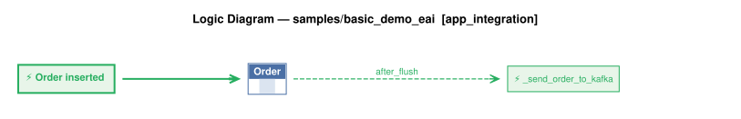

# Logic Flow — samples/basic_demo_eai [app_integration]

> Scoped to requirement: **app_integration**

<table>
<tr valign="top">
<td width="65%">



</td>
<td width="35%">

### Rules

1. `Order` → `_send_order_to_kafka` (after_flush) — Order publish: sends the Order to Kafka topic order_shipping when date_shipped is first set

</td>
</tr>
</table>

## Requirements

```
Feature: Kafka Publish Shipping Notification

  Scenario: Notify shipping when an order is dispatched
    Given an Order exists
    When date_shipped is set
    Then publish to Kafka topic order_shipping
    And use message_formats/order_shipping.json as the message shape
    And use by-example publish rather than key-only publish
```

---
_Generated 2026-10-19 19:46_
