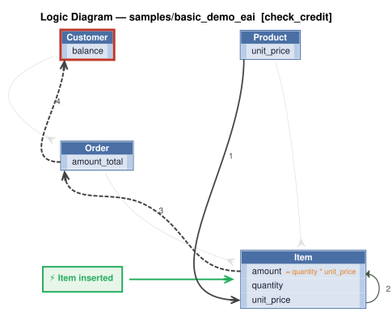

# Logic Flow — samples/basic_demo_eai [check_credit]

> Scoped to requirement: **check_credit**

<table>
<tr valign="top">
<td width="65%">



</td>
<td width="35%">

### Rules

1. `unit_price = copy(unit_price)`<br>
2. `amount = quantity * unit_price`<br>
3. `amount_total = sum(amount)`<br>
4. `balance = sum(amount_total where date_shipped)`<br>
5. constraint: `Customer`

</td>
</tr>
</table>

## Requirements

```
Feature: Check Credit

  Scenario: Place an order
    Given a customer with a credit limit
    When an order is placed
    Then copy the price from the product
    And multiply by quantity to get the item amount
    And sum item amounts to get the order total
    And sum unpaid order totals to get the customer balance
    And reject if balance exceeds the credit limit

version: 1.0
created: 2026-10-24
created_by: claude-sonnet-5-5 (valjhuber@gmail.com)
```

---
_Generated 2026-10-24 15:06_
