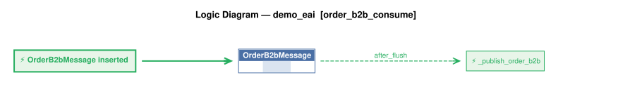

# Logic Flow — samples/basic_demo_eai [order_b2b_consume]

> Scoped to requirement: **order_b2b_consume**

<table>
<tr valign="top">
<td width="65%">



</td>
<td width="35%">

### Rules

1. `OrderB2bMessage` → `_publish_order_b2b` (after_flush) — OrderB2bMessage event: publishes the raw blob to topic order_b2b_processed after Tx 1 commits, so

</td>
</tr>
</table>

## Requirements

```
Feature: Kafka Subscribe Order Integration

  Scenario: Accept inbound orders from sales channel
    Given an inbound order message in JSON format (message_formats/order_b2b.json)
    When the message is received from Kafka topic order_b2b
    Then map Account to Customer by name
    And map Items.Name to Product by name
    And map Items.QuantityOrdered to Item.quantity

version: 1.0
created: 2026-10-24
created_by: claude-sonnet-5-5 (valjhuber@gmail.com)
```

---
_Generated 2026-10-24 15:06_
