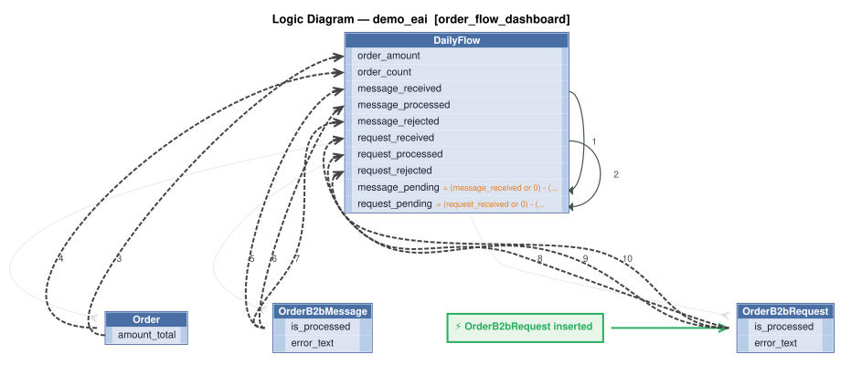

# Logic Flow — demo_eai [order_flow_dashboard]

> Scoped to requirement: **order_flow_dashboard**

<table>
<tr valign="top">
<td width="65%">



</td>
<td width="35%">

### Rules

1. `message_pending = (message_received or 0) - (message_processed or 0) - (message_rejected or 0)`<br>
2. `request_pending = (request_received or 0) - (request_processed or 0) - (request_rejected or 0)`<br>
3. `order_amount = sum(amount_total)`<br>
4. `order_count = count(Order)`<br>
5. `message_received = count(OrderB2bMessage)`<br>
6. `message_processed = count(OrderB2bMessage where is_processed)`<br>
7. `message_rejected = count(OrderB2bMessage where error_text)`<br>
8. `request_received = count(OrderB2bRequest)`<br>
9. `request_processed = count(OrderB2bRequest where is_processed)`<br>
10. `request_rejected = count(OrderB2bRequest where error_text)`

</td>
</tr>
</table>

## Requirements

```
Feature: Order Flow Dashboard

  Scenario: Show that orders are flowing
    Given orders arrive through the B2B API and the Kafka topic order_b2b
    When an operator opens the Admin App home page
    Then maintain daily totals of orders (count and total amount), and of order_b2b messages and B2B requests
         (received, processed, rejected, and not yet done)
    And chart the daily totals for the last 30 days, showing a day with no activity as zero
    And date each Order, message and request when it arrives
    And show current data each time the page is opened

version: 1.0
created: 2026-11-19T19:02:00
created_by: claude-opus-5-5 (valjhuber@gmail.com)
```

---
_Generated 2026-11-19 18:57_
