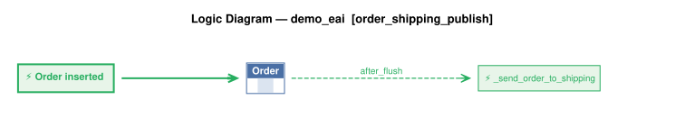

# Logic Flow — samples/basic_demo_eai [order_shipping_publish]

> Scoped to requirement: **order_shipping_publish**

<table>
<tr valign="top">
<td width="65%">



</td>
<td width="35%">

### Rules

1. `Order` → `_send_order_to_shipping` (after_flush) — Order event: publishes the Order to Kafka topic order_shipping (by-example, shape from

</td>
</tr>
</table>

## Requirements

```
Feature: Kafka Publish Shipping Notification

  Scenario: Notify shipping when an order is dispatched
    Given an Order exists
    When date_shipped is set
    Then publish to Kafka topic order_shipping
    And use message_formats/order_shipping.json as the message shape
    And use by-example publish rather than key-only publish

version: 1.0
created: 2026-10-24
created_by: claude-sonnet-5-5 (valjhuber@gmail.com)
```

---
_Generated 2026-10-24 15:06_
