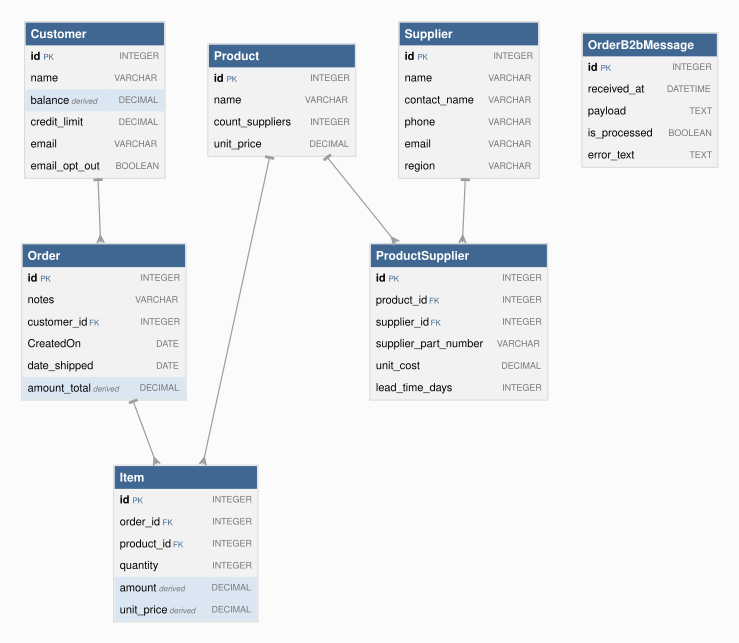

# Requirements Traceability Report

This report shows requirements, the rules created from them, and the tests created from those rules.

This project began as natural-language requirements, fleshed out by AI into a running system of business rules that are *executable documentation*. This report is how you govern the result.

A governable system is one you can **read**, **trust**, and **maintain**: each requirement is listed beside the rules that implement it (*read*); the tests and logic logs show those rules running (*trust*); re-run it after any change and it flags the gaps — an untested requirement, an untraced rule, a channel no test checks (*maintain*).

It is generated from the project's own files, nothing written by hand, so it is as current as the last run and covers the whole project, not a sample. Open **Background** (below the summary) for what the terms mean, how to read the report, and what it can and can't tell you.


**Project:** basic_demo_eai &nbsp;|&nbsp; **Generated:** October 21, 2026 12:09 &nbsp;|&nbsp; **Rules:** 8 &nbsp;|&nbsp; **Test scenarios:** 14 &nbsp;|&nbsp; **Generator:** requirements_traceability_report.py 2.9

**Last test run:** October 20, 2026 17:28 (18h 40m before this report; test results and logic logs below are from that run)


&nbsp;
&nbsp;

## At a Glance

**⚠ 5 requirement(s), all implemented; 4 tested (gap: §5 Security); 14 of 14 scenarios passed; last run 18h 40m ago.**

| | |
|---|---|
| Requirements | 5 (5 implemented) |
| Tested | 4 of 5 - gap: §5 Security |
| Last test run | ✅ 14 passed, 0 failed (October 20, 2026 17:28, 18h 40m ago) |
| Rules | 8 (5 declarative, 0 Python functions, 3 Python events) |
| Rules shown running in a test log | 7 of 8 |
| Security | not enabled; 11 role(s), 1 row-level grant(s) |
| Messages and APIs | 2 Kafka topic(s) in, 2 out; 2 HTTP endpoint(s) |

_Status: ✅ every requirement is implemented and tested, all scenarios pass, and the results are current. ⚠ a requirement is untested or unimplemented, there is no test run, or files changed since the last run. ❌ a scenario failed. This reports what was traced and tested, not that the system is correct._

**About this project** _(from [readme.md](../../../readme.md))_

This app illustrates using IntegrationServices for B2B push-style integrations with APIs, and internal integration with messages.

**basic_demo_eai** is a single API Logic Server providing APIs *and logic* — it both
subscribes and publishes, so there's no second project to stand up:

1. **Order Logic:** enforcing database integrity (Check Credit) and application
   integration (notify shipping)

2. A **Custom API** (`OrderB2B`), matching an agreed-upon format for B2B partners

3. **Kafka Subscribe:** listens on topic `order_b2b` for inbound orders from a
   message broker

4. **Kafka Publish:** publishes to topic `order_shipping` when an order ships —
   consumed by whatever downstream shipping system you plug in (not part of this
   demo)

5. **Standard APIs** for ad-hoc integration, user interfaces, etc

<details markdown>
<summary>Background: what this report is, and how to read it</summary>

&nbsp;

<details markdown>
<summary>Requirements are business policies, expressed in natural language</summary>

<br>

A **requirement** is a statement of business behavior - how data is computed, validated, and transmitted - written in plain language. It lives in the project at `docs/requirements/<name>/requirements.md`.  For example:

&nbsp;

```
On Placing Orders, Check Credit
    1. The Customer's balance does not exceed the credit limit
    2. The Customer's balance is the sum of the unshipped Order amount_total
    3. The Order's amount_total is the sum of the Item amount
    4. The Item amount is the quantity * unit_price
    5. The Item unit_price is copied from the Product unit_price
```

</details>

&nbsp;

<details markdown>
<summary>Rules implement requirements</summary>

<br>

A requirement is written at a high level, and AI fills in details as it builds — as it should — so the requirement no longer says exactly what the system does. The rules do. That's a Goldilocks answer to the question of what you review:

* **Requirements say too little** — incomplete by design; AI fills in the details.
* **Code says too much** — business language in, hundreds of lines of procedural code out. The work moves from writing to reading, and if you can't read it, you can't govern it.
* **Rules are just right** — close to the requirement's own level, but complete and deterministic.

Code could be treated like machine language — never read, only trusted — if it were produced deterministically. Generation from natural language isn't. Rules restore that contract: a readable source, deterministically executed.

The requirements above become rules like this:

```
Rule.copy(derive=models.Item.unit_price, from_parent=models.Product.unit_price)
Rule.formula(derive=models.Item.amount,
             as_expression=lambda row: row.quantity * row.unit_price)
Rule.sum(derive=models.Order.amount_total, as_sum_of=models.Item.amount)
Rule.sum(derive=models.Customer.balance, as_sum_of=models.Order.amount_total,
         where=lambda row: row.date_shipped is None)
Rule.constraint(
    validate=models.Customer,
    as_condition=lambda row: row.balance <= row.credit_limit,
    error_msg="balance ({row.balance}) exceeds credit limit ({row.credit_limit})")
```

Rules are ***executable documentation*** that you can read and trust:

* **Read:** rules stay near the requirement's level, so this report can list them side by side and you can check one against the other. 5 rules vs. ~200 lines in our [A/B test](https://github.com/ApiLogicServer/ApiLogicServer-src/blob/main/api_logic_server_cli/prototypes/manager/samples/basic_demo_logic_gov/logic/procedural/declarative-vs-procedural-comparison.md) — **~40x less to review**, whether generated or hand-coded.
* **Trust:** the document is enforced, not just descriptive.
    * **What you read is what runs** — no drift between description and behavior.
    * **Dependencies:** with code, you analyze every execution path to know it runs at the right times. With rules: if the rule is there, it runs, in the right order.
    * **All sources and paths:** the engine hooks into every commit — API, UI or agent — insert, update and delete, including related rows. No bypass.
    * **Seeing is believing:** each scenario in *Tests and Results* below embeds its logic log — every rule that ran, in order, with old and new values.

Better AI makes generating code easier. It doesn't change what you have to read. The problem is the representation, not the capability. And governance is active, not just process: the engine enforces the rules on every transaction, and this report — regenerated from the project itself — shows it happening.

&nbsp;

</details>

&nbsp;

<details markdown>
<summary>Process overview: creation and iteration</summary>

<br>


In two phases. First, `genai-logic create` builds a working system from the database: API, Admin App, data model. Then behavior is added from requirements — the typical sequence, each step a request to an AI assistant:

1. Write each requirement in natural language, in `docs/requirements/<name>/requirements.md`.
2. `implement reqs <name>` — creates the rules, API endpoints and Kafka integrations.
3. `create tests from rules` — writes the test scenarios and steps.
4. `run the tests` — starts the server if needed, runs the suite, reports pass/fail.
5. `run the requirements traceability report` — regenerates this report.

Optional: `create logic diagram for each requirement` (needs Graphviz).

What makes steps 3–5 possible: rules are high-level enough that AI can read them too. The tests, the logic diagrams and this report are all generated by reading the same rules you review — where logic is Python code, the report can only quote its docstring.

The report connects the chain: requirement → rules and handlers → tests → logic log. How *this* project was actually built is recorded under Provenance.

</details>

&nbsp;

<details markdown>
<summary>How to read this report</summary>

<br>

| If you are...  | Start with                                                        | Look for                                                                                     |
| -------------- | ----------------------------------------------------------------- | -------------------------------------------------------------------------------------------- |
| Business owner | *Requirements in detail*                                          | The requirement text, then the **Tests** line under it: does a test exist, and did it pass?  |
| Auditor        | *Coverage summary*, *Rule coverage by tests*, *Messages and APIs* | Gaps (untested, untraced), the date of the last test run, and how each rule was shown to run |
| Developer      | *Tests and Results*                                               | Each scenario's logic log: every rule that ran, in order, with old and new values            |

</details>

&nbsp;

<details markdown>
<summary>What this report can and can't tell you</summary>

<br>

**It shows**

- Which files and rules implement each requirement, read from the project's source.
- Which scenarios ran in the last test run, and whether each passed.
- Which rules the engine logged as running in each scenario.

**It doesn't show**

- Whether the requirements are right or complete. It traces what was written down.
- Whether an event did anything. Events run on every commit of their class and decide for themselves whether to act, so appearing in the log doesn't mean the event had an effect.
- Whether a constraint works. A constraint appears in the log only when it rejects a transaction, so look for a scenario that makes it reject.
- Whether a message arrived. Unless a test step looks for it on the broker or endpoint, a passing scenario doesn't prove delivery. The *Messages and APIs* table flags channels no test mentions.
- Whether the results are current. They are as old as the last test run, shown in the header, which also warns if files changed since.
- Which version of a requirement the code was built from, or which clause of a requirement a given rule serves.

</details>

&nbsp;

<details markdown>
<summary>Terms</summary>

<br>

| Term        | Meaning                                                                                              |
| ----------- | ---------------------------------------------------------------------------------------------------- |
| Requirement | A statement of business behavior, in plain language; the unit this report traces.                    |
| Rule        | A declaration about data (sum, count, formula, copy, constraint) that the engine enforces at every commit. |
| Event       | Python code the engine calls when a row of a given class changes (for example, to publish a message). |
| Handler     | Code that serves an API endpoint or consumes a Kafka topic.                                          |
| Scenario    | One Behave test: a short Given / When / Then script run against the live API.                        |
| Logic log   | The engine's record of every rule it ran in a transaction, nested to show cascades (an Item change adjusts its Order, which adjusts its Customer). |
| Phase       | The step of a commit: ROW LOGIC (derivations, constraints), COMMIT LOGIC (checks that need finished totals), AFTER_FLUSH LOGIC (events that need database-assigned keys, such as publishing). |
| Seen        | The engine reported running the rule in that scenario's log.                                         |

</details>

</details>


&nbsp;
&nbsp;

## Contents

- [Requirements Coverage](#requirements-coverage)
- [Data Model](#data-model)
- [Security (RBAC)](#security-rbac)
- [Messages and APIs](#messages-and-apis)
- [Tests and Results](#tests-and-results)
- [Provenance](#provenance)


&nbsp;
&nbsp;

## Requirements Coverage

Every requirement should have rules that implement it, and tests that prove it. This section checks that chain in both directions: a requirement missing rules or tests is a gap, and rules or tests that belong to no requirement are flagged too. The matching uses the `Feature:` names and `§N` tags that requirements, code and tests share.


&nbsp;

### Coverage summary

| Measure | Result |
|---|---|
| Requirements | 5 |
| Implemented (at least one file) | 5 of 5 |
| Tested (at least one scenario) | 4 of 5 - gap: §5 Security |
| Implementation not traced to a requirement | `logic/logic_discovery/system/all_classes_stamping.py` |
| Tests not traced to a requirement | none |
| Test results (last run) | ✅ 14 passed, 0 failed |
| Scenarios with a logic log | 14 of 14 |
| Rules seen in at least one scenario's log | 7 of 8 (1 not counted: the engine's log does not name `all classes.early_row_event → handle_all()`, so it cannot be matched) |

_Test results are as current as the last run (see the header). A gap is any requirement with no implementation or no test._

<details markdown>
<summary>How to read this table</summary>

Test results are read from `logs/behave.log`, so they are only as current as that run. Not recorded here: which version of a requirement the code was built against, and which clause of a requirement a given rule serves.

</details>


&nbsp;

### Traceability matrix

| Requirement | Implemented by | Rules | Tests |
|---|---|---|---|
| §1 Business Logic — Check Credit | [logic/logic_discovery/check_credit.py](../../../logic/logic_discovery/check_credit.py) | 5 | ✅ 9 scenario(s): 9 passed |
| §2 B2B API — Accept orders from external partners | [integration/OrderB2bMapper.py](../../../integration/OrderB2bMapper.py)<br>[api/api_discovery/order_b2b_api.py](../../../api/api_discovery/order_b2b_api.py) | 0 | ✅ 3 scenario(s): 3 passed |
| §3 Kafka Subscribe — Inbound orders from sales channel | [logic/logic_discovery/order_b2b_consume.py](../../../logic/logic_discovery/order_b2b_consume.py)<br>[integration/kafka/kafka_subscribe_discovery/order_b2b.py](../../../integration/kafka/kafka_subscribe_discovery/order_b2b.py)<br>[integration/OrderB2bMapper.py](../../../integration/OrderB2bMapper.py)<br>[api/api_discovery/order_b2b_consume_debug.py](../../../api/api_discovery/order_b2b_consume_debug.py) | 1 | ✅ 1 scenario(s): 1 passed |
| §4 Kafka Publish — Notify shipping on dispatch | [logic/logic_discovery/app_integration.py](../../../logic/logic_discovery/app_integration.py)<br>[integration/kafka/kafka_publish_discovery/order_shipping.py](../../../integration/kafka/kafka_publish_discovery/order_shipping.py) | 1 | ✅ 1 scenario(s): 1 passed |
| §5 Security | [security/declare_security.py](../../../security/declare_security.py) | 0 | ⚠ none defined |


&nbsp;

### Rule coverage by tests

| Rule | Requirement | Seen in |
|---|---|---|
| `Order.after_flush_row_event → _send_order_to_kafka()` | §4 Kafka Publish — Notify shipping on dispatch | 12: Partner Order Is Accepted And Rules Derive The Totals; Create Order Rolls Up To Customer Balance; Update Item Quantity Recalculates Amounts; +9 more |
| `Item.unit_price = copy of Product.unit_price` | §1 Business Logic — Check Credit | 13: Partner Order Is Accepted And Rules Derive The Totals; Partner Order Exceeding Credit Limit Is Rejected; Create Order Rolls Up To Customer Balance; +10 more |
| `Item.amount = quantity * unit_price` | §1 Business Logic — Check Credit | 13: Partner Order Is Accepted And Rules Derive The Totals; Partner Order Exceeding Credit Limit Is Rejected; Create Order Rolls Up To Customer Balance; +10 more |
| `Order.amount_total = sum(Item.amount)` | §1 Business Logic — Check Credit | 13: Partner Order Is Accepted And Rules Derive The Totals; Partner Order Exceeding Credit Limit Is Rejected; Create Order Rolls Up To Customer Balance; +10 more |
| `Customer.balance = sum(Order.amount_total) where date_shipped is None` | §1 Business Logic — Check Credit | 13: Partner Order Is Accepted And Rules Derive The Totals; Partner Order Exceeding Credit Limit Is Rejected; Create Order Rolls Up To Customer Balance; +10 more |
| `Customer: balance is None or credit_limit is None or balance <= credit_limit` | §1 Business Logic — Check Credit | 2: Partner Order Exceeding Credit Limit Is Rejected; Order Exceeding Credit Limit Is Rejected |
| `OrderB2bMessage.after_flush_row_event → _publish_order_b2b()` | §3 Kafka Subscribe — Inbound orders from sales channel | 1: Inbound Order Message Creates The Order And Items |
| `all classes.early_row_event → handle_all()` | (none) | n/a - cannot be matched to the engine's log |

_"Seen" means the engine's log shows the rule ran, not proof that it took effect._

<details markdown>
<summary>How to read this table</summary>

"Seen" means the engine reported running the rule in that scenario's logic log. A scenario can only contribute if it has a log (see the coverage summary): a test that does not open one writes into whichever log was open last, and its rules are then credited to that scenario, or to the shared log. An event's function runs on every commit of its class, and its own condition decides whether it acts, so seen does not mean it took effect. A constraint appears in the log only when it rejects a transaction, so it is seen only in scenarios that make it reject. "Not seen" therefore means no log shows it, not that no test ran it.

</details>


&nbsp;

### Requirements in detail

**8 rules** in 4 files: 5 declarative (sum, count, copy, formula and constraint expressions), 0 backed by a Python function, 3 events (Python).

_Declarative rules are read straight from their declarations. Functions and events are Python code, so for those the report shows the docstring — it does not analyze the code._

Each requirement is followed by the rules and handlers in the files that implement it. Logic diagrams are shown (click to expand) where they exist.

<details markdown>
<summary>How to create the missing logic diagrams</summary>

Needs Graphviz (`brew install graphviz`). Tell your AI assistant:

```
create logic diagram for each requirement
```

or run this from the Manager root (`genai-logic`):

```
python system/ApiLogicServer-Internal-Dev/logic_diagram_gv.py samples/basic_demo_eai --each
```

Each diagram is saved under `docs/requirements/<name>/logic_diagrams/`. Then regenerate this report (`python requirements_traceability_report.py run`, from `test/api_logic_server_behave`).

</details>

&nbsp;


#### §1 Business Logic — Check Credit

Tests: ✅ 9 scenario(s): 9 passed

```
Feature: Check Credit

  Scenario: Place an order
    Given a customer with a credit limit
    When an order is placed
    Then copy the price from the product
    And multiply by quantity to get the item amount
    And sum item amounts to get the order total
    And sum unpaid order totals to get the customer balance
    And reject if balance exceeds the credit limit
```

| Rule / item | Type | Logic | Description | Where |
|---|---|---|---|---|
| `Item.unit_price = copy of Product.unit_price` | copy | declarative |  | [check_credit.py](../../../logic/logic_discovery/check_credit.py) |
| `Item.amount = quantity * unit_price` | formula | declarative |  | [check_credit.py](../../../logic/logic_discovery/check_credit.py) |
| `Order.amount_total = sum(Item.amount)` | sum | declarative |  | [check_credit.py](../../../logic/logic_discovery/check_credit.py) |
| `Customer.balance = sum(Order.amount_total) where date_shipped is None` | sum | declarative |  | [check_credit.py](../../../logic/logic_discovery/check_credit.py) |
| `Customer: balance is None or credit_limit is None or balance <= credit_limit` | constraint | declarative | Error: balance ({row.balance}) exceeds credit limit ({row.credit_limit}) | [check_credit.py](../../../logic/logic_discovery/check_credit.py) |

<details markdown>
<summary>Logic diagram: check_credit</summary>


</details>

#### §2 B2B API — Accept orders from external partners

Tests: ✅ 3 scenario(s): 3 passed

```
Feature: B2B Order Integration

  Scenario: Accept order from external partner
    Given an inbound B2B order in partner format (message_formats/order_b2b.json)
    When the order is received via a Custom API endpoint named OrderB2B
    Then map Account to Customer by name
    And map Items.Name to Product by name
    And map Items.QuantityOrdered to Item.quantity
```

| Rule / item | Type | Logic | Description | Where |
|---|---|---|---|---|
| `OrderB2bMapper.py` | module |  | JSON → Order + Items mapper for Kafka topic order_b2b / Custom API OrderB2B (Req §2, §3). | [OrderB2bMapper.py](../../../integration/OrderB2bMapper.py) |
| `HTTP in: POST /api/OrderB2B` | http | handler (Python) | API service OrderB2B: accepts an inbound B2B order from an external partner. | [order_b2b_api.py](../../../api/api_discovery/order_b2b_api.py) |

#### §3 Kafka Subscribe — Inbound orders from sales channel

Tests: ✅ 1 scenario(s): 1 passed

```
Feature: Kafka Subscribe Order Integration

  Scenario: Accept inbound orders from sales channel
    Given an inbound order message in JSON format (message_formats/order_b2b.json)
    When the message is received from Kafka topic order_b2b
    Then map Account to Customer by name
    And map Items.Name to Product by name
    And map Items.QuantityOrdered to Item.quantity
```

| Rule / item | Type | Logic | Description | Where |
|---|---|---|---|---|
| `OrderB2bMessage.after_flush_row_event → _publish_order_b2b()` | after_flush_row_event | event (Python) | OrderB2bMessage event: publishes the raw blob to order_b2b_processed after Tx 1 commits, so Consumer 2 can parse it in a clean Tx 2 (2-message pattern). | [order_b2b_consume.py](../../../logic/logic_discovery/order_b2b_consume.py) |
| `Kafka in: order_b2b` | kafka | handler (Python) | Kafka subscribe order_b2b (Consumer 1): saves the raw message as an OrderB2bMessage blob and commits; the row event then publishes it to order_b2b_processed. | [order_b2b.py](../../../integration/kafka/kafka_subscribe_discovery/order_b2b.py) |
| `Kafka in: order_b2b_processed` | kafka | handler (Python) | Kafka subscribe order_b2b_processed (Consumer 2): parses the blob and persists Order and Item rows, marking the blob processed, in one atomic transaction (Tx 2). | [order_b2b.py](../../../integration/kafka/kafka_subscribe_discovery/order_b2b.py) |
| `OrderB2bMapper.py` | module |  | JSON → Order + Items mapper for Kafka topic order_b2b / Custom API OrderB2B (Req §2, §3). | [OrderB2bMapper.py](../../../integration/OrderB2bMapper.py) |
| `HTTP in: GET /consume_debug/order_b2b` | http | handler (Python) | API service consume_debug: runs the order_b2b consume pipeline without Kafka. | [order_b2b_consume_debug.py](../../../api/api_discovery/order_b2b_consume_debug.py) |

#### §4 Kafka Publish — Notify shipping on dispatch

Tests: ✅ 1 scenario(s): 1 passed

```
Feature: Kafka Publish Shipping Notification

  Scenario: Notify shipping when an order is dispatched
    Given an Order exists
    When date_shipped is set
    Then publish to Kafka topic order_shipping
    And use message_formats/order_shipping.json as the message shape
    And use by-example publish rather than key-only publish
```

| Rule / item | Type | Logic | Description | Where |
|---|---|---|---|---|
| `Order.after_flush_row_event → _send_order_to_kafka()` | after_flush_row_event | event (Python) | Order publish: sends the Order to Kafka topic order_shipping when date_shipped is first set (or changes), by example, using the message shape in kafka_publish_discovery/order_shipping.py. | [app_integration.py](../../../logic/logic_discovery/app_integration.py) |
| `order_shipping.py` | module |  | By-example publish mapper for Kafka topic order_shipping (Req §4). | [order_shipping.py](../../../integration/kafka/kafka_publish_discovery/order_shipping.py) |

<details markdown>
<summary>Logic diagram: app_integration</summary>


</details>

#### §5 Security

Tests: none defined

```
Feature: Row-Level Security
  Scenario: Sales role sees limited customers
    Given a user with the sales role
    When querying the Customer list
    Then only return customers where credit_limit >= 3000 or balance > 0
```

| Rule / item | Type | Logic | Description | Where |
|---|---|---|---|---|
| `Grant on Customer to role sales: credit_limit >= 3000 or balance > 0` | grant | declarative |  | [declare_security.py](../../../security/declare_security.py) |

#### Rules not traced to a requirement

| Rule / item | Type | Logic | Description | Where |
|---|---|---|---|---|
| `all classes.early_row_event → handle_all()` | early_row_event_all_classes | event (Python) | Generic handler - executed for every row update across all classes. | [all_classes_stamping.py](../../../logic/logic_discovery/system/all_classes_stamping.py) |


&nbsp;
&nbsp;

## Data Model

The tables the rules run over. Shaded columns are derived by rules — no code writes them.



_Generated from `docs/db.dbml` (parents above children; shaded rows are derived by rules). To use your own layout, save it as `docs/db_diagram.png`._


&nbsp;

### Derived columns

| Table | Column | Rule | Definition |
|---|---|---|---|
| Item | unit_price | copy | `Item.unit_price = copy of Product.unit_price` |
| Item | amount | formula | `Item.amount = quantity * unit_price` |
| Order | amount_total | sum | `Order.amount_total = sum(Item.amount)` |
| Customer | balance | sum | `Customer.balance = sum(Order.amount_total) where date_shipped is None` |


&nbsp;
&nbsp;

## Security (RBAC)

Who can do what: each role's permissions, and which rows each role can see.

**Security enabled: no** (`SECURITY_ENABLED` in `config/default.env`). The declarations below are not enforced until `genai-logic add-auth` is run.


&nbsp;

### Roles and CRUD (DefaultRolePermission)

| Role | Read | Insert | Update | Delete |
|---|---|---|---|---|
| sa | ✅ | ✅ | ✅ | ✅ |
| tenant | ✅ | — | — | ✅ |
| CS_ADMIN | ✅ | ✅ | ✅ | ✅ |
| manager | ✅ | ✅ | ✅ | — |
| teller | ✅ | ✅ | ✅ | — |
| customer | ✅ | ✅ | ✅ | — |
| readonly | ✅ | — | — | — |
| public | ✅ | — | — | — |
| sales | ✅ | — | — | — |
| default-roles-kcals | ✅ | ✅ | ✅ | — |
| uma_authorization | ✅ | ✅ | ✅ | — |


&nbsp;

### Row-level grants (Grant)

| Table | Role | Filter | Requirement |
|---|---|---|---|
| Customer | sales | `credit_limit >= 3000 or balance > 0` | §5 |


&nbsp;
&nbsp;

## Messages and APIs

How data enters and leaves beyond the standard API: Kafka topics in and out, custom HTTP endpoints — and whether any test touches each one.

| Direction | Channel | Name | Handler | Tables created | Message shape | Requirement | Tests mention it |
|---|---|---|---|---|---|---|---|
| ➡ in | Kafka | `order_b2b` | `order_b2b()` - Kafka subscribe order_b2b (Consumer 1): saves the raw message as an OrderB2bMessage blob and commits; the row event then publishes it to order_b2b_processed. | OrderB2bMessage | [order_b2b.json](../../../integration/kafka/message_formats/order_b2b.json) | §3 Kafka Subscribe — Inbound orders from sales channel | ✅ |
| ➡ in | Kafka | `order_b2b_processed` | `order_b2b_processed()` - Kafka subscribe order_b2b_processed (Consumer 2): parses the blob and persists Order and Item rows, marking the blob processed, in one atomic transaction (Tx 2). | Item, Order, OrderB2bMessage |  | §3 Kafka Subscribe — Inbound orders from sales channel | ⚠ no test mentions it |
| ⬅ out | Kafka | `order_shipping` | Order.after_flush_row_event → _send_order_to_kafka() - Order publish: sends the Order to Kafka topic order_shipping when date_shipped is first set (or changes), by example, using the message shape in kafka_publish_discovery/order_shipping.py. |  | [order_shipping.json](../../../integration/kafka/message_formats/order_shipping.json) | §4 Kafka Publish — Notify shipping on dispatch | ✅ |
| ⬅ out | Kafka | `order_b2b_processed` | OrderB2bMessage.after_flush_row_event → _publish_order_b2b() - OrderB2bMessage event: publishes the raw blob to order_b2b_processed after Tx 1 commits, so Consumer 2 can parse it in a clean Tx 2 (2-message pattern). |  |  | §3 Kafka Subscribe — Inbound orders from sales channel | ⚠ no test mentions it |
| ➡ in | HTTP | `POST /api/OrderB2B` | `order_b2b_api()` - API service OrderB2B: accepts an inbound B2B order from an external partner. |  |  | §2 B2B API — Accept orders from external partners | ✅ |
| ➡ in | HTTP | `GET /consume_debug/order_b2b` | `consume_debug_order_b2b()` - API service consume_debug: runs the order_b2b consume pipeline without Kafka. |  |  | §3 Kafka Subscribe — Inbound orders from sales channel | ✅ |

_"Tests mention it" checks the test sources, not delivery._

<details markdown>
<summary>How to read this column</summary>

A passing scenario proves a message reached a topic or an endpoint only if its steps look for it there. A handler that ran (see the logic log) is weaker evidence than a step that consumes the message. Channels no test mentions are flagged.

</details>

<details markdown>
<summary>How to read this table</summary>

Topics and endpoints are read from the discovery folders. The condition that triggers an outbound message lives in Python (see the rules under each requirement); here it is described by the handler's docstring. "Tables created" lists rows the handler's code constructs, following its calls within the project; blank means none were found, not that none exist.

</details>


<details markdown>
<summary>Message shape: order_b2b</summary>

```json
{
  "Account": "Alice",
  "Notes": "Kafka order from sales",
  "Items": [
    { "Name": "Widget",  "QuantityOrdered": 1 },
    { "Name": "Gadget",  "QuantityOrdered": 2 }
  ]
}
```
</details>

<details markdown>
<summary>Message shape: order_shipping</summary>

```json
{
  "order_id": 1,
  "order_date": "2026-04-06",
  "customer_name": "Alfreds Futterkiste",
  "total": 100.00,
  "items": [
    { "quantity": 2, "product_name": "Chai", "unit_price": 25.00 }
  ]
}
```
</details>


&nbsp;
&nbsp;

## Tests and Results

**✅ 14 scenario(s): 14 passed, 0 failed** (from the last run, `logs/behave.log`).

Each test drives the running system the way any client would — create an order, change a quantity, ship it — and checks the result.

**The logic log** is what makes them more than pass/fail. Business rules run inside the server on every commit, so the server records exactly what they did, and this report embeds that record for each scenario. Two things to look for:

1. **It shows every rule that runs.** Each line is one rule execution, with the row's state, old and new values. You see not just that a test passed, but which rules ran and what each one changed.
2. **The nesting shows multi-table chaining.** Indentation follows the cascade: a change to an Item adjusts its Order, which adjusts its Customer.

<details markdown>
<summary>How to read the logic log</summary>

Open a scenario's "Rules exercised and logic log" block to see it. The log is shown in full, attribute values included, because those values are what you diagnose from when a rule produces an unexpected result.

To read a log line:

```
....Order[16] {Update - Adjusting order: amount_total} id: 16, customer_id: 19, amount_total:  [0.0-->] 90.0

```

- The leading dots are the depth in the cascade: Item (2 dots), its Order (4), its Customer (6).
- `Order[16]` is the row; `{...}` is the rule or action that ran; the rest is the row's attribute values at that step.
- `[0.0-->] 90.0` marks a value the rules changed, with its old and new value.
- The log is in phases: **ROW LOGIC** (derivations and constraints, as rows change), **COMMIT LOGIC** (checks that need the finished aggregates), and **AFTER_FLUSH LOGIC** (events that need database-assigned keys, such as the Kafka publish).

More: [Logic Log](https://apilogicserver.github.io/Docs/Logic-Debug/#logic-log).

</details>

&nbsp;

<details markdown>
<summary>How to add more tests, and run them</summary>

**1. Have AI create them.** This project's context tells your AI assistant how (`.github/copilot-instructions.md`, `docs/training/testing.md`). Just say:

```

create tests from rules

```

The assistant reads `database/models.py`, the logic files and the custom APIs, then writes `.feature` files and step implementations under `test/api_logic_server_behave/features/`. Then say `run the tests` and `run the requirements traceability report` and the assistant does both.

Or, to have each requirement's tests linked in the Tests column above (it matches on `Feature:` name), say which names to use:

```

create tests from rules, one Feature per requirement, named exactly:
- Check Credit
- B2B Order Integration
- Kafka Subscribe Order Integration
- Kafka Publish Shipping Notification
- Row-Level Security

```

_Tests with other names still run and appear below; they just aren't linked to a requirement._

**2. You can also define tests manually.** Add a `<name>.feature` file (Gherkin) under `test/api_logic_server_behave/features/` and its steps under `features/steps/`. The steps call the running API, so tests exercise the same rules as any client. See `docs/training/testing.md` for the patterns that keep tests repeatable.

**Or run them yourself** (server running, from `test/api_logic_server_behave`):

```

python behave_run.py --outfile=logs/behave.log
python requirements_traceability_report.py run

```

</details>

&nbsp;
&nbsp;

### Feature: B2B Order Integration  

&nbsp;
&nbsp;

#### Scenario: Partner Order Is Accepted And Rules Derive The Totals ✅
&emsp;  Scenario: Partner Order Is Accepted And Rules Derive The Totals  
&emsp;&emsp;    Given Customer "Acme" with balance 0 and credit limit 1000  
&emsp;&emsp;    When B2B order is posted for "Acme" with 2 Widget and 1 Gadget  
&emsp;&emsp;    Then B2B order is accepted  
&emsp;&emsp;    Then Order has 2 items  
&emsp;&emsp;    Then Order amount_total is 330  
&emsp;&emsp;    Then Customer balance is 330  

<details markdown>
<summary>Rules exercised and logic log (1 transaction)</summary>


&nbsp;
&nbsp;


**Rules Used** in Scenario: Partner Order Is Accepted And Rules Derive The Totals
```
  Customer  
    1. Derive Customer.balance as Sum(Order.amount_total Where lambda row: row.date_shipped is None))  
  Item  
    2. Derive Item.amount as Formula (1): as_expression=lambda row: row.quantity * row.unit [...]  
    3. Derive Item.unit_price as Copy(product.unit_price)  
  Order  
    4. RowEvent Order._send_order_to_kafka()  
    5. Derive Order.amount_total as Sum(Item.amount Where  - None)  
```
**Logic Log** in Scenario: Partner Order Is Accepted And Rules Derive The Totals (1 transaction)
```
Logic Phase:		ROW LOGIC		(session=0x10c8009d0) (sqlalchemy before_flush)			 - 2026-10-19 20:06:20,581 - logic_logger - INFO
..Order[None] {Insert - client} id: None, notes: behave test, customer_id: 6, CreatedOn: None, date_shipped: None, amount_total: None  row: 0x10c78b150  session: 0x10c8009d0  ins_upd_dlt: ins, initial: ins - 2026-10-19 20:06:20,581 - logic_logger - INFO
..Order[None] {server aggregate_defaults: amount_total } id: None, notes: behave test, customer_id: 6, CreatedOn: None, date_shipped: None, amount_total: 0  row: 0x10c78b150  session: 0x10c8009d0  ins_upd_dlt: ins, initial: ins - 2026-10-19 20:06:20,581 - logic_logger - INFO
..Item[None] {Insert - client} id: None, order_id: None, product_id: 2, quantity: 2, amount: None, unit_price: None  row: 0x10c78bc50  session: 0x10c8009d0  ins_upd_dlt: ins, initial: ins - 2026-10-19 20:06:20,581 - logic_logger - INFO
..Item[None] {copy_rules for role: product - unit_price} id: None, order_id: None, product_id: 2, quantity: 2, amount: None, unit_price: 90.0000000000  row: 0x10c78bc50  session: 0x10c8009d0  ins_upd_dlt: ins, initial: ins - 2026-10-19 20:06:20,582 - logic_logger - INFO
..Item[None] {Formula amount} id: None, order_id: None, product_id: 2, quantity: 2, amount: 180.0000000000, unit_price: 90.0000000000  row: 0x10c78bc50  session: 0x10c8009d0  ins_upd_dlt: ins, initial: ins - 2026-10-19 20:06:20,582 - logic_logger - INFO
....Order[None] {Update - Adjusting order: amount_total} id: None, notes: behave test, customer_id: 6, CreatedOn: None, date_shipped: None, amount_total:  [0-->] 180.0000000000  row: 0x10c78b150  session: 0x10c8009d0  ins_upd_dlt: upd, initial: upd - 2026-10-19 20:06:20,582 - logic_logger - INFO
......Customer[6] {Update - Adjusting customer: balance} id: 6, name: Acme 1792465580574, balance:  [0E-10-->] 180.0000000000, credit_limit: 1000.0000000000, email: None, email_opt_out: None  row: 0x10c78afd0  session: 0x10c8009d0  ins_upd_dlt: upd, initial: upd - 2026-10-19 20:06:20,582 - logic_logger - INFO
..Item[None] {Insert - client} id: None, order_id: None, product_id: 1, quantity: 1, amount: None, unit_price: None  row: 0x10c098450  session: 0x10c8009d0  ins_upd_dlt: ins, initial: ins - 2026-10-19 20:06:20,582 - logic_logger - INFO
..Item[None] {copy_rules for role: product - unit_price} id: None, order_id: None, product_id: 1, quantity: 1, amount: None, unit_price: 150.0000000000  row: 0x10c098450  session: 0x10c8009d0  ins_upd_dlt: ins, initial: ins - 2026-10-19 20:06:20,582 - logic_logger - INFO
..Item[None] {Formula amount} id: None, order_id: None, product_id: 1, quantity: 1, amount: 150.0000000000, unit_price: 150.0000000000  row: 0x10c098450  session: 0x10c8009d0  ins_upd_dlt: ins, initial: ins - 2026-10-19 20:06:20,583 - logic_logger - INFO
....Order[None] {Update - Adjusting order: amount_total} id: None, notes: behave test, customer_id: 6, CreatedOn: None, date_shipped: None, amount_total:  [180.0000000000-->] 330.0000000000  row: 0x10c78b150  session: 0x10c8009d0  ins_upd_dlt: upd, initial: upd - 2026-10-19 20:06:20,583 - logic_logger - INFO
......Customer[6] {Update - Adjusting customer: balance} id: 6, name: Acme 1792465580574, balance:  [180.0000000000-->] 330.0000000000, credit_limit: 1000.0000000000, email: None, email_opt_out: None  row: 0x10c78afd0  session: 0x10c8009d0  ins_upd_dlt: upd, initial: upd - 2026-10-19 20:06:20,583 - logic_logger - INFO
Logic Phase:		COMMIT LOGIC		(session=0x10c8009d0)   										 - 2026-10-19 20:06:20,583 - logic_logger - INFO
Logic Phase:		AFTER_FLUSH LOGIC	(session=0x10c8009d0)   										 - 2026-10-19 20:06:20,584 - logic_logger - INFO
..Order[6] {AfterFlush Event} id: 6, notes: behave test, customer_id: 6, CreatedOn: None, date_shipped: None, amount_total: 330.0000000000  row: 0x10c78b150  session: 0x10c8009d0  ins_upd_dlt: ins, initial: ins - 2026-10-19 20:06:20,584 - logic_logger - INFO

```
</details>

&nbsp;
&nbsp;

#### Scenario: Partner Order For An Unknown Customer Is Rejected ✅
&emsp;  Scenario: Partner Order For An Unknown Customer Is Rejected  
&emsp;&emsp;    Given Customer "Beta" with balance 0 and credit limit 1000  
&emsp;&emsp;    When B2B order is posted for unknown customer with 1 Widget  
&emsp;&emsp;    Then B2B order is rejected with status 404  
&emsp;&emsp;    Then Customer balance is 0  

_No rules fired in this scenario's logic log._

&nbsp;
&nbsp;

#### Scenario: Partner Order Exceeding Credit Limit Is Rejected ✅
&emsp;  Scenario: Partner Order Exceeding Credit Limit Is Rejected  
&emsp;&emsp;    Given Customer "Gamma" with balance 0 and credit limit 100  
&emsp;&emsp;    When B2B order is posted for "Gamma" with 2 Widget  
&emsp;&emsp;    Then B2B order is not accepted  
&emsp;&emsp;    Then Customer balance is 0  

<details markdown>
<summary>Rules exercised and logic log (1 transaction)</summary>


&nbsp;
&nbsp;


**Rules Used** in Scenario: Partner Order Exceeding Credit Limit Is Rejected
```
  Customer  
    1. Derive Customer.balance as Sum(Order.amount_total Where lambda row: row.date_shipped is None))  
    2. Constraint Function: None  
  Item  
    3. Derive Item.amount as Formula (1): as_expression=lambda row: row.quantity * row.unit [...]  
    4. Derive Item.unit_price as Copy(product.unit_price)  
  Order  
    5. Derive Order.amount_total as Sum(Item.amount Where  - None)  
```
**Logic Log** in Scenario: Partner Order Exceeding Credit Limit Is Rejected (1 transaction)
```
Logic Phase:		ROW LOGIC		(session=0x10c773570) (sqlalchemy before_flush)			 - 2026-10-19 20:06:20,606 - logic_logger - INFO
..Order[None] {Insert - client} id: None, notes: behave test, customer_id: 8, CreatedOn: None, date_shipped: None, amount_total: None  row: 0x10c78b9d0  session: 0x10c773570  ins_upd_dlt: ins, initial: ins - 2026-10-19 20:06:20,606 - logic_logger - INFO
..Order[None] {server aggregate_defaults: amount_total } id: None, notes: behave test, customer_id: 8, CreatedOn: None, date_shipped: None, amount_total: 0  row: 0x10c78b9d0  session: 0x10c773570  ins_upd_dlt: ins, initial: ins - 2026-10-19 20:06:20,606 - logic_logger - INFO
..Item[None] {Insert - client} id: None, order_id: None, product_id: 2, quantity: 2, amount: None, unit_price: None  row: 0x10c7f32d0  session: 0x10c773570  ins_upd_dlt: ins, initial: ins - 2026-10-19 20:06:20,606 - logic_logger - INFO
..Item[None] {copy_rules for role: product - unit_price} id: None, order_id: None, product_id: 2, quantity: 2, amount: None, unit_price: 90.0000000000  row: 0x10c7f32d0  session: 0x10c773570  ins_upd_dlt: ins, initial: ins - 2026-10-19 20:06:20,606 - logic_logger - INFO
..Item[None] {Formula amount} id: None, order_id: None, product_id: 2, quantity: 2, amount: 180.0000000000, unit_price: 90.0000000000  row: 0x10c7f32d0  session: 0x10c773570  ins_upd_dlt: ins, initial: ins - 2026-10-19 20:06:20,606 - logic_logger - INFO
....Order[None] {Update - Adjusting order: amount_total} id: None, notes: behave test, customer_id: 8, CreatedOn: None, date_shipped: None, amount_total:  [0-->] 180.0000000000  row: 0x10c78b9d0  session: 0x10c773570  ins_upd_dlt: upd, initial: upd - 2026-10-19 20:06:20,606 - logic_logger - INFO
......Customer[8] {Update - Adjusting customer: balance} id: 8, name: Gamma 1792465580602, balance:  [0E-10-->] 180.0000000000, credit_limit: 100.0000000000, email: None, email_opt_out: None  row: 0x10c7f3250  session: 0x10c773570  ins_upd_dlt: upd, initial: upd - 2026-10-19 20:06:20,606 - logic_logger - INFO
......Customer[8] {Constraint Failure: balance (180.0000000000) exceeds credit limit (100.0000000000)} id: 8, name: Gamma 1792465580602, balance:  [0E-10-->] 180.0000000000, credit_limit: 100.0000000000, email: None, email_opt_out: None  row: 0x10c7f3250  session: 0x10c773570  ins_upd_dlt: upd, initial: upd - 2026-10-19 20:06:20,606 - logic_logger - INFO

```
</details>

&nbsp;
&nbsp;

### Feature: Check Credit  

&nbsp;
&nbsp;

#### Scenario: Create Order Rolls Up To Customer Balance ✅
&emsp;  Scenario: Create Order Rolls Up To Customer Balance  
&emsp;&emsp;    Given Customer "Alice" with balance 0 and credit limit 1000  
&emsp;&emsp;    And Order is created for "Alice"  
&emsp;&emsp;    When Item is created with 5 Widget  
&emsp;&emsp;    Then Item unit_price is 90  
&emsp;&emsp;    Then Item amount is 450  
&emsp;&emsp;    Then Order amount_total is 450  
&emsp;&emsp;    Then Customer balance is 450  

<details markdown>
<summary>Rules exercised and logic log (2 transactions)</summary>


&nbsp;
&nbsp;


**Rules Used** in Scenario: Create Order Rolls Up To Customer Balance
```
  Customer  
    1. Derive Customer.balance as Sum(Order.amount_total Where lambda row: row.date_shipped is None))  
  Order  
    2. RowEvent Order._send_order_to_kafka()  
    3. Derive Order.amount_total as Sum(Item.amount Where  - None)  
  Item  
    4. Derive Item.amount as Formula (1): as_expression=lambda row: row.quantity * row.unit [...]  
    5. Derive Item.unit_price as Copy(product.unit_price)  
```
**Logic Log** in Scenario: Create Order Rolls Up To Customer Balance (2 transactions)
```
Logic Phase:		ROW LOGIC		(session=0x10c773570) (sqlalchemy before_flush)			 - 2026-10-19 20:06:20,614 - logic_logger - INFO
..Order[None] {Insert - client} id: None, notes: None, customer_id: 9, CreatedOn: None, date_shipped: None, amount_total: None  row: 0x10c7f2850  session: 0x10c773570  ins_upd_dlt: ins, initial: ins - 2026-10-19 20:06:20,614 - logic_logger - INFO
..Order[None] {server aggregate_defaults: amount_total } id: None, notes: None, customer_id: 9, CreatedOn: None, date_shipped: None, amount_total: 0  row: 0x10c7f2850  session: 0x10c773570  ins_upd_dlt: ins, initial: ins - 2026-10-19 20:06:20,614 - logic_logger - INFO
Logic Phase:		COMMIT LOGIC		(session=0x10c773570)   										 - 2026-10-19 20:06:20,615 - logic_logger - INFO
Logic Phase:		AFTER_FLUSH LOGIC	(session=0x10c773570)   										 - 2026-10-19 20:06:20,615 - logic_logger - INFO
..Order[7] {AfterFlush Event} id: 7, notes: None, customer_id: 9, CreatedOn: None, date_shipped: None, amount_total: 0  row: 0x10c7f2850  session: 0x10c773570  ins_upd_dlt: ins, initial: ins - 2026-10-19 20:06:20,615 - logic_logger - INFO


Logic Phase:		ROW LOGIC		(session=0x10c773350) (sqlalchemy before_flush)			 - 2026-10-19 20:06:20,620 - logic_logger - INFO
..Item[None] {Insert - client} id: None, order_id: 7, product_id: 2, quantity: 5, amount: None, unit_price: None  row: 0x10c78bcd0  session: 0x10c773350  ins_upd_dlt: ins, initial: ins - 2026-10-19 20:06:20,620 - logic_logger - INFO
..Item[None] {copy_rules for role: product - unit_price} id: None, order_id: 7, product_id: 2, quantity: 5, amount: None, unit_price: 90.0000000000  row: 0x10c78bcd0  session: 0x10c773350  ins_upd_dlt: ins, initial: ins - 2026-10-19 20:06:20,621 - logic_logger - INFO
..Item[None] {Formula amount} id: None, order_id: 7, product_id: 2, quantity: 5, amount: 450.0000000000, unit_price: 90.0000000000  row: 0x10c78bcd0  session: 0x10c773350  ins_upd_dlt: ins, initial: ins - 2026-10-19 20:06:20,621 - logic_logger - INFO
....Order[7] {Update - Adjusting order: amount_total} id: 7, notes: None, customer_id: 9, CreatedOn: None, date_shipped: None, amount_total:  [0E-10-->] 450.0000000000  row: 0x10c9562d0  session: 0x10c773350  ins_upd_dlt: upd, initial: upd - 2026-10-19 20:06:20,621 - logic_logger - INFO
......Customer[9] {Update - Adjusting customer: balance} id: 9, name: Alice 1792465580610, balance:  [0E-10-->] 450.0000000000, credit_limit: 1000.0000000000, email: None, email_opt_out: None  row: 0x10c956ad0  session: 0x10c773350  ins_upd_dlt: upd, initial: upd - 2026-10-19 20:06:20,622 - logic_logger - INFO
Logic Phase:		COMMIT LOGIC		(session=0x10c773350)   										 - 2026-10-19 20:06:20,622 - logic_logger - INFO
Logic Phase:		AFTER_FLUSH LOGIC	(session=0x10c773350)   										 - 2026-10-19 20:06:20,623 - logic_logger - INFO
....Order[7] {AfterFlush Event} id: 7, notes: None, customer_id: 9, CreatedOn: None, date_shipped: None, amount_total:  [0E-10-->] 450.0000000000  row: 0x10c9562d0  session: 0x10c773350  ins_upd_dlt: upd, initial: upd - 2026-10-19 20:06:20,623 - logic_logger - INFO

```
</details>

&nbsp;
&nbsp;

#### Scenario: Update Item Quantity Recalculates Amounts ✅
&emsp;  Scenario: Update Item Quantity Recalculates Amounts  
&emsp;&emsp;    Given Customer "Bob" with balance 0 and credit limit 1000  
&emsp;&emsp;    And Order is created for "Bob"  
&emsp;&emsp;    And Item is created with 2 Widget  
&emsp;&emsp;    When Item quantity is changed to 6  
&emsp;&emsp;    Then Item amount is 540  
&emsp;&emsp;    Then Order amount_total is 540  
&emsp;&emsp;    Then Customer balance is 540  

<details markdown>
<summary>Rules exercised and logic log (3 transactions)</summary>


&nbsp;
&nbsp;


**Rules Used** in Scenario: Update Item Quantity Recalculates Amounts
```
  Customer  
    1. Derive Customer.balance as Sum(Order.amount_total Where lambda row: row.date_shipped is None))  
  Order  
    2. RowEvent Order._send_order_to_kafka()  
    3. Derive Order.amount_total as Sum(Item.amount Where  - None)  
  Item  
    4. Derive Item.amount as Formula (1): as_expression=lambda row: row.quantity * row.unit [...]  
    5. Derive Item.unit_price as Copy(product.unit_price)  
```
**Logic Log** in Scenario: Update Item Quantity Recalculates Amounts (3 transactions)
```
Logic Phase:		ROW LOGIC		(session=0x10c773460) (sqlalchemy before_flush)			 - 2026-10-19 20:06:20,635 - logic_logger - INFO
..Order[None] {Insert - client} id: None, notes: None, customer_id: 10, CreatedOn: None, date_shipped: None, amount_total: None  row: 0x10c7f0850  session: 0x10c773460  ins_upd_dlt: ins, initial: ins - 2026-10-19 20:06:20,635 - logic_logger - INFO
..Order[None] {server aggregate_defaults: amount_total } id: None, notes: None, customer_id: 10, CreatedOn: None, date_shipped: None, amount_total: 0  row: 0x10c7f0850  session: 0x10c773460  ins_upd_dlt: ins, initial: ins - 2026-10-19 20:06:20,635 - logic_logger - INFO
Logic Phase:		COMMIT LOGIC		(session=0x10c773460)   										 - 2026-10-19 20:06:20,636 - logic_logger - INFO
Logic Phase:		AFTER_FLUSH LOGIC	(session=0x10c773460)   										 - 2026-10-19 20:06:20,636 - logic_logger - INFO
..Order[8] {AfterFlush Event} id: 8, notes: None, customer_id: 10, CreatedOn: None, date_shipped: None, amount_total: 0  row: 0x10c7f0850  session: 0x10c773460  ins_upd_dlt: ins, initial: ins - 2026-10-19 20:06:20,636 - logic_logger - INFO


Logic Phase:		ROW LOGIC		(session=0x10c7738a0) (sqlalchemy before_flush)			 - 2026-10-19 20:06:20,640 - logic_logger - INFO
..Item[None] {Insert - client} id: None, order_id: 8, product_id: 2, quantity: 2, amount: None, unit_price: None  row: 0x10c9551d0  session: 0x10c7738a0  ins_upd_dlt: ins, initial: ins - 2026-10-19 20:06:20,640 - logic_logger - INFO
..Item[None] {copy_rules for role: product - unit_price} id: None, order_id: 8, product_id: 2, quantity: 2, amount: None, unit_price: 90.0000000000  row: 0x10c9551d0  session: 0x10c7738a0  ins_upd_dlt: ins, initial: ins - 2026-10-19 20:06:20,641 - logic_logger - INFO
..Item[None] {Formula amount} id: None, order_id: 8, product_id: 2, quantity: 2, amount: 180.0000000000, unit_price: 90.0000000000  row: 0x10c9551d0  session: 0x10c7738a0  ins_upd_dlt: ins, initial: ins - 2026-10-19 20:06:20,641 - logic_logger - INFO
....Order[8] {Update - Adjusting order: amount_total} id: 8, notes: None, customer_id: 10, CreatedOn: None, date_shipped: None, amount_total:  [0E-10-->] 180.0000000000  row: 0x10c9574d0  session: 0x10c7738a0  ins_upd_dlt: upd, initial: upd - 2026-10-19 20:06:20,641 - logic_logger - INFO
......Customer[10] {Update - Adjusting customer: balance} id: 10, name: Bob 1792465580632, balance:  [0E-10-->] 180.0000000000, credit_limit: 1000.0000000000, email: None, email_opt_out: None  row: 0x10c9bc950  session: 0x10c7738a0  ins_upd_dlt: upd, initial: upd - 2026-10-19 20:06:20,641 - logic_logger - INFO
Logic Phase:		COMMIT LOGIC		(session=0x10c7738a0)   										 - 2026-10-19 20:06:20,641 - logic_logger - INFO
Logic Phase:		AFTER_FLUSH LOGIC	(session=0x10c7738a0)   										 - 2026-10-19 20:06:20,642 - logic_logger - INFO
....Order[8] {AfterFlush Event} id: 8, notes: None, customer_id: 10, CreatedOn: None, date_shipped: None, amount_total:  [0E-10-->] 180.0000000000  row: 0x10c9574d0  session: 0x10c7738a0  ins_upd_dlt: upd, initial: upd - 2026-10-19 20:06:20,642 - logic_logger - INFO


Logic Phase:		ROW LOGIC		(session=0x10c9c0270) (sqlalchemy before_flush)			 - 2026-10-19 20:06:20,644 - logic_logger - INFO
..Item[9] {Update - client} id: 9, order_id: 8, product_id: 2, quantity:  [2-->] 6, amount: 180.0000000000, unit_price: 90.0000000000  row: 0x10c9bc250  session: 0x10c9c0270  ins_upd_dlt: upd, initial: upd - 2026-10-19 20:06:20,644 - logic_logger - INFO
..Item[9] {Formula amount} id: 9, order_id: 8, product_id: 2, quantity:  [2-->] 6, amount:  [180.0000000000-->] 540.0000000000, unit_price: 90.0000000000  row: 0x10c9bc250  session: 0x10c9c0270  ins_upd_dlt: upd, initial: upd - 2026-10-19 20:06:20,645 - logic_logger - INFO
....Order[8] {Update - Adjusting order: amount_total} id: 8, notes: None, customer_id: 10, CreatedOn: None, date_shipped: None, amount_total:  [180.0000000000-->] 540.0000000000  row: 0x10c9bcb50  session: 0x10c9c0270  ins_upd_dlt: upd, initial: upd - 2026-10-19 20:06:20,645 - logic_logger - INFO
......Customer[10] {Update - Adjusting customer: balance} id: 10, name: Bob 1792465580632, balance:  [180.0000000000-->] 540.0000000000, credit_limit: 1000.0000000000, email: None, email_opt_out: None  row: 0x10c9bd850  session: 0x10c9c0270  ins_upd_dlt: upd, initial: upd - 2026-10-19 20:06:20,645 - logic_logger - INFO
Logic Phase:		COMMIT LOGIC		(session=0x10c9c0270)   										 - 2026-10-19 20:06:20,645 - logic_logger - INFO
Logic Phase:		AFTER_FLUSH LOGIC	(session=0x10c9c0270)   										 - 2026-10-19 20:06:20,646 - logic_logger - INFO
....Order[8] {AfterFlush Event} id: 8, notes: None, customer_id: 10, CreatedOn: None, date_shipped: None, amount_total:  [180.0000000000-->] 540.0000000000  row: 0x10c9bcb50  session: 0x10c9c0270  ins_upd_dlt: upd, initial: upd - 2026-10-19 20:06:20,646 - logic_logger - INFO

```
</details>

&nbsp;
&nbsp;

#### Scenario: Update Item Product Recopies Unit Price ✅
&emsp;  Scenario: Update Item Product Recopies Unit Price  
&emsp;&emsp;    Given Customer "Carol" with balance 0 and credit limit 1000  
&emsp;&emsp;    And Order is created for "Carol"  
&emsp;&emsp;    And Item is created with 3 Widget  
&emsp;&emsp;    When Item product is changed to Gadget  
&emsp;&emsp;    Then Item unit_price is 150  
&emsp;&emsp;    Then Item amount is 450  
&emsp;&emsp;    Then Order amount_total is 450  
&emsp;&emsp;    Then Customer balance is 450  

<details markdown>
<summary>Rules exercised and logic log (3 transactions)</summary>


&nbsp;
&nbsp;


**Rules Used** in Scenario: Update Item Product Recopies Unit Price
```
  Customer  
    1. Derive Customer.balance as Sum(Order.amount_total Where lambda row: row.date_shipped is None))  
  Order  
    2. RowEvent Order._send_order_to_kafka()  
    3. Derive Order.amount_total as Sum(Item.amount Where  - None)  
  Item  
    4. Derive Item.amount as Formula (1): as_expression=lambda row: row.quantity * row.unit [...]  
    5. Derive Item.unit_price as Copy(product.unit_price)  
```
**Logic Log** in Scenario: Update Item Product Recopies Unit Price (3 transactions)
```
Logic Phase:		ROW LOGIC		(session=0x10c9c09e0) (sqlalchemy before_flush)			 - 2026-10-19 20:06:20,656 - logic_logger - INFO
..Order[None] {Insert - client} id: None, notes: None, customer_id: 11, CreatedOn: None, date_shipped: None, amount_total: None  row: 0x10c954050  session: 0x10c9c09e0  ins_upd_dlt: ins, initial: ins - 2026-10-19 20:06:20,656 - logic_logger - INFO
..Order[None] {server aggregate_defaults: amount_total } id: None, notes: None, customer_id: 11, CreatedOn: None, date_shipped: None, amount_total: 0  row: 0x10c954050  session: 0x10c9c09e0  ins_upd_dlt: ins, initial: ins - 2026-10-19 20:06:20,656 - logic_logger - INFO
Logic Phase:		COMMIT LOGIC		(session=0x10c9c09e0)   										 - 2026-10-19 20:06:20,656 - logic_logger - INFO
Logic Phase:		AFTER_FLUSH LOGIC	(session=0x10c9c09e0)   										 - 2026-10-19 20:06:20,657 - logic_logger - INFO
..Order[9] {AfterFlush Event} id: 9, notes: None, customer_id: 11, CreatedOn: None, date_shipped: None, amount_total: 0  row: 0x10c954050  session: 0x10c9c09e0  ins_upd_dlt: ins, initial: ins - 2026-10-19 20:06:20,657 - logic_logger - INFO


Logic Phase:		ROW LOGIC		(session=0x10c9c07c0) (sqlalchemy before_flush)			 - 2026-10-19 20:06:20,661 - logic_logger - INFO
..Item[None] {Insert - client} id: None, order_id: 9, product_id: 2, quantity: 3, amount: None, unit_price: None  row: 0x10c956350  session: 0x10c9c07c0  ins_upd_dlt: ins, initial: ins - 2026-10-19 20:06:20,661 - logic_logger - INFO
..Item[None] {copy_rules for role: product - unit_price} id: None, order_id: 9, product_id: 2, quantity: 3, amount: None, unit_price: 90.0000000000  row: 0x10c956350  session: 0x10c9c07c0  ins_upd_dlt: ins, initial: ins - 2026-10-19 20:06:20,661 - logic_logger - INFO
..Item[None] {Formula amount} id: None, order_id: 9, product_id: 2, quantity: 3, amount: 270.0000000000, unit_price: 90.0000000000  row: 0x10c956350  session: 0x10c9c07c0  ins_upd_dlt: ins, initial: ins - 2026-10-19 20:06:20,662 - logic_logger - INFO
....Order[9] {Update - Adjusting order: amount_total} id: 9, notes: None, customer_id: 11, CreatedOn: None, date_shipped: None, amount_total:  [0E-10-->] 270.0000000000  row: 0x10c9bc750  session: 0x10c9c07c0  ins_upd_dlt: upd, initial: upd - 2026-10-19 20:06:20,662 - logic_logger - INFO
......Customer[11] {Update - Adjusting customer: balance} id: 11, name: Carol 1792465580652, balance:  [0E-10-->] 270.0000000000, credit_limit: 1000.0000000000, email: None, email_opt_out: None  row: 0x10c7f0b50  session: 0x10c9c07c0  ins_upd_dlt: upd, initial: upd - 2026-10-19 20:06:20,662 - logic_logger - INFO
Logic Phase:		COMMIT LOGIC		(session=0x10c9c07c0)   										 - 2026-10-19 20:06:20,662 - logic_logger - INFO
Logic Phase:		AFTER_FLUSH LOGIC	(session=0x10c9c07c0)   										 - 2026-10-19 20:06:20,662 - logic_logger - INFO
....Order[9] {AfterFlush Event} id: 9, notes: None, customer_id: 11, CreatedOn: None, date_shipped: None, amount_total:  [0E-10-->] 270.0000000000  row: 0x10c9bc750  session: 0x10c9c07c0  ins_upd_dlt: upd, initial: upd - 2026-10-19 20:06:20,662 - logic_logger - INFO


Logic Phase:		ROW LOGIC		(session=0x10c772580) (sqlalchemy before_flush)			 - 2026-10-19 20:06:20,666 - logic_logger - INFO
..Item[10] {Update - client} id: 10, order_id: 9, product_id:  [2-->] 1, quantity: 3, amount: 270.0000000000, unit_price: 90.0000000000  row: 0x10c9bc050  session: 0x10c772580  ins_upd_dlt: upd, initial: upd - 2026-10-19 20:06:20,666 - logic_logger - INFO
..Item[10] {copy_rules for role: product - unit_price} id: 10, order_id: 9, product_id:  [2-->] 1, quantity: 3, amount: 270.0000000000, unit_price:  [90.0000000000-->] 150.0000000000  row: 0x10c9bc050  session: 0x10c772580  ins_upd_dlt: upd, initial: upd - 2026-10-19 20:06:20,667 - logic_logger - INFO
..Item[10] {Formula amount} id: 10, order_id: 9, product_id:  [2-->] 1, quantity: 3, amount:  [270.0000000000-->] 450.0000000000, unit_price:  [90.0000000000-->] 150.0000000000  row: 0x10c9bc050  session: 0x10c772580  ins_upd_dlt: upd, initial: upd - 2026-10-19 20:06:20,667 - logic_logger - INFO
....Order[9] {Update - Adjusting order: amount_total} id: 9, notes: None, customer_id: 11, CreatedOn: None, date_shipped: None, amount_total:  [270.0000000000-->] 450.0000000000  row: 0x10c9bda50  session: 0x10c772580  ins_upd_dlt: upd, initial: upd - 2026-10-19 20:06:20,667 - logic_logger - INFO
......Customer[11] {Update - Adjusting customer: balance} id: 11, name: Carol 1792465580652, balance:  [270.0000000000-->] 450.0000000000, credit_limit: 1000.0000000000, email: None, email_opt_out: None  row: 0x10c9bdcd0  session: 0x10c772580  ins_upd_dlt: upd, initial: upd - 2026-10-19 20:06:20,667 - logic_logger - INFO
Logic Phase:		COMMIT LOGIC		(session=0x10c772580)   										 - 2026-10-19 20:06:20,667 - logic_logger - INFO
Logic Phase:		AFTER_FLUSH LOGIC	(session=0x10c772580)   										 - 2026-10-19 20:06:20,668 - logic_logger - INFO
....Order[9] {AfterFlush Event} id: 9, notes: None, customer_id: 11, CreatedOn: None, date_shipped: None, amount_total:  [270.0000000000-->] 450.0000000000  row: 0x10c9bda50  session: 0x10c772580  ins_upd_dlt: upd, initial: upd - 2026-10-19 20:06:20,668 - logic_logger - INFO

```
</details>

&nbsp;
&nbsp;

#### Scenario: Delete Item Reduces Order And Balance ✅
&emsp;  Scenario: Delete Item Reduces Order And Balance  
&emsp;&emsp;    Given Customer "Dave" with balance 0 and credit limit 1000  
&emsp;&emsp;    And Order is created for "Dave"  
&emsp;&emsp;    And Item is created with 4 Widget  
&emsp;&emsp;    When Item is deleted  
&emsp;&emsp;    Then Order amount_total is 0  
&emsp;&emsp;    Then Customer balance is 0  

<details markdown>
<summary>Rules exercised and logic log (3 transactions)</summary>


&nbsp;
&nbsp;


**Rules Used** in Scenario: Delete Item Reduces Order And Balance
```
  Customer  
    1. Derive Customer.balance as Sum(Order.amount_total Where lambda row: row.date_shipped is None))  
  Order  
    2. RowEvent Order._send_order_to_kafka()  
    3. Derive Order.amount_total as Sum(Item.amount Where  - None)  
  Item  
    4. Derive Item.amount as Formula (1): as_expression=lambda row: row.quantity * row.unit [...]  
    5. Derive Item.unit_price as Copy(product.unit_price)  
```
**Logic Log** in Scenario: Delete Item Reduces Order And Balance (3 transactions)
```
Logic Phase:		ROW LOGIC		(session=0x10c7738a0) (sqlalchemy before_flush)			 - 2026-10-19 20:06:20,678 - logic_logger - INFO
..Order[None] {Insert - client} id: None, notes: None, customer_id: 12, CreatedOn: None, date_shipped: None, amount_total: None  row: 0x10c9568d0  session: 0x10c7738a0  ins_upd_dlt: ins, initial: ins - 2026-10-19 20:06:20,678 - logic_logger - INFO
..Order[None] {server aggregate_defaults: amount_total } id: None, notes: None, customer_id: 12, CreatedOn: None, date_shipped: None, amount_total: 0  row: 0x10c9568d0  session: 0x10c7738a0  ins_upd_dlt: ins, initial: ins - 2026-10-19 20:06:20,678 - logic_logger - INFO
Logic Phase:		COMMIT LOGIC		(session=0x10c7738a0)   										 - 2026-10-19 20:06:20,679 - logic_logger - INFO
Logic Phase:		AFTER_FLUSH LOGIC	(session=0x10c7738a0)   										 - 2026-10-19 20:06:20,679 - logic_logger - INFO
..Order[10] {AfterFlush Event} id: 10, notes: None, customer_id: 12, CreatedOn: None, date_shipped: None, amount_total: 0  row: 0x10c9568d0  session: 0x10c7738a0  ins_upd_dlt: ins, initial: ins - 2026-10-19 20:06:20,679 - logic_logger - INFO


Logic Phase:		ROW LOGIC		(session=0x10c9c0af0) (sqlalchemy before_flush)			 - 2026-10-19 20:06:20,683 - logic_logger - INFO
..Item[None] {Insert - client} id: None, order_id: 10, product_id: 2, quantity: 4, amount: None, unit_price: None  row: 0x10c955dd0  session: 0x10c9c0af0  ins_upd_dlt: ins, initial: ins - 2026-10-19 20:06:20,683 - logic_logger - INFO
..Item[None] {copy_rules for role: product - unit_price} id: None, order_id: 10, product_id: 2, quantity: 4, amount: None, unit_price: 90.0000000000  row: 0x10c955dd0  session: 0x10c9c0af0  ins_upd_dlt: ins, initial: ins - 2026-10-19 20:06:20,684 - logic_logger - INFO
..Item[None] {Formula amount} id: None, order_id: 10, product_id: 2, quantity: 4, amount: 360.0000000000, unit_price: 90.0000000000  row: 0x10c955dd0  session: 0x10c9c0af0  ins_upd_dlt: ins, initial: ins - 2026-10-19 20:06:20,684 - logic_logger - INFO
....Order[10] {Update - Adjusting order: amount_total} id: 10, notes: None, customer_id: 12, CreatedOn: None, date_shipped: None, amount_total:  [0E-10-->] 360.0000000000  row: 0x10c9bc550  session: 0x10c9c0af0  ins_upd_dlt: upd, initial: upd - 2026-10-19 20:06:20,684 - logic_logger - INFO
......Customer[12] {Update - Adjusting customer: balance} id: 12, name: Dave 1792465580675, balance:  [0E-10-->] 360.0000000000, credit_limit: 1000.0000000000, email: None, email_opt_out: None  row: 0x10c9be6d0  session: 0x10c9c0af0  ins_upd_dlt: upd, initial: upd - 2026-10-19 20:06:20,684 - logic_logger - INFO
Logic Phase:		COMMIT LOGIC		(session=0x10c9c0af0)   										 - 2026-10-19 20:06:20,684 - logic_logger - INFO
Logic Phase:		AFTER_FLUSH LOGIC	(session=0x10c9c0af0)   										 - 2026-10-19 20:06:20,685 - logic_logger - INFO
....Order[10] {AfterFlush Event} id: 10, notes: None, customer_id: 12, CreatedOn: None, date_shipped: None, amount_total:  [0E-10-->] 360.0000000000  row: 0x10c9bc550  session: 0x10c9c0af0  ins_upd_dlt: upd, initial: upd - 2026-10-19 20:06:20,685 - logic_logger - INFO


Logic Phase:		ROW LOGIC		(session=0x10c9c0380) (sqlalchemy before_flush)			 - 2026-10-19 20:06:20,687 - logic_logger - INFO
..Item[11] {Delete - client} id: 11, order_id: 10, product_id: 2, quantity: 4, amount: 360.0000000000, unit_price: 90.0000000000  row: 0x10c9bc9d0  session: 0x10c9c0380  ins_upd_dlt: dlt, initial: dlt - 2026-10-19 20:06:20,687 - logic_logger - INFO
....Order[10] {Update - Adjusting order: amount_total} id: 10, notes: None, customer_id: 12, CreatedOn: None, date_shipped: None, amount_total:  [360.0000000000-->] 0E-10  row: 0x10c9bded0  session: 0x10c9c0380  ins_upd_dlt: upd, initial: upd - 2026-10-19 20:06:20,687 - logic_logger - INFO
......Customer[12] {Update - Adjusting customer: balance} id: 12, name: Dave 1792465580675, balance:  [360.0000000000-->] 0E-10, credit_limit: 1000.0000000000, email: None, email_opt_out: None  row: 0x10c9bead0  session: 0x10c9c0380  ins_upd_dlt: upd, initial: upd - 2026-10-19 20:06:20,688 - logic_logger - INFO
Logic Phase:		COMMIT LOGIC		(session=0x10c9c0380)   										 - 2026-10-19 20:06:20,688 - logic_logger - INFO
Logic Phase:		AFTER_FLUSH LOGIC	(session=0x10c9c0380)   										 - 2026-10-19 20:06:20,688 - logic_logger - INFO
....Order[10] {AfterFlush Event} id: 10, notes: None, customer_id: 12, CreatedOn: None, date_shipped: None, amount_total:  [360.0000000000-->] 0E-10  row: 0x10c9bded0  session: 0x10c9c0380  ins_upd_dlt: upd, initial: upd - 2026-10-19 20:06:20,688 - logic_logger - INFO

```
</details>

&nbsp;
&nbsp;

#### Scenario: Change Order Customer Adjusts Both Balances ✅
&emsp;  Scenario: Change Order Customer Adjusts Both Balances  
&emsp;&emsp;    Given Customer "Erin" with balance 0 and credit limit 1000  
&emsp;&emsp;    And Customer "Frank" with balance 0 and credit limit 1000  
&emsp;&emsp;    And Order is created for "Erin"  
&emsp;&emsp;    And Item is created with 5 Widget  
&emsp;&emsp;    When Order customer is changed to "Frank"  
&emsp;&emsp;    Then Customer "Erin" balance is 0  
&emsp;&emsp;    Then Customer "Frank" balance is 450  

<details markdown>
<summary>Rules exercised and logic log (3 transactions)</summary>


&nbsp;
&nbsp;


**Rules Used** in Scenario: Change Order Customer Adjusts Both Balances
```
  Customer  
    1. Derive Customer.balance as Sum(Order.amount_total Where lambda row: row.date_shipped is None))  
  Order  
    2. RowEvent Order._send_order_to_kafka()  
    3. Derive Order.amount_total as Sum(Item.amount Where  - None)  
  Item  
    4. Derive Item.amount as Formula (1): as_expression=lambda row: row.quantity * row.unit [...]  
    5. Derive Item.unit_price as Copy(product.unit_price)  
```
**Logic Log** in Scenario: Change Order Customer Adjusts Both Balances (3 transactions)
```
Logic Phase:		ROW LOGIC		(session=0x10c9c0e20) (sqlalchemy before_flush)			 - 2026-10-19 20:06:20,700 - logic_logger - INFO
..Order[None] {Insert - client} id: None, notes: None, customer_id: 13, CreatedOn: None, date_shipped: None, amount_total: None  row: 0x10c9be650  session: 0x10c9c0e20  ins_upd_dlt: ins, initial: ins - 2026-10-19 20:06:20,700 - logic_logger - INFO
..Order[None] {server aggregate_defaults: amount_total } id: None, notes: None, customer_id: 13, CreatedOn: None, date_shipped: None, amount_total: 0  row: 0x10c9be650  session: 0x10c9c0e20  ins_upd_dlt: ins, initial: ins - 2026-10-19 20:06:20,700 - logic_logger - INFO
Logic Phase:		COMMIT LOGIC		(session=0x10c9c0e20)   										 - 2026-10-19 20:06:20,700 - logic_logger - INFO
Logic Phase:		AFTER_FLUSH LOGIC	(session=0x10c9c0e20)   										 - 2026-10-19 20:06:20,700 - logic_logger - INFO
..Order[11] {AfterFlush Event} id: 11, notes: None, customer_id: 13, CreatedOn: None, date_shipped: None, amount_total: 0  row: 0x10c9be650  session: 0x10c9c0e20  ins_upd_dlt: ins, initial: ins - 2026-10-19 20:06:20,700 - logic_logger - INFO


Logic Phase:		ROW LOGIC		(session=0x10c9c0f30) (sqlalchemy before_flush)			 - 2026-10-19 20:06:20,704 - logic_logger - INFO
..Item[None] {Insert - client} id: None, order_id: 11, product_id: 2, quantity: 5, amount: None, unit_price: None  row: 0x10c9bcb50  session: 0x10c9c0f30  ins_upd_dlt: ins, initial: ins - 2026-10-19 20:06:20,704 - logic_logger - INFO
..Item[None] {copy_rules for role: product - unit_price} id: None, order_id: 11, product_id: 2, quantity: 5, amount: None, unit_price: 90.0000000000  row: 0x10c9bcb50  session: 0x10c9c0f30  ins_upd_dlt: ins, initial: ins - 2026-10-19 20:06:20,705 - logic_logger - INFO
..Item[None] {Formula amount} id: None, order_id: 11, product_id: 2, quantity: 5, amount: 450.0000000000, unit_price: 90.0000000000  row: 0x10c9bcb50  session: 0x10c9c0f30  ins_upd_dlt: ins, initial: ins - 2026-10-19 20:06:20,705 - logic_logger - INFO
....Order[11] {Update - Adjusting order: amount_total} id: 11, notes: None, customer_id: 13, CreatedOn: None, date_shipped: None, amount_total:  [0E-10-->] 450.0000000000  row: 0x10c9bdf50  session: 0x10c9c0f30  ins_upd_dlt: upd, initial: upd - 2026-10-19 20:06:20,705 - logic_logger - INFO
......Customer[13] {Update - Adjusting customer: balance} id: 13, name: Erin 1792465580693, balance:  [0E-10-->] 450.0000000000, credit_limit: 1000.0000000000, email: None, email_opt_out: None  row: 0x10c9bee50  session: 0x10c9c0f30  ins_upd_dlt: upd, initial: upd - 2026-10-19 20:06:20,705 - logic_logger - INFO
Logic Phase:		COMMIT LOGIC		(session=0x10c9c0f30)   										 - 2026-10-19 20:06:20,705 - logic_logger - INFO
Logic Phase:		AFTER_FLUSH LOGIC	(session=0x10c9c0f30)   										 - 2026-10-19 20:06:20,706 - logic_logger - INFO
....Order[11] {AfterFlush Event} id: 11, notes: None, customer_id: 13, CreatedOn: None, date_shipped: None, amount_total:  [0E-10-->] 450.0000000000  row: 0x10c9bdf50  session: 0x10c9c0f30  ins_upd_dlt: upd, initial: upd - 2026-10-19 20:06:20,706 - logic_logger - INFO


Logic Phase:		ROW LOGIC		(session=0x10c7738a0) (sqlalchemy before_flush)			 - 2026-10-19 20:06:20,708 - logic_logger - INFO
..Order[11] {Update - client} id: 11, notes: None, customer_id:  [13-->] 14, CreatedOn: None, date_shipped: None, amount_total: 450.0000000000  row: 0x10c9bf2d0  session: 0x10c7738a0  ins_upd_dlt: upd, initial: upd - 2026-10-19 20:06:20,708 - logic_logger - INFO
....Customer[14] {Update - Adjusting customer: balance, balance} id: 14, name: Frank 1792465580696, balance:  [0E-10-->] 450.0000000000, credit_limit: 1000.0000000000, email: None, email_opt_out: None  row: 0x10c9beed0  session: 0x10c7738a0  ins_upd_dlt: upd, initial: upd - 2026-10-19 20:06:20,709 - logic_logger - INFO
....Customer[13] {Update - Adjusting Old customer} id: 13, name: Erin 1792465580693, balance:  [450.0000000000-->] 0E-10, credit_limit: 1000.0000000000, email: None, email_opt_out: None  row: 0x10c9be250  session: 0x10c7738a0  ins_upd_dlt: upd, initial: upd - 2026-10-19 20:06:20,709 - logic_logger - INFO
Logic Phase:		COMMIT LOGIC		(session=0x10c7738a0)   										 - 2026-10-19 20:06:20,709 - logic_logger - INFO
Logic Phase:		AFTER_FLUSH LOGIC	(session=0x10c7738a0)   										 - 2026-10-19 20:06:20,709 - logic_logger - INFO
..Order[11] {AfterFlush Event} id: 11, notes: None, customer_id:  [13-->] 14, CreatedOn: None, date_shipped: None, amount_total: 450.0000000000  row: 0x10c9bf2d0  session: 0x10c7738a0  ins_upd_dlt: upd, initial: upd - 2026-10-19 20:06:20,710 - logic_logger - INFO

```
</details>

&nbsp;
&nbsp;

#### Scenario: Ship Order Excludes From Balance ✅
&emsp;  Scenario: Ship Order Excludes From Balance  
&emsp;&emsp;    Given Customer "Grace" with balance 0 and credit limit 1000  
&emsp;&emsp;    And Order is created for "Grace"  
&emsp;&emsp;    And Item is created with 5 Widget  
&emsp;&emsp;    When Order is shipped  
&emsp;&emsp;    Then Customer balance is 0  

<details markdown>
<summary>Rules exercised and logic log (3 transactions)</summary>


&nbsp;
&nbsp;


**Rules Used** in Scenario: Ship Order Excludes From Balance
```
  Customer  
    1. Derive Customer.balance as Sum(Order.amount_total Where lambda row: row.date_shipped is None))  
  Order  
    2. RowEvent Order._send_order_to_kafka()  
    3. Derive Order.amount_total as Sum(Item.amount Where  - None)  
  Item  
    4. Derive Item.amount as Formula (1): as_expression=lambda row: row.quantity * row.unit [...]  
    5. Derive Item.unit_price as Copy(product.unit_price)  
```
**Logic Log** in Scenario: Ship Order Excludes From Balance (3 transactions)
```
Logic Phase:		ROW LOGIC		(session=0x10c773680) (sqlalchemy before_flush)			 - 2026-10-19 20:06:20,719 - logic_logger - INFO
..Order[None] {Insert - client} id: None, notes: None, customer_id: 15, CreatedOn: None, date_shipped: None, amount_total: None  row: 0x10c9577d0  session: 0x10c773680  ins_upd_dlt: ins, initial: ins - 2026-10-19 20:06:20,719 - logic_logger - INFO
..Order[None] {server aggregate_defaults: amount_total } id: None, notes: None, customer_id: 15, CreatedOn: None, date_shipped: None, amount_total: 0  row: 0x10c9577d0  session: 0x10c773680  ins_upd_dlt: ins, initial: ins - 2026-10-19 20:06:20,719 - logic_logger - INFO
Logic Phase:		COMMIT LOGIC		(session=0x10c773680)   										 - 2026-10-19 20:06:20,719 - logic_logger - INFO
Logic Phase:		AFTER_FLUSH LOGIC	(session=0x10c773680)   										 - 2026-10-19 20:06:20,720 - logic_logger - INFO
..Order[12] {AfterFlush Event} id: 12, notes: None, customer_id: 15, CreatedOn: None, date_shipped: None, amount_total: 0  row: 0x10c9577d0  session: 0x10c773680  ins_upd_dlt: ins, initial: ins - 2026-10-19 20:06:20,720 - logic_logger - INFO


Logic Phase:		ROW LOGIC		(session=0x10c9c0270) (sqlalchemy before_flush)			 - 2026-10-19 20:06:20,723 - logic_logger - INFO
..Item[None] {Insert - client} id: None, order_id: 12, product_id: 2, quantity: 5, amount: None, unit_price: None  row: 0x10c9548d0  session: 0x10c9c0270  ins_upd_dlt: ins, initial: ins - 2026-10-19 20:06:20,723 - logic_logger - INFO
..Item[None] {copy_rules for role: product - unit_price} id: None, order_id: 12, product_id: 2, quantity: 5, amount: None, unit_price: 90.0000000000  row: 0x10c9548d0  session: 0x10c9c0270  ins_upd_dlt: ins, initial: ins - 2026-10-19 20:06:20,724 - logic_logger - INFO
..Item[None] {Formula amount} id: None, order_id: 12, product_id: 2, quantity: 5, amount: 450.0000000000, unit_price: 90.0000000000  row: 0x10c9548d0  session: 0x10c9c0270  ins_upd_dlt: ins, initial: ins - 2026-10-19 20:06:20,724 - logic_logger - INFO
....Order[12] {Update - Adjusting order: amount_total} id: 12, notes: None, customer_id: 15, CreatedOn: None, date_shipped: None, amount_total:  [0E-10-->] 450.0000000000  row: 0x10c9be150  session: 0x10c9c0270  ins_upd_dlt: upd, initial: upd - 2026-10-19 20:06:20,724 - logic_logger - INFO
......Customer[15] {Update - Adjusting customer: balance} id: 15, name: Grace 1792465580715, balance:  [0E-10-->] 450.0000000000, credit_limit: 1000.0000000000, email: None, email_opt_out: None  row: 0x10c9be6d0  session: 0x10c9c0270  ins_upd_dlt: upd, initial: upd - 2026-10-19 20:06:20,724 - logic_logger - INFO
Logic Phase:		COMMIT LOGIC		(session=0x10c9c0270)   										 - 2026-10-19 20:06:20,724 - logic_logger - INFO
Logic Phase:		AFTER_FLUSH LOGIC	(session=0x10c9c0270)   										 - 2026-10-19 20:06:20,725 - logic_logger - INFO
....Order[12] {AfterFlush Event} id: 12, notes: None, customer_id: 15, CreatedOn: None, date_shipped: None, amount_total:  [0E-10-->] 450.0000000000  row: 0x10c9be150  session: 0x10c9c0270  ins_upd_dlt: upd, initial: upd - 2026-10-19 20:06:20,725 - logic_logger - INFO


Logic Phase:		ROW LOGIC		(session=0x10c9c0050) (sqlalchemy before_flush)			 - 2026-10-19 20:06:20,728 - logic_logger - INFO
..Order[12] {Update - client} id: 12, notes: None, customer_id: 15, CreatedOn: None, date_shipped:  [None-->] 2026-01-01 00:00:00, amount_total: 450.0000000000  row: 0x10c9bded0  session: 0x10c9c0050  ins_upd_dlt: upd, initial: upd - 2026-10-19 20:06:20,728 - logic_logger - INFO
....Customer[15] {Update - Adjusting customer: balance} id: 15, name: Grace 1792465580715, balance:  [450.0000000000-->] 0E-10, credit_limit: 1000.0000000000, email: None, email_opt_out: None  row: 0x10c9bf950  session: 0x10c9c0050  ins_upd_dlt: upd, initial: upd - 2026-10-19 20:06:20,728 - logic_logger - INFO
Logic Phase:		COMMIT LOGIC		(session=0x10c9c0050)   										 - 2026-10-19 20:06:20,728 - logic_logger - INFO
Logic Phase:		AFTER_FLUSH LOGIC	(session=0x10c9c0050)   										 - 2026-10-19 20:06:20,729 - logic_logger - INFO
..Order[12] {AfterFlush Event} id: 12, notes: None, customer_id: 15, CreatedOn: None, date_shipped:  [None-->] 2026-01-01 00:00:00, amount_total: 450.0000000000  row: 0x10c9bded0  session: 0x10c9c0050  ins_upd_dlt: upd, initial: upd - 2026-10-19 20:06:20,729 - logic_logger - INFO
..Order[12] {publish_kafka_message: topic='order_shipping', key={'id': 12}} id: 12, notes: None, customer_id: 15, CreatedOn: None, date_shipped:  [None-->] 2026-01-01 00:00:00, amount_total: 450.0000000000  row: 0x10c9bded0  session: 0x10c9c0050  ins_upd_dlt: upd, initial: upd - 2026-10-19 20:06:20,739 - logic_logger - INFO

```
</details>

&nbsp;
&nbsp;

#### Scenario: Unship Order Includes In Balance ✅
&emsp;  Scenario: Unship Order Includes In Balance  
&emsp;&emsp;    Given Customer "Heidi" with balance 0 and credit limit 1000  
&emsp;&emsp;    And Order is created for "Heidi"  
&emsp;&emsp;    And Item is created with 5 Widget  
&emsp;&emsp;    And Order is shipped  
&emsp;&emsp;    When Order is unshipped  
&emsp;&emsp;    Then Customer balance is 450  

<details markdown>
<summary>Rules exercised and logic log (4 transactions)</summary>


&nbsp;
&nbsp;


**Rules Used** in Scenario: Unship Order Includes In Balance
```
  Customer  
    1. Derive Customer.balance as Sum(Order.amount_total Where lambda row: row.date_shipped is None))  
  Order  
    2. RowEvent Order._send_order_to_kafka()  
    3. Derive Order.amount_total as Sum(Item.amount Where  - None)  
  Item  
    4. Derive Item.amount as Formula (1): as_expression=lambda row: row.quantity * row.unit [...]  
    5. Derive Item.unit_price as Copy(product.unit_price)  
```
**Logic Log** in Scenario: Unship Order Includes In Balance (4 transactions)
```
Logic Phase:		ROW LOGIC		(session=0x10c9c1480) (sqlalchemy before_flush)			 - 2026-10-19 20:06:20,748 - logic_logger - INFO
..Order[None] {Insert - client} id: None, notes: None, customer_id: 16, CreatedOn: None, date_shipped: None, amount_total: None  row: 0x10c9568d0  session: 0x10c9c1480  ins_upd_dlt: ins, initial: ins - 2026-10-19 20:06:20,748 - logic_logger - INFO
..Order[None] {server aggregate_defaults: amount_total } id: None, notes: None, customer_id: 16, CreatedOn: None, date_shipped: None, amount_total: 0  row: 0x10c9568d0  session: 0x10c9c1480  ins_upd_dlt: ins, initial: ins - 2026-10-19 20:06:20,748 - logic_logger - INFO
Logic Phase:		COMMIT LOGIC		(session=0x10c9c1480)   										 - 2026-10-19 20:06:20,748 - logic_logger - INFO
Logic Phase:		AFTER_FLUSH LOGIC	(session=0x10c9c1480)   										 - 2026-10-19 20:06:20,748 - logic_logger - INFO
..Order[13] {AfterFlush Event} id: 13, notes: None, customer_id: 16, CreatedOn: None, date_shipped: None, amount_total: 0  row: 0x10c9568d0  session: 0x10c9c1480  ins_upd_dlt: ins, initial: ins - 2026-10-19 20:06:20,748 - logic_logger - INFO


Logic Phase:		ROW LOGIC		(session=0x10c9c16a0) (sqlalchemy before_flush)			 - 2026-10-19 20:06:20,752 - logic_logger - INFO
..Item[None] {Insert - client} id: None, order_id: 13, product_id: 2, quantity: 5, amount: None, unit_price: None  row: 0x10c9bd8d0  session: 0x10c9c16a0  ins_upd_dlt: ins, initial: ins - 2026-10-19 20:06:20,752 - logic_logger - INFO
..Item[None] {copy_rules for role: product - unit_price} id: None, order_id: 13, product_id: 2, quantity: 5, amount: None, unit_price: 90.0000000000  row: 0x10c9bd8d0  session: 0x10c9c16a0  ins_upd_dlt: ins, initial: ins - 2026-10-19 20:06:20,753 - logic_logger - INFO
..Item[None] {Formula amount} id: None, order_id: 13, product_id: 2, quantity: 5, amount: 450.0000000000, unit_price: 90.0000000000  row: 0x10c9bd8d0  session: 0x10c9c16a0  ins_upd_dlt: ins, initial: ins - 2026-10-19 20:06:20,753 - logic_logger - INFO
....Order[13] {Update - Adjusting order: amount_total} id: 13, notes: None, customer_id: 16, CreatedOn: None, date_shipped: None, amount_total:  [0E-10-->] 450.0000000000  row: 0x10c9befd0  session: 0x10c9c16a0  ins_upd_dlt: upd, initial: upd - 2026-10-19 20:06:20,753 - logic_logger - INFO
......Customer[16] {Update - Adjusting customer: balance} id: 16, name: Heidi 1792465580744, balance:  [0E-10-->] 450.0000000000, credit_limit: 1000.0000000000, email: None, email_opt_out: None  row: 0x10ca18d50  session: 0x10c9c16a0  ins_upd_dlt: upd, initial: upd - 2026-10-19 20:06:20,753 - logic_logger - INFO
Logic Phase:		COMMIT LOGIC		(session=0x10c9c16a0)   										 - 2026-10-19 20:06:20,754 - logic_logger - INFO
Logic Phase:		AFTER_FLUSH LOGIC	(session=0x10c9c16a0)   										 - 2026-10-19 20:06:20,754 - logic_logger - INFO
....Order[13] {AfterFlush Event} id: 13, notes: None, customer_id: 16, CreatedOn: None, date_shipped: None, amount_total:  [0E-10-->] 450.0000000000  row: 0x10c9befd0  session: 0x10c9c16a0  ins_upd_dlt: upd, initial: upd - 2026-10-19 20:06:20,754 - logic_logger - INFO


Logic Phase:		ROW LOGIC		(session=0x10c773680) (sqlalchemy before_flush)			 - 2026-10-19 20:06:20,757 - logic_logger - INFO
..Order[13] {Update - client} id: 13, notes: None, customer_id: 16, CreatedOn: None, date_shipped:  [None-->] 2026-01-01 00:00:00, amount_total: 450.0000000000  row: 0x10c9be3d0  session: 0x10c773680  ins_upd_dlt: upd, initial: upd - 2026-10-19 20:06:20,757 - logic_logger - INFO
....Customer[16] {Update - Adjusting customer: balance} id: 16, name: Heidi 1792465580744, balance:  [450.0000000000-->] 0E-10, credit_limit: 1000.0000000000, email: None, email_opt_out: None  row: 0x10c9bea50  session: 0x10c773680  ins_upd_dlt: upd, initial: upd - 2026-10-19 20:06:20,758 - logic_logger - INFO
Logic Phase:		COMMIT LOGIC		(session=0x10c773680)   										 - 2026-10-19 20:06:20,758 - logic_logger - INFO
Logic Phase:		AFTER_FLUSH LOGIC	(session=0x10c773680)   										 - 2026-10-19 20:06:20,758 - logic_logger - INFO
..Order[13] {AfterFlush Event} id: 13, notes: None, customer_id: 16, CreatedOn: None, date_shipped:  [None-->] 2026-01-01 00:00:00, amount_total: 450.0000000000  row: 0x10c9be3d0  session: 0x10c773680  ins_upd_dlt: upd, initial: upd - 2026-10-19 20:06:20,758 - logic_logger - INFO
..Order[13] {publish_kafka_message: topic='order_shipping', key={'id': 13}} id: 13, notes: None, customer_id: 16, CreatedOn: None, date_shipped:  [None-->] 2026-01-01 00:00:00, amount_total: 450.0000000000  row: 0x10c9be3d0  session: 0x10c773680  ins_upd_dlt: upd, initial: upd - 2026-10-19 20:06:20,760 - logic_logger - INFO


Logic Phase:		ROW LOGIC		(session=0x10c773460) (sqlalchemy before_flush)			 - 2026-10-19 20:06:20,763 - logic_logger - INFO
..Order[13] {Update - client} id: 13, notes: None, customer_id: 16, CreatedOn: None, date_shipped:  [2026-01-01-->] None, amount_total: 450.0000000000  row: 0x10c9be8d0  session: 0x10c773460  ins_upd_dlt: upd, initial: upd - 2026-10-19 20:06:20,763 - logic_logger - INFO
....Customer[16] {Update - Adjusting customer: balance} id: 16, name: Heidi 1792465580744, balance:  [0E-10-->] 450.0000000000, credit_limit: 1000.0000000000, email: None, email_opt_out: None  row: 0x10c9bde50  session: 0x10c773460  ins_upd_dlt: upd, initial: upd - 2026-10-19 20:06:20,763 - logic_logger - INFO
Logic Phase:		COMMIT LOGIC		(session=0x10c773460)   										 - 2026-10-19 20:06:20,763 - logic_logger - INFO
Logic Phase:		AFTER_FLUSH LOGIC	(session=0x10c773460)   										 - 2026-10-19 20:06:20,764 - logic_logger - INFO
..Order[13] {AfterFlush Event} id: 13, notes: None, customer_id: 16, CreatedOn: None, date_shipped:  [2026-01-01-->] None, amount_total: 450.0000000000  row: 0x10c9be8d0  session: 0x10c773460  ins_upd_dlt: upd, initial: upd - 2026-10-19 20:06:20,764 - logic_logger - INFO

```
</details>

&nbsp;
&nbsp;

#### Scenario: Order Within Credit Limit Is Accepted ✅
&emsp;  Scenario: Order Within Credit Limit Is Accepted  
&emsp;&emsp;    Given Customer "Ivan" with balance 0 and credit limit 1000  
&emsp;&emsp;    And Order is created for "Ivan"  
&emsp;&emsp;    When Item is created with 10 Widget  
&emsp;&emsp;    Then Order creation succeeded  
&emsp;&emsp;    Then Customer balance is 900  

<details markdown>
<summary>Rules exercised and logic log (2 transactions)</summary>


&nbsp;
&nbsp;


**Rules Used** in Scenario: Order Within Credit Limit Is Accepted
```
  Customer  
    1. Derive Customer.balance as Sum(Order.amount_total Where lambda row: row.date_shipped is None))  
  Order  
    2. RowEvent Order._send_order_to_kafka()  
    3. Derive Order.amount_total as Sum(Item.amount Where  - None)  
  Item  
    4. Derive Item.amount as Formula (1): as_expression=lambda row: row.quantity * row.unit [...]  
    5. Derive Item.unit_price as Copy(product.unit_price)  
```
**Logic Log** in Scenario: Order Within Credit Limit Is Accepted (2 transactions)
```
Logic Phase:		ROW LOGIC		(session=0x10c9c05a0) (sqlalchemy before_flush)			 - 2026-10-19 20:06:20,771 - logic_logger - INFO
..Order[None] {Insert - client} id: None, notes: None, customer_id: 17, CreatedOn: None, date_shipped: None, amount_total: None  row: 0x10c9557d0  session: 0x10c9c05a0  ins_upd_dlt: ins, initial: ins - 2026-10-19 20:06:20,771 - logic_logger - INFO
..Order[None] {server aggregate_defaults: amount_total } id: None, notes: None, customer_id: 17, CreatedOn: None, date_shipped: None, amount_total: 0  row: 0x10c9557d0  session: 0x10c9c05a0  ins_upd_dlt: ins, initial: ins - 2026-10-19 20:06:20,771 - logic_logger - INFO
Logic Phase:		COMMIT LOGIC		(session=0x10c9c05a0)   										 - 2026-10-19 20:06:20,772 - logic_logger - INFO
Logic Phase:		AFTER_FLUSH LOGIC	(session=0x10c9c05a0)   										 - 2026-10-19 20:06:20,772 - logic_logger - INFO
..Order[14] {AfterFlush Event} id: 14, notes: None, customer_id: 17, CreatedOn: None, date_shipped: None, amount_total: 0  row: 0x10c9557d0  session: 0x10c9c05a0  ins_upd_dlt: ins, initial: ins - 2026-10-19 20:06:20,772 - logic_logger - INFO


Logic Phase:		ROW LOGIC		(session=0x10c9c08d0) (sqlalchemy before_flush)			 - 2026-10-19 20:06:20,776 - logic_logger - INFO
..Item[None] {Insert - client} id: None, order_id: 14, product_id: 2, quantity: 10, amount: None, unit_price: None  row: 0x10c954cd0  session: 0x10c9c08d0  ins_upd_dlt: ins, initial: ins - 2026-10-19 20:06:20,776 - logic_logger - INFO
..Item[None] {copy_rules for role: product - unit_price} id: None, order_id: 14, product_id: 2, quantity: 10, amount: None, unit_price: 90.0000000000  row: 0x10c954cd0  session: 0x10c9c08d0  ins_upd_dlt: ins, initial: ins - 2026-10-19 20:06:20,777 - logic_logger - INFO
..Item[None] {Formula amount} id: None, order_id: 14, product_id: 2, quantity: 10, amount: 900.0000000000, unit_price: 90.0000000000  row: 0x10c954cd0  session: 0x10c9c08d0  ins_upd_dlt: ins, initial: ins - 2026-10-19 20:06:20,777 - logic_logger - INFO
....Order[14] {Update - Adjusting order: amount_total} id: 14, notes: None, customer_id: 17, CreatedOn: None, date_shipped: None, amount_total:  [0E-10-->] 900.0000000000  row: 0x10c9bda50  session: 0x10c9c08d0  ins_upd_dlt: upd, initial: upd - 2026-10-19 20:06:20,777 - logic_logger - INFO
......Customer[17] {Update - Adjusting customer: balance} id: 17, name: Ivan 1792465580767, balance:  [0E-10-->] 900.0000000000, credit_limit: 1000.0000000000, email: None, email_opt_out: None  row: 0x10ca182d0  session: 0x10c9c08d0  ins_upd_dlt: upd, initial: upd - 2026-10-19 20:06:20,777 - logic_logger - INFO
Logic Phase:		COMMIT LOGIC		(session=0x10c9c08d0)   										 - 2026-10-19 20:06:20,778 - logic_logger - INFO
Logic Phase:		AFTER_FLUSH LOGIC	(session=0x10c9c08d0)   										 - 2026-10-19 20:06:20,778 - logic_logger - INFO
....Order[14] {AfterFlush Event} id: 14, notes: None, customer_id: 17, CreatedOn: None, date_shipped: None, amount_total:  [0E-10-->] 900.0000000000  row: 0x10c9bda50  session: 0x10c9c08d0  ins_upd_dlt: upd, initial: upd - 2026-10-19 20:06:20,778 - logic_logger - INFO

```
</details>

&nbsp;
&nbsp;

#### Scenario: Order Exceeding Credit Limit Is Rejected ✅
&emsp;  Scenario: Order Exceeding Credit Limit Is Rejected  
&emsp;&emsp;    Given Customer "Judy" with balance 0 and credit limit 40  
&emsp;&emsp;    And Order is created for "Judy"  
&emsp;&emsp;    When Item is created with 5 Widget  
&emsp;&emsp;    Then Item creation is rejected  
&emsp;&emsp;    Then Customer balance is 0  

<details markdown>
<summary>Rules exercised and logic log (2 transactions)</summary>


&nbsp;
&nbsp;


**Rules Used** in Scenario: Order Exceeding Credit Limit Is Rejected
```
  Customer  
    1. Derive Customer.balance as Sum(Order.amount_total Where lambda row: row.date_shipped is None))  
    2. Constraint Function: None  
  Order  
    3. RowEvent Order._send_order_to_kafka()  
    4. Derive Order.amount_total as Sum(Item.amount Where  - None)  
  Item  
    5. Derive Item.amount as Formula (1): as_expression=lambda row: row.quantity * row.unit [...]  
    6. Derive Item.unit_price as Copy(product.unit_price)  
```
**Logic Log** in Scenario: Order Exceeding Credit Limit Is Rejected (2 transactions)
```
Logic Phase:		ROW LOGIC		(session=0x10c9c0d10) (sqlalchemy before_flush)			 - 2026-10-19 20:06:20,786 - logic_logger - INFO
..Order[None] {Insert - client} id: None, notes: None, customer_id: 18, CreatedOn: None, date_shipped: None, amount_total: None  row: 0x10c9551d0  session: 0x10c9c0d10  ins_upd_dlt: ins, initial: ins - 2026-10-19 20:06:20,786 - logic_logger - INFO
..Order[None] {server aggregate_defaults: amount_total } id: None, notes: None, customer_id: 18, CreatedOn: None, date_shipped: None, amount_total: 0  row: 0x10c9551d0  session: 0x10c9c0d10  ins_upd_dlt: ins, initial: ins - 2026-10-19 20:06:20,786 - logic_logger - INFO
Logic Phase:		COMMIT LOGIC		(session=0x10c9c0d10)   										 - 2026-10-19 20:06:20,786 - logic_logger - INFO
Logic Phase:		AFTER_FLUSH LOGIC	(session=0x10c9c0d10)   										 - 2026-10-19 20:06:20,787 - logic_logger - INFO
..Order[15] {AfterFlush Event} id: 15, notes: None, customer_id: 18, CreatedOn: None, date_shipped: None, amount_total: 0  row: 0x10c9551d0  session: 0x10c9c0d10  ins_upd_dlt: ins, initial: ins - 2026-10-19 20:06:20,787 - logic_logger - INFO


Logic Phase:		ROW LOGIC		(session=0x10c9c0270) (sqlalchemy before_flush)			 - 2026-10-19 20:06:20,791 - logic_logger - INFO
..Item[None] {Insert - client} id: None, order_id: 15, product_id: 2, quantity: 5, amount: None, unit_price: None  row: 0x10c9bf050  session: 0x10c9c0270  ins_upd_dlt: ins, initial: ins - 2026-10-19 20:06:20,791 - logic_logger - INFO
..Item[None] {copy_rules for role: product - unit_price} id: None, order_id: 15, product_id: 2, quantity: 5, amount: None, unit_price: 90.0000000000  row: 0x10c9bf050  session: 0x10c9c0270  ins_upd_dlt: ins, initial: ins - 2026-10-19 20:06:20,792 - logic_logger - INFO
..Item[None] {Formula amount} id: None, order_id: 15, product_id: 2, quantity: 5, amount: 450.0000000000, unit_price: 90.0000000000  row: 0x10c9bf050  session: 0x10c9c0270  ins_upd_dlt: ins, initial: ins - 2026-10-19 20:06:20,792 - logic_logger - INFO
....Order[15] {Update - Adjusting order: amount_total} id: 15, notes: None, customer_id: 18, CreatedOn: None, date_shipped: None, amount_total:  [0E-10-->] 450.0000000000  row: 0x10ca18c50  session: 0x10c9c0270  ins_upd_dlt: upd, initial: upd - 2026-10-19 20:06:20,792 - logic_logger - INFO
......Customer[18] {Update - Adjusting customer: balance} id: 18, name: Judy 1792465580782, balance:  [0E-10-->] 450.0000000000, credit_limit: 40.0000000000, email: None, email_opt_out: None  row: 0x10ca18f50  session: 0x10c9c0270  ins_upd_dlt: upd, initial: upd - 2026-10-19 20:06:20,792 - logic_logger - INFO
......Customer[18] {Constraint Failure: balance (450.0000000000) exceeds credit limit (40.0000000000)} id: 18, name: Judy 1792465580782, balance:  [0E-10-->] 450.0000000000, credit_limit: 40.0000000000, email: None, email_opt_out: None  row: 0x10ca18f50  session: 0x10c9c0270  ins_upd_dlt: upd, initial: upd - 2026-10-19 20:06:20,792 - logic_logger - INFO

```
</details>

&nbsp;
&nbsp;

### Feature: Kafka Publish Shipping Notification  

&nbsp;
&nbsp;

#### Scenario: Shipping An Order Publishes To order_shipping ✅
&emsp;  Scenario: Shipping An Order Publishes To order_shipping  
&emsp;&emsp;    Given Customer "Echo" with balance 0 and credit limit 1000  
&emsp;&emsp;    And Order is created for "Echo"  
&emsp;&emsp;    And Item is created with 1 Widget  
&emsp;&emsp;    When Order is shipped  
&emsp;&emsp;    Then The order_shipping publish event fired  
&emsp;&emsp;    Then A message for the order is on topic order_shipping  

<details markdown>
<summary>Rules exercised and logic log (3 transactions)</summary>


&nbsp;
&nbsp;


**Rules Used** in Scenario: Shipping An Order Publishes To order_shipping
```
  Customer  
    1. Derive Customer.balance as Sum(Order.amount_total Where lambda row: row.date_shipped is None))  
  Order  
    2. RowEvent Order._send_order_to_kafka()  
    3. Derive Order.amount_total as Sum(Item.amount Where  - None)  
  Item  
    4. Derive Item.amount as Formula (1): as_expression=lambda row: row.quantity * row.unit [...]  
    5. Derive Item.unit_price as Copy(product.unit_price)  
```
**Logic Log** in Scenario: Shipping An Order Publishes To order_shipping (3 transactions)
```
Logic Phase:		ROW LOGIC		(session=0x10c9c1d00) (sqlalchemy before_flush)			 - 2026-10-19 20:06:20,804 - logic_logger - INFO
..Order[None] {Insert - client} id: None, notes: None, customer_id: 19, CreatedOn: None, date_shipped: None, amount_total: None  row: 0x10ca18a50  session: 0x10c9c1d00  ins_upd_dlt: ins, initial: ins - 2026-10-19 20:06:20,804 - logic_logger - INFO
..Order[None] {server aggregate_defaults: amount_total } id: None, notes: None, customer_id: 19, CreatedOn: None, date_shipped: None, amount_total: 0  row: 0x10ca18a50  session: 0x10c9c1d00  ins_upd_dlt: ins, initial: ins - 2026-10-19 20:06:20,804 - logic_logger - INFO
Logic Phase:		COMMIT LOGIC		(session=0x10c9c1d00)   										 - 2026-10-19 20:06:20,805 - logic_logger - INFO
Logic Phase:		AFTER_FLUSH LOGIC	(session=0x10c9c1d00)   										 - 2026-10-19 20:06:20,805 - logic_logger - INFO
..Order[16] {AfterFlush Event} id: 16, notes: None, customer_id: 19, CreatedOn: None, date_shipped: None, amount_total: 0  row: 0x10ca18a50  session: 0x10c9c1d00  ins_upd_dlt: ins, initial: ins - 2026-10-19 20:06:20,805 - logic_logger - INFO


Logic Phase:		ROW LOGIC		(session=0x10c772580) (sqlalchemy before_flush)			 - 2026-10-19 20:06:20,809 - logic_logger - INFO
..Item[None] {Insert - client} id: None, order_id: 16, product_id: 2, quantity: 1, amount: None, unit_price: None  row: 0x10ca187d0  session: 0x10c772580  ins_upd_dlt: ins, initial: ins - 2026-10-19 20:06:20,809 - logic_logger - INFO
..Item[None] {copy_rules for role: product - unit_price} id: None, order_id: 16, product_id: 2, quantity: 1, amount: None, unit_price: 90.0000000000  row: 0x10ca187d0  session: 0x10c772580  ins_upd_dlt: ins, initial: ins - 2026-10-19 20:06:20,810 - logic_logger - INFO
..Item[None] {Formula amount} id: None, order_id: 16, product_id: 2, quantity: 1, amount: 90.0000000000, unit_price: 90.0000000000  row: 0x10ca187d0  session: 0x10c772580  ins_upd_dlt: ins, initial: ins - 2026-10-19 20:06:20,810 - logic_logger - INFO
....Order[16] {Update - Adjusting order: amount_total} id: 16, notes: None, customer_id: 19, CreatedOn: None, date_shipped: None, amount_total:  [0E-10-->] 90.0000000000  row: 0x10c9571d0  session: 0x10c772580  ins_upd_dlt: upd, initial: upd - 2026-10-19 20:06:20,810 - logic_logger - INFO
......Customer[19] {Update - Adjusting customer: balance} id: 19, name: Echo 1792465580800, balance:  [0E-10-->] 90.0000000000, credit_limit: 1000.0000000000, email: None, email_opt_out: None  row: 0x10c9bf050  session: 0x10c772580  ins_upd_dlt: upd, initial: upd - 2026-10-19 20:06:20,810 - logic_logger - INFO
Logic Phase:		COMMIT LOGIC		(session=0x10c772580)   										 - 2026-10-19 20:06:20,811 - logic_logger - INFO
Logic Phase:		AFTER_FLUSH LOGIC	(session=0x10c772580)   										 - 2026-10-19 20:06:20,811 - logic_logger - INFO
....Order[16] {AfterFlush Event} id: 16, notes: None, customer_id: 19, CreatedOn: None, date_shipped: None, amount_total:  [0E-10-->] 90.0000000000  row: 0x10c9571d0  session: 0x10c772580  ins_upd_dlt: upd, initial: upd - 2026-10-19 20:06:20,811 - logic_logger - INFO


Logic Phase:		ROW LOGIC		(session=0x10c773680) (sqlalchemy before_flush)			 - 2026-10-19 20:06:20,813 - logic_logger - INFO
..Order[16] {Update - client} id: 16, notes: None, customer_id: 19, CreatedOn: None, date_shipped:  [None-->] 2026-01-01 00:00:00, amount_total: 90.0000000000  row: 0x10c7f3550  session: 0x10c773680  ins_upd_dlt: upd, initial: upd - 2026-10-19 20:06:20,813 - logic_logger - INFO
....Customer[19] {Update - Adjusting customer: balance} id: 19, name: Echo 1792465580800, balance:  [90.0000000000-->] 0E-10, credit_limit: 1000.0000000000, email: None, email_opt_out: None  row: 0x10c9bf1d0  session: 0x10c773680  ins_upd_dlt: upd, initial: upd - 2026-10-19 20:06:20,814 - logic_logger - INFO
Logic Phase:		COMMIT LOGIC		(session=0x10c773680)   										 - 2026-10-19 20:06:20,814 - logic_logger - INFO
Logic Phase:		AFTER_FLUSH LOGIC	(session=0x10c773680)   										 - 2026-10-19 20:06:20,814 - logic_logger - INFO
..Order[16] {AfterFlush Event} id: 16, notes: None, customer_id: 19, CreatedOn: None, date_shipped:  [None-->] 2026-01-01 00:00:00, amount_total: 90.0000000000  row: 0x10c7f3550  session: 0x10c773680  ins_upd_dlt: upd, initial: upd - 2026-10-19 20:06:20,814 - logic_logger - INFO
..Order[16] {publish_kafka_message: topic='order_shipping', key={'id': 16}} id: 16, notes: None, customer_id: 19, CreatedOn: None, date_shipped:  [None-->] 2026-01-01 00:00:00, amount_total: 90.0000000000  row: 0x10c7f3550  session: 0x10c773680  ins_upd_dlt: upd, initial: upd - 2026-10-19 20:06:20,816 - logic_logger - INFO

```
</details>

&nbsp;
&nbsp;

### Feature: Kafka Subscribe Order Integration  

&nbsp;
&nbsp;

#### Scenario: Inbound Order Message Creates The Order And Items ✅
&emsp;  Scenario: Inbound Order Message Creates The Order And Items  
&emsp;&emsp;    Given Customer "Delta" with balance 0 and credit limit 1000  
&emsp;&emsp;    When Inbound order message is consumed for "Delta" with 2 Widget and 1 Gadget  
&emsp;&emsp;    Then Order is persisted from the message  
&emsp;&emsp;    Then Order has 2 items  
&emsp;&emsp;    Then Order amount_total is 330  
&emsp;&emsp;    Then Customer balance is 330  
&emsp;&emsp;    Then Message blob is marked processed  

<details markdown>
<summary>Rules exercised and logic log (1 transaction)</summary>


&nbsp;
&nbsp;


**Rules Used** in Scenario: Inbound Order Message Creates The Order And Items
```
  Customer  
    1. Derive Customer.balance as Sum(Order.amount_total Where lambda row: row.date_shipped is None))  
  Item  
    2. Derive Item.amount as Formula (1): as_expression=lambda row: row.quantity * row.unit [...]  
    3. Derive Item.unit_price as Copy(product.unit_price)  
  Order  
    4. RowEvent Order._send_order_to_kafka()  
    5. Derive Order.amount_total as Sum(Item.amount Where  - None)  
  OrderB2bMessage  
    6. RowEvent OrderB2bMessage._publish_order_b2b()  
```
**Logic Log** in Scenario: Inbound Order Message Creates The Order And Items (1 transaction)
```
Logic Phase:		ROW LOGIC		(session=0x10c9c19d0) (sqlalchemy before_flush)			 - 2026-10-19 20:06:24,046 - logic_logger - INFO
..Order[None] {Insert - client} id: None, notes: behave kafka test, customer_id: 20, CreatedOn: None, date_shipped: None, amount_total: None  row: 0x10ca183d0  session: 0x10c9c19d0  ins_upd_dlt: ins, initial: ins - 2026-10-19 20:06:24,046 - logic_logger - INFO
..Order[None] {server aggregate_defaults: amount_total } id: None, notes: behave kafka test, customer_id: 20, CreatedOn: None, date_shipped: None, amount_total: 0  row: 0x10ca183d0  session: 0x10c9c19d0  ins_upd_dlt: ins, initial: ins - 2026-10-19 20:06:24,047 - logic_logger - INFO
..Item[None] {Insert - client} id: None, order_id: None, product_id: 2, quantity: 2, amount: None, unit_price: None  row: 0x10ca18c50  session: 0x10c9c19d0  ins_upd_dlt: ins, initial: ins - 2026-10-19 20:06:24,047 - logic_logger - INFO
..Item[None] {copy_rules for role: product - unit_price} id: None, order_id: None, product_id: 2, quantity: 2, amount: None, unit_price: 90.0000000000  row: 0x10ca18c50  session: 0x10c9c19d0  ins_upd_dlt: ins, initial: ins - 2026-10-19 20:06:24,048 - logic_logger - INFO
..Item[None] {Formula amount} id: None, order_id: None, product_id: 2, quantity: 2, amount: 180.0000000000, unit_price: 90.0000000000  row: 0x10ca18c50  session: 0x10c9c19d0  ins_upd_dlt: ins, initial: ins - 2026-10-19 20:06:24,048 - logic_logger - INFO
....Order[None] {Update - Adjusting order: amount_total} id: None, notes: behave kafka test, customer_id: 20, CreatedOn: None, date_shipped: None, amount_total:  [0-->] 180.0000000000  row: 0x10ca183d0  session: 0x10c9c19d0  ins_upd_dlt: upd, initial: upd - 2026-10-19 20:06:24,048 - logic_logger - INFO
......Customer[20] {Update - Adjusting customer: balance} id: 20, name: Delta 1792465584034, balance:  [0E-10-->] 180.0000000000, credit_limit: 1000.0000000000, email: None, email_opt_out: None  row: 0x10c9bc9d0  session: 0x10c9c19d0  ins_upd_dlt: upd, initial: upd - 2026-10-19 20:06:24,048 - logic_logger - INFO
..Item[None] {Insert - client} id: None, order_id: None, product_id: 1, quantity: 1, amount: None, unit_price: None  row: 0x10c957150  session: 0x10c9c19d0  ins_upd_dlt: ins, initial: ins - 2026-10-19 20:06:24,048 - logic_logger - INFO
..Item[None] {copy_rules for role: product - unit_price} id: None, order_id: None, product_id: 1, quantity: 1, amount: None, unit_price: 150.0000000000  row: 0x10c957150  session: 0x10c9c19d0  ins_upd_dlt: ins, initial: ins - 2026-10-19 20:06:24,049 - logic_logger - INFO
..Item[None] {Formula amount} id: None, order_id: None, product_id: 1, quantity: 1, amount: 150.0000000000, unit_price: 150.0000000000  row: 0x10c957150  session: 0x10c9c19d0  ins_upd_dlt: ins, initial: ins - 2026-10-19 20:06:24,049 - logic_logger - INFO
....Order[None] {Update - Adjusting order: amount_total} id: None, notes: behave kafka test, customer_id: 20, CreatedOn: None, date_shipped: None, amount_total:  [180.0000000000-->] 330.0000000000  row: 0x10ca183d0  session: 0x10c9c19d0  ins_upd_dlt: upd, initial: upd - 2026-10-19 20:06:24,049 - logic_logger - INFO
......Customer[20] {Update - Adjusting customer: balance} id: 20, name: Delta 1792465584034, balance:  [180.0000000000-->] 330.0000000000, credit_limit: 1000.0000000000, email: None, email_opt_out: None  row: 0x10c9bc9d0  session: 0x10c9c19d0  ins_upd_dlt: upd, initial: upd - 2026-10-19 20:06:24,049 - logic_logger - INFO
..OrderB2bMessage[None] {Insert - client} id: None, received_at: None, payload: {"Account": "Delta 1792465584034", "Notes": "behave kafka test", "Items": [{"Name": "Widget", "QuantityOrdered": 2}, {"Name": "Gadget", "QuantityOrdered": 1}]}, is_processed: True, error_text: None  row: 0x10c75d2b0  session: 0x10c9c19d0  ins_upd_dlt: ins, initial: ins - 2026-10-19 20:06:24,049 - logic_logger - INFO
..OrderB2bMessage[None] {server_defaults: received_at } id: None, received_at: 2026-10-19, payload: {"Account": "Delta 1792465584034", "Notes": "behave kafka test", "Items": [{"Name": "Widget", "QuantityOrdered": 2}, {"Name": "Gadget", "QuantityOrdered": 1}]}, is_processed: True, error_text: None  row: 0x10c75d2b0  session: 0x10c9c19d0  ins_upd_dlt: ins, initial: ins - 2026-10-19 20:06:24,049 - logic_logger - INFO
Logic Phase:		COMMIT LOGIC		(session=0x10c9c19d0)   										 - 2026-10-19 20:06:24,050 - logic_logger - INFO
Logic Phase:		AFTER_FLUSH LOGIC	(session=0x10c9c19d0)   										 - 2026-10-19 20:06:24,051 - logic_logger - INFO
..Order[17] {AfterFlush Event} id: 17, notes: behave kafka test, customer_id: 20, CreatedOn: None, date_shipped: None, amount_total: 330.0000000000  row: 0x10ca183d0  session: 0x10c9c19d0  ins_upd_dlt: ins, initial: ins - 2026-10-19 20:06:24,051 - logic_logger - INFO
..OrderB2bMessage[1] {AfterFlush Event} id: 1, received_at: 2026-10-19, payload: {"Account": "Delta 1792465584034", "Notes": "behave kafka test", "Items": [{"Name": "Widget", "QuantityOrdered": 2}, {"Name": "Gadget", "QuantityOrdered": 1}]}, is_processed: True, error_text: None  row: 0x10c75d2b0  session: 0x10c9c19d0  ins_upd_dlt: ins, initial: ins - 2026-10-19 20:06:24,051 - logic_logger - INFO
..OrderB2bMessage[1] {_publish_order_b2b: skipping re-publish — blob.id=1 already is_processed=True (debug path)} id: 1, received_at: 2026-10-19, payload: {"Account": "Delta 1792465584034", "Notes": "behave kafka test", "Items": [{"Name": "Widget", "QuantityOrdered": 2}, {"Name": "Gadget", "QuantityOrdered": 1}]}, is_processed: True, error_text: None  row: 0x10c75d2b0  session: 0x10c9c19d0  ins_upd_dlt: ins, initial: ins - 2026-10-19 20:06:24,051 - logic_logger - INFO

```
</details>

&nbsp;&nbsp;  
/Users/val/dev/ApiLogicServer/ApiLogicServer-dev/build_and_test/genai-logic/samples/basic_demo_eai/test/api_logic_server_behave/behave_run.py completed at October 19, 2026 20:06:24  


&nbsp;
&nbsp;

## Provenance

| | |
|---|---|
| Generated | October 21, 2026 12:09 |
| Generator | `requirements_traceability_report.py` 2.9 |
| Report text from | reports/Requirements Traceability Report Template.md (sha256 e0c810e2e22e) |
| Tests last ran | October 20, 2026 17:28 |
| Project | basic_demo_eai |
| Project created | September 23, 2026 17:58:57 |
| Requirement files read | `docs/requirements/app_integration/requirements.md` (sha256 c0f83958)<br>`docs/requirements/check_credit/requirements.md` (sha256 2ce6b340)<br>`docs/requirements/demo_eai/requirements.md` (sha256 672062e9)<br>`docs/requirements/order_b2b/requirements.md` (sha256 e9c4bc11) |
| Regenerate | `python requirements_traceability_report.py run`, from `test/api_logic_server_behave` |

_The report is derived from the project's files and the last test run; nothing in it is stored anywhere else, so regenerating it always reflects the project as it is now._

