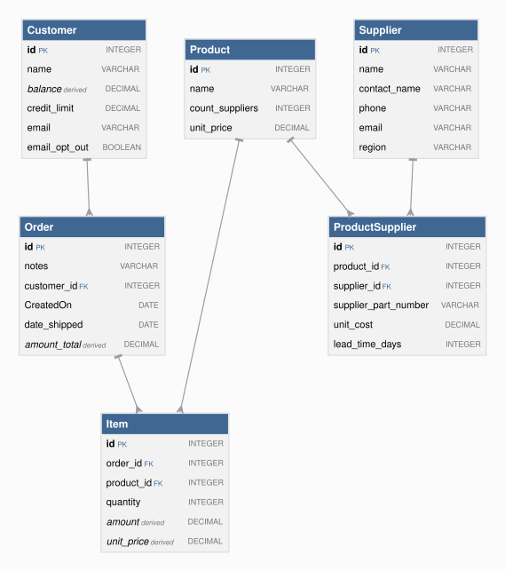

# Requirements Traceability Report

This report shows requirements, the rules created from them, and the tests created from those rules.

This project began as natural-language requirements, fleshed out by AI into a running system of business rules that are *executable documentation*. This report is how you govern the result.

A governable system is one you can **read**, **trust**, and **maintain**: each requirement is listed beside the rules that implement it (*read*); the tests and logic logs show those rules running (*trust*); re-run it after any change and it flags the gaps — an untested requirement, an untraced rule, a channel no test checks (*maintain*).

It is generated from the project's own files, nothing written by hand, so it is as current as the last run and covers the whole project, not a sample. Open **Background** (below the summary) for what the terms mean, how to read the report, and what it can and can't tell you.


**Project:** basic_demo_rule_reuse &nbsp;|&nbsp; **Generated:** November 22, 2026 17:17 &nbsp;|&nbsp; **Rules:** 7 &nbsp;|&nbsp; **Test scenarios:** 16 &nbsp;|&nbsp; **Generator:** requirements_traceability_report.py 2.17

**Last test run:** November 22, 2026 09:08, took 0.35 s (8h 8m before this report; test results and logic logs below are from that run)


&nbsp;
&nbsp;

## At a Glance

**✅ 3 requirement(s), all implemented; 3 tested; 16 of 16 scenarios passed; last run 8h 8m ago.**

| | |
|---|---|
| Requirements | 3 (3 implemented) |
| Tested | 3 of 3 |
| Last test run | ✅ 16 passed, 0 failed (November 22, 2026 09:08, 8h 8m ago); took 0.35 s |
| Rules | 7 (5 declarative, 0 Python functions, 2 Python events) |
| Rules shown running in a test log | 5 of 7 |
| Security | not enabled; 10 role(s), 0 row-level grant(s) |
| Messages and APIs | 0 Kafka topic(s) in, 1 out; 0 HTTP endpoint(s) |
| Kafka | simulated, no broker: messages are tested through /consume_debug; live delivery not verified |

_Status: ✅ every requirement is implemented and tested, all scenarios pass, and the results are current. ⚠ a requirement is untested or unimplemented, there is no test run, or files changed since the last run. ❌ a scenario failed. This reports what was traced and tested, not that the system is correct._

**About this project** _(from [readme_standard.md](../../readme_standard.md))_

This is an order-management system for customers, orders, items and products. Five declarative rules keep a customer's balance within their credit limit, computed live from unshipped order totals, item amounts (quantity * unit price) and prices copied from products, on every insert, update or delete. Moving an order to another customer needs no rule of its own: the same balance sum adjusts both customers and the same credit check runs. A sixth rule publishes an order to Kafka topic `order_shipping` once, when it ships.

See [project_creation_report.md](../../docs/requirements/project_creation_report.md) for how this was built.

<details markdown>
<summary>Background: what this report is, and how to read it</summary>

&nbsp;

<details markdown>
<summary>Requirements are business policies, expressed in natural language</summary>

<br>

A **requirement** is a statement of business behavior - how data is computed, validated, and transmitted - written in plain language. It lives in the project at `docs/requirements/<name>/requirements.md`.  For example:

&nbsp;

```
On Placing Orders, Check Credit
    1. The Customer's balance does not exceed the credit limit
    2. The Customer's balance is the sum of the unshipped Order amount_total
    3. The Order's amount_total is the sum of the Item amount
    4. The Item amount is the quantity * unit_price
    5. The Item unit_price is copied from the Product unit_price
```

</details>

&nbsp;

<details markdown>
<summary>Rules implement requirements</summary>

<br>

A requirement is written at a high level, and AI fills in details as it builds — as it should — so the requirement no longer says exactly what the system does. The rules do. That's a Goldilocks answer to the question of what you review:

* **Requirements say too little** — incomplete by design; AI fills in the details.
* **Code says too much** — business language in, hundreds of lines of procedural code out. The work moves from writing to reading, and if you can't read it, you can't govern it.
* **Rules are just right** — close to the requirement's own level, but complete and deterministic.

Code could be treated like machine language — never read, only trusted — if it were produced deterministically. Generation from natural language isn't. Rules restore that contract: a readable source, deterministically executed.

The requirements above become rules like this:

```
Rule.copy(derive=models.Item.unit_price, from_parent=models.Product.unit_price)
Rule.formula(derive=models.Item.amount,
             as_expression=lambda row: row.quantity * row.unit_price)
Rule.sum(derive=models.Order.amount_total, as_sum_of=models.Item.amount)
Rule.sum(derive=models.Customer.balance, as_sum_of=models.Order.amount_total,
         where=lambda row: row.date_shipped is None)
Rule.constraint(
    validate=models.Customer,
    as_condition=lambda row: row.balance <= row.credit_limit,
    error_msg="balance ({row.balance}) exceeds credit limit ({row.credit_limit})")
```

Rules are ***executable documentation*** that you can read and trust:

* **Read:** rules stay near the requirement's level, so this report can list them side by side and you can check one against the other. 5 rules vs. ~200 lines in our [A/B test](https://github.com/ApiLogicServer/ApiLogicServer-src/blob/main/api_logic_server_cli/prototypes/manager/samples/basic_demo_logic_gov/logic/procedural/declarative-vs-procedural-comparison.md) — **~40x less to review**, whether generated or hand-coded.
* **Trust:** the document is enforced, not just descriptive.
    * **What you read is what runs** — no drift between description and behavior.
    * **Dependencies:** with code, you analyze every execution path to know it runs at the right times. With rules: if the rule is there, it runs, in the right order.
    * **All sources and paths:** the engine hooks into every commit — API, UI or agent — insert, update and delete, including related rows. No bypass.
    * **Seeing is believing:** each scenario in *Tests and Results* below embeds its logic log — every rule that ran, in order, with old and new values.

Better AI makes generating code easier. It doesn't change what you have to read. The problem is the representation, not the capability. And governance is active, not just process: the engine enforces the rules on every transaction, and this report — regenerated from the project itself — shows it happening.

&nbsp;

</details>

&nbsp;

<details markdown>
<summary>Process overview: creation and iteration</summary>

<br>


In two phases. First, `genai-logic create` builds a working system from the database: API, Admin App, data model. Then behavior is added from requirements — the typical sequence, each step a request to an AI assistant:

1. Write each requirement in natural language, in `docs/requirements/<name>/requirements.md`.
2. `implement reqs <name>` — creates the rules, API endpoints and Kafka integrations.
3. `create tests from rules` — writes the test scenarios and steps.
4. `run the tests` — starts the server if needed, runs the suite, reports pass/fail.
5. `run the requirements traceability report` — regenerates this report.

Optional: `create logic diagram for each requirement` (needs Graphviz).

What makes steps 3–5 possible: rules are high-level enough that AI can read them too. The tests, the logic diagrams and this report are all generated by reading the same rules you review — where logic is Python code, the report can only quote its docstring.

The report connects the chain: requirement → rules and handlers → tests → logic log. How *this* project was actually built is recorded under Provenance.

</details>

&nbsp;

<details markdown>
<summary>How to read this report</summary>

<br>

| If you are...  | Start with                                                        | Look for                                                                                     |
| -------------- | ----------------------------------------------------------------- | -------------------------------------------------------------------------------------------- |
| Business owner | *Requirements in detail*                                          | The requirement text, then the **Tests** line under it: does a test exist, and did it pass?  |
| Auditor        | *Coverage summary*, *Rule coverage by tests*, *Messages and APIs* | Gaps (untested, untraced), the date of the last test run, and how each rule was shown to run |
| Developer      | *Tests and Results*                                               | Each scenario's logic log: every rule that ran, in order, with old and new values            |

</details>

&nbsp;

<details markdown>
<summary>What this report can and can't tell you</summary>

<br>

**It shows**

- Which files and rules implement each requirement, read from the project's source.
- Which scenarios ran in the last test run, and whether each passed.
- Which rules the engine logged as running in each scenario.

**It doesn't show**

- Whether the requirements are right or complete. It traces what was written down.
- Whether an event did anything. Events run on every commit of their class and decide for themselves whether to act, so appearing in the log doesn't mean the event had an effect.
- Whether a constraint works. A constraint appears in the log only when it rejects a transaction, so look for a scenario that makes it reject.
- Whether a message arrived. Unless a test step looks for it on the broker or endpoint, a passing scenario doesn't prove delivery. The *Messages and APIs* table flags channels no test mentions.
- Whether the results are current. They are as old as the last test run, shown in the header, which also warns if files changed since.
- Which version of a requirement the code was built from, or which clause of a requirement a given rule serves.

</details>

&nbsp;

<details markdown>
<summary>Terms</summary>

<br>

| Term        | Meaning                                                                                              |
| ----------- | ---------------------------------------------------------------------------------------------------- |
| Requirement | A statement of business behavior, in plain language; the unit this report traces.                    |
| Rule        | A declaration about data (sum, count, formula, copy, constraint) that the engine enforces at every commit. |
| Event       | Python code the engine calls when a row of a given class changes (for example, to publish a message). |
| Handler     | Code that serves an API endpoint or consumes a Kafka topic.                                          |
| Scenario    | One Behave test: a short Given / When / Then script run against the live API.                        |
| Logic log   | The engine's record of every rule it ran in a transaction, nested to show cascades (an Item change adjusts its Order, which adjusts its Customer). |
| Phase       | The step of a commit: ROW LOGIC (derivations, constraints), COMMIT LOGIC (checks that need finished totals), AFTER_FLUSH LOGIC (events that need database-assigned keys, such as publishing). |
| Seen        | The engine reported running the rule in that scenario's log.                                         |

</details>

</details>


&nbsp;
&nbsp;

## Contents

- [Requirements Coverage](#requirements-coverage)
- [Data Model](#data-model)
- [Security (RBAC)](#security-rbac)
- [Messages and APIs](#messages-and-apis)
- [Tests and Results](#tests-and-results)
- [Provenance](#provenance)


&nbsp;
&nbsp;

## Requirements Coverage

Every requirement should have rules that implement it, and tests that prove it. This section checks that chain in both directions: a requirement missing rules or tests is a gap, and rules or tests that belong to no requirement are flagged too. The matching uses the requirement names, `Feature:` names and `§N` tags that requirements, code and tests share. Requirements may be grouped into a use case (for example Place Order), read from the logic folder or the prompt; the level is optional.


&nbsp;

### Coverage summary

| Measure | Result |
|---|---|
| Requirements | 3 |
| Implemented (at least one file) | 3 of 3 |
| Tested (at least one scenario) | 3 of 3 |
| Use cases | 2: Place Order, Move Order |
| Implementation not traced to a requirement | `security/declare_security.py` |
| Tests not traced to a requirement | none |
| Test results (last run) | ✅ 16 passed, 0 failed; took 0.35 s |
| Scenarios with a logic log | 16 of 16 |
| Rules seen in at least one scenario's log | 5 of 7 (2 not counted: the engine's log does not name `Order.after_flush_row_event → kafka_producer.send_row_to_kafka()`, `all classes.early_row_event → handle_all()`, so it cannot be matched) |

_Test results are as current as the last run (see the header). A gap is any requirement with no implementation or no test._

<details markdown>
<summary>How to read this table</summary>

Test results are read from `logs/behave.log`, so they are only as current as that run. Not recorded here: which version of a requirement the code was built against, and which clause of a requirement a given rule serves.

</details>


&nbsp;

### Traceability matrix

| Use case | Requirement | Implemented by | Rules | Tests |
|---|---|---|---|---|
| Place Order | Check Credit (Placing Orders) | [logic/logic_discovery/place_order/check_credit.py](../../logic/logic_discovery/place_order/check_credit.py) | 5 | ✅ 11 scenario(s): 11 passed |
| Place Order | App Integration | [logic/logic_discovery/place_order/app_integration.py](../../logic/logic_discovery/place_order/app_integration.py) | 1 | ✅ 3 scenario(s): 3 passed |
| Move Order | Check Credit (Moving Orders to a different Customer) | covered by existing rules:<br>uses `Customer.balance` (Check Credit (Placing Orders))<br>uses `Customer.credit_limit_check` (Check Credit (Placing Orders))<br>(placeholder: [logic/logic_discovery/move_order/check_credit.py](../../logic/logic_discovery/move_order/check_credit.py)) | 2 | ✅ 2 scenario(s): 2 passed |


&nbsp;

### Rule coverage by tests

| Rule | Requirement | Seen in |
|---|---|---|
| `Order.after_flush_row_event → kafka_producer.send_row_to_kafka()` | App Integration | n/a - cannot be matched to the engine's log |
| `Customer: balance <= credit_limit` | Check Credit (Placing Orders) | 2: Order over the credit limit is rejected; Moving an Order over the new Customer's limit is rejected |
| `Customer.balance = sum(Order.amount_total) where date_shipped is None` | Check Credit (Placing Orders) | 16: Shipping an Order publishes it; Editing an unshipped Order does not publish; Editing a shipped Order does not publish again; +13 more |
| `Order.amount_total = sum(Item.amount)` | Check Credit (Placing Orders) | 16: Shipping an Order publishes it; Editing an unshipped Order does not publish; Editing a shipped Order does not publish again; +13 more |
| `Item.amount = quantity * unit_price` | Check Credit (Placing Orders) | 16: Shipping an Order publishes it; Editing an unshipped Order does not publish; Editing a shipped Order does not publish again; +13 more |
| `Item.unit_price = copy of Product.unit_price` | Check Credit (Placing Orders) | 16: Shipping an Order publishes it; Editing an unshipped Order does not publish; Editing a shipped Order does not publish again; +13 more |
| `all classes.early_row_event → handle_all()` | (none) | n/a - cannot be matched to the engine's log |

_"Seen" means the engine's log shows the rule ran, not proof that it took effect._

<details markdown>
<summary>How to read this table</summary>

"Seen" means the engine reported running the rule in that scenario's logic log. A scenario can only contribute if it has a log (see the coverage summary): a test that does not open one writes into whichever log was open last, and its rules are then credited to that scenario, or to the shared log. An event's function runs on every commit of its class, and its own condition decides whether it acts, so seen does not mean it took effect. A constraint appears in the log only when it rejects a transaction, so it is seen only in scenarios that make it reject. "Not seen" therefore means no log shows it, not that no test ran it.

</details>


&nbsp;

### Requirements in detail

**7 rules** in 3 files: 5 declarative (sum, count, copy, formula and constraint expressions), 0 backed by a Python function, 2 events (Python).

_Declarative rules are read straight from their declarations. Functions and events are Python code, so for those the report shows the docstring — it does not analyze the code._

Each requirement is followed by the rules and handlers in the files that implement it. Logic diagrams are shown (click to expand) where they exist.

<details markdown>
<summary>How to create the missing logic diagrams</summary>

Needs Graphviz (`brew install graphviz`). Tell your AI assistant:

```
create logic diagram for each requirement
```

or run this from the Manager root (`manager`):

```
python system/ApiLogicServer-Internal-Dev/logic_diagram_gv.py samples/basic_demo_rule_reuse --each
```

Each diagram is saved under `docs/requirements/<name>/logic_diagrams/`. Then regenerate this report (`python requirements_traceability_report.py run`, from `test/api_logic_server_behave`).

</details>

&nbsp;


#### Check Credit (Placing Orders)

Use case: Place Order

Tests: ✅ 11 scenario(s): 11 passed

```
    1. The Customer's balance is less than the credit limit
    2. The Customer's balance is the sum of the unshipped Order amount_total
    3. The Order's amount_total is the sum of the Item amount
    4. The Item amount is the quantity * unit_price
    5. The Item unit_price is copied from the Product unit_price
```

| Rule / item | Type | Logic | Description | Where |
|---|---|---|---|---|
| `Customer: balance <= credit_limit` | constraint | declarative | Error: Customer balance ({row.balance}) exceeds credit limit ({row.credit_limit}) | [check_credit.py](../../logic/logic_discovery/place_order/check_credit.py) |
| `Customer.balance = sum(Order.amount_total) where date_shipped is None` | sum | declarative |  | [check_credit.py](../../logic/logic_discovery/place_order/check_credit.py) |
| `Order.amount_total = sum(Item.amount)` | sum | declarative |  | [check_credit.py](../../logic/logic_discovery/place_order/check_credit.py) |
| `Item.amount = quantity * unit_price` | formula | declarative |  | [check_credit.py](../../logic/logic_discovery/place_order/check_credit.py) |
| `Item.unit_price = copy of Product.unit_price` | copy | declarative |  | [check_credit.py](../../logic/logic_discovery/place_order/check_credit.py) |

#### App Integration

Use case: Place Order

Tests: ✅ 3 scenario(s): 3 passed

```
    1. Publish the Order to Kafka topic 'order_shipping' when the date_shipped becomes not None.
```

| Rule / item | Type | Logic | Description | Where |
|---|---|---|---|---|
| `Order.after_flush_row_event → kafka_producer.send_row_to_kafka()` | after_flush_row_event | event (Python) | (no docstring) | [app_integration.py](../../logic/logic_discovery/place_order/app_integration.py) |

#### Check Credit (Moving Orders to a different Customer)

Use case: Move Order

Tests: ✅ 2 scenario(s): 2 passed

```
    1. Recompute the customers balances as the sum of the unhipped order totals
    2. The Customer's balance must not exceed the credit limit
    Uses: Customer.balance (Check Credit), Customer.credit_limit_check (Check Credit)
```

**Covered by existing rules.** This requirement needs no rules of its own: it is met by `Customer.balance` (Check Credit (Placing Orders)), `Customer.credit_limit_check` (Check Credit (Placing Orders)), which the engine enforces on every write path, automatically. Rules are not written per path, so a requirement about one path is usually already met. Kept for its tests, and so that a change to the rule it uses shows here.

| Rule / item | Type | Logic | Description | Where |
|---|---|---|---|---|
| `check_credit.py` | module |  | On Moving Orders to a different Customer, Check Credit | [check_credit.py](../../logic/logic_discovery/move_order/check_credit.py) |
| `Customer.balance = sum(Order.amount_total) where date_shipped is None` | sum | declarative | (used from Check Credit (Placing Orders): `Customer.balance`) | [check_credit.py](../../logic/logic_discovery/place_order/check_credit.py) |
| `Customer: balance <= credit_limit` | constraint | declarative | Error: Customer balance ({row.balance}) exceeds credit limit ({row.credit_limit}) (used from Check Credit (Placing Orders): `Customer.credit_limit_check`) | [check_credit.py](../../logic/logic_discovery/place_order/check_credit.py) |


&nbsp;
&nbsp;

## Data Model

The tables the rules run over. Derived columns (in italics) are computed by rules — no code writes them. Tinted groups are the subtypes.



_Generated from `docs/db.dbml` (parents above children; shaded rows are derived by rules). To use your own layout, save it as `docs/db_diagram.png`._


&nbsp;

### Derived columns

| Table | Column | Rule | Definition |
|---|---|---|---|
| Customer | balance | sum | `Customer.balance = sum(Order.amount_total) where date_shipped is None` |
| Order | amount_total | sum | `Order.amount_total = sum(Item.amount)` |
| Item | amount | formula | `Item.amount = quantity * unit_price` |
| Item | unit_price | copy | `Item.unit_price = copy of Product.unit_price` |


&nbsp;
&nbsp;

## Security (RBAC)

Who can do what: each role's permissions, and which rows each role can see.

**Security enabled: no** (`SECURITY_ENABLED` in `config/default.env`). The declarations below are not enforced until `genai-logic add-auth` is run.


&nbsp;

### Roles and CRUD (DefaultRolePermission)

| Role | Read | Insert | Update | Delete |
|---|---|---|---|---|
| sa | ✅ | ✅ | ✅ | ✅ |
| tenant | ✅ | — | — | ✅ |
| CS_ADMIN | ✅ | ✅ | ✅ | ✅ |
| manager | ✅ | ✅ | ✅ | — |
| teller | ✅ | ✅ | ✅ | — |
| customer | ✅ | ✅ | ✅ | — |
| readonly | ✅ | — | — | — |
| public | ✅ | — | — | — |
| default-roles-kcals | ✅ | ✅ | ✅ | — |
| uma_authorization | ✅ | ✅ | ✅ | — |


&nbsp;

### Row-level grants (Grant)

None declared (`Grant`).


&nbsp;
&nbsp;

## Messages and APIs

How data enters and leaves beyond the standard API: Kafka topics in and out, custom HTTP endpoints — and whether any test touches each one.

**Kafka mode: simulated (no broker).** `KAFKA_SERVER` is not set, so no Kafka consumer or producer runs. The tests deliver inbound messages by calling `/consume_debug`, which runs the same parse-and-save function the live consumer uses, so lookups, rules and the saved message are exercised, but Kafka delivery itself is not. Outbound messages are built and logged, not sent. To test with a real broker, set `KAFKA_SERVER` and `KAFKA_CONSUMER_GROUP` (see `integration/kafka/kafka_readme.md`).

| Direction | Channel | Name | Tests mention it | Handler | Tables created | Message shape | Requirement |
|---|---|---|---|---|---|---|---|
| ⬅ out | Kafka | `order_shipping` | ⚠ message checked in the log, not on the topic | Order.after_flush_row_event → kafka_producer.send_row_to_kafka() - (no docstring) |  |  | App Integration |

_"Tests mention it" checks the test sources, not delivery._

<details markdown>
<summary>How to read this column</summary>

A passing scenario proves a message reached a topic or an endpoint only if its steps look for it there. A handler that ran (see the logic log) is weaker evidence than a step that consumes the message. Channels no test mentions are flagged.

</details>

<details markdown>
<summary>How to read this table</summary>

Topics and endpoints are read from the discovery folders. The condition that triggers an outbound message lives in Python (see the rules under each requirement); here it is described by the handler's docstring. "Tables created" lists rows the handler's code constructs, following its calls within the project; blank means none were found, not that none exist.

</details>


&nbsp;
&nbsp;

## Tests and Results

**✅ 16 scenario(s): 16 passed, 0 failed; took 0.35 s** (from the last run, `logs/behave.log`).

Each test drives the running system the way any client would — create an order, change a quantity, ship it — and checks the result.

**The logic log** is what makes them more than pass/fail. Business rules run inside the server on every commit, so the server records exactly what they did, and this report embeds that record for each scenario. Two things to look for:

1. **It shows every rule that runs.** Each line is one rule execution, with the row's state, old and new values. You see not just that a test passed, but which rules ran and what each one changed.
2. **The nesting shows multi-table chaining.** Indentation follows the cascade: a change to an Item adjusts its Order, which adjusts its Customer.

<details markdown>
<summary>How to read the logic log</summary>

Open a scenario's "Rules exercised and logic log" block to see it. The log is shown in full, attribute values included, because those values are what you diagnose from when a rule produces an unexpected result.

To read a log line:

```
....Order[16] {Update - Adjusting order: amount_total} id: 16, customer_id: 19, amount_total:  [0.0-->] 90.0

```

- The leading dots are the depth in the cascade: Item (2 dots), its Order (4), its Customer (6).
- `Order[16]` is the row; `{...}` is the rule or action that ran; the rest is the row's attribute values at that step.
- `[0.0-->] 90.0` marks a value the rules changed, with its old and new value.
- The log is in phases: **ROW LOGIC** (derivations and constraints, as rows change), **COMMIT LOGIC** (checks that need the finished aggregates), and **AFTER_FLUSH LOGIC** (events that need database-assigned keys, such as the Kafka publish).

More: [Logic Log](https://apilogicserver.github.io/Docs/Logic-Debug/#logic-log).

</details>

&nbsp;

<details markdown>
<summary>How to add more tests, and run them</summary>

**1. Have AI create them.** This project's context tells your AI assistant how (`.github/copilot-instructions.md`, `docs/training/testing.md`). Just say:

```

create tests from rules

```

The assistant reads `database/models.py`, the logic files and the custom APIs, then writes `.feature` files and step implementations under `test/api_logic_server_behave/features/`. Then say `run the tests` and `run the requirements traceability report` and the assistant does both.

Or, to have each requirement's tests linked in the Tests column above (it matches on `Feature:` name), say which names to use:

```

create tests from rules, one Feature per requirement, named exactly:
- Check Credit (Placing Orders)
- App Integration
- Check Credit (Moving Orders to a different Customer)

```

_Tests with other names still run and appear below; they just aren't linked to a requirement._

**2. You can also define tests manually.** Add a `<name>.feature` file (Gherkin) under `test/api_logic_server_behave/features/` and its steps under `features/steps/`. The steps call the running API, so tests exercise the same rules as any client. See `docs/training/testing.md` for the patterns that keep tests repeatable.

**Or run them yourself** (server running, from `test/api_logic_server_behave`):

```

python behave_run.py --outfile=logs/behave.log
python requirements_traceability_report.py run

```

</details>

&nbsp;
&nbsp;

### Feature: App Integration  

&nbsp;
&nbsp;

#### Scenario: Shipping an Order publishes it ✅ (0.03 s)
&emsp;  Scenario: Shipping an Order publishes it  
&emsp;&emsp;    Given Customer "Ann" with credit limit 1000  
&emsp;&emsp;    And Order "O1" is created for "Ann" with 1 Widget  
&emsp;&emsp;    When Order "O1" is shipped  
&emsp;&emsp;    Then Order "O1" is published to topic "order_shipping" 1 time  

<details markdown>
<summary>Rules exercised and logic log (3 transactions)</summary>


&nbsp;
&nbsp;


**Rules Used** in Scenario: Shipping an Order publishes it
```
  Customer  
    1. Derive Customer.balance as Sum(Order.amount_total Where Rule.sum(derive=models.Customer.balance, as_sum_of=models.Order.amount_total, where=lambda row: row.date_shipped is None))  
  Order  
    2. RowEvent Order.send_row_to_kafka() name: shipping_publish  
    3. Derive Order.amount_total as Sum(Item.amount Where  - None)  
  Item  
    4. Derive Item.amount as Formula (1): Rule.formula(derive=models.Item.amount, as_expres [...]  
    5. Derive Item.unit_price as Copy(product.unit_price)  
```
**Logic Log** in Scenario: Shipping an Order publishes it (3 transactions)
```
Logic Phase:		ROW LOGIC		(session=0x109b965d0) (sqlalchemy before_flush)			 - 2026-11-22 09:08:59,137 - logic_logger - INFO
..Order[None] {Insert - client} id: None, notes: test O1, customer_id: 6, CreatedOn: None, date_shipped: None, amount_total: None  row: 0x109cfabd0  session: 0x109b965d0  ins_upd_dlt: ins, initial: ins - 2026-11-22 09:08:59,137 - logic_logger - INFO
..Order[None] {server aggregate_defaults: amount_total } id: None, notes: test O1, customer_id: 6, CreatedOn: None, date_shipped: None, amount_total: 0  row: 0x109cfabd0  session: 0x109b965d0  ins_upd_dlt: ins, initial: ins - 2026-11-22 09:08:59,137 - logic_logger - INFO
Logic Phase:		COMMIT LOGIC		(session=0x109b965d0)   										 - 2026-11-22 09:08:59,138 - logic_logger - INFO
Logic Phase:		AFTER_FLUSH LOGIC	(session=0x109b965d0)   										 - 2026-11-22 09:08:59,139 - logic_logger - INFO
..Order[6] {AfterFlush Event} id: 6, notes: test O1, customer_id: 6, CreatedOn: None, date_shipped: None, amount_total: 0  row: 0x109cfabd0  session: 0x109b965d0  ins_upd_dlt: ins, initial: ins - 2026-11-22 09:08:59,139 - logic_logger - INFO


Logic Phase:		ROW LOGIC		(session=0x109d262c0) (sqlalchemy before_flush)			 - 2026-11-22 09:08:59,145 - logic_logger - INFO
..Item[None] {Insert - client} id: None, order_id: 6, product_id: 2, quantity: 1, amount: None, unit_price: None  row: 0x109cfbd50  session: 0x109d262c0  ins_upd_dlt: ins, initial: ins - 2026-11-22 09:08:59,145 - logic_logger - INFO
..Item[None] {copy_rules for role: product - unit_price} id: None, order_id: 6, product_id: 2, quantity: 1, amount: None, unit_price: 90.0000000000  row: 0x109cfbd50  session: 0x109d262c0  ins_upd_dlt: ins, initial: ins - 2026-11-22 09:08:59,146 - logic_logger - INFO
..Item[None] {Formula amount} id: None, order_id: 6, product_id: 2, quantity: 1, amount: 90.0000000000, unit_price: 90.0000000000  row: 0x109cfbd50  session: 0x109d262c0  ins_upd_dlt: ins, initial: ins - 2026-11-22 09:08:59,146 - logic_logger - INFO
....Order[6] {Update - Adjusting order: amount_total} id: 6, notes: test O1, customer_id: 6, CreatedOn: None, date_shipped: None, amount_total:  [0E-10-->] 90.0000000000  row: 0x109d347d0  session: 0x109d262c0  ins_upd_dlt: upd, initial: upd - 2026-11-22 09:08:59,146 - logic_logger - INFO
......Customer[6] {Update - Adjusting customer: balance} id: 6, name: Ann 1795367339130, balance:  [0E-10-->] 90.0000000000, credit_limit: 1000.0000000000, email: None, email_opt_out: None  row: 0x109d37dd0  session: 0x109d262c0  ins_upd_dlt: upd, initial: upd - 2026-11-22 09:08:59,146 - logic_logger - INFO
Logic Phase:		COMMIT LOGIC		(session=0x109d262c0)   										 - 2026-11-22 09:08:59,147 - logic_logger - INFO
Logic Phase:		AFTER_FLUSH LOGIC	(session=0x109d262c0)   										 - 2026-11-22 09:08:59,148 - logic_logger - INFO
....Order[6] {AfterFlush Event} id: 6, notes: test O1, customer_id: 6, CreatedOn: None, date_shipped: None, amount_total:  [0E-10-->] 90.0000000000  row: 0x109d347d0  session: 0x109d262c0  ins_upd_dlt: upd, initial: upd - 2026-11-22 09:08:59,148 - logic_logger - INFO


Logic Phase:		ROW LOGIC		(session=0x109641130) (sqlalchemy before_flush)			 - 2026-11-22 09:08:59,152 - logic_logger - INFO
..Order[6] {Update - client} id: 6, notes: test O1, customer_id: 6, CreatedOn: None, date_shipped:  [None-->] 2026-11-22 00:00:00, amount_total: 90.0000000000  row: 0x109d78850  session: 0x109641130  ins_upd_dlt: upd, initial: upd - 2026-11-22 09:08:59,152 - logic_logger - INFO
....Customer[6] {Update - Adjusting customer: balance} id: 6, name: Ann 1795367339130, balance:  [90.0000000000-->] 0E-10, credit_limit: 1000.0000000000, email: None, email_opt_out: None  row: 0x109d7a350  session: 0x109641130  ins_upd_dlt: upd, initial: upd - 2026-11-22 09:08:59,152 - logic_logger - INFO
Logic Phase:		COMMIT LOGIC		(session=0x109641130)   										 - 2026-11-22 09:08:59,152 - logic_logger - INFO
Logic Phase:		AFTER_FLUSH LOGIC	(session=0x109641130)   										 - 2026-11-22 09:08:59,153 - logic_logger - INFO
..Order[6] {AfterFlush Event} id: 6, notes: test O1, customer_id: 6, CreatedOn: None, date_shipped:  [None-->] 2026-11-22 00:00:00, amount_total: 90.0000000000  row: 0x109d78850  session: 0x109641130  ins_upd_dlt: upd, initial: upd - 2026-11-22 09:08:59,153 - logic_logger - INFO
..Order[6] {Sending Order to Kafka topic 'order_shipping' [Note: **Kafka not enabled** ]} id: 6, notes: test O1, customer_id: 6, CreatedOn: None, date_shipped:  [None-->] 2026-11-22 00:00:00, amount_total: 90.0000000000  row: 0x109d78850  session: 0x109641130  ins_upd_dlt: upd, initial: upd - 2026-11-22 09:08:59,153 - logic_logger - INFO

```
</details>

&nbsp;
&nbsp;

#### Scenario: Editing an unshipped Order does not publish ✅ (0.02 s)
&emsp;  Scenario: Editing an unshipped Order does not publish  
&emsp;&emsp;    Given Customer "Ann" with credit limit 1000  
&emsp;&emsp;    And Order "O1" is created for "Ann" with 1 Widget  
&emsp;&emsp;    When Order "O1" notes are changed  
&emsp;&emsp;    Then Order "O1" is published to topic "order_shipping" 0 times  

<details markdown>
<summary>Rules exercised and logic log (3 transactions)</summary>


&nbsp;
&nbsp;


**Rules Used** in Scenario: Editing an unshipped Order does not publish
```
  Customer  
    1. Derive Customer.balance as Sum(Order.amount_total Where Rule.sum(derive=models.Customer.balance, as_sum_of=models.Order.amount_total, where=lambda row: row.date_shipped is None))  
  Order  
    2. RowEvent Order.send_row_to_kafka() name: shipping_publish  
    3. Derive Order.amount_total as Sum(Item.amount Where  - None)  
  Item  
    4. Derive Item.amount as Formula (1): Rule.formula(derive=models.Item.amount, as_expres [...]  
    5. Derive Item.unit_price as Copy(product.unit_price)  
```
**Logic Log** in Scenario: Editing an unshipped Order does not publish (3 transactions)
```
Logic Phase:		ROW LOGIC		(session=0x109c9f130) (sqlalchemy before_flush)			 - 2026-11-22 09:08:59,159 - logic_logger - INFO
..Order[None] {Insert - client} id: None, notes: test O1, customer_id: 7, CreatedOn: None, date_shipped: None, amount_total: None  row: 0x109d36bd0  session: 0x109c9f130  ins_upd_dlt: ins, initial: ins - 2026-11-22 09:08:59,159 - logic_logger - INFO
..Order[None] {server aggregate_defaults: amount_total } id: None, notes: test O1, customer_id: 7, CreatedOn: None, date_shipped: None, amount_total: 0  row: 0x109d36bd0  session: 0x109c9f130  ins_upd_dlt: ins, initial: ins - 2026-11-22 09:08:59,160 - logic_logger - INFO
Logic Phase:		COMMIT LOGIC		(session=0x109c9f130)   										 - 2026-11-22 09:08:59,160 - logic_logger - INFO
Logic Phase:		AFTER_FLUSH LOGIC	(session=0x109c9f130)   										 - 2026-11-22 09:08:59,160 - logic_logger - INFO
..Order[7] {AfterFlush Event} id: 7, notes: test O1, customer_id: 7, CreatedOn: None, date_shipped: None, amount_total: 0  row: 0x109d36bd0  session: 0x109c9f130  ins_upd_dlt: ins, initial: ins - 2026-11-22 09:08:59,160 - logic_logger - INFO


Logic Phase:		ROW LOGIC		(session=0x109c9ee00) (sqlalchemy before_flush)			 - 2026-11-22 09:08:59,165 - logic_logger - INFO
..Item[None] {Insert - client} id: None, order_id: 7, product_id: 2, quantity: 1, amount: None, unit_price: None  row: 0x109d371d0  session: 0x109c9ee00  ins_upd_dlt: ins, initial: ins - 2026-11-22 09:08:59,165 - logic_logger - INFO
..Item[None] {copy_rules for role: product - unit_price} id: None, order_id: 7, product_id: 2, quantity: 1, amount: None, unit_price: 90.0000000000  row: 0x109d371d0  session: 0x109c9ee00  ins_upd_dlt: ins, initial: ins - 2026-11-22 09:08:59,165 - logic_logger - INFO
..Item[None] {Formula amount} id: None, order_id: 7, product_id: 2, quantity: 1, amount: 90.0000000000, unit_price: 90.0000000000  row: 0x109d371d0  session: 0x109c9ee00  ins_upd_dlt: ins, initial: ins - 2026-11-22 09:08:59,165 - logic_logger - INFO
....Order[7] {Update - Adjusting order: amount_total} id: 7, notes: test O1, customer_id: 7, CreatedOn: None, date_shipped: None, amount_total:  [0E-10-->] 90.0000000000  row: 0x109d78950  session: 0x109c9ee00  ins_upd_dlt: upd, initial: upd - 2026-11-22 09:08:59,165 - logic_logger - INFO
......Customer[7] {Update - Adjusting customer: balance} id: 7, name: Ann 1795367339156, balance:  [0E-10-->] 90.0000000000, credit_limit: 1000.0000000000, email: None, email_opt_out: None  row: 0x109d7a950  session: 0x109c9ee00  ins_upd_dlt: upd, initial: upd - 2026-11-22 09:08:59,165 - logic_logger - INFO
Logic Phase:		COMMIT LOGIC		(session=0x109c9ee00)   										 - 2026-11-22 09:08:59,166 - logic_logger - INFO
Logic Phase:		AFTER_FLUSH LOGIC	(session=0x109c9ee00)   										 - 2026-11-22 09:08:59,166 - logic_logger - INFO
....Order[7] {AfterFlush Event} id: 7, notes: test O1, customer_id: 7, CreatedOn: None, date_shipped: None, amount_total:  [0E-10-->] 90.0000000000  row: 0x109d78950  session: 0x109c9ee00  ins_upd_dlt: upd, initial: upd - 2026-11-22 09:08:59,166 - logic_logger - INFO


Logic Phase:		ROW LOGIC		(session=0x109d7c8d0) (sqlalchemy before_flush)			 - 2026-11-22 09:08:59,169 - logic_logger - INFO
..Order[7] {Update - client} id: 7, notes:  [test O1-->] edited 1795367339168, customer_id: 7, CreatedOn: None, date_shipped: None, amount_total: 90.0000000000  row: 0x109d79250  session: 0x109d7c8d0  ins_upd_dlt: upd, initial: upd - 2026-11-22 09:08:59,169 - logic_logger - INFO
Logic Phase:		COMMIT LOGIC		(session=0x109d7c8d0)   										 - 2026-11-22 09:08:59,169 - logic_logger - INFO
Logic Phase:		AFTER_FLUSH LOGIC	(session=0x109d7c8d0)   										 - 2026-11-22 09:08:59,169 - logic_logger - INFO
..Order[7] {AfterFlush Event} id: 7, notes:  [test O1-->] edited 1795367339168, customer_id: 7, CreatedOn: None, date_shipped: None, amount_total: 90.0000000000  row: 0x109d79250  session: 0x109d7c8d0  ins_upd_dlt: upd, initial: upd - 2026-11-22 09:08:59,169 - logic_logger - INFO

```
</details>

&nbsp;
&nbsp;

#### Scenario: Editing a shipped Order does not publish again ✅ (0.02 s)
&emsp;  Scenario: Editing a shipped Order does not publish again  
&emsp;&emsp;    Given Customer "Ann" with credit limit 1000  
&emsp;&emsp;    And Order "O1" is created for "Ann" with 1 Widget  
&emsp;&emsp;    And Order "O1" is shipped  
&emsp;&emsp;    When Order "O1" notes are changed  
&emsp;&emsp;    Then Order "O1" is published to topic "order_shipping" 1 time  

<details markdown>
<summary>Rules exercised and logic log (4 transactions)</summary>


&nbsp;
&nbsp;


**Rules Used** in Scenario: Editing a shipped Order does not publish again
```
  Customer  
    1. Derive Customer.balance as Sum(Order.amount_total Where Rule.sum(derive=models.Customer.balance, as_sum_of=models.Order.amount_total, where=lambda row: row.date_shipped is None))  
  Order  
    2. RowEvent Order.send_row_to_kafka() name: shipping_publish  
    3. Derive Order.amount_total as Sum(Item.amount Where  - None)  
  Item  
    4. Derive Item.amount as Formula (1): Rule.formula(derive=models.Item.amount, as_expres [...]  
    5. Derive Item.unit_price as Copy(product.unit_price)  
```
**Logic Log** in Scenario: Editing a shipped Order does not publish again (4 transactions)
```
Logic Phase:		ROW LOGIC		(session=0x109d7cd10) (sqlalchemy before_flush)			 - 2026-11-22 09:08:59,175 - logic_logger - INFO
..Order[None] {Insert - client} id: None, notes: test O1, customer_id: 8, CreatedOn: None, date_shipped: None, amount_total: None  row: 0x109d34e50  session: 0x109d7cd10  ins_upd_dlt: ins, initial: ins - 2026-11-22 09:08:59,175 - logic_logger - INFO
..Order[None] {server aggregate_defaults: amount_total } id: None, notes: test O1, customer_id: 8, CreatedOn: None, date_shipped: None, amount_total: 0  row: 0x109d34e50  session: 0x109d7cd10  ins_upd_dlt: ins, initial: ins - 2026-11-22 09:08:59,175 - logic_logger - INFO
Logic Phase:		COMMIT LOGIC		(session=0x109d7cd10)   										 - 2026-11-22 09:08:59,175 - logic_logger - INFO
Logic Phase:		AFTER_FLUSH LOGIC	(session=0x109d7cd10)   										 - 2026-11-22 09:08:59,176 - logic_logger - INFO
..Order[8] {AfterFlush Event} id: 8, notes: test O1, customer_id: 8, CreatedOn: None, date_shipped: None, amount_total: 0  row: 0x109d34e50  session: 0x109d7cd10  ins_upd_dlt: ins, initial: ins - 2026-11-22 09:08:59,176 - logic_logger - INFO


Logic Phase:		ROW LOGIC		(session=0x109d7cf30) (sqlalchemy before_flush)			 - 2026-11-22 09:08:59,179 - logic_logger - INFO
..Item[None] {Insert - client} id: None, order_id: 8, product_id: 2, quantity: 1, amount: None, unit_price: None  row: 0x109d7a0d0  session: 0x109d7cf30  ins_upd_dlt: ins, initial: ins - 2026-11-22 09:08:59,179 - logic_logger - INFO
..Item[None] {copy_rules for role: product - unit_price} id: None, order_id: 8, product_id: 2, quantity: 1, amount: None, unit_price: 90.0000000000  row: 0x109d7a0d0  session: 0x109d7cf30  ins_upd_dlt: ins, initial: ins - 2026-11-22 09:08:59,179 - logic_logger - INFO
..Item[None] {Formula amount} id: None, order_id: 8, product_id: 2, quantity: 1, amount: 90.0000000000, unit_price: 90.0000000000  row: 0x109d7a0d0  session: 0x109d7cf30  ins_upd_dlt: ins, initial: ins - 2026-11-22 09:08:59,180 - logic_logger - INFO
....Order[8] {Update - Adjusting order: amount_total} id: 8, notes: test O1, customer_id: 8, CreatedOn: None, date_shipped: None, amount_total:  [0E-10-->] 90.0000000000  row: 0x109d79350  session: 0x109d7cf30  ins_upd_dlt: upd, initial: upd - 2026-11-22 09:08:59,180 - logic_logger - INFO
......Customer[8] {Update - Adjusting customer: balance} id: 8, name: Ann 1795367339172, balance:  [0E-10-->] 90.0000000000, credit_limit: 1000.0000000000, email: None, email_opt_out: None  row: 0x109d7b250  session: 0x109d7cf30  ins_upd_dlt: upd, initial: upd - 2026-11-22 09:08:59,180 - logic_logger - INFO
Logic Phase:		COMMIT LOGIC		(session=0x109d7cf30)   										 - 2026-11-22 09:08:59,180 - logic_logger - INFO
Logic Phase:		AFTER_FLUSH LOGIC	(session=0x109d7cf30)   										 - 2026-11-22 09:08:59,180 - logic_logger - INFO
....Order[8] {AfterFlush Event} id: 8, notes: test O1, customer_id: 8, CreatedOn: None, date_shipped: None, amount_total:  [0E-10-->] 90.0000000000  row: 0x109d79350  session: 0x109d7cf30  ins_upd_dlt: upd, initial: upd - 2026-11-22 09:08:59,180 - logic_logger - INFO


Logic Phase:		ROW LOGIC		(session=0x109d7d040) (sqlalchemy before_flush)			 - 2026-11-22 09:08:59,183 - logic_logger - INFO
..Order[8] {Update - client} id: 8, notes: test O1, customer_id: 8, CreatedOn: None, date_shipped:  [None-->] 2026-11-22 00:00:00, amount_total: 90.0000000000  row: 0x109d799d0  session: 0x109d7d040  ins_upd_dlt: upd, initial: upd - 2026-11-22 09:08:59,183 - logic_logger - INFO
....Customer[8] {Update - Adjusting customer: balance} id: 8, name: Ann 1795367339172, balance:  [90.0000000000-->] 0E-10, credit_limit: 1000.0000000000, email: None, email_opt_out: None  row: 0x109d7b6d0  session: 0x109d7d040  ins_upd_dlt: upd, initial: upd - 2026-11-22 09:08:59,183 - logic_logger - INFO
Logic Phase:		COMMIT LOGIC		(session=0x109d7d040)   										 - 2026-11-22 09:08:59,183 - logic_logger - INFO
Logic Phase:		AFTER_FLUSH LOGIC	(session=0x109d7d040)   										 - 2026-11-22 09:08:59,183 - logic_logger - INFO
..Order[8] {AfterFlush Event} id: 8, notes: test O1, customer_id: 8, CreatedOn: None, date_shipped:  [None-->] 2026-11-22 00:00:00, amount_total: 90.0000000000  row: 0x109d799d0  session: 0x109d7d040  ins_upd_dlt: upd, initial: upd - 2026-11-22 09:08:59,183 - logic_logger - INFO
..Order[8] {Sending Order to Kafka topic 'order_shipping' [Note: **Kafka not enabled** ]} id: 8, notes: test O1, customer_id: 8, CreatedOn: None, date_shipped:  [None-->] 2026-11-22 00:00:00, amount_total: 90.0000000000  row: 0x109d799d0  session: 0x109d7d040  ins_upd_dlt: upd, initial: upd - 2026-11-22 09:08:59,184 - logic_logger - INFO


Logic Phase:		ROW LOGIC		(session=0x109d7d260) (sqlalchemy before_flush)			 - 2026-11-22 09:08:59,186 - logic_logger - INFO
..Order[8] {Update - client} id: 8, notes:  [test O1-->] edited 1795367339185, customer_id: 8, CreatedOn: None, date_shipped: 2026-11-22, amount_total: 90.0000000000  row: 0x109d79fd0  session: 0x109d7d260  ins_upd_dlt: upd, initial: upd - 2026-11-22 09:08:59,186 - logic_logger - INFO
Logic Phase:		COMMIT LOGIC		(session=0x109d7d260)   										 - 2026-11-22 09:08:59,186 - logic_logger - INFO
Logic Phase:		AFTER_FLUSH LOGIC	(session=0x109d7d260)   										 - 2026-11-22 09:08:59,186 - logic_logger - INFO
..Order[8] {AfterFlush Event} id: 8, notes:  [test O1-->] edited 1795367339185, customer_id: 8, CreatedOn: None, date_shipped: 2026-11-22, amount_total: 90.0000000000  row: 0x109d79fd0  session: 0x109d7d260  ins_upd_dlt: upd, initial: upd - 2026-11-22 09:08:59,186 - logic_logger - INFO

```
</details>

&nbsp;
&nbsp;

### Feature: Check Credit  

&nbsp;
&nbsp;

#### Scenario: Order with Item is created ✅ (0.01 s)
&emsp;  Scenario: Order with Item is created  
&emsp;&emsp;    Given Customer "Ann" with credit limit 1000  
&emsp;&emsp;    When Order "O1" is created for "Ann" with 2 Gadget  
&emsp;&emsp;    Then Item of Order "O1" has unit_price 150 and amount 300  
&emsp;&emsp;    And Order "O1" amount_total is 300  
&emsp;&emsp;    And Customer "Ann" balance is 300  

<details markdown>
<summary>Rules exercised and logic log (2 transactions)</summary>


&nbsp;
&nbsp;


**Rules Used** in Scenario: Order with Item is created
```
  Customer  
    1. Derive Customer.balance as Sum(Order.amount_total Where Rule.sum(derive=models.Customer.balance, as_sum_of=models.Order.amount_total, where=lambda row: row.date_shipped is None))  
  Order  
    2. RowEvent Order.send_row_to_kafka() name: shipping_publish  
    3. Derive Order.amount_total as Sum(Item.amount Where  - None)  
  Item  
    4. Derive Item.amount as Formula (1): Rule.formula(derive=models.Item.amount, as_expres [...]  
    5. Derive Item.unit_price as Copy(product.unit_price)  
```
**Logic Log** in Scenario: Order with Item is created (2 transactions)
```
Logic Phase:		ROW LOGIC		(session=0x109c9f020) (sqlalchemy before_flush)			 - 2026-11-22 09:08:59,192 - logic_logger - INFO
..Order[None] {Insert - client} id: None, notes: test O1, customer_id: 9, CreatedOn: None, date_shipped: None, amount_total: None  row: 0x109ce0ed0  session: 0x109c9f020  ins_upd_dlt: ins, initial: ins - 2026-11-22 09:08:59,192 - logic_logger - INFO
..Order[None] {server aggregate_defaults: amount_total } id: None, notes: test O1, customer_id: 9, CreatedOn: None, date_shipped: None, amount_total: 0  row: 0x109ce0ed0  session: 0x109c9f020  ins_upd_dlt: ins, initial: ins - 2026-11-22 09:08:59,192 - logic_logger - INFO
Logic Phase:		COMMIT LOGIC		(session=0x109c9f020)   										 - 2026-11-22 09:08:59,192 - logic_logger - INFO
Logic Phase:		AFTER_FLUSH LOGIC	(session=0x109c9f020)   										 - 2026-11-22 09:08:59,192 - logic_logger - INFO
..Order[9] {AfterFlush Event} id: 9, notes: test O1, customer_id: 9, CreatedOn: None, date_shipped: None, amount_total: 0  row: 0x109ce0ed0  session: 0x109c9f020  ins_upd_dlt: ins, initial: ins - 2026-11-22 09:08:59,193 - logic_logger - INFO


Logic Phase:		ROW LOGIC		(session=0x109c9ecf0) (sqlalchemy before_flush)			 - 2026-11-22 09:08:59,196 - logic_logger - INFO
..Item[None] {Insert - client} id: None, order_id: 9, product_id: 1, quantity: 2, amount: None, unit_price: None  row: 0x109d36bd0  session: 0x109c9ecf0  ins_upd_dlt: ins, initial: ins - 2026-11-22 09:08:59,196 - logic_logger - INFO
..Item[None] {copy_rules for role: product - unit_price} id: None, order_id: 9, product_id: 1, quantity: 2, amount: None, unit_price: 150.0000000000  row: 0x109d36bd0  session: 0x109c9ecf0  ins_upd_dlt: ins, initial: ins - 2026-11-22 09:08:59,196 - logic_logger - INFO
..Item[None] {Formula amount} id: None, order_id: 9, product_id: 1, quantity: 2, amount: 300.0000000000, unit_price: 150.0000000000  row: 0x109d36bd0  session: 0x109c9ecf0  ins_upd_dlt: ins, initial: ins - 2026-11-22 09:08:59,196 - logic_logger - INFO
....Order[9] {Update - Adjusting order: amount_total} id: 9, notes: test O1, customer_id: 9, CreatedOn: None, date_shipped: None, amount_total:  [0E-10-->] 300.0000000000  row: 0x109d7a650  session: 0x109c9ecf0  ins_upd_dlt: upd, initial: upd - 2026-11-22 09:08:59,196 - logic_logger - INFO
......Customer[9] {Update - Adjusting customer: balance} id: 9, name: Ann 1795367339189, balance:  [0E-10-->] 300.0000000000, credit_limit: 1000.0000000000, email: None, email_opt_out: None  row: 0x109d7b1d0  session: 0x109c9ecf0  ins_upd_dlt: upd, initial: upd - 2026-11-22 09:08:59,196 - logic_logger - INFO
Logic Phase:		COMMIT LOGIC		(session=0x109c9ecf0)   										 - 2026-11-22 09:08:59,197 - logic_logger - INFO
Logic Phase:		AFTER_FLUSH LOGIC	(session=0x109c9ecf0)   										 - 2026-11-22 09:08:59,197 - logic_logger - INFO
....Order[9] {AfterFlush Event} id: 9, notes: test O1, customer_id: 9, CreatedOn: None, date_shipped: None, amount_total:  [0E-10-->] 300.0000000000  row: 0x109d7a650  session: 0x109c9ecf0  ins_upd_dlt: upd, initial: upd - 2026-11-22 09:08:59,197 - logic_logger - INFO

```
</details>

&nbsp;
&nbsp;

#### Scenario: Item quantity is changed ✅ (0.02 s)
&emsp;  Scenario: Item quantity is changed  
&emsp;&emsp;    Given Customer "Ann" with credit limit 1000  
&emsp;&emsp;    And Order "O1" is created for "Ann" with 2 Gadget  
&emsp;&emsp;    When Item of Order "O1" quantity is changed to 3  
&emsp;&emsp;    Then Item of Order "O1" has unit_price 150 and amount 450  
&emsp;&emsp;    And Order "O1" amount_total is 450  
&emsp;&emsp;    And Customer "Ann" balance is 450  

<details markdown>
<summary>Rules exercised and logic log (3 transactions)</summary>


&nbsp;
&nbsp;


**Rules Used** in Scenario: Item quantity is changed
```
  Customer  
    1. Derive Customer.balance as Sum(Order.amount_total Where Rule.sum(derive=models.Customer.balance, as_sum_of=models.Order.amount_total, where=lambda row: row.date_shipped is None))  
  Order  
    2. RowEvent Order.send_row_to_kafka() name: shipping_publish  
    3. Derive Order.amount_total as Sum(Item.amount Where  - None)  
  Item  
    4. Derive Item.amount as Formula (1): Rule.formula(derive=models.Item.amount, as_expres [...]  
    5. Derive Item.unit_price as Copy(product.unit_price)  
```
**Logic Log** in Scenario: Item quantity is changed (3 transactions)
```
Logic Phase:		ROW LOGIC		(session=0x109c9f240) (sqlalchemy before_flush)			 - 2026-11-22 09:08:59,206 - logic_logger - INFO
..Order[None] {Insert - client} id: None, notes: test O1, customer_id: 10, CreatedOn: None, date_shipped: None, amount_total: None  row: 0x109d366d0  session: 0x109c9f240  ins_upd_dlt: ins, initial: ins - 2026-11-22 09:08:59,206 - logic_logger - INFO
..Order[None] {server aggregate_defaults: amount_total } id: None, notes: test O1, customer_id: 10, CreatedOn: None, date_shipped: None, amount_total: 0  row: 0x109d366d0  session: 0x109c9f240  ins_upd_dlt: ins, initial: ins - 2026-11-22 09:08:59,206 - logic_logger - INFO
Logic Phase:		COMMIT LOGIC		(session=0x109c9f240)   										 - 2026-11-22 09:08:59,206 - logic_logger - INFO
Logic Phase:		AFTER_FLUSH LOGIC	(session=0x109c9f240)   										 - 2026-11-22 09:08:59,206 - logic_logger - INFO
..Order[10] {AfterFlush Event} id: 10, notes: test O1, customer_id: 10, CreatedOn: None, date_shipped: None, amount_total: 0  row: 0x109d366d0  session: 0x109c9f240  ins_upd_dlt: ins, initial: ins - 2026-11-22 09:08:59,206 - logic_logger - INFO


Logic Phase:		ROW LOGIC		(session=0x109d7cf30) (sqlalchemy before_flush)			 - 2026-11-22 09:08:59,210 - logic_logger - INFO
..Item[None] {Insert - client} id: None, order_id: 10, product_id: 1, quantity: 2, amount: None, unit_price: None  row: 0x109ca6d50  session: 0x109d7cf30  ins_upd_dlt: ins, initial: ins - 2026-11-22 09:08:59,210 - logic_logger - INFO
..Item[None] {copy_rules for role: product - unit_price} id: None, order_id: 10, product_id: 1, quantity: 2, amount: None, unit_price: 150.0000000000  row: 0x109ca6d50  session: 0x109d7cf30  ins_upd_dlt: ins, initial: ins - 2026-11-22 09:08:59,210 - logic_logger - INFO
..Item[None] {Formula amount} id: None, order_id: 10, product_id: 1, quantity: 2, amount: 300.0000000000, unit_price: 150.0000000000  row: 0x109ca6d50  session: 0x109d7cf30  ins_upd_dlt: ins, initial: ins - 2026-11-22 09:08:59,210 - logic_logger - INFO
....Order[10] {Update - Adjusting order: amount_total} id: 10, notes: test O1, customer_id: 10, CreatedOn: None, date_shipped: None, amount_total:  [0E-10-->] 300.0000000000  row: 0x109d79ed0  session: 0x109d7cf30  ins_upd_dlt: upd, initial: upd - 2026-11-22 09:08:59,210 - logic_logger - INFO
......Customer[10] {Update - Adjusting customer: balance} id: 10, name: Ann 1795367339203, balance:  [0E-10-->] 300.0000000000, credit_limit: 1000.0000000000, email: None, email_opt_out: None  row: 0x109d7a450  session: 0x109d7cf30  ins_upd_dlt: upd, initial: upd - 2026-11-22 09:08:59,210 - logic_logger - INFO
Logic Phase:		COMMIT LOGIC		(session=0x109d7cf30)   										 - 2026-11-22 09:08:59,211 - logic_logger - INFO
Logic Phase:		AFTER_FLUSH LOGIC	(session=0x109d7cf30)   										 - 2026-11-22 09:08:59,211 - logic_logger - INFO
....Order[10] {AfterFlush Event} id: 10, notes: test O1, customer_id: 10, CreatedOn: None, date_shipped: None, amount_total:  [0E-10-->] 300.0000000000  row: 0x109d79ed0  session: 0x109d7cf30  ins_upd_dlt: upd, initial: upd - 2026-11-22 09:08:59,211 - logic_logger - INFO


Logic Phase:		ROW LOGIC		(session=0x109d7cd10) (sqlalchemy before_flush)			 - 2026-11-22 09:08:59,213 - logic_logger - INFO
..Item[10] {Update - client} id: 10, order_id: 10, product_id: 1, quantity:  [2-->] 3, amount: 300.0000000000, unit_price: 150.0000000000  row: 0x109d78c50  session: 0x109d7cd10  ins_upd_dlt: upd, initial: upd - 2026-11-22 09:08:59,213 - logic_logger - INFO
..Item[10] {Formula amount} id: 10, order_id: 10, product_id: 1, quantity:  [2-->] 3, amount:  [300.0000000000-->] 450.0000000000, unit_price: 150.0000000000  row: 0x109d78c50  session: 0x109d7cd10  ins_upd_dlt: upd, initial: upd - 2026-11-22 09:08:59,213 - logic_logger - INFO
....Order[10] {Update - Adjusting order: amount_total} id: 10, notes: test O1, customer_id: 10, CreatedOn: None, date_shipped: None, amount_total:  [300.0000000000-->] 450.0000000000  row: 0x109d7a7d0  session: 0x109d7cd10  ins_upd_dlt: upd, initial: upd - 2026-11-22 09:08:59,214 - logic_logger - INFO
......Customer[10] {Update - Adjusting customer: balance} id: 10, name: Ann 1795367339203, balance:  [300.0000000000-->] 450.0000000000, credit_limit: 1000.0000000000, email: None, email_opt_out: None  row: 0x109d7bf50  session: 0x109d7cd10  ins_upd_dlt: upd, initial: upd - 2026-11-22 09:08:59,214 - logic_logger - INFO
Logic Phase:		COMMIT LOGIC		(session=0x109d7cd10)   										 - 2026-11-22 09:08:59,214 - logic_logger - INFO
Logic Phase:		AFTER_FLUSH LOGIC	(session=0x109d7cd10)   										 - 2026-11-22 09:08:59,214 - logic_logger - INFO
....Order[10] {AfterFlush Event} id: 10, notes: test O1, customer_id: 10, CreatedOn: None, date_shipped: None, amount_total:  [300.0000000000-->] 450.0000000000  row: 0x109d7a7d0  session: 0x109d7cd10  ins_upd_dlt: upd, initial: upd - 2026-11-22 09:08:59,214 - logic_logger - INFO

```
</details>

&nbsp;
&nbsp;

#### Scenario: Item product is changed ✅ (0.02 s)
&emsp;  Scenario: Item product is changed  
&emsp;&emsp;    Given Customer "Ann" with credit limit 1000  
&emsp;&emsp;    And Order "O1" is created for "Ann" with 2 Gadget  
&emsp;&emsp;    When Item of Order "O1" product is changed to Widget  
&emsp;&emsp;    Then Item of Order "O1" has unit_price 90 and amount 180  
&emsp;&emsp;    And Order "O1" amount_total is 180  
&emsp;&emsp;    And Customer "Ann" balance is 180  

<details markdown>
<summary>Rules exercised and logic log (3 transactions)</summary>


&nbsp;
&nbsp;


**Rules Used** in Scenario: Item product is changed
```
  Customer  
    1. Derive Customer.balance as Sum(Order.amount_total Where Rule.sum(derive=models.Customer.balance, as_sum_of=models.Order.amount_total, where=lambda row: row.date_shipped is None))  
  Order  
    2. RowEvent Order.send_row_to_kafka() name: shipping_publish  
    3. Derive Order.amount_total as Sum(Item.amount Where  - None)  
  Item  
    4. Derive Item.amount as Formula (1): Rule.formula(derive=models.Item.amount, as_expres [...]  
    5. Derive Item.unit_price as Copy(product.unit_price)  
```
**Logic Log** in Scenario: Item product is changed (3 transactions)
```
Logic Phase:		ROW LOGIC		(session=0x109d7c7c0) (sqlalchemy before_flush)			 - 2026-11-22 09:08:59,225 - logic_logger - INFO
..Order[None] {Insert - client} id: None, notes: test O1, customer_id: 11, CreatedOn: None, date_shipped: None, amount_total: None  row: 0x109ccf0d0  session: 0x109d7c7c0  ins_upd_dlt: ins, initial: ins - 2026-11-22 09:08:59,225 - logic_logger - INFO
..Order[None] {server aggregate_defaults: amount_total } id: None, notes: test O1, customer_id: 11, CreatedOn: None, date_shipped: None, amount_total: 0  row: 0x109ccf0d0  session: 0x109d7c7c0  ins_upd_dlt: ins, initial: ins - 2026-11-22 09:08:59,225 - logic_logger - INFO
Logic Phase:		COMMIT LOGIC		(session=0x109d7c7c0)   										 - 2026-11-22 09:08:59,225 - logic_logger - INFO
Logic Phase:		AFTER_FLUSH LOGIC	(session=0x109d7c7c0)   										 - 2026-11-22 09:08:59,226 - logic_logger - INFO
..Order[11] {AfterFlush Event} id: 11, notes: test O1, customer_id: 11, CreatedOn: None, date_shipped: None, amount_total: 0  row: 0x109ccf0d0  session: 0x109d7c7c0  ins_upd_dlt: ins, initial: ins - 2026-11-22 09:08:59,226 - logic_logger - INFO


Logic Phase:		ROW LOGIC		(session=0x109d7c160) (sqlalchemy before_flush)			 - 2026-11-22 09:08:59,229 - logic_logger - INFO
..Item[None] {Insert - client} id: None, order_id: 11, product_id: 1, quantity: 2, amount: None, unit_price: None  row: 0x109d7bed0  session: 0x109d7c160  ins_upd_dlt: ins, initial: ins - 2026-11-22 09:08:59,229 - logic_logger - INFO
..Item[None] {copy_rules for role: product - unit_price} id: None, order_id: 11, product_id: 1, quantity: 2, amount: None, unit_price: 150.0000000000  row: 0x109d7bed0  session: 0x109d7c160  ins_upd_dlt: ins, initial: ins - 2026-11-22 09:08:59,229 - logic_logger - INFO
..Item[None] {Formula amount} id: None, order_id: 11, product_id: 1, quantity: 2, amount: 300.0000000000, unit_price: 150.0000000000  row: 0x109d7bed0  session: 0x109d7c160  ins_upd_dlt: ins, initial: ins - 2026-11-22 09:08:59,229 - logic_logger - INFO
....Order[11] {Update - Adjusting order: amount_total} id: 11, notes: test O1, customer_id: 11, CreatedOn: None, date_shipped: None, amount_total:  [0E-10-->] 300.0000000000  row: 0x109d784d0  session: 0x109d7c160  ins_upd_dlt: upd, initial: upd - 2026-11-22 09:08:59,229 - logic_logger - INFO
......Customer[11] {Update - Adjusting customer: balance} id: 11, name: Ann 1795367339221, balance:  [0E-10-->] 300.0000000000, credit_limit: 1000.0000000000, email: None, email_opt_out: None  row: 0x109dd06d0  session: 0x109d7c160  ins_upd_dlt: upd, initial: upd - 2026-11-22 09:08:59,229 - logic_logger - INFO
Logic Phase:		COMMIT LOGIC		(session=0x109d7c160)   										 - 2026-11-22 09:08:59,229 - logic_logger - INFO
Logic Phase:		AFTER_FLUSH LOGIC	(session=0x109d7c160)   										 - 2026-11-22 09:08:59,230 - logic_logger - INFO
....Order[11] {AfterFlush Event} id: 11, notes: test O1, customer_id: 11, CreatedOn: None, date_shipped: None, amount_total:  [0E-10-->] 300.0000000000  row: 0x109d784d0  session: 0x109d7c160  ins_upd_dlt: upd, initial: upd - 2026-11-22 09:08:59,230 - logic_logger - INFO


Logic Phase:		ROW LOGIC		(session=0x109d7d480) (sqlalchemy before_flush)			 - 2026-11-22 09:08:59,233 - logic_logger - INFO
..Item[11] {Update - client} id: 11, order_id: 11, product_id:  [1-->] 2, quantity: 2, amount: 300.0000000000, unit_price: 150.0000000000  row: 0x109d7b850  session: 0x109d7d480  ins_upd_dlt: upd, initial: upd - 2026-11-22 09:08:59,233 - logic_logger - INFO
..Item[11] {copy_rules for role: product - unit_price} id: 11, order_id: 11, product_id:  [1-->] 2, quantity: 2, amount: 300.0000000000, unit_price:  [150.0000000000-->] 90.0000000000  row: 0x109d7b850  session: 0x109d7d480  ins_upd_dlt: upd, initial: upd - 2026-11-22 09:08:59,234 - logic_logger - INFO
..Item[11] {Formula amount} id: 11, order_id: 11, product_id:  [1-->] 2, quantity: 2, amount:  [300.0000000000-->] 180.0000000000, unit_price:  [150.0000000000-->] 90.0000000000  row: 0x109d7b850  session: 0x109d7d480  ins_upd_dlt: upd, initial: upd - 2026-11-22 09:08:59,234 - logic_logger - INFO
....Order[11] {Update - Adjusting order: amount_total} id: 11, notes: test O1, customer_id: 11, CreatedOn: None, date_shipped: None, amount_total:  [300.0000000000-->] 180.0000000000  row: 0x109dd08d0  session: 0x109d7d480  ins_upd_dlt: upd, initial: upd - 2026-11-22 09:08:59,234 - logic_logger - INFO
......Customer[11] {Update - Adjusting customer: balance} id: 11, name: Ann 1795367339221, balance:  [300.0000000000-->] 180.0000000000, credit_limit: 1000.0000000000, email: None, email_opt_out: None  row: 0x109dd1350  session: 0x109d7d480  ins_upd_dlt: upd, initial: upd - 2026-11-22 09:08:59,234 - logic_logger - INFO
Logic Phase:		COMMIT LOGIC		(session=0x109d7d480)   										 - 2026-11-22 09:08:59,234 - logic_logger - INFO
Logic Phase:		AFTER_FLUSH LOGIC	(session=0x109d7d480)   										 - 2026-11-22 09:08:59,235 - logic_logger - INFO
....Order[11] {AfterFlush Event} id: 11, notes: test O1, customer_id: 11, CreatedOn: None, date_shipped: None, amount_total:  [300.0000000000-->] 180.0000000000  row: 0x109dd08d0  session: 0x109d7d480  ins_upd_dlt: upd, initial: upd - 2026-11-22 09:08:59,235 - logic_logger - INFO

```
</details>

&nbsp;
&nbsp;

#### Scenario: Item is deleted ✅ (0.02 s)
&emsp;  Scenario: Item is deleted  
&emsp;&emsp;    Given Customer "Ann" with credit limit 1000  
&emsp;&emsp;    And Order "O1" is created for "Ann" with 2 Gadget  
&emsp;&emsp;    When Item of Order "O1" is deleted  
&emsp;&emsp;    Then Order "O1" amount_total is 0  
&emsp;&emsp;    And Customer "Ann" balance is 0  

<details markdown>
<summary>Rules exercised and logic log (3 transactions)</summary>


&nbsp;
&nbsp;


**Rules Used** in Scenario: Item is deleted
```
  Customer  
    1. Derive Customer.balance as Sum(Order.amount_total Where Rule.sum(derive=models.Customer.balance, as_sum_of=models.Order.amount_total, where=lambda row: row.date_shipped is None))  
  Order  
    2. RowEvent Order.send_row_to_kafka() name: shipping_publish  
    3. Derive Order.amount_total as Sum(Item.amount Where  - None)  
  Item  
    4. Derive Item.amount as Formula (1): Rule.formula(derive=models.Item.amount, as_expres [...]  
    5. Derive Item.unit_price as Copy(product.unit_price)  
```
**Logic Log** in Scenario: Item is deleted (3 transactions)
```
Logic Phase:		ROW LOGIC		(session=0x109d7d590) (sqlalchemy before_flush)			 - 2026-11-22 09:08:59,244 - logic_logger - INFO
..Order[None] {Insert - client} id: None, notes: test O1, customer_id: 12, CreatedOn: None, date_shipped: None, amount_total: None  row: 0x109d7add0  session: 0x109d7d590  ins_upd_dlt: ins, initial: ins - 2026-11-22 09:08:59,244 - logic_logger - INFO
..Order[None] {server aggregate_defaults: amount_total } id: None, notes: test O1, customer_id: 12, CreatedOn: None, date_shipped: None, amount_total: 0  row: 0x109d7add0  session: 0x109d7d590  ins_upd_dlt: ins, initial: ins - 2026-11-22 09:08:59,244 - logic_logger - INFO
Logic Phase:		COMMIT LOGIC		(session=0x109d7d590)   										 - 2026-11-22 09:08:59,244 - logic_logger - INFO
Logic Phase:		AFTER_FLUSH LOGIC	(session=0x109d7d590)   										 - 2026-11-22 09:08:59,244 - logic_logger - INFO
..Order[12] {AfterFlush Event} id: 12, notes: test O1, customer_id: 12, CreatedOn: None, date_shipped: None, amount_total: 0  row: 0x109d7add0  session: 0x109d7d590  ins_upd_dlt: ins, initial: ins - 2026-11-22 09:08:59,244 - logic_logger - INFO


Logic Phase:		ROW LOGIC		(session=0x109d7e030) (sqlalchemy before_flush)			 - 2026-11-22 09:08:59,248 - logic_logger - INFO
..Item[None] {Insert - client} id: None, order_id: 12, product_id: 1, quantity: 2, amount: None, unit_price: None  row: 0x109d7a050  session: 0x109d7e030  ins_upd_dlt: ins, initial: ins - 2026-11-22 09:08:59,248 - logic_logger - INFO
..Item[None] {copy_rules for role: product - unit_price} id: None, order_id: 12, product_id: 1, quantity: 2, amount: None, unit_price: 150.0000000000  row: 0x109d7a050  session: 0x109d7e030  ins_upd_dlt: ins, initial: ins - 2026-11-22 09:08:59,248 - logic_logger - INFO
..Item[None] {Formula amount} id: None, order_id: 12, product_id: 1, quantity: 2, amount: 300.0000000000, unit_price: 150.0000000000  row: 0x109d7a050  session: 0x109d7e030  ins_upd_dlt: ins, initial: ins - 2026-11-22 09:08:59,248 - logic_logger - INFO
....Order[12] {Update - Adjusting order: amount_total} id: 12, notes: test O1, customer_id: 12, CreatedOn: None, date_shipped: None, amount_total:  [0E-10-->] 300.0000000000  row: 0x109dd12d0  session: 0x109d7e030  ins_upd_dlt: upd, initial: upd - 2026-11-22 09:08:59,248 - logic_logger - INFO
......Customer[12] {Update - Adjusting customer: balance} id: 12, name: Ann 1795367339241, balance:  [0E-10-->] 300.0000000000, credit_limit: 1000.0000000000, email: None, email_opt_out: None  row: 0x109dd17d0  session: 0x109d7e030  ins_upd_dlt: upd, initial: upd - 2026-11-22 09:08:59,248 - logic_logger - INFO
Logic Phase:		COMMIT LOGIC		(session=0x109d7e030)   										 - 2026-11-22 09:08:59,248 - logic_logger - INFO
Logic Phase:		AFTER_FLUSH LOGIC	(session=0x109d7e030)   										 - 2026-11-22 09:08:59,249 - logic_logger - INFO
....Order[12] {AfterFlush Event} id: 12, notes: test O1, customer_id: 12, CreatedOn: None, date_shipped: None, amount_total:  [0E-10-->] 300.0000000000  row: 0x109dd12d0  session: 0x109d7e030  ins_upd_dlt: upd, initial: upd - 2026-11-22 09:08:59,249 - logic_logger - INFO


Logic Phase:		ROW LOGIC		(session=0x109c9f570) (sqlalchemy before_flush)			 - 2026-11-22 09:08:59,251 - logic_logger - INFO
..Item[12] {Delete - client} id: 12, order_id: 12, product_id: 1, quantity: 2, amount: 300.0000000000, unit_price: 150.0000000000  row: 0x109d7a1d0  session: 0x109c9f570  ins_upd_dlt: dlt, initial: dlt - 2026-11-22 09:08:59,251 - logic_logger - INFO
....Order[12] {Update - Adjusting order: amount_total} id: 12, notes: test O1, customer_id: 12, CreatedOn: None, date_shipped: None, amount_total:  [300.0000000000-->] 0E-10  row: 0x109d7acd0  session: 0x109c9f570  ins_upd_dlt: upd, initial: upd - 2026-11-22 09:08:59,251 - logic_logger - INFO
......Customer[12] {Update - Adjusting customer: balance} id: 12, name: Ann 1795367339241, balance:  [300.0000000000-->] 0E-10, credit_limit: 1000.0000000000, email: None, email_opt_out: None  row: 0x109d7abd0  session: 0x109c9f570  ins_upd_dlt: upd, initial: upd - 2026-11-22 09:08:59,252 - logic_logger - INFO
Logic Phase:		COMMIT LOGIC		(session=0x109c9f570)   										 - 2026-11-22 09:08:59,252 - logic_logger - INFO
Logic Phase:		AFTER_FLUSH LOGIC	(session=0x109c9f570)   										 - 2026-11-22 09:08:59,252 - logic_logger - INFO
....Order[12] {AfterFlush Event} id: 12, notes: test O1, customer_id: 12, CreatedOn: None, date_shipped: None, amount_total:  [300.0000000000-->] 0E-10  row: 0x109d7acd0  session: 0x109c9f570  ins_upd_dlt: upd, initial: upd - 2026-11-22 09:08:59,252 - logic_logger - INFO

```
</details>

&nbsp;
&nbsp;

#### Scenario: Item is moved to another Order ✅ (0.03 s)
&emsp;  Scenario: Item is moved to another Order  
&emsp;&emsp;    Given Customer "Ann" with credit limit 1000  
&emsp;&emsp;    And Order "O1" is created for "Ann" with 2 Gadget  
&emsp;&emsp;    And Order "O2" is created for "Ann" with 1 Widget  
&emsp;&emsp;    When Item of Order "O1" is moved to Order "O2"  
&emsp;&emsp;    Then Order "O1" amount_total is 0  
&emsp;&emsp;    And Order "O2" amount_total is 390  
&emsp;&emsp;    And Customer "Ann" balance is 390  

<details markdown>
<summary>Rules exercised and logic log (5 transactions)</summary>


&nbsp;
&nbsp;


**Rules Used** in Scenario: Item is moved to another Order
```
  Customer  
    1. Derive Customer.balance as Sum(Order.amount_total Where Rule.sum(derive=models.Customer.balance, as_sum_of=models.Order.amount_total, where=lambda row: row.date_shipped is None))  
  Order  
    2. RowEvent Order.send_row_to_kafka() name: shipping_publish  
    3. Derive Order.amount_total as Sum(Item.amount Where  - None)  
  Item  
    4. Derive Item.amount as Formula (1): Rule.formula(derive=models.Item.amount, as_expres [...]  
    5. Derive Item.unit_price as Copy(product.unit_price)  
```
**Logic Log** in Scenario: Item is moved to another Order (5 transactions)
```
Logic Phase:		ROW LOGIC		(session=0x109c9f130) (sqlalchemy before_flush)			 - 2026-11-22 09:08:59,260 - logic_logger - INFO
..Order[None] {Insert - client} id: None, notes: test O1, customer_id: 13, CreatedOn: None, date_shipped: None, amount_total: None  row: 0x109d377d0  session: 0x109c9f130  ins_upd_dlt: ins, initial: ins - 2026-11-22 09:08:59,260 - logic_logger - INFO
..Order[None] {server aggregate_defaults: amount_total } id: None, notes: test O1, customer_id: 13, CreatedOn: None, date_shipped: None, amount_total: 0  row: 0x109d377d0  session: 0x109c9f130  ins_upd_dlt: ins, initial: ins - 2026-11-22 09:08:59,260 - logic_logger - INFO
Logic Phase:		COMMIT LOGIC		(session=0x109c9f130)   										 - 2026-11-22 09:08:59,261 - logic_logger - INFO
Logic Phase:		AFTER_FLUSH LOGIC	(session=0x109c9f130)   										 - 2026-11-22 09:08:59,261 - logic_logger - INFO
..Order[13] {AfterFlush Event} id: 13, notes: test O1, customer_id: 13, CreatedOn: None, date_shipped: None, amount_total: 0  row: 0x109d377d0  session: 0x109c9f130  ins_upd_dlt: ins, initial: ins - 2026-11-22 09:08:59,261 - logic_logger - INFO


Logic Phase:		ROW LOGIC		(session=0x109c9ee00) (sqlalchemy before_flush)			 - 2026-11-22 09:08:59,264 - logic_logger - INFO
..Item[None] {Insert - client} id: None, order_id: 13, product_id: 1, quantity: 2, amount: None, unit_price: None  row: 0x109d34e50  session: 0x109c9ee00  ins_upd_dlt: ins, initial: ins - 2026-11-22 09:08:59,264 - logic_logger - INFO
..Item[None] {copy_rules for role: product - unit_price} id: None, order_id: 13, product_id: 1, quantity: 2, amount: None, unit_price: 150.0000000000  row: 0x109d34e50  session: 0x109c9ee00  ins_upd_dlt: ins, initial: ins - 2026-11-22 09:08:59,265 - logic_logger - INFO
..Item[None] {Formula amount} id: None, order_id: 13, product_id: 1, quantity: 2, amount: 300.0000000000, unit_price: 150.0000000000  row: 0x109d34e50  session: 0x109c9ee00  ins_upd_dlt: ins, initial: ins - 2026-11-22 09:08:59,265 - logic_logger - INFO
....Order[13] {Update - Adjusting order: amount_total} id: 13, notes: test O1, customer_id: 13, CreatedOn: None, date_shipped: None, amount_total:  [0E-10-->] 300.0000000000  row: 0x109d7b4d0  session: 0x109c9ee00  ins_upd_dlt: upd, initial: upd - 2026-11-22 09:08:59,265 - logic_logger - INFO
......Customer[13] {Update - Adjusting customer: balance} id: 13, name: Ann 1795367339257, balance:  [0E-10-->] 300.0000000000, credit_limit: 1000.0000000000, email: None, email_opt_out: None  row: 0x109d7af50  session: 0x109c9ee00  ins_upd_dlt: upd, initial: upd - 2026-11-22 09:08:59,265 - logic_logger - INFO
Logic Phase:		COMMIT LOGIC		(session=0x109c9ee00)   										 - 2026-11-22 09:08:59,265 - logic_logger - INFO
Logic Phase:		AFTER_FLUSH LOGIC	(session=0x109c9ee00)   										 - 2026-11-22 09:08:59,266 - logic_logger - INFO
....Order[13] {AfterFlush Event} id: 13, notes: test O1, customer_id: 13, CreatedOn: None, date_shipped: None, amount_total:  [0E-10-->] 300.0000000000  row: 0x109d7b4d0  session: 0x109c9ee00  ins_upd_dlt: upd, initial: upd - 2026-11-22 09:08:59,266 - logic_logger - INFO


Logic Phase:		ROW LOGIC		(session=0x109c9f680) (sqlalchemy before_flush)			 - 2026-11-22 09:08:59,268 - logic_logger - INFO
..Order[None] {Insert - client} id: None, notes: test O2, customer_id: 13, CreatedOn: None, date_shipped: None, amount_total: None  row: 0x109d371d0  session: 0x109c9f680  ins_upd_dlt: ins, initial: ins - 2026-11-22 09:08:59,268 - logic_logger - INFO
..Order[None] {server aggregate_defaults: amount_total } id: None, notes: test O2, customer_id: 13, CreatedOn: None, date_shipped: None, amount_total: 0  row: 0x109d371d0  session: 0x109c9f680  ins_upd_dlt: ins, initial: ins - 2026-11-22 09:08:59,268 - logic_logger - INFO
Logic Phase:		COMMIT LOGIC		(session=0x109c9f680)   										 - 2026-11-22 09:08:59,268 - logic_logger - INFO
Logic Phase:		AFTER_FLUSH LOGIC	(session=0x109c9f680)   										 - 2026-11-22 09:08:59,269 - logic_logger - INFO
..Order[14] {AfterFlush Event} id: 14, notes: test O2, customer_id: 13, CreatedOn: None, date_shipped: None, amount_total: 0  row: 0x109d371d0  session: 0x109c9f680  ins_upd_dlt: ins, initial: ins - 2026-11-22 09:08:59,269 - logic_logger - INFO


Logic Phase:		ROW LOGIC		(session=0x109d7d590) (sqlalchemy before_flush)			 - 2026-11-22 09:08:59,272 - logic_logger - INFO
..Item[None] {Insert - client} id: None, order_id: 14, product_id: 2, quantity: 1, amount: None, unit_price: None  row: 0x109d373d0  session: 0x109d7d590  ins_upd_dlt: ins, initial: ins - 2026-11-22 09:08:59,272 - logic_logger - INFO
..Item[None] {copy_rules for role: product - unit_price} id: None, order_id: 14, product_id: 2, quantity: 1, amount: None, unit_price: 90.0000000000  row: 0x109d373d0  session: 0x109d7d590  ins_upd_dlt: ins, initial: ins - 2026-11-22 09:08:59,272 - logic_logger - INFO
..Item[None] {Formula amount} id: None, order_id: 14, product_id: 2, quantity: 1, amount: 90.0000000000, unit_price: 90.0000000000  row: 0x109d373d0  session: 0x109d7d590  ins_upd_dlt: ins, initial: ins - 2026-11-22 09:08:59,272 - logic_logger - INFO
....Order[14] {Update - Adjusting order: amount_total} id: 14, notes: test O2, customer_id: 13, CreatedOn: None, date_shipped: None, amount_total:  [0E-10-->] 90.0000000000  row: 0x109d78c50  session: 0x109d7d590  ins_upd_dlt: upd, initial: upd - 2026-11-22 09:08:59,272 - logic_logger - INFO
......Customer[13] {Update - Adjusting customer: balance} id: 13, name: Ann 1795367339257, balance:  [300.0000000000-->] 390.0000000000, credit_limit: 1000.0000000000, email: None, email_opt_out: None  row: 0x109dd16d0  session: 0x109d7d590  ins_upd_dlt: upd, initial: upd - 2026-11-22 09:08:59,273 - logic_logger - INFO
Logic Phase:		COMMIT LOGIC		(session=0x109d7d590)   										 - 2026-11-22 09:08:59,273 - logic_logger - INFO
Logic Phase:		AFTER_FLUSH LOGIC	(session=0x109d7d590)   										 - 2026-11-22 09:08:59,273 - logic_logger - INFO
....Order[14] {AfterFlush Event} id: 14, notes: test O2, customer_id: 13, CreatedOn: None, date_shipped: None, amount_total:  [0E-10-->] 90.0000000000  row: 0x109d78c50  session: 0x109d7d590  ins_upd_dlt: upd, initial: upd - 2026-11-22 09:08:59,273 - logic_logger - INFO


Logic Phase:		ROW LOGIC		(session=0x109d7d8c0) (sqlalchemy before_flush)			 - 2026-11-22 09:08:59,275 - logic_logger - INFO
..Item[13] {Update - client} id: 13, order_id:  [13-->] 14, product_id: 1, quantity: 2, amount: 300.0000000000, unit_price: 150.0000000000  row: 0x109d7a8d0  session: 0x109d7d8c0  ins_upd_dlt: upd, initial: upd - 2026-11-22 09:08:59,275 - logic_logger - INFO
..Item[13] {Prune Formula: amount [['quantity', 'unit_price']]} id: 13, order_id:  [13-->] 14, product_id: 1, quantity: 2, amount: 300.0000000000, unit_price: 150.0000000000  row: 0x109d7a8d0  session: 0x109d7d8c0  ins_upd_dlt: upd, initial: upd - 2026-11-22 09:08:59,275 - logic_logger - INFO
....Order[14] {Update - Adjusting order: amount_total, amount_total} id: 14, notes: test O2, customer_id: 13, CreatedOn: None, date_shipped: None, amount_total:  [90.0000000000-->] 390.0000000000  row: 0x109dd0fd0  session: 0x109d7d8c0  ins_upd_dlt: upd, initial: upd - 2026-11-22 09:08:59,276 - logic_logger - INFO
......Customer[13] {Update - Adjusting customer: balance} id: 13, name: Ann 1795367339257, balance:  [390.0000000000-->] 690.0000000000, credit_limit: 1000.0000000000, email: None, email_opt_out: None  row: 0x109dd06d0  session: 0x109d7d8c0  ins_upd_dlt: upd, initial: upd - 2026-11-22 09:08:59,276 - logic_logger - INFO
....Order[13] {Update - Adjusting Old order} id: 13, notes: test O1, customer_id: 13, CreatedOn: None, date_shipped: None, amount_total:  [300.0000000000-->] 0E-10  row: 0x109dd1550  session: 0x109d7d8c0  ins_upd_dlt: upd, initial: upd - 2026-11-22 09:08:59,276 - logic_logger - INFO
......Customer[13] {Update - Adjusting customer: balance} id: 13, name: Ann 1795367339257, balance:  [690.0000000000-->] 390.0000000000, credit_limit: 1000.0000000000, email: None, email_opt_out: None  row: 0x109dd06d0  session: 0x109d7d8c0  ins_upd_dlt: upd, initial: upd - 2026-11-22 09:08:59,276 - logic_logger - INFO
Logic Phase:		COMMIT LOGIC		(session=0x109d7d8c0)   										 - 2026-11-22 09:08:59,276 - logic_logger - INFO
Logic Phase:		AFTER_FLUSH LOGIC	(session=0x109d7d8c0)   										 - 2026-11-22 09:08:59,277 - logic_logger - INFO
....Order[14] {AfterFlush Event} id: 14, notes: test O2, customer_id: 13, CreatedOn: None, date_shipped: None, amount_total:  [90.0000000000-->] 390.0000000000  row: 0x109dd0fd0  session: 0x109d7d8c0  ins_upd_dlt: upd, initial: upd - 2026-11-22 09:08:59,277 - logic_logger - INFO
....Order[13] {AfterFlush Event} id: 13, notes: test O1, customer_id: 13, CreatedOn: None, date_shipped: None, amount_total:  [300.0000000000-->] 0E-10  row: 0x109dd1550  session: 0x109d7d8c0  ins_upd_dlt: upd, initial: upd - 2026-11-22 09:08:59,277 - logic_logger - INFO

```
</details>

&nbsp;
&nbsp;

#### Scenario: Order is deleted ✅ (0.02 s)
&emsp;  Scenario: Order is deleted  
&emsp;&emsp;    Given Customer "Ann" with credit limit 1000  
&emsp;&emsp;    And Order "O1" is created for "Ann" with 2 Gadget  
&emsp;&emsp;    And Order "O2" is created for "Ann" with 1 Widget  
&emsp;&emsp;    When Order "O1" is deleted  
&emsp;&emsp;    Then Customer "Ann" balance is 90  

<details markdown>
<summary>Rules exercised and logic log (5 transactions)</summary>


&nbsp;
&nbsp;


**Rules Used** in Scenario: Order is deleted
```
  Customer  
    1. Derive Customer.balance as Sum(Order.amount_total Where Rule.sum(derive=models.Customer.balance, as_sum_of=models.Order.amount_total, where=lambda row: row.date_shipped is None))  
  Order  
    2. RowEvent Order.send_row_to_kafka() name: shipping_publish  
    3. Derive Order.amount_total as Sum(Item.amount Where  - None)  
  Item  
    4. Derive Item.amount as Formula (1): Rule.formula(derive=models.Item.amount, as_expres [...]  
    5. Derive Item.unit_price as Copy(product.unit_price)  
```
**Logic Log** in Scenario: Order is deleted (5 transactions)
```
Logic Phase:		ROW LOGIC		(session=0x109d7c160) (sqlalchemy before_flush)			 - 2026-11-22 09:08:59,286 - logic_logger - INFO
..Order[None] {Insert - client} id: None, notes: test O1, customer_id: 14, CreatedOn: None, date_shipped: None, amount_total: None  row: 0x109ccf0d0  session: 0x109d7c160  ins_upd_dlt: ins, initial: ins - 2026-11-22 09:08:59,286 - logic_logger - INFO
..Order[None] {server aggregate_defaults: amount_total } id: None, notes: test O1, customer_id: 14, CreatedOn: None, date_shipped: None, amount_total: 0  row: 0x109ccf0d0  session: 0x109d7c160  ins_upd_dlt: ins, initial: ins - 2026-11-22 09:08:59,286 - logic_logger - INFO
Logic Phase:		COMMIT LOGIC		(session=0x109d7c160)   										 - 2026-11-22 09:08:59,286 - logic_logger - INFO
Logic Phase:		AFTER_FLUSH LOGIC	(session=0x109d7c160)   										 - 2026-11-22 09:08:59,287 - logic_logger - INFO
..Order[15] {AfterFlush Event} id: 15, notes: test O1, customer_id: 14, CreatedOn: None, date_shipped: None, amount_total: 0  row: 0x109ccf0d0  session: 0x109d7c160  ins_upd_dlt: ins, initial: ins - 2026-11-22 09:08:59,287 - logic_logger - INFO


Logic Phase:		ROW LOGIC		(session=0x109d7c7c0) (sqlalchemy before_flush)			 - 2026-11-22 09:08:59,290 - logic_logger - INFO
..Item[None] {Insert - client} id: None, order_id: 15, product_id: 1, quantity: 2, amount: None, unit_price: None  row: 0x109d79250  session: 0x109d7c7c0  ins_upd_dlt: ins, initial: ins - 2026-11-22 09:08:59,290 - logic_logger - INFO
..Item[None] {copy_rules for role: product - unit_price} id: None, order_id: 15, product_id: 1, quantity: 2, amount: None, unit_price: 150.0000000000  row: 0x109d79250  session: 0x109d7c7c0  ins_upd_dlt: ins, initial: ins - 2026-11-22 09:08:59,290 - logic_logger - INFO
..Item[None] {Formula amount} id: None, order_id: 15, product_id: 1, quantity: 2, amount: 300.0000000000, unit_price: 150.0000000000  row: 0x109d79250  session: 0x109d7c7c0  ins_upd_dlt: ins, initial: ins - 2026-11-22 09:08:59,290 - logic_logger - INFO
....Order[15] {Update - Adjusting order: amount_total} id: 15, notes: test O1, customer_id: 14, CreatedOn: None, date_shipped: None, amount_total:  [0E-10-->] 300.0000000000  row: 0x109dd0950  session: 0x109d7c7c0  ins_upd_dlt: upd, initial: upd - 2026-11-22 09:08:59,290 - logic_logger - INFO
......Customer[14] {Update - Adjusting customer: balance} id: 14, name: Ann 1795367339283, balance:  [0E-10-->] 300.0000000000, credit_limit: 1000.0000000000, email: None, email_opt_out: None  row: 0x109dd0f50  session: 0x109d7c7c0  ins_upd_dlt: upd, initial: upd - 2026-11-22 09:08:59,290 - logic_logger - INFO
Logic Phase:		COMMIT LOGIC		(session=0x109d7c7c0)   										 - 2026-11-22 09:08:59,291 - logic_logger - INFO
Logic Phase:		AFTER_FLUSH LOGIC	(session=0x109d7c7c0)   										 - 2026-11-22 09:08:59,291 - logic_logger - INFO
....Order[15] {AfterFlush Event} id: 15, notes: test O1, customer_id: 14, CreatedOn: None, date_shipped: None, amount_total:  [0E-10-->] 300.0000000000  row: 0x109dd0950  session: 0x109d7c7c0  ins_upd_dlt: upd, initial: upd - 2026-11-22 09:08:59,291 - logic_logger - INFO


Logic Phase:		ROW LOGIC		(session=0x109d7cc00) (sqlalchemy before_flush)			 - 2026-11-22 09:08:59,293 - logic_logger - INFO
..Order[None] {Insert - client} id: None, notes: test O2, customer_id: 14, CreatedOn: None, date_shipped: None, amount_total: None  row: 0x109d7aad0  session: 0x109d7cc00  ins_upd_dlt: ins, initial: ins - 2026-11-22 09:08:59,293 - logic_logger - INFO
..Order[None] {server aggregate_defaults: amount_total } id: None, notes: test O2, customer_id: 14, CreatedOn: None, date_shipped: None, amount_total: 0  row: 0x109d7aad0  session: 0x109d7cc00  ins_upd_dlt: ins, initial: ins - 2026-11-22 09:08:59,293 - logic_logger - INFO
Logic Phase:		COMMIT LOGIC		(session=0x109d7cc00)   										 - 2026-11-22 09:08:59,294 - logic_logger - INFO
Logic Phase:		AFTER_FLUSH LOGIC	(session=0x109d7cc00)   										 - 2026-11-22 09:08:59,294 - logic_logger - INFO
..Order[16] {AfterFlush Event} id: 16, notes: test O2, customer_id: 14, CreatedOn: None, date_shipped: None, amount_total: 0  row: 0x109d7aad0  session: 0x109d7cc00  ins_upd_dlt: ins, initial: ins - 2026-11-22 09:08:59,294 - logic_logger - INFO


Logic Phase:		ROW LOGIC		(session=0x109d7cd10) (sqlalchemy before_flush)			 - 2026-11-22 09:08:59,297 - logic_logger - INFO
..Item[None] {Insert - client} id: None, order_id: 16, product_id: 2, quantity: 1, amount: None, unit_price: None  row: 0x109d792d0  session: 0x109d7cd10  ins_upd_dlt: ins, initial: ins - 2026-11-22 09:08:59,297 - logic_logger - INFO
..Item[None] {copy_rules for role: product - unit_price} id: None, order_id: 16, product_id: 2, quantity: 1, amount: None, unit_price: 90.0000000000  row: 0x109d792d0  session: 0x109d7cd10  ins_upd_dlt: ins, initial: ins - 2026-11-22 09:08:59,297 - logic_logger - INFO
..Item[None] {Formula amount} id: None, order_id: 16, product_id: 2, quantity: 1, amount: 90.0000000000, unit_price: 90.0000000000  row: 0x109d792d0  session: 0x109d7cd10  ins_upd_dlt: ins, initial: ins - 2026-11-22 09:08:59,297 - logic_logger - INFO
....Order[16] {Update - Adjusting order: amount_total} id: 16, notes: test O2, customer_id: 14, CreatedOn: None, date_shipped: None, amount_total:  [0E-10-->] 90.0000000000  row: 0x109dd0650  session: 0x109d7cd10  ins_upd_dlt: upd, initial: upd - 2026-11-22 09:08:59,297 - logic_logger - INFO
......Customer[14] {Update - Adjusting customer: balance} id: 14, name: Ann 1795367339283, balance:  [300.0000000000-->] 390.0000000000, credit_limit: 1000.0000000000, email: None, email_opt_out: None  row: 0x109dd1bd0  session: 0x109d7cd10  ins_upd_dlt: upd, initial: upd - 2026-11-22 09:08:59,298 - logic_logger - INFO
Logic Phase:		COMMIT LOGIC		(session=0x109d7cd10)   										 - 2026-11-22 09:08:59,298 - logic_logger - INFO
Logic Phase:		AFTER_FLUSH LOGIC	(session=0x109d7cd10)   										 - 2026-11-22 09:08:59,298 - logic_logger - INFO
....Order[16] {AfterFlush Event} id: 16, notes: test O2, customer_id: 14, CreatedOn: None, date_shipped: None, amount_total:  [0E-10-->] 90.0000000000  row: 0x109dd0650  session: 0x109d7cd10  ins_upd_dlt: upd, initial: upd - 2026-11-22 09:08:59,298 - logic_logger - INFO


Logic Phase:		ROW LOGIC		(session=0x109d7cf30) (sqlalchemy before_flush)			 - 2026-11-22 09:08:59,300 - logic_logger - INFO
..Order[15] {Delete - client} id: 15, notes: test O1, customer_id: 14, CreatedOn: None, date_shipped: None, amount_total: 300.0000000000  row: 0x109d794d0  session: 0x109d7cf30  ins_upd_dlt: dlt, initial: dlt - 2026-11-22 09:08:59,301 - logic_logger - INFO
....Customer[14] {Update - Adjusting customer: balance} id: 14, name: Ann 1795367339283, balance:  [390.0000000000-->] 90.0000000000, credit_limit: 1000.0000000000, email: None, email_opt_out: None  row: 0x109dd03d0  session: 0x109d7cf30  ins_upd_dlt: upd, initial: upd - 2026-11-22 09:08:59,301 - logic_logger - INFO
Logic Phase:		COMMIT LOGIC		(session=0x109d7cf30)   										 - 2026-11-22 09:08:59,301 - logic_logger - INFO
Logic Phase:		AFTER_FLUSH LOGIC	(session=0x109d7cf30)   										 - 2026-11-22 09:08:59,302 - logic_logger - INFO
..Order[15] {AfterFlush Event} id: 15, notes: test O1, customer_id: 14, CreatedOn: None, date_shipped: None, amount_total: 300.0000000000  row: 0x109d794d0  session: 0x109d7cf30  ins_upd_dlt: dlt, initial: dlt - 2026-11-22 09:08:59,302 - logic_logger - INFO

```
</details>

&nbsp;
&nbsp;

#### Scenario: Shipped Order leaves the balance ✅ (0.01 s)
&emsp;  Scenario: Shipped Order leaves the balance  
&emsp;&emsp;    Given Customer "Ann" with credit limit 1000  
&emsp;&emsp;    And Order "O1" is created for "Ann" with 2 Gadget  
&emsp;&emsp;    When Order "O1" is shipped  
&emsp;&emsp;    Then Customer "Ann" balance is 0  

<details markdown>
<summary>Rules exercised and logic log (3 transactions)</summary>


&nbsp;
&nbsp;


**Rules Used** in Scenario: Shipped Order leaves the balance
```
  Customer  
    1. Derive Customer.balance as Sum(Order.amount_total Where Rule.sum(derive=models.Customer.balance, as_sum_of=models.Order.amount_total, where=lambda row: row.date_shipped is None))  
  Order  
    2. RowEvent Order.send_row_to_kafka() name: shipping_publish  
    3. Derive Order.amount_total as Sum(Item.amount Where  - None)  
  Item  
    4. Derive Item.amount as Formula (1): Rule.formula(derive=models.Item.amount, as_expres [...]  
    5. Derive Item.unit_price as Copy(product.unit_price)  
```
**Logic Log** in Scenario: Shipped Order leaves the balance (3 transactions)
```
Logic Phase:		ROW LOGIC		(session=0x109d7de10) (sqlalchemy before_flush)			 - 2026-11-22 09:08:59,308 - logic_logger - INFO
..Order[None] {Insert - client} id: None, notes: test O1, customer_id: 15, CreatedOn: None, date_shipped: None, amount_total: None  row: 0x109d7b6d0  session: 0x109d7de10  ins_upd_dlt: ins, initial: ins - 2026-11-22 09:08:59,308 - logic_logger - INFO
..Order[None] {server aggregate_defaults: amount_total } id: None, notes: test O1, customer_id: 15, CreatedOn: None, date_shipped: None, amount_total: 0  row: 0x109d7b6d0  session: 0x109d7de10  ins_upd_dlt: ins, initial: ins - 2026-11-22 09:08:59,308 - logic_logger - INFO
Logic Phase:		COMMIT LOGIC		(session=0x109d7de10)   										 - 2026-11-22 09:08:59,308 - logic_logger - INFO
Logic Phase:		AFTER_FLUSH LOGIC	(session=0x109d7de10)   										 - 2026-11-22 09:08:59,309 - logic_logger - INFO
..Order[17] {AfterFlush Event} id: 17, notes: test O1, customer_id: 15, CreatedOn: None, date_shipped: None, amount_total: 0  row: 0x109d7b6d0  session: 0x109d7de10  ins_upd_dlt: ins, initial: ins - 2026-11-22 09:08:59,309 - logic_logger - INFO


Logic Phase:		ROW LOGIC		(session=0x109d7e250) (sqlalchemy before_flush)			 - 2026-11-22 09:08:59,312 - logic_logger - INFO
..Item[None] {Insert - client} id: None, order_id: 17, product_id: 1, quantity: 2, amount: None, unit_price: None  row: 0x109d79050  session: 0x109d7e250  ins_upd_dlt: ins, initial: ins - 2026-11-22 09:08:59,312 - logic_logger - INFO
..Item[None] {copy_rules for role: product - unit_price} id: None, order_id: 17, product_id: 1, quantity: 2, amount: None, unit_price: 150.0000000000  row: 0x109d79050  session: 0x109d7e250  ins_upd_dlt: ins, initial: ins - 2026-11-22 09:08:59,312 - logic_logger - INFO
..Item[None] {Formula amount} id: None, order_id: 17, product_id: 1, quantity: 2, amount: 300.0000000000, unit_price: 150.0000000000  row: 0x109d79050  session: 0x109d7e250  ins_upd_dlt: ins, initial: ins - 2026-11-22 09:08:59,312 - logic_logger - INFO
....Order[17] {Update - Adjusting order: amount_total} id: 17, notes: test O1, customer_id: 15, CreatedOn: None, date_shipped: None, amount_total:  [0E-10-->] 300.0000000000  row: 0x109dd02d0  session: 0x109d7e250  ins_upd_dlt: upd, initial: upd - 2026-11-22 09:08:59,313 - logic_logger - INFO
......Customer[15] {Update - Adjusting customer: balance} id: 15, name: Ann 1795367339305, balance:  [0E-10-->] 300.0000000000, credit_limit: 1000.0000000000, email: None, email_opt_out: None  row: 0x109dd2ed0  session: 0x109d7e250  ins_upd_dlt: upd, initial: upd - 2026-11-22 09:08:59,313 - logic_logger - INFO
Logic Phase:		COMMIT LOGIC		(session=0x109d7e250)   										 - 2026-11-22 09:08:59,313 - logic_logger - INFO
Logic Phase:		AFTER_FLUSH LOGIC	(session=0x109d7e250)   										 - 2026-11-22 09:08:59,313 - logic_logger - INFO
....Order[17] {AfterFlush Event} id: 17, notes: test O1, customer_id: 15, CreatedOn: None, date_shipped: None, amount_total:  [0E-10-->] 300.0000000000  row: 0x109dd02d0  session: 0x109d7e250  ins_upd_dlt: upd, initial: upd - 2026-11-22 09:08:59,313 - logic_logger - INFO


Logic Phase:		ROW LOGIC		(session=0x109d7e470) (sqlalchemy before_flush)			 - 2026-11-22 09:08:59,315 - logic_logger - INFO
..Order[17] {Update - client} id: 17, notes: test O1, customer_id: 15, CreatedOn: None, date_shipped:  [None-->] 2026-11-22 00:00:00, amount_total: 300.0000000000  row: 0x109dd27d0  session: 0x109d7e470  ins_upd_dlt: upd, initial: upd - 2026-11-22 09:08:59,315 - logic_logger - INFO
....Customer[15] {Update - Adjusting customer: balance} id: 15, name: Ann 1795367339305, balance:  [300.0000000000-->] 0E-10, credit_limit: 1000.0000000000, email: None, email_opt_out: None  row: 0x109dd3350  session: 0x109d7e470  ins_upd_dlt: upd, initial: upd - 2026-11-22 09:08:59,316 - logic_logger - INFO
Logic Phase:		COMMIT LOGIC		(session=0x109d7e470)   										 - 2026-11-22 09:08:59,316 - logic_logger - INFO
Logic Phase:		AFTER_FLUSH LOGIC	(session=0x109d7e470)   										 - 2026-11-22 09:08:59,316 - logic_logger - INFO
..Order[17] {AfterFlush Event} id: 17, notes: test O1, customer_id: 15, CreatedOn: None, date_shipped:  [None-->] 2026-11-22 00:00:00, amount_total: 300.0000000000  row: 0x109dd27d0  session: 0x109d7e470  ins_upd_dlt: upd, initial: upd - 2026-11-22 09:08:59,316 - logic_logger - INFO
..Order[17] {Sending Order to Kafka topic 'order_shipping' [Note: **Kafka not enabled** ]} id: 17, notes: test O1, customer_id: 15, CreatedOn: None, date_shipped:  [None-->] 2026-11-22 00:00:00, amount_total: 300.0000000000  row: 0x109dd27d0  session: 0x109d7e470  ins_upd_dlt: upd, initial: upd - 2026-11-22 09:08:59,316 - logic_logger - INFO

```
</details>

&nbsp;
&nbsp;

#### Scenario: Unshipped Order re-enters the balance ✅ (0.02 s)
&emsp;  Scenario: Unshipped Order re-enters the balance  
&emsp;&emsp;    Given Customer "Ann" with credit limit 1000  
&emsp;&emsp;    And Order "O1" is created for "Ann" with 2 Gadget  
&emsp;&emsp;    And Order "O1" is shipped  
&emsp;&emsp;    When Order "O1" is unshipped  
&emsp;&emsp;    Then Customer "Ann" balance is 300  

<details markdown>
<summary>Rules exercised and logic log (4 transactions)</summary>


&nbsp;
&nbsp;


**Rules Used** in Scenario: Unshipped Order re-enters the balance
```
  Customer  
    1. Derive Customer.balance as Sum(Order.amount_total Where Rule.sum(derive=models.Customer.balance, as_sum_of=models.Order.amount_total, where=lambda row: row.date_shipped is None))  
  Order  
    2. RowEvent Order.send_row_to_kafka() name: shipping_publish  
    3. Derive Order.amount_total as Sum(Item.amount Where  - None)  
  Item  
    4. Derive Item.amount as Formula (1): Rule.formula(derive=models.Item.amount, as_expres [...]  
    5. Derive Item.unit_price as Copy(product.unit_price)  
```
**Logic Log** in Scenario: Unshipped Order re-enters the balance (4 transactions)
```
Logic Phase:		ROW LOGIC		(session=0x109c9f130) (sqlalchemy before_flush)			 - 2026-11-22 09:08:59,323 - logic_logger - INFO
..Order[None] {Insert - client} id: None, notes: test O1, customer_id: 16, CreatedOn: None, date_shipped: None, amount_total: None  row: 0x109d373d0  session: 0x109c9f130  ins_upd_dlt: ins, initial: ins - 2026-11-22 09:08:59,323 - logic_logger - INFO
..Order[None] {server aggregate_defaults: amount_total } id: None, notes: test O1, customer_id: 16, CreatedOn: None, date_shipped: None, amount_total: 0  row: 0x109d373d0  session: 0x109c9f130  ins_upd_dlt: ins, initial: ins - 2026-11-22 09:08:59,323 - logic_logger - INFO
Logic Phase:		COMMIT LOGIC		(session=0x109c9f130)   										 - 2026-11-22 09:08:59,323 - logic_logger - INFO
Logic Phase:		AFTER_FLUSH LOGIC	(session=0x109c9f130)   										 - 2026-11-22 09:08:59,323 - logic_logger - INFO
..Order[18] {AfterFlush Event} id: 18, notes: test O1, customer_id: 16, CreatedOn: None, date_shipped: None, amount_total: 0  row: 0x109d373d0  session: 0x109c9f130  ins_upd_dlt: ins, initial: ins - 2026-11-22 09:08:59,323 - logic_logger - INFO


Logic Phase:		ROW LOGIC		(session=0x109c9ecf0) (sqlalchemy before_flush)			 - 2026-11-22 09:08:59,327 - logic_logger - INFO
..Item[None] {Insert - client} id: None, order_id: 18, product_id: 1, quantity: 2, amount: None, unit_price: None  row: 0x109d377d0  session: 0x109c9ecf0  ins_upd_dlt: ins, initial: ins - 2026-11-22 09:08:59,327 - logic_logger - INFO
..Item[None] {copy_rules for role: product - unit_price} id: None, order_id: 18, product_id: 1, quantity: 2, amount: None, unit_price: 150.0000000000  row: 0x109d377d0  session: 0x109c9ecf0  ins_upd_dlt: ins, initial: ins - 2026-11-22 09:08:59,327 - logic_logger - INFO
..Item[None] {Formula amount} id: None, order_id: 18, product_id: 1, quantity: 2, amount: 300.0000000000, unit_price: 150.0000000000  row: 0x109d377d0  session: 0x109c9ecf0  ins_upd_dlt: ins, initial: ins - 2026-11-22 09:08:59,327 - logic_logger - INFO
....Order[18] {Update - Adjusting order: amount_total} id: 18, notes: test O1, customer_id: 16, CreatedOn: None, date_shipped: None, amount_total:  [0E-10-->] 300.0000000000  row: 0x109d79350  session: 0x109c9ecf0  ins_upd_dlt: upd, initial: upd - 2026-11-22 09:08:59,327 - logic_logger - INFO
......Customer[16] {Update - Adjusting customer: balance} id: 16, name: Ann 1795367339320, balance:  [0E-10-->] 300.0000000000, credit_limit: 1000.0000000000, email: None, email_opt_out: None  row: 0x109d7ad50  session: 0x109c9ecf0  ins_upd_dlt: upd, initial: upd - 2026-11-22 09:08:59,327 - logic_logger - INFO
Logic Phase:		COMMIT LOGIC		(session=0x109c9ecf0)   										 - 2026-11-22 09:08:59,327 - logic_logger - INFO
Logic Phase:		AFTER_FLUSH LOGIC	(session=0x109c9ecf0)   										 - 2026-11-22 09:08:59,328 - logic_logger - INFO
....Order[18] {AfterFlush Event} id: 18, notes: test O1, customer_id: 16, CreatedOn: None, date_shipped: None, amount_total:  [0E-10-->] 300.0000000000  row: 0x109d79350  session: 0x109c9ecf0  ins_upd_dlt: upd, initial: upd - 2026-11-22 09:08:59,328 - logic_logger - INFO


Logic Phase:		ROW LOGIC		(session=0x109c9f570) (sqlalchemy before_flush)			 - 2026-11-22 09:08:59,330 - logic_logger - INFO
..Order[18] {Update - client} id: 18, notes: test O1, customer_id: 16, CreatedOn: None, date_shipped:  [None-->] 2026-11-22 00:00:00, amount_total: 300.0000000000  row: 0x109d79250  session: 0x109c9f570  ins_upd_dlt: upd, initial: upd - 2026-11-22 09:08:59,330 - logic_logger - INFO
....Customer[16] {Update - Adjusting customer: balance} id: 16, name: Ann 1795367339320, balance:  [300.0000000000-->] 0E-10, credit_limit: 1000.0000000000, email: None, email_opt_out: None  row: 0x109d7ba50  session: 0x109c9f570  ins_upd_dlt: upd, initial: upd - 2026-11-22 09:08:59,330 - logic_logger - INFO
Logic Phase:		COMMIT LOGIC		(session=0x109c9f570)   										 - 2026-11-22 09:08:59,330 - logic_logger - INFO
Logic Phase:		AFTER_FLUSH LOGIC	(session=0x109c9f570)   										 - 2026-11-22 09:08:59,331 - logic_logger - INFO
..Order[18] {AfterFlush Event} id: 18, notes: test O1, customer_id: 16, CreatedOn: None, date_shipped:  [None-->] 2026-11-22 00:00:00, amount_total: 300.0000000000  row: 0x109d79250  session: 0x109c9f570  ins_upd_dlt: upd, initial: upd - 2026-11-22 09:08:59,331 - logic_logger - INFO
..Order[18] {Sending Order to Kafka topic 'order_shipping' [Note: **Kafka not enabled** ]} id: 18, notes: test O1, customer_id: 16, CreatedOn: None, date_shipped:  [None-->] 2026-11-22 00:00:00, amount_total: 300.0000000000  row: 0x109d79250  session: 0x109c9f570  ins_upd_dlt: upd, initial: upd - 2026-11-22 09:08:59,331 - logic_logger - INFO


Logic Phase:		ROW LOGIC		(session=0x109c9f240) (sqlalchemy before_flush)			 - 2026-11-22 09:08:59,333 - logic_logger - INFO
..Order[18] {Update - client} id: 18, notes: test O1, customer_id: 16, CreatedOn: None, date_shipped:  [2026-11-22-->] None, amount_total: 300.0000000000  row: 0x109d7a950  session: 0x109c9f240  ins_upd_dlt: upd, initial: upd - 2026-11-22 09:08:59,333 - logic_logger - INFO
....Customer[16] {Update - Adjusting customer: balance} id: 16, name: Ann 1795367339320, balance:  [0E-10-->] 300.0000000000, credit_limit: 1000.0000000000, email: None, email_opt_out: None  row: 0x109d7bdd0  session: 0x109c9f240  ins_upd_dlt: upd, initial: upd - 2026-11-22 09:08:59,333 - logic_logger - INFO
Logic Phase:		COMMIT LOGIC		(session=0x109c9f240)   										 - 2026-11-22 09:08:59,333 - logic_logger - INFO
Logic Phase:		AFTER_FLUSH LOGIC	(session=0x109c9f240)   										 - 2026-11-22 09:08:59,333 - logic_logger - INFO
..Order[18] {AfterFlush Event} id: 18, notes: test O1, customer_id: 16, CreatedOn: None, date_shipped:  [2026-11-22-->] None, amount_total: 300.0000000000  row: 0x109d7a950  session: 0x109c9f240  ins_upd_dlt: upd, initial: upd - 2026-11-22 09:08:59,333 - logic_logger - INFO

```
</details>

&nbsp;
&nbsp;

#### Scenario: Order within the credit limit is accepted ✅ (0.01 s)
&emsp;  Scenario: Order within the credit limit is accepted  
&emsp;&emsp;    Given Customer "Ann" with credit limit 1000  
&emsp;&emsp;    When Order "O1" is created for "Ann" with 3 Gadget  
&emsp;&emsp;    Then the transaction is accepted  
&emsp;&emsp;    And Customer "Ann" balance is 450  

<details markdown>
<summary>Rules exercised and logic log (2 transactions)</summary>


&nbsp;
&nbsp;


**Rules Used** in Scenario: Order within the credit limit is accepted
```
  Customer  
    1. Derive Customer.balance as Sum(Order.amount_total Where Rule.sum(derive=models.Customer.balance, as_sum_of=models.Order.amount_total, where=lambda row: row.date_shipped is None))  
  Order  
    2. RowEvent Order.send_row_to_kafka() name: shipping_publish  
    3. Derive Order.amount_total as Sum(Item.amount Where  - None)  
  Item  
    4. Derive Item.amount as Formula (1): Rule.formula(derive=models.Item.amount, as_expres [...]  
    5. Derive Item.unit_price as Copy(product.unit_price)  
```
**Logic Log** in Scenario: Order within the credit limit is accepted (2 transactions)
```
Logic Phase:		ROW LOGIC		(session=0x109d7dbf0) (sqlalchemy before_flush)			 - 2026-11-22 09:08:59,340 - logic_logger - INFO
..Order[None] {Insert - client} id: None, notes: test O1, customer_id: 17, CreatedOn: None, date_shipped: None, amount_total: None  row: 0x109d371d0  session: 0x109d7dbf0  ins_upd_dlt: ins, initial: ins - 2026-11-22 09:08:59,340 - logic_logger - INFO
..Order[None] {server aggregate_defaults: amount_total } id: None, notes: test O1, customer_id: 17, CreatedOn: None, date_shipped: None, amount_total: 0  row: 0x109d371d0  session: 0x109d7dbf0  ins_upd_dlt: ins, initial: ins - 2026-11-22 09:08:59,340 - logic_logger - INFO
Logic Phase:		COMMIT LOGIC		(session=0x109d7dbf0)   										 - 2026-11-22 09:08:59,340 - logic_logger - INFO
Logic Phase:		AFTER_FLUSH LOGIC	(session=0x109d7dbf0)   										 - 2026-11-22 09:08:59,340 - logic_logger - INFO
..Order[19] {AfterFlush Event} id: 19, notes: test O1, customer_id: 17, CreatedOn: None, date_shipped: None, amount_total: 0  row: 0x109d371d0  session: 0x109d7dbf0  ins_upd_dlt: ins, initial: ins - 2026-11-22 09:08:59,340 - logic_logger - INFO


Logic Phase:		ROW LOGIC		(session=0x109d7cf30) (sqlalchemy before_flush)			 - 2026-11-22 09:08:59,344 - logic_logger - INFO
..Item[None] {Insert - client} id: None, order_id: 19, product_id: 1, quantity: 3, amount: None, unit_price: None  row: 0x109d359d0  session: 0x109d7cf30  ins_upd_dlt: ins, initial: ins - 2026-11-22 09:08:59,344 - logic_logger - INFO
..Item[None] {copy_rules for role: product - unit_price} id: None, order_id: 19, product_id: 1, quantity: 3, amount: None, unit_price: 150.0000000000  row: 0x109d359d0  session: 0x109d7cf30  ins_upd_dlt: ins, initial: ins - 2026-11-22 09:08:59,344 - logic_logger - INFO
..Item[None] {Formula amount} id: None, order_id: 19, product_id: 1, quantity: 3, amount: 450.0000000000, unit_price: 150.0000000000  row: 0x109d359d0  session: 0x109d7cf30  ins_upd_dlt: ins, initial: ins - 2026-11-22 09:08:59,344 - logic_logger - INFO
....Order[19] {Update - Adjusting order: amount_total} id: 19, notes: test O1, customer_id: 17, CreatedOn: None, date_shipped: None, amount_total:  [0E-10-->] 450.0000000000  row: 0x109d7b950  session: 0x109d7cf30  ins_upd_dlt: upd, initial: upd - 2026-11-22 09:08:59,344 - logic_logger - INFO
......Customer[17] {Update - Adjusting customer: balance} id: 17, name: Ann 1795367339337, balance:  [0E-10-->] 450.0000000000, credit_limit: 1000.0000000000, email: None, email_opt_out: None  row: 0x109dd2a50  session: 0x109d7cf30  ins_upd_dlt: upd, initial: upd - 2026-11-22 09:08:59,344 - logic_logger - INFO
Logic Phase:		COMMIT LOGIC		(session=0x109d7cf30)   										 - 2026-11-22 09:08:59,345 - logic_logger - INFO
Logic Phase:		AFTER_FLUSH LOGIC	(session=0x109d7cf30)   										 - 2026-11-22 09:08:59,345 - logic_logger - INFO
....Order[19] {AfterFlush Event} id: 19, notes: test O1, customer_id: 17, CreatedOn: None, date_shipped: None, amount_total:  [0E-10-->] 450.0000000000  row: 0x109d7b950  session: 0x109d7cf30  ins_upd_dlt: upd, initial: upd - 2026-11-22 09:08:59,345 - logic_logger - INFO

```
</details>

&nbsp;
&nbsp;

#### Scenario: Order exactly at the credit limit is accepted ✅ (0.01 s)
&emsp;  Scenario: Order exactly at the credit limit is accepted  
&emsp;&emsp;    Given Customer "Ann" with credit limit 300  
&emsp;&emsp;    When Order "O1" is created for "Ann" with 2 Gadget  
&emsp;&emsp;    Then the transaction is accepted  
&emsp;&emsp;    And Customer "Ann" balance is 300  

<details markdown>
<summary>Rules exercised and logic log (2 transactions)</summary>


&nbsp;
&nbsp;


**Rules Used** in Scenario: Order exactly at the credit limit is accepted
```
  Customer  
    1. Derive Customer.balance as Sum(Order.amount_total Where Rule.sum(derive=models.Customer.balance, as_sum_of=models.Order.amount_total, where=lambda row: row.date_shipped is None))  
  Order  
    2. RowEvent Order.send_row_to_kafka() name: shipping_publish  
    3. Derive Order.amount_total as Sum(Item.amount Where  - None)  
  Item  
    4. Derive Item.amount as Formula (1): Rule.formula(derive=models.Item.amount, as_expres [...]  
    5. Derive Item.unit_price as Copy(product.unit_price)  
```
**Logic Log** in Scenario: Order exactly at the credit limit is accepted (2 transactions)
```
Logic Phase:		ROW LOGIC		(session=0x109d7cc00) (sqlalchemy before_flush)			 - 2026-11-22 09:08:59,352 - logic_logger - INFO
..Order[None] {Insert - client} id: None, notes: test O1, customer_id: 18, CreatedOn: None, date_shipped: None, amount_total: None  row: 0x109d7bed0  session: 0x109d7cc00  ins_upd_dlt: ins, initial: ins - 2026-11-22 09:08:59,352 - logic_logger - INFO
..Order[None] {server aggregate_defaults: amount_total } id: None, notes: test O1, customer_id: 18, CreatedOn: None, date_shipped: None, amount_total: 0  row: 0x109d7bed0  session: 0x109d7cc00  ins_upd_dlt: ins, initial: ins - 2026-11-22 09:08:59,352 - logic_logger - INFO
Logic Phase:		COMMIT LOGIC		(session=0x109d7cc00)   										 - 2026-11-22 09:08:59,352 - logic_logger - INFO
Logic Phase:		AFTER_FLUSH LOGIC	(session=0x109d7cc00)   										 - 2026-11-22 09:08:59,353 - logic_logger - INFO
..Order[20] {AfterFlush Event} id: 20, notes: test O1, customer_id: 18, CreatedOn: None, date_shipped: None, amount_total: 0  row: 0x109d7bed0  session: 0x109d7cc00  ins_upd_dlt: ins, initial: ins - 2026-11-22 09:08:59,353 - logic_logger - INFO


Logic Phase:		ROW LOGIC		(session=0x109d7c7c0) (sqlalchemy before_flush)			 - 2026-11-22 09:08:59,356 - logic_logger - INFO
..Item[None] {Insert - client} id: None, order_id: 20, product_id: 1, quantity: 2, amount: None, unit_price: None  row: 0x109d7bbd0  session: 0x109d7c7c0  ins_upd_dlt: ins, initial: ins - 2026-11-22 09:08:59,356 - logic_logger - INFO
..Item[None] {copy_rules for role: product - unit_price} id: None, order_id: 20, product_id: 1, quantity: 2, amount: None, unit_price: 150.0000000000  row: 0x109d7bbd0  session: 0x109d7c7c0  ins_upd_dlt: ins, initial: ins - 2026-11-22 09:08:59,356 - logic_logger - INFO
..Item[None] {Formula amount} id: None, order_id: 20, product_id: 1, quantity: 2, amount: 300.0000000000, unit_price: 150.0000000000  row: 0x109d7bbd0  session: 0x109d7c7c0  ins_upd_dlt: ins, initial: ins - 2026-11-22 09:08:59,356 - logic_logger - INFO
....Order[20] {Update - Adjusting order: amount_total} id: 20, notes: test O1, customer_id: 18, CreatedOn: None, date_shipped: None, amount_total:  [0E-10-->] 300.0000000000  row: 0x109dd2c50  session: 0x109d7c7c0  ins_upd_dlt: upd, initial: upd - 2026-11-22 09:08:59,356 - logic_logger - INFO
......Customer[18] {Update - Adjusting customer: balance} id: 18, name: Ann 1795367339349, balance:  [0E-10-->] 300.0000000000, credit_limit: 300.0000000000, email: None, email_opt_out: None  row: 0x109dd2bd0  session: 0x109d7c7c0  ins_upd_dlt: upd, initial: upd - 2026-11-22 09:08:59,356 - logic_logger - INFO
Logic Phase:		COMMIT LOGIC		(session=0x109d7c7c0)   										 - 2026-11-22 09:08:59,357 - logic_logger - INFO
Logic Phase:		AFTER_FLUSH LOGIC	(session=0x109d7c7c0)   										 - 2026-11-22 09:08:59,357 - logic_logger - INFO
....Order[20] {AfterFlush Event} id: 20, notes: test O1, customer_id: 18, CreatedOn: None, date_shipped: None, amount_total:  [0E-10-->] 300.0000000000  row: 0x109dd2c50  session: 0x109d7c7c0  ins_upd_dlt: upd, initial: upd - 2026-11-22 09:08:59,357 - logic_logger - INFO

```
</details>

&nbsp;
&nbsp;

#### Scenario: Order over the credit limit is rejected ✅ (0.02 s)
&emsp;  Scenario: Order over the credit limit is rejected  
&emsp;&emsp;    Given Customer "Ann" with credit limit 200  
&emsp;&emsp;    When Order "O1" is created for "Ann" with 2 Gadget  
&emsp;&emsp;    Then the transaction is rejected with "exceeds credit limit"  
&emsp;&emsp;    And Customer "Ann" balance is 0  

<details markdown>
<summary>Rules exercised and logic log (2 transactions)</summary>


&nbsp;
&nbsp;


**Rules Used** in Scenario: Order over the credit limit is rejected
```
  Customer  
    1. Derive Customer.balance as Sum(Order.amount_total Where Rule.sum(derive=models.Customer.balance, as_sum_of=models.Order.amount_total, where=lambda row: row.date_shipped is None))  
    2. Constraint Customer.credit_limit_check  
  Order  
    3. RowEvent Order.send_row_to_kafka() name: shipping_publish  
    4. Derive Order.amount_total as Sum(Item.amount Where  - None)  
  Item  
    5. Derive Item.amount as Formula (1): Rule.formula(derive=models.Item.amount, as_expres [...]  
    6. Derive Item.unit_price as Copy(product.unit_price)  
```
**Logic Log** in Scenario: Order over the credit limit is rejected (2 transactions)
```
Logic Phase:		ROW LOGIC		(session=0x109d7d9d0) (sqlalchemy before_flush)			 - 2026-11-22 09:08:59,364 - logic_logger - INFO
..Order[None] {Insert - client} id: None, notes: test O1, customer_id: 19, CreatedOn: None, date_shipped: None, amount_total: None  row: 0x109d7a350  session: 0x109d7d9d0  ins_upd_dlt: ins, initial: ins - 2026-11-22 09:08:59,365 - logic_logger - INFO
..Order[None] {server aggregate_defaults: amount_total } id: None, notes: test O1, customer_id: 19, CreatedOn: None, date_shipped: None, amount_total: 0  row: 0x109d7a350  session: 0x109d7d9d0  ins_upd_dlt: ins, initial: ins - 2026-11-22 09:08:59,365 - logic_logger - INFO
Logic Phase:		COMMIT LOGIC		(session=0x109d7d9d0)   										 - 2026-11-22 09:08:59,365 - logic_logger - INFO
Logic Phase:		AFTER_FLUSH LOGIC	(session=0x109d7d9d0)   										 - 2026-11-22 09:08:59,365 - logic_logger - INFO
..Order[21] {AfterFlush Event} id: 21, notes: test O1, customer_id: 19, CreatedOn: None, date_shipped: None, amount_total: 0  row: 0x109d7a350  session: 0x109d7d9d0  ins_upd_dlt: ins, initial: ins - 2026-11-22 09:08:59,365 - logic_logger - INFO


Logic Phase:		ROW LOGIC		(session=0x109d7d8c0) (sqlalchemy before_flush)			 - 2026-11-22 09:08:59,369 - logic_logger - INFO
..Item[None] {Insert - client} id: None, order_id: 21, product_id: 1, quantity: 2, amount: None, unit_price: None  row: 0x109d7b550  session: 0x109d7d8c0  ins_upd_dlt: ins, initial: ins - 2026-11-22 09:08:59,369 - logic_logger - INFO
..Item[None] {copy_rules for role: product - unit_price} id: None, order_id: 21, product_id: 1, quantity: 2, amount: None, unit_price: 150.0000000000  row: 0x109d7b550  session: 0x109d7d8c0  ins_upd_dlt: ins, initial: ins - 2026-11-22 09:08:59,369 - logic_logger - INFO
..Item[None] {Formula amount} id: None, order_id: 21, product_id: 1, quantity: 2, amount: 300.0000000000, unit_price: 150.0000000000  row: 0x109d7b550  session: 0x109d7d8c0  ins_upd_dlt: ins, initial: ins - 2026-11-22 09:08:59,369 - logic_logger - INFO
....Order[21] {Update - Adjusting order: amount_total} id: 21, notes: test O1, customer_id: 19, CreatedOn: None, date_shipped: None, amount_total:  [0E-10-->] 300.0000000000  row: 0x109dd2050  session: 0x109d7d8c0  ins_upd_dlt: upd, initial: upd - 2026-11-22 09:08:59,369 - logic_logger - INFO
......Customer[19] {Update - Adjusting customer: balance} id: 19, name: Ann 1795367339361, balance:  [0E-10-->] 300.0000000000, credit_limit: 200.0000000000, email: None, email_opt_out: None  row: 0x109dd2ed0  session: 0x109d7d8c0  ins_upd_dlt: upd, initial: upd - 2026-11-22 09:08:59,369 - logic_logger - INFO
......Customer[19] {Constraint Failure (Customer.credit_limit_check): Customer balance (300.0000000000) exceeds credit limit (200.0000000000)} id: 19, name: Ann 1795367339361, balance:  [0E-10-->] 300.0000000000, credit_limit: 200.0000000000, email: None, email_opt_out: None  row: 0x109dd2ed0  session: 0x109d7d8c0  ins_upd_dlt: upd, initial: upd - 2026-11-22 09:08:59,369 - logic_logger - INFO

```
</details>

&nbsp;
&nbsp;

### Feature: Move Order Check Credit  

&nbsp;
&nbsp;

#### Scenario: Moving an Order adjusts both balances ✅ (0.02 s)
&emsp;  Scenario: Moving an Order adjusts both balances  
&emsp;&emsp;    Given Customer "Ann" with credit limit 1000  
&emsp;&emsp;    And Customer "Bob" with credit limit 1000  
&emsp;&emsp;    And Order "O1" is created for "Ann" with 2 Gadget  
&emsp;&emsp;    When Order "O1" is moved to Customer "Bob"  
&emsp;&emsp;    Then the transaction is accepted  
&emsp;&emsp;    And Customer "Ann" balance is 0  
&emsp;&emsp;    And Customer "Bob" balance is 300  

<details markdown>
<summary>Rules exercised and logic log (3 transactions)</summary>


&nbsp;
&nbsp;


**Rules Used** in Scenario: Moving an Order adjusts both balances
```
  Customer  
    1. Derive Customer.balance as Sum(Order.amount_total Where Rule.sum(derive=models.Customer.balance, as_sum_of=models.Order.amount_total, where=lambda row: row.date_shipped is None))  
  Order  
    2. RowEvent Order.send_row_to_kafka() name: shipping_publish  
    3. Derive Order.amount_total as Sum(Item.amount Where  - None)  
  Item  
    4. Derive Item.amount as Formula (1): Rule.formula(derive=models.Item.amount, as_expres [...]  
    5. Derive Item.unit_price as Copy(product.unit_price)  
```
**Logic Log** in Scenario: Moving an Order adjusts both balances (3 transactions)
```
Logic Phase:		ROW LOGIC		(session=0x109d7e8b0) (sqlalchemy before_flush)			 - 2026-11-22 09:08:59,384 - logic_logger - INFO
..Order[None] {Insert - client} id: None, notes: test O1, customer_id: 20, CreatedOn: None, date_shipped: None, amount_total: None  row: 0x109dd2fd0  session: 0x109d7e8b0  ins_upd_dlt: ins, initial: ins - 2026-11-22 09:08:59,384 - logic_logger - INFO
..Order[None] {server aggregate_defaults: amount_total } id: None, notes: test O1, customer_id: 20, CreatedOn: None, date_shipped: None, amount_total: 0  row: 0x109dd2fd0  session: 0x109d7e8b0  ins_upd_dlt: ins, initial: ins - 2026-11-22 09:08:59,384 - logic_logger - INFO
Logic Phase:		COMMIT LOGIC		(session=0x109d7e8b0)   										 - 2026-11-22 09:08:59,384 - logic_logger - INFO
Logic Phase:		AFTER_FLUSH LOGIC	(session=0x109d7e8b0)   										 - 2026-11-22 09:08:59,384 - logic_logger - INFO
..Order[22] {AfterFlush Event} id: 22, notes: test O1, customer_id: 20, CreatedOn: None, date_shipped: None, amount_total: 0  row: 0x109dd2fd0  session: 0x109d7e8b0  ins_upd_dlt: ins, initial: ins - 2026-11-22 09:08:59,384 - logic_logger - INFO


Logic Phase:		ROW LOGIC		(session=0x109d7ecf0) (sqlalchemy before_flush)			 - 2026-11-22 09:08:59,388 - logic_logger - INFO
..Item[None] {Insert - client} id: None, order_id: 22, product_id: 1, quantity: 2, amount: None, unit_price: None  row: 0x109dd3250  session: 0x109d7ecf0  ins_upd_dlt: ins, initial: ins - 2026-11-22 09:08:59,388 - logic_logger - INFO
..Item[None] {copy_rules for role: product - unit_price} id: None, order_id: 22, product_id: 1, quantity: 2, amount: None, unit_price: 150.0000000000  row: 0x109dd3250  session: 0x109d7ecf0  ins_upd_dlt: ins, initial: ins - 2026-11-22 09:08:59,388 - logic_logger - INFO
..Item[None] {Formula amount} id: None, order_id: 22, product_id: 1, quantity: 2, amount: 300.0000000000, unit_price: 150.0000000000  row: 0x109dd3250  session: 0x109d7ecf0  ins_upd_dlt: ins, initial: ins - 2026-11-22 09:08:59,388 - logic_logger - INFO
....Order[22] {Update - Adjusting order: amount_total} id: 22, notes: test O1, customer_id: 20, CreatedOn: None, date_shipped: None, amount_total:  [0E-10-->] 300.0000000000  row: 0x109f14750  session: 0x109d7ecf0  ins_upd_dlt: upd, initial: upd - 2026-11-22 09:08:59,388 - logic_logger - INFO
......Customer[20] {Update - Adjusting customer: balance} id: 20, name: Ann 1795367339378, balance:  [0E-10-->] 300.0000000000, credit_limit: 1000.0000000000, email: None, email_opt_out: None  row: 0x109f15850  session: 0x109d7ecf0  ins_upd_dlt: upd, initial: upd - 2026-11-22 09:08:59,389 - logic_logger - INFO
Logic Phase:		COMMIT LOGIC		(session=0x109d7ecf0)   										 - 2026-11-22 09:08:59,389 - logic_logger - INFO
Logic Phase:		AFTER_FLUSH LOGIC	(session=0x109d7ecf0)   										 - 2026-11-22 09:08:59,389 - logic_logger - INFO
....Order[22] {AfterFlush Event} id: 22, notes: test O1, customer_id: 20, CreatedOn: None, date_shipped: None, amount_total:  [0E-10-->] 300.0000000000  row: 0x109f14750  session: 0x109d7ecf0  ins_upd_dlt: upd, initial: upd - 2026-11-22 09:08:59,389 - logic_logger - INFO


Logic Phase:		ROW LOGIC		(session=0x109d7ef10) (sqlalchemy before_flush)			 - 2026-11-22 09:08:59,391 - logic_logger - INFO
..Order[22] {Update - client} id: 22, notes: test O1, customer_id:  [20-->] 21, CreatedOn: None, date_shipped: None, amount_total: 300.0000000000  row: 0x109f157d0  session: 0x109d7ef10  ins_upd_dlt: upd, initial: upd - 2026-11-22 09:08:59,392 - logic_logger - INFO
....Customer[21] {Update - Adjusting customer: balance, balance} id: 21, name: Bob 1795367339380, balance:  [0E-10-->] 300.0000000000, credit_limit: 1000.0000000000, email: None, email_opt_out: None  row: 0x109f15bd0  session: 0x109d7ef10  ins_upd_dlt: upd, initial: upd - 2026-11-22 09:08:59,392 - logic_logger - INFO
....Customer[20] {Update - Adjusting Old customer} id: 20, name: Ann 1795367339378, balance:  [300.0000000000-->] 0E-10, credit_limit: 1000.0000000000, email: None, email_opt_out: None  row: 0x109f15dd0  session: 0x109d7ef10  ins_upd_dlt: upd, initial: upd - 2026-11-22 09:08:59,392 - logic_logger - INFO
Logic Phase:		COMMIT LOGIC		(session=0x109d7ef10)   										 - 2026-11-22 09:08:59,392 - logic_logger - INFO
Logic Phase:		AFTER_FLUSH LOGIC	(session=0x109d7ef10)   										 - 2026-11-22 09:08:59,393 - logic_logger - INFO
..Order[22] {AfterFlush Event} id: 22, notes: test O1, customer_id:  [20-->] 21, CreatedOn: None, date_shipped: None, amount_total: 300.0000000000  row: 0x109f157d0  session: 0x109d7ef10  ins_upd_dlt: upd, initial: upd - 2026-11-22 09:08:59,393 - logic_logger - INFO

```
</details>

&nbsp;
&nbsp;

#### Scenario: Moving an Order over the new Customer's limit is rejected ✅ (0.02 s)
&emsp;  Scenario: Moving an Order over the new Customer's limit is rejected  
&emsp;&emsp;    Given Customer "Ann" with credit limit 1000  
&emsp;&emsp;    And Customer "Bob" with credit limit 200  
&emsp;&emsp;    And Order "O1" is created for "Ann" with 2 Gadget  
&emsp;&emsp;    When Order "O1" is moved to Customer "Bob"  
&emsp;&emsp;    Then the transaction is rejected with "exceeds credit limit"  
&emsp;&emsp;    And Customer "Ann" balance is 300  
&emsp;&emsp;    And Customer "Bob" balance is 0  

<details markdown>
<summary>Rules exercised and logic log (3 transactions)</summary>


&nbsp;
&nbsp;


**Rules Used** in Scenario: Moving an Order over the new Customer's limit is rejected
```
  Customer  
    1. Derive Customer.balance as Sum(Order.amount_total Where Rule.sum(derive=models.Customer.balance, as_sum_of=models.Order.amount_total, where=lambda row: row.date_shipped is None))  
    2. Constraint Customer.credit_limit_check  
  Order  
    3. RowEvent Order.send_row_to_kafka() name: shipping_publish  
    4. Derive Order.amount_total as Sum(Item.amount Where  - None)  
  Item  
    5. Derive Item.amount as Formula (1): Rule.formula(derive=models.Item.amount, as_expres [...]  
    6. Derive Item.unit_price as Copy(product.unit_price)  
```
**Logic Log** in Scenario: Moving an Order over the new Customer's limit is rejected (3 transactions)
```
Logic Phase:		ROW LOGIC		(session=0x109c9ecf0) (sqlalchemy before_flush)			 - 2026-11-22 09:08:59,403 - logic_logger - INFO
..Order[None] {Insert - client} id: None, notes: test O1, customer_id: 22, CreatedOn: None, date_shipped: None, amount_total: None  row: 0x109dd2bd0  session: 0x109c9ecf0  ins_upd_dlt: ins, initial: ins - 2026-11-22 09:08:59,403 - logic_logger - INFO
..Order[None] {server aggregate_defaults: amount_total } id: None, notes: test O1, customer_id: 22, CreatedOn: None, date_shipped: None, amount_total: 0  row: 0x109dd2bd0  session: 0x109c9ecf0  ins_upd_dlt: ins, initial: ins - 2026-11-22 09:08:59,403 - logic_logger - INFO
Logic Phase:		COMMIT LOGIC		(session=0x109c9ecf0)   										 - 2026-11-22 09:08:59,404 - logic_logger - INFO
Logic Phase:		AFTER_FLUSH LOGIC	(session=0x109c9ecf0)   										 - 2026-11-22 09:08:59,404 - logic_logger - INFO
..Order[23] {AfterFlush Event} id: 23, notes: test O1, customer_id: 22, CreatedOn: None, date_shipped: None, amount_total: 0  row: 0x109dd2bd0  session: 0x109c9ecf0  ins_upd_dlt: ins, initial: ins - 2026-11-22 09:08:59,404 - logic_logger - INFO


Logic Phase:		ROW LOGIC		(session=0x109c9f130) (sqlalchemy before_flush)			 - 2026-11-22 09:08:59,407 - logic_logger - INFO
..Item[None] {Insert - client} id: None, order_id: 23, product_id: 1, quantity: 2, amount: None, unit_price: None  row: 0x109cfbcd0  session: 0x109c9f130  ins_upd_dlt: ins, initial: ins - 2026-11-22 09:08:59,407 - logic_logger - INFO
..Item[None] {copy_rules for role: product - unit_price} id: None, order_id: 23, product_id: 1, quantity: 2, amount: None, unit_price: 150.0000000000  row: 0x109cfbcd0  session: 0x109c9f130  ins_upd_dlt: ins, initial: ins - 2026-11-22 09:08:59,408 - logic_logger - INFO
..Item[None] {Formula amount} id: None, order_id: 23, product_id: 1, quantity: 2, amount: 300.0000000000, unit_price: 150.0000000000  row: 0x109cfbcd0  session: 0x109c9f130  ins_upd_dlt: ins, initial: ins - 2026-11-22 09:08:59,408 - logic_logger - INFO
....Order[23] {Update - Adjusting order: amount_total} id: 23, notes: test O1, customer_id: 22, CreatedOn: None, date_shipped: None, amount_total:  [0E-10-->] 300.0000000000  row: 0x109dd2050  session: 0x109c9f130  ins_upd_dlt: upd, initial: upd - 2026-11-22 09:08:59,408 - logic_logger - INFO
......Customer[22] {Update - Adjusting customer: balance} id: 22, name: Ann 1795367339397, balance:  [0E-10-->] 300.0000000000, credit_limit: 1000.0000000000, email: None, email_opt_out: None  row: 0x109d7b4d0  session: 0x109c9f130  ins_upd_dlt: upd, initial: upd - 2026-11-22 09:08:59,408 - logic_logger - INFO
Logic Phase:		COMMIT LOGIC		(session=0x109c9f130)   										 - 2026-11-22 09:08:59,408 - logic_logger - INFO
Logic Phase:		AFTER_FLUSH LOGIC	(session=0x109c9f130)   										 - 2026-11-22 09:08:59,409 - logic_logger - INFO
....Order[23] {AfterFlush Event} id: 23, notes: test O1, customer_id: 22, CreatedOn: None, date_shipped: None, amount_total:  [0E-10-->] 300.0000000000  row: 0x109dd2050  session: 0x109c9f130  ins_upd_dlt: upd, initial: upd - 2026-11-22 09:08:59,409 - logic_logger - INFO


Logic Phase:		ROW LOGIC		(session=0x109c9f680) (sqlalchemy before_flush)			 - 2026-11-22 09:08:59,411 - logic_logger - INFO
..Order[23] {Update - client} id: 23, notes: test O1, customer_id:  [22-->] 23, CreatedOn: None, date_shipped: None, amount_total: 300.0000000000  row: 0x109d792d0  session: 0x109c9f680  ins_upd_dlt: upd, initial: upd - 2026-11-22 09:08:59,411 - logic_logger - INFO
....Customer[23] {Update - Adjusting customer: balance, balance} id: 23, name: Bob 1795367339400, balance:  [0E-10-->] 300.0000000000, credit_limit: 200.0000000000, email: None, email_opt_out: None  row: 0x109d7bbd0  session: 0x109c9f680  ins_upd_dlt: upd, initial: upd - 2026-11-22 09:08:59,411 - logic_logger - INFO
....Customer[23] {Constraint Failure (Customer.credit_limit_check): Customer balance (300.0000000000) exceeds credit limit (200.0000000000)} id: 23, name: Bob 1795367339400, balance:  [0E-10-->] 300.0000000000, credit_limit: 200.0000000000, email: None, email_opt_out: None  row: 0x109d7bbd0  session: 0x109c9f680  ins_upd_dlt: upd, initial: upd - 2026-11-22 09:08:59,411 - logic_logger - INFO

```
</details>

&nbsp;&nbsp;  
/Users/val/dev/genai-logic/ApiLogicServer-dev/build_and_test/genai-logic/basic_demo_rule_reuse/test/api_logic_server_behave/behave_run.py completed at November 22, 2026 09:08:59  
Behave run time: 0.347 s  


&nbsp;
&nbsp;

## Provenance

| | |
|---|---|
| Generated | November 22, 2026 17:17 |
| Generator | `requirements_traceability_report.py` 2.17 |
| Report text from | reports/Requirements Traceability Report Template.md (sha256 a19673a13fa0) |
| Tests last ran | November 22, 2026 09:08 |
| Project | basic_demo_rule_reuse |
| Source commit | b02aa153 (uncommitted changes) |
| Project created | November 22, 2026 08:49:56 |
| Requirement files read | `docs/requirements/app_integration/requirements.md` (sha256 1c1f2680)<br>`docs/requirements/basic_demo_rule_reuse/requirements.md` (sha256 76bcf59f)<br>`docs/requirements/check_credit/requirements.md` (sha256 1fe2fc99)<br>`docs/requirements/move_order_check_credit/requirements.md` (sha256 4d29c76e) |
| Regenerate | `python requirements_traceability_report.py run`, from `test/api_logic_server_behave` |

_The report is derived from the project's files and the last test run; nothing in it is stored anywhere else, so regenerating it always reflects the project as it is now._

