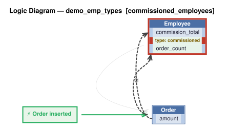
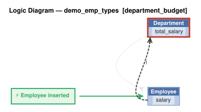
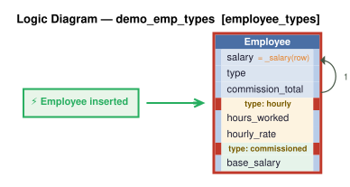
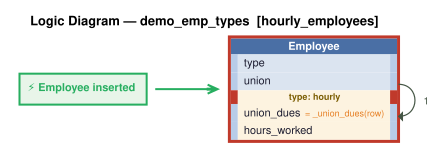
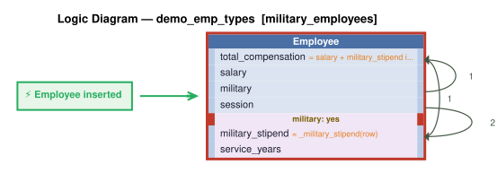
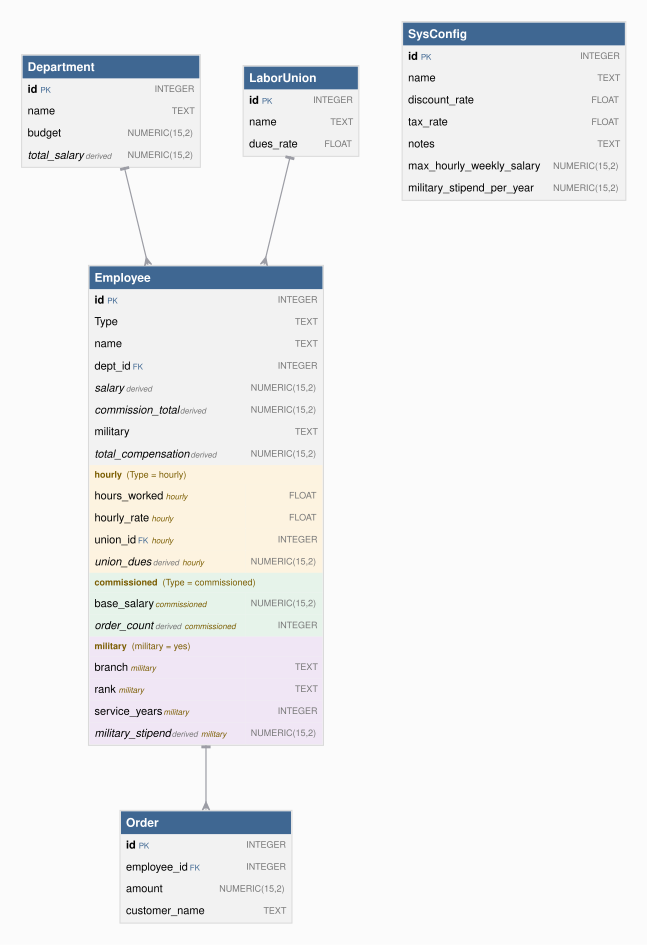

# Requirements Traceability Report

This report shows requirements, the rules created from them, and the tests created from those rules.

This project began as natural-language requirements, fleshed out by AI into a running system of business rules that are *executable documentation*. This report is how you govern the result.

A governable system is one you can **read**, **trust**, and **maintain**: each requirement is listed beside the rules that implement it (*read*); the tests and logic logs show those rules running (*trust*); re-run it after any change and it flags the gaps — an untested requirement, an untraced rule, a channel no test checks (*maintain*).

It is generated from the project's own files, nothing written by hand, so it is as current as the last run and covers the whole project, not a sample. Open **Background** (below the summary) for what the terms mean, how to read the report, and what it can and can't tell you.


**Project:** demo_emp_types &nbsp;|&nbsp; **Generated:** November 07, 2026 16:58 &nbsp;|&nbsp; **Rules:** 18 &nbsp;|&nbsp; **Test scenarios:** 38 &nbsp;|&nbsp; **Generator:** requirements_traceability_report.py 2.15

**Last test run:** November 07, 2026 16:58, took 0.50 s (0m before this report; test results and logic logs below are from that run)


&nbsp;
&nbsp;

## At a Glance

**✅ 5 requirement(s), all implemented; 5 tested; 38 of 38 scenarios passed; last run 0m ago.**

| | |
|---|---|
| Requirements | 5 (5 implemented) |
| Tested | 5 of 5 |
| Last test run | ✅ 38 passed, 0 failed (November 07, 2026 16:58, 0m ago); took 0.50 s |
| Rules | 18 (11 declarative, 6 Python functions, 1 Python events) |
| Rules shown running in a test log | 17 of 18 |
| Security | not enabled; 10 role(s), 0 row-level grant(s) |

_Status: ✅ every requirement is implemented and tested, all scenarios pass, and the results are current. ⚠ a requirement is untested or unimplemented, there is no test run, or files changed since the last run. ❌ a scenario failed. This reports what was traced and tested, not that the system is correct._

<details markdown>
<summary>Background: what this report is, and how to read it</summary>

&nbsp;

<details markdown>
<summary>Requirements are business policies, expressed in natural language</summary>

<br>

A **requirement** is a statement of business behavior - how data is computed, validated, and transmitted - written in plain language. It lives in the project at `docs/requirements/<name>/requirements.md`.  For example:

&nbsp;

```
On Placing Orders, Check Credit
    1. The Customer's balance does not exceed the credit limit
    2. The Customer's balance is the sum of the unshipped Order amount_total
    3. The Order's amount_total is the sum of the Item amount
    4. The Item amount is the quantity * unit_price
    5. The Item unit_price is copied from the Product unit_price
```

</details>

&nbsp;

<details markdown>
<summary>Rules implement requirements</summary>

<br>

A requirement is written at a high level, and AI fills in details as it builds — as it should — so the requirement no longer says exactly what the system does. The rules do. That's a Goldilocks answer to the question of what you review:

* **Requirements say too little** — incomplete by design; AI fills in the details.
* **Code says too much** — business language in, hundreds of lines of procedural code out. The work moves from writing to reading, and if you can't read it, you can't govern it.
* **Rules are just right** — close to the requirement's own level, but complete and deterministic.

Code could be treated like machine language — never read, only trusted — if it were produced deterministically. Generation from natural language isn't. Rules restore that contract: a readable source, deterministically executed.

The requirements above become rules like this:

```
Rule.copy(derive=models.Item.unit_price, from_parent=models.Product.unit_price)
Rule.formula(derive=models.Item.amount,
             as_expression=lambda row: row.quantity * row.unit_price)
Rule.sum(derive=models.Order.amount_total, as_sum_of=models.Item.amount)
Rule.sum(derive=models.Customer.balance, as_sum_of=models.Order.amount_total,
         where=lambda row: row.date_shipped is None)
Rule.constraint(
    validate=models.Customer,
    as_condition=lambda row: row.balance <= row.credit_limit,
    error_msg="balance ({row.balance}) exceeds credit limit ({row.credit_limit})")
```

Rules are ***executable documentation*** that you can read and trust:

* **Read:** rules stay near the requirement's level, so this report can list them side by side and you can check one against the other. 5 rules vs. ~200 lines in our [A/B test](https://github.com/ApiLogicServer/ApiLogicServer-src/blob/main/api_logic_server_cli/prototypes/manager/samples/basic_demo_logic_gov/logic/procedural/declarative-vs-procedural-comparison.md) — **~40x less to review**, whether generated or hand-coded.
* **Trust:** the document is enforced, not just descriptive.
    * **What you read is what runs** — no drift between description and behavior.
    * **Dependencies:** with code, you analyze every execution path to know it runs at the right times. With rules: if the rule is there, it runs, in the right order.
    * **All sources and paths:** the engine hooks into every commit — API, UI or agent — insert, update and delete, including related rows. No bypass.
    * **Seeing is believing:** each scenario in *Tests and Results* below embeds its logic log — every rule that ran, in order, with old and new values.

Better AI makes generating code easier. It doesn't change what you have to read. The problem is the representation, not the capability. And governance is active, not just process: the engine enforces the rules on every transaction, and this report — regenerated from the project itself — shows it happening.

&nbsp;

</details>

&nbsp;

<details markdown>
<summary>Process overview: creation and iteration</summary>

<br>


In two phases. First, `genai-logic create` builds a working system from the database: API, Admin App, data model. Then behavior is added from requirements — the typical sequence, each step a request to an AI assistant:

1. Write each requirement in natural language, in `docs/requirements/<name>/requirements.md`.
2. `implement reqs <name>` — creates the rules, API endpoints and Kafka integrations.
3. `create tests from rules` — writes the test scenarios and steps.
4. `run the tests` — starts the server if needed, runs the suite, reports pass/fail.
5. `run the requirements traceability report` — regenerates this report.

Optional: `create logic diagram for each requirement` (needs Graphviz).

What makes steps 3–5 possible: rules are high-level enough that AI can read them too. The tests, the logic diagrams and this report are all generated by reading the same rules you review — where logic is Python code, the report can only quote its docstring.

The report connects the chain: requirement → rules and handlers → tests → logic log. How *this* project was actually built is recorded under Provenance.

</details>

&nbsp;

<details markdown>
<summary>How to read this report</summary>

<br>

| If you are...  | Start with                                                        | Look for                                                                                     |
| -------------- | ----------------------------------------------------------------- | -------------------------------------------------------------------------------------------- |
| Business owner | *Requirements in detail*                                          | The requirement text, then the **Tests** line under it: does a test exist, and did it pass?  |
| Auditor        | *Coverage summary*, *Rule coverage by tests*, *Messages and APIs* | Gaps (untested, untraced), the date of the last test run, and how each rule was shown to run |
| Developer      | *Tests and Results*                                               | Each scenario's logic log: every rule that ran, in order, with old and new values            |

</details>

&nbsp;

<details markdown>
<summary>What this report can and can't tell you</summary>

<br>

**It shows**

- Which files and rules implement each requirement, read from the project's source.
- Which scenarios ran in the last test run, and whether each passed.
- Which rules the engine logged as running in each scenario.

**It doesn't show**

- Whether the requirements are right or complete. It traces what was written down.
- Whether an event did anything. Events run on every commit of their class and decide for themselves whether to act, so appearing in the log doesn't mean the event had an effect.
- Whether a constraint works. A constraint appears in the log only when it rejects a transaction, so look for a scenario that makes it reject.
- Whether a message arrived. Unless a test step looks for it on the broker or endpoint, a passing scenario doesn't prove delivery. The *Messages and APIs* table flags channels no test mentions.
- Whether the results are current. They are as old as the last test run, shown in the header, which also warns if files changed since.
- Which version of a requirement the code was built from, or which clause of a requirement a given rule serves.

</details>

&nbsp;

<details markdown>
<summary>Terms</summary>

<br>

| Term        | Meaning                                                                                              |
| ----------- | ---------------------------------------------------------------------------------------------------- |
| Requirement | A statement of business behavior, in plain language; the unit this report traces.                    |
| Rule        | A declaration about data (sum, count, formula, copy, constraint) that the engine enforces at every commit. |
| Event       | Python code the engine calls when a row of a given class changes (for example, to publish a message). |
| Handler     | Code that serves an API endpoint or consumes a Kafka topic.                                          |
| Scenario    | One Behave test: a short Given / When / Then script run against the live API.                        |
| Logic log   | The engine's record of every rule it ran in a transaction, nested to show cascades (an Item change adjusts its Order, which adjusts its Customer). |
| Phase       | The step of a commit: ROW LOGIC (derivations, constraints), COMMIT LOGIC (checks that need finished totals), AFTER_FLUSH LOGIC (events that need database-assigned keys, such as publishing). |
| Seen        | The engine reported running the rule in that scenario's log.                                         |

</details>

</details>


&nbsp;
&nbsp;

## Contents

- [Requirements Coverage](#requirements-coverage)
- [Data Model](#data-model)
- [Security (RBAC)](#security-rbac)
- [Messages and APIs](#messages-and-apis)
- [Tests and Results](#tests-and-results)
- [Provenance](#provenance)


&nbsp;
&nbsp;

## Requirements Coverage

Every requirement should have rules that implement it, and tests that prove it. This section checks that chain in both directions: a requirement missing rules or tests is a gap, and rules or tests that belong to no requirement are flagged too. The matching uses the requirement names, `Feature:` names and `§N` tags that requirements, code and tests share. Requirements may be grouped into a use case (for example Place Order), read from the logic folder or the prompt; the level is optional.


&nbsp;

### Coverage summary

| Measure | Result |
|---|---|
| Requirements | 5 |
| Implemented (at least one file) | 5 of 5 |
| Tested (at least one scenario) | 5 of 5 |
| Implementation not traced to a requirement | `security/declare_security.py`, `logic/logic_discovery/system/all_classes_stamping.py` |
| Tests not traced to a requirement | none |
| Test results (last run) | ✅ 38 passed, 0 failed; took 0.50 s |
| Scenarios with a logic log | 38 of 38 |
| Rules seen in at least one scenario's log | 17 of 18 (1 not counted: the engine's log does not name `all classes.early_row_event → handle_all()`, so it cannot be matched) |

_Test results are as current as the last run (see the header). A gap is any requirement with no implementation or no test._

<details markdown>
<summary>How to read this table</summary>

Test results are read from `logs/behave.log`, so they are only as current as that run. Not recorded here: which version of a requirement the code was built against, and which clause of a requirement a given rule serves.

</details>


&nbsp;

### Traceability matrix

| Requirement | Implemented by | Rules | Tests |
|---|---|---|---|
| commissioned_employees | [logic/logic_discovery/commissioned_employees.py](../../logic/logic_discovery/commissioned_employees.py) | 4 | ✅ 7 scenario(s): 7 passed |
| department_budget | [logic/logic_discovery/department_budget.py](../../logic/logic_discovery/department_budget.py) | 2 | ✅ 6 scenario(s): 6 passed |
| employee_types | [logic/logic_discovery/employee_types.py](../../logic/logic_discovery/employee_types.py) | 2 | ✅ 7 scenario(s): 7 passed |
| hourly_employees | [logic/logic_discovery/hourly_employees.py](../../logic/logic_discovery/hourly_employees.py) | 4 | ✅ 10 scenario(s): 10 passed |
| military_employees | [logic/logic_discovery/military_employees.py](../../logic/logic_discovery/military_employees.py) | 5 | ✅ 8 scenario(s): 8 passed |


&nbsp;

### Rule coverage by tests

| Rule | Requirement | Seen in |
|---|---|---|
| `Employee.commission_total = sum(Order.amount)` | commissioned_employees | 6: Order raises commission_total and order_count; Order amount change adjusts commission_total; Deleting an order lowers commission_total and order_count; +3 more |
| `Employee.order_count = count(Order)` | commissioned_employees | 6: Order raises commission_total and order_count; Order amount change adjusts commission_total; Deleting an order lowers commission_total and order_count; +3 more |
| `Employee: type == 'commissioned' or order_count == 0` | commissioned_employees | 9: Salaried employee may not have orders; Hourly employee may not have base_salary; Unknown employee type is rejected; +6 more |
| `Employee: type == 'commissioned' or base_salary is None` | commissioned_employees | 9: Salaried employee may not have orders; Hourly employee may not have base_salary; Unknown employee type is rejected; +6 more |
| `Department.total_salary = sum(Employee.salary)` | department_budget | 38: Order raises commission_total and order_count; Order amount change adjusts commission_total; Deleting an order lowers commission_total and order_count; +35 more |
| `Department: _total_salary_within_budget()` | department_budget | 1: Total salary over the budget is rejected |
| `Employee.salary = _salary()` | employee_types | 38: Order raises commission_total and order_count; Order amount change adjusts commission_total; Deleting an order lowers commission_total and order_count; +35 more |
| `Employee: type in ('salaried', 'hourly', 'commissioned')` | employee_types | 9: Salaried employee may not have orders; Hourly employee may not have base_salary; Unknown employee type is rejected; +6 more |
| `Employee.union_dues = _union_dues()` | hourly_employees | 38: Order raises commission_total and order_count; Order amount change adjusts commission_total; Deleting an order lowers commission_total and order_count; +35 more |
| `Employee: _hourly_salary_within_cap()` | hourly_employees | 9: Salaried employee may not have orders; Hourly employee may not have base_salary; Unknown employee type is rejected; +6 more |
| `Employee: type == 'hourly' or union_id is None` | hourly_employees | 9: Salaried employee may not have orders; Hourly employee may not have base_salary; Unknown employee type is rejected; +6 more |
| `Employee: type == 'hourly' or (hours_worked is None and hourly_rate is None)` | hourly_employees | 9: Salaried employee may not have orders; Hourly employee may not have base_salary; Unknown employee type is rejected; +6 more |
| `Employee.military_stipend = _military_stipend()` | military_employees | 38: Order raises commission_total and order_count; Order amount change adjusts commission_total; Deleting an order lowers commission_total and order_count; +35 more |
| `Employee.total_compensation = salary + military_stipend if military == "yes" else salary` | military_employees | 38: Order raises commission_total and order_count; Order amount change adjusts commission_total; Deleting an order lowers commission_total and order_count; +35 more |
| `Employee: _military_valid()` | military_employees | 9: Salaried employee may not have orders; Hourly employee may not have base_salary; Unknown employee type is rejected; +6 more |
| `Employee: branch is None or branch in BRANCHES` | military_employees | 9: Salaried employee may not have orders; Hourly employee may not have base_salary; Unknown employee type is rejected; +6 more |
| `Employee: military == "yes" or (branch is None and rank is None and service_years is None)` | military_employees | 9: Salaried employee may not have orders; Hourly employee may not have base_salary; Unknown employee type is rejected; +6 more |
| `all classes.early_row_event → handle_all()` | (none) | n/a - cannot be matched to the engine's log |

_"Seen" means the engine's log shows the rule ran, not proof that it took effect._

<details markdown>
<summary>How to read this table</summary>

"Seen" means the engine reported running the rule in that scenario's logic log. A scenario can only contribute if it has a log (see the coverage summary): a test that does not open one writes into whichever log was open last, and its rules are then credited to that scenario, or to the shared log. An event's function runs on every commit of its class, and its own condition decides whether it acts, so seen does not mean it took effect. A constraint appears in the log only when it rejects a transaction, so it is seen only in scenarios that make it reject. "Not seen" therefore means no log shows it, not that no test ran it.

</details>


&nbsp;

### Requirements in detail

**18 rules** in 6 files: 11 declarative (sum, count, copy, formula and constraint expressions), 6 backed by a Python function, 1 events (Python).

_Declarative rules are read straight from their declarations. Functions and events are Python code, so for those the report shows the docstring — it does not analyze the code._

Each requirement is followed by the rules and handlers in the files that implement it. Logic diagrams are shown (click to expand) where they exist.

<details markdown>
<summary>How to create or refresh the logic diagrams</summary>

Needs Graphviz (`brew install graphviz`). Tell your AI assistant:

```
create logic diagram for each requirement
```

or run this from the Manager root (`genai-logic`):

```
python system/ApiLogicServer-Internal-Dev/logic_diagram_gv.py demo_emp_types --each
```

Each diagram is saved under `docs/requirements/<name>/logic_diagrams/`. Then regenerate this report (`python requirements_traceability_report.py run`, from `test/api_logic_server_behave`).

</details>

&nbsp;


#### commissioned_employees

Tests: ✅ 7 scenario(s): 7 passed

```
Feature: Commissioned Employees

Commissioned employees are employees who can have Orders; only Commissioned employees may have Orders. Each Order has an amount and a customer name. Commissioned employees: commission_total = sum of Order.amount.
```

| Rule / item | Type | Logic | Description | Where |
|---|---|---|---|---|
| `Employee.commission_total = sum(Order.amount)` | sum | declarative |  | [commissioned_employees.py](../../logic/logic_discovery/commissioned_employees.py) |
| `Employee.order_count = count(Order)` | count | declarative |  | [commissioned_employees.py](../../logic/logic_discovery/commissioned_employees.py) |
| `Employee: type == 'commissioned' or order_count == 0` | constraint | declarative | Error: Only commissioned employees may have Orders | [commissioned_employees.py](../../logic/logic_discovery/commissioned_employees.py) |
| `Employee: type == 'commissioned' or base_salary is None` | constraint | declarative | Error: base_salary applies only to commissioned employees | [commissioned_employees.py](../../logic/logic_discovery/commissioned_employees.py) |

<details markdown>
<summary>Logic diagram: commissioned_employees</summary>



</details>

#### department_budget

Tests: ✅ 6 scenario(s): 6 passed

```
Feature: Department Budget

Departments have a name and a budget. Department.total_salary = sum of Employee.salary (all types). Department.total_salary must not exceed Department.budget. A user with the manager role may exceed the budget; other users may not.
```

| Rule / item | Type | Logic | Description | Where |
|---|---|---|---|---|
| `Department.total_salary = sum(Employee.salary)` | sum | declarative |  | [department_budget.py](../../logic/logic_discovery/department_budget.py) |
| `Department: _total_salary_within_budget()` | constraint | Python function | Department constraint: total_salary must not exceed budget, unless the user has the manager role. | [department_budget.py](../../logic/logic_discovery/department_budget.py) |

<details markdown>
<summary>Logic diagram: department_budget</summary>



</details>

#### employee_types

Tests: ✅ 7 scenario(s): 7 passed

```
Feature: Employee Types

Employees have a name, dept, and salary. Employees have a type that is one of: 'salaried', 'hourly', or 'commissioned'.

Hourly employees: salary = hours_worked * hourly_rate.

Commissioned employees: salary = base_salary + commission_total.
```

| Rule / item | Type | Logic | Description | Where |
|---|---|---|---|---|
| `Employee.salary = _salary()` | formula | Python function | Derive salary: hourly = hours_worked * hourly_rate; commissioned = base_salary + commission_total; salaried = as entered. | [employee_types.py](../../logic/logic_discovery/employee_types.py) |
| `Employee: type in ('salaried', 'hourly', 'commissioned')` | constraint | declarative | Error: Employee type ({row.type}) must be salaried, hourly or commissioned | [employee_types.py](../../logic/logic_discovery/employee_types.py) |

<details markdown>
<summary>Logic diagram: employee_types</summary>



</details>

#### hourly_employees

Tests: ✅ 10 scenario(s): 10 passed

```
Feature: Hourly Employees

Hourly employees are employees with hours_worked (REAL) and hourly_rate (REAL). Hourly employees: salary must not exceed 5000 per week. Hourly employees may be assigned to a Union (optional); only Hourly employees may have a union_id. Unions have a name and a dues_rate (REAL). Hourly employees: union_dues = hours_worked * union.dues_rate (0 if no union assigned).
```

| Rule / item | Type | Logic | Description | Where |
|---|---|---|---|---|
| `Employee.union_dues = _union_dues()` | formula | Python function | Derive union_dues: hours_worked * union dues_rate for hourly employees (0 if no union, or not hourly). | [hourly_employees.py](../../logic/logic_discovery/hourly_employees.py) |
| `Employee: _hourly_salary_within_cap()` | constraint | Python function | Employee constraint: an hourly employee's weekly salary must not exceed SysConfig max_hourly_weekly_salary. | [hourly_employees.py](../../logic/logic_discovery/hourly_employees.py) |
| `Employee: type == 'hourly' or union_id is None` | constraint | declarative | Error: Only hourly employees may have a union_id | [hourly_employees.py](../../logic/logic_discovery/hourly_employees.py) |
| `Employee: type == 'hourly' or (hours_worked is None and hourly_rate is None)` | constraint | declarative | Error: hours_worked and hourly_rate apply only to hourly employees | [hourly_employees.py](../../logic/logic_discovery/hourly_employees.py) |

<details markdown>
<summary>Logic diagram: hourly_employees</summary>



</details>

#### military_employees

Tests: ✅ 8 scenario(s): 8 passed

```
Feature: Military Employees

Employees may also have a military classification, independent of employment type. Military employees have a branch (TEXT: 'Army', 'Navy', 'Air Force', 'Marines', 'Coast Guard'), a rank (TEXT), and service_years (INTEGER). Military employees receive a military_stipend (REAL) = service_years * 100. Total compensation for military employees = salary + military_stipend. Total compensation for non-military employees = salary.
```

| Rule / item | Type | Logic | Description | Where |
|---|---|---|---|---|
| `Employee.military_stipend = _military_stipend()` | formula | Python function | Derive military_stipend: service_years * SysConfig military_stipend_per_year for military employees, 0 otherwise. | [military_employees.py](../../logic/logic_discovery/military_employees.py) |
| `Employee.total_compensation = salary + military_stipend if military == "yes" else salary` | formula | declarative |  | [military_employees.py](../../logic/logic_discovery/military_employees.py) |
| `Employee: _military_valid()` | constraint | Python function | Employee constraint: the military classification must be yes or no. | [military_employees.py](../../logic/logic_discovery/military_employees.py) |
| `Employee: branch is None or branch in BRANCHES` | constraint | declarative | Error: branch ({row.branch}) must be Army, Navy, Air Force, Marines or Coast Guard | [military_employees.py](../../logic/logic_discovery/military_employees.py) |
| `Employee: military == "yes" or (branch is None and rank is None and service_years is None)` | constraint | declarative | Error: branch, rank and service_years apply only to military employees | [military_employees.py](../../logic/logic_discovery/military_employees.py) |

<details markdown>
<summary>Logic diagram: military_employees</summary>



</details>

#### Rules not traced to a requirement

| Rule / item | Type | Logic | Description | Where |
|---|---|---|---|---|
| `all classes.early_row_event → handle_all()` | early_row_event_all_classes | event (Python) | Generic handler - executed for every row update across all classes. | [all_classes_stamping.py](../../logic/logic_discovery/system/all_classes_stamping.py) |


&nbsp;
&nbsp;

## Data Model

The tables the rules run over. Derived columns (in italics) are computed by rules — no code writes them. Tinted groups are the subtypes.



_Generated from `docs/db.dbml` (parents above children; shaded rows are derived by rules). To use your own layout, save it as `docs/db_diagram.png`._


&nbsp;

### Derived columns

| Table | Column | Rule | Definition |
|---|---|---|---|
| Employee | commission_total | sum | `Employee.commission_total = sum(Order.amount)` |
| Employee | order_count | count | `Employee.order_count = count(Order)` |
| Department | total_salary | sum | `Department.total_salary = sum(Employee.salary)` |
| Employee | salary | formula | `Employee.salary = _salary()` |
| Employee | union_dues | formula | `Employee.union_dues = _union_dues()` |
| Employee | military_stipend | formula | `Employee.military_stipend = _military_stipend()` |
| Employee | total_compensation | formula | `Employee.total_compensation = salary + military_stipend if military == "yes" else salary` |


&nbsp;
&nbsp;

## Security (RBAC)

Who can do what: each role's permissions, and which rows each role can see.

**Security enabled: no** (`SECURITY_ENABLED` in `config/default.env`). The declarations below are not enforced until `genai-logic add-auth` is run.


&nbsp;

### Roles and CRUD (DefaultRolePermission)

| Role | Read | Insert | Update | Delete |
|---|---|---|---|---|
| sa | ✅ | ✅ | ✅ | ✅ |
| tenant | ✅ | — | — | ✅ |
| CS_ADMIN | ✅ | ✅ | ✅ | ✅ |
| manager | ✅ | ✅ | ✅ | — |
| teller | ✅ | ✅ | ✅ | — |
| customer | ✅ | ✅ | ✅ | — |
| readonly | ✅ | — | — | — |
| public | ✅ | — | — | — |
| default-roles-kcals | ✅ | ✅ | ✅ | — |
| uma_authorization | ✅ | ✅ | ✅ | — |


&nbsp;

### Row-level grants (Grant)

None declared (`Grant`).


&nbsp;
&nbsp;

## Messages and APIs

How data enters and leaves beyond the standard API: Kafka topics in and out, custom HTTP endpoints — and whether any test touches each one.

No Kafka topics or custom API endpoints found.


&nbsp;
&nbsp;

## Tests and Results

**✅ 38 scenario(s): 38 passed, 0 failed; took 0.50 s** (from the last run, `logs/behave.log`).

Each test drives the running system the way any client would — create an order, change a quantity, ship it — and checks the result.

**The logic log** is what makes them more than pass/fail. Business rules run inside the server on every commit, so the server records exactly what they did, and this report embeds that record for each scenario. Two things to look for:

1. **It shows every rule that runs.** Each line is one rule execution, with the row's state, old and new values. You see not just that a test passed, but which rules ran and what each one changed.
2. **The nesting shows multi-table chaining.** Indentation follows the cascade: a change to an Item adjusts its Order, which adjusts its Customer.

<details markdown>
<summary>How to read the logic log</summary>

Open a scenario's "Rules exercised and logic log" block to see it. The log is shown in full, attribute values included, because those values are what you diagnose from when a rule produces an unexpected result.

To read a log line:

```
....Order[16] {Update - Adjusting order: amount_total} id: 16, customer_id: 19, amount_total:  [0.0-->] 90.0

```

- The leading dots are the depth in the cascade: Item (2 dots), its Order (4), its Customer (6).
- `Order[16]` is the row; `{...}` is the rule or action that ran; the rest is the row's attribute values at that step.
- `[0.0-->] 90.0` marks a value the rules changed, with its old and new value.
- The log is in phases: **ROW LOGIC** (derivations and constraints, as rows change), **COMMIT LOGIC** (checks that need the finished aggregates), and **AFTER_FLUSH LOGIC** (events that need database-assigned keys, such as the Kafka publish).

More: [Logic Log](https://apilogicserver.github.io/Docs/Logic-Debug/#logic-log).

</details>

&nbsp;

<details markdown>
<summary>How to add more tests, and run them</summary>

**1. Have AI create them.** This project's context tells your AI assistant how (`.github/copilot-instructions.md`, `docs/training/testing.md`). Just say:

```

create tests from rules

```

The assistant reads `database/models.py`, the logic files and the custom APIs, then writes `.feature` files and step implementations under `test/api_logic_server_behave/features/`. Then say `run the tests` and `run the requirements traceability report` and the assistant does both.

Or, to have each requirement's tests linked in the Tests column above (it matches on `Feature:` name), say which names to use:

```

create tests from rules, one Feature per requirement, named exactly:
- Commissioned Employees
- Department Budget
- Employee Types
- Hourly Employees
- Military Employees

```

_Tests with other names still run and appear below; they just aren't linked to a requirement._

**2. You can also define tests manually.** Add a `<name>.feature` file (Gherkin) under `test/api_logic_server_behave/features/` and its steps under `features/steps/`. The steps call the running API, so tests exercise the same rules as any client. See `docs/training/testing.md` for the patterns that keep tests repeatable.

**Or run them yourself** (server running, from `test/api_logic_server_behave`):

```

python behave_run.py --outfile=logs/behave.log
python requirements_traceability_report.py run

```

</details>

&nbsp;
&nbsp;

### Feature: Commissioned Employees  

&nbsp;
&nbsp;

#### Scenario: Order raises commission_total and order_count ✅ (0.03 s)
&emsp;  Scenario: Order raises commission_total and order_count  
&emsp;&emsp;    Given a department with budget 1000000  
&emsp;&emsp;    And an employee of type commissioned with name="Comm Add" base_salary=1000  
&emsp;&emsp;    When an order of 500 is added for the employee  
&emsp;&emsp;    Then the employee commission_total is 500  
&emsp;&emsp;    And the employee order_count is 1  
&emsp;&emsp;    And the employee salary is 1500  

<details markdown>
<summary>Rules exercised and logic log (2 transactions)</summary>


&nbsp;
&nbsp;


**Rules Used** in Scenario: Order raises commission_total and order_count
```
  Department  
    1. Derive Department.total_salary as Sum(Employee.salary Where  - None)  
  Employee  
    2. Derive Employee.total_compensation as Formula (3): as_expression=lambda row: row.salary + row.milita [...]  
    3. Derive Employee.military_stipend as Formula (2): <function>  
    4. Derive Employee.union_dues as Formula (4): <function>  
    5. Derive Employee.salary as Formula (1): <function>  
    6. Derive Employee.commission_total as Sum(Order.amount Where  - None)  
    7. Derive Employee.order_count as Count(Order Where  - None)  
```
**Logic Log** in Scenario: Order raises commission_total and order_count (2 transactions)
```
Logic Phase:		ROW LOGIC		(session=0x10c84b4d0) (sqlalchemy before_flush)			 - 2026-11-07 16:58:00,528 - logic_logger - INFO
..Employee[None] {Insert - client} id: None, type: commissioned, name: Comm Add 1794099480527, dept_id: 42, salary: None, hours_worked: None, hourly_rate: None, union_id: None, union_dues: None, base_salary: 1000, commission_total: None, order_count: None, military: None, branch: None, rank: None, service_years: None, military_stipend: None, total_compensation: None  row: 0x10c8cf200  session: 0x10c84b4d0  ins_upd_dlt: ins, initial: ins - 2026-11-07 16:58:00,528 - logic_logger - INFO
..Employee[None] {server_defaults: salary union_dues commission_total order_count military_stipend total_compensation } id: None, type: commissioned, name: Comm Add 1794099480527, dept_id: 42, salary: 0, hours_worked: None, hourly_rate: None, union_id: None, union_dues: 0, base_salary: 1000, commission_total: 0, order_count: 0, military: None, branch: None, rank: None, service_years: None, military_stipend: 0, total_compensation: 0  row: 0x10c8cf200  session: 0x10c84b4d0  ins_upd_dlt: ins, initial: ins - 2026-11-07 16:58:00,528 - logic_logger - INFO
..Employee[None] {server aggregate_defaults: commission_total order_count } id: None, type: commissioned, name: Comm Add 1794099480527, dept_id: 42, salary: 0, hours_worked: None, hourly_rate: None, union_id: None, union_dues: 0, base_salary: 1000, commission_total: 0, order_count: 0, military: None, branch: None, rank: None, service_years: None, military_stipend: 0, total_compensation: 0  row: 0x10c8cf200  session: 0x10c84b4d0  ins_upd_dlt: ins, initial: ins - 2026-11-07 16:58:00,528 - logic_logger - INFO
..Employee[None] {Formula salary} id: None, type: commissioned, name: Comm Add 1794099480527, dept_id: 42, salary: 1000, hours_worked: None, hourly_rate: None, union_id: None, union_dues: 0, base_salary: 1000, commission_total: 0, order_count: 0, military: None, branch: None, rank: None, service_years: None, military_stipend: 0, total_compensation: 0  row: 0x10c8cf200  session: 0x10c84b4d0  ins_upd_dlt: ins, initial: ins - 2026-11-07 16:58:00,529 - logic_logger - INFO
..Employee[None] {Formula total_compensation} id: None, type: commissioned, name: Comm Add 1794099480527, dept_id: 42, salary: 1000, hours_worked: None, hourly_rate: None, union_id: None, union_dues: 0, base_salary: 1000, commission_total: 0, order_count: 0, military: None, branch: None, rank: None, service_years: None, military_stipend: 0, total_compensation: 1000  row: 0x10c8cf200  session: 0x10c84b4d0  ins_upd_dlt: ins, initial: ins - 2026-11-07 16:58:00,529 - logic_logger - INFO
....Department[42] {Update - Adjusting dept: total_salary} id: 42, name: Dept 1794099480521, budget: 1000000.00, total_salary:  [0.00-->] 1000.00  row: 0x10c9c9010  session: 0x10c84b4d0  ins_upd_dlt: upd, initial: upd - 2026-11-07 16:58:00,529 - logic_logger - INFO
Logic Phase:		COMMIT LOGIC		(session=0x10c84b4d0)   										 - 2026-11-07 16:58:00,530 - logic_logger - INFO
Logic Phase:		AFTER_FLUSH LOGIC	(session=0x10c84b4d0)   										 - 2026-11-07 16:58:00,531 - logic_logger - INFO


Logic Phase:		ROW LOGIC		(session=0x10c9e0180) (sqlalchemy before_flush)			 - 2026-11-07 16:58:00,534 - logic_logger - INFO
..Order[None] {Insert - client} id: None, employee_id: 36, amount: 500, customer_name: Customer 1794099480533  row: 0x10c9c88a0  session: 0x10c9e0180  ins_upd_dlt: ins, initial: ins - 2026-11-07 16:58:00,534 - logic_logger - INFO
....Employee[36] {Update - Adjusting employee: commission_total, order_count} id: 36, type: commissioned, name: Comm Add 1794099480527, dept_id: 42, salary: 1000.00, hours_worked: None, hourly_rate: None, union_id: None, union_dues: 0.00, base_salary: 1000.00, commission_total:  [0.00-->] 500.00, order_count:  [0-->] 1, military: None, branch: None, rank: None, service_years: None, military_stipend: 0.00, total_compensation: 1000.00  row: 0x10ca14230  session: 0x10c9e0180  ins_upd_dlt: upd, initial: upd - 2026-11-07 16:58:00,534 - logic_logger - INFO
....Employee[36] {Formula salary} id: 36, type: commissioned, name: Comm Add 1794099480527, dept_id: 42, salary:  [1000.00-->] 1500.00, hours_worked: None, hourly_rate: None, union_id: None, union_dues: 0.00, base_salary: 1000.00, commission_total:  [0.00-->] 500.00, order_count:  [0-->] 1, military: None, branch: None, rank: None, service_years: None, military_stipend: 0.00, total_compensation: 1000.00  row: 0x10ca14230  session: 0x10c9e0180  ins_upd_dlt: upd, initial: upd - 2026-11-07 16:58:00,535 - logic_logger - INFO
....Employee[36] {Prune Formula: military_stipend [['military', 'service_years']]} id: 36, type: commissioned, name: Comm Add 1794099480527, dept_id: 42, salary:  [1000.00-->] 1500.00, hours_worked: None, hourly_rate: None, union_id: None, union_dues: 0.00, base_salary: 1000.00, commission_total:  [0.00-->] 500.00, order_count:  [0-->] 1, military: None, branch: None, rank: None, service_years: None, military_stipend: 0.00, total_compensation: 1000.00  row: 0x10ca14230  session: 0x10c9e0180  ins_upd_dlt: upd, initial: upd - 2026-11-07 16:58:00,535 - logic_logger - INFO
....Employee[36] {Formula total_compensation} id: 36, type: commissioned, name: Comm Add 1794099480527, dept_id: 42, salary:  [1000.00-->] 1500.00, hours_worked: None, hourly_rate: None, union_id: None, union_dues: 0.00, base_salary: 1000.00, commission_total:  [0.00-->] 500.00, order_count:  [0-->] 1, military: None, branch: None, rank: None, service_years: None, military_stipend: 0.00, total_compensation:  [1000.00-->] 1500.00  row: 0x10ca14230  session: 0x10c9e0180  ins_upd_dlt: upd, initial: upd - 2026-11-07 16:58:00,535 - logic_logger - INFO
....Employee[36] {Prune Formula: union_dues [['type', 'hours_worked', 'union', 'union.dues_rate']]} id: 36, type: commissioned, name: Comm Add 1794099480527, dept_id: 42, salary:  [1000.00-->] 1500.00, hours_worked: None, hourly_rate: None, union_id: None, union_dues: 0.00, base_salary: 1000.00, commission_total:  [0.00-->] 500.00, order_count:  [0-->] 1, military: None, branch: None, rank: None, service_years: None, military_stipend: 0.00, total_compensation:  [1000.00-->] 1500.00  row: 0x10ca14230  session: 0x10c9e0180  ins_upd_dlt: upd, initial: upd - 2026-11-07 16:58:00,535 - logic_logger - INFO
......Department[42] {Update - Adjusting dept: total_salary} id: 42, name: Dept 1794099480521, budget: 1000000.00, total_salary:  [1000.00-->] 1500.00  row: 0x10c9c94e0  session: 0x10c9e0180  ins_upd_dlt: upd, initial: upd - 2026-11-07 16:58:00,535 - logic_logger - INFO
Logic Phase:		COMMIT LOGIC		(session=0x10c9e0180)   										 - 2026-11-07 16:58:00,536 - logic_logger - INFO
Logic Phase:		AFTER_FLUSH LOGIC	(session=0x10c9e0180)   										 - 2026-11-07 16:58:00,537 - logic_logger - INFO

```
</details>

&nbsp;
&nbsp;

#### Scenario: Order amount change adjusts commission_total ✅ (0.02 s)
&emsp;  Scenario: Order amount change adjusts commission_total  
&emsp;&emsp;    Given a department with budget 1000000  
&emsp;&emsp;    And an employee of type commissioned with name="Comm Change" base_salary=1000  
&emsp;&emsp;    And an order of 500 is added for the employee  
&emsp;&emsp;    When the order amount is changed to 800  
&emsp;&emsp;    Then the employee commission_total is 800  
&emsp;&emsp;    And the employee salary is 1800  

<details markdown>
<summary>Rules exercised and logic log (3 transactions)</summary>


&nbsp;
&nbsp;


**Rules Used** in Scenario: Order amount change adjusts commission_total
```
  Department  
    1. Derive Department.total_salary as Sum(Employee.salary Where  - None)  
  Employee  
    2. Derive Employee.total_compensation as Formula (3): as_expression=lambda row: row.salary + row.milita [...]  
    3. Derive Employee.military_stipend as Formula (2): <function>  
    4. Derive Employee.union_dues as Formula (4): <function>  
    5. Derive Employee.salary as Formula (1): <function>  
    6. Derive Employee.commission_total as Sum(Order.amount Where  - None)  
    7. Derive Employee.order_count as Count(Order Where  - None)  
```
**Logic Log** in Scenario: Order amount change adjusts commission_total (3 transactions)
```
Logic Phase:		ROW LOGIC		(session=0x10c87a7a0) (sqlalchemy before_flush)			 - 2026-11-07 16:58:00,548 - logic_logger - INFO
..Employee[None] {Insert - client} id: None, type: commissioned, name: Comm Change 1794099480547, dept_id: 43, salary: None, hours_worked: None, hourly_rate: None, union_id: None, union_dues: None, base_salary: 1000, commission_total: None, order_count: None, military: None, branch: None, rank: None, service_years: None, military_stipend: None, total_compensation: None  row: 0x10ca154f0  session: 0x10c87a7a0  ins_upd_dlt: ins, initial: ins - 2026-11-07 16:58:00,548 - logic_logger - INFO
..Employee[None] {server_defaults: salary union_dues commission_total order_count military_stipend total_compensation } id: None, type: commissioned, name: Comm Change 1794099480547, dept_id: 43, salary: 0, hours_worked: None, hourly_rate: None, union_id: None, union_dues: 0, base_salary: 1000, commission_total: 0, order_count: 0, military: None, branch: None, rank: None, service_years: None, military_stipend: 0, total_compensation: 0  row: 0x10ca154f0  session: 0x10c87a7a0  ins_upd_dlt: ins, initial: ins - 2026-11-07 16:58:00,548 - logic_logger - INFO
..Employee[None] {server aggregate_defaults: commission_total order_count } id: None, type: commissioned, name: Comm Change 1794099480547, dept_id: 43, salary: 0, hours_worked: None, hourly_rate: None, union_id: None, union_dues: 0, base_salary: 1000, commission_total: 0, order_count: 0, military: None, branch: None, rank: None, service_years: None, military_stipend: 0, total_compensation: 0  row: 0x10ca154f0  session: 0x10c87a7a0  ins_upd_dlt: ins, initial: ins - 2026-11-07 16:58:00,548 - logic_logger - INFO
..Employee[None] {Formula salary} id: None, type: commissioned, name: Comm Change 1794099480547, dept_id: 43, salary: 1000, hours_worked: None, hourly_rate: None, union_id: None, union_dues: 0, base_salary: 1000, commission_total: 0, order_count: 0, military: None, branch: None, rank: None, service_years: None, military_stipend: 0, total_compensation: 0  row: 0x10ca154f0  session: 0x10c87a7a0  ins_upd_dlt: ins, initial: ins - 2026-11-07 16:58:00,548 - logic_logger - INFO
..Employee[None] {Formula total_compensation} id: None, type: commissioned, name: Comm Change 1794099480547, dept_id: 43, salary: 1000, hours_worked: None, hourly_rate: None, union_id: None, union_dues: 0, base_salary: 1000, commission_total: 0, order_count: 0, military: None, branch: None, rank: None, service_years: None, military_stipend: 0, total_compensation: 1000  row: 0x10ca154f0  session: 0x10c87a7a0  ins_upd_dlt: ins, initial: ins - 2026-11-07 16:58:00,548 - logic_logger - INFO
....Department[43] {Update - Adjusting dept: total_salary} id: 43, name: Dept 1794099480544, budget: 1000000.00, total_salary:  [0.00-->] 1000.00  row: 0x10c9c8830  session: 0x10c87a7a0  ins_upd_dlt: upd, initial: upd - 2026-11-07 16:58:00,548 - logic_logger - INFO
Logic Phase:		COMMIT LOGIC		(session=0x10c87a7a0)   										 - 2026-11-07 16:58:00,549 - logic_logger - INFO
Logic Phase:		AFTER_FLUSH LOGIC	(session=0x10c87a7a0)   										 - 2026-11-07 16:58:00,549 - logic_logger - INFO


Logic Phase:		ROW LOGIC		(session=0x10c87a690) (sqlalchemy before_flush)			 - 2026-11-07 16:58:00,552 - logic_logger - INFO
..Order[None] {Insert - client} id: None, employee_id: 37, amount: 500, customer_name: Customer 1794099480551  row: 0x10c9c9a90  session: 0x10c87a690  ins_upd_dlt: ins, initial: ins - 2026-11-07 16:58:00,552 - logic_logger - INFO
....Employee[37] {Update - Adjusting employee: commission_total, order_count} id: 37, type: commissioned, name: Comm Change 1794099480547, dept_id: 43, salary: 1000.00, hours_worked: None, hourly_rate: None, union_id: None, union_dues: 0.00, base_salary: 1000.00, commission_total:  [0.00-->] 500.00, order_count:  [0-->] 1, military: None, branch: None, rank: None, service_years: None, military_stipend: 0.00, total_compensation: 1000.00  row: 0x10ca15c70  session: 0x10c87a690  ins_upd_dlt: upd, initial: upd - 2026-11-07 16:58:00,552 - logic_logger - INFO
....Employee[37] {Formula salary} id: 37, type: commissioned, name: Comm Change 1794099480547, dept_id: 43, salary:  [1000.00-->] 1500.00, hours_worked: None, hourly_rate: None, union_id: None, union_dues: 0.00, base_salary: 1000.00, commission_total:  [0.00-->] 500.00, order_count:  [0-->] 1, military: None, branch: None, rank: None, service_years: None, military_stipend: 0.00, total_compensation: 1000.00  row: 0x10ca15c70  session: 0x10c87a690  ins_upd_dlt: upd, initial: upd - 2026-11-07 16:58:00,552 - logic_logger - INFO
....Employee[37] {Prune Formula: military_stipend [['military', 'service_years']]} id: 37, type: commissioned, name: Comm Change 1794099480547, dept_id: 43, salary:  [1000.00-->] 1500.00, hours_worked: None, hourly_rate: None, union_id: None, union_dues: 0.00, base_salary: 1000.00, commission_total:  [0.00-->] 500.00, order_count:  [0-->] 1, military: None, branch: None, rank: None, service_years: None, military_stipend: 0.00, total_compensation: 1000.00  row: 0x10ca15c70  session: 0x10c87a690  ins_upd_dlt: upd, initial: upd - 2026-11-07 16:58:00,552 - logic_logger - INFO
....Employee[37] {Formula total_compensation} id: 37, type: commissioned, name: Comm Change 1794099480547, dept_id: 43, salary:  [1000.00-->] 1500.00, hours_worked: None, hourly_rate: None, union_id: None, union_dues: 0.00, base_salary: 1000.00, commission_total:  [0.00-->] 500.00, order_count:  [0-->] 1, military: None, branch: None, rank: None, service_years: None, military_stipend: 0.00, total_compensation:  [1000.00-->] 1500.00  row: 0x10ca15c70  session: 0x10c87a690  ins_upd_dlt: upd, initial: upd - 2026-11-07 16:58:00,552 - logic_logger - INFO
....Employee[37] {Prune Formula: union_dues [['type', 'hours_worked', 'union', 'union.dues_rate']]} id: 37, type: commissioned, name: Comm Change 1794099480547, dept_id: 43, salary:  [1000.00-->] 1500.00, hours_worked: None, hourly_rate: None, union_id: None, union_dues: 0.00, base_salary: 1000.00, commission_total:  [0.00-->] 500.00, order_count:  [0-->] 1, military: None, branch: None, rank: None, service_years: None, military_stipend: 0.00, total_compensation:  [1000.00-->] 1500.00  row: 0x10ca15c70  session: 0x10c87a690  ins_upd_dlt: upd, initial: upd - 2026-11-07 16:58:00,552 - logic_logger - INFO
......Department[43] {Update - Adjusting dept: total_salary} id: 43, name: Dept 1794099480544, budget: 1000000.00, total_salary:  [1000.00-->] 1500.00  row: 0x10c9c9da0  session: 0x10c87a690  ins_upd_dlt: upd, initial: upd - 2026-11-07 16:58:00,552 - logic_logger - INFO
Logic Phase:		COMMIT LOGIC		(session=0x10c87a690)   										 - 2026-11-07 16:58:00,553 - logic_logger - INFO
Logic Phase:		AFTER_FLUSH LOGIC	(session=0x10c87a690)   										 - 2026-11-07 16:58:00,554 - logic_logger - INFO


Logic Phase:		ROW LOGIC		(session=0x10c87a580) (sqlalchemy before_flush)			 - 2026-11-07 16:58:00,556 - logic_logger - INFO
..Order[9] {Update - client} id: 9, employee_id: 37, amount:  [500.00-->] 800, customer_name: Customer 1794099480551  row: 0x10c9c9f60  session: 0x10c87a580  ins_upd_dlt: upd, initial: upd - 2026-11-07 16:58:00,556 - logic_logger - INFO
....Employee[37] {Update - Adjusting employee: commission_total} id: 37, type: commissioned, name: Comm Change 1794099480547, dept_id: 43, salary: 1500.00, hours_worked: None, hourly_rate: None, union_id: None, union_dues: 0.00, base_salary: 1000.00, commission_total:  [500.00-->] 800.00, order_count: 1, military: None, branch: None, rank: None, service_years: None, military_stipend: 0.00, total_compensation: 1500.00  row: 0x10ca15310  session: 0x10c87a580  ins_upd_dlt: upd, initial: upd - 2026-11-07 16:58:00,556 - logic_logger - INFO
....Employee[37] {Formula salary} id: 37, type: commissioned, name: Comm Change 1794099480547, dept_id: 43, salary:  [1500.00-->] 1800.00, hours_worked: None, hourly_rate: None, union_id: None, union_dues: 0.00, base_salary: 1000.00, commission_total:  [500.00-->] 800.00, order_count: 1, military: None, branch: None, rank: None, service_years: None, military_stipend: 0.00, total_compensation: 1500.00  row: 0x10ca15310  session: 0x10c87a580  ins_upd_dlt: upd, initial: upd - 2026-11-07 16:58:00,557 - logic_logger - INFO
....Employee[37] {Prune Formula: military_stipend [['military', 'service_years']]} id: 37, type: commissioned, name: Comm Change 1794099480547, dept_id: 43, salary:  [1500.00-->] 1800.00, hours_worked: None, hourly_rate: None, union_id: None, union_dues: 0.00, base_salary: 1000.00, commission_total:  [500.00-->] 800.00, order_count: 1, military: None, branch: None, rank: None, service_years: None, military_stipend: 0.00, total_compensation: 1500.00  row: 0x10ca15310  session: 0x10c87a580  ins_upd_dlt: upd, initial: upd - 2026-11-07 16:58:00,557 - logic_logger - INFO
....Employee[37] {Formula total_compensation} id: 37, type: commissioned, name: Comm Change 1794099480547, dept_id: 43, salary:  [1500.00-->] 1800.00, hours_worked: None, hourly_rate: None, union_id: None, union_dues: 0.00, base_salary: 1000.00, commission_total:  [500.00-->] 800.00, order_count: 1, military: None, branch: None, rank: None, service_years: None, military_stipend: 0.00, total_compensation:  [1500.00-->] 1800.00  row: 0x10ca15310  session: 0x10c87a580  ins_upd_dlt: upd, initial: upd - 2026-11-07 16:58:00,557 - logic_logger - INFO
....Employee[37] {Prune Formula: union_dues [['type', 'hours_worked', 'union', 'union.dues_rate']]} id: 37, type: commissioned, name: Comm Change 1794099480547, dept_id: 43, salary:  [1500.00-->] 1800.00, hours_worked: None, hourly_rate: None, union_id: None, union_dues: 0.00, base_salary: 1000.00, commission_total:  [500.00-->] 800.00, order_count: 1, military: None, branch: None, rank: None, service_years: None, military_stipend: 0.00, total_compensation:  [1500.00-->] 1800.00  row: 0x10ca15310  session: 0x10c87a580  ins_upd_dlt: upd, initial: upd - 2026-11-07 16:58:00,557 - logic_logger - INFO
......Department[43] {Update - Adjusting dept: total_salary} id: 43, name: Dept 1794099480544, budget: 1000000.00, total_salary:  [1500.00-->] 1800.00  row: 0x10c9c9940  session: 0x10c87a580  ins_upd_dlt: upd, initial: upd - 2026-11-07 16:58:00,557 - logic_logger - INFO
Logic Phase:		COMMIT LOGIC		(session=0x10c87a580)   										 - 2026-11-07 16:58:00,558 - logic_logger - INFO
Logic Phase:		AFTER_FLUSH LOGIC	(session=0x10c87a580)   										 - 2026-11-07 16:58:00,558 - logic_logger - INFO

```
</details>

&nbsp;
&nbsp;

#### Scenario: Deleting an order lowers commission_total and order_count ✅ (0.02 s)
&emsp;  Scenario: Deleting an order lowers commission_total and order_count  
&emsp;&emsp;    Given a department with budget 1000000  
&emsp;&emsp;    And an employee of type commissioned with name="Comm Delete" base_salary=1000  
&emsp;&emsp;    And an order of 500 is added for the employee  
&emsp;&emsp;    When the order is deleted  
&emsp;&emsp;    Then the employee commission_total is 0  
&emsp;&emsp;    And the employee order_count is 0  

<details markdown>
<summary>Rules exercised and logic log (3 transactions)</summary>


&nbsp;
&nbsp;


**Rules Used** in Scenario: Deleting an order lowers commission_total and order_count
```
  Department  
    1. Derive Department.total_salary as Sum(Employee.salary Where  - None)  
  Employee  
    2. Derive Employee.total_compensation as Formula (3): as_expression=lambda row: row.salary + row.milita [...]  
    3. Derive Employee.military_stipend as Formula (2): <function>  
    4. Derive Employee.union_dues as Formula (4): <function>  
    5. Derive Employee.salary as Formula (1): <function>  
    6. Derive Employee.commission_total as Sum(Order.amount Where  - None)  
    7. Derive Employee.order_count as Count(Order Where  - None)  
```
**Logic Log** in Scenario: Deleting an order lowers commission_total and order_count (3 transactions)
```
Logic Phase:		ROW LOGIC		(session=0x10c87abe0) (sqlalchemy before_flush)			 - 2026-11-07 16:58:00,567 - logic_logger - INFO
..Employee[None] {Insert - client} id: None, type: commissioned, name: Comm Delete 1794099480566, dept_id: 44, salary: None, hours_worked: None, hourly_rate: None, union_id: None, union_dues: None, base_salary: 1000, commission_total: None, order_count: None, military: None, branch: None, rank: None, service_years: None, military_stipend: None, total_compensation: None  row: 0x10ca15b80  session: 0x10c87abe0  ins_upd_dlt: ins, initial: ins - 2026-11-07 16:58:00,567 - logic_logger - INFO
..Employee[None] {server_defaults: salary union_dues commission_total order_count military_stipend total_compensation } id: None, type: commissioned, name: Comm Delete 1794099480566, dept_id: 44, salary: 0, hours_worked: None, hourly_rate: None, union_id: None, union_dues: 0, base_salary: 1000, commission_total: 0, order_count: 0, military: None, branch: None, rank: None, service_years: None, military_stipend: 0, total_compensation: 0  row: 0x10ca15b80  session: 0x10c87abe0  ins_upd_dlt: ins, initial: ins - 2026-11-07 16:58:00,567 - logic_logger - INFO
..Employee[None] {server aggregate_defaults: commission_total order_count } id: None, type: commissioned, name: Comm Delete 1794099480566, dept_id: 44, salary: 0, hours_worked: None, hourly_rate: None, union_id: None, union_dues: 0, base_salary: 1000, commission_total: 0, order_count: 0, military: None, branch: None, rank: None, service_years: None, military_stipend: 0, total_compensation: 0  row: 0x10ca15b80  session: 0x10c87abe0  ins_upd_dlt: ins, initial: ins - 2026-11-07 16:58:00,567 - logic_logger - INFO
..Employee[None] {Formula salary} id: None, type: commissioned, name: Comm Delete 1794099480566, dept_id: 44, salary: 1000, hours_worked: None, hourly_rate: None, union_id: None, union_dues: 0, base_salary: 1000, commission_total: 0, order_count: 0, military: None, branch: None, rank: None, service_years: None, military_stipend: 0, total_compensation: 0  row: 0x10ca15b80  session: 0x10c87abe0  ins_upd_dlt: ins, initial: ins - 2026-11-07 16:58:00,568 - logic_logger - INFO
..Employee[None] {Formula total_compensation} id: None, type: commissioned, name: Comm Delete 1794099480566, dept_id: 44, salary: 1000, hours_worked: None, hourly_rate: None, union_id: None, union_dues: 0, base_salary: 1000, commission_total: 0, order_count: 0, military: None, branch: None, rank: None, service_years: None, military_stipend: 0, total_compensation: 1000  row: 0x10ca15b80  session: 0x10c87abe0  ins_upd_dlt: ins, initial: ins - 2026-11-07 16:58:00,568 - logic_logger - INFO
....Department[44] {Update - Adjusting dept: total_salary} id: 44, name: Dept 1794099480564, budget: 1000000.00, total_salary:  [0.00-->] 1000.00  row: 0x10c9ca350  session: 0x10c87abe0  ins_upd_dlt: upd, initial: upd - 2026-11-07 16:58:00,568 - logic_logger - INFO
Logic Phase:		COMMIT LOGIC		(session=0x10c87abe0)   										 - 2026-11-07 16:58:00,568 - logic_logger - INFO
Logic Phase:		AFTER_FLUSH LOGIC	(session=0x10c87abe0)   										 - 2026-11-07 16:58:00,569 - logic_logger - INFO


Logic Phase:		ROW LOGIC		(session=0x10c87b020) (sqlalchemy before_flush)			 - 2026-11-07 16:58:00,571 - logic_logger - INFO
..Order[None] {Insert - client} id: None, employee_id: 38, amount: 500, customer_name: Customer 1794099480570  row: 0x10c9c8910  session: 0x10c87b020  ins_upd_dlt: ins, initial: ins - 2026-11-07 16:58:00,571 - logic_logger - INFO
....Employee[38] {Update - Adjusting employee: commission_total, order_count} id: 38, type: commissioned, name: Comm Delete 1794099480566, dept_id: 44, salary: 1000.00, hours_worked: None, hourly_rate: None, union_id: None, union_dues: 0.00, base_salary: 1000.00, commission_total:  [0.00-->] 500.00, order_count:  [0-->] 1, military: None, branch: None, rank: None, service_years: None, military_stipend: 0.00, total_compensation: 1000.00  row: 0x10ca15e50  session: 0x10c87b020  ins_upd_dlt: upd, initial: upd - 2026-11-07 16:58:00,571 - logic_logger - INFO
....Employee[38] {Formula salary} id: 38, type: commissioned, name: Comm Delete 1794099480566, dept_id: 44, salary:  [1000.00-->] 1500.00, hours_worked: None, hourly_rate: None, union_id: None, union_dues: 0.00, base_salary: 1000.00, commission_total:  [0.00-->] 500.00, order_count:  [0-->] 1, military: None, branch: None, rank: None, service_years: None, military_stipend: 0.00, total_compensation: 1000.00  row: 0x10ca15e50  session: 0x10c87b020  ins_upd_dlt: upd, initial: upd - 2026-11-07 16:58:00,571 - logic_logger - INFO
....Employee[38] {Prune Formula: military_stipend [['military', 'service_years']]} id: 38, type: commissioned, name: Comm Delete 1794099480566, dept_id: 44, salary:  [1000.00-->] 1500.00, hours_worked: None, hourly_rate: None, union_id: None, union_dues: 0.00, base_salary: 1000.00, commission_total:  [0.00-->] 500.00, order_count:  [0-->] 1, military: None, branch: None, rank: None, service_years: None, military_stipend: 0.00, total_compensation: 1000.00  row: 0x10ca15e50  session: 0x10c87b020  ins_upd_dlt: upd, initial: upd - 2026-11-07 16:58:00,571 - logic_logger - INFO
....Employee[38] {Formula total_compensation} id: 38, type: commissioned, name: Comm Delete 1794099480566, dept_id: 44, salary:  [1000.00-->] 1500.00, hours_worked: None, hourly_rate: None, union_id: None, union_dues: 0.00, base_salary: 1000.00, commission_total:  [0.00-->] 500.00, order_count:  [0-->] 1, military: None, branch: None, rank: None, service_years: None, military_stipend: 0.00, total_compensation:  [1000.00-->] 1500.00  row: 0x10ca15e50  session: 0x10c87b020  ins_upd_dlt: upd, initial: upd - 2026-11-07 16:58:00,572 - logic_logger - INFO
....Employee[38] {Prune Formula: union_dues [['type', 'hours_worked', 'union', 'union.dues_rate']]} id: 38, type: commissioned, name: Comm Delete 1794099480566, dept_id: 44, salary:  [1000.00-->] 1500.00, hours_worked: None, hourly_rate: None, union_id: None, union_dues: 0.00, base_salary: 1000.00, commission_total:  [0.00-->] 500.00, order_count:  [0-->] 1, military: None, branch: None, rank: None, service_years: None, military_stipend: 0.00, total_compensation:  [1000.00-->] 1500.00  row: 0x10ca15e50  session: 0x10c87b020  ins_upd_dlt: upd, initial: upd - 2026-11-07 16:58:00,572 - logic_logger - INFO
......Department[44] {Update - Adjusting dept: total_salary} id: 44, name: Dept 1794099480564, budget: 1000000.00, total_salary:  [1000.00-->] 1500.00  row: 0x10c9ca7b0  session: 0x10c87b020  ins_upd_dlt: upd, initial: upd - 2026-11-07 16:58:00,572 - logic_logger - INFO
Logic Phase:		COMMIT LOGIC		(session=0x10c87b020)   										 - 2026-11-07 16:58:00,572 - logic_logger - INFO
Logic Phase:		AFTER_FLUSH LOGIC	(session=0x10c87b020)   										 - 2026-11-07 16:58:00,573 - logic_logger - INFO


Logic Phase:		ROW LOGIC		(session=0x10c87b130) (sqlalchemy before_flush)			 - 2026-11-07 16:58:00,575 - logic_logger - INFO
..Order[10] {Delete - client} id: 10, employee_id: 38, amount: 500.00, customer_name: Customer 1794099480570  row: 0x10c9ca970  session: 0x10c87b130  ins_upd_dlt: dlt, initial: dlt - 2026-11-07 16:58:00,575 - logic_logger - INFO
....Employee[38] {Update - Adjusting employee: commission_total, order_count} id: 38, type: commissioned, name: Comm Delete 1794099480566, dept_id: 44, salary: 1500.00, hours_worked: None, hourly_rate: None, union_id: None, union_dues: 0.00, base_salary: 1000.00, commission_total:  [500.00-->] 0.00, order_count:  [1-->] 0, military: None, branch: None, rank: None, service_years: None, military_stipend: 0.00, total_compensation: 1500.00  row: 0x10ca16120  session: 0x10c87b130  ins_upd_dlt: upd, initial: upd - 2026-11-07 16:58:00,576 - logic_logger - INFO
....Employee[38] {Formula salary} id: 38, type: commissioned, name: Comm Delete 1794099480566, dept_id: 44, salary:  [1500.00-->] 1000.00, hours_worked: None, hourly_rate: None, union_id: None, union_dues: 0.00, base_salary: 1000.00, commission_total:  [500.00-->] 0.00, order_count:  [1-->] 0, military: None, branch: None, rank: None, service_years: None, military_stipend: 0.00, total_compensation: 1500.00  row: 0x10ca16120  session: 0x10c87b130  ins_upd_dlt: upd, initial: upd - 2026-11-07 16:58:00,576 - logic_logger - INFO
....Employee[38] {Prune Formula: military_stipend [['military', 'service_years']]} id: 38, type: commissioned, name: Comm Delete 1794099480566, dept_id: 44, salary:  [1500.00-->] 1000.00, hours_worked: None, hourly_rate: None, union_id: None, union_dues: 0.00, base_salary: 1000.00, commission_total:  [500.00-->] 0.00, order_count:  [1-->] 0, military: None, branch: None, rank: None, service_years: None, military_stipend: 0.00, total_compensation: 1500.00  row: 0x10ca16120  session: 0x10c87b130  ins_upd_dlt: upd, initial: upd - 2026-11-07 16:58:00,576 - logic_logger - INFO
....Employee[38] {Formula total_compensation} id: 38, type: commissioned, name: Comm Delete 1794099480566, dept_id: 44, salary:  [1500.00-->] 1000.00, hours_worked: None, hourly_rate: None, union_id: None, union_dues: 0.00, base_salary: 1000.00, commission_total:  [500.00-->] 0.00, order_count:  [1-->] 0, military: None, branch: None, rank: None, service_years: None, military_stipend: 0.00, total_compensation:  [1500.00-->] 1000.00  row: 0x10ca16120  session: 0x10c87b130  ins_upd_dlt: upd, initial: upd - 2026-11-07 16:58:00,576 - logic_logger - INFO
....Employee[38] {Prune Formula: union_dues [['type', 'hours_worked', 'union', 'union.dues_rate']]} id: 38, type: commissioned, name: Comm Delete 1794099480566, dept_id: 44, salary:  [1500.00-->] 1000.00, hours_worked: None, hourly_rate: None, union_id: None, union_dues: 0.00, base_salary: 1000.00, commission_total:  [500.00-->] 0.00, order_count:  [1-->] 0, military: None, branch: None, rank: None, service_years: None, military_stipend: 0.00, total_compensation:  [1500.00-->] 1000.00  row: 0x10ca16120  session: 0x10c87b130  ins_upd_dlt: upd, initial: upd - 2026-11-07 16:58:00,576 - logic_logger - INFO
......Department[44] {Update - Adjusting dept: total_salary} id: 44, name: Dept 1794099480564, budget: 1000000.00, total_salary:  [1500.00-->] 1000.00  row: 0x10c9caa50  session: 0x10c87b130  ins_upd_dlt: upd, initial: upd - 2026-11-07 16:58:00,576 - logic_logger - INFO
Logic Phase:		COMMIT LOGIC		(session=0x10c87b130)   										 - 2026-11-07 16:58:00,577 - logic_logger - INFO
Logic Phase:		AFTER_FLUSH LOGIC	(session=0x10c87b130)   										 - 2026-11-07 16:58:00,577 - logic_logger - INFO

```
</details>

&nbsp;
&nbsp;

#### Scenario: Moving an order adjusts both employees ✅ (0.03 s)
&emsp;  Scenario: Moving an order adjusts both employees  
&emsp;&emsp;    Given a department with budget 1000000  
&emsp;&emsp;    And an employee of type commissioned with name="Comm From" base_salary=1000  
&emsp;&emsp;    And another employee of type commissioned with name="Comm To" base_salary=2000  
&emsp;&emsp;    And an order of 500 is added for the employee  
&emsp;&emsp;    When the order is moved to the other employee  
&emsp;&emsp;    Then the employee commission_total is 0  
&emsp;&emsp;    And the other employee commission_total is 500  
&emsp;&emsp;    And the other employee order_count is 1  

<details markdown>
<summary>Rules exercised and logic log (4 transactions)</summary>


&nbsp;
&nbsp;


**Rules Used** in Scenario: Moving an order adjusts both employees
```
  Department  
    1. Derive Department.total_salary as Sum(Employee.salary Where  - None)  
  Employee  
    2. Derive Employee.total_compensation as Formula (3): as_expression=lambda row: row.salary + row.milita [...]  
    3. Derive Employee.military_stipend as Formula (2): <function>  
    4. Derive Employee.union_dues as Formula (4): <function>  
    5. Derive Employee.salary as Formula (1): <function>  
    6. Derive Employee.commission_total as Sum(Order.amount Where  - None)  
    7. Derive Employee.order_count as Count(Order Where  - None)  
```
**Logic Log** in Scenario: Moving an order adjusts both employees (4 transactions)
```
Logic Phase:		ROW LOGIC		(session=0x10c87b240) (sqlalchemy before_flush)			 - 2026-11-07 16:58:00,585 - logic_logger - INFO
..Employee[None] {Insert - client} id: None, type: commissioned, name: Comm From 1794099480584, dept_id: 45, salary: None, hours_worked: None, hourly_rate: None, union_id: None, union_dues: None, base_salary: 1000, commission_total: None, order_count: None, military: None, branch: None, rank: None, service_years: None, military_stipend: None, total_compensation: None  row: 0x10ca15400  session: 0x10c87b240  ins_upd_dlt: ins, initial: ins - 2026-11-07 16:58:00,585 - logic_logger - INFO
..Employee[None] {server_defaults: salary union_dues commission_total order_count military_stipend total_compensation } id: None, type: commissioned, name: Comm From 1794099480584, dept_id: 45, salary: 0, hours_worked: None, hourly_rate: None, union_id: None, union_dues: 0, base_salary: 1000, commission_total: 0, order_count: 0, military: None, branch: None, rank: None, service_years: None, military_stipend: 0, total_compensation: 0  row: 0x10ca15400  session: 0x10c87b240  ins_upd_dlt: ins, initial: ins - 2026-11-07 16:58:00,585 - logic_logger - INFO
..Employee[None] {server aggregate_defaults: commission_total order_count } id: None, type: commissioned, name: Comm From 1794099480584, dept_id: 45, salary: 0, hours_worked: None, hourly_rate: None, union_id: None, union_dues: 0, base_salary: 1000, commission_total: 0, order_count: 0, military: None, branch: None, rank: None, service_years: None, military_stipend: 0, total_compensation: 0  row: 0x10ca15400  session: 0x10c87b240  ins_upd_dlt: ins, initial: ins - 2026-11-07 16:58:00,585 - logic_logger - INFO
..Employee[None] {Formula salary} id: None, type: commissioned, name: Comm From 1794099480584, dept_id: 45, salary: 1000, hours_worked: None, hourly_rate: None, union_id: None, union_dues: 0, base_salary: 1000, commission_total: 0, order_count: 0, military: None, branch: None, rank: None, service_years: None, military_stipend: 0, total_compensation: 0  row: 0x10ca15400  session: 0x10c87b240  ins_upd_dlt: ins, initial: ins - 2026-11-07 16:58:00,586 - logic_logger - INFO
..Employee[None] {Formula total_compensation} id: None, type: commissioned, name: Comm From 1794099480584, dept_id: 45, salary: 1000, hours_worked: None, hourly_rate: None, union_id: None, union_dues: 0, base_salary: 1000, commission_total: 0, order_count: 0, military: None, branch: None, rank: None, service_years: None, military_stipend: 0, total_compensation: 1000  row: 0x10ca15400  session: 0x10c87b240  ins_upd_dlt: ins, initial: ins - 2026-11-07 16:58:00,586 - logic_logger - INFO
....Department[45] {Update - Adjusting dept: total_salary} id: 45, name: Dept 1794099480582, budget: 1000000.00, total_salary:  [0.00-->] 1000.00  row: 0x10c9caeb0  session: 0x10c87b240  ins_upd_dlt: upd, initial: upd - 2026-11-07 16:58:00,586 - logic_logger - INFO
Logic Phase:		COMMIT LOGIC		(session=0x10c87b240)   										 - 2026-11-07 16:58:00,587 - logic_logger - INFO
Logic Phase:		AFTER_FLUSH LOGIC	(session=0x10c87b240)   										 - 2026-11-07 16:58:00,587 - logic_logger - INFO


Logic Phase:		ROW LOGIC		(session=0x10c87b570) (sqlalchemy before_flush)			 - 2026-11-07 16:58:00,590 - logic_logger - INFO
..Employee[None] {Insert - client} id: None, type: commissioned, name: Comm To 1794099480588, dept_id: 45, salary: None, hours_worked: None, hourly_rate: None, union_id: None, union_dues: None, base_salary: 2000, commission_total: None, order_count: None, military: None, branch: None, rank: None, service_years: None, military_stipend: None, total_compensation: None  row: 0x10ca15f40  session: 0x10c87b570  ins_upd_dlt: ins, initial: ins - 2026-11-07 16:58:00,590 - logic_logger - INFO
..Employee[None] {server_defaults: salary union_dues commission_total order_count military_stipend total_compensation } id: None, type: commissioned, name: Comm To 1794099480588, dept_id: 45, salary: 0, hours_worked: None, hourly_rate: None, union_id: None, union_dues: 0, base_salary: 2000, commission_total: 0, order_count: 0, military: None, branch: None, rank: None, service_years: None, military_stipend: 0, total_compensation: 0  row: 0x10ca15f40  session: 0x10c87b570  ins_upd_dlt: ins, initial: ins - 2026-11-07 16:58:00,590 - logic_logger - INFO
..Employee[None] {server aggregate_defaults: commission_total order_count } id: None, type: commissioned, name: Comm To 1794099480588, dept_id: 45, salary: 0, hours_worked: None, hourly_rate: None, union_id: None, union_dues: 0, base_salary: 2000, commission_total: 0, order_count: 0, military: None, branch: None, rank: None, service_years: None, military_stipend: 0, total_compensation: 0  row: 0x10ca15f40  session: 0x10c87b570  ins_upd_dlt: ins, initial: ins - 2026-11-07 16:58:00,590 - logic_logger - INFO
..Employee[None] {Formula salary} id: None, type: commissioned, name: Comm To 1794099480588, dept_id: 45, salary: 2000, hours_worked: None, hourly_rate: None, union_id: None, union_dues: 0, base_salary: 2000, commission_total: 0, order_count: 0, military: None, branch: None, rank: None, service_years: None, military_stipend: 0, total_compensation: 0  row: 0x10ca15f40  session: 0x10c87b570  ins_upd_dlt: ins, initial: ins - 2026-11-07 16:58:00,590 - logic_logger - INFO
..Employee[None] {Formula total_compensation} id: None, type: commissioned, name: Comm To 1794099480588, dept_id: 45, salary: 2000, hours_worked: None, hourly_rate: None, union_id: None, union_dues: 0, base_salary: 2000, commission_total: 0, order_count: 0, military: None, branch: None, rank: None, service_years: None, military_stipend: 0, total_compensation: 2000  row: 0x10ca15f40  session: 0x10c87b570  ins_upd_dlt: ins, initial: ins - 2026-11-07 16:58:00,590 - logic_logger - INFO
....Department[45] {Update - Adjusting dept: total_salary} id: 45, name: Dept 1794099480582, budget: 1000000.00, total_salary:  [1000.00-->] 3000.00  row: 0x10c9caba0  session: 0x10c87b570  ins_upd_dlt: upd, initial: upd - 2026-11-07 16:58:00,590 - logic_logger - INFO
Logic Phase:		COMMIT LOGIC		(session=0x10c87b570)   										 - 2026-11-07 16:58:00,591 - logic_logger - INFO
Logic Phase:		AFTER_FLUSH LOGIC	(session=0x10c87b570)   										 - 2026-11-07 16:58:00,591 - logic_logger - INFO


Logic Phase:		ROW LOGIC		(session=0x10c87af10) (sqlalchemy before_flush)			 - 2026-11-07 16:58:00,594 - logic_logger - INFO
..Order[None] {Insert - client} id: None, employee_id: 39, amount: 500, customer_name: Customer 1794099480593  row: 0x10c9ca900  session: 0x10c87af10  ins_upd_dlt: ins, initial: ins - 2026-11-07 16:58:00,594 - logic_logger - INFO
....Employee[39] {Update - Adjusting employee: commission_total, order_count} id: 39, type: commissioned, name: Comm From 1794099480584, dept_id: 45, salary: 1000.00, hours_worked: None, hourly_rate: None, union_id: None, union_dues: 0.00, base_salary: 1000.00, commission_total:  [0.00-->] 500.00, order_count:  [0-->] 1, military: None, branch: None, rank: None, service_years: None, military_stipend: 0.00, total_compensation: 1000.00  row: 0x10ca15e50  session: 0x10c87af10  ins_upd_dlt: upd, initial: upd - 2026-11-07 16:58:00,594 - logic_logger - INFO
....Employee[39] {Formula salary} id: 39, type: commissioned, name: Comm From 1794099480584, dept_id: 45, salary:  [1000.00-->] 1500.00, hours_worked: None, hourly_rate: None, union_id: None, union_dues: 0.00, base_salary: 1000.00, commission_total:  [0.00-->] 500.00, order_count:  [0-->] 1, military: None, branch: None, rank: None, service_years: None, military_stipend: 0.00, total_compensation: 1000.00  row: 0x10ca15e50  session: 0x10c87af10  ins_upd_dlt: upd, initial: upd - 2026-11-07 16:58:00,594 - logic_logger - INFO
....Employee[39] {Prune Formula: military_stipend [['military', 'service_years']]} id: 39, type: commissioned, name: Comm From 1794099480584, dept_id: 45, salary:  [1000.00-->] 1500.00, hours_worked: None, hourly_rate: None, union_id: None, union_dues: 0.00, base_salary: 1000.00, commission_total:  [0.00-->] 500.00, order_count:  [0-->] 1, military: None, branch: None, rank: None, service_years: None, military_stipend: 0.00, total_compensation: 1000.00  row: 0x10ca15e50  session: 0x10c87af10  ins_upd_dlt: upd, initial: upd - 2026-11-07 16:58:00,594 - logic_logger - INFO
....Employee[39] {Formula total_compensation} id: 39, type: commissioned, name: Comm From 1794099480584, dept_id: 45, salary:  [1000.00-->] 1500.00, hours_worked: None, hourly_rate: None, union_id: None, union_dues: 0.00, base_salary: 1000.00, commission_total:  [0.00-->] 500.00, order_count:  [0-->] 1, military: None, branch: None, rank: None, service_years: None, military_stipend: 0.00, total_compensation:  [1000.00-->] 1500.00  row: 0x10ca15e50  session: 0x10c87af10  ins_upd_dlt: upd, initial: upd - 2026-11-07 16:58:00,595 - logic_logger - INFO
....Employee[39] {Prune Formula: union_dues [['type', 'hours_worked', 'union', 'union.dues_rate']]} id: 39, type: commissioned, name: Comm From 1794099480584, dept_id: 45, salary:  [1000.00-->] 1500.00, hours_worked: None, hourly_rate: None, union_id: None, union_dues: 0.00, base_salary: 1000.00, commission_total:  [0.00-->] 500.00, order_count:  [0-->] 1, military: None, branch: None, rank: None, service_years: None, military_stipend: 0.00, total_compensation:  [1000.00-->] 1500.00  row: 0x10ca15e50  session: 0x10c87af10  ins_upd_dlt: upd, initial: upd - 2026-11-07 16:58:00,595 - logic_logger - INFO
......Department[45] {Update - Adjusting dept: total_salary} id: 45, name: Dept 1794099480582, budget: 1000000.00, total_salary:  [3000.00-->] 3500.00  row: 0x10c9ca6d0  session: 0x10c87af10  ins_upd_dlt: upd, initial: upd - 2026-11-07 16:58:00,595 - logic_logger - INFO
Logic Phase:		COMMIT LOGIC		(session=0x10c87af10)   										 - 2026-11-07 16:58:00,596 - logic_logger - INFO
Logic Phase:		AFTER_FLUSH LOGIC	(session=0x10c87af10)   										 - 2026-11-07 16:58:00,596 - logic_logger - INFO


Logic Phase:		ROW LOGIC		(session=0x10c87acf0) (sqlalchemy before_flush)			 - 2026-11-07 16:58:00,598 - logic_logger - INFO
..Order[11] {Update - client} id: 11, employee_id:  [39-->] 40, amount: 500.00, customer_name: Customer 1794099480593  row: 0x10c9c9ef0  session: 0x10c87acf0  ins_upd_dlt: upd, initial: upd - 2026-11-07 16:58:00,598 - logic_logger - INFO
....Employee[40] {Update - Adjusting employee: commission_total, commission_total, order_count, order_count} id: 40, type: commissioned, name: Comm To 1794099480588, dept_id: 45, salary: 2000.00, hours_worked: None, hourly_rate: None, union_id: None, union_dues: 0.00, base_salary: 2000.00, commission_total:  [0.00-->] 500.00, order_count:  [0-->] 1, military: None, branch: None, rank: None, service_years: None, military_stipend: 0.00, total_compensation: 2000.00  row: 0x10ca15b80  session: 0x10c87acf0  ins_upd_dlt: upd, initial: upd - 2026-11-07 16:58:00,599 - logic_logger - INFO
....Employee[40] {Formula salary} id: 40, type: commissioned, name: Comm To 1794099480588, dept_id: 45, salary:  [2000.00-->] 2500.00, hours_worked: None, hourly_rate: None, union_id: None, union_dues: 0.00, base_salary: 2000.00, commission_total:  [0.00-->] 500.00, order_count:  [0-->] 1, military: None, branch: None, rank: None, service_years: None, military_stipend: 0.00, total_compensation: 2000.00  row: 0x10ca15b80  session: 0x10c87acf0  ins_upd_dlt: upd, initial: upd - 2026-11-07 16:58:00,599 - logic_logger - INFO
....Employee[40] {Prune Formula: military_stipend [['military', 'service_years']]} id: 40, type: commissioned, name: Comm To 1794099480588, dept_id: 45, salary:  [2000.00-->] 2500.00, hours_worked: None, hourly_rate: None, union_id: None, union_dues: 0.00, base_salary: 2000.00, commission_total:  [0.00-->] 500.00, order_count:  [0-->] 1, military: None, branch: None, rank: None, service_years: None, military_stipend: 0.00, total_compensation: 2000.00  row: 0x10ca15b80  session: 0x10c87acf0  ins_upd_dlt: upd, initial: upd - 2026-11-07 16:58:00,599 - logic_logger - INFO
....Employee[40] {Formula total_compensation} id: 40, type: commissioned, name: Comm To 1794099480588, dept_id: 45, salary:  [2000.00-->] 2500.00, hours_worked: None, hourly_rate: None, union_id: None, union_dues: 0.00, base_salary: 2000.00, commission_total:  [0.00-->] 500.00, order_count:  [0-->] 1, military: None, branch: None, rank: None, service_years: None, military_stipend: 0.00, total_compensation:  [2000.00-->] 2500.00  row: 0x10ca15b80  session: 0x10c87acf0  ins_upd_dlt: upd, initial: upd - 2026-11-07 16:58:00,599 - logic_logger - INFO
....Employee[40] {Prune Formula: union_dues [['type', 'hours_worked', 'union', 'union.dues_rate']]} id: 40, type: commissioned, name: Comm To 1794099480588, dept_id: 45, salary:  [2000.00-->] 2500.00, hours_worked: None, hourly_rate: None, union_id: None, union_dues: 0.00, base_salary: 2000.00, commission_total:  [0.00-->] 500.00, order_count:  [0-->] 1, military: None, branch: None, rank: None, service_years: None, military_stipend: 0.00, total_compensation:  [2000.00-->] 2500.00  row: 0x10ca15b80  session: 0x10c87acf0  ins_upd_dlt: upd, initial: upd - 2026-11-07 16:58:00,599 - logic_logger - INFO
......Department[45] {Update - Adjusting dept: total_salary} id: 45, name: Dept 1794099480582, budget: 1000000.00, total_salary:  [3500.00-->] 4000.00  row: 0x10c9c9e80  session: 0x10c87acf0  ins_upd_dlt: upd, initial: upd - 2026-11-07 16:58:00,599 - logic_logger - INFO
....Employee[39] {Update - Adjusting Old employee} id: 39, type: commissioned, name: Comm From 1794099480584, dept_id: 45, salary: 1500.00, hours_worked: None, hourly_rate: None, union_id: None, union_dues: 0.00, base_salary: 1000.00, commission_total:  [500.00-->] 0.00, order_count:  [1-->] 0, military: None, branch: None, rank: None, service_years: None, military_stipend: 0.00, total_compensation: 1500.00  row: 0x10ca15310  session: 0x10c87acf0  ins_upd_dlt: upd, initial: upd - 2026-11-07 16:58:00,600 - logic_logger - INFO
....Employee[39] {Formula salary} id: 39, type: commissioned, name: Comm From 1794099480584, dept_id: 45, salary:  [1500.00-->] 1000.00, hours_worked: None, hourly_rate: None, union_id: None, union_dues: 0.00, base_salary: 1000.00, commission_total:  [500.00-->] 0.00, order_count:  [1-->] 0, military: None, branch: None, rank: None, service_years: None, military_stipend: 0.00, total_compensation: 1500.00  row: 0x10ca15310  session: 0x10c87acf0  ins_upd_dlt: upd, initial: upd - 2026-11-07 16:58:00,600 - logic_logger - INFO
....Employee[39] {Prune Formula: military_stipend [['military', 'service_years']]} id: 39, type: commissioned, name: Comm From 1794099480584, dept_id: 45, salary:  [1500.00-->] 1000.00, hours_worked: None, hourly_rate: None, union_id: None, union_dues: 0.00, base_salary: 1000.00, commission_total:  [500.00-->] 0.00, order_count:  [1-->] 0, military: None, branch: None, rank: None, service_years: None, military_stipend: 0.00, total_compensation: 1500.00  row: 0x10ca15310  session: 0x10c87acf0  ins_upd_dlt: upd, initial: upd - 2026-11-07 16:58:00,600 - logic_logger - INFO
....Employee[39] {Formula total_compensation} id: 39, type: commissioned, name: Comm From 1794099480584, dept_id: 45, salary:  [1500.00-->] 1000.00, hours_worked: None, hourly_rate: None, union_id: None, union_dues: 0.00, base_salary: 1000.00, commission_total:  [500.00-->] 0.00, order_count:  [1-->] 0, military: None, branch: None, rank: None, service_years: None, military_stipend: 0.00, total_compensation:  [1500.00-->] 1000.00  row: 0x10ca15310  session: 0x10c87acf0  ins_upd_dlt: upd, initial: upd - 2026-11-07 16:58:00,600 - logic_logger - INFO
....Employee[39] {Prune Formula: union_dues [['type', 'hours_worked', 'union', 'union.dues_rate']]} id: 39, type: commissioned, name: Comm From 1794099480584, dept_id: 45, salary:  [1500.00-->] 1000.00, hours_worked: None, hourly_rate: None, union_id: None, union_dues: 0.00, base_salary: 1000.00, commission_total:  [500.00-->] 0.00, order_count:  [1-->] 0, military: None, branch: None, rank: None, service_years: None, military_stipend: 0.00, total_compensation:  [1500.00-->] 1000.00  row: 0x10ca15310  session: 0x10c87acf0  ins_upd_dlt: upd, initial: upd - 2026-11-07 16:58:00,600 - logic_logger - INFO
......Department[45] {Update - Adjusting dept: total_salary} id: 45, name: Dept 1794099480582, budget: 1000000.00, total_salary:  [4000.00-->] 3500.00  row: 0x10c9c9e80  session: 0x10c87acf0  ins_upd_dlt: upd, initial: upd - 2026-11-07 16:58:00,600 - logic_logger - INFO
Logic Phase:		COMMIT LOGIC		(session=0x10c87acf0)   										 - 2026-11-07 16:58:00,601 - logic_logger - INFO
Logic Phase:		AFTER_FLUSH LOGIC	(session=0x10c87acf0)   										 - 2026-11-07 16:58:00,601 - logic_logger - INFO

```
</details>

&nbsp;
&nbsp;

#### Scenario: Base salary change adjusts salary ✅ (0.02 s)
&emsp;  Scenario: Base salary change adjusts salary  
&emsp;&emsp;    Given a department with budget 1000000  
&emsp;&emsp;    And an employee of type commissioned with name="Comm Base" base_salary=1000  
&emsp;&emsp;    And an order of 500 is added for the employee  
&emsp;&emsp;    When the employee base_salary is changed to 2000  
&emsp;&emsp;    Then the employee salary is 2500  

<details markdown>
<summary>Rules exercised and logic log (3 transactions)</summary>


&nbsp;
&nbsp;


**Rules Used** in Scenario: Base salary change adjusts salary
```
  Department  
    1. Derive Department.total_salary as Sum(Employee.salary Where  - None)  
  Employee  
    2. Derive Employee.total_compensation as Formula (3): as_expression=lambda row: row.salary + row.milita [...]  
    3. Derive Employee.military_stipend as Formula (2): <function>  
    4. Derive Employee.union_dues as Formula (4): <function>  
    5. Derive Employee.salary as Formula (1): <function>  
    6. Derive Employee.commission_total as Sum(Order.amount Where  - None)  
    7. Derive Employee.order_count as Count(Order Where  - None)  
```
**Logic Log** in Scenario: Base salary change adjusts salary (3 transactions)
```
Logic Phase:		ROW LOGIC		(session=0x10c87a360) (sqlalchemy before_flush)			 - 2026-11-07 16:58:00,613 - logic_logger - INFO
..Employee[None] {Insert - client} id: None, type: commissioned, name: Comm Base 1794099480612, dept_id: 46, salary: None, hours_worked: None, hourly_rate: None, union_id: None, union_dues: None, base_salary: 1000, commission_total: None, order_count: None, military: None, branch: None, rank: None, service_years: None, military_stipend: None, total_compensation: None  row: 0x10ca16120  session: 0x10c87a360  ins_upd_dlt: ins, initial: ins - 2026-11-07 16:58:00,613 - logic_logger - INFO
..Employee[None] {server_defaults: salary union_dues commission_total order_count military_stipend total_compensation } id: None, type: commissioned, name: Comm Base 1794099480612, dept_id: 46, salary: 0, hours_worked: None, hourly_rate: None, union_id: None, union_dues: 0, base_salary: 1000, commission_total: 0, order_count: 0, military: None, branch: None, rank: None, service_years: None, military_stipend: 0, total_compensation: 0  row: 0x10ca16120  session: 0x10c87a360  ins_upd_dlt: ins, initial: ins - 2026-11-07 16:58:00,613 - logic_logger - INFO
..Employee[None] {server aggregate_defaults: commission_total order_count } id: None, type: commissioned, name: Comm Base 1794099480612, dept_id: 46, salary: 0, hours_worked: None, hourly_rate: None, union_id: None, union_dues: 0, base_salary: 1000, commission_total: 0, order_count: 0, military: None, branch: None, rank: None, service_years: None, military_stipend: 0, total_compensation: 0  row: 0x10ca16120  session: 0x10c87a360  ins_upd_dlt: ins, initial: ins - 2026-11-07 16:58:00,613 - logic_logger - INFO
..Employee[None] {Formula salary} id: None, type: commissioned, name: Comm Base 1794099480612, dept_id: 46, salary: 1000, hours_worked: None, hourly_rate: None, union_id: None, union_dues: 0, base_salary: 1000, commission_total: 0, order_count: 0, military: None, branch: None, rank: None, service_years: None, military_stipend: 0, total_compensation: 0  row: 0x10ca16120  session: 0x10c87a360  ins_upd_dlt: ins, initial: ins - 2026-11-07 16:58:00,613 - logic_logger - INFO
..Employee[None] {Formula total_compensation} id: None, type: commissioned, name: Comm Base 1794099480612, dept_id: 46, salary: 1000, hours_worked: None, hourly_rate: None, union_id: None, union_dues: 0, base_salary: 1000, commission_total: 0, order_count: 0, military: None, branch: None, rank: None, service_years: None, military_stipend: 0, total_compensation: 1000  row: 0x10ca16120  session: 0x10c87a360  ins_upd_dlt: ins, initial: ins - 2026-11-07 16:58:00,613 - logic_logger - INFO
....Department[46] {Update - Adjusting dept: total_salary} id: 46, name: Dept 1794099480609, budget: 1000000.00, total_salary:  [0.00-->] 1000.00  row: 0x10c9ca0b0  session: 0x10c87a360  ins_upd_dlt: upd, initial: upd - 2026-11-07 16:58:00,613 - logic_logger - INFO
Logic Phase:		COMMIT LOGIC		(session=0x10c87a360)   										 - 2026-11-07 16:58:00,614 - logic_logger - INFO
Logic Phase:		AFTER_FLUSH LOGIC	(session=0x10c87a360)   										 - 2026-11-07 16:58:00,614 - logic_logger - INFO


Logic Phase:		ROW LOGIC		(session=0x10c87a580) (sqlalchemy before_flush)			 - 2026-11-07 16:58:00,617 - logic_logger - INFO
..Order[None] {Insert - client} id: None, employee_id: 41, amount: 500, customer_name: Customer 1794099480616  row: 0x10c9ca2e0  session: 0x10c87a580  ins_upd_dlt: ins, initial: ins - 2026-11-07 16:58:00,617 - logic_logger - INFO
....Employee[41] {Update - Adjusting employee: commission_total, order_count} id: 41, type: commissioned, name: Comm Base 1794099480612, dept_id: 46, salary: 1000.00, hours_worked: None, hourly_rate: None, union_id: None, union_dues: 0.00, base_salary: 1000.00, commission_total:  [0.00-->] 500.00, order_count:  [0-->] 1, military: None, branch: None, rank: None, service_years: None, military_stipend: 0.00, total_compensation: 1000.00  row: 0x10ca15c70  session: 0x10c87a580  ins_upd_dlt: upd, initial: upd - 2026-11-07 16:58:00,617 - logic_logger - INFO
....Employee[41] {Formula salary} id: 41, type: commissioned, name: Comm Base 1794099480612, dept_id: 46, salary:  [1000.00-->] 1500.00, hours_worked: None, hourly_rate: None, union_id: None, union_dues: 0.00, base_salary: 1000.00, commission_total:  [0.00-->] 500.00, order_count:  [0-->] 1, military: None, branch: None, rank: None, service_years: None, military_stipend: 0.00, total_compensation: 1000.00  row: 0x10ca15c70  session: 0x10c87a580  ins_upd_dlt: upd, initial: upd - 2026-11-07 16:58:00,617 - logic_logger - INFO
....Employee[41] {Prune Formula: military_stipend [['military', 'service_years']]} id: 41, type: commissioned, name: Comm Base 1794099480612, dept_id: 46, salary:  [1000.00-->] 1500.00, hours_worked: None, hourly_rate: None, union_id: None, union_dues: 0.00, base_salary: 1000.00, commission_total:  [0.00-->] 500.00, order_count:  [0-->] 1, military: None, branch: None, rank: None, service_years: None, military_stipend: 0.00, total_compensation: 1000.00  row: 0x10ca15c70  session: 0x10c87a580  ins_upd_dlt: upd, initial: upd - 2026-11-07 16:58:00,617 - logic_logger - INFO
....Employee[41] {Formula total_compensation} id: 41, type: commissioned, name: Comm Base 1794099480612, dept_id: 46, salary:  [1000.00-->] 1500.00, hours_worked: None, hourly_rate: None, union_id: None, union_dues: 0.00, base_salary: 1000.00, commission_total:  [0.00-->] 500.00, order_count:  [0-->] 1, military: None, branch: None, rank: None, service_years: None, military_stipend: 0.00, total_compensation:  [1000.00-->] 1500.00  row: 0x10ca15c70  session: 0x10c87a580  ins_upd_dlt: upd, initial: upd - 2026-11-07 16:58:00,617 - logic_logger - INFO
....Employee[41] {Prune Formula: union_dues [['type', 'hours_worked', 'union', 'union.dues_rate']]} id: 41, type: commissioned, name: Comm Base 1794099480612, dept_id: 46, salary:  [1000.00-->] 1500.00, hours_worked: None, hourly_rate: None, union_id: None, union_dues: 0.00, base_salary: 1000.00, commission_total:  [0.00-->] 500.00, order_count:  [0-->] 1, military: None, branch: None, rank: None, service_years: None, military_stipend: 0.00, total_compensation:  [1000.00-->] 1500.00  row: 0x10ca15c70  session: 0x10c87a580  ins_upd_dlt: upd, initial: upd - 2026-11-07 16:58:00,617 - logic_logger - INFO
......Department[46] {Update - Adjusting dept: total_salary} id: 46, name: Dept 1794099480609, budget: 1000000.00, total_salary:  [1000.00-->] 1500.00  row: 0x10c9c9a90  session: 0x10c87a580  ins_upd_dlt: upd, initial: upd - 2026-11-07 16:58:00,618 - logic_logger - INFO
Logic Phase:		COMMIT LOGIC		(session=0x10c87a580)   										 - 2026-11-07 16:58:00,618 - logic_logger - INFO
Logic Phase:		AFTER_FLUSH LOGIC	(session=0x10c87a580)   										 - 2026-11-07 16:58:00,619 - logic_logger - INFO


Logic Phase:		ROW LOGIC		(session=0x10c87a9c0) (sqlalchemy before_flush)			 - 2026-11-07 16:58:00,621 - logic_logger - INFO
..Employee[41] {Update - client} id: 41, type: commissioned, name: Comm Base 1794099480612, dept_id: 46, salary: 1500.00, hours_worked: None, hourly_rate: None, union_id: None, union_dues: 0.00, base_salary:  [1000.00-->] 2000, commission_total: 500.00, order_count: 1, military: None, branch: None, rank: None, service_years: None, military_stipend: 0.00, total_compensation: 1500.00  row: 0x10ca154f0  session: 0x10c87a9c0  ins_upd_dlt: upd, initial: upd - 2026-11-07 16:58:00,621 - logic_logger - INFO
..Employee[41] {Formula salary} id: 41, type: commissioned, name: Comm Base 1794099480612, dept_id: 46, salary:  [1500.00-->] 2500.00, hours_worked: None, hourly_rate: None, union_id: None, union_dues: 0.00, base_salary:  [1000.00-->] 2000, commission_total: 500.00, order_count: 1, military: None, branch: None, rank: None, service_years: None, military_stipend: 0.00, total_compensation: 1500.00  row: 0x10ca154f0  session: 0x10c87a9c0  ins_upd_dlt: upd, initial: upd - 2026-11-07 16:58:00,621 - logic_logger - INFO
..Employee[41] {Prune Formula: military_stipend [['military', 'service_years']]} id: 41, type: commissioned, name: Comm Base 1794099480612, dept_id: 46, salary:  [1500.00-->] 2500.00, hours_worked: None, hourly_rate: None, union_id: None, union_dues: 0.00, base_salary:  [1000.00-->] 2000, commission_total: 500.00, order_count: 1, military: None, branch: None, rank: None, service_years: None, military_stipend: 0.00, total_compensation: 1500.00  row: 0x10ca154f0  session: 0x10c87a9c0  ins_upd_dlt: upd, initial: upd - 2026-11-07 16:58:00,621 - logic_logger - INFO
..Employee[41] {Formula total_compensation} id: 41, type: commissioned, name: Comm Base 1794099480612, dept_id: 46, salary:  [1500.00-->] 2500.00, hours_worked: None, hourly_rate: None, union_id: None, union_dues: 0.00, base_salary:  [1000.00-->] 2000, commission_total: 500.00, order_count: 1, military: None, branch: None, rank: None, service_years: None, military_stipend: 0.00, total_compensation:  [1500.00-->] 2500.00  row: 0x10ca154f0  session: 0x10c87a9c0  ins_upd_dlt: upd, initial: upd - 2026-11-07 16:58:00,621 - logic_logger - INFO
..Employee[41] {Prune Formula: union_dues [['type', 'hours_worked', 'union', 'union.dues_rate']]} id: 41, type: commissioned, name: Comm Base 1794099480612, dept_id: 46, salary:  [1500.00-->] 2500.00, hours_worked: None, hourly_rate: None, union_id: None, union_dues: 0.00, base_salary:  [1000.00-->] 2000, commission_total: 500.00, order_count: 1, military: None, branch: None, rank: None, service_years: None, military_stipend: 0.00, total_compensation:  [1500.00-->] 2500.00  row: 0x10ca154f0  session: 0x10c87a9c0  ins_upd_dlt: upd, initial: upd - 2026-11-07 16:58:00,621 - logic_logger - INFO
....Department[46] {Update - Adjusting dept: total_salary} id: 46, name: Dept 1794099480609, budget: 1000000.00, total_salary:  [1500.00-->] 2500.00  row: 0x10c9cacf0  session: 0x10c87a9c0  ins_upd_dlt: upd, initial: upd - 2026-11-07 16:58:00,621 - logic_logger - INFO
Logic Phase:		COMMIT LOGIC		(session=0x10c87a9c0)   										 - 2026-11-07 16:58:00,622 - logic_logger - INFO
Logic Phase:		AFTER_FLUSH LOGIC	(session=0x10c87a9c0)   										 - 2026-11-07 16:58:00,623 - logic_logger - INFO

```
</details>

&nbsp;
&nbsp;

#### Scenario: Salaried employee may not have orders ✅ (0.01 s)
&emsp;  Scenario: Salaried employee may not have orders  
&emsp;&emsp;    Given a department with budget 1000000  
&emsp;&emsp;    And an employee of type salaried with name="Order Sal" salary=1000  
&emsp;&emsp;    When an order of 100 is added for the employee  
&emsp;&emsp;    Then the request is rejected with "Only commissioned employees may have Orders"  

<details markdown>
<summary>Rules exercised and logic log (2 transactions)</summary>


&nbsp;
&nbsp;


**Rules Used** in Scenario: Salaried employee may not have orders
```
  Department  
    1. Derive Department.total_salary as Sum(Employee.salary Where  - None)  
  Employee  
    2. Derive Employee.total_compensation as Formula (3): as_expression=lambda row: row.salary + row.milita [...]  
    3. Derive Employee.military_stipend as Formula (2): <function>  
    4. Derive Employee.union_dues as Formula (4): <function>  
    5. Derive Employee.salary as Formula (1): <function>  
    6. Constraint Function: None  
    7. Derive Employee.commission_total as Sum(Order.amount Where  - None)  
    8. Derive Employee.order_count as Count(Order Where  - None)  
```
**Logic Log** in Scenario: Salaried employee may not have orders (2 transactions)
```
Logic Phase:		ROW LOGIC		(session=0x10c8797b0) (sqlalchemy before_flush)			 - 2026-11-07 16:58:00,630 - logic_logger - INFO
..Employee[None] {Insert - client} id: None, type: salaried, name: Order Sal 1794099480629, dept_id: 47, salary: 1000, hours_worked: None, hourly_rate: None, union_id: None, union_dues: None, base_salary: None, commission_total: None, order_count: None, military: None, branch: None, rank: None, service_years: None, military_stipend: None, total_compensation: None  row: 0x10ca158b0  session: 0x10c8797b0  ins_upd_dlt: ins, initial: ins - 2026-11-07 16:58:00,630 - logic_logger - INFO
..Employee[None] {server_defaults: union_dues commission_total order_count military_stipend total_compensation } id: None, type: salaried, name: Order Sal 1794099480629, dept_id: 47, salary: 1000, hours_worked: None, hourly_rate: None, union_id: None, union_dues: 0, base_salary: None, commission_total: 0, order_count: 0, military: None, branch: None, rank: None, service_years: None, military_stipend: 0, total_compensation: 0  row: 0x10ca158b0  session: 0x10c8797b0  ins_upd_dlt: ins, initial: ins - 2026-11-07 16:58:00,630 - logic_logger - INFO
..Employee[None] {server aggregate_defaults: commission_total order_count } id: None, type: salaried, name: Order Sal 1794099480629, dept_id: 47, salary: 1000, hours_worked: None, hourly_rate: None, union_id: None, union_dues: 0, base_salary: None, commission_total: 0, order_count: 0, military: None, branch: None, rank: None, service_years: None, military_stipend: 0, total_compensation: 0  row: 0x10ca158b0  session: 0x10c8797b0  ins_upd_dlt: ins, initial: ins - 2026-11-07 16:58:00,630 - logic_logger - INFO
..Employee[None] {Formula total_compensation} id: None, type: salaried, name: Order Sal 1794099480629, dept_id: 47, salary: 1000, hours_worked: None, hourly_rate: None, union_id: None, union_dues: 0, base_salary: None, commission_total: 0, order_count: 0, military: None, branch: None, rank: None, service_years: None, military_stipend: 0, total_compensation: 1000  row: 0x10ca158b0  session: 0x10c8797b0  ins_upd_dlt: ins, initial: ins - 2026-11-07 16:58:00,630 - logic_logger - INFO
....Department[47] {Update - Adjusting dept: total_salary} id: 47, name: Dept 1794099480627, budget: 1000000.00, total_salary:  [0.00-->] 1000.00  row: 0x10c9cad60  session: 0x10c8797b0  ins_upd_dlt: upd, initial: upd - 2026-11-07 16:58:00,630 - logic_logger - INFO
Logic Phase:		COMMIT LOGIC		(session=0x10c8797b0)   										 - 2026-11-07 16:58:00,631 - logic_logger - INFO
Logic Phase:		AFTER_FLUSH LOGIC	(session=0x10c8797b0)   										 - 2026-11-07 16:58:00,631 - logic_logger - INFO


Logic Phase:		ROW LOGIC		(session=0x10c879150) (sqlalchemy before_flush)			 - 2026-11-07 16:58:00,633 - logic_logger - INFO
..Order[None] {Insert - client} id: None, employee_id: 42, amount: 100, customer_name: Customer 1794099480633  row: 0x10c9cac10  session: 0x10c879150  ins_upd_dlt: ins, initial: ins - 2026-11-07 16:58:00,634 - logic_logger - INFO
....Employee[42] {Update - Adjusting employee: commission_total, order_count} id: 42, type: salaried, name: Order Sal 1794099480629, dept_id: 47, salary: 1000.00, hours_worked: None, hourly_rate: None, union_id: None, union_dues: 0.00, base_salary: None, commission_total:  [0.00-->] 100.00, order_count:  [0-->] 1, military: None, branch: None, rank: None, service_years: None, military_stipend: 0.00, total_compensation: 1000.00  row: 0x10ca157c0  session: 0x10c879150  ins_upd_dlt: upd, initial: upd - 2026-11-07 16:58:00,634 - logic_logger - INFO
....Employee[42] {Prune Formula: military_stipend [['military', 'service_years']]} id: 42, type: salaried, name: Order Sal 1794099480629, dept_id: 47, salary: 1000.00, hours_worked: None, hourly_rate: None, union_id: None, union_dues: 0.00, base_salary: None, commission_total:  [0.00-->] 100.00, order_count:  [0-->] 1, military: None, branch: None, rank: None, service_years: None, military_stipend: 0.00, total_compensation: 1000.00  row: 0x10ca157c0  session: 0x10c879150  ins_upd_dlt: upd, initial: upd - 2026-11-07 16:58:00,634 - logic_logger - INFO
....Employee[42] {Prune Formula: total_compensation [['salary', 'military_stipend', 'military', 'salary']]} id: 42, type: salaried, name: Order Sal 1794099480629, dept_id: 47, salary: 1000.00, hours_worked: None, hourly_rate: None, union_id: None, union_dues: 0.00, base_salary: None, commission_total:  [0.00-->] 100.00, order_count:  [0-->] 1, military: None, branch: None, rank: None, service_years: None, military_stipend: 0.00, total_compensation: 1000.00  row: 0x10ca157c0  session: 0x10c879150  ins_upd_dlt: upd, initial: upd - 2026-11-07 16:58:00,634 - logic_logger - INFO
....Employee[42] {Prune Formula: union_dues [['type', 'hours_worked', 'union', 'union.dues_rate']]} id: 42, type: salaried, name: Order Sal 1794099480629, dept_id: 47, salary: 1000.00, hours_worked: None, hourly_rate: None, union_id: None, union_dues: 0.00, base_salary: None, commission_total:  [0.00-->] 100.00, order_count:  [0-->] 1, military: None, branch: None, rank: None, service_years: None, military_stipend: 0.00, total_compensation: 1000.00  row: 0x10ca157c0  session: 0x10c879150  ins_upd_dlt: upd, initial: upd - 2026-11-07 16:58:00,634 - logic_logger - INFO
....Employee[42] {Constraint Failure: Only commissioned employees may have Orders} id: 42, type: salaried, name: Order Sal 1794099480629, dept_id: 47, salary: 1000.00, hours_worked: None, hourly_rate: None, union_id: None, union_dues: 0.00, base_salary: None, commission_total:  [0.00-->] 100.00, order_count:  [0-->] 1, military: None, branch: None, rank: None, service_years: None, military_stipend: 0.00, total_compensation: 1000.00  row: 0x10ca157c0  session: 0x10c879150  ins_upd_dlt: upd, initial: upd - 2026-11-07 16:58:00,634 - logic_logger - INFO

```
</details>

&nbsp;
&nbsp;

#### Scenario: Hourly employee may not have base_salary ✅ (0.01 s)
&emsp;  Scenario: Hourly employee may not have base_salary  
&emsp;&emsp;    Given a department with budget 1000000  
&emsp;&emsp;    When an employee of type hourly is created with name="Base Hour" hours_worked=1 hourly_rate=1 base_salary=100  
&emsp;&emsp;    Then the request is rejected with "base_salary applies only to commissioned employees"  

<details markdown>
<summary>Rules exercised and logic log (1 transaction)</summary>


&nbsp;
&nbsp;


**Rules Used** in Scenario: Hourly employee may not have base_salary
```
  Department  
    1. Derive Department.total_salary as Sum(Employee.salary Where  - None)  
  Employee  
    2. Derive Employee.total_compensation as Formula (3): as_expression=lambda row: row.salary + row.milita [...]  
    3. Constraint Function: None  
    4. Derive Employee.military_stipend as Formula (2): <function>  
    5. Derive Employee.union_dues as Formula (4): <function>  
    6. Derive Employee.salary as Formula (1): <function>  
```
**Logic Log** in Scenario: Hourly employee may not have base_salary (1 transaction)
```
Logic Phase:		ROW LOGIC		(session=0x10c87bdf0) (sqlalchemy before_flush)			 - 2026-11-07 16:58:00,641 - logic_logger - INFO
..Employee[None] {Insert - client} id: None, type: hourly, name: Base Hour 1794099480640, dept_id: 48, salary: None, hours_worked: 1.0, hourly_rate: 1.0, union_id: None, union_dues: None, base_salary: 100, commission_total: None, order_count: None, military: None, branch: None, rank: None, service_years: None, military_stipend: None, total_compensation: None  row: 0x10ca16300  session: 0x10c87bdf0  ins_upd_dlt: ins, initial: ins - 2026-11-07 16:58:00,641 - logic_logger - INFO
..Employee[None] {server_defaults: salary union_dues commission_total order_count military_stipend total_compensation } id: None, type: hourly, name: Base Hour 1794099480640, dept_id: 48, salary: 0, hours_worked: 1.0, hourly_rate: 1.0, union_id: None, union_dues: 0, base_salary: 100, commission_total: 0, order_count: 0, military: None, branch: None, rank: None, service_years: None, military_stipend: 0, total_compensation: 0  row: 0x10ca16300  session: 0x10c87bdf0  ins_upd_dlt: ins, initial: ins - 2026-11-07 16:58:00,641 - logic_logger - INFO
..Employee[None] {server aggregate_defaults: commission_total order_count } id: None, type: hourly, name: Base Hour 1794099480640, dept_id: 48, salary: 0, hours_worked: 1.0, hourly_rate: 1.0, union_id: None, union_dues: 0, base_salary: 100, commission_total: 0, order_count: 0, military: None, branch: None, rank: None, service_years: None, military_stipend: 0, total_compensation: 0  row: 0x10ca16300  session: 0x10c87bdf0  ins_upd_dlt: ins, initial: ins - 2026-11-07 16:58:00,641 - logic_logger - INFO
..Employee[None] {Formula salary} id: None, type: hourly, name: Base Hour 1794099480640, dept_id: 48, salary: 1.00, hours_worked: 1.0, hourly_rate: 1.0, union_id: None, union_dues: 0, base_salary: 100, commission_total: 0, order_count: 0, military: None, branch: None, rank: None, service_years: None, military_stipend: 0, total_compensation: 0  row: 0x10ca16300  session: 0x10c87bdf0  ins_upd_dlt: ins, initial: ins - 2026-11-07 16:58:00,642 - logic_logger - INFO
..Employee[None] {Formula total_compensation} id: None, type: hourly, name: Base Hour 1794099480640, dept_id: 48, salary: 1.00, hours_worked: 1.0, hourly_rate: 1.0, union_id: None, union_dues: 0, base_salary: 100, commission_total: 0, order_count: 0, military: None, branch: None, rank: None, service_years: None, military_stipend: 0, total_compensation: 1.00  row: 0x10ca16300  session: 0x10c87bdf0  ins_upd_dlt: ins, initial: ins - 2026-11-07 16:58:00,642 - logic_logger - INFO
....Department[48] {Update - Adjusting dept: total_salary} id: 48, name: Dept 1794099480638, budget: 1000000.00, total_salary:  [0.00-->] 1.00  row: 0x10c9cb690  session: 0x10c87bdf0  ins_upd_dlt: upd, initial: upd - 2026-11-07 16:58:00,642 - logic_logger - INFO
..Employee[None] {Constraint Failure: base_salary applies only to commissioned employees} id: None, type: hourly, name: Base Hour 1794099480640, dept_id: 48, salary: 1.00, hours_worked: 1.0, hourly_rate: 1.0, union_id: None, union_dues: 0, base_salary: 100, commission_total: 0, order_count: 0, military: None, branch: None, rank: None, service_years: None, military_stipend: 0, total_compensation: 1.00  row: 0x10ca16300  session: 0x10c87bdf0  ins_upd_dlt: ins, initial: ins - 2026-11-07 16:58:00,642 - logic_logger - INFO

```
</details>

&nbsp;
&nbsp;

### Feature: Department Budget  

&nbsp;
&nbsp;

#### Scenario: Employee added to a department raises total_salary ✅ (0.01 s)
&emsp;  Scenario: Employee added to a department raises total_salary  
&emsp;&emsp;    Given a department with budget 100000  
&emsp;&emsp;    When an employee of type salaried is created with name="Add Emp" salary=40000  
&emsp;&emsp;    Then the department total_salary is 40000  

<details markdown>
<summary>Rules exercised and logic log (1 transaction)</summary>


&nbsp;
&nbsp;


**Rules Used** in Scenario: Employee added to a department raises total_salary
```
  Department  
    1. Derive Department.total_salary as Sum(Employee.salary Where  - None)  
  Employee  
    2. Derive Employee.total_compensation as Formula (3): as_expression=lambda row: row.salary + row.milita [...]  
    3. Derive Employee.military_stipend as Formula (2): <function>  
    4. Derive Employee.union_dues as Formula (4): <function>  
    5. Derive Employee.salary as Formula (1): <function>  
```
**Logic Log** in Scenario: Employee added to a department raises total_salary (1 transaction)
```
Logic Phase:		ROW LOGIC		(session=0x10c87bf00) (sqlalchemy before_flush)			 - 2026-11-07 16:58:00,648 - logic_logger - INFO
..Employee[None] {Insert - client} id: None, type: salaried, name: Add Emp 1794099480647, dept_id: 49, salary: 40000, hours_worked: None, hourly_rate: None, union_id: None, union_dues: None, base_salary: None, commission_total: None, order_count: None, military: None, branch: None, rank: None, service_years: None, military_stipend: None, total_compensation: None  row: 0x10ca15220  session: 0x10c87bf00  ins_upd_dlt: ins, initial: ins - 2026-11-07 16:58:00,648 - logic_logger - INFO
..Employee[None] {server_defaults: union_dues commission_total order_count military_stipend total_compensation } id: None, type: salaried, name: Add Emp 1794099480647, dept_id: 49, salary: 40000, hours_worked: None, hourly_rate: None, union_id: None, union_dues: 0, base_salary: None, commission_total: 0, order_count: 0, military: None, branch: None, rank: None, service_years: None, military_stipend: 0, total_compensation: 0  row: 0x10ca15220  session: 0x10c87bf00  ins_upd_dlt: ins, initial: ins - 2026-11-07 16:58:00,648 - logic_logger - INFO
..Employee[None] {server aggregate_defaults: commission_total order_count } id: None, type: salaried, name: Add Emp 1794099480647, dept_id: 49, salary: 40000, hours_worked: None, hourly_rate: None, union_id: None, union_dues: 0, base_salary: None, commission_total: 0, order_count: 0, military: None, branch: None, rank: None, service_years: None, military_stipend: 0, total_compensation: 0  row: 0x10ca15220  session: 0x10c87bf00  ins_upd_dlt: ins, initial: ins - 2026-11-07 16:58:00,648 - logic_logger - INFO
..Employee[None] {Formula total_compensation} id: None, type: salaried, name: Add Emp 1794099480647, dept_id: 49, salary: 40000, hours_worked: None, hourly_rate: None, union_id: None, union_dues: 0, base_salary: None, commission_total: 0, order_count: 0, military: None, branch: None, rank: None, service_years: None, military_stipend: 0, total_compensation: 40000  row: 0x10ca15220  session: 0x10c87bf00  ins_upd_dlt: ins, initial: ins - 2026-11-07 16:58:00,649 - logic_logger - INFO
....Department[49] {Update - Adjusting dept: total_salary} id: 49, name: Dept 1794099480645, budget: 100000.00, total_salary:  [0.00-->] 40000.00  row: 0x10cb71f60  session: 0x10c87bf00  ins_upd_dlt: upd, initial: upd - 2026-11-07 16:58:00,649 - logic_logger - INFO
Logic Phase:		COMMIT LOGIC		(session=0x10c87bf00)   										 - 2026-11-07 16:58:00,649 - logic_logger - INFO
Logic Phase:		AFTER_FLUSH LOGIC	(session=0x10c87bf00)   										 - 2026-11-07 16:58:00,650 - logic_logger - INFO

```
</details>

&nbsp;
&nbsp;

#### Scenario: Salary change adjusts the department total ✅ (0.01 s)
&emsp;  Scenario: Salary change adjusts the department total  
&emsp;&emsp;    Given a department with budget 100000  
&emsp;&emsp;    And an employee of type salaried with name="Raise Emp" salary=40000  
&emsp;&emsp;    When the employee salary is changed to 55000  
&emsp;&emsp;    Then the department total_salary is 55000  

<details markdown>
<summary>Rules exercised and logic log (2 transactions)</summary>


&nbsp;
&nbsp;


**Rules Used** in Scenario: Salary change adjusts the department total
```
  Department  
    1. Derive Department.total_salary as Sum(Employee.salary Where  - None)  
  Employee  
    2. Derive Employee.total_compensation as Formula (3): as_expression=lambda row: row.salary + row.milita [...]  
    3. Derive Employee.military_stipend as Formula (2): <function>  
    4. Derive Employee.union_dues as Formula (4): <function>  
    5. Derive Employee.salary as Formula (1): <function>  
```
**Logic Log** in Scenario: Salary change adjusts the department total (2 transactions)
```
Logic Phase:		ROW LOGIC		(session=0x10c87bbd0) (sqlalchemy before_flush)			 - 2026-11-07 16:58:00,657 - logic_logger - INFO
..Employee[None] {Insert - client} id: None, type: salaried, name: Raise Emp 1794099480656, dept_id: 50, salary: 40000, hours_worked: None, hourly_rate: None, union_id: None, union_dues: None, base_salary: None, commission_total: None, order_count: None, military: None, branch: None, rank: None, service_years: None, military_stipend: None, total_compensation: None  row: 0x10ca168a0  session: 0x10c87bbd0  ins_upd_dlt: ins, initial: ins - 2026-11-07 16:58:00,657 - logic_logger - INFO
..Employee[None] {server_defaults: union_dues commission_total order_count military_stipend total_compensation } id: None, type: salaried, name: Raise Emp 1794099480656, dept_id: 50, salary: 40000, hours_worked: None, hourly_rate: None, union_id: None, union_dues: 0, base_salary: None, commission_total: 0, order_count: 0, military: None, branch: None, rank: None, service_years: None, military_stipend: 0, total_compensation: 0  row: 0x10ca168a0  session: 0x10c87bbd0  ins_upd_dlt: ins, initial: ins - 2026-11-07 16:58:00,657 - logic_logger - INFO
..Employee[None] {server aggregate_defaults: commission_total order_count } id: None, type: salaried, name: Raise Emp 1794099480656, dept_id: 50, salary: 40000, hours_worked: None, hourly_rate: None, union_id: None, union_dues: 0, base_salary: None, commission_total: 0, order_count: 0, military: None, branch: None, rank: None, service_years: None, military_stipend: 0, total_compensation: 0  row: 0x10ca168a0  session: 0x10c87bbd0  ins_upd_dlt: ins, initial: ins - 2026-11-07 16:58:00,657 - logic_logger - INFO
..Employee[None] {Formula total_compensation} id: None, type: salaried, name: Raise Emp 1794099480656, dept_id: 50, salary: 40000, hours_worked: None, hourly_rate: None, union_id: None, union_dues: 0, base_salary: None, commission_total: 0, order_count: 0, military: None, branch: None, rank: None, service_years: None, military_stipend: 0, total_compensation: 40000  row: 0x10ca168a0  session: 0x10c87bbd0  ins_upd_dlt: ins, initial: ins - 2026-11-07 16:58:00,657 - logic_logger - INFO
....Department[50] {Update - Adjusting dept: total_salary} id: 50, name: Dept 1794099480654, budget: 100000.00, total_salary:  [0.00-->] 40000.00  row: 0x10c9cb770  session: 0x10c87bbd0  ins_upd_dlt: upd, initial: upd - 2026-11-07 16:58:00,657 - logic_logger - INFO
Logic Phase:		COMMIT LOGIC		(session=0x10c87bbd0)   										 - 2026-11-07 16:58:00,658 - logic_logger - INFO
Logic Phase:		AFTER_FLUSH LOGIC	(session=0x10c87bbd0)   										 - 2026-11-07 16:58:00,658 - logic_logger - INFO


Logic Phase:		ROW LOGIC		(session=0x10c87bac0) (sqlalchemy before_flush)			 - 2026-11-07 16:58:00,661 - logic_logger - INFO
..Employee[44] {Update - client} id: 44, type: salaried, name: Raise Emp 1794099480656, dept_id: 50, salary:  [40000.00-->] 55000, hours_worked: None, hourly_rate: None, union_id: None, union_dues: 0.00, base_salary: None, commission_total: 0.00, order_count: 0, military: None, branch: None, rank: None, service_years: None, military_stipend: 0.00, total_compensation: 40000.00  row: 0x10ca16030  session: 0x10c87bac0  ins_upd_dlt: upd, initial: upd - 2026-11-07 16:58:00,661 - logic_logger - INFO
..Employee[44] {Prune Formula: military_stipend [['military', 'service_years']]} id: 44, type: salaried, name: Raise Emp 1794099480656, dept_id: 50, salary:  [40000.00-->] 55000, hours_worked: None, hourly_rate: None, union_id: None, union_dues: 0.00, base_salary: None, commission_total: 0.00, order_count: 0, military: None, branch: None, rank: None, service_years: None, military_stipend: 0.00, total_compensation: 40000.00  row: 0x10ca16030  session: 0x10c87bac0  ins_upd_dlt: upd, initial: upd - 2026-11-07 16:58:00,661 - logic_logger - INFO
..Employee[44] {Formula total_compensation} id: 44, type: salaried, name: Raise Emp 1794099480656, dept_id: 50, salary:  [40000.00-->] 55000, hours_worked: None, hourly_rate: None, union_id: None, union_dues: 0.00, base_salary: None, commission_total: 0.00, order_count: 0, military: None, branch: None, rank: None, service_years: None, military_stipend: 0.00, total_compensation:  [40000.00-->] 55000  row: 0x10ca16030  session: 0x10c87bac0  ins_upd_dlt: upd, initial: upd - 2026-11-07 16:58:00,661 - logic_logger - INFO
..Employee[44] {Prune Formula: union_dues [['type', 'hours_worked', 'union', 'union.dues_rate']]} id: 44, type: salaried, name: Raise Emp 1794099480656, dept_id: 50, salary:  [40000.00-->] 55000, hours_worked: None, hourly_rate: None, union_id: None, union_dues: 0.00, base_salary: None, commission_total: 0.00, order_count: 0, military: None, branch: None, rank: None, service_years: None, military_stipend: 0.00, total_compensation:  [40000.00-->] 55000  row: 0x10ca16030  session: 0x10c87bac0  ins_upd_dlt: upd, initial: upd - 2026-11-07 16:58:00,661 - logic_logger - INFO
....Department[50] {Update - Adjusting dept: total_salary} id: 50, name: Dept 1794099480654, budget: 100000.00, total_salary:  [40000.00-->] 55000.00  row: 0x10c9cb620  session: 0x10c87bac0  ins_upd_dlt: upd, initial: upd - 2026-11-07 16:58:00,661 - logic_logger - INFO
Logic Phase:		COMMIT LOGIC		(session=0x10c87bac0)   										 - 2026-11-07 16:58:00,662 - logic_logger - INFO
Logic Phase:		AFTER_FLUSH LOGIC	(session=0x10c87bac0)   										 - 2026-11-07 16:58:00,662 - logic_logger - INFO

```
</details>

&nbsp;
&nbsp;

#### Scenario: Deleting an employee lowers total_salary ✅ (0.01 s)
&emsp;  Scenario: Deleting an employee lowers total_salary  
&emsp;&emsp;    Given a department with budget 100000  
&emsp;&emsp;    And an employee of type salaried with name="Delete Emp" salary=40000  
&emsp;&emsp;    When the employee is deleted  
&emsp;&emsp;    Then the department total_salary is 0  

<details markdown>
<summary>Rules exercised and logic log (2 transactions)</summary>


&nbsp;
&nbsp;


**Rules Used** in Scenario: Deleting an employee lowers total_salary
```
  Department  
    1. Derive Department.total_salary as Sum(Employee.salary Where  - None)  
  Employee  
    2. Derive Employee.total_compensation as Formula (3): as_expression=lambda row: row.salary + row.milita [...]  
    3. Derive Employee.military_stipend as Formula (2): <function>  
    4. Derive Employee.union_dues as Formula (4): <function>  
    5. Derive Employee.salary as Formula (1): <function>  
```
**Logic Log** in Scenario: Deleting an employee lowers total_salary (2 transactions)
```
Logic Phase:		ROW LOGIC		(session=0x10c8797b0) (sqlalchemy before_flush)			 - 2026-11-07 16:58:00,669 - logic_logger - INFO
..Employee[None] {Insert - client} id: None, type: salaried, name: Delete Emp 1794099480668, dept_id: 51, salary: 40000, hours_worked: None, hourly_rate: None, union_id: None, union_dues: None, base_salary: None, commission_total: None, order_count: None, military: None, branch: None, rank: None, service_years: None, military_stipend: None, total_compensation: None  row: 0x10ca16300  session: 0x10c8797b0  ins_upd_dlt: ins, initial: ins - 2026-11-07 16:58:00,669 - logic_logger - INFO
..Employee[None] {server_defaults: union_dues commission_total order_count military_stipend total_compensation } id: None, type: salaried, name: Delete Emp 1794099480668, dept_id: 51, salary: 40000, hours_worked: None, hourly_rate: None, union_id: None, union_dues: 0, base_salary: None, commission_total: 0, order_count: 0, military: None, branch: None, rank: None, service_years: None, military_stipend: 0, total_compensation: 0  row: 0x10ca16300  session: 0x10c8797b0  ins_upd_dlt: ins, initial: ins - 2026-11-07 16:58:00,669 - logic_logger - INFO
..Employee[None] {server aggregate_defaults: commission_total order_count } id: None, type: salaried, name: Delete Emp 1794099480668, dept_id: 51, salary: 40000, hours_worked: None, hourly_rate: None, union_id: None, union_dues: 0, base_salary: None, commission_total: 0, order_count: 0, military: None, branch: None, rank: None, service_years: None, military_stipend: 0, total_compensation: 0  row: 0x10ca16300  session: 0x10c8797b0  ins_upd_dlt: ins, initial: ins - 2026-11-07 16:58:00,669 - logic_logger - INFO
..Employee[None] {Formula total_compensation} id: None, type: salaried, name: Delete Emp 1794099480668, dept_id: 51, salary: 40000, hours_worked: None, hourly_rate: None, union_id: None, union_dues: 0, base_salary: None, commission_total: 0, order_count: 0, military: None, branch: None, rank: None, service_years: None, military_stipend: 0, total_compensation: 40000  row: 0x10ca16300  session: 0x10c8797b0  ins_upd_dlt: ins, initial: ins - 2026-11-07 16:58:00,670 - logic_logger - INFO
....Department[51] {Update - Adjusting dept: total_salary} id: 51, name: Dept 1794099480666, budget: 100000.00, total_salary:  [0.00-->] 40000.00  row: 0x10c9cb150  session: 0x10c8797b0  ins_upd_dlt: upd, initial: upd - 2026-11-07 16:58:00,670 - logic_logger - INFO
Logic Phase:		COMMIT LOGIC		(session=0x10c8797b0)   										 - 2026-11-07 16:58:00,671 - logic_logger - INFO
Logic Phase:		AFTER_FLUSH LOGIC	(session=0x10c8797b0)   										 - 2026-11-07 16:58:00,671 - logic_logger - INFO


Logic Phase:		ROW LOGIC		(session=0x10c87b680) (sqlalchemy before_flush)			 - 2026-11-07 16:58:00,673 - logic_logger - INFO
..Employee[45] {Delete - client} id: 45, type: salaried, name: Delete Emp 1794099480668, dept_id: 51, salary: 40000.00, hours_worked: None, hourly_rate: None, union_id: None, union_dues: 0.00, base_salary: None, commission_total: 0.00, order_count: 0, military: None, branch: None, rank: None, service_years: None, military_stipend: 0.00, total_compensation: 40000.00  row: 0x10ca155e0  session: 0x10c87b680  ins_upd_dlt: dlt, initial: dlt - 2026-11-07 16:58:00,673 - logic_logger - INFO
....Department[51] {Update - Adjusting dept: total_salary} id: 51, name: Dept 1794099480666, budget: 100000.00, total_salary:  [40000.00-->] 0.00  row: 0x10c9ca040  session: 0x10c87b680  ins_upd_dlt: upd, initial: upd - 2026-11-07 16:58:00,673 - logic_logger - INFO
Logic Phase:		COMMIT LOGIC		(session=0x10c87b680)   										 - 2026-11-07 16:58:00,674 - logic_logger - INFO
Logic Phase:		AFTER_FLUSH LOGIC	(session=0x10c87b680)   										 - 2026-11-07 16:58:00,675 - logic_logger - INFO

```
</details>

&nbsp;
&nbsp;

#### Scenario: Moving an employee adjusts both departments ✅ (0.02 s)
&emsp;  Scenario: Moving an employee adjusts both departments  
&emsp;&emsp;    Given a department with budget 100000  
&emsp;&emsp;    And another department with budget 100000  
&emsp;&emsp;    And an employee of type salaried with name="Move Emp" salary=40000  
&emsp;&emsp;    When the employee is moved to the other department  
&emsp;&emsp;    Then the department total_salary is 0  
&emsp;&emsp;    And the other department total_salary is 40000  

<details markdown>
<summary>Rules exercised and logic log (2 transactions)</summary>


&nbsp;
&nbsp;


**Rules Used** in Scenario: Moving an employee adjusts both departments
```
  Department  
    1. Derive Department.total_salary as Sum(Employee.salary Where  - None)  
  Employee  
    2. Derive Employee.total_compensation as Formula (3): as_expression=lambda row: row.salary + row.milita [...]  
    3. Derive Employee.military_stipend as Formula (2): <function>  
    4. Derive Employee.union_dues as Formula (4): <function>  
    5. Derive Employee.salary as Formula (1): <function>  
```
**Logic Log** in Scenario: Moving an employee adjusts both departments (2 transactions)
```
Logic Phase:		ROW LOGIC		(session=0x10c87aad0) (sqlalchemy before_flush)			 - 2026-11-07 16:58:00,683 - logic_logger - INFO
..Employee[None] {Insert - client} id: None, type: salaried, name: Move Emp 1794099480682, dept_id: 52, salary: 40000, hours_worked: None, hourly_rate: None, union_id: None, union_dues: None, base_salary: None, commission_total: None, order_count: None, military: None, branch: None, rank: None, service_years: None, military_stipend: None, total_compensation: None  row: 0x10ca154f0  session: 0x10c87aad0  ins_upd_dlt: ins, initial: ins - 2026-11-07 16:58:00,683 - logic_logger - INFO
..Employee[None] {server_defaults: union_dues commission_total order_count military_stipend total_compensation } id: None, type: salaried, name: Move Emp 1794099480682, dept_id: 52, salary: 40000, hours_worked: None, hourly_rate: None, union_id: None, union_dues: 0, base_salary: None, commission_total: 0, order_count: 0, military: None, branch: None, rank: None, service_years: None, military_stipend: 0, total_compensation: 0  row: 0x10ca154f0  session: 0x10c87aad0  ins_upd_dlt: ins, initial: ins - 2026-11-07 16:58:00,683 - logic_logger - INFO
..Employee[None] {server aggregate_defaults: commission_total order_count } id: None, type: salaried, name: Move Emp 1794099480682, dept_id: 52, salary: 40000, hours_worked: None, hourly_rate: None, union_id: None, union_dues: 0, base_salary: None, commission_total: 0, order_count: 0, military: None, branch: None, rank: None, service_years: None, military_stipend: 0, total_compensation: 0  row: 0x10ca154f0  session: 0x10c87aad0  ins_upd_dlt: ins, initial: ins - 2026-11-07 16:58:00,683 - logic_logger - INFO
..Employee[None] {Formula total_compensation} id: None, type: salaried, name: Move Emp 1794099480682, dept_id: 52, salary: 40000, hours_worked: None, hourly_rate: None, union_id: None, union_dues: 0, base_salary: None, commission_total: 0, order_count: 0, military: None, branch: None, rank: None, service_years: None, military_stipend: 0, total_compensation: 40000  row: 0x10ca154f0  session: 0x10c87aad0  ins_upd_dlt: ins, initial: ins - 2026-11-07 16:58:00,683 - logic_logger - INFO
....Department[52] {Update - Adjusting dept: total_salary} id: 52, name: Dept 1794099480678, budget: 100000.00, total_salary:  [0.00-->] 40000.00  row: 0x10c9c9be0  session: 0x10c87aad0  ins_upd_dlt: upd, initial: upd - 2026-11-07 16:58:00,684 - logic_logger - INFO
Logic Phase:		COMMIT LOGIC		(session=0x10c87aad0)   										 - 2026-11-07 16:58:00,684 - logic_logger - INFO
Logic Phase:		AFTER_FLUSH LOGIC	(session=0x10c87aad0)   										 - 2026-11-07 16:58:00,685 - logic_logger - INFO


Logic Phase:		ROW LOGIC		(session=0x10c87ae00) (sqlalchemy before_flush)			 - 2026-11-07 16:58:00,687 - logic_logger - INFO
..Employee[46] {Update - client} id: 46, type: salaried, name: Move Emp 1794099480682, dept_id:  [52-->] 53, salary: 40000.00, hours_worked: None, hourly_rate: None, union_id: None, union_dues: 0.00, base_salary: None, commission_total: 0.00, order_count: 0, military: None, branch: None, rank: None, service_years: None, military_stipend: 0.00, total_compensation: 40000.00  row: 0x10ca15c70  session: 0x10c87ae00  ins_upd_dlt: upd, initial: upd - 2026-11-07 16:58:00,687 - logic_logger - INFO
..Employee[46] {Prune Formula: salary [['type', 'hours_worked', 'hourly_rate', 'base_salary', 'commission_total', 'salary']]} id: 46, type: salaried, name: Move Emp 1794099480682, dept_id:  [52-->] 53, salary: 40000.00, hours_worked: None, hourly_rate: None, union_id: None, union_dues: 0.00, base_salary: None, commission_total: 0.00, order_count: 0, military: None, branch: None, rank: None, service_years: None, military_stipend: 0.00, total_compensation: 40000.00  row: 0x10ca15c70  session: 0x10c87ae00  ins_upd_dlt: upd, initial: upd - 2026-11-07 16:58:00,688 - logic_logger - INFO
..Employee[46] {Prune Formula: military_stipend [['military', 'service_years']]} id: 46, type: salaried, name: Move Emp 1794099480682, dept_id:  [52-->] 53, salary: 40000.00, hours_worked: None, hourly_rate: None, union_id: None, union_dues: 0.00, base_salary: None, commission_total: 0.00, order_count: 0, military: None, branch: None, rank: None, service_years: None, military_stipend: 0.00, total_compensation: 40000.00  row: 0x10ca15c70  session: 0x10c87ae00  ins_upd_dlt: upd, initial: upd - 2026-11-07 16:58:00,688 - logic_logger - INFO
..Employee[46] {Prune Formula: total_compensation [['salary', 'military_stipend', 'military', 'salary']]} id: 46, type: salaried, name: Move Emp 1794099480682, dept_id:  [52-->] 53, salary: 40000.00, hours_worked: None, hourly_rate: None, union_id: None, union_dues: 0.00, base_salary: None, commission_total: 0.00, order_count: 0, military: None, branch: None, rank: None, service_years: None, military_stipend: 0.00, total_compensation: 40000.00  row: 0x10ca15c70  session: 0x10c87ae00  ins_upd_dlt: upd, initial: upd - 2026-11-07 16:58:00,688 - logic_logger - INFO
..Employee[46] {Prune Formula: union_dues [['type', 'hours_worked', 'union', 'union.dues_rate']]} id: 46, type: salaried, name: Move Emp 1794099480682, dept_id:  [52-->] 53, salary: 40000.00, hours_worked: None, hourly_rate: None, union_id: None, union_dues: 0.00, base_salary: None, commission_total: 0.00, order_count: 0, military: None, branch: None, rank: None, service_years: None, military_stipend: 0.00, total_compensation: 40000.00  row: 0x10ca15c70  session: 0x10c87ae00  ins_upd_dlt: upd, initial: upd - 2026-11-07 16:58:00,688 - logic_logger - INFO
....Department[53] {Update - Adjusting dept: total_salary, total_salary} id: 53, name: Other Dept 1794099480680, budget: 100000.00, total_salary:  [0.00-->] 40000.00  row: 0x10c9c9da0  session: 0x10c87ae00  ins_upd_dlt: upd, initial: upd - 2026-11-07 16:58:00,688 - logic_logger - INFO
....Department[52] {Update - Adjusting Old dept} id: 52, name: Dept 1794099480678, budget: 100000.00, total_salary:  [40000.00-->] 0.00  row: 0x10c9ca0b0  session: 0x10c87ae00  ins_upd_dlt: upd, initial: upd - 2026-11-07 16:58:00,688 - logic_logger - INFO
Logic Phase:		COMMIT LOGIC		(session=0x10c87ae00)   										 - 2026-11-07 16:58:00,689 - logic_logger - INFO
Logic Phase:		AFTER_FLUSH LOGIC	(session=0x10c87ae00)   										 - 2026-11-07 16:58:00,690 - logic_logger - INFO

```
</details>

&nbsp;
&nbsp;

#### Scenario: Total salary equal to the budget is accepted ✅ (0.01 s)
&emsp;  Scenario: Total salary equal to the budget is accepted  
&emsp;&emsp;    Given a department with budget 50000  
&emsp;&emsp;    When an employee of type salaried is created with name="Boundary Emp" salary=50000  
&emsp;&emsp;    Then the request is accepted  
&emsp;&emsp;    And the department total_salary is 50000  

<details markdown>
<summary>Rules exercised and logic log (1 transaction)</summary>


&nbsp;
&nbsp;


**Rules Used** in Scenario: Total salary equal to the budget is accepted
```
  Department  
    1. Derive Department.total_salary as Sum(Employee.salary Where  - None)  
  Employee  
    2. Derive Employee.total_compensation as Formula (3): as_expression=lambda row: row.salary + row.milita [...]  
    3. Derive Employee.military_stipend as Formula (2): <function>  
    4. Derive Employee.union_dues as Formula (4): <function>  
    5. Derive Employee.salary as Formula (1): <function>  
```
**Logic Log** in Scenario: Total salary equal to the budget is accepted (1 transaction)
```
Logic Phase:		ROW LOGIC		(session=0x10c87af10) (sqlalchemy before_flush)			 - 2026-11-07 16:58:00,697 - logic_logger - INFO
..Employee[None] {Insert - client} id: None, type: salaried, name: Boundary Emp 1794099480696, dept_id: 54, salary: 50000, hours_worked: None, hourly_rate: None, union_id: None, union_dues: None, base_salary: None, commission_total: None, order_count: None, military: None, branch: None, rank: None, service_years: None, military_stipend: None, total_compensation: None  row: 0x10ca15130  session: 0x10c87af10  ins_upd_dlt: ins, initial: ins - 2026-11-07 16:58:00,697 - logic_logger - INFO
..Employee[None] {server_defaults: union_dues commission_total order_count military_stipend total_compensation } id: None, type: salaried, name: Boundary Emp 1794099480696, dept_id: 54, salary: 50000, hours_worked: None, hourly_rate: None, union_id: None, union_dues: 0, base_salary: None, commission_total: 0, order_count: 0, military: None, branch: None, rank: None, service_years: None, military_stipend: 0, total_compensation: 0  row: 0x10ca15130  session: 0x10c87af10  ins_upd_dlt: ins, initial: ins - 2026-11-07 16:58:00,697 - logic_logger - INFO
..Employee[None] {server aggregate_defaults: commission_total order_count } id: None, type: salaried, name: Boundary Emp 1794099480696, dept_id: 54, salary: 50000, hours_worked: None, hourly_rate: None, union_id: None, union_dues: 0, base_salary: None, commission_total: 0, order_count: 0, military: None, branch: None, rank: None, service_years: None, military_stipend: 0, total_compensation: 0  row: 0x10ca15130  session: 0x10c87af10  ins_upd_dlt: ins, initial: ins - 2026-11-07 16:58:00,697 - logic_logger - INFO
..Employee[None] {Formula total_compensation} id: None, type: salaried, name: Boundary Emp 1794099480696, dept_id: 54, salary: 50000, hours_worked: None, hourly_rate: None, union_id: None, union_dues: 0, base_salary: None, commission_total: 0, order_count: 0, military: None, branch: None, rank: None, service_years: None, military_stipend: 0, total_compensation: 50000  row: 0x10ca15130  session: 0x10c87af10  ins_upd_dlt: ins, initial: ins - 2026-11-07 16:58:00,698 - logic_logger - INFO
....Department[54] {Update - Adjusting dept: total_salary} id: 54, name: Dept 1794099480694, budget: 50000.00, total_salary:  [0.00-->] 50000.00  row: 0x10c9c9ef0  session: 0x10c87af10  ins_upd_dlt: upd, initial: upd - 2026-11-07 16:58:00,698 - logic_logger - INFO
Logic Phase:		COMMIT LOGIC		(session=0x10c87af10)   										 - 2026-11-07 16:58:00,698 - logic_logger - INFO
Logic Phase:		AFTER_FLUSH LOGIC	(session=0x10c87af10)   										 - 2026-11-07 16:58:00,699 - logic_logger - INFO

```
</details>

&nbsp;
&nbsp;

#### Scenario: Total salary over the budget is rejected ✅ (0.01 s)
&emsp;  Scenario: Total salary over the budget is rejected  
&emsp;&emsp;    Given a department with budget 50000  
&emsp;&emsp;    When an employee of type salaried is created with name="Over Emp" salary=50001  
&emsp;&emsp;    Then the request is rejected with "exceeds budget"  

<details markdown>
<summary>Rules exercised and logic log (1 transaction)</summary>


&nbsp;
&nbsp;


**Rules Used** in Scenario: Total salary over the budget is rejected
```
  Department  
    1. Derive Department.total_salary as Sum(Employee.salary Where  - None)  
    2. Constraint Function: <function _total_salary_within_budget at 0x10c850c20>  
  Employee  
    3. Derive Employee.total_compensation as Formula (3): as_expression=lambda row: row.salary + row.milita [...]  
    4. Derive Employee.military_stipend as Formula (2): <function>  
    5. Derive Employee.union_dues as Formula (4): <function>  
    6. Derive Employee.salary as Formula (1): <function>  
```
**Logic Log** in Scenario: Total salary over the budget is rejected (1 transaction)
```
Logic Phase:		ROW LOGIC		(session=0x10c87b570) (sqlalchemy before_flush)			 - 2026-11-07 16:58:00,706 - logic_logger - INFO
..Employee[None] {Insert - client} id: None, type: salaried, name: Over Emp 1794099480705, dept_id: 55, salary: 50001, hours_worked: None, hourly_rate: None, union_id: None, union_dues: None, base_salary: None, commission_total: None, order_count: None, military: None, branch: None, rank: None, service_years: None, military_stipend: None, total_compensation: None  row: 0x10ca165d0  session: 0x10c87b570  ins_upd_dlt: ins, initial: ins - 2026-11-07 16:58:00,706 - logic_logger - INFO
..Employee[None] {server_defaults: union_dues commission_total order_count military_stipend total_compensation } id: None, type: salaried, name: Over Emp 1794099480705, dept_id: 55, salary: 50001, hours_worked: None, hourly_rate: None, union_id: None, union_dues: 0, base_salary: None, commission_total: 0, order_count: 0, military: None, branch: None, rank: None, service_years: None, military_stipend: 0, total_compensation: 0  row: 0x10ca165d0  session: 0x10c87b570  ins_upd_dlt: ins, initial: ins - 2026-11-07 16:58:00,706 - logic_logger - INFO
..Employee[None] {server aggregate_defaults: commission_total order_count } id: None, type: salaried, name: Over Emp 1794099480705, dept_id: 55, salary: 50001, hours_worked: None, hourly_rate: None, union_id: None, union_dues: 0, base_salary: None, commission_total: 0, order_count: 0, military: None, branch: None, rank: None, service_years: None, military_stipend: 0, total_compensation: 0  row: 0x10ca165d0  session: 0x10c87b570  ins_upd_dlt: ins, initial: ins - 2026-11-07 16:58:00,706 - logic_logger - INFO
..Employee[None] {Formula total_compensation} id: None, type: salaried, name: Over Emp 1794099480705, dept_id: 55, salary: 50001, hours_worked: None, hourly_rate: None, union_id: None, union_dues: 0, base_salary: None, commission_total: 0, order_count: 0, military: None, branch: None, rank: None, service_years: None, military_stipend: 0, total_compensation: 50001  row: 0x10ca165d0  session: 0x10c87b570  ins_upd_dlt: ins, initial: ins - 2026-11-07 16:58:00,706 - logic_logger - INFO
....Department[55] {Update - Adjusting dept: total_salary} id: 55, name: Dept 1794099480702, budget: 50000.00, total_salary:  [0.00-->] 50001.00  row: 0x10c9ca900  session: 0x10c87b570  ins_upd_dlt: upd, initial: upd - 2026-11-07 16:58:00,706 - logic_logger - INFO
....Department[55] {Constraint Failure: Department total_salary (50001.00) exceeds budget (50000.00)} id: 55, name: Dept 1794099480702, budget: 50000.00, total_salary:  [0.00-->] 50001.00  row: 0x10c9ca900  session: 0x10c87b570  ins_upd_dlt: upd, initial: upd - 2026-11-07 16:58:00,706 - logic_logger - INFO

```
</details>

&nbsp;
&nbsp;

### Feature: Employee Types  

&nbsp;
&nbsp;

#### Scenario: Salaried salary is the entered value ✅ (0.01 s)
&emsp;  Scenario: Salaried salary is the entered value  
&emsp;&emsp;    Given a department with budget 1000000  
&emsp;&emsp;    When an employee of type salaried is created with name="Sal Emp" salary=70000  
&emsp;&emsp;    Then the employee salary is 70000  

<details markdown>
<summary>Rules exercised and logic log (1 transaction)</summary>


&nbsp;
&nbsp;


**Rules Used** in Scenario: Salaried salary is the entered value
```
  Department  
    1. Derive Department.total_salary as Sum(Employee.salary Where  - None)  
  Employee  
    2. Derive Employee.total_compensation as Formula (3): as_expression=lambda row: row.salary + row.milita [...]  
    3. Derive Employee.military_stipend as Formula (2): <function>  
    4. Derive Employee.union_dues as Formula (4): <function>  
    5. Derive Employee.salary as Formula (1): <function>  
```
**Logic Log** in Scenario: Salaried salary is the entered value (1 transaction)
```
Logic Phase:		ROW LOGIC		(session=0x10cb845a0) (sqlalchemy before_flush)			 - 2026-11-07 16:58:00,712 - logic_logger - INFO
..Employee[None] {Insert - client} id: None, type: salaried, name: Sal Emp 1794099480712, dept_id: 56, salary: 70000, hours_worked: None, hourly_rate: None, union_id: None, union_dues: None, base_salary: None, commission_total: None, order_count: None, military: None, branch: None, rank: None, service_years: None, military_stipend: None, total_compensation: None  row: 0x10ca15b80  session: 0x10cb845a0  ins_upd_dlt: ins, initial: ins - 2026-11-07 16:58:00,713 - logic_logger - INFO
..Employee[None] {server_defaults: union_dues commission_total order_count military_stipend total_compensation } id: None, type: salaried, name: Sal Emp 1794099480712, dept_id: 56, salary: 70000, hours_worked: None, hourly_rate: None, union_id: None, union_dues: 0, base_salary: None, commission_total: 0, order_count: 0, military: None, branch: None, rank: None, service_years: None, military_stipend: 0, total_compensation: 0  row: 0x10ca15b80  session: 0x10cb845a0  ins_upd_dlt: ins, initial: ins - 2026-11-07 16:58:00,713 - logic_logger - INFO
..Employee[None] {server aggregate_defaults: commission_total order_count } id: None, type: salaried, name: Sal Emp 1794099480712, dept_id: 56, salary: 70000, hours_worked: None, hourly_rate: None, union_id: None, union_dues: 0, base_salary: None, commission_total: 0, order_count: 0, military: None, branch: None, rank: None, service_years: None, military_stipend: 0, total_compensation: 0  row: 0x10ca15b80  session: 0x10cb845a0  ins_upd_dlt: ins, initial: ins - 2026-11-07 16:58:00,713 - logic_logger - INFO
..Employee[None] {Formula total_compensation} id: None, type: salaried, name: Sal Emp 1794099480712, dept_id: 56, salary: 70000, hours_worked: None, hourly_rate: None, union_id: None, union_dues: 0, base_salary: None, commission_total: 0, order_count: 0, military: None, branch: None, rank: None, service_years: None, military_stipend: 0, total_compensation: 70000  row: 0x10ca15b80  session: 0x10cb845a0  ins_upd_dlt: ins, initial: ins - 2026-11-07 16:58:00,713 - logic_logger - INFO
....Department[56] {Update - Adjusting dept: total_salary} id: 56, name: Dept 1794099480709, budget: 1000000.00, total_salary:  [0.00-->] 70000.00  row: 0x10cb72200  session: 0x10cb845a0  ins_upd_dlt: upd, initial: upd - 2026-11-07 16:58:00,713 - logic_logger - INFO
Logic Phase:		COMMIT LOGIC		(session=0x10cb845a0)   										 - 2026-11-07 16:58:00,714 - logic_logger - INFO
Logic Phase:		AFTER_FLUSH LOGIC	(session=0x10cb845a0)   										 - 2026-11-07 16:58:00,714 - logic_logger - INFO

```
</details>

&nbsp;
&nbsp;

#### Scenario: Salaried salary change is kept ✅ (0.01 s)
&emsp;  Scenario: Salaried salary change is kept  
&emsp;&emsp;    Given a department with budget 1000000  
&emsp;&emsp;    And an employee of type salaried with name="Sal Change" salary=70000  
&emsp;&emsp;    When the employee salary is changed to 72000  
&emsp;&emsp;    Then the employee salary is 72000  

<details markdown>
<summary>Rules exercised and logic log (2 transactions)</summary>


&nbsp;
&nbsp;


**Rules Used** in Scenario: Salaried salary change is kept
```
  Department  
    1. Derive Department.total_salary as Sum(Employee.salary Where  - None)  
  Employee  
    2. Derive Employee.total_compensation as Formula (3): as_expression=lambda row: row.salary + row.milita [...]  
    3. Derive Employee.military_stipend as Formula (2): <function>  
    4. Derive Employee.union_dues as Formula (4): <function>  
    5. Derive Employee.salary as Formula (1): <function>  
```
**Logic Log** in Scenario: Salaried salary change is kept (2 transactions)
```
Logic Phase:		ROW LOGIC		(session=0x10c87af10) (sqlalchemy before_flush)			 - 2026-11-07 16:58:00,721 - logic_logger - INFO
..Employee[None] {Insert - client} id: None, type: salaried, name: Sal Change 1794099480721, dept_id: 57, salary: 70000, hours_worked: None, hourly_rate: None, union_id: None, union_dues: None, base_salary: None, commission_total: None, order_count: None, military: None, branch: None, rank: None, service_years: None, military_stipend: None, total_compensation: None  row: 0x10ca157c0  session: 0x10c87af10  ins_upd_dlt: ins, initial: ins - 2026-11-07 16:58:00,721 - logic_logger - INFO
..Employee[None] {server_defaults: union_dues commission_total order_count military_stipend total_compensation } id: None, type: salaried, name: Sal Change 1794099480721, dept_id: 57, salary: 70000, hours_worked: None, hourly_rate: None, union_id: None, union_dues: 0, base_salary: None, commission_total: 0, order_count: 0, military: None, branch: None, rank: None, service_years: None, military_stipend: 0, total_compensation: 0  row: 0x10ca157c0  session: 0x10c87af10  ins_upd_dlt: ins, initial: ins - 2026-11-07 16:58:00,722 - logic_logger - INFO
..Employee[None] {server aggregate_defaults: commission_total order_count } id: None, type: salaried, name: Sal Change 1794099480721, dept_id: 57, salary: 70000, hours_worked: None, hourly_rate: None, union_id: None, union_dues: 0, base_salary: None, commission_total: 0, order_count: 0, military: None, branch: None, rank: None, service_years: None, military_stipend: 0, total_compensation: 0  row: 0x10ca157c0  session: 0x10c87af10  ins_upd_dlt: ins, initial: ins - 2026-11-07 16:58:00,722 - logic_logger - INFO
..Employee[None] {Formula total_compensation} id: None, type: salaried, name: Sal Change 1794099480721, dept_id: 57, salary: 70000, hours_worked: None, hourly_rate: None, union_id: None, union_dues: 0, base_salary: None, commission_total: 0, order_count: 0, military: None, branch: None, rank: None, service_years: None, military_stipend: 0, total_compensation: 70000  row: 0x10ca157c0  session: 0x10c87af10  ins_upd_dlt: ins, initial: ins - 2026-11-07 16:58:00,722 - logic_logger - INFO
....Department[57] {Update - Adjusting dept: total_salary} id: 57, name: Dept 1794099480718, budget: 1000000.00, total_salary:  [0.00-->] 70000.00  row: 0x10c9ca900  session: 0x10c87af10  ins_upd_dlt: upd, initial: upd - 2026-11-07 16:58:00,722 - logic_logger - INFO
Logic Phase:		COMMIT LOGIC		(session=0x10c87af10)   										 - 2026-11-07 16:58:00,723 - logic_logger - INFO
Logic Phase:		AFTER_FLUSH LOGIC	(session=0x10c87af10)   										 - 2026-11-07 16:58:00,723 - logic_logger - INFO


Logic Phase:		ROW LOGIC		(session=0x10c87abe0) (sqlalchemy before_flush)			 - 2026-11-07 16:58:00,725 - logic_logger - INFO
..Employee[49] {Update - client} id: 49, type: salaried, name: Sal Change 1794099480721, dept_id: 57, salary:  [70000.00-->] 72000, hours_worked: None, hourly_rate: None, union_id: None, union_dues: 0.00, base_salary: None, commission_total: 0.00, order_count: 0, military: None, branch: None, rank: None, service_years: None, military_stipend: 0.00, total_compensation: 70000.00  row: 0x10ca15310  session: 0x10c87abe0  ins_upd_dlt: upd, initial: upd - 2026-11-07 16:58:00,725 - logic_logger - INFO
..Employee[49] {Prune Formula: military_stipend [['military', 'service_years']]} id: 49, type: salaried, name: Sal Change 1794099480721, dept_id: 57, salary:  [70000.00-->] 72000, hours_worked: None, hourly_rate: None, union_id: None, union_dues: 0.00, base_salary: None, commission_total: 0.00, order_count: 0, military: None, branch: None, rank: None, service_years: None, military_stipend: 0.00, total_compensation: 70000.00  row: 0x10ca15310  session: 0x10c87abe0  ins_upd_dlt: upd, initial: upd - 2026-11-07 16:58:00,725 - logic_logger - INFO
..Employee[49] {Formula total_compensation} id: 49, type: salaried, name: Sal Change 1794099480721, dept_id: 57, salary:  [70000.00-->] 72000, hours_worked: None, hourly_rate: None, union_id: None, union_dues: 0.00, base_salary: None, commission_total: 0.00, order_count: 0, military: None, branch: None, rank: None, service_years: None, military_stipend: 0.00, total_compensation:  [70000.00-->] 72000  row: 0x10ca15310  session: 0x10c87abe0  ins_upd_dlt: upd, initial: upd - 2026-11-07 16:58:00,725 - logic_logger - INFO
..Employee[49] {Prune Formula: union_dues [['type', 'hours_worked', 'union', 'union.dues_rate']]} id: 49, type: salaried, name: Sal Change 1794099480721, dept_id: 57, salary:  [70000.00-->] 72000, hours_worked: None, hourly_rate: None, union_id: None, union_dues: 0.00, base_salary: None, commission_total: 0.00, order_count: 0, military: None, branch: None, rank: None, service_years: None, military_stipend: 0.00, total_compensation:  [70000.00-->] 72000  row: 0x10ca15310  session: 0x10c87abe0  ins_upd_dlt: upd, initial: upd - 2026-11-07 16:58:00,725 - logic_logger - INFO
....Department[57] {Update - Adjusting dept: total_salary} id: 57, name: Dept 1794099480718, budget: 1000000.00, total_salary:  [70000.00-->] 72000.00  row: 0x10c9ca2e0  session: 0x10c87abe0  ins_upd_dlt: upd, initial: upd - 2026-11-07 16:58:00,726 - logic_logger - INFO
Logic Phase:		COMMIT LOGIC		(session=0x10c87abe0)   										 - 2026-11-07 16:58:00,726 - logic_logger - INFO
Logic Phase:		AFTER_FLUSH LOGIC	(session=0x10c87abe0)   										 - 2026-11-07 16:58:00,727 - logic_logger - INFO

```
</details>

&nbsp;
&nbsp;

#### Scenario: Hourly salary is hours_worked times hourly_rate ✅ (0.01 s)
&emsp;  Scenario: Hourly salary is hours_worked times hourly_rate  
&emsp;&emsp;    Given a department with budget 1000000  
&emsp;&emsp;    When an employee of type hourly is created with name="Hour Emp" hours_worked=40 hourly_rate=25  
&emsp;&emsp;    Then the employee salary is 1000  

<details markdown>
<summary>Rules exercised and logic log (1 transaction)</summary>


&nbsp;
&nbsp;


**Rules Used** in Scenario: Hourly salary is hours_worked times hourly_rate
```
  Department  
    1. Derive Department.total_salary as Sum(Employee.salary Where  - None)  
  Employee  
    2. Derive Employee.total_compensation as Formula (3): as_expression=lambda row: row.salary + row.milita [...]  
    3. Derive Employee.military_stipend as Formula (2): <function>  
    4. Derive Employee.union_dues as Formula (4): <function>  
    5. Derive Employee.salary as Formula (1): <function>  
```
**Logic Log** in Scenario: Hourly salary is hours_worked times hourly_rate (1 transaction)
```
Logic Phase:		ROW LOGIC		(session=0x10c87aad0) (sqlalchemy before_flush)			 - 2026-11-07 16:58:00,734 - logic_logger - INFO
..Employee[None] {Insert - client} id: None, type: hourly, name: Hour Emp 1794099480733, dept_id: 58, salary: None, hours_worked: 40.0, hourly_rate: 25.0, union_id: None, union_dues: None, base_salary: None, commission_total: None, order_count: None, military: None, branch: None, rank: None, service_years: None, military_stipend: None, total_compensation: None  row: 0x10ca15f40  session: 0x10c87aad0  ins_upd_dlt: ins, initial: ins - 2026-11-07 16:58:00,734 - logic_logger - INFO
..Employee[None] {server_defaults: salary union_dues commission_total order_count military_stipend total_compensation } id: None, type: hourly, name: Hour Emp 1794099480733, dept_id: 58, salary: 0, hours_worked: 40.0, hourly_rate: 25.0, union_id: None, union_dues: 0, base_salary: None, commission_total: 0, order_count: 0, military: None, branch: None, rank: None, service_years: None, military_stipend: 0, total_compensation: 0  row: 0x10ca15f40  session: 0x10c87aad0  ins_upd_dlt: ins, initial: ins - 2026-11-07 16:58:00,734 - logic_logger - INFO
..Employee[None] {server aggregate_defaults: commission_total order_count } id: None, type: hourly, name: Hour Emp 1794099480733, dept_id: 58, salary: 0, hours_worked: 40.0, hourly_rate: 25.0, union_id: None, union_dues: 0, base_salary: None, commission_total: 0, order_count: 0, military: None, branch: None, rank: None, service_years: None, military_stipend: 0, total_compensation: 0  row: 0x10ca15f40  session: 0x10c87aad0  ins_upd_dlt: ins, initial: ins - 2026-11-07 16:58:00,734 - logic_logger - INFO
..Employee[None] {Formula salary} id: None, type: hourly, name: Hour Emp 1794099480733, dept_id: 58, salary: 1000.00, hours_worked: 40.0, hourly_rate: 25.0, union_id: None, union_dues: 0, base_salary: None, commission_total: 0, order_count: 0, military: None, branch: None, rank: None, service_years: None, military_stipend: 0, total_compensation: 0  row: 0x10ca15f40  session: 0x10c87aad0  ins_upd_dlt: ins, initial: ins - 2026-11-07 16:58:00,734 - logic_logger - INFO
..Employee[None] {Formula total_compensation} id: None, type: hourly, name: Hour Emp 1794099480733, dept_id: 58, salary: 1000.00, hours_worked: 40.0, hourly_rate: 25.0, union_id: None, union_dues: 0, base_salary: None, commission_total: 0, order_count: 0, military: None, branch: None, rank: None, service_years: None, military_stipend: 0, total_compensation: 1000.00  row: 0x10ca15f40  session: 0x10c87aad0  ins_upd_dlt: ins, initial: ins - 2026-11-07 16:58:00,734 - logic_logger - INFO
....Department[58] {Update - Adjusting dept: total_salary} id: 58, name: Dept 1794099480731, budget: 1000000.00, total_salary:  [0.00-->] 1000.00  row: 0x10c9c9ef0  session: 0x10c87aad0  ins_upd_dlt: upd, initial: upd - 2026-11-07 16:58:00,734 - logic_logger - INFO
Logic Phase:		COMMIT LOGIC		(session=0x10c87aad0)   										 - 2026-11-07 16:58:00,735 - logic_logger - INFO
Logic Phase:		AFTER_FLUSH LOGIC	(session=0x10c87aad0)   										 - 2026-11-07 16:58:00,735 - logic_logger - INFO

```
</details>

&nbsp;
&nbsp;

#### Scenario: Hourly salary follows a change of hours_worked ✅ (0.01 s)
&emsp;  Scenario: Hourly salary follows a change of hours_worked  
&emsp;&emsp;    Given a department with budget 1000000  
&emsp;&emsp;    And an employee of type hourly with name="Hour Hours" hours_worked=40 hourly_rate=25  
&emsp;&emsp;    When the employee hours_worked is changed to 20  
&emsp;&emsp;    Then the employee salary is 500  

<details markdown>
<summary>Rules exercised and logic log (2 transactions)</summary>


&nbsp;
&nbsp;


**Rules Used** in Scenario: Hourly salary follows a change of hours_worked
```
  Department  
    1. Derive Department.total_salary as Sum(Employee.salary Where  - None)  
  Employee  
    2. Derive Employee.total_compensation as Formula (3): as_expression=lambda row: row.salary + row.milita [...]  
    3. Derive Employee.military_stipend as Formula (2): <function>  
    4. Derive Employee.union_dues as Formula (4): <function>  
    5. Derive Employee.salary as Formula (1): <function>  
```
**Logic Log** in Scenario: Hourly salary follows a change of hours_worked (2 transactions)
```
Logic Phase:		ROW LOGIC		(session=0x10c87b790) (sqlalchemy before_flush)			 - 2026-11-07 16:58:00,755 - logic_logger - INFO
..Employee[None] {Insert - client} id: None, type: hourly, name: Hour Rate 1794099480754, dept_id: 60, salary: None, hours_worked: 40.0, hourly_rate: 25.0, union_id: None, union_dues: None, base_salary: None, commission_total: None, order_count: None, military: None, branch: None, rank: None, service_years: None, military_stipend: None, total_compensation: None  row: 0x10ca16120  session: 0x10c87b790  ins_upd_dlt: ins, initial: ins - 2026-11-07 16:58:00,755 - logic_logger - INFO
..Employee[None] {server_defaults: salary union_dues commission_total order_count military_stipend total_compensation } id: None, type: hourly, name: Hour Rate 1794099480754, dept_id: 60, salary: 0, hours_worked: 40.0, hourly_rate: 25.0, union_id: None, union_dues: 0, base_salary: None, commission_total: 0, order_count: 0, military: None, branch: None, rank: None, service_years: None, military_stipend: 0, total_compensation: 0  row: 0x10ca16120  session: 0x10c87b790  ins_upd_dlt: ins, initial: ins - 2026-11-07 16:58:00,755 - logic_logger - INFO
..Employee[None] {server aggregate_defaults: commission_total order_count } id: None, type: hourly, name: Hour Rate 1794099480754, dept_id: 60, salary: 0, hours_worked: 40.0, hourly_rate: 25.0, union_id: None, union_dues: 0, base_salary: None, commission_total: 0, order_count: 0, military: None, branch: None, rank: None, service_years: None, military_stipend: 0, total_compensation: 0  row: 0x10ca16120  session: 0x10c87b790  ins_upd_dlt: ins, initial: ins - 2026-11-07 16:58:00,755 - logic_logger - INFO
..Employee[None] {Formula salary} id: None, type: hourly, name: Hour Rate 1794099480754, dept_id: 60, salary: 1000.00, hours_worked: 40.0, hourly_rate: 25.0, union_id: None, union_dues: 0, base_salary: None, commission_total: 0, order_count: 0, military: None, branch: None, rank: None, service_years: None, military_stipend: 0, total_compensation: 0  row: 0x10ca16120  session: 0x10c87b790  ins_upd_dlt: ins, initial: ins - 2026-11-07 16:58:00,755 - logic_logger - INFO
..Employee[None] {Formula total_compensation} id: None, type: hourly, name: Hour Rate 1794099480754, dept_id: 60, salary: 1000.00, hours_worked: 40.0, hourly_rate: 25.0, union_id: None, union_dues: 0, base_salary: None, commission_total: 0, order_count: 0, military: None, branch: None, rank: None, service_years: None, military_stipend: 0, total_compensation: 1000.00  row: 0x10ca16120  session: 0x10c87b790  ins_upd_dlt: ins, initial: ins - 2026-11-07 16:58:00,755 - logic_logger - INFO
....Department[60] {Update - Adjusting dept: total_salary} id: 60, name: Dept 1794099480752, budget: 1000000.00, total_salary:  [0.00-->] 1000.00  row: 0x10c9c9cc0  session: 0x10c87b790  ins_upd_dlt: upd, initial: upd - 2026-11-07 16:58:00,755 - logic_logger - INFO
Logic Phase:		COMMIT LOGIC		(session=0x10c87b790)   										 - 2026-11-07 16:58:00,756 - logic_logger - INFO
Logic Phase:		AFTER_FLUSH LOGIC	(session=0x10c87b790)   										 - 2026-11-07 16:58:00,756 - logic_logger - INFO


Logic Phase:		ROW LOGIC		(session=0x10c87b460) (sqlalchemy before_flush)			 - 2026-11-07 16:58:00,759 - logic_logger - INFO
..Employee[52] {Update - client} id: 52, type: hourly, name: Hour Rate 1794099480754, dept_id: 60, salary: 1000.00, hours_worked: 40.0, hourly_rate:  [25.0-->] 30.0, union_id: None, union_dues: 0.00, base_salary: None, commission_total: 0.00, order_count: 0, military: None, branch: None, rank: None, service_years: None, military_stipend: 0.00, total_compensation: 1000.00  row: 0x10ca158b0  session: 0x10c87b460  ins_upd_dlt: upd, initial: upd - 2026-11-07 16:58:00,759 - logic_logger - INFO
..Employee[52] {Formula salary} id: 52, type: hourly, name: Hour Rate 1794099480754, dept_id: 60, salary:  [1000.00-->] 1200.00, hours_worked: 40.0, hourly_rate:  [25.0-->] 30.0, union_id: None, union_dues: 0.00, base_salary: None, commission_total: 0.00, order_count: 0, military: None, branch: None, rank: None, service_years: None, military_stipend: 0.00, total_compensation: 1000.00  row: 0x10ca158b0  session: 0x10c87b460  ins_upd_dlt: upd, initial: upd - 2026-11-07 16:58:00,759 - logic_logger - INFO
..Employee[52] {Prune Formula: military_stipend [['military', 'service_years']]} id: 52, type: hourly, name: Hour Rate 1794099480754, dept_id: 60, salary:  [1000.00-->] 1200.00, hours_worked: 40.0, hourly_rate:  [25.0-->] 30.0, union_id: None, union_dues: 0.00, base_salary: None, commission_total: 0.00, order_count: 0, military: None, branch: None, rank: None, service_years: None, military_stipend: 0.00, total_compensation: 1000.00  row: 0x10ca158b0  session: 0x10c87b460  ins_upd_dlt: upd, initial: upd - 2026-11-07 16:58:00,759 - logic_logger - INFO
..Employee[52] {Formula total_compensation} id: 52, type: hourly, name: Hour Rate 1794099480754, dept_id: 60, salary:  [1000.00-->] 1200.00, hours_worked: 40.0, hourly_rate:  [25.0-->] 30.0, union_id: None, union_dues: 0.00, base_salary: None, commission_total: 0.00, order_count: 0, military: None, branch: None, rank: None, service_years: None, military_stipend: 0.00, total_compensation:  [1000.00-->] 1200.00  row: 0x10ca158b0  session: 0x10c87b460  ins_upd_dlt: upd, initial: upd - 2026-11-07 16:58:00,759 - logic_logger - INFO
..Employee[52] {Prune Formula: union_dues [['type', 'hours_worked', 'union', 'union.dues_rate']]} id: 52, type: hourly, name: Hour Rate 1794099480754, dept_id: 60, salary:  [1000.00-->] 1200.00, hours_worked: 40.0, hourly_rate:  [25.0-->] 30.0, union_id: None, union_dues: 0.00, base_salary: None, commission_total: 0.00, order_count: 0, military: None, branch: None, rank: None, service_years: None, military_stipend: 0.00, total_compensation:  [1000.00-->] 1200.00  row: 0x10ca158b0  session: 0x10c87b460  ins_upd_dlt: upd, initial: upd - 2026-11-07 16:58:00,759 - logic_logger - INFO
....Department[60] {Update - Adjusting dept: total_salary} id: 60, name: Dept 1794099480752, budget: 1000000.00, total_salary:  [1000.00-->] 1200.00  row: 0x10c9ca040  session: 0x10c87b460  ins_upd_dlt: upd, initial: upd - 2026-11-07 16:58:00,759 - logic_logger - INFO
Logic Phase:		COMMIT LOGIC		(session=0x10c87b460)   										 - 2026-11-07 16:58:00,760 - logic_logger - INFO
Logic Phase:		AFTER_FLUSH LOGIC	(session=0x10c87b460)   										 - 2026-11-07 16:58:00,760 - logic_logger - INFO

```
</details>

&nbsp;
&nbsp;

#### Scenario: Hourly salary follows a change of hourly_rate ✅ (0.01 s)
&emsp;  Scenario: Hourly salary follows a change of hourly_rate  
&emsp;&emsp;    Given a department with budget 1000000  
&emsp;&emsp;    And an employee of type hourly with name="Hour Rate" hours_worked=40 hourly_rate=25  
&emsp;&emsp;    When the employee hourly_rate is changed to 30  
&emsp;&emsp;    Then the employee salary is 1200  

<details markdown>
<summary>Rules exercised and logic log (2 transactions)</summary>


&nbsp;
&nbsp;


**Rules Used** in Scenario: Hourly salary follows a change of hourly_rate
```
  Department  
    1. Derive Department.total_salary as Sum(Employee.salary Where  - None)  
  Employee  
    2. Derive Employee.total_compensation as Formula (3): as_expression=lambda row: row.salary + row.milita [...]  
    3. Derive Employee.military_stipend as Formula (2): <function>  
    4. Derive Employee.union_dues as Formula (4): <function>  
    5. Derive Employee.salary as Formula (1): <function>  
```
**Logic Log** in Scenario: Hourly salary follows a change of hourly_rate (2 transactions)
```
Logic Phase:		ROW LOGIC		(session=0x10c87b790) (sqlalchemy before_flush)			 - 2026-11-07 16:58:00,755 - logic_logger - INFO
..Employee[None] {Insert - client} id: None, type: hourly, name: Hour Rate 1794099480754, dept_id: 60, salary: None, hours_worked: 40.0, hourly_rate: 25.0, union_id: None, union_dues: None, base_salary: None, commission_total: None, order_count: None, military: None, branch: None, rank: None, service_years: None, military_stipend: None, total_compensation: None  row: 0x10ca16120  session: 0x10c87b790  ins_upd_dlt: ins, initial: ins - 2026-11-07 16:58:00,755 - logic_logger - INFO
..Employee[None] {server_defaults: salary union_dues commission_total order_count military_stipend total_compensation } id: None, type: hourly, name: Hour Rate 1794099480754, dept_id: 60, salary: 0, hours_worked: 40.0, hourly_rate: 25.0, union_id: None, union_dues: 0, base_salary: None, commission_total: 0, order_count: 0, military: None, branch: None, rank: None, service_years: None, military_stipend: 0, total_compensation: 0  row: 0x10ca16120  session: 0x10c87b790  ins_upd_dlt: ins, initial: ins - 2026-11-07 16:58:00,755 - logic_logger - INFO
..Employee[None] {server aggregate_defaults: commission_total order_count } id: None, type: hourly, name: Hour Rate 1794099480754, dept_id: 60, salary: 0, hours_worked: 40.0, hourly_rate: 25.0, union_id: None, union_dues: 0, base_salary: None, commission_total: 0, order_count: 0, military: None, branch: None, rank: None, service_years: None, military_stipend: 0, total_compensation: 0  row: 0x10ca16120  session: 0x10c87b790  ins_upd_dlt: ins, initial: ins - 2026-11-07 16:58:00,755 - logic_logger - INFO
..Employee[None] {Formula salary} id: None, type: hourly, name: Hour Rate 1794099480754, dept_id: 60, salary: 1000.00, hours_worked: 40.0, hourly_rate: 25.0, union_id: None, union_dues: 0, base_salary: None, commission_total: 0, order_count: 0, military: None, branch: None, rank: None, service_years: None, military_stipend: 0, total_compensation: 0  row: 0x10ca16120  session: 0x10c87b790  ins_upd_dlt: ins, initial: ins - 2026-11-07 16:58:00,755 - logic_logger - INFO
..Employee[None] {Formula total_compensation} id: None, type: hourly, name: Hour Rate 1794099480754, dept_id: 60, salary: 1000.00, hours_worked: 40.0, hourly_rate: 25.0, union_id: None, union_dues: 0, base_salary: None, commission_total: 0, order_count: 0, military: None, branch: None, rank: None, service_years: None, military_stipend: 0, total_compensation: 1000.00  row: 0x10ca16120  session: 0x10c87b790  ins_upd_dlt: ins, initial: ins - 2026-11-07 16:58:00,755 - logic_logger - INFO
....Department[60] {Update - Adjusting dept: total_salary} id: 60, name: Dept 1794099480752, budget: 1000000.00, total_salary:  [0.00-->] 1000.00  row: 0x10c9c9cc0  session: 0x10c87b790  ins_upd_dlt: upd, initial: upd - 2026-11-07 16:58:00,755 - logic_logger - INFO
Logic Phase:		COMMIT LOGIC		(session=0x10c87b790)   										 - 2026-11-07 16:58:00,756 - logic_logger - INFO
Logic Phase:		AFTER_FLUSH LOGIC	(session=0x10c87b790)   										 - 2026-11-07 16:58:00,756 - logic_logger - INFO


Logic Phase:		ROW LOGIC		(session=0x10c87b460) (sqlalchemy before_flush)			 - 2026-11-07 16:58:00,759 - logic_logger - INFO
..Employee[52] {Update - client} id: 52, type: hourly, name: Hour Rate 1794099480754, dept_id: 60, salary: 1000.00, hours_worked: 40.0, hourly_rate:  [25.0-->] 30.0, union_id: None, union_dues: 0.00, base_salary: None, commission_total: 0.00, order_count: 0, military: None, branch: None, rank: None, service_years: None, military_stipend: 0.00, total_compensation: 1000.00  row: 0x10ca158b0  session: 0x10c87b460  ins_upd_dlt: upd, initial: upd - 2026-11-07 16:58:00,759 - logic_logger - INFO
..Employee[52] {Formula salary} id: 52, type: hourly, name: Hour Rate 1794099480754, dept_id: 60, salary:  [1000.00-->] 1200.00, hours_worked: 40.0, hourly_rate:  [25.0-->] 30.0, union_id: None, union_dues: 0.00, base_salary: None, commission_total: 0.00, order_count: 0, military: None, branch: None, rank: None, service_years: None, military_stipend: 0.00, total_compensation: 1000.00  row: 0x10ca158b0  session: 0x10c87b460  ins_upd_dlt: upd, initial: upd - 2026-11-07 16:58:00,759 - logic_logger - INFO
..Employee[52] {Prune Formula: military_stipend [['military', 'service_years']]} id: 52, type: hourly, name: Hour Rate 1794099480754, dept_id: 60, salary:  [1000.00-->] 1200.00, hours_worked: 40.0, hourly_rate:  [25.0-->] 30.0, union_id: None, union_dues: 0.00, base_salary: None, commission_total: 0.00, order_count: 0, military: None, branch: None, rank: None, service_years: None, military_stipend: 0.00, total_compensation: 1000.00  row: 0x10ca158b0  session: 0x10c87b460  ins_upd_dlt: upd, initial: upd - 2026-11-07 16:58:00,759 - logic_logger - INFO
..Employee[52] {Formula total_compensation} id: 52, type: hourly, name: Hour Rate 1794099480754, dept_id: 60, salary:  [1000.00-->] 1200.00, hours_worked: 40.0, hourly_rate:  [25.0-->] 30.0, union_id: None, union_dues: 0.00, base_salary: None, commission_total: 0.00, order_count: 0, military: None, branch: None, rank: None, service_years: None, military_stipend: 0.00, total_compensation:  [1000.00-->] 1200.00  row: 0x10ca158b0  session: 0x10c87b460  ins_upd_dlt: upd, initial: upd - 2026-11-07 16:58:00,759 - logic_logger - INFO
..Employee[52] {Prune Formula: union_dues [['type', 'hours_worked', 'union', 'union.dues_rate']]} id: 52, type: hourly, name: Hour Rate 1794099480754, dept_id: 60, salary:  [1000.00-->] 1200.00, hours_worked: 40.0, hourly_rate:  [25.0-->] 30.0, union_id: None, union_dues: 0.00, base_salary: None, commission_total: 0.00, order_count: 0, military: None, branch: None, rank: None, service_years: None, military_stipend: 0.00, total_compensation:  [1000.00-->] 1200.00  row: 0x10ca158b0  session: 0x10c87b460  ins_upd_dlt: upd, initial: upd - 2026-11-07 16:58:00,759 - logic_logger - INFO
....Department[60] {Update - Adjusting dept: total_salary} id: 60, name: Dept 1794099480752, budget: 1000000.00, total_salary:  [1000.00-->] 1200.00  row: 0x10c9ca040  session: 0x10c87b460  ins_upd_dlt: upd, initial: upd - 2026-11-07 16:58:00,759 - logic_logger - INFO
Logic Phase:		COMMIT LOGIC		(session=0x10c87b460)   										 - 2026-11-07 16:58:00,760 - logic_logger - INFO
Logic Phase:		AFTER_FLUSH LOGIC	(session=0x10c87b460)   										 - 2026-11-07 16:58:00,760 - logic_logger - INFO

```
</details>

&nbsp;
&nbsp;

#### Scenario: Each employee type is accepted ✅ (0.01 s)
&emsp;  Scenario: Each employee type is accepted  
&emsp;&emsp;    Given a department with budget 1000000  
&emsp;&emsp;    When an employee of type commissioned is created with name="Type Comm" base_salary=1000  
&emsp;&emsp;    Then the request is accepted  

<details markdown>
<summary>Rules exercised and logic log (1 transaction)</summary>


&nbsp;
&nbsp;


**Rules Used** in Scenario: Each employee type is accepted
```
  Department  
    1. Derive Department.total_salary as Sum(Employee.salary Where  - None)  
  Employee  
    2. Derive Employee.total_compensation as Formula (3): as_expression=lambda row: row.salary + row.milita [...]  
    3. Derive Employee.military_stipend as Formula (2): <function>  
    4. Derive Employee.union_dues as Formula (4): <function>  
    5. Derive Employee.salary as Formula (1): <function>  
```
**Logic Log** in Scenario: Each employee type is accepted (1 transaction)
```
Logic Phase:		ROW LOGIC		(session=0x10c87b8a0) (sqlalchemy before_flush)			 - 2026-11-07 16:58:00,767 - logic_logger - INFO
..Employee[None] {Insert - client} id: None, type: commissioned, name: Type Comm 1794099480766, dept_id: 61, salary: None, hours_worked: None, hourly_rate: None, union_id: None, union_dues: None, base_salary: 1000, commission_total: None, order_count: None, military: None, branch: None, rank: None, service_years: None, military_stipend: None, total_compensation: None  row: 0x10ca15130  session: 0x10c87b8a0  ins_upd_dlt: ins, initial: ins - 2026-11-07 16:58:00,767 - logic_logger - INFO
..Employee[None] {server_defaults: salary union_dues commission_total order_count military_stipend total_compensation } id: None, type: commissioned, name: Type Comm 1794099480766, dept_id: 61, salary: 0, hours_worked: None, hourly_rate: None, union_id: None, union_dues: 0, base_salary: 1000, commission_total: 0, order_count: 0, military: None, branch: None, rank: None, service_years: None, military_stipend: 0, total_compensation: 0  row: 0x10ca15130  session: 0x10c87b8a0  ins_upd_dlt: ins, initial: ins - 2026-11-07 16:58:00,767 - logic_logger - INFO
..Employee[None] {server aggregate_defaults: commission_total order_count } id: None, type: commissioned, name: Type Comm 1794099480766, dept_id: 61, salary: 0, hours_worked: None, hourly_rate: None, union_id: None, union_dues: 0, base_salary: 1000, commission_total: 0, order_count: 0, military: None, branch: None, rank: None, service_years: None, military_stipend: 0, total_compensation: 0  row: 0x10ca15130  session: 0x10c87b8a0  ins_upd_dlt: ins, initial: ins - 2026-11-07 16:58:00,767 - logic_logger - INFO
..Employee[None] {Formula salary} id: None, type: commissioned, name: Type Comm 1794099480766, dept_id: 61, salary: 1000, hours_worked: None, hourly_rate: None, union_id: None, union_dues: 0, base_salary: 1000, commission_total: 0, order_count: 0, military: None, branch: None, rank: None, service_years: None, military_stipend: 0, total_compensation: 0  row: 0x10ca15130  session: 0x10c87b8a0  ins_upd_dlt: ins, initial: ins - 2026-11-07 16:58:00,767 - logic_logger - INFO
..Employee[None] {Formula total_compensation} id: None, type: commissioned, name: Type Comm 1794099480766, dept_id: 61, salary: 1000, hours_worked: None, hourly_rate: None, union_id: None, union_dues: 0, base_salary: 1000, commission_total: 0, order_count: 0, military: None, branch: None, rank: None, service_years: None, military_stipend: 0, total_compensation: 1000  row: 0x10ca15130  session: 0x10c87b8a0  ins_upd_dlt: ins, initial: ins - 2026-11-07 16:58:00,767 - logic_logger - INFO
....Department[61] {Update - Adjusting dept: total_salary} id: 61, name: Dept 1794099480764, budget: 1000000.00, total_salary:  [0.00-->] 1000.00  row: 0x10c9ca740  session: 0x10c87b8a0  ins_upd_dlt: upd, initial: upd - 2026-11-07 16:58:00,767 - logic_logger - INFO
Logic Phase:		COMMIT LOGIC		(session=0x10c87b8a0)   										 - 2026-11-07 16:58:00,768 - logic_logger - INFO
Logic Phase:		AFTER_FLUSH LOGIC	(session=0x10c87b8a0)   										 - 2026-11-07 16:58:00,768 - logic_logger - INFO

```
</details>

&nbsp;
&nbsp;

#### Scenario: Unknown employee type is rejected ✅ (0.01 s)
&emsp;  Scenario: Unknown employee type is rejected  
&emsp;&emsp;    Given a department with budget 1000000  
&emsp;&emsp;    When an employee of type contractor is created with name="Type Bad" salary=1000  
&emsp;&emsp;    Then the request is rejected with "must be salaried, hourly or commissioned"  

<details markdown>
<summary>Rules exercised and logic log (1 transaction)</summary>


&nbsp;
&nbsp;


**Rules Used** in Scenario: Unknown employee type is rejected
```
  Department  
    1. Derive Department.total_salary as Sum(Employee.salary Where  - None)  
  Employee  
    2. Derive Employee.total_compensation as Formula (3): as_expression=lambda row: row.salary + row.milita [...]  
    3. Derive Employee.military_stipend as Formula (2): <function>  
    4. Derive Employee.union_dues as Formula (4): <function>  
    5. Constraint Function: None  
    6. Derive Employee.salary as Formula (1): <function>  
```
**Logic Log** in Scenario: Unknown employee type is rejected (1 transaction)
```
Logic Phase:		ROW LOGIC		(session=0x10cb846b0) (sqlalchemy before_flush)			 - 2026-11-07 16:58:00,774 - logic_logger - INFO
..Employee[None] {Insert - client} id: None, type: contractor, name: Type Bad 1794099480773, dept_id: 62, salary: 1000, hours_worked: None, hourly_rate: None, union_id: None, union_dues: None, base_salary: None, commission_total: None, order_count: None, military: None, branch: None, rank: None, service_years: None, military_stipend: None, total_compensation: None  row: 0x10ca155e0  session: 0x10cb846b0  ins_upd_dlt: ins, initial: ins - 2026-11-07 16:58:00,774 - logic_logger - INFO
..Employee[None] {server_defaults: union_dues commission_total order_count military_stipend total_compensation } id: None, type: contractor, name: Type Bad 1794099480773, dept_id: 62, salary: 1000, hours_worked: None, hourly_rate: None, union_id: None, union_dues: 0, base_salary: None, commission_total: 0, order_count: 0, military: None, branch: None, rank: None, service_years: None, military_stipend: 0, total_compensation: 0  row: 0x10ca155e0  session: 0x10cb846b0  ins_upd_dlt: ins, initial: ins - 2026-11-07 16:58:00,774 - logic_logger - INFO
..Employee[None] {server aggregate_defaults: commission_total order_count } id: None, type: contractor, name: Type Bad 1794099480773, dept_id: 62, salary: 1000, hours_worked: None, hourly_rate: None, union_id: None, union_dues: 0, base_salary: None, commission_total: 0, order_count: 0, military: None, branch: None, rank: None, service_years: None, military_stipend: 0, total_compensation: 0  row: 0x10ca155e0  session: 0x10cb846b0  ins_upd_dlt: ins, initial: ins - 2026-11-07 16:58:00,774 - logic_logger - INFO
..Employee[None] {Formula total_compensation} id: None, type: contractor, name: Type Bad 1794099480773, dept_id: 62, salary: 1000, hours_worked: None, hourly_rate: None, union_id: None, union_dues: 0, base_salary: None, commission_total: 0, order_count: 0, military: None, branch: None, rank: None, service_years: None, military_stipend: 0, total_compensation: 1000  row: 0x10ca155e0  session: 0x10cb846b0  ins_upd_dlt: ins, initial: ins - 2026-11-07 16:58:00,775 - logic_logger - INFO
....Department[62] {Update - Adjusting dept: total_salary} id: 62, name: Dept 1794099480771, budget: 1000000.00, total_salary:  [0.00-->] 1000.00  row: 0x10c9cb770  session: 0x10cb846b0  ins_upd_dlt: upd, initial: upd - 2026-11-07 16:58:00,775 - logic_logger - INFO
..Employee[None] {Constraint Failure: Employee type (contractor) must be salaried, hourly or commissioned} id: None, type: contractor, name: Type Bad 1794099480773, dept_id: 62, salary: 1000, hours_worked: None, hourly_rate: None, union_id: None, union_dues: 0, base_salary: None, commission_total: 0, order_count: 0, military: None, branch: None, rank: None, service_years: None, military_stipend: 0, total_compensation: 1000  row: 0x10ca155e0  session: 0x10cb846b0  ins_upd_dlt: ins, initial: ins - 2026-11-07 16:58:00,775 - logic_logger - INFO

```
</details>

&nbsp;
&nbsp;

### Feature: Hourly Employees  

&nbsp;
&nbsp;

#### Scenario: Union dues are hours_worked times the union dues_rate ✅ (0.01 s)
&emsp;  Scenario: Union dues are hours_worked times the union dues_rate  
&emsp;&emsp;    Given a department with budget 1000000  
&emsp;&emsp;    And a union with dues rate 2.5  
&emsp;&emsp;    When an employee of type hourly is created with name="Dues Emp" hours_worked=40 hourly_rate=25 union_id=@union  
&emsp;&emsp;    Then the employee union_dues is 100  

<details markdown>
<summary>Rules exercised and logic log (1 transaction)</summary>


&nbsp;
&nbsp;


**Rules Used** in Scenario: Union dues are hours_worked times the union dues_rate
```
  Department  
    1. Derive Department.total_salary as Sum(Employee.salary Where  - None)  
  Employee  
    2. Derive Employee.total_compensation as Formula (3): as_expression=lambda row: row.salary + row.milita [...]  
    3. Derive Employee.military_stipend as Formula (2): <function>  
    4. Derive Employee.union_dues as Formula (4): <function>  
    5. Derive Employee.salary as Formula (1): <function>  
```
**Logic Log** in Scenario: Union dues are hours_worked times the union dues_rate (1 transaction)
```
Logic Phase:		ROW LOGIC		(session=0x10cb84490) (sqlalchemy before_flush)			 - 2026-11-07 16:58:00,783 - logic_logger - INFO
..Employee[None] {Insert - client} id: None, type: hourly, name: Dues Emp 1794099480783, dept_id: 63, salary: None, hours_worked: 40.0, hourly_rate: 25.0, union_id: 8, union_dues: None, base_salary: None, commission_total: None, order_count: None, military: None, branch: None, rank: None, service_years: None, military_stipend: None, total_compensation: None  row: 0x10ca16d50  session: 0x10cb84490  ins_upd_dlt: ins, initial: ins - 2026-11-07 16:58:00,784 - logic_logger - INFO
..Employee[None] {server_defaults: salary union_dues commission_total order_count military_stipend total_compensation } id: None, type: hourly, name: Dues Emp 1794099480783, dept_id: 63, salary: 0, hours_worked: 40.0, hourly_rate: 25.0, union_id: 8, union_dues: 0, base_salary: None, commission_total: 0, order_count: 0, military: None, branch: None, rank: None, service_years: None, military_stipend: 0, total_compensation: 0  row: 0x10ca16d50  session: 0x10cb84490  ins_upd_dlt: ins, initial: ins - 2026-11-07 16:58:00,784 - logic_logger - INFO
..Employee[None] {server aggregate_defaults: commission_total order_count } id: None, type: hourly, name: Dues Emp 1794099480783, dept_id: 63, salary: 0, hours_worked: 40.0, hourly_rate: 25.0, union_id: 8, union_dues: 0, base_salary: None, commission_total: 0, order_count: 0, military: None, branch: None, rank: None, service_years: None, military_stipend: 0, total_compensation: 0  row: 0x10ca16d50  session: 0x10cb84490  ins_upd_dlt: ins, initial: ins - 2026-11-07 16:58:00,784 - logic_logger - INFO
..Employee[None] {Formula salary} id: None, type: hourly, name: Dues Emp 1794099480783, dept_id: 63, salary: 1000.00, hours_worked: 40.0, hourly_rate: 25.0, union_id: 8, union_dues: 0, base_salary: None, commission_total: 0, order_count: 0, military: None, branch: None, rank: None, service_years: None, military_stipend: 0, total_compensation: 0  row: 0x10ca16d50  session: 0x10cb84490  ins_upd_dlt: ins, initial: ins - 2026-11-07 16:58:00,784 - logic_logger - INFO
..Employee[None] {Formula total_compensation} id: None, type: hourly, name: Dues Emp 1794099480783, dept_id: 63, salary: 1000.00, hours_worked: 40.0, hourly_rate: 25.0, union_id: 8, union_dues: 0, base_salary: None, commission_total: 0, order_count: 0, military: None, branch: None, rank: None, service_years: None, military_stipend: 0, total_compensation: 1000.00  row: 0x10ca16d50  session: 0x10cb84490  ins_upd_dlt: ins, initial: ins - 2026-11-07 16:58:00,784 - logic_logger - INFO
..Employee[None] {Formula union_dues} id: None, type: hourly, name: Dues Emp 1794099480783, dept_id: 63, salary: 1000.00, hours_worked: 40.0, hourly_rate: 25.0, union_id: 8, union_dues: 100.00, base_salary: None, commission_total: 0, order_count: 0, military: None, branch: None, rank: None, service_years: None, military_stipend: 0, total_compensation: 1000.00  row: 0x10ca16d50  session: 0x10cb84490  ins_upd_dlt: ins, initial: ins - 2026-11-07 16:58:00,785 - logic_logger - INFO
....Department[63] {Update - Adjusting dept: total_salary} id: 63, name: Dept 1794099480778, budget: 1000000.00, total_salary:  [0.00-->] 1000.00  row: 0x10c9ca820  session: 0x10cb84490  ins_upd_dlt: upd, initial: upd - 2026-11-07 16:58:00,785 - logic_logger - INFO
Logic Phase:		COMMIT LOGIC		(session=0x10cb84490)   										 - 2026-11-07 16:58:00,785 - logic_logger - INFO
Logic Phase:		AFTER_FLUSH LOGIC	(session=0x10cb84490)   										 - 2026-11-07 16:58:00,786 - logic_logger - INFO

```
</details>

&nbsp;
&nbsp;

#### Scenario: Union dues follow a change of hours_worked ✅ (0.01 s)
&emsp;  Scenario: Union dues follow a change of hours_worked  
&emsp;&emsp;    Given a department with budget 1000000  
&emsp;&emsp;    And a union with dues rate 2.5  
&emsp;&emsp;    And an employee of type hourly with name="Dues Hours" hours_worked=40 hourly_rate=25 union_id=@union  
&emsp;&emsp;    When the employee hours_worked is changed to 10  
&emsp;&emsp;    Then the employee union_dues is 25  

<details markdown>
<summary>Rules exercised and logic log (2 transactions)</summary>


&nbsp;
&nbsp;


**Rules Used** in Scenario: Union dues follow a change of hours_worked
```
  Department  
    1. Derive Department.total_salary as Sum(Employee.salary Where  - None)  
  Employee  
    2. Derive Employee.total_compensation as Formula (3): as_expression=lambda row: row.salary + row.milita [...]  
    3. Derive Employee.military_stipend as Formula (2): <function>  
    4. Derive Employee.union_dues as Formula (4): <function>  
    5. Derive Employee.salary as Formula (1): <function>  
```
**Logic Log** in Scenario: Union dues follow a change of hours_worked (2 transactions)
```
Logic Phase:		ROW LOGIC		(session=0x10c87b680) (sqlalchemy before_flush)			 - 2026-11-07 16:58:00,810 - logic_logger - INFO
..Employee[None] {Insert - client} id: None, type: hourly, name: Dues Rate 1794099480810, dept_id: 65, salary: None, hours_worked: 40.0, hourly_rate: 25.0, union_id: 10, union_dues: None, base_salary: None, commission_total: None, order_count: None, military: None, branch: None, rank: None, service_years: None, military_stipend: None, total_compensation: None  row: 0x10ca165d0  session: 0x10c87b680  ins_upd_dlt: ins, initial: ins - 2026-11-07 16:58:00,810 - logic_logger - INFO
..Employee[None] {server_defaults: salary union_dues commission_total order_count military_stipend total_compensation } id: None, type: hourly, name: Dues Rate 1794099480810, dept_id: 65, salary: 0, hours_worked: 40.0, hourly_rate: 25.0, union_id: 10, union_dues: 0, base_salary: None, commission_total: 0, order_count: 0, military: None, branch: None, rank: None, service_years: None, military_stipend: 0, total_compensation: 0  row: 0x10ca165d0  session: 0x10c87b680  ins_upd_dlt: ins, initial: ins - 2026-11-07 16:58:00,811 - logic_logger - INFO
..Employee[None] {server aggregate_defaults: commission_total order_count } id: None, type: hourly, name: Dues Rate 1794099480810, dept_id: 65, salary: 0, hours_worked: 40.0, hourly_rate: 25.0, union_id: 10, union_dues: 0, base_salary: None, commission_total: 0, order_count: 0, military: None, branch: None, rank: None, service_years: None, military_stipend: 0, total_compensation: 0  row: 0x10ca165d0  session: 0x10c87b680  ins_upd_dlt: ins, initial: ins - 2026-11-07 16:58:00,811 - logic_logger - INFO
..Employee[None] {Formula salary} id: None, type: hourly, name: Dues Rate 1794099480810, dept_id: 65, salary: 1000.00, hours_worked: 40.0, hourly_rate: 25.0, union_id: 10, union_dues: 0, base_salary: None, commission_total: 0, order_count: 0, military: None, branch: None, rank: None, service_years: None, military_stipend: 0, total_compensation: 0  row: 0x10ca165d0  session: 0x10c87b680  ins_upd_dlt: ins, initial: ins - 2026-11-07 16:58:00,811 - logic_logger - INFO
..Employee[None] {Formula total_compensation} id: None, type: hourly, name: Dues Rate 1794099480810, dept_id: 65, salary: 1000.00, hours_worked: 40.0, hourly_rate: 25.0, union_id: 10, union_dues: 0, base_salary: None, commission_total: 0, order_count: 0, military: None, branch: None, rank: None, service_years: None, military_stipend: 0, total_compensation: 1000.00  row: 0x10ca165d0  session: 0x10c87b680  ins_upd_dlt: ins, initial: ins - 2026-11-07 16:58:00,811 - logic_logger - INFO
..Employee[None] {Formula union_dues} id: None, type: hourly, name: Dues Rate 1794099480810, dept_id: 65, salary: 1000.00, hours_worked: 40.0, hourly_rate: 25.0, union_id: 10, union_dues: 100.00, base_salary: None, commission_total: 0, order_count: 0, military: None, branch: None, rank: None, service_years: None, military_stipend: 0, total_compensation: 1000.00  row: 0x10ca165d0  session: 0x10c87b680  ins_upd_dlt: ins, initial: ins - 2026-11-07 16:58:00,811 - logic_logger - INFO
....Department[65] {Update - Adjusting dept: total_salary} id: 65, name: Dept 1794099480805, budget: 1000000.00, total_salary:  [0.00-->] 1000.00  row: 0x10c9cb3f0  session: 0x10c87b680  ins_upd_dlt: upd, initial: upd - 2026-11-07 16:58:00,811 - logic_logger - INFO
Logic Phase:		COMMIT LOGIC		(session=0x10c87b680)   										 - 2026-11-07 16:58:00,812 - logic_logger - INFO
Logic Phase:		AFTER_FLUSH LOGIC	(session=0x10c87b680)   										 - 2026-11-07 16:58:00,812 - logic_logger - INFO


Logic Phase:		ROW LOGIC		(session=0x10c87a360) (sqlalchemy before_flush)			 - 2026-11-07 16:58:00,815 - logic_logger - INFO
..LaborUnion[10] {Update - client} id: 10, name: Union 1794099480807, dues_rate:  [2.5-->] 5.0  row: 0x10c9cadd0  session: 0x10c87a360  ins_upd_dlt: upd, initial: upd - 2026-11-07 16:58:00,815 - logic_logger - INFO
....Employee[56] {Update - Cascading union.dues_rate (,...)} id: 56, type: hourly, name: Dues Rate 1794099480810, dept_id: 65, salary: 1000.00, hours_worked: 40.0, hourly_rate: 25.0, union_id: 10, union_dues: 100.00, base_salary: None, commission_total: 0.00, order_count: 0, military: None, branch: None, rank: None, service_years: None, military_stipend: 0.00, total_compensation: 1000.00  row: 0x10ca15310  session: 0x10c87a360  ins_upd_dlt: upd, initial: upd - 2026-11-07 16:58:00,815 - logic_logger - INFO
....Employee[56] {Prune Formula: salary [['type', 'hours_worked', 'hourly_rate', 'base_salary', 'commission_total', 'salary']]} id: 56, type: hourly, name: Dues Rate 1794099480810, dept_id: 65, salary: 1000.00, hours_worked: 40.0, hourly_rate: 25.0, union_id: 10, union_dues: 100.00, base_salary: None, commission_total: 0.00, order_count: 0, military: None, branch: None, rank: None, service_years: None, military_stipend: 0.00, total_compensation: 1000.00  row: 0x10ca15310  session: 0x10c87a360  ins_upd_dlt: upd, initial: upd - 2026-11-07 16:58:00,816 - logic_logger - INFO
....Employee[56] {Prune Formula: military_stipend [['military', 'service_years']]} id: 56, type: hourly, name: Dues Rate 1794099480810, dept_id: 65, salary: 1000.00, hours_worked: 40.0, hourly_rate: 25.0, union_id: 10, union_dues: 100.00, base_salary: None, commission_total: 0.00, order_count: 0, military: None, branch: None, rank: None, service_years: None, military_stipend: 0.00, total_compensation: 1000.00  row: 0x10ca15310  session: 0x10c87a360  ins_upd_dlt: upd, initial: upd - 2026-11-07 16:58:00,816 - logic_logger - INFO
....Employee[56] {Prune Formula: total_compensation [['salary', 'military_stipend', 'military', 'salary']]} id: 56, type: hourly, name: Dues Rate 1794099480810, dept_id: 65, salary: 1000.00, hours_worked: 40.0, hourly_rate: 25.0, union_id: 10, union_dues: 100.00, base_salary: None, commission_total: 0.00, order_count: 0, military: None, branch: None, rank: None, service_years: None, military_stipend: 0.00, total_compensation: 1000.00  row: 0x10ca15310  session: 0x10c87a360  ins_upd_dlt: upd, initial: upd - 2026-11-07 16:58:00,816 - logic_logger - INFO
....Employee[56] {Formula union_dues} id: 56, type: hourly, name: Dues Rate 1794099480810, dept_id: 65, salary: 1000.00, hours_worked: 40.0, hourly_rate: 25.0, union_id: 10, union_dues:  [100.00-->] 200.00, base_salary: None, commission_total: 0.00, order_count: 0, military: None, branch: None, rank: None, service_years: None, military_stipend: 0.00, total_compensation: 1000.00  row: 0x10ca15310  session: 0x10c87a360  ins_upd_dlt: upd, initial: upd - 2026-11-07 16:58:00,816 - logic_logger - INFO
Logic Phase:		COMMIT LOGIC		(session=0x10c87a360)   										 - 2026-11-07 16:58:00,816 - logic_logger - INFO
Logic Phase:		AFTER_FLUSH LOGIC	(session=0x10c87a360)   										 - 2026-11-07 16:58:00,817 - logic_logger - INFO

```
</details>

&nbsp;
&nbsp;

#### Scenario: Union dues follow a change of the union dues_rate ✅ (0.01 s)
&emsp;  Scenario: Union dues follow a change of the union dues_rate  
&emsp;&emsp;    Given a department with budget 1000000  
&emsp;&emsp;    And a union with dues rate 2.5  
&emsp;&emsp;    And an employee of type hourly with name="Dues Rate" hours_worked=40 hourly_rate=25 union_id=@union  
&emsp;&emsp;    When the union dues_rate is changed to 5  
&emsp;&emsp;    Then the employee union_dues is 200  

<details markdown>
<summary>Rules exercised and logic log (2 transactions)</summary>


&nbsp;
&nbsp;


**Rules Used** in Scenario: Union dues follow a change of the union dues_rate
```
  Department  
    1. Derive Department.total_salary as Sum(Employee.salary Where  - None)  
  Employee  
    2. Derive Employee.total_compensation as Formula (3): as_expression=lambda row: row.salary + row.milita [...]  
    3. Derive Employee.military_stipend as Formula (2): <function>  
    4. Derive Employee.union_dues as Formula (4): <function>  
    5. Derive Employee.salary as Formula (1): <function>  
```
**Logic Log** in Scenario: Union dues follow a change of the union dues_rate (2 transactions)
```
Logic Phase:		ROW LOGIC		(session=0x10c87b680) (sqlalchemy before_flush)			 - 2026-11-07 16:58:00,810 - logic_logger - INFO
..Employee[None] {Insert - client} id: None, type: hourly, name: Dues Rate 1794099480810, dept_id: 65, salary: None, hours_worked: 40.0, hourly_rate: 25.0, union_id: 10, union_dues: None, base_salary: None, commission_total: None, order_count: None, military: None, branch: None, rank: None, service_years: None, military_stipend: None, total_compensation: None  row: 0x10ca165d0  session: 0x10c87b680  ins_upd_dlt: ins, initial: ins - 2026-11-07 16:58:00,810 - logic_logger - INFO
..Employee[None] {server_defaults: salary union_dues commission_total order_count military_stipend total_compensation } id: None, type: hourly, name: Dues Rate 1794099480810, dept_id: 65, salary: 0, hours_worked: 40.0, hourly_rate: 25.0, union_id: 10, union_dues: 0, base_salary: None, commission_total: 0, order_count: 0, military: None, branch: None, rank: None, service_years: None, military_stipend: 0, total_compensation: 0  row: 0x10ca165d0  session: 0x10c87b680  ins_upd_dlt: ins, initial: ins - 2026-11-07 16:58:00,811 - logic_logger - INFO
..Employee[None] {server aggregate_defaults: commission_total order_count } id: None, type: hourly, name: Dues Rate 1794099480810, dept_id: 65, salary: 0, hours_worked: 40.0, hourly_rate: 25.0, union_id: 10, union_dues: 0, base_salary: None, commission_total: 0, order_count: 0, military: None, branch: None, rank: None, service_years: None, military_stipend: 0, total_compensation: 0  row: 0x10ca165d0  session: 0x10c87b680  ins_upd_dlt: ins, initial: ins - 2026-11-07 16:58:00,811 - logic_logger - INFO
..Employee[None] {Formula salary} id: None, type: hourly, name: Dues Rate 1794099480810, dept_id: 65, salary: 1000.00, hours_worked: 40.0, hourly_rate: 25.0, union_id: 10, union_dues: 0, base_salary: None, commission_total: 0, order_count: 0, military: None, branch: None, rank: None, service_years: None, military_stipend: 0, total_compensation: 0  row: 0x10ca165d0  session: 0x10c87b680  ins_upd_dlt: ins, initial: ins - 2026-11-07 16:58:00,811 - logic_logger - INFO
..Employee[None] {Formula total_compensation} id: None, type: hourly, name: Dues Rate 1794099480810, dept_id: 65, salary: 1000.00, hours_worked: 40.0, hourly_rate: 25.0, union_id: 10, union_dues: 0, base_salary: None, commission_total: 0, order_count: 0, military: None, branch: None, rank: None, service_years: None, military_stipend: 0, total_compensation: 1000.00  row: 0x10ca165d0  session: 0x10c87b680  ins_upd_dlt: ins, initial: ins - 2026-11-07 16:58:00,811 - logic_logger - INFO
..Employee[None] {Formula union_dues} id: None, type: hourly, name: Dues Rate 1794099480810, dept_id: 65, salary: 1000.00, hours_worked: 40.0, hourly_rate: 25.0, union_id: 10, union_dues: 100.00, base_salary: None, commission_total: 0, order_count: 0, military: None, branch: None, rank: None, service_years: None, military_stipend: 0, total_compensation: 1000.00  row: 0x10ca165d0  session: 0x10c87b680  ins_upd_dlt: ins, initial: ins - 2026-11-07 16:58:00,811 - logic_logger - INFO
....Department[65] {Update - Adjusting dept: total_salary} id: 65, name: Dept 1794099480805, budget: 1000000.00, total_salary:  [0.00-->] 1000.00  row: 0x10c9cb3f0  session: 0x10c87b680  ins_upd_dlt: upd, initial: upd - 2026-11-07 16:58:00,811 - logic_logger - INFO
Logic Phase:		COMMIT LOGIC		(session=0x10c87b680)   										 - 2026-11-07 16:58:00,812 - logic_logger - INFO
Logic Phase:		AFTER_FLUSH LOGIC	(session=0x10c87b680)   										 - 2026-11-07 16:58:00,812 - logic_logger - INFO


Logic Phase:		ROW LOGIC		(session=0x10c87a360) (sqlalchemy before_flush)			 - 2026-11-07 16:58:00,815 - logic_logger - INFO
..LaborUnion[10] {Update - client} id: 10, name: Union 1794099480807, dues_rate:  [2.5-->] 5.0  row: 0x10c9cadd0  session: 0x10c87a360  ins_upd_dlt: upd, initial: upd - 2026-11-07 16:58:00,815 - logic_logger - INFO
....Employee[56] {Update - Cascading union.dues_rate (,...)} id: 56, type: hourly, name: Dues Rate 1794099480810, dept_id: 65, salary: 1000.00, hours_worked: 40.0, hourly_rate: 25.0, union_id: 10, union_dues: 100.00, base_salary: None, commission_total: 0.00, order_count: 0, military: None, branch: None, rank: None, service_years: None, military_stipend: 0.00, total_compensation: 1000.00  row: 0x10ca15310  session: 0x10c87a360  ins_upd_dlt: upd, initial: upd - 2026-11-07 16:58:00,815 - logic_logger - INFO
....Employee[56] {Prune Formula: salary [['type', 'hours_worked', 'hourly_rate', 'base_salary', 'commission_total', 'salary']]} id: 56, type: hourly, name: Dues Rate 1794099480810, dept_id: 65, salary: 1000.00, hours_worked: 40.0, hourly_rate: 25.0, union_id: 10, union_dues: 100.00, base_salary: None, commission_total: 0.00, order_count: 0, military: None, branch: None, rank: None, service_years: None, military_stipend: 0.00, total_compensation: 1000.00  row: 0x10ca15310  session: 0x10c87a360  ins_upd_dlt: upd, initial: upd - 2026-11-07 16:58:00,816 - logic_logger - INFO
....Employee[56] {Prune Formula: military_stipend [['military', 'service_years']]} id: 56, type: hourly, name: Dues Rate 1794099480810, dept_id: 65, salary: 1000.00, hours_worked: 40.0, hourly_rate: 25.0, union_id: 10, union_dues: 100.00, base_salary: None, commission_total: 0.00, order_count: 0, military: None, branch: None, rank: None, service_years: None, military_stipend: 0.00, total_compensation: 1000.00  row: 0x10ca15310  session: 0x10c87a360  ins_upd_dlt: upd, initial: upd - 2026-11-07 16:58:00,816 - logic_logger - INFO
....Employee[56] {Prune Formula: total_compensation [['salary', 'military_stipend', 'military', 'salary']]} id: 56, type: hourly, name: Dues Rate 1794099480810, dept_id: 65, salary: 1000.00, hours_worked: 40.0, hourly_rate: 25.0, union_id: 10, union_dues: 100.00, base_salary: None, commission_total: 0.00, order_count: 0, military: None, branch: None, rank: None, service_years: None, military_stipend: 0.00, total_compensation: 1000.00  row: 0x10ca15310  session: 0x10c87a360  ins_upd_dlt: upd, initial: upd - 2026-11-07 16:58:00,816 - logic_logger - INFO
....Employee[56] {Formula union_dues} id: 56, type: hourly, name: Dues Rate 1794099480810, dept_id: 65, salary: 1000.00, hours_worked: 40.0, hourly_rate: 25.0, union_id: 10, union_dues:  [100.00-->] 200.00, base_salary: None, commission_total: 0.00, order_count: 0, military: None, branch: None, rank: None, service_years: None, military_stipend: 0.00, total_compensation: 1000.00  row: 0x10ca15310  session: 0x10c87a360  ins_upd_dlt: upd, initial: upd - 2026-11-07 16:58:00,816 - logic_logger - INFO
Logic Phase:		COMMIT LOGIC		(session=0x10c87a360)   										 - 2026-11-07 16:58:00,816 - logic_logger - INFO
Logic Phase:		AFTER_FLUSH LOGIC	(session=0x10c87a360)   										 - 2026-11-07 16:58:00,817 - logic_logger - INFO

```
</details>

&nbsp;
&nbsp;

#### Scenario: Hourly employee with no union pays no dues ✅ (0.01 s)
&emsp;  Scenario: Hourly employee with no union pays no dues  
&emsp;&emsp;    Given a department with budget 1000000  
&emsp;&emsp;    When an employee of type hourly is created with name="No Union" hours_worked=40 hourly_rate=25  
&emsp;&emsp;    Then the employee union_dues is 0  

<details markdown>
<summary>Rules exercised and logic log (1 transaction)</summary>


&nbsp;
&nbsp;


**Rules Used** in Scenario: Hourly employee with no union pays no dues
```
  Department  
    1. Derive Department.total_salary as Sum(Employee.salary Where  - None)  
  Employee  
    2. Derive Employee.total_compensation as Formula (3): as_expression=lambda row: row.salary + row.milita [...]  
    3. Derive Employee.military_stipend as Formula (2): <function>  
    4. Derive Employee.union_dues as Formula (4): <function>  
    5. Derive Employee.salary as Formula (1): <function>  
```
**Logic Log** in Scenario: Hourly employee with no union pays no dues (1 transaction)
```
Logic Phase:		ROW LOGIC		(session=0x10c87ae00) (sqlalchemy before_flush)			 - 2026-11-07 16:58:00,823 - logic_logger - INFO
..Employee[None] {Insert - client} id: None, type: hourly, name: No Union 1794099480822, dept_id: 66, salary: None, hours_worked: 40.0, hourly_rate: 25.0, union_id: None, union_dues: None, base_salary: None, commission_total: None, order_count: None, military: None, branch: None, rank: None, service_years: None, military_stipend: None, total_compensation: None  row: 0x10ca157c0  session: 0x10c87ae00  ins_upd_dlt: ins, initial: ins - 2026-11-07 16:58:00,823 - logic_logger - INFO
..Employee[None] {server_defaults: salary union_dues commission_total order_count military_stipend total_compensation } id: None, type: hourly, name: No Union 1794099480822, dept_id: 66, salary: 0, hours_worked: 40.0, hourly_rate: 25.0, union_id: None, union_dues: 0, base_salary: None, commission_total: 0, order_count: 0, military: None, branch: None, rank: None, service_years: None, military_stipend: 0, total_compensation: 0  row: 0x10ca157c0  session: 0x10c87ae00  ins_upd_dlt: ins, initial: ins - 2026-11-07 16:58:00,823 - logic_logger - INFO
..Employee[None] {server aggregate_defaults: commission_total order_count } id: None, type: hourly, name: No Union 1794099480822, dept_id: 66, salary: 0, hours_worked: 40.0, hourly_rate: 25.0, union_id: None, union_dues: 0, base_salary: None, commission_total: 0, order_count: 0, military: None, branch: None, rank: None, service_years: None, military_stipend: 0, total_compensation: 0  row: 0x10ca157c0  session: 0x10c87ae00  ins_upd_dlt: ins, initial: ins - 2026-11-07 16:58:00,823 - logic_logger - INFO
..Employee[None] {Formula salary} id: None, type: hourly, name: No Union 1794099480822, dept_id: 66, salary: 1000.00, hours_worked: 40.0, hourly_rate: 25.0, union_id: None, union_dues: 0, base_salary: None, commission_total: 0, order_count: 0, military: None, branch: None, rank: None, service_years: None, military_stipend: 0, total_compensation: 0  row: 0x10ca157c0  session: 0x10c87ae00  ins_upd_dlt: ins, initial: ins - 2026-11-07 16:58:00,824 - logic_logger - INFO
..Employee[None] {Formula total_compensation} id: None, type: hourly, name: No Union 1794099480822, dept_id: 66, salary: 1000.00, hours_worked: 40.0, hourly_rate: 25.0, union_id: None, union_dues: 0, base_salary: None, commission_total: 0, order_count: 0, military: None, branch: None, rank: None, service_years: None, military_stipend: 0, total_compensation: 1000.00  row: 0x10ca157c0  session: 0x10c87ae00  ins_upd_dlt: ins, initial: ins - 2026-11-07 16:58:00,824 - logic_logger - INFO
....Department[66] {Update - Adjusting dept: total_salary} id: 66, name: Dept 1794099480820, budget: 1000000.00, total_salary:  [0.00-->] 1000.00  row: 0x10c9c9d30  session: 0x10c87ae00  ins_upd_dlt: upd, initial: upd - 2026-11-07 16:58:00,824 - logic_logger - INFO
Logic Phase:		COMMIT LOGIC		(session=0x10c87ae00)   										 - 2026-11-07 16:58:00,825 - logic_logger - INFO
Logic Phase:		AFTER_FLUSH LOGIC	(session=0x10c87ae00)   										 - 2026-11-07 16:58:00,825 - logic_logger - INFO

```
</details>

&nbsp;
&nbsp;

#### Scenario: Removing the union resets dues to zero ✅ (0.01 s)
&emsp;  Scenario: Removing the union resets dues to zero  
&emsp;&emsp;    Given a department with budget 1000000  
&emsp;&emsp;    And a union with dues rate 2.5  
&emsp;&emsp;    And an employee of type hourly with name="Leave Union" hours_worked=40 hourly_rate=25 union_id=@union  
&emsp;&emsp;    When the employee union_id is changed to null  
&emsp;&emsp;    Then the employee union_dues is 0  

<details markdown>
<summary>Rules exercised and logic log (2 transactions)</summary>


&nbsp;
&nbsp;


**Rules Used** in Scenario: Removing the union resets dues to zero
```
  Department  
    1. Derive Department.total_salary as Sum(Employee.salary Where  - None)  
  Employee  
    2. Derive Employee.total_compensation as Formula (3): as_expression=lambda row: row.salary + row.milita [...]  
    3. Derive Employee.military_stipend as Formula (2): <function>  
    4. Derive Employee.union_dues as Formula (4): <function>  
    5. Derive Employee.salary as Formula (1): <function>  
```
**Logic Log** in Scenario: Removing the union resets dues to zero (2 transactions)
```
Logic Phase:		ROW LOGIC		(session=0x10c87b130) (sqlalchemy before_flush)			 - 2026-11-07 16:58:00,833 - logic_logger - INFO
..Employee[None] {Insert - client} id: None, type: hourly, name: Leave Union 1794099480833, dept_id: 67, salary: None, hours_worked: 40.0, hourly_rate: 25.0, union_id: 11, union_dues: None, base_salary: None, commission_total: None, order_count: None, military: None, branch: None, rank: None, service_years: None, military_stipend: None, total_compensation: None  row: 0x10ca17020  session: 0x10c87b130  ins_upd_dlt: ins, initial: ins - 2026-11-07 16:58:00,834 - logic_logger - INFO
..Employee[None] {server_defaults: salary union_dues commission_total order_count military_stipend total_compensation } id: None, type: hourly, name: Leave Union 1794099480833, dept_id: 67, salary: 0, hours_worked: 40.0, hourly_rate: 25.0, union_id: 11, union_dues: 0, base_salary: None, commission_total: 0, order_count: 0, military: None, branch: None, rank: None, service_years: None, military_stipend: 0, total_compensation: 0  row: 0x10ca17020  session: 0x10c87b130  ins_upd_dlt: ins, initial: ins - 2026-11-07 16:58:00,834 - logic_logger - INFO
..Employee[None] {server aggregate_defaults: commission_total order_count } id: None, type: hourly, name: Leave Union 1794099480833, dept_id: 67, salary: 0, hours_worked: 40.0, hourly_rate: 25.0, union_id: 11, union_dues: 0, base_salary: None, commission_total: 0, order_count: 0, military: None, branch: None, rank: None, service_years: None, military_stipend: 0, total_compensation: 0  row: 0x10ca17020  session: 0x10c87b130  ins_upd_dlt: ins, initial: ins - 2026-11-07 16:58:00,834 - logic_logger - INFO
..Employee[None] {Formula salary} id: None, type: hourly, name: Leave Union 1794099480833, dept_id: 67, salary: 1000.00, hours_worked: 40.0, hourly_rate: 25.0, union_id: 11, union_dues: 0, base_salary: None, commission_total: 0, order_count: 0, military: None, branch: None, rank: None, service_years: None, military_stipend: 0, total_compensation: 0  row: 0x10ca17020  session: 0x10c87b130  ins_upd_dlt: ins, initial: ins - 2026-11-07 16:58:00,834 - logic_logger - INFO
..Employee[None] {Formula total_compensation} id: None, type: hourly, name: Leave Union 1794099480833, dept_id: 67, salary: 1000.00, hours_worked: 40.0, hourly_rate: 25.0, union_id: 11, union_dues: 0, base_salary: None, commission_total: 0, order_count: 0, military: None, branch: None, rank: None, service_years: None, military_stipend: 0, total_compensation: 1000.00  row: 0x10ca17020  session: 0x10c87b130  ins_upd_dlt: ins, initial: ins - 2026-11-07 16:58:00,834 - logic_logger - INFO
..Employee[None] {Formula union_dues} id: None, type: hourly, name: Leave Union 1794099480833, dept_id: 67, salary: 1000.00, hours_worked: 40.0, hourly_rate: 25.0, union_id: 11, union_dues: 100.00, base_salary: None, commission_total: 0, order_count: 0, military: None, branch: None, rank: None, service_years: None, military_stipend: 0, total_compensation: 1000.00  row: 0x10ca17020  session: 0x10c87b130  ins_upd_dlt: ins, initial: ins - 2026-11-07 16:58:00,834 - logic_logger - INFO
....Department[67] {Update - Adjusting dept: total_salary} id: 67, name: Dept 1794099480829, budget: 1000000.00, total_salary:  [0.00-->] 1000.00  row: 0x10c9ca430  session: 0x10c87b130  ins_upd_dlt: upd, initial: upd - 2026-11-07 16:58:00,834 - logic_logger - INFO
Logic Phase:		COMMIT LOGIC		(session=0x10c87b130)   										 - 2026-11-07 16:58:00,835 - logic_logger - INFO
Logic Phase:		AFTER_FLUSH LOGIC	(session=0x10c87b130)   										 - 2026-11-07 16:58:00,835 - logic_logger - INFO


Logic Phase:		ROW LOGIC		(session=0x10c8798c0) (sqlalchemy before_flush)			 - 2026-11-07 16:58:00,838 - logic_logger - INFO
..Employee[58] {Update - client} id: 58, type: hourly, name: Leave Union 1794099480833, dept_id: 67, salary: 1000.00, hours_worked: 40.0, hourly_rate: 25.0, union_id:  [11-->] None, union_dues: 100.00, base_salary: None, commission_total: 0.00, order_count: 0, military: None, branch: None, rank: None, service_years: None, military_stipend: 0.00, total_compensation: 1000.00  row: 0x10ca15e50  session: 0x10c8798c0  ins_upd_dlt: upd, initial: upd - 2026-11-07 16:58:00,838 - logic_logger - INFO
..Employee[58] {Prune Formula: salary [['type', 'hours_worked', 'hourly_rate', 'base_salary', 'commission_total', 'salary']]} id: 58, type: hourly, name: Leave Union 1794099480833, dept_id: 67, salary: 1000.00, hours_worked: 40.0, hourly_rate: 25.0, union_id:  [11-->] None, union_dues: 100.00, base_salary: None, commission_total: 0.00, order_count: 0, military: None, branch: None, rank: None, service_years: None, military_stipend: 0.00, total_compensation: 1000.00  row: 0x10ca15e50  session: 0x10c8798c0  ins_upd_dlt: upd, initial: upd - 2026-11-07 16:58:00,838 - logic_logger - INFO
..Employee[58] {Prune Formula: military_stipend [['military', 'service_years']]} id: 58, type: hourly, name: Leave Union 1794099480833, dept_id: 67, salary: 1000.00, hours_worked: 40.0, hourly_rate: 25.0, union_id:  [11-->] None, union_dues: 100.00, base_salary: None, commission_total: 0.00, order_count: 0, military: None, branch: None, rank: None, service_years: None, military_stipend: 0.00, total_compensation: 1000.00  row: 0x10ca15e50  session: 0x10c8798c0  ins_upd_dlt: upd, initial: upd - 2026-11-07 16:58:00,838 - logic_logger - INFO
..Employee[58] {Prune Formula: total_compensation [['salary', 'military_stipend', 'military', 'salary']]} id: 58, type: hourly, name: Leave Union 1794099480833, dept_id: 67, salary: 1000.00, hours_worked: 40.0, hourly_rate: 25.0, union_id:  [11-->] None, union_dues: 100.00, base_salary: None, commission_total: 0.00, order_count: 0, military: None, branch: None, rank: None, service_years: None, military_stipend: 0.00, total_compensation: 1000.00  row: 0x10ca15e50  session: 0x10c8798c0  ins_upd_dlt: upd, initial: upd - 2026-11-07 16:58:00,838 - logic_logger - INFO
..Employee[58] {Formula union_dues} id: 58, type: hourly, name: Leave Union 1794099480833, dept_id: 67, salary: 1000.00, hours_worked: 40.0, hourly_rate: 25.0, union_id:  [11-->] None, union_dues:  [100.00-->] 0, base_salary: None, commission_total: 0.00, order_count: 0, military: None, branch: None, rank: None, service_years: None, military_stipend: 0.00, total_compensation: 1000.00  row: 0x10ca15e50  session: 0x10c8798c0  ins_upd_dlt: upd, initial: upd - 2026-11-07 16:58:00,838 - logic_logger - INFO
Logic Phase:		COMMIT LOGIC		(session=0x10c8798c0)   										 - 2026-11-07 16:58:00,839 - logic_logger - INFO
Logic Phase:		AFTER_FLUSH LOGIC	(session=0x10c8798c0)   										 - 2026-11-07 16:58:00,839 - logic_logger - INFO

```
</details>

&nbsp;
&nbsp;

#### Scenario: Hourly salary equal to 5000 is accepted ✅ (0.01 s)
&emsp;  Scenario: Hourly salary equal to 5000 is accepted  
&emsp;&emsp;    Given a department with budget 1000000  
&emsp;&emsp;    When an employee of type hourly is created with name="Cap Emp" hours_worked=100 hourly_rate=50  
&emsp;&emsp;    Then the request is accepted  
&emsp;&emsp;    And the employee salary is 5000  

<details markdown>
<summary>Rules exercised and logic log (1 transaction)</summary>


&nbsp;
&nbsp;


**Rules Used** in Scenario: Hourly salary equal to 5000 is accepted
```
  Department  
    1. Derive Department.total_salary as Sum(Employee.salary Where  - None)  
  Employee  
    2. Derive Employee.total_compensation as Formula (3): as_expression=lambda row: row.salary + row.milita [...]  
    3. Derive Employee.military_stipend as Formula (2): <function>  
    4. Derive Employee.union_dues as Formula (4): <function>  
    5. Derive Employee.salary as Formula (1): <function>  
```
**Logic Log** in Scenario: Hourly salary equal to 5000 is accepted (1 transaction)
```
Logic Phase:		ROW LOGIC		(session=0x10cb84050) (sqlalchemy before_flush)			 - 2026-11-07 16:58:00,845 - logic_logger - INFO
..Employee[None] {Insert - client} id: None, type: hourly, name: Cap Emp 1794099480845, dept_id: 68, salary: None, hours_worked: 100.0, hourly_rate: 50.0, union_id: None, union_dues: None, base_salary: None, commission_total: None, order_count: None, military: None, branch: None, rank: None, service_years: None, military_stipend: None, total_compensation: None  row: 0x10ca16c60  session: 0x10cb84050  ins_upd_dlt: ins, initial: ins - 2026-11-07 16:58:00,845 - logic_logger - INFO
..Employee[None] {server_defaults: salary union_dues commission_total order_count military_stipend total_compensation } id: None, type: hourly, name: Cap Emp 1794099480845, dept_id: 68, salary: 0, hours_worked: 100.0, hourly_rate: 50.0, union_id: None, union_dues: 0, base_salary: None, commission_total: 0, order_count: 0, military: None, branch: None, rank: None, service_years: None, military_stipend: 0, total_compensation: 0  row: 0x10ca16c60  session: 0x10cb84050  ins_upd_dlt: ins, initial: ins - 2026-11-07 16:58:00,845 - logic_logger - INFO
..Employee[None] {server aggregate_defaults: commission_total order_count } id: None, type: hourly, name: Cap Emp 1794099480845, dept_id: 68, salary: 0, hours_worked: 100.0, hourly_rate: 50.0, union_id: None, union_dues: 0, base_salary: None, commission_total: 0, order_count: 0, military: None, branch: None, rank: None, service_years: None, military_stipend: 0, total_compensation: 0  row: 0x10ca16c60  session: 0x10cb84050  ins_upd_dlt: ins, initial: ins - 2026-11-07 16:58:00,846 - logic_logger - INFO
..Employee[None] {Formula salary} id: None, type: hourly, name: Cap Emp 1794099480845, dept_id: 68, salary: 5000.00, hours_worked: 100.0, hourly_rate: 50.0, union_id: None, union_dues: 0, base_salary: None, commission_total: 0, order_count: 0, military: None, branch: None, rank: None, service_years: None, military_stipend: 0, total_compensation: 0  row: 0x10ca16c60  session: 0x10cb84050  ins_upd_dlt: ins, initial: ins - 2026-11-07 16:58:00,846 - logic_logger - INFO
..Employee[None] {Formula total_compensation} id: None, type: hourly, name: Cap Emp 1794099480845, dept_id: 68, salary: 5000.00, hours_worked: 100.0, hourly_rate: 50.0, union_id: None, union_dues: 0, base_salary: None, commission_total: 0, order_count: 0, military: None, branch: None, rank: None, service_years: None, military_stipend: 0, total_compensation: 5000.00  row: 0x10ca16c60  session: 0x10cb84050  ins_upd_dlt: ins, initial: ins - 2026-11-07 16:58:00,846 - logic_logger - INFO
....Department[68] {Update - Adjusting dept: total_salary} id: 68, name: Dept 1794099480842, budget: 1000000.00, total_salary:  [0.00-->] 5000.00  row: 0x10cb71e10  session: 0x10cb84050  ins_upd_dlt: upd, initial: upd - 2026-11-07 16:58:00,846 - logic_logger - INFO
Logic Phase:		COMMIT LOGIC		(session=0x10cb84050)   										 - 2026-11-07 16:58:00,847 - logic_logger - INFO
Logic Phase:		AFTER_FLUSH LOGIC	(session=0x10cb84050)   										 - 2026-11-07 16:58:00,847 - logic_logger - INFO

```
</details>

&nbsp;
&nbsp;

#### Scenario: Hourly salary above 5000 is rejected ✅ (0.01 s)
&emsp;  Scenario: Hourly salary above 5000 is rejected  
&emsp;&emsp;    Given a department with budget 1000000  
&emsp;&emsp;    When an employee of type hourly is created with name="Cap Over" hours_worked=100 hourly_rate=50.01  
&emsp;&emsp;    Then the request is rejected with "Hourly salary"  

<details markdown>
<summary>Rules exercised and logic log (1 transaction)</summary>


&nbsp;
&nbsp;


**Rules Used** in Scenario: Hourly salary above 5000 is rejected
```
  Department  
    1. Derive Department.total_salary as Sum(Employee.salary Where  - None)  
  Employee  
    2. Derive Employee.total_compensation as Formula (3): as_expression=lambda row: row.salary + row.milita [...]  
    3. Derive Employee.military_stipend as Formula (2): <function>  
    4. Derive Employee.union_dues as Formula (4): <function>  
    5. Derive Employee.salary as Formula (1): <function>  
    6. Constraint Function: <function _hourly_salary_within_cap at 0x10c850540>  
```
**Logic Log** in Scenario: Hourly salary above 5000 is rejected (1 transaction)
```
Logic Phase:		ROW LOGIC		(session=0x10c87af10) (sqlalchemy before_flush)			 - 2026-11-07 16:58:00,854 - logic_logger - INFO
..Employee[None] {Insert - client} id: None, type: hourly, name: Cap Over 1794099480853, dept_id: 69, salary: None, hours_worked: 100.0, hourly_rate: 50.01, union_id: None, union_dues: None, base_salary: None, commission_total: None, order_count: None, military: None, branch: None, rank: None, service_years: None, military_stipend: None, total_compensation: None  row: 0x10ca17200  session: 0x10c87af10  ins_upd_dlt: ins, initial: ins - 2026-11-07 16:58:00,854 - logic_logger - INFO
..Employee[None] {server_defaults: salary union_dues commission_total order_count military_stipend total_compensation } id: None, type: hourly, name: Cap Over 1794099480853, dept_id: 69, salary: 0, hours_worked: 100.0, hourly_rate: 50.01, union_id: None, union_dues: 0, base_salary: None, commission_total: 0, order_count: 0, military: None, branch: None, rank: None, service_years: None, military_stipend: 0, total_compensation: 0  row: 0x10ca17200  session: 0x10c87af10  ins_upd_dlt: ins, initial: ins - 2026-11-07 16:58:00,854 - logic_logger - INFO
..Employee[None] {server aggregate_defaults: commission_total order_count } id: None, type: hourly, name: Cap Over 1794099480853, dept_id: 69, salary: 0, hours_worked: 100.0, hourly_rate: 50.01, union_id: None, union_dues: 0, base_salary: None, commission_total: 0, order_count: 0, military: None, branch: None, rank: None, service_years: None, military_stipend: 0, total_compensation: 0  row: 0x10ca17200  session: 0x10c87af10  ins_upd_dlt: ins, initial: ins - 2026-11-07 16:58:00,854 - logic_logger - INFO
..Employee[None] {Formula salary} id: None, type: hourly, name: Cap Over 1794099480853, dept_id: 69, salary: 5001.00, hours_worked: 100.0, hourly_rate: 50.01, union_id: None, union_dues: 0, base_salary: None, commission_total: 0, order_count: 0, military: None, branch: None, rank: None, service_years: None, military_stipend: 0, total_compensation: 0  row: 0x10ca17200  session: 0x10c87af10  ins_upd_dlt: ins, initial: ins - 2026-11-07 16:58:00,854 - logic_logger - INFO
..Employee[None] {Formula total_compensation} id: None, type: hourly, name: Cap Over 1794099480853, dept_id: 69, salary: 5001.00, hours_worked: 100.0, hourly_rate: 50.01, union_id: None, union_dues: 0, base_salary: None, commission_total: 0, order_count: 0, military: None, branch: None, rank: None, service_years: None, military_stipend: 0, total_compensation: 5001.00  row: 0x10ca17200  session: 0x10c87af10  ins_upd_dlt: ins, initial: ins - 2026-11-07 16:58:00,854 - logic_logger - INFO
....Department[69] {Update - Adjusting dept: total_salary} id: 69, name: Dept 1794099480851, budget: 1000000.00, total_salary:  [0.00-->] 5001.00  row: 0x10c9caba0  session: 0x10c87af10  ins_upd_dlt: upd, initial: upd - 2026-11-07 16:58:00,855 - logic_logger - INFO
..Employee[None] {Constraint Failure: Hourly salary (5001.00) exceeds the weekly maximum} id: None, type: hourly, name: Cap Over 1794099480853, dept_id: 69, salary: 5001.00, hours_worked: 100.0, hourly_rate: 50.01, union_id: None, union_dues: 0, base_salary: None, commission_total: 0, order_count: 0, military: None, branch: None, rank: None, service_years: None, military_stipend: 0, total_compensation: 5001.00  row: 0x10ca17200  session: 0x10c87af10  ins_upd_dlt: ins, initial: ins - 2026-11-07 16:58:00,855 - logic_logger - INFO

```
</details>

&nbsp;
&nbsp;

#### Scenario: Only hourly employees may have a union ✅ (0.01 s)
&emsp;  Scenario: Only hourly employees may have a union  
&emsp;&emsp;    Given a department with budget 1000000  
&emsp;&emsp;    And a union with dues rate 2.5  
&emsp;&emsp;    When an employee of type salaried is created with name="Union Sal" salary=1000 union_id=@union  
&emsp;&emsp;    Then the request is rejected with "Only hourly employees may have a union_id"  

<details markdown>
<summary>Rules exercised and logic log (1 transaction)</summary>


&nbsp;
&nbsp;


**Rules Used** in Scenario: Only hourly employees may have a union
```
  Department  
    1. Derive Department.total_salary as Sum(Employee.salary Where  - None)  
  Employee  
    2. Constraint Function: None  
    3. Derive Employee.total_compensation as Formula (3): as_expression=lambda row: row.salary + row.milita [...]  
    4. Derive Employee.military_stipend as Formula (2): <function>  
    5. Derive Employee.union_dues as Formula (4): <function>  
    6. Derive Employee.salary as Formula (1): <function>  
```
**Logic Log** in Scenario: Only hourly employees may have a union (1 transaction)
```
Logic Phase:		ROW LOGIC		(session=0x10c87ae00) (sqlalchemy before_flush)			 - 2026-11-07 16:58:00,863 - logic_logger - INFO
..Employee[None] {Insert - client} id: None, type: salaried, name: Union Sal 1794099480862, dept_id: 70, salary: 1000, hours_worked: None, hourly_rate: None, union_id: 12, union_dues: None, base_salary: None, commission_total: None, order_count: None, military: None, branch: None, rank: None, service_years: None, military_stipend: None, total_compensation: None  row: 0x10ca15310  session: 0x10c87ae00  ins_upd_dlt: ins, initial: ins - 2026-11-07 16:58:00,863 - logic_logger - INFO
..Employee[None] {server_defaults: union_dues commission_total order_count military_stipend total_compensation } id: None, type: salaried, name: Union Sal 1794099480862, dept_id: 70, salary: 1000, hours_worked: None, hourly_rate: None, union_id: 12, union_dues: 0, base_salary: None, commission_total: 0, order_count: 0, military: None, branch: None, rank: None, service_years: None, military_stipend: 0, total_compensation: 0  row: 0x10ca15310  session: 0x10c87ae00  ins_upd_dlt: ins, initial: ins - 2026-11-07 16:58:00,863 - logic_logger - INFO
..Employee[None] {server aggregate_defaults: commission_total order_count } id: None, type: salaried, name: Union Sal 1794099480862, dept_id: 70, salary: 1000, hours_worked: None, hourly_rate: None, union_id: 12, union_dues: 0, base_salary: None, commission_total: 0, order_count: 0, military: None, branch: None, rank: None, service_years: None, military_stipend: 0, total_compensation: 0  row: 0x10ca15310  session: 0x10c87ae00  ins_upd_dlt: ins, initial: ins - 2026-11-07 16:58:00,863 - logic_logger - INFO
..Employee[None] {Formula total_compensation} id: None, type: salaried, name: Union Sal 1794099480862, dept_id: 70, salary: 1000, hours_worked: None, hourly_rate: None, union_id: 12, union_dues: 0, base_salary: None, commission_total: 0, order_count: 0, military: None, branch: None, rank: None, service_years: None, military_stipend: 0, total_compensation: 1000  row: 0x10ca15310  session: 0x10c87ae00  ins_upd_dlt: ins, initial: ins - 2026-11-07 16:58:00,864 - logic_logger - INFO
....Department[70] {Update - Adjusting dept: total_salary} id: 70, name: Dept 1794099480858, budget: 1000000.00, total_salary:  [0.00-->] 1000.00  row: 0x10c9ca120  session: 0x10c87ae00  ins_upd_dlt: upd, initial: upd - 2026-11-07 16:58:00,864 - logic_logger - INFO
..Employee[None] {Constraint Failure: Only hourly employees may have a union_id} id: None, type: salaried, name: Union Sal 1794099480862, dept_id: 70, salary: 1000, hours_worked: None, hourly_rate: None, union_id: 12, union_dues: 0, base_salary: None, commission_total: 0, order_count: 0, military: None, branch: None, rank: None, service_years: None, military_stipend: 0, total_compensation: 1000  row: 0x10ca15310  session: 0x10c87ae00  ins_upd_dlt: ins, initial: ins - 2026-11-07 16:58:00,865 - logic_logger - INFO

```
</details>

&nbsp;
&nbsp;

#### Scenario: Hourly employee may have a union ✅ (0.01 s)
&emsp;  Scenario: Hourly employee may have a union  
&emsp;&emsp;    Given a department with budget 1000000  
&emsp;&emsp;    And a union with dues rate 2.5  
&emsp;&emsp;    When an employee of type hourly is created with name="Union Hour" hours_worked=1 hourly_rate=1 union_id=@union  
&emsp;&emsp;    Then the request is accepted  

<details markdown>
<summary>Rules exercised and logic log (1 transaction)</summary>


&nbsp;
&nbsp;


**Rules Used** in Scenario: Hourly employee may have a union
```
  Department  
    1. Derive Department.total_salary as Sum(Employee.salary Where  - None)  
  Employee  
    2. Derive Employee.total_compensation as Formula (3): as_expression=lambda row: row.salary + row.milita [...]  
    3. Derive Employee.military_stipend as Formula (2): <function>  
    4. Derive Employee.union_dues as Formula (4): <function>  
    5. Derive Employee.salary as Formula (1): <function>  
```
**Logic Log** in Scenario: Hourly employee may have a union (1 transaction)
```
Logic Phase:		ROW LOGIC		(session=0x10c87a9c0) (sqlalchemy before_flush)			 - 2026-11-07 16:58:00,872 - logic_logger - INFO
..Employee[None] {Insert - client} id: None, type: hourly, name: Union Hour 1794099480871, dept_id: 71, salary: None, hours_worked: 1.0, hourly_rate: 1.0, union_id: 13, union_dues: None, base_salary: None, commission_total: None, order_count: None, military: None, branch: None, rank: None, service_years: None, military_stipend: None, total_compensation: None  row: 0x10ca173e0  session: 0x10c87a9c0  ins_upd_dlt: ins, initial: ins - 2026-11-07 16:58:00,872 - logic_logger - INFO
..Employee[None] {server_defaults: salary union_dues commission_total order_count military_stipend total_compensation } id: None, type: hourly, name: Union Hour 1794099480871, dept_id: 71, salary: 0, hours_worked: 1.0, hourly_rate: 1.0, union_id: 13, union_dues: 0, base_salary: None, commission_total: 0, order_count: 0, military: None, branch: None, rank: None, service_years: None, military_stipend: 0, total_compensation: 0  row: 0x10ca173e0  session: 0x10c87a9c0  ins_upd_dlt: ins, initial: ins - 2026-11-07 16:58:00,872 - logic_logger - INFO
..Employee[None] {server aggregate_defaults: commission_total order_count } id: None, type: hourly, name: Union Hour 1794099480871, dept_id: 71, salary: 0, hours_worked: 1.0, hourly_rate: 1.0, union_id: 13, union_dues: 0, base_salary: None, commission_total: 0, order_count: 0, military: None, branch: None, rank: None, service_years: None, military_stipend: 0, total_compensation: 0  row: 0x10ca173e0  session: 0x10c87a9c0  ins_upd_dlt: ins, initial: ins - 2026-11-07 16:58:00,872 - logic_logger - INFO
..Employee[None] {Formula salary} id: None, type: hourly, name: Union Hour 1794099480871, dept_id: 71, salary: 1.00, hours_worked: 1.0, hourly_rate: 1.0, union_id: 13, union_dues: 0, base_salary: None, commission_total: 0, order_count: 0, military: None, branch: None, rank: None, service_years: None, military_stipend: 0, total_compensation: 0  row: 0x10ca173e0  session: 0x10c87a9c0  ins_upd_dlt: ins, initial: ins - 2026-11-07 16:58:00,873 - logic_logger - INFO
..Employee[None] {Formula total_compensation} id: None, type: hourly, name: Union Hour 1794099480871, dept_id: 71, salary: 1.00, hours_worked: 1.0, hourly_rate: 1.0, union_id: 13, union_dues: 0, base_salary: None, commission_total: 0, order_count: 0, military: None, branch: None, rank: None, service_years: None, military_stipend: 0, total_compensation: 1.00  row: 0x10ca173e0  session: 0x10c87a9c0  ins_upd_dlt: ins, initial: ins - 2026-11-07 16:58:00,873 - logic_logger - INFO
..Employee[None] {Formula union_dues} id: None, type: hourly, name: Union Hour 1794099480871, dept_id: 71, salary: 1.00, hours_worked: 1.0, hourly_rate: 1.0, union_id: 13, union_dues: 2.50, base_salary: None, commission_total: 0, order_count: 0, military: None, branch: None, rank: None, service_years: None, military_stipend: 0, total_compensation: 1.00  row: 0x10ca173e0  session: 0x10c87a9c0  ins_upd_dlt: ins, initial: ins - 2026-11-07 16:58:00,873 - logic_logger - INFO
....Department[71] {Update - Adjusting dept: total_salary} id: 71, name: Dept 1794099480867, budget: 1000000.00, total_salary:  [0.00-->] 1.00  row: 0x10c9ca040  session: 0x10c87a9c0  ins_upd_dlt: upd, initial: upd - 2026-11-07 16:58:00,873 - logic_logger - INFO
Logic Phase:		COMMIT LOGIC		(session=0x10c87a9c0)   										 - 2026-11-07 16:58:00,874 - logic_logger - INFO
Logic Phase:		AFTER_FLUSH LOGIC	(session=0x10c87a9c0)   										 - 2026-11-07 16:58:00,874 - logic_logger - INFO

```
</details>

&nbsp;
&nbsp;

#### Scenario: Hours worked are rejected for a non-hourly employee ✅ (0.01 s)
&emsp;  Scenario: Hours worked are rejected for a non-hourly employee  
&emsp;&emsp;    Given a department with budget 1000000  
&emsp;&emsp;    When an employee of type salaried is created with name="Hours Sal" salary=1000 hours_worked=5  
&emsp;&emsp;    Then the request is rejected with "apply only to hourly employees"  

<details markdown>
<summary>Rules exercised and logic log (1 transaction)</summary>


&nbsp;
&nbsp;


**Rules Used** in Scenario: Hours worked are rejected for a non-hourly employee
```
  Department  
    1. Derive Department.total_salary as Sum(Employee.salary Where  - None)  
  Employee  
    2. Derive Employee.total_compensation as Formula (3): as_expression=lambda row: row.salary + row.milita [...]  
    3. Constraint Function: None  
    4. Derive Employee.military_stipend as Formula (2): <function>  
    5. Derive Employee.union_dues as Formula (4): <function>  
    6. Derive Employee.salary as Formula (1): <function>  
```
**Logic Log** in Scenario: Hours worked are rejected for a non-hourly employee (1 transaction)
```
Logic Phase:		ROW LOGIC		(session=0x10c87bdf0) (sqlalchemy before_flush)			 - 2026-11-07 16:58:00,880 - logic_logger - INFO
..Employee[None] {Insert - client} id: None, type: salaried, name: Hours Sal 1794099480879, dept_id: 72, salary: 1000, hours_worked: 5.0, hourly_rate: None, union_id: None, union_dues: None, base_salary: None, commission_total: None, order_count: None, military: None, branch: None, rank: None, service_years: None, military_stipend: None, total_compensation: None  row: 0x10ca16030  session: 0x10c87bdf0  ins_upd_dlt: ins, initial: ins - 2026-11-07 16:58:00,880 - logic_logger - INFO
..Employee[None] {server_defaults: union_dues commission_total order_count military_stipend total_compensation } id: None, type: salaried, name: Hours Sal 1794099480879, dept_id: 72, salary: 1000, hours_worked: 5.0, hourly_rate: None, union_id: None, union_dues: 0, base_salary: None, commission_total: 0, order_count: 0, military: None, branch: None, rank: None, service_years: None, military_stipend: 0, total_compensation: 0  row: 0x10ca16030  session: 0x10c87bdf0  ins_upd_dlt: ins, initial: ins - 2026-11-07 16:58:00,880 - logic_logger - INFO
..Employee[None] {server aggregate_defaults: commission_total order_count } id: None, type: salaried, name: Hours Sal 1794099480879, dept_id: 72, salary: 1000, hours_worked: 5.0, hourly_rate: None, union_id: None, union_dues: 0, base_salary: None, commission_total: 0, order_count: 0, military: None, branch: None, rank: None, service_years: None, military_stipend: 0, total_compensation: 0  row: 0x10ca16030  session: 0x10c87bdf0  ins_upd_dlt: ins, initial: ins - 2026-11-07 16:58:00,880 - logic_logger - INFO
..Employee[None] {Formula total_compensation} id: None, type: salaried, name: Hours Sal 1794099480879, dept_id: 72, salary: 1000, hours_worked: 5.0, hourly_rate: None, union_id: None, union_dues: 0, base_salary: None, commission_total: 0, order_count: 0, military: None, branch: None, rank: None, service_years: None, military_stipend: 0, total_compensation: 1000  row: 0x10ca16030  session: 0x10c87bdf0  ins_upd_dlt: ins, initial: ins - 2026-11-07 16:58:00,880 - logic_logger - INFO
....Department[72] {Update - Adjusting dept: total_salary} id: 72, name: Dept 1794099480877, budget: 1000000.00, total_salary:  [0.00-->] 1000.00  row: 0x10c9cb2a0  session: 0x10c87bdf0  ins_upd_dlt: upd, initial: upd - 2026-11-07 16:58:00,880 - logic_logger - INFO
..Employee[None] {Constraint Failure: hours_worked and hourly_rate apply only to hourly employees} id: None, type: salaried, name: Hours Sal 1794099480879, dept_id: 72, salary: 1000, hours_worked: 5.0, hourly_rate: None, union_id: None, union_dues: 0, base_salary: None, commission_total: 0, order_count: 0, military: None, branch: None, rank: None, service_years: None, military_stipend: 0, total_compensation: 1000  row: 0x10ca16030  session: 0x10c87bdf0  ins_upd_dlt: ins, initial: ins - 2026-11-07 16:58:00,881 - logic_logger - INFO

```
</details>

&nbsp;
&nbsp;

### Feature: Military Employees  

&nbsp;
&nbsp;

#### Scenario: Military stipend is service_years times 100 ✅ (0.01 s)
&emsp;  Scenario: Military stipend is service_years times 100  
&emsp;&emsp;    Given a department with budget 1000000  
&emsp;&emsp;    When an employee of type salaried is created with name="Mil Emp" salary=50000 military="yes" branch="Navy" rank="Captain" service_years=8  
&emsp;&emsp;    Then the employee military_stipend is 800  
&emsp;&emsp;    And the employee total_compensation is 50800  

<details markdown>
<summary>Rules exercised and logic log (1 transaction)</summary>


&nbsp;
&nbsp;


**Rules Used** in Scenario: Military stipend is service_years times 100
```
  Department  
    1. Derive Department.total_salary as Sum(Employee.salary Where  - None)  
  Employee  
    2. Derive Employee.total_compensation as Formula (3): as_expression=lambda row: row.salary + row.milita [...]  
    3. Derive Employee.military_stipend as Formula (2): <function>  
    4. Derive Employee.union_dues as Formula (4): <function>  
    5. Derive Employee.salary as Formula (1): <function>  
```
**Logic Log** in Scenario: Military stipend is service_years times 100 (1 transaction)
```
Logic Phase:		ROW LOGIC		(session=0x10c879f20) (sqlalchemy before_flush)			 - 2026-11-07 16:58:00,887 - logic_logger - INFO
..Employee[None] {Insert - client} id: None, type: salaried, name: Mil Emp 1794099480886, dept_id: 73, salary: 50000, hours_worked: None, hourly_rate: None, union_id: None, union_dues: None, base_salary: None, commission_total: None, order_count: None, military: yes, branch: Navy, rank: Captain, service_years: 8, military_stipend: None, total_compensation: None  row: 0x10ca177a0  session: 0x10c879f20  ins_upd_dlt: ins, initial: ins - 2026-11-07 16:58:00,887 - logic_logger - INFO
..Employee[None] {server_defaults: union_dues commission_total order_count military_stipend total_compensation } id: None, type: salaried, name: Mil Emp 1794099480886, dept_id: 73, salary: 50000, hours_worked: None, hourly_rate: None, union_id: None, union_dues: 0, base_salary: None, commission_total: 0, order_count: 0, military: yes, branch: Navy, rank: Captain, service_years: 8, military_stipend: 0, total_compensation: 0  row: 0x10ca177a0  session: 0x10c879f20  ins_upd_dlt: ins, initial: ins - 2026-11-07 16:58:00,887 - logic_logger - INFO
..Employee[None] {server aggregate_defaults: commission_total order_count } id: None, type: salaried, name: Mil Emp 1794099480886, dept_id: 73, salary: 50000, hours_worked: None, hourly_rate: None, union_id: None, union_dues: 0, base_salary: None, commission_total: 0, order_count: 0, military: yes, branch: Navy, rank: Captain, service_years: 8, military_stipend: 0, total_compensation: 0  row: 0x10ca177a0  session: 0x10c879f20  ins_upd_dlt: ins, initial: ins - 2026-11-07 16:58:00,887 - logic_logger - INFO
..Employee[None] {Formula military_stipend} id: None, type: salaried, name: Mil Emp 1794099480886, dept_id: 73, salary: 50000, hours_worked: None, hourly_rate: None, union_id: None, union_dues: 0, base_salary: None, commission_total: 0, order_count: 0, military: yes, branch: Navy, rank: Captain, service_years: 8, military_stipend: 800.00, total_compensation: 0  row: 0x10ca177a0  session: 0x10c879f20  ins_upd_dlt: ins, initial: ins - 2026-11-07 16:58:00,887 - logic_logger - INFO
..Employee[None] {Formula total_compensation} id: None, type: salaried, name: Mil Emp 1794099480886, dept_id: 73, salary: 50000, hours_worked: None, hourly_rate: None, union_id: None, union_dues: 0, base_salary: None, commission_total: 0, order_count: 0, military: yes, branch: Navy, rank: Captain, service_years: 8, military_stipend: 800.00, total_compensation: 50800.00  row: 0x10ca177a0  session: 0x10c879f20  ins_upd_dlt: ins, initial: ins - 2026-11-07 16:58:00,887 - logic_logger - INFO
....Department[73] {Update - Adjusting dept: total_salary} id: 73, name: Dept 1794099480884, budget: 1000000.00, total_salary:  [0.00-->] 50000.00  row: 0x10cb72cf0  session: 0x10c879f20  ins_upd_dlt: upd, initial: upd - 2026-11-07 16:58:00,887 - logic_logger - INFO
Logic Phase:		COMMIT LOGIC		(session=0x10c879f20)   										 - 2026-11-07 16:58:00,888 - logic_logger - INFO
Logic Phase:		AFTER_FLUSH LOGIC	(session=0x10c879f20)   										 - 2026-11-07 16:58:00,888 - logic_logger - INFO

```
</details>

&nbsp;
&nbsp;

#### Scenario: Stipend follows a change of service_years ✅ (0.01 s)
&emsp;  Scenario: Stipend follows a change of service_years  
&emsp;&emsp;    Given a department with budget 1000000  
&emsp;&emsp;    And an employee of type salaried with name="Mil Years" salary=50000 military="yes" branch="Army" rank="Major" service_years=8  
&emsp;&emsp;    When the employee service_years is changed to 10  
&emsp;&emsp;    Then the employee military_stipend is 1000  
&emsp;&emsp;    And the employee total_compensation is 51000  

<details markdown>
<summary>Rules exercised and logic log (2 transactions)</summary>


&nbsp;
&nbsp;


**Rules Used** in Scenario: Stipend follows a change of service_years
```
  Department  
    1. Derive Department.total_salary as Sum(Employee.salary Where  - None)  
  Employee  
    2. Derive Employee.total_compensation as Formula (3): as_expression=lambda row: row.salary + row.milita [...]  
    3. Derive Employee.military_stipend as Formula (2): <function>  
    4. Derive Employee.union_dues as Formula (4): <function>  
    5. Derive Employee.salary as Formula (1): <function>  
```
**Logic Log** in Scenario: Stipend follows a change of service_years (2 transactions)
```
Logic Phase:		ROW LOGIC		(session=0x10cb848d0) (sqlalchemy before_flush)			 - 2026-11-07 16:58:00,897 - logic_logger - INFO
..Employee[None] {Insert - client} id: None, type: salaried, name: Mil Years 1794099480896, dept_id: 74, salary: 50000, hours_worked: None, hourly_rate: None, union_id: None, union_dues: None, base_salary: None, commission_total: None, order_count: None, military: yes, branch: Army, rank: Major, service_years: 8, military_stipend: None, total_compensation: None  row: 0x10ca17a70  session: 0x10cb848d0  ins_upd_dlt: ins, initial: ins - 2026-11-07 16:58:00,897 - logic_logger - INFO
..Employee[None] {server_defaults: union_dues commission_total order_count military_stipend total_compensation } id: None, type: salaried, name: Mil Years 1794099480896, dept_id: 74, salary: 50000, hours_worked: None, hourly_rate: None, union_id: None, union_dues: 0, base_salary: None, commission_total: 0, order_count: 0, military: yes, branch: Army, rank: Major, service_years: 8, military_stipend: 0, total_compensation: 0  row: 0x10ca17a70  session: 0x10cb848d0  ins_upd_dlt: ins, initial: ins - 2026-11-07 16:58:00,897 - logic_logger - INFO
..Employee[None] {server aggregate_defaults: commission_total order_count } id: None, type: salaried, name: Mil Years 1794099480896, dept_id: 74, salary: 50000, hours_worked: None, hourly_rate: None, union_id: None, union_dues: 0, base_salary: None, commission_total: 0, order_count: 0, military: yes, branch: Army, rank: Major, service_years: 8, military_stipend: 0, total_compensation: 0  row: 0x10ca17a70  session: 0x10cb848d0  ins_upd_dlt: ins, initial: ins - 2026-11-07 16:58:00,897 - logic_logger - INFO
..Employee[None] {Formula military_stipend} id: None, type: salaried, name: Mil Years 1794099480896, dept_id: 74, salary: 50000, hours_worked: None, hourly_rate: None, union_id: None, union_dues: 0, base_salary: None, commission_total: 0, order_count: 0, military: yes, branch: Army, rank: Major, service_years: 8, military_stipend: 800.00, total_compensation: 0  row: 0x10ca17a70  session: 0x10cb848d0  ins_upd_dlt: ins, initial: ins - 2026-11-07 16:58:00,897 - logic_logger - INFO
..Employee[None] {Formula total_compensation} id: None, type: salaried, name: Mil Years 1794099480896, dept_id: 74, salary: 50000, hours_worked: None, hourly_rate: None, union_id: None, union_dues: 0, base_salary: None, commission_total: 0, order_count: 0, military: yes, branch: Army, rank: Major, service_years: 8, military_stipend: 800.00, total_compensation: 50800.00  row: 0x10ca17a70  session: 0x10cb848d0  ins_upd_dlt: ins, initial: ins - 2026-11-07 16:58:00,897 - logic_logger - INFO
....Department[74] {Update - Adjusting dept: total_salary} id: 74, name: Dept 1794099480894, budget: 1000000.00, total_salary:  [0.00-->] 50000.00  row: 0x10cb72c10  session: 0x10cb848d0  ins_upd_dlt: upd, initial: upd - 2026-11-07 16:58:00,898 - logic_logger - INFO
Logic Phase:		COMMIT LOGIC		(session=0x10cb848d0)   										 - 2026-11-07 16:58:00,898 - logic_logger - INFO
Logic Phase:		AFTER_FLUSH LOGIC	(session=0x10cb848d0)   										 - 2026-11-07 16:58:00,899 - logic_logger - INFO


Logic Phase:		ROW LOGIC		(session=0x10cb84270) (sqlalchemy before_flush)			 - 2026-11-07 16:58:00,901 - logic_logger - INFO
..Employee[62] {Update - client} id: 62, type: salaried, name: Mil Years 1794099480896, dept_id: 74, salary: 50000.00, hours_worked: None, hourly_rate: None, union_id: None, union_dues: 0.00, base_salary: None, commission_total: 0.00, order_count: 0, military: yes, branch: Army, rank: Major, service_years:  [8-->] 10, military_stipend: 800.00, total_compensation: 50800.00  row: 0x10ca17b60  session: 0x10cb84270  ins_upd_dlt: upd, initial: upd - 2026-11-07 16:58:00,901 - logic_logger - INFO
..Employee[62] {Prune Formula: salary [['type', 'hours_worked', 'hourly_rate', 'base_salary', 'commission_total', 'salary']]} id: 62, type: salaried, name: Mil Years 1794099480896, dept_id: 74, salary: 50000.00, hours_worked: None, hourly_rate: None, union_id: None, union_dues: 0.00, base_salary: None, commission_total: 0.00, order_count: 0, military: yes, branch: Army, rank: Major, service_years:  [8-->] 10, military_stipend: 800.00, total_compensation: 50800.00  row: 0x10ca17b60  session: 0x10cb84270  ins_upd_dlt: upd, initial: upd - 2026-11-07 16:58:00,901 - logic_logger - INFO
..Employee[62] {Formula military_stipend} id: 62, type: salaried, name: Mil Years 1794099480896, dept_id: 74, salary: 50000.00, hours_worked: None, hourly_rate: None, union_id: None, union_dues: 0.00, base_salary: None, commission_total: 0.00, order_count: 0, military: yes, branch: Army, rank: Major, service_years:  [8-->] 10, military_stipend:  [800.00-->] 1000.00, total_compensation: 50800.00  row: 0x10ca17b60  session: 0x10cb84270  ins_upd_dlt: upd, initial: upd - 2026-11-07 16:58:00,901 - logic_logger - INFO
..Employee[62] {Formula total_compensation} id: 62, type: salaried, name: Mil Years 1794099480896, dept_id: 74, salary: 50000.00, hours_worked: None, hourly_rate: None, union_id: None, union_dues: 0.00, base_salary: None, commission_total: 0.00, order_count: 0, military: yes, branch: Army, rank: Major, service_years:  [8-->] 10, military_stipend:  [800.00-->] 1000.00, total_compensation:  [50800.00-->] 51000.00  row: 0x10ca17b60  session: 0x10cb84270  ins_upd_dlt: upd, initial: upd - 2026-11-07 16:58:00,901 - logic_logger - INFO
..Employee[62] {Prune Formula: union_dues [['type', 'hours_worked', 'union', 'union.dues_rate']]} id: 62, type: salaried, name: Mil Years 1794099480896, dept_id: 74, salary: 50000.00, hours_worked: None, hourly_rate: None, union_id: None, union_dues: 0.00, base_salary: None, commission_total: 0.00, order_count: 0, military: yes, branch: Army, rank: Major, service_years:  [8-->] 10, military_stipend:  [800.00-->] 1000.00, total_compensation:  [50800.00-->] 51000.00  row: 0x10ca17b60  session: 0x10cb84270  ins_upd_dlt: upd, initial: upd - 2026-11-07 16:58:00,901 - logic_logger - INFO
Logic Phase:		COMMIT LOGIC		(session=0x10cb84270)   										 - 2026-11-07 16:58:00,902 - logic_logger - INFO
Logic Phase:		AFTER_FLUSH LOGIC	(session=0x10cb84270)   										 - 2026-11-07 16:58:00,902 - logic_logger - INFO

```
</details>

&nbsp;
&nbsp;

#### Scenario: Leaving the military removes the stipend ✅ (0.01 s)
&emsp;  Scenario: Leaving the military removes the stipend  
&emsp;&emsp;    Given a department with budget 1000000  
&emsp;&emsp;    And an employee of type salaried with name="Mil Leave" salary=50000 military="yes" branch="Marines" rank="Sergeant" service_years=4  
&emsp;&emsp;    When the employee leaves the military  
&emsp;&emsp;    Then the employee military_stipend is 0  
&emsp;&emsp;    And the employee total_compensation is 50000  

<details markdown>
<summary>Rules exercised and logic log (2 transactions)</summary>


&nbsp;
&nbsp;


**Rules Used** in Scenario: Leaving the military removes the stipend
```
  Department  
    1. Derive Department.total_salary as Sum(Employee.salary Where  - None)  
  Employee  
    2. Derive Employee.total_compensation as Formula (3): as_expression=lambda row: row.salary + row.milita [...]  
    3. Derive Employee.military_stipend as Formula (2): <function>  
    4. Derive Employee.union_dues as Formula (4): <function>  
    5. Derive Employee.salary as Formula (1): <function>  
```
**Logic Log** in Scenario: Leaving the military removes the stipend (2 transactions)
```
Logic Phase:		ROW LOGIC		(session=0x10cb85150) (sqlalchemy before_flush)			 - 2026-11-07 16:58:00,910 - logic_logger - INFO
..Employee[None] {Insert - client} id: None, type: salaried, name: Mil Leave 1794099480909, dept_id: 75, salary: 50000, hours_worked: None, hourly_rate: None, union_id: None, union_dues: None, base_salary: None, commission_total: None, order_count: None, military: yes, branch: Marines, rank: Sergeant, service_years: 4, military_stipend: None, total_compensation: None  row: 0x10ca17980  session: 0x10cb85150  ins_upd_dlt: ins, initial: ins - 2026-11-07 16:58:00,910 - logic_logger - INFO
..Employee[None] {server_defaults: union_dues commission_total order_count military_stipend total_compensation } id: None, type: salaried, name: Mil Leave 1794099480909, dept_id: 75, salary: 50000, hours_worked: None, hourly_rate: None, union_id: None, union_dues: 0, base_salary: None, commission_total: 0, order_count: 0, military: yes, branch: Marines, rank: Sergeant, service_years: 4, military_stipend: 0, total_compensation: 0  row: 0x10ca17980  session: 0x10cb85150  ins_upd_dlt: ins, initial: ins - 2026-11-07 16:58:00,910 - logic_logger - INFO
..Employee[None] {server aggregate_defaults: commission_total order_count } id: None, type: salaried, name: Mil Leave 1794099480909, dept_id: 75, salary: 50000, hours_worked: None, hourly_rate: None, union_id: None, union_dues: 0, base_salary: None, commission_total: 0, order_count: 0, military: yes, branch: Marines, rank: Sergeant, service_years: 4, military_stipend: 0, total_compensation: 0  row: 0x10ca17980  session: 0x10cb85150  ins_upd_dlt: ins, initial: ins - 2026-11-07 16:58:00,910 - logic_logger - INFO
..Employee[None] {Formula military_stipend} id: None, type: salaried, name: Mil Leave 1794099480909, dept_id: 75, salary: 50000, hours_worked: None, hourly_rate: None, union_id: None, union_dues: 0, base_salary: None, commission_total: 0, order_count: 0, military: yes, branch: Marines, rank: Sergeant, service_years: 4, military_stipend: 400.00, total_compensation: 0  row: 0x10ca17980  session: 0x10cb85150  ins_upd_dlt: ins, initial: ins - 2026-11-07 16:58:00,911 - logic_logger - INFO
..Employee[None] {Formula total_compensation} id: None, type: salaried, name: Mil Leave 1794099480909, dept_id: 75, salary: 50000, hours_worked: None, hourly_rate: None, union_id: None, union_dues: 0, base_salary: None, commission_total: 0, order_count: 0, military: yes, branch: Marines, rank: Sergeant, service_years: 4, military_stipend: 400.00, total_compensation: 50400.00  row: 0x10ca17980  session: 0x10cb85150  ins_upd_dlt: ins, initial: ins - 2026-11-07 16:58:00,911 - logic_logger - INFO
....Department[75] {Update - Adjusting dept: total_salary} id: 75, name: Dept 1794099480907, budget: 1000000.00, total_salary:  [0.00-->] 50000.00  row: 0x10cb731c0  session: 0x10cb85150  ins_upd_dlt: upd, initial: upd - 2026-11-07 16:58:00,911 - logic_logger - INFO
Logic Phase:		COMMIT LOGIC		(session=0x10cb85150)   										 - 2026-11-07 16:58:00,912 - logic_logger - INFO
Logic Phase:		AFTER_FLUSH LOGIC	(session=0x10cb85150)   										 - 2026-11-07 16:58:00,912 - logic_logger - INFO


Logic Phase:		ROW LOGIC		(session=0x10c87bce0) (sqlalchemy before_flush)			 - 2026-11-07 16:58:00,914 - logic_logger - INFO
..Employee[63] {Update - client} id: 63, type: salaried, name: Mil Leave 1794099480909, dept_id: 75, salary: 50000.00, hours_worked: None, hourly_rate: None, union_id: None, union_dues: 0.00, base_salary: None, commission_total: 0.00, order_count: 0, military:  [yes-->] no, branch:  [Marines-->] None, rank:  [Sergeant-->] None, service_years:  [4-->] None, military_stipend: 400.00, total_compensation: 50400.00  row: 0x10ca17b60  session: 0x10c87bce0  ins_upd_dlt: upd, initial: upd - 2026-11-07 16:58:00,914 - logic_logger - INFO
..Employee[63] {Prune Formula: salary [['type', 'hours_worked', 'hourly_rate', 'base_salary', 'commission_total', 'salary']]} id: 63, type: salaried, name: Mil Leave 1794099480909, dept_id: 75, salary: 50000.00, hours_worked: None, hourly_rate: None, union_id: None, union_dues: 0.00, base_salary: None, commission_total: 0.00, order_count: 0, military:  [yes-->] no, branch:  [Marines-->] None, rank:  [Sergeant-->] None, service_years:  [4-->] None, military_stipend: 400.00, total_compensation: 50400.00  row: 0x10ca17b60  session: 0x10c87bce0  ins_upd_dlt: upd, initial: upd - 2026-11-07 16:58:00,915 - logic_logger - INFO
..Employee[63] {Formula military_stipend} id: 63, type: salaried, name: Mil Leave 1794099480909, dept_id: 75, salary: 50000.00, hours_worked: None, hourly_rate: None, union_id: None, union_dues: 0.00, base_salary: None, commission_total: 0.00, order_count: 0, military:  [yes-->] no, branch:  [Marines-->] None, rank:  [Sergeant-->] None, service_years:  [4-->] None, military_stipend:  [400.00-->] 0, total_compensation: 50400.00  row: 0x10ca17b60  session: 0x10c87bce0  ins_upd_dlt: upd, initial: upd - 2026-11-07 16:58:00,915 - logic_logger - INFO
..Employee[63] {Formula total_compensation} id: 63, type: salaried, name: Mil Leave 1794099480909, dept_id: 75, salary: 50000.00, hours_worked: None, hourly_rate: None, union_id: None, union_dues: 0.00, base_salary: None, commission_total: 0.00, order_count: 0, military:  [yes-->] no, branch:  [Marines-->] None, rank:  [Sergeant-->] None, service_years:  [4-->] None, military_stipend:  [400.00-->] 0, total_compensation:  [50400.00-->] 50000.00  row: 0x10ca17b60  session: 0x10c87bce0  ins_upd_dlt: upd, initial: upd - 2026-11-07 16:58:00,915 - logic_logger - INFO
..Employee[63] {Prune Formula: union_dues [['type', 'hours_worked', 'union', 'union.dues_rate']]} id: 63, type: salaried, name: Mil Leave 1794099480909, dept_id: 75, salary: 50000.00, hours_worked: None, hourly_rate: None, union_id: None, union_dues: 0.00, base_salary: None, commission_total: 0.00, order_count: 0, military:  [yes-->] no, branch:  [Marines-->] None, rank:  [Sergeant-->] None, service_years:  [4-->] None, military_stipend:  [400.00-->] 0, total_compensation:  [50400.00-->] 50000.00  row: 0x10ca17b60  session: 0x10c87bce0  ins_upd_dlt: upd, initial: upd - 2026-11-07 16:58:00,915 - logic_logger - INFO
Logic Phase:		COMMIT LOGIC		(session=0x10c87bce0)   										 - 2026-11-07 16:58:00,915 - logic_logger - INFO
Logic Phase:		AFTER_FLUSH LOGIC	(session=0x10c87bce0)   										 - 2026-11-07 16:58:00,915 - logic_logger - INFO

```
</details>

&nbsp;
&nbsp;

#### Scenario: Non-military total compensation equals salary ✅ (0.01 s)
&emsp;  Scenario: Non-military total compensation equals salary  
&emsp;&emsp;    Given a department with budget 1000000  
&emsp;&emsp;    When an employee of type salaried is created with name="Civ Emp" salary=50000  
&emsp;&emsp;    Then the employee total_compensation is 50000  

<details markdown>
<summary>Rules exercised and logic log (1 transaction)</summary>


&nbsp;
&nbsp;


**Rules Used** in Scenario: Non-military total compensation equals salary
```
  Department  
    1. Derive Department.total_salary as Sum(Employee.salary Where  - None)  
  Employee  
    2. Derive Employee.total_compensation as Formula (3): as_expression=lambda row: row.salary + row.milita [...]  
    3. Derive Employee.military_stipend as Formula (2): <function>  
    4. Derive Employee.union_dues as Formula (4): <function>  
    5. Derive Employee.salary as Formula (1): <function>  
```
**Logic Log** in Scenario: Non-military total compensation equals salary (1 transaction)
```
Logic Phase:		ROW LOGIC		(session=0x10c87bdf0) (sqlalchemy before_flush)			 - 2026-11-07 16:58:00,923 - logic_logger - INFO
..Employee[None] {Insert - client} id: None, type: salaried, name: Civ Emp 1794099480922, dept_id: 76, salary: 50000, hours_worked: None, hourly_rate: None, union_id: None, union_dues: None, base_salary: None, commission_total: None, order_count: None, military: None, branch: None, rank: None, service_years: None, military_stipend: None, total_compensation: None  row: 0x10ca17a70  session: 0x10c87bdf0  ins_upd_dlt: ins, initial: ins - 2026-11-07 16:58:00,923 - logic_logger - INFO
..Employee[None] {server_defaults: union_dues commission_total order_count military_stipend total_compensation } id: None, type: salaried, name: Civ Emp 1794099480922, dept_id: 76, salary: 50000, hours_worked: None, hourly_rate: None, union_id: None, union_dues: 0, base_salary: None, commission_total: 0, order_count: 0, military: None, branch: None, rank: None, service_years: None, military_stipend: 0, total_compensation: 0  row: 0x10ca17a70  session: 0x10c87bdf0  ins_upd_dlt: ins, initial: ins - 2026-11-07 16:58:00,923 - logic_logger - INFO
..Employee[None] {server aggregate_defaults: commission_total order_count } id: None, type: salaried, name: Civ Emp 1794099480922, dept_id: 76, salary: 50000, hours_worked: None, hourly_rate: None, union_id: None, union_dues: 0, base_salary: None, commission_total: 0, order_count: 0, military: None, branch: None, rank: None, service_years: None, military_stipend: 0, total_compensation: 0  row: 0x10ca17a70  session: 0x10c87bdf0  ins_upd_dlt: ins, initial: ins - 2026-11-07 16:58:00,923 - logic_logger - INFO
..Employee[None] {Formula total_compensation} id: None, type: salaried, name: Civ Emp 1794099480922, dept_id: 76, salary: 50000, hours_worked: None, hourly_rate: None, union_id: None, union_dues: 0, base_salary: None, commission_total: 0, order_count: 0, military: None, branch: None, rank: None, service_years: None, military_stipend: 0, total_compensation: 50000  row: 0x10ca17a70  session: 0x10c87bdf0  ins_upd_dlt: ins, initial: ins - 2026-11-07 16:58:00,924 - logic_logger - INFO
....Department[76] {Update - Adjusting dept: total_salary} id: 76, name: Dept 1794099480920, budget: 1000000.00, total_salary:  [0.00-->] 50000.00  row: 0x10c9ca510  session: 0x10c87bdf0  ins_upd_dlt: upd, initial: upd - 2026-11-07 16:58:00,924 - logic_logger - INFO
Logic Phase:		COMMIT LOGIC		(session=0x10c87bdf0)   										 - 2026-11-07 16:58:00,924 - logic_logger - INFO
Logic Phase:		AFTER_FLUSH LOGIC	(session=0x10c87bdf0)   										 - 2026-11-07 16:58:00,925 - logic_logger - INFO

```
</details>

&nbsp;
&nbsp;

#### Scenario: Military total compensation follows a salary change ✅ (0.01 s)
&emsp;  Scenario: Military total compensation follows a salary change  
&emsp;&emsp;    Given a department with budget 1000000  
&emsp;&emsp;    And an employee of type hourly with name="Mil Hourly" hours_worked=10 hourly_rate=10 military="yes" branch="Air Force" rank="Airman" service_years=2  
&emsp;&emsp;    When the employee hours_worked is changed to 20  
&emsp;&emsp;    Then the employee total_compensation is 400  

<details markdown>
<summary>Rules exercised and logic log (2 transactions)</summary>


&nbsp;
&nbsp;


**Rules Used** in Scenario: Military total compensation follows a salary change
```
  Department  
    1. Derive Department.total_salary as Sum(Employee.salary Where  - None)  
  Employee  
    2. Derive Employee.total_compensation as Formula (3): as_expression=lambda row: row.salary + row.milita [...]  
    3. Derive Employee.military_stipend as Formula (2): <function>  
    4. Derive Employee.union_dues as Formula (4): <function>  
    5. Derive Employee.salary as Formula (1): <function>  
```
**Logic Log** in Scenario: Military total compensation follows a salary change (2 transactions)
```
Logic Phase:		ROW LOGIC		(session=0x10c87a9c0) (sqlalchemy before_flush)			 - 2026-11-07 16:58:00,932 - logic_logger - INFO
..Employee[None] {Insert - client} id: None, type: hourly, name: Mil Hourly 1794099480931, dept_id: 77, salary: None, hours_worked: 10.0, hourly_rate: 10.0, union_id: None, union_dues: None, base_salary: None, commission_total: None, order_count: None, military: yes, branch: Air Force, rank: Airman, service_years: 2, military_stipend: None, total_compensation: None  row: 0x10ca17c50  session: 0x10c87a9c0  ins_upd_dlt: ins, initial: ins - 2026-11-07 16:58:00,932 - logic_logger - INFO
..Employee[None] {server_defaults: salary union_dues commission_total order_count military_stipend total_compensation } id: None, type: hourly, name: Mil Hourly 1794099480931, dept_id: 77, salary: 0, hours_worked: 10.0, hourly_rate: 10.0, union_id: None, union_dues: 0, base_salary: None, commission_total: 0, order_count: 0, military: yes, branch: Air Force, rank: Airman, service_years: 2, military_stipend: 0, total_compensation: 0  row: 0x10ca17c50  session: 0x10c87a9c0  ins_upd_dlt: ins, initial: ins - 2026-11-07 16:58:00,932 - logic_logger - INFO
..Employee[None] {server aggregate_defaults: commission_total order_count } id: None, type: hourly, name: Mil Hourly 1794099480931, dept_id: 77, salary: 0, hours_worked: 10.0, hourly_rate: 10.0, union_id: None, union_dues: 0, base_salary: None, commission_total: 0, order_count: 0, military: yes, branch: Air Force, rank: Airman, service_years: 2, military_stipend: 0, total_compensation: 0  row: 0x10ca17c50  session: 0x10c87a9c0  ins_upd_dlt: ins, initial: ins - 2026-11-07 16:58:00,933 - logic_logger - INFO
..Employee[None] {Formula salary} id: None, type: hourly, name: Mil Hourly 1794099480931, dept_id: 77, salary: 100.00, hours_worked: 10.0, hourly_rate: 10.0, union_id: None, union_dues: 0, base_salary: None, commission_total: 0, order_count: 0, military: yes, branch: Air Force, rank: Airman, service_years: 2, military_stipend: 0, total_compensation: 0  row: 0x10ca17c50  session: 0x10c87a9c0  ins_upd_dlt: ins, initial: ins - 2026-11-07 16:58:00,933 - logic_logger - INFO
..Employee[None] {Formula military_stipend} id: None, type: hourly, name: Mil Hourly 1794099480931, dept_id: 77, salary: 100.00, hours_worked: 10.0, hourly_rate: 10.0, union_id: None, union_dues: 0, base_salary: None, commission_total: 0, order_count: 0, military: yes, branch: Air Force, rank: Airman, service_years: 2, military_stipend: 200.00, total_compensation: 0  row: 0x10ca17c50  session: 0x10c87a9c0  ins_upd_dlt: ins, initial: ins - 2026-11-07 16:58:00,933 - logic_logger - INFO
..Employee[None] {Formula total_compensation} id: None, type: hourly, name: Mil Hourly 1794099480931, dept_id: 77, salary: 100.00, hours_worked: 10.0, hourly_rate: 10.0, union_id: None, union_dues: 0, base_salary: None, commission_total: 0, order_count: 0, military: yes, branch: Air Force, rank: Airman, service_years: 2, military_stipend: 200.00, total_compensation: 300.00  row: 0x10ca17c50  session: 0x10c87a9c0  ins_upd_dlt: ins, initial: ins - 2026-11-07 16:58:00,933 - logic_logger - INFO
....Department[77] {Update - Adjusting dept: total_salary} id: 77, name: Dept 1794099480929, budget: 1000000.00, total_salary:  [0.00-->] 100.00  row: 0x10c9c9e10  session: 0x10c87a9c0  ins_upd_dlt: upd, initial: upd - 2026-11-07 16:58:00,933 - logic_logger - INFO
Logic Phase:		COMMIT LOGIC		(session=0x10c87a9c0)   										 - 2026-11-07 16:58:00,934 - logic_logger - INFO
Logic Phase:		AFTER_FLUSH LOGIC	(session=0x10c87a9c0)   										 - 2026-11-07 16:58:00,934 - logic_logger - INFO


Logic Phase:		ROW LOGIC		(session=0x10c879150) (sqlalchemy before_flush)			 - 2026-11-07 16:58:00,937 - logic_logger - INFO
..Employee[65] {Update - client} id: 65, type: hourly, name: Mil Hourly 1794099480931, dept_id: 77, salary: 100.00, hours_worked:  [10.0-->] 20.0, hourly_rate: 10.0, union_id: None, union_dues: 0.00, base_salary: None, commission_total: 0.00, order_count: 0, military: yes, branch: Air Force, rank: Airman, service_years: 2, military_stipend: 200.00, total_compensation: 300.00  row: 0x10ca177a0  session: 0x10c879150  ins_upd_dlt: upd, initial: upd - 2026-11-07 16:58:00,937 - logic_logger - INFO
..Employee[65] {Formula salary} id: 65, type: hourly, name: Mil Hourly 1794099480931, dept_id: 77, salary:  [100.00-->] 200.00, hours_worked:  [10.0-->] 20.0, hourly_rate: 10.0, union_id: None, union_dues: 0.00, base_salary: None, commission_total: 0.00, order_count: 0, military: yes, branch: Air Force, rank: Airman, service_years: 2, military_stipend: 200.00, total_compensation: 300.00  row: 0x10ca177a0  session: 0x10c879150  ins_upd_dlt: upd, initial: upd - 2026-11-07 16:58:00,937 - logic_logger - INFO
..Employee[65] {Prune Formula: military_stipend [['military', 'service_years']]} id: 65, type: hourly, name: Mil Hourly 1794099480931, dept_id: 77, salary:  [100.00-->] 200.00, hours_worked:  [10.0-->] 20.0, hourly_rate: 10.0, union_id: None, union_dues: 0.00, base_salary: None, commission_total: 0.00, order_count: 0, military: yes, branch: Air Force, rank: Airman, service_years: 2, military_stipend: 200.00, total_compensation: 300.00  row: 0x10ca177a0  session: 0x10c879150  ins_upd_dlt: upd, initial: upd - 2026-11-07 16:58:00,937 - logic_logger - INFO
..Employee[65] {Formula total_compensation} id: 65, type: hourly, name: Mil Hourly 1794099480931, dept_id: 77, salary:  [100.00-->] 200.00, hours_worked:  [10.0-->] 20.0, hourly_rate: 10.0, union_id: None, union_dues: 0.00, base_salary: None, commission_total: 0.00, order_count: 0, military: yes, branch: Air Force, rank: Airman, service_years: 2, military_stipend: 200.00, total_compensation:  [300.00-->] 400.00  row: 0x10ca177a0  session: 0x10c879150  ins_upd_dlt: upd, initial: upd - 2026-11-07 16:58:00,937 - logic_logger - INFO
....Department[77] {Update - Adjusting dept: total_salary} id: 77, name: Dept 1794099480929, budget: 1000000.00, total_salary:  [100.00-->] 200.00  row: 0x10c9ca040  session: 0x10c879150  ins_upd_dlt: upd, initial: upd - 2026-11-07 16:58:00,937 - logic_logger - INFO
Logic Phase:		COMMIT LOGIC		(session=0x10c879150)   										 - 2026-11-07 16:58:00,938 - logic_logger - INFO
Logic Phase:		AFTER_FLUSH LOGIC	(session=0x10c879150)   										 - 2026-11-07 16:58:00,938 - logic_logger - INFO

```
</details>

&nbsp;
&nbsp;

#### Scenario: Unknown branch is rejected ✅ (0.01 s)
&emsp;  Scenario: Unknown branch is rejected  
&emsp;&emsp;    Given a department with budget 1000000  
&emsp;&emsp;    When an employee of type salaried is created with name="Bad Branch" salary=1000 military="yes" branch="Space Force" rank="Cadet" service_years=1  
&emsp;&emsp;    Then the request is rejected with "must be Army, Navy"  

<details markdown>
<summary>Rules exercised and logic log (1 transaction)</summary>


&nbsp;
&nbsp;


**Rules Used** in Scenario: Unknown branch is rejected
```
  Department  
    1. Derive Department.total_salary as Sum(Employee.salary Where  - None)  
  Employee  
    2. Derive Employee.total_compensation as Formula (3): as_expression=lambda row: row.salary + row.milita [...]  
    3. Derive Employee.military_stipend as Formula (2): <function>  
    4. Derive Employee.union_dues as Formula (4): <function>  
    5. Constraint Function: None  
    6. Derive Employee.salary as Formula (1): <function>  
```
**Logic Log** in Scenario: Unknown branch is rejected (1 transaction)
```
Logic Phase:		ROW LOGIC		(session=0x10c87a360) (sqlalchemy before_flush)			 - 2026-11-07 16:58:00,946 - logic_logger - INFO
..Employee[None] {Insert - client} id: None, type: salaried, name: Bad Branch 1794099480945, dept_id: 78, salary: 1000, hours_worked: None, hourly_rate: None, union_id: None, union_dues: None, base_salary: None, commission_total: None, order_count: None, military: yes, branch: Space Force, rank: Cadet, service_years: 1, military_stipend: None, total_compensation: None  row: 0x10ca172f0  session: 0x10c87a360  ins_upd_dlt: ins, initial: ins - 2026-11-07 16:58:00,946 - logic_logger - INFO
..Employee[None] {server_defaults: union_dues commission_total order_count military_stipend total_compensation } id: None, type: salaried, name: Bad Branch 1794099480945, dept_id: 78, salary: 1000, hours_worked: None, hourly_rate: None, union_id: None, union_dues: 0, base_salary: None, commission_total: 0, order_count: 0, military: yes, branch: Space Force, rank: Cadet, service_years: 1, military_stipend: 0, total_compensation: 0  row: 0x10ca172f0  session: 0x10c87a360  ins_upd_dlt: ins, initial: ins - 2026-11-07 16:58:00,946 - logic_logger - INFO
..Employee[None] {server aggregate_defaults: commission_total order_count } id: None, type: salaried, name: Bad Branch 1794099480945, dept_id: 78, salary: 1000, hours_worked: None, hourly_rate: None, union_id: None, union_dues: 0, base_salary: None, commission_total: 0, order_count: 0, military: yes, branch: Space Force, rank: Cadet, service_years: 1, military_stipend: 0, total_compensation: 0  row: 0x10ca172f0  session: 0x10c87a360  ins_upd_dlt: ins, initial: ins - 2026-11-07 16:58:00,946 - logic_logger - INFO
..Employee[None] {Formula military_stipend} id: None, type: salaried, name: Bad Branch 1794099480945, dept_id: 78, salary: 1000, hours_worked: None, hourly_rate: None, union_id: None, union_dues: 0, base_salary: None, commission_total: 0, order_count: 0, military: yes, branch: Space Force, rank: Cadet, service_years: 1, military_stipend: 100.00, total_compensation: 0  row: 0x10ca172f0  session: 0x10c87a360  ins_upd_dlt: ins, initial: ins - 2026-11-07 16:58:00,946 - logic_logger - INFO
..Employee[None] {Formula total_compensation} id: None, type: salaried, name: Bad Branch 1794099480945, dept_id: 78, salary: 1000, hours_worked: None, hourly_rate: None, union_id: None, union_dues: 0, base_salary: None, commission_total: 0, order_count: 0, military: yes, branch: Space Force, rank: Cadet, service_years: 1, military_stipend: 100.00, total_compensation: 1100.00  row: 0x10ca172f0  session: 0x10c87a360  ins_upd_dlt: ins, initial: ins - 2026-11-07 16:58:00,946 - logic_logger - INFO
....Department[78] {Update - Adjusting dept: total_salary} id: 78, name: Dept 1794099480943, budget: 1000000.00, total_salary:  [0.00-->] 1000.00  row: 0x10c9cae40  session: 0x10c87a360  ins_upd_dlt: upd, initial: upd - 2026-11-07 16:58:00,946 - logic_logger - INFO
..Employee[None] {Constraint Failure: branch (Space Force) must be Army, Navy, Air Force, Marines or Coast Guard} id: None, type: salaried, name: Bad Branch 1794099480945, dept_id: 78, salary: 1000, hours_worked: None, hourly_rate: None, union_id: None, union_dues: 0, base_salary: None, commission_total: 0, order_count: 0, military: yes, branch: Space Force, rank: Cadet, service_years: 1, military_stipend: 100.00, total_compensation: 1100.00  row: 0x10ca172f0  session: 0x10c87a360  ins_upd_dlt: ins, initial: ins - 2026-11-07 16:58:00,947 - logic_logger - INFO

```
</details>

&nbsp;
&nbsp;

#### Scenario: Military columns on a non-military employee are rejected ✅ (0.01 s)
&emsp;  Scenario: Military columns on a non-military employee are rejected  
&emsp;&emsp;    Given a department with budget 1000000  
&emsp;&emsp;    When an employee of type salaried is created with name="Civ Branch" salary=1000 branch="Navy"  
&emsp;&emsp;    Then the request is rejected with "apply only to military employees"  

<details markdown>
<summary>Rules exercised and logic log (1 transaction)</summary>


&nbsp;
&nbsp;


**Rules Used** in Scenario: Military columns on a non-military employee are rejected
```
  Department  
    1. Derive Department.total_salary as Sum(Employee.salary Where  - None)  
  Employee  
    2. Constraint Function: None  
    3. Derive Employee.total_compensation as Formula (3): as_expression=lambda row: row.salary + row.milita [...]  
    4. Derive Employee.military_stipend as Formula (2): <function>  
    5. Derive Employee.union_dues as Formula (4): <function>  
    6. Derive Employee.salary as Formula (1): <function>  
```
**Logic Log** in Scenario: Military columns on a non-military employee are rejected (1 transaction)
```
Logic Phase:		ROW LOGIC		(session=0x10c87b130) (sqlalchemy before_flush)			 - 2026-11-07 16:58:00,953 - logic_logger - INFO
..Employee[None] {Insert - client} id: None, type: salaried, name: Civ Branch 1794099480952, dept_id: 79, salary: 1000, hours_worked: None, hourly_rate: None, union_id: None, union_dues: None, base_salary: None, commission_total: None, order_count: None, military: None, branch: Navy, rank: None, service_years: None, military_stipend: None, total_compensation: None  row: 0x10ca173e0  session: 0x10c87b130  ins_upd_dlt: ins, initial: ins - 2026-11-07 16:58:00,953 - logic_logger - INFO
..Employee[None] {server_defaults: union_dues commission_total order_count military_stipend total_compensation } id: None, type: salaried, name: Civ Branch 1794099480952, dept_id: 79, salary: 1000, hours_worked: None, hourly_rate: None, union_id: None, union_dues: 0, base_salary: None, commission_total: 0, order_count: 0, military: None, branch: Navy, rank: None, service_years: None, military_stipend: 0, total_compensation: 0  row: 0x10ca173e0  session: 0x10c87b130  ins_upd_dlt: ins, initial: ins - 2026-11-07 16:58:00,953 - logic_logger - INFO
..Employee[None] {server aggregate_defaults: commission_total order_count } id: None, type: salaried, name: Civ Branch 1794099480952, dept_id: 79, salary: 1000, hours_worked: None, hourly_rate: None, union_id: None, union_dues: 0, base_salary: None, commission_total: 0, order_count: 0, military: None, branch: Navy, rank: None, service_years: None, military_stipend: 0, total_compensation: 0  row: 0x10ca173e0  session: 0x10c87b130  ins_upd_dlt: ins, initial: ins - 2026-11-07 16:58:00,953 - logic_logger - INFO
..Employee[None] {Formula total_compensation} id: None, type: salaried, name: Civ Branch 1794099480952, dept_id: 79, salary: 1000, hours_worked: None, hourly_rate: None, union_id: None, union_dues: 0, base_salary: None, commission_total: 0, order_count: 0, military: None, branch: Navy, rank: None, service_years: None, military_stipend: 0, total_compensation: 1000  row: 0x10ca173e0  session: 0x10c87b130  ins_upd_dlt: ins, initial: ins - 2026-11-07 16:58:00,953 - logic_logger - INFO
....Department[79] {Update - Adjusting dept: total_salary} id: 79, name: Dept 1794099480950, budget: 1000000.00, total_salary:  [0.00-->] 1000.00  row: 0x10c9ca430  session: 0x10c87b130  ins_upd_dlt: upd, initial: upd - 2026-11-07 16:58:00,953 - logic_logger - INFO
..Employee[None] {Constraint Failure: branch, rank and service_years apply only to military employees} id: None, type: salaried, name: Civ Branch 1794099480952, dept_id: 79, salary: 1000, hours_worked: None, hourly_rate: None, union_id: None, union_dues: 0, base_salary: None, commission_total: 0, order_count: 0, military: None, branch: Navy, rank: None, service_years: None, military_stipend: 0, total_compensation: 1000  row: 0x10ca173e0  session: 0x10c87b130  ins_upd_dlt: ins, initial: ins - 2026-11-07 16:58:00,954 - logic_logger - INFO

```
</details>

&nbsp;
&nbsp;

#### Scenario: Unknown military value is rejected ✅ (0.01 s)
&emsp;  Scenario: Unknown military value is rejected  
&emsp;&emsp;    Given a department with budget 1000000  
&emsp;&emsp;    When an employee of type salaried is created with name="Bad Mil" salary=1000 military="maybe"  
&emsp;&emsp;    Then the request is rejected with "military must be yes or no"  

<details markdown>
<summary>Rules exercised and logic log (1 transaction)</summary>


&nbsp;
&nbsp;


**Rules Used** in Scenario: Unknown military value is rejected
```
  Department  
    1. Derive Department.total_salary as Sum(Employee.salary Where  - None)  
  Employee  
    2. Derive Employee.total_compensation as Formula (3): as_expression=lambda row: row.salary + row.milita [...]  
    3. Constraint Function: <function _military_valid at 0x10c803d80>  
    4. Derive Employee.military_stipend as Formula (2): <function>  
    5. Derive Employee.union_dues as Formula (4): <function>  
    6. Derive Employee.salary as Formula (1): <function>  
```
**Logic Log** in Scenario: Unknown military value is rejected (1 transaction)
```
Logic Phase:		ROW LOGIC		(session=0x10c87af10) (sqlalchemy before_flush)			 - 2026-11-07 16:58:00,960 - logic_logger - INFO
..Employee[None] {Insert - client} id: None, type: salaried, name: Bad Mil 1794099480959, dept_id: 80, salary: 1000, hours_worked: None, hourly_rate: None, union_id: None, union_dues: None, base_salary: None, commission_total: None, order_count: None, military: maybe, branch: None, rank: None, service_years: None, military_stipend: None, total_compensation: None  row: 0x10ca15e50  session: 0x10c87af10  ins_upd_dlt: ins, initial: ins - 2026-11-07 16:58:00,960 - logic_logger - INFO
..Employee[None] {server_defaults: union_dues commission_total order_count military_stipend total_compensation } id: None, type: salaried, name: Bad Mil 1794099480959, dept_id: 80, salary: 1000, hours_worked: None, hourly_rate: None, union_id: None, union_dues: 0, base_salary: None, commission_total: 0, order_count: 0, military: maybe, branch: None, rank: None, service_years: None, military_stipend: 0, total_compensation: 0  row: 0x10ca15e50  session: 0x10c87af10  ins_upd_dlt: ins, initial: ins - 2026-11-07 16:58:00,960 - logic_logger - INFO
..Employee[None] {server aggregate_defaults: commission_total order_count } id: None, type: salaried, name: Bad Mil 1794099480959, dept_id: 80, salary: 1000, hours_worked: None, hourly_rate: None, union_id: None, union_dues: 0, base_salary: None, commission_total: 0, order_count: 0, military: maybe, branch: None, rank: None, service_years: None, military_stipend: 0, total_compensation: 0  row: 0x10ca15e50  session: 0x10c87af10  ins_upd_dlt: ins, initial: ins - 2026-11-07 16:58:00,960 - logic_logger - INFO
..Employee[None] {Formula total_compensation} id: None, type: salaried, name: Bad Mil 1794099480959, dept_id: 80, salary: 1000, hours_worked: None, hourly_rate: None, union_id: None, union_dues: 0, base_salary: None, commission_total: 0, order_count: 0, military: maybe, branch: None, rank: None, service_years: None, military_stipend: 0, total_compensation: 1000  row: 0x10ca15e50  session: 0x10c87af10  ins_upd_dlt: ins, initial: ins - 2026-11-07 16:58:00,960 - logic_logger - INFO
....Department[80] {Update - Adjusting dept: total_salary} id: 80, name: Dept 1794099480957, budget: 1000000.00, total_salary:  [0.00-->] 1000.00  row: 0x10cb730e0  session: 0x10c87af10  ins_upd_dlt: upd, initial: upd - 2026-11-07 16:58:00,961 - logic_logger - INFO
..Employee[None] {Constraint Failure: military must be yes or no} id: None, type: salaried, name: Bad Mil 1794099480959, dept_id: 80, salary: 1000, hours_worked: None, hourly_rate: None, union_id: None, union_dues: 0, base_salary: None, commission_total: 0, order_count: 0, military: maybe, branch: None, rank: None, service_years: None, military_stipend: 0, total_compensation: 1000  row: 0x10ca15e50  session: 0x10c87af10  ins_upd_dlt: ins, initial: ins - 2026-11-07 16:58:00,961 - logic_logger - INFO

```
</details>

&nbsp;&nbsp;  
/Users/val/dev/ApiLogicServer/ApiLogicServer-dev/build_and_test/genai-logic/demo_emp_types/test/api_logic_server_behave/behave_run.py completed at November 07, 2026 16:58:00  
Behave run time: 0.497 s  


&nbsp;
&nbsp;

## Provenance

| | |
|---|---|
| Generated | November 07, 2026 16:58 |
| Generator | `requirements_traceability_report.py` 2.15 |
| Report text from | reports/Requirements Traceability Report Template.md (sha256 a19673a13fa0) |
| Tests last ran | November 07, 2026 16:58 |
| Project | demo_emp_types |
| Project created | November 07, 2026 16:48:14 |
| Requirement files read | `docs/requirements/commissioned_employees/requirements.md` (sha256 5df66714)<br>`docs/requirements/department_budget/requirements.md` (sha256 e460b72f)<br>`docs/requirements/employee_types/requirements.md` (sha256 9fe56517)<br>`docs/requirements/hourly_employees/requirements.md` (sha256 c5cefb20)<br>`docs/requirements/military_employees/requirements.md` (sha256 7ea44054) |
| Regenerate | `python requirements_traceability_report.py run`, from `test/api_logic_server_behave` |

_The report is derived from the project's files and the last test run; nothing in it is stored anywhere else, so regenerating it always reflects the project as it is now._

