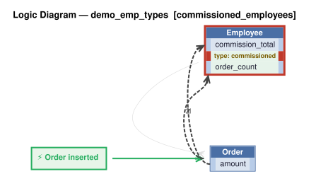

# Logic Flow — demo_emp_types [commissioned_employees]

> Scoped to requirement: **commissioned_employees**

<table>
<tr valign="top">
<td width="65%">



</td>
<td width="35%">

### Rules

1. `commission_total = sum(amount)`<br>
2. `order_count = count(Order)`<br>
3. constraint: `Employee`

</td>
</tr>
</table>

## Requirements

```
Feature: Commissioned Employees

Commissioned employees are employees who can have Orders; only Commissioned employees may have Orders. Each Order has an amount and a customer name. Commissioned employees: commission_total = sum of Order.amount.
```

---
_Generated 2026-11-07 16:52_
