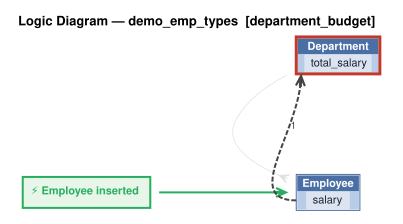

# Logic Flow — demo_emp_types [department_budget]

> Scoped to requirement: **department_budget**

<table>
<tr valign="top">
<td width="65%">



</td>
<td width="35%">

### Rules

1. `total_salary = sum(salary)`<br>
2. constraint: `Department`

</td>
</tr>
</table>

## Requirements

```
Feature: Department Budget

Departments have a name and a budget. Department.total_salary = sum of Employee.salary (all types). Department.total_salary must not exceed Department.budget. A user with the manager role may exceed the budget; other users may not.
```

---
_Generated 2026-11-07 16:52_
