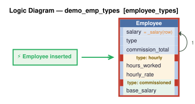

# Logic Flow — demo_emp_types [employee_types]

> Scoped to requirement: **employee_types**

<table>
<tr valign="top">
<td width="65%">



</td>
<td width="35%">

### Rules

1. `salary = _salary(row)` — Derive salary: hourly = hours_worked * hourly_rate; commissioned = base_salary + commission_total; salaried = as entered.<br>
2. constraint: `Employee`

</td>
</tr>
</table>

## Requirements

```
Feature: Employee Types

Employees have a name, dept, and salary. Employees have a type that is one of: 'salaried', 'hourly', or 'commissioned'.

Hourly employees: salary = hours_worked * hourly_rate.

Commissioned employees: salary = base_salary + commission_total.
```

---
_Generated 2026-11-07 16:52_
