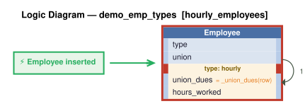

# Logic Flow — demo_emp_types [hourly_employees]

> Scoped to requirement: **hourly_employees**

<table>
<tr valign="top">
<td width="65%">



</td>
<td width="35%">

### Rules

1. `union_dues = _union_dues(row)` — Derive union_dues: hours_worked * union dues_rate for hourly employees (0 if no union, or not hourly).<br>
2. constraint: `Employee`

</td>
</tr>
</table>

## Requirements

```
Feature: Hourly Employees

Hourly employees are employees with hours_worked (REAL) and hourly_rate (REAL). Hourly employees: salary must not exceed 5000 per week. Hourly employees may be assigned to a Union (optional); only Hourly employees may have a union_id. Unions have a name and a dues_rate (REAL). Hourly employees: union_dues = hours_worked * union.dues_rate (0 if no union assigned).
```

---
_Generated 2026-11-07 16:52_
