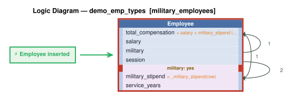

# Logic Flow — demo_emp_types [military_employees]

> Scoped to requirement: **military_employees**

<table>
<tr valign="top">
<td width="65%">



</td>
<td width="35%">

### Rules

1. `total_compensation = salary + military_stipend if military == "yes" else salary`<br>
2. `military_stipend = _military_stipend(row)` — Derive military_stipend: service_years * SysConfig military_stipend_per_year for military employees, 0 otherwise.<br>
3. constraint: `Employee`

</td>
</tr>
</table>

## Requirements

```
Feature: Military Employees

Employees may also have a military classification, independent of employment type. Military employees have a branch (TEXT: 'Army', 'Navy', 'Air Force', 'Marines', 'Coast Guard'), a rank (TEXT), and service_years (INTEGER). Military employees receive a military_stipend (REAL) = service_years * 100. Total compensation for military employees = salary + military_stipend. Total compensation for non-military employees = salary.
```

---
_Generated 2026-11-07 16:52_
