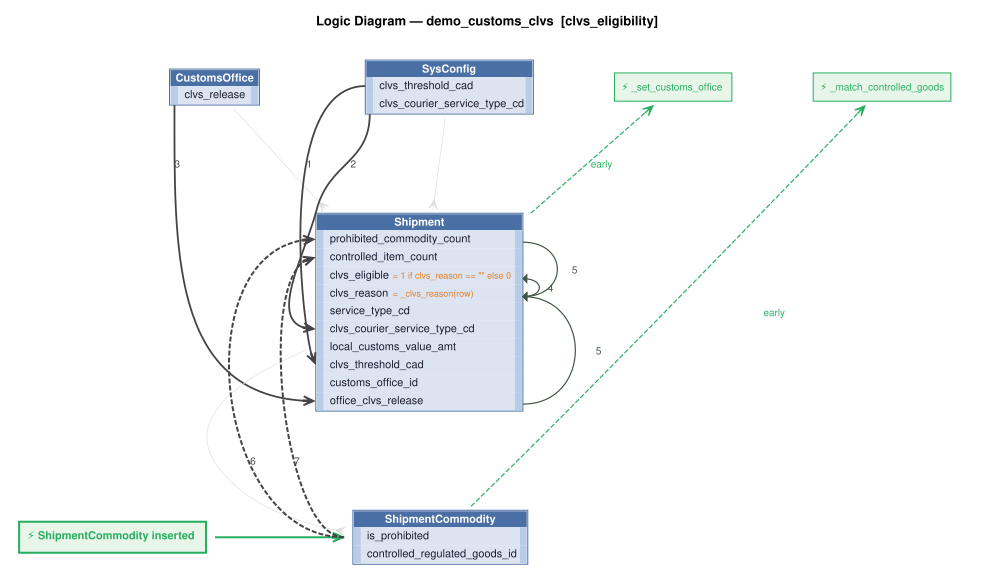
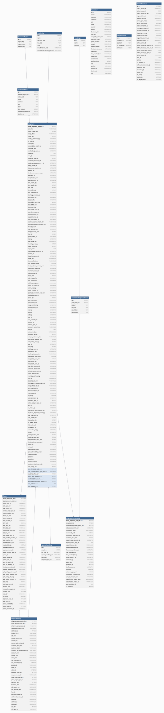

# Requirements Traceability Report

This report shows requirements, the rules created from them, and the tests created from those rules.

This project began as natural-language requirements, fleshed out by AI into a running system of business rules that are *executable documentation*. This report is how you govern the result.

A governable system is one you can **read**, **trust**, and **maintain**: each requirement is listed beside the rules that implement it (*read*); the tests and logic logs show those rules running (*trust*); re-run it after any change and it flags the gaps — an untested requirement, an untraced rule, a channel no test checks (*maintain*).

It is generated from the project's own files, nothing written by hand, so it is as current as the last run and covers the whole project, not a sample. Open **Background** (below the summary) for what the terms mean, how to read the report, and what it can and can't tell you.


**Project:** demo_customs_clvs &nbsp;|&nbsp; **Generated:** November 01, 2026 11:12 &nbsp;|&nbsp; **Rules:** 10 &nbsp;|&nbsp; **Test scenarios:** 22 &nbsp;|&nbsp; **Generator:** requirements_traceability_report.py 2.13

**Last test run:** November 01, 2026 10:12, took 16.3 s (1h 0m before this report; test results and logic logs below are from that run)


&nbsp;
&nbsp;

## At a Glance

**✅ 3 requirement(s), all implemented; 3 tested; 22 of 22 scenarios passed; last run 1h 0m ago.**

| | |
|---|---|
| Requirements | 3 (3 implemented) |
| Tested | 3 of 3 |
| Last test run | ✅ 22 passed, 0 failed (November 01, 2026 10:12, 1h 0m ago); took 16.3 s |
| Rules | 10 (4 declarative, 1 Python functions, 5 Python events) |
| Rules shown running in a test log | 9 of 10 |
| Security | not enabled; 10 role(s), 0 row-level grant(s) |
| Messages and APIs | 2 Kafka topic(s) in, 1 out; 2 HTTP endpoint(s) |
| Kafka | live (localhost:9092): subscribe tested through the broker; outbound messages checked in the log |

_Status: ✅ every requirement is implemented and tested, all scenarios pass, and the results are current. ⚠ a requirement is untested or unimplemented, there is no test run, or files changed since the last run. ❌ a scenario failed. This reports what was traced and tested, not that the system is correct._

**About this project** _(from [readme.md](../../readme.md))_

This is a proof of what changes when business logic is governed by architecture, not discipline — built to the scope and standards of a real enterprise integration, in 2 days.

**Delivery Speed — 2 Days, Not Months**<br>
Built in 2 days by one engineer. The scope — Kafka 2-message pipeline, XML parsing, 7-table persistence, importer matching, CLVS eligibility rules, REST API, Admin UI, and standard enterprise delivery standards — is not a toy project. A traditional team would scope this in weeks and deliver in months.

Curious what your team would estimate? Give your AI this requirements document and ask.

**Business Inputs — Not Technical Specs**<br>
Traditional delivery starts from *technical* inputs: schema DDL, API specs, field-mapping logic expressed in developer terms. This started from *business* inputs — artifacts the business team already owned.

A plain-English requirements document. An existing database schema. An XML field-mapping spreadsheet. A sample message. GenAI-Logic's Executable Requirements workflow compiled these directly into a running, governed system — no translation layer required.

Speed is not a tradeoff against governance here. Both are consequences of the same thing: declarative rules replace procedural code, so the system is both faster to build and impossible to bypass.

**Governance — No Bypass**<br>
Business rules are enforced at the commit point — every transaction, every source, automatically. Not because developers remembered. Because there is no other path.

A new developer, a new agent, a new integration: all inherit the same rules automatically. Governed by architecture, not discipline.

**Governance — At Scale**<br>
Governance by developer discipline fails at scale — routinely, and at significant cost. Rules get missed. New endpoints, new agents, new integrations don't inherit them. The larger the system, the more paths, and the more paths, the more misses.

Governance by architecture doesn't degrade. Rules enforced at the commit point run on every transaction, regardless of source — API, UI, agent, or integration added three years later. That guarantee doesn't erode as the system grows.

AI makes this available at org-wide scale. Requirements your teams already produce — plain English, Gherkin, regulation text — become the input. GenAI-Logic compiles them into enforced rules. The same workflow, every project, every team.

_… [more in readme.md](../../readme.md)_

<details markdown>
<summary>Background: what this report is, and how to read it</summary>

&nbsp;

<details markdown>
<summary>Requirements are business policies, expressed in natural language</summary>

<br>

A **requirement** is a statement of business behavior - how data is computed, validated, and transmitted - written in plain language. It lives in the project at `docs/requirements/<name>/requirements.md`.  For example:

&nbsp;

```
On Placing Orders, Check Credit
    1. The Customer's balance does not exceed the credit limit
    2. The Customer's balance is the sum of the unshipped Order amount_total
    3. The Order's amount_total is the sum of the Item amount
    4. The Item amount is the quantity * unit_price
    5. The Item unit_price is copied from the Product unit_price
```

</details>

&nbsp;

<details markdown>
<summary>Rules implement requirements</summary>

<br>

A requirement is written at a high level, and AI fills in details as it builds — as it should — so the requirement no longer says exactly what the system does. The rules do. That's a Goldilocks answer to the question of what you review:

* **Requirements say too little** — incomplete by design; AI fills in the details.
* **Code says too much** — business language in, hundreds of lines of procedural code out. The work moves from writing to reading, and if you can't read it, you can't govern it.
* **Rules are just right** — close to the requirement's own level, but complete and deterministic.

Code could be treated like machine language — never read, only trusted — if it were produced deterministically. Generation from natural language isn't. Rules restore that contract: a readable source, deterministically executed.

The requirements above become rules like this:

```
Rule.copy(derive=models.Item.unit_price, from_parent=models.Product.unit_price)
Rule.formula(derive=models.Item.amount,
             as_expression=lambda row: row.quantity * row.unit_price)
Rule.sum(derive=models.Order.amount_total, as_sum_of=models.Item.amount)
Rule.sum(derive=models.Customer.balance, as_sum_of=models.Order.amount_total,
         where=lambda row: row.date_shipped is None)
Rule.constraint(
    validate=models.Customer,
    as_condition=lambda row: row.balance <= row.credit_limit,
    error_msg="balance ({row.balance}) exceeds credit limit ({row.credit_limit})")
```

Rules are ***executable documentation*** that you can read and trust:

* **Read:** rules stay near the requirement's level, so this report can list them side by side and you can check one against the other. 5 rules vs. ~200 lines in our [A/B test](https://github.com/ApiLogicServer/ApiLogicServer-src/blob/main/api_logic_server_cli/prototypes/manager/samples/basic_demo_logic_gov/logic/procedural/declarative-vs-procedural-comparison.md) — **~40x less to review**, whether generated or hand-coded.
* **Trust:** the document is enforced, not just descriptive.
    * **What you read is what runs** — no drift between description and behavior.
    * **Dependencies:** with code, you analyze every execution path to know it runs at the right times. With rules: if the rule is there, it runs, in the right order.
    * **All sources and paths:** the engine hooks into every commit — API, UI or agent — insert, update and delete, including related rows. No bypass.
    * **Seeing is believing:** each scenario in *Tests and Results* below embeds its logic log — every rule that ran, in order, with old and new values.

Better AI makes generating code easier. It doesn't change what you have to read. The problem is the representation, not the capability. And governance is active, not just process: the engine enforces the rules on every transaction, and this report — regenerated from the project itself — shows it happening.

&nbsp;

</details>

&nbsp;

<details markdown>
<summary>Process overview: creation and iteration</summary>

<br>


In two phases. First, `genai-logic create` builds a working system from the database: API, Admin App, data model. Then behavior is added from requirements — the typical sequence, each step a request to an AI assistant:

1. Write each requirement in natural language, in `docs/requirements/<name>/requirements.md`.
2. `implement reqs <name>` — creates the rules, API endpoints and Kafka integrations.
3. `create tests from rules` — writes the test scenarios and steps.
4. `run the tests` — starts the server if needed, runs the suite, reports pass/fail.
5. `run the requirements traceability report` — regenerates this report.

Optional: `create logic diagram for each requirement` (needs Graphviz).

What makes steps 3–5 possible: rules are high-level enough that AI can read them too. The tests, the logic diagrams and this report are all generated by reading the same rules you review — where logic is Python code, the report can only quote its docstring.

The report connects the chain: requirement → rules and handlers → tests → logic log. How *this* project was actually built is recorded under Provenance.

</details>

&nbsp;

<details markdown>
<summary>How to read this report</summary>

<br>

| If you are...  | Start with                                                        | Look for                                                                                     |
| -------------- | ----------------------------------------------------------------- | -------------------------------------------------------------------------------------------- |
| Business owner | *Requirements in detail*                                          | The requirement text, then the **Tests** line under it: does a test exist, and did it pass?  |
| Auditor        | *Coverage summary*, *Rule coverage by tests*, *Messages and APIs* | Gaps (untested, untraced), the date of the last test run, and how each rule was shown to run |
| Developer      | *Tests and Results*                                               | Each scenario's logic log: every rule that ran, in order, with old and new values            |

</details>

&nbsp;

<details markdown>
<summary>What this report can and can't tell you</summary>

<br>

**It shows**

- Which files and rules implement each requirement, read from the project's source.
- Which scenarios ran in the last test run, and whether each passed.
- Which rules the engine logged as running in each scenario.

**It doesn't show**

- Whether the requirements are right or complete. It traces what was written down.
- Whether an event did anything. Events run on every commit of their class and decide for themselves whether to act, so appearing in the log doesn't mean the event had an effect.
- Whether a constraint works. A constraint appears in the log only when it rejects a transaction, so look for a scenario that makes it reject.
- Whether a message arrived. Unless a test step looks for it on the broker or endpoint, a passing scenario doesn't prove delivery. The *Messages and APIs* table flags channels no test mentions.
- Whether the results are current. They are as old as the last test run, shown in the header, which also warns if files changed since.
- Which version of a requirement the code was built from, or which clause of a requirement a given rule serves.

</details>

&nbsp;

<details markdown>
<summary>Terms</summary>

<br>

| Term        | Meaning                                                                                              |
| ----------- | ---------------------------------------------------------------------------------------------------- |
| Requirement | A statement of business behavior, in plain language; the unit this report traces.                    |
| Rule        | A declaration about data (sum, count, formula, copy, constraint) that the engine enforces at every commit. |
| Event       | Python code the engine calls when a row of a given class changes (for example, to publish a message). |
| Handler     | Code that serves an API endpoint or consumes a Kafka topic.                                          |
| Scenario    | One Behave test: a short Given / When / Then script run against the live API.                        |
| Logic log   | The engine's record of every rule it ran in a transaction, nested to show cascades (an Item change adjusts its Order, which adjusts its Customer). |
| Phase       | The step of a commit: ROW LOGIC (derivations, constraints), COMMIT LOGIC (checks that need finished totals), AFTER_FLUSH LOGIC (events that need database-assigned keys, such as publishing). |
| Seen        | The engine reported running the rule in that scenario's log.                                         |

</details>

</details>


&nbsp;
&nbsp;

## Contents

- [Requirements Coverage](#requirements-coverage)
- [Data Model](#data-model)
- [Security (RBAC)](#security-rbac)
- [Messages and APIs](#messages-and-apis)
- [Tests and Results](#tests-and-results)
- [Provenance](#provenance)


&nbsp;
&nbsp;

## Requirements Coverage

Every requirement should have rules that implement it, and tests that prove it. This section checks that chain in both directions: a requirement missing rules or tests is a gap, and rules or tests that belong to no requirement are flagged too. The matching uses the `Feature:` names and `§N` tags that requirements, code and tests share.


&nbsp;

### Coverage summary

| Measure | Result |
|---|---|
| Requirements | 3 |
| Implemented (at least one file) | 3 of 3 |
| Tested (at least one scenario) | 3 of 3 |
| Implementation not traced to a requirement | `security/declare_security.py`, `logic/logic_discovery/system/all_classes_stamping.py` |
| Tests not traced to a requirement | none |
| Test results (last run) | ✅ 22 passed, 0 failed; took 16.3 s |
| Scenarios with a logic log | 22 of 22 |
| Rules seen in at least one scenario's log | 9 of 10 (1 not counted: the engine's log does not name `all classes.early_row_event → handle_all()`, so it cannot be matched) |

_Test results are as current as the last run (see the header). A gap is any requirement with no implementation or no test._

<details markdown>
<summary>How to read this table</summary>

Test results are read from `logs/behave.log`, so they are only as current as that run. Not recorded here: which version of a requirement the code was built against, and which clause of a requirement a given rule serves.

</details>


&nbsp;

### Traceability matrix

| Requirement | Implemented by | Rules | Tests |
|---|---|---|---|
| §1 Subscribe to Kafka and persist shipments | [logic/logic_discovery/isdc_consume.py](../../logic/logic_discovery/isdc_consume.py)<br>[integration/kafka/kafka_subscribe_discovery/isdc.py](../../integration/kafka/kafka_subscribe_discovery/isdc.py)<br>[integration/IsdcMapper.py](../../integration/IsdcMapper.py)<br>[api/api_discovery/isdc_kafka_consume_debug.py](../../api/api_discovery/isdc_kafka_consume_debug.py) | 1 | ✅ 5 scenario(s): 5 passed |
| §2 Importer matching | [logic/logic_discovery/shipment_matching.py](../../logic/logic_discovery/shipment_matching.py) | 1 | ✅ 2 scenario(s): 2 passed |
| §3 CVLS Eligibility | [logic/logic_discovery/clvs_eligibility.py](../../logic/logic_discovery/clvs_eligibility.py) | 7 | ✅ 15 scenario(s): 15 passed |


&nbsp;

### Rule coverage by tests

| Rule | Requirement | Seen in |
|---|---|---|
| `Shipment.early_row_event → _set_customs_office()` | §3 CVLS Eligibility | 21: Shipment at or below the LVS threshold is eligible; Shipment exactly at the threshold is eligible; Shipment over the threshold is not eligible; +18 more |
| `ShipmentCommodity.early_row_event → _match_controlled_goods()` | §3 CVLS Eligibility | 21: Shipment at or below the LVS threshold is eligible; Shipment exactly at the threshold is eligible; Shipment over the threshold is not eligible; +18 more |
| `Shipment.customs_office_clvs_release = copy of CustomsOffice.clvs_release` | §3 CVLS Eligibility | 21: Shipment at or below the LVS threshold is eligible; Shipment exactly at the threshold is eligible; Shipment over the threshold is not eligible; +18 more |
| `Shipment.prohibited_commodity_count = count(ShipmentCommodity) where is_prohibited == 1` | §3 CVLS Eligibility | 21: Shipment at or below the LVS threshold is eligible; Shipment exactly at the threshold is eligible; Shipment over the threshold is not eligible; +18 more |
| `Shipment.controlled_commodity_count = count(ShipmentCommodity) where controlled_regulated_goods_id is not None` | §3 CVLS Eligibility | 21: Shipment at or below the LVS threshold is eligible; Shipment exactly at the threshold is eligible; Shipment over the threshold is not eligible; +18 more |
| `Shipment.clvs_reason = _clvs_reason()` | §3 CVLS Eligibility | 21: Shipment at or below the LVS threshold is eligible; Shipment exactly at the threshold is eligible; Shipment over the threshold is not eligible; +18 more |
| `Shipment.clvs_eligible = 1 if clvs_reason == "" else 0` | §3 CVLS Eligibility | 21: Shipment at or below the LVS threshold is eligible; Shipment exactly at the threshold is eligible; Shipment over the threshold is not eligible; +18 more |
| `ShipmentXml.after_flush_row_event → _publish_isdc()` | §1 Subscribe to Kafka and persist shipments | 22: Shipment at or below the LVS threshold is eligible; Shipment exactly at the threshold is eligible; Shipment over the threshold is not eligible; +19 more |
| `Shipment.row_event → _match_importer()` | §2 Importer matching | 21: Shipment at or below the LVS threshold is eligible; Shipment exactly at the threshold is eligible; Shipment over the threshold is not eligible; +18 more |
| `all classes.early_row_event → handle_all()` | (none) | n/a - cannot be matched to the engine's log |

_"Seen" means the engine's log shows the rule ran, not proof that it took effect._

<details markdown>
<summary>How to read this table</summary>

"Seen" means the engine reported running the rule in that scenario's logic log. A scenario can only contribute if it has a log (see the coverage summary): a test that does not open one writes into whichever log was open last, and its rules are then credited to that scenario, or to the shared log. An event's function runs on every commit of its class, and its own condition decides whether it acts, so seen does not mean it took effect. A constraint appears in the log only when it rejects a transaction, so it is seen only in scenarios that make it reject. "Not seen" therefore means no log shows it, not that no test ran it.

</details>


&nbsp;

### Requirements in detail

**10 rules** in 4 files: 4 declarative (sum, count, copy, formula and constraint expressions), 1 backed by a Python function, 5 events (Python).

_Declarative rules are read straight from their declarations. Functions and events are Python code, so for those the report shows the docstring — it does not analyze the code._

Each requirement is followed by the rules and handlers in the files that implement it. Logic diagrams are shown (click to expand) where they exist.

<details markdown>
<summary>How to create the missing logic diagrams</summary>

Needs Graphviz (`brew install graphviz`). Tell your AI assistant:

```
create logic diagram for each requirement
```

or run this from the Manager root (`genai-logic`):

```
python system/ApiLogicServer-Internal-Dev/logic_diagram_gv.py demo_customs_clvs --each
```

Each diagram is saved under `docs/requirements/<name>/logic_diagrams/`. Then regenerate this report (`python requirements_traceability_report.py run`, from `test/api_logic_server_behave`).

</details>

&nbsp;


#### §1 Subscribe to Kafka and persist shipments

Tests: ✅ 5 scenario(s): 5 passed

```
Feature: Subscribe to Kafka and persist shipments

Read `docs/training/eai_subscribe.md`, then:

Subscribe to Kafka topic `isdc`. Each message is a CIMCorp shipment XML.

Parse and persist to the database using the field mappings in
`message_formats/Classify_Entity_Details.csv`.

Use `message_formats/MDE-CDV-HVS-WR-Rev260328.xml` as the reference message.

Duplicate replay behavior (required for this project):
- Match existing shipments by `LOCAL_SHIPMENT_OID_NBR` (`Shipment.local_shipment_oid_nbr`).
- If a duplicate key is found, replace the existing shipment graph in Tx 2:
    parse first, then replace the prior shipment graph and insert parsed rows.
    Implementation is not prescribed; behavior must match the verification checks below.
- Keep this behavior configurable via env policy (`fail|replace`), default `replace` for this project.

Important mapping note (prevent PK collisions):
- In this payload, party OID fields may carry placeholder value `0` for multiple rows.
- If mapped to local primary-key columns (e.g. `ShipmentParty.shipment_party_oid_nbr`),
  normalize placeholder IDs to `None` so DB autoincrement assigns unique PK values.

**Verify:** `F5`, then:
curl 'http://localhost:5656/consume_debug/isdc?file=docs/requirements/customs_demo/message_formats/MDE-CDV-HVS-WR-Rev260328.xml'
Response should show `"success": true` with `awb_nbr`, `pieces`, `parties`, `commodities`. Check Admin UI — a ShipmentXml row and a Shipment row with children should appear.

Then run the automated test gate (server must be running on port 5656):
bash docs/requirements/customs_demo/test_gate.sh
```

| Rule / item | Type | Logic | Description | Where |
|---|---|---|---|---|
| `ShipmentXml.after_flush_row_event → _publish_isdc()` | after_flush_row_event | event (Python) | ShipmentXml event: publishes the raw blob to isdc_processed after Tx 1 commits, so Consumer 2 parses it in a clean Tx 2. | [isdc_consume.py](../../logic/logic_discovery/isdc_consume.py) |
| `Kafka in: isdc` | kafka | handler (Python) | Kafka subscribe isdc: Consumer 1 saves the raw XML as a ShipmentXml blob and commits (Tx 1). | [isdc.py](../../integration/kafka/kafka_subscribe_discovery/isdc.py) |
| `Kafka in: isdc_processed` | kafka | handler (Python) | Kafka subscribe isdc_processed: Consumer 2 parses the blob and persists the Shipment graph (Tx 2). | [isdc.py](../../integration/kafka/kafka_subscribe_discovery/isdc.py) |
| `IsdcMapper.py` | module |  | Feature: Subscribe to Kafka and persist shipments | [IsdcMapper.py](../../integration/IsdcMapper.py) |
| `HTTP in: GET /consume_debug/isdc` | http | handler (Python) | EAI debug (development only, no authentication): sends the message in ?file= to the topic, live through Kafka or simulated | [isdc_kafka_consume_debug.py](../../api/api_discovery/isdc_kafka_consume_debug.py) |
| `HTTP in: POST /consume_debug/isdc/reset` | http | handler (Python) | EAI debug (development only, destructive): purges the messages in the pipeline's topics | [isdc_kafka_consume_debug.py](../../api/api_discovery/isdc_kafka_consume_debug.py) |

<details markdown>
<summary>Logic diagram: isdc_consume</summary>


</details>

#### §2 Importer matching

Tests: ✅ 2 scenario(s): 2 passed

```
Feature: Importer matching

Logic discovery: Shipment matching (Phase 2).

Create `logic/logic_discovery/shipment_matching.py`.

On Shipment insert, look up the matching Customer using:
    Shipment.trprt_bill_to_acct_nbr == Customer.duty_bill_to_acct_nbr

If no match: log a warning, do nothing.
If match found: create a ShipmentParty row, matching high confidence columns
from Customer to ShipmentParty.
Use Rule.row_event (not early_row_event) — fires before_flush so the new
ShipmentParty writes atomically with the parent Shipment.

**Required: seed `Customer` data before verifying.** Add at least one row via the Admin UI (or a SQL INSERT) with `duty_bill_to_acct_nbr` matching the `trprt_bill_to_acct_nbr` value in your test XML.

**Verify:** Re-run the Step 2 curl. A ShipmentParty with `shipment_party_type_cd="I"` should appear in Admin UI.

---
```

| Rule / item | Type | Logic | Description | Where |
|---|---|---|---|---|
| `Shipment.row_event → _match_importer()` | row_event | event (Python) | Shipment event: on insert, finds the Customer whose duty_bill_to_acct_nbr equals the shipment's trprt_bill_to_acct_nbr and adds an importer ShipmentParty (type I) copied from it; logs a warning if none matches. | [shipment_matching.py](../../logic/logic_discovery/shipment_matching.py) |

#### §3 CVLS Eligibility

Tests: ✅ 15 scenario(s): 15 passed

```
Feature: CVLS Eligibility

Scenario: Shipment at or below the LVS threshold is eligible
  Given a shipment imported by an authorized CLVS courier
  And the shipment has an estimated value for duty not exceeding CAD $3,300
  And the shipment has no prohibited commodity lines (ShipmentCommodity.is_prohibited = 1)
  And the shipment has no controlled or regulatory goods (lookup using first ten digits of the harmonized tariff number)
  And the shipment is released at a CBSA-designated customs office
  When the shipment eligibility is evaluated
  Then the shipment shall be eligible for the CLVS Program
  And set the clvs_reason as a comma delimited list of short all reasons why failed (or blank)
```

| Rule / item | Type | Logic | Description | Where |
|---|---|---|---|---|
| `Shipment.early_row_event → _set_customs_office()` | early_row_event | event (Python) | Shipment event: looks up the CustomsOffice whose office_code is the planned clearance location and sets customs_office_id (FK), so Rule.copy can bring the office's clvs_release down before the eligibility reason is derived. | [clvs_eligibility.py](../../logic/logic_discovery/clvs_eligibility.py) |
| `ShipmentCommodity.early_row_event → _match_controlled_goods()` | early_row_event | event (Python) | ShipmentCommodity event: looks up ControlledRegulatedGood by the first ten digits of the harmonized tariff number (a controlled hs_code is a prefix of them) and sets controlled_regulated_goods_id (FK) before Rule.count aggregates it. | [clvs_eligibility.py](../../logic/logic_discovery/clvs_eligibility.py) |
| `Shipment.customs_office_clvs_release = copy of CustomsOffice.clvs_release` | copy | declarative |  | [clvs_eligibility.py](../../logic/logic_discovery/clvs_eligibility.py) |
| `Shipment.prohibited_commodity_count = count(ShipmentCommodity) where is_prohibited == 1` | count | declarative |  | [clvs_eligibility.py](../../logic/logic_discovery/clvs_eligibility.py) |
| `Shipment.controlled_commodity_count = count(ShipmentCommodity) where controlled_regulated_goods_id is not None` | count | declarative |  | [clvs_eligibility.py](../../logic/logic_discovery/clvs_eligibility.py) |
| `Shipment.clvs_reason = _clvs_reason()` | formula | Python function | Derive clvs_reason: comma-delimited short reasons why the shipment fails CLVS eligibility (blank if eligible). | [clvs_eligibility.py](../../logic/logic_discovery/clvs_eligibility.py) |
| `Shipment.clvs_eligible = 1 if clvs_reason == "" else 0` | formula | declarative |  | [clvs_eligibility.py](../../logic/logic_discovery/clvs_eligibility.py) |

<details markdown>
<summary>Logic diagram: clvs_eligibility</summary>



</details>

#### Rules not traced to a requirement

| Rule / item | Type | Logic | Description | Where |
|---|---|---|---|---|
| `all classes.early_row_event → handle_all()` | early_row_event_all_classes | event (Python) | Generic handler - executed for every row update across all classes. | [all_classes_stamping.py](../../logic/logic_discovery/system/all_classes_stamping.py) |


&nbsp;
&nbsp;

## Data Model

The tables the rules run over. Shaded columns are derived by rules — no code writes them.



_Generated from `docs/db.dbml` (parents above children; shaded rows are derived by rules). To use your own layout, save it as `docs/db_diagram.png`._


&nbsp;

### Derived columns

| Table | Column | Rule | Definition |
|---|---|---|---|
| Shipment | customs_office_clvs_release | copy | `Shipment.customs_office_clvs_release = copy of CustomsOffice.clvs_release` |
| Shipment | prohibited_commodity_count | count | `Shipment.prohibited_commodity_count = count(ShipmentCommodity) where is_prohibited == 1` |
| Shipment | controlled_commodity_count | count | `Shipment.controlled_commodity_count = count(ShipmentCommodity) where controlled_regulated_goods_id is not None` |
| Shipment | clvs_reason | formula | `Shipment.clvs_reason = _clvs_reason()` |
| Shipment | clvs_eligible | formula | `Shipment.clvs_eligible = 1 if clvs_reason == "" else 0` |


&nbsp;
&nbsp;

## Security (RBAC)

Who can do what: each role's permissions, and which rows each role can see.

**Security enabled: no** (`SECURITY_ENABLED` in `config/default.env`). The declarations below are not enforced until `genai-logic add-auth` is run.


&nbsp;

### Roles and CRUD (DefaultRolePermission)

| Role | Read | Insert | Update | Delete |
|---|---|---|---|---|
| sa | ✅ | ✅ | ✅ | ✅ |
| tenant | ✅ | — | — | ✅ |
| CS_ADMIN | ✅ | ✅ | ✅ | ✅ |
| manager | ✅ | ✅ | ✅ | — |
| teller | ✅ | ✅ | ✅ | — |
| customer | ✅ | ✅ | ✅ | — |
| readonly | ✅ | — | — | — |
| public | ✅ | — | — | — |
| default-roles-kcals | ✅ | ✅ | ✅ | — |
| uma_authorization | ✅ | ✅ | ✅ | — |


&nbsp;

### Row-level grants (Grant)

None declared (`Grant`).


&nbsp;
&nbsp;

## Messages and APIs

How data enters and leaves beyond the standard API: Kafka topics in and out, custom HTTP endpoints — and whether any test touches each one.

**Kafka mode: live (localhost:9092).** The tests sent inbound messages through a real broker: `/consume_debug` published them to topic `order_b2b`, the server's consumers processed them, and the tests then checked the results. Outbound `order_shipping` messages are checked in the server log, not read back from the topic.

| Direction | Channel | Name | Tests mention it | Handler | Tables created | Message shape | Requirement |
|---|---|---|---|---|---|---|---|
| ➡ in | Kafka | `isdc` | ✅ live | `isdc()` - Kafka subscribe isdc: Consumer 1 saves the raw XML as a ShipmentXml blob and commits (Tx 1). | ShipmentXml |  | §1 Subscribe to Kafka and persist shipments |
| ➡ in | Kafka | `isdc_processed` | ✅ live | `isdc_processed()` - Kafka subscribe isdc_processed: Consumer 2 parses the blob and persists the Shipment graph (Tx 2). | ShipmentXml |  | §1 Subscribe to Kafka and persist shipments |
| ⬅ out | Kafka | `isdc_processed` | ✅ live | ShipmentXml.after_flush_row_event → _publish_isdc() - ShipmentXml event: publishes the raw blob to isdc_processed after Tx 1 commits, so Consumer 2 parses it in a clean Tx 2. |  |  | §1 Subscribe to Kafka and persist shipments |
| ➡ in | HTTP | `GET /consume_debug/isdc` | ✅ | `register_consume_debug()` - EAI debug (development only, no authentication): sends the message in ?file= to the topic, live through Kafka or simulated |  |  | §1 Subscribe to Kafka and persist shipments |
| ➡ in | HTTP | `POST /consume_debug/isdc/reset` | ⚠ no test mentions it | `register_queue_reset()` - EAI debug (development only, destructive): purges the messages in the pipeline's topics |  |  | §1 Subscribe to Kafka and persist shipments |

_"Tests mention it" checks the test sources, not delivery._

<details markdown>
<summary>How to read this column</summary>

A passing scenario proves a message reached a topic or an endpoint only if its steps look for it there. A handler that ran (see the logic log) is weaker evidence than a step that consumes the message. Channels no test mentions are flagged.

</details>

<details markdown>
<summary>How to read this table</summary>

Topics and endpoints are read from the discovery folders. The condition that triggers an outbound message lives in Python (see the rules under each requirement); here it is described by the handler's docstring. "Tables created" lists rows the handler's code constructs, following its calls within the project; blank means none were found, not that none exist.

</details>


&nbsp;
&nbsp;

## Tests and Results

**✅ 22 scenario(s): 22 passed, 0 failed; took 16.3 s** (from the last run, `logs/behave.log`).

Each test drives the running system the way any client would — create an order, change a quantity, ship it — and checks the result.

**The logic log** is what makes them more than pass/fail. Business rules run inside the server on every commit, so the server records exactly what they did, and this report embeds that record for each scenario. Two things to look for:

1. **It shows every rule that runs.** Each line is one rule execution, with the row's state, old and new values. You see not just that a test passed, but which rules ran and what each one changed.
2. **The nesting shows multi-table chaining.** Indentation follows the cascade: a change to an Item adjusts its Order, which adjusts its Customer.

<details markdown>
<summary>How to read the logic log</summary>

Open a scenario's "Rules exercised and logic log" block to see it. The log is shown in full, attribute values included, because those values are what you diagnose from when a rule produces an unexpected result.

To read a log line:

```
....Order[16] {Update - Adjusting order: amount_total} id: 16, customer_id: 19, amount_total:  [0.0-->] 90.0

```

- The leading dots are the depth in the cascade: Item (2 dots), its Order (4), its Customer (6).
- `Order[16]` is the row; `{...}` is the rule or action that ran; the rest is the row's attribute values at that step.
- `[0.0-->] 90.0` marks a value the rules changed, with its old and new value.
- The log is in phases: **ROW LOGIC** (derivations and constraints, as rows change), **COMMIT LOGIC** (checks that need the finished aggregates), and **AFTER_FLUSH LOGIC** (events that need database-assigned keys, such as the Kafka publish).

More: [Logic Log](https://apilogicserver.github.io/Docs/Logic-Debug/#logic-log).

</details>

&nbsp;

<details markdown>
<summary>How to add more tests, and run them</summary>

**1. Have AI create them.** This project's context tells your AI assistant how (`.github/copilot-instructions.md`, `docs/training/testing.md`). Just say:

```

create tests from rules

```

The assistant reads `database/models.py`, the logic files and the custom APIs, then writes `.feature` files and step implementations under `test/api_logic_server_behave/features/`. Then say `run the tests` and `run the requirements traceability report` and the assistant does both.

Or, to have each requirement's tests linked in the Tests column above (it matches on `Feature:` name), say which names to use:

```

create tests from rules, one Feature per requirement, named exactly:
- Subscribe to Kafka and persist shipments
- Importer matching
- CVLS Eligibility

```

_Tests with other names still run and appear below; they just aren't linked to a requirement._

**2. You can also define tests manually.** Add a `<name>.feature` file (Gherkin) under `test/api_logic_server_behave/features/` and its steps under `features/steps/`. The steps call the running API, so tests exercise the same rules as any client. See `docs/training/testing.md` for the patterns that keep tests repeatable.

**Or run them yourself** (server running, from `test/api_logic_server_behave`):

```

python behave_run.py --outfile=logs/behave.log
python requirements_traceability_report.py run

```

</details>

&nbsp;
&nbsp;

### Feature: CVLS Eligibility  

&nbsp;
&nbsp;

#### Scenario: Shipment at or below the LVS threshold is eligible ✅ (3.6 s)
&emsp;  Scenario: Shipment at or below the LVS threshold is eligible  
&emsp;&emsp;    Given a shipment imported by courier "04" with value 3000 at office "0504" with tariff "4901.99.00.91"  
&emsp;&emsp;    When the shipment eligibility is evaluated  
&emsp;&emsp;    Then the shipment is eligible for the CLVS Program  
&emsp;&emsp;    And clvs_reason is blank  

<details markdown>
<summary>Rules exercised and logic log (3 transactions)</summary>


&nbsp;
&nbsp;


**Rules Used** in Scenario: Shipment at or below the LVS threshold is eligible
```
  ShipmentXml  
    1. RowEvent ShipmentXml._publish_isdc()  
  Shipment  
    2. RowEvent Shipment._match_importer()  
    3. Derive Shipment.customs_office_clvs_release as Copy(customs_office.clvs_release)  
    4. Derive Shipment.controlled_commodity_count as Count(ShipmentCommodity Where Rule.count(derive=models.Shipment.controlled_commodity_count, as_count_of=models.ShipmentCommodity, where=lambda row: row.controlled_regulated_goods_id is not None))  
    5. Derive Shipment.clvs_reason as Formula (1): <function>  
    6. Derive Shipment.clvs_eligible as Formula (2): Rule.formula(derive=models.Shipment.clvs_eligible [...]  
    7. Derive Shipment.prohibited_commodity_count as Count(ShipmentCommodity Where Rule.count(derive=models.Shipment.prohibited_commodity_count, as_count_of=models.ShipmentCommodity, where=lambda row: row.is_prohibited == 1))  
    8. RowEvent Shipment._set_customs_office()  
  ShipmentCommodity  
    9. RowEvent ShipmentCommodity._match_controlled_goods()  
```
**Logic Log** in Scenario: Shipment at or below the LVS threshold is eligible (3 transactions)
```
Logic Phase:		ROW LOGIC		(session=0x10a0b3250) (sqlalchemy before_flush)			 - 2026-11-01 10:11:49,534 - logic_logger - INFO
..ShipmentXml[None] {Insert - client} id: None, received_at: 2026-11-01 18:11:49.533102, payload: <?xml version="1.0" encoding="UTF-8" standalone="yes"?>..., is_processed: False, error_text: None  row: 0x109d0ef90  session: 0x10a0b3250  ins_upd_dlt: ins, initial: ins - 2026-11-01 10:11:49,534 - logic_logger - INFO
Logic Phase:		COMMIT LOGIC		(session=0x10a0b3250)   										 - 2026-11-01 10:11:49,534 - logic_logger - INFO
Logic Phase:		AFTER_FLUSH LOGIC	(session=0x10a0b3250)   										 - 2026-11-01 10:11:49,537 - logic_logger - INFO
..ShipmentXml[57] {AfterFlush Event} id: 57, received_at: 2026-11-01 18:11:49.533102, payload: <?xml version="1.0" encoding="UTF-8" standalone="yes"?>..., is_processed: False, error_text: None  row: 0x109d0ef90  session: 0x10a0b3250  ins_upd_dlt: ins, initial: ins - 2026-11-01 10:11:49,537 - logic_logger - INFO


Logic Phase:		ROW LOGIC		(session=0x10a0b3a50) (sqlalchemy before_flush)			 - 2026-11-01 10:11:49,552 - logic_logger - INFO
..Shipment[7355670631] {Insert - client} local_shipment_oid_nbr: 7355670631, awb_nbr: 427153913309, base_charge_amt: None, cargo_desc: None, cargo_qty: None, cash_in_advance_flg: None, ci_seq_nbr: None, comat_flg: None, consolidated_freight_flg: None, container_nbr: None, contract_wgt_type_cd: L, create_dt: 2026-04-11, csa_flg: None, customer_seq_nbr: None, customs_clearance_cd: None, customs_clearance_entry_flg: None, dang_goods_cd: None, data_entry_location_cd: MTY, deleted_flg: None, dest_customs_currency_cd: None, dest_eec_flg: None, dest_location_cd: YTQ, dest_loc_cntry_cd: CA, dim_height_qty: 0, dim_length_qty: 0, dim_wgt: 0.0, dim_width_qty: 0, dim_shipment_flg: None, discharge_location_cd: None, drop_dscnt_cd: 1, dutiable_flg: X, duty_bill_to_acct_nbr: 451000010, duty_bill_to_cd: C, duty_cash_flg: None, duty_credit_card_flg: None, ecs_filing_status_cd: None, export_country_cd: CN, export_license_flg: None, fda_confirmation_flg: None, carrier_assigned_mawb_nbr: None, planned_clearance_location_cd: 0504, form_type_cd: 430, free_domicile_cd: None, freight_charge_amt: 0.0, ftsr_nbr: None, goods_class_cd: None, hal_flg: None, hal_phone_nbr: None, handling_unit_qty: 0, hawb_serial_nbr: 1, input_tmstp: 2025-12-23, intermediate_consignee_cd: None, invoice_cd: None, keyed_currency_cd: None, keyer_nm: ISDCEVP, last_modified_nm: ISDC, last_modified_tmstp: 2025-12-23 17:03:12, local_customs_currency_cd: CAD, manuf_orig_cntry_cd: CA, manifest_status_cd: None, mde_source_cd: V, meter_nbr: 0, oda_charge_flg: None, opa_charge_flg: None, origin_loc_city_nm: MONTERREY, origin_loc_cntry_cd: CN, origin_eec_flg: None, origin_location_cd: MTY, package_movement_scan_cd: P, packaging_type_cd: None, piece_qty: 1, pkg_mark_desc: IE 9047, prior_notice_nbr: None, ramp_transfer_flg: None, record_status_cd: None, rod_flg: None, rpl_flg: None, sdl_flg: None, sed_cd: None, sed_exempt_nbr: None, service_cd: 01, service_type_cd: 04, shipment_control_nbr: None, ship_dt: 2025-12-18, shipment_desc: HARD COVER BOOKS, shipment_id_nbr: None, shipper_reference_desc: None, split_billing_address_amt: None, split_billing_kilo_wgt: None, spu_flg: None, total_wgt: 70.0, total_wgt_uom_cd: L, tracking_id_nbr: 427153913309, tracking_id_qual_nbr: None, transaction_seq_tmstp: 2025-12-23 16:57:37.633316, trprt_bill_to_acct_nbr: 451000010, trprt_bill_to_cd: C, trprt_credit_card_flg: None, tran_data_source_cd: None, unassign_reason_cd: None, unloading_usa_port_cd: None, value_changed_flg: None, weekday_delivery_flg: None, xtn_nbr: NO EEI 30.2(D)(1), dest_loc_city_nm: WOODBRIDGE, final_import_clearance_loc_cd: YMX, image_folder_id_cd: None, aci_download_flg: Y, broker_dest_loc_cd: None, visa_trans_cd: SA, etl_tmstp: None, split_shipment_flg: None, shipment_type_cd: 0, entry_category_type_cd: None, eci_flg: None, ci_image_flg: None, trprt_bill_to_pymt_method_cd: 1, duplicate_shipment_record_flg: None, oga_shipment_flg: None, cad_value_amt: None, transaction_nbr: None, ci_image_tmstp: None, iid_master_cd: None, iid_classify_cd: None, automation_ci_flg: None, iid_flg: None, carriage_value_amt: 3000.0, customs_value_amt: 3000.0, dest_customs_value_amt: 3000.0, local_customs_value_amt: 3000, active_flg: None, entry_dt: None, admissibility_mode: None, prev_admissibility_mode: None, cargocontrolnbr: None, portofexit: None, portofentry: None, warehousecode: None, surface_intl_shipment_nbr: None, customs_office_id: None, customs_office_clvs_release: None, prohibited_commodity_count: None, controlled_commodity_count: None, clvs_reason: None, clvs_eligible: None  row: 0x10ab79400  session: 0x10a0b3a50  ins_upd_dlt: ins, initial: ins - 2026-11-01 10:11:49,554 - logic_logger - INFO
..Shipment[7355670631] {server_defaults: duty_credit_card_flg rod_flg trprt_credit_card_flg eci_flg ci_image_flg duplicate_shipment_record_flg oga_shipment_flg active_flg prohibited_commodity_count controlled_commodity_count clvs_eligible } local_shipment_oid_nbr: 7355670631, awb_nbr: 427153913309, base_charge_amt: None, cargo_desc: None, cargo_qty: None, cash_in_advance_flg: None, ci_seq_nbr: None, comat_flg: None, consolidated_freight_flg: None, container_nbr: None, contract_wgt_type_cd: L, create_dt: 2026-04-11, csa_flg: None, customer_seq_nbr: None, customs_clearance_cd: None, customs_clearance_entry_flg: None, dang_goods_cd: None, data_entry_location_cd: MTY, deleted_flg: None, dest_customs_currency_cd: None, dest_eec_flg: None, dest_location_cd: YTQ, dest_loc_cntry_cd: CA, dim_height_qty: 0, dim_length_qty: 0, dim_wgt: 0.0, dim_width_qty: 0, dim_shipment_flg: None, discharge_location_cd: None, drop_dscnt_cd: 1, dutiable_flg: X, duty_bill_to_acct_nbr: 451000010, duty_bill_to_cd: C, duty_cash_flg: None, duty_credit_card_flg: 'N', ecs_filing_status_cd: None, export_country_cd: CN, export_license_flg: None, fda_confirmation_flg: None, carrier_assigned_mawb_nbr: None, planned_clearance_location_cd: 0504, form_type_cd: 430, free_domicile_cd: None, freight_charge_amt: 0.0, ftsr_nbr: None, goods_class_cd: None, hal_flg: None, hal_phone_nbr: None, handling_unit_qty: 0, hawb_serial_nbr: 1, input_tmstp: 2025-12-23, intermediate_consignee_cd: None, invoice_cd: None, keyed_currency_cd: None, keyer_nm: ISDCEVP, last_modified_nm: ISDC, last_modified_tmstp: 2025-12-23 17:03:12, local_customs_currency_cd: CAD, manuf_orig_cntry_cd: CA, manifest_status_cd: None, mde_source_cd: V, meter_nbr: 0, oda_charge_flg: None, opa_charge_flg: None, origin_loc_city_nm: MONTERREY, origin_loc_cntry_cd: CN, origin_eec_flg: None, origin_location_cd: MTY, package_movement_scan_cd: P, packaging_type_cd: None, piece_qty: 1, pkg_mark_desc: IE 9047, prior_notice_nbr: None, ramp_transfer_flg: None, record_status_cd: None, rod_flg: 'N', rpl_flg: None, sdl_flg: None, sed_cd: None, sed_exempt_nbr: None, service_cd: 01, service_type_cd: 04, shipment_control_nbr: None, ship_dt: 2025-12-18, shipment_desc: HARD COVER BOOKS, shipment_id_nbr: None, shipper_reference_desc: None, split_billing_address_amt: None, split_billing_kilo_wgt: None, spu_flg: None, total_wgt: 70.0, total_wgt_uom_cd: L, tracking_id_nbr: 427153913309, tracking_id_qual_nbr: None, transaction_seq_tmstp: 2025-12-23 16:57:37.633316, trprt_bill_to_acct_nbr: 451000010, trprt_bill_to_cd: C, trprt_credit_card_flg: 'N', tran_data_source_cd: None, unassign_reason_cd: None, unloading_usa_port_cd: None, value_changed_flg: None, weekday_delivery_flg: None, xtn_nbr: NO EEI 30.2(D)(1), dest_loc_city_nm: WOODBRIDGE, final_import_clearance_loc_cd: YMX, image_folder_id_cd: None, aci_download_flg: Y, broker_dest_loc_cd: None, visa_trans_cd: SA, etl_tmstp: None, split_shipment_flg: None, shipment_type_cd: 0, entry_category_type_cd: None, eci_flg: 'N', ci_image_flg: 'N', trprt_bill_to_pymt_method_cd: 1, duplicate_shipment_record_flg: 'N', oga_shipment_flg: 'N', cad_value_amt: None, transaction_nbr: None, ci_image_tmstp: None, iid_master_cd: None, iid_classify_cd: None, automation_ci_flg: None, iid_flg: None, carriage_value_amt: 3000.0, customs_value_amt: 3000.0, dest_customs_value_amt: 3000.0, local_customs_value_amt: 3000, active_flg: 'Y', entry_dt: None, admissibility_mode: None, prev_admissibility_mode: None, cargocontrolnbr: None, portofexit: None, portofentry: None, warehousecode: None, surface_intl_shipment_nbr: None, customs_office_id: None, customs_office_clvs_release: None, prohibited_commodity_count: 0, controlled_commodity_count: 0, clvs_reason: None, clvs_eligible: 0  row: 0x10ab79400  session: 0x10a0b3a50  ins_upd_dlt: ins, initial: ins - 2026-11-01 10:11:49,555 - logic_logger - INFO
..Shipment[7355670631] {server aggregate_defaults: prohibited_commodity_count controlled_commodity_count } local_shipment_oid_nbr: 7355670631, awb_nbr: 427153913309, base_charge_amt: None, cargo_desc: None, cargo_qty: None, cash_in_advance_flg: None, ci_seq_nbr: None, comat_flg: None, consolidated_freight_flg: None, container_nbr: None, contract_wgt_type_cd: L, create_dt: 2026-04-11, csa_flg: None, customer_seq_nbr: None, customs_clearance_cd: None, customs_clearance_entry_flg: None, dang_goods_cd: None, data_entry_location_cd: MTY, deleted_flg: None, dest_customs_currency_cd: None, dest_eec_flg: None, dest_location_cd: YTQ, dest_loc_cntry_cd: CA, dim_height_qty: 0, dim_length_qty: 0, dim_wgt: 0.0, dim_width_qty: 0, dim_shipment_flg: None, discharge_location_cd: None, drop_dscnt_cd: 1, dutiable_flg: X, duty_bill_to_acct_nbr: 451000010, duty_bill_to_cd: C, duty_cash_flg: None, duty_credit_card_flg: 'N', ecs_filing_status_cd: None, export_country_cd: CN, export_license_flg: None, fda_confirmation_flg: None, carrier_assigned_mawb_nbr: None, planned_clearance_location_cd: 0504, form_type_cd: 430, free_domicile_cd: None, freight_charge_amt: 0.0, ftsr_nbr: None, goods_class_cd: None, hal_flg: None, hal_phone_nbr: None, handling_unit_qty: 0, hawb_serial_nbr: 1, input_tmstp: 2025-12-23, intermediate_consignee_cd: None, invoice_cd: None, keyed_currency_cd: None, keyer_nm: ISDCEVP, last_modified_nm: ISDC, last_modified_tmstp: 2025-12-23 17:03:12, local_customs_currency_cd: CAD, manuf_orig_cntry_cd: CA, manifest_status_cd: None, mde_source_cd: V, meter_nbr: 0, oda_charge_flg: None, opa_charge_flg: None, origin_loc_city_nm: MONTERREY, origin_loc_cntry_cd: CN, origin_eec_flg: None, origin_location_cd: MTY, package_movement_scan_cd: P, packaging_type_cd: None, piece_qty: 1, pkg_mark_desc: IE 9047, prior_notice_nbr: None, ramp_transfer_flg: None, record_status_cd: None, rod_flg: 'N', rpl_flg: None, sdl_flg: None, sed_cd: None, sed_exempt_nbr: None, service_cd: 01, service_type_cd: 04, shipment_control_nbr: None, ship_dt: 2025-12-18, shipment_desc: HARD COVER BOOKS, shipment_id_nbr: None, shipper_reference_desc: None, split_billing_address_amt: None, split_billing_kilo_wgt: None, spu_flg: None, total_wgt: 70.0, total_wgt_uom_cd: L, tracking_id_nbr: 427153913309, tracking_id_qual_nbr: None, transaction_seq_tmstp: 2025-12-23 16:57:37.633316, trprt_bill_to_acct_nbr: 451000010, trprt_bill_to_cd: C, trprt_credit_card_flg: 'N', tran_data_source_cd: None, unassign_reason_cd: None, unloading_usa_port_cd: None, value_changed_flg: None, weekday_delivery_flg: None, xtn_nbr: NO EEI 30.2(D)(1), dest_loc_city_nm: WOODBRIDGE, final_import_clearance_loc_cd: YMX, image_folder_id_cd: None, aci_download_flg: Y, broker_dest_loc_cd: None, visa_trans_cd: SA, etl_tmstp: None, split_shipment_flg: None, shipment_type_cd: 0, entry_category_type_cd: None, eci_flg: 'N', ci_image_flg: 'N', trprt_bill_to_pymt_method_cd: 1, duplicate_shipment_record_flg: 'N', oga_shipment_flg: 'N', cad_value_amt: None, transaction_nbr: None, ci_image_tmstp: None, iid_master_cd: None, iid_classify_cd: None, automation_ci_flg: None, iid_flg: None, carriage_value_amt: 3000.0, customs_value_amt: 3000.0, dest_customs_value_amt: 3000.0, local_customs_value_amt: 3000, active_flg: 'Y', entry_dt: None, admissibility_mode: None, prev_admissibility_mode: None, cargocontrolnbr: None, portofexit: None, portofentry: None, warehousecode: None, surface_intl_shipment_nbr: None, customs_office_id: None, customs_office_clvs_release: None, prohibited_commodity_count: 0, controlled_commodity_count: 0, clvs_reason: None, clvs_eligible: 0  row: 0x10ab79400  session: 0x10a0b3a50  ins_upd_dlt: ins, initial: ins - 2026-11-01 10:11:49,556 - logic_logger - INFO
..Shipment[7355670631] {copy_rules for role: customs_office - customs_office_clvs_release} local_shipment_oid_nbr: 7355670631, awb_nbr: 427153913309, base_charge_amt: None, cargo_desc: None, cargo_qty: None, cash_in_advance_flg: None, ci_seq_nbr: None, comat_flg: None, consolidated_freight_flg: None, container_nbr: None, contract_wgt_type_cd: L, create_dt: 2026-04-11, csa_flg: None, customer_seq_nbr: None, customs_clearance_cd: None, customs_clearance_entry_flg: None, dang_goods_cd: None, data_entry_location_cd: MTY, deleted_flg: None, dest_customs_currency_cd: None, dest_eec_flg: None, dest_location_cd: YTQ, dest_loc_cntry_cd: CA, dim_height_qty: 0, dim_length_qty: 0, dim_wgt: 0.0, dim_width_qty: 0, dim_shipment_flg: None, discharge_location_cd: None, drop_dscnt_cd: 1, dutiable_flg: X, duty_bill_to_acct_nbr: 451000010, duty_bill_to_cd: C, duty_cash_flg: None, duty_credit_card_flg: 'N', ecs_filing_status_cd: None, export_country_cd: CN, export_license_flg: None, fda_confirmation_flg: None, carrier_assigned_mawb_nbr: None, planned_clearance_location_cd: 0504, form_type_cd: 430, free_domicile_cd: None, freight_charge_amt: 0.0, ftsr_nbr: None, goods_class_cd: None, hal_flg: None, hal_phone_nbr: None, handling_unit_qty: 0, hawb_serial_nbr: 1, input_tmstp: 2025-12-23, intermediate_consignee_cd: None, invoice_cd: None, keyed_currency_cd: None, keyer_nm: ISDCEVP, last_modified_nm: ISDC, last_modified_tmstp: 2025-12-23 17:03:12, local_customs_currency_cd: CAD, manuf_orig_cntry_cd: CA, manifest_status_cd: None, mde_source_cd: V, meter_nbr: 0, oda_charge_flg: None, opa_charge_flg: None, origin_loc_city_nm: MONTERREY, origin_loc_cntry_cd: CN, origin_eec_flg: None, origin_location_cd: MTY, package_movement_scan_cd: P, packaging_type_cd: None, piece_qty: 1, pkg_mark_desc: IE 9047, prior_notice_nbr: None, ramp_transfer_flg: None, record_status_cd: None, rod_flg: 'N', rpl_flg: None, sdl_flg: None, sed_cd: None, sed_exempt_nbr: None, service_cd: 01, service_type_cd: 04, shipment_control_nbr: None, ship_dt: 2025-12-18, shipment_desc: HARD COVER BOOKS, shipment_id_nbr: None, shipper_reference_desc: None, split_billing_address_amt: None, split_billing_kilo_wgt: None, spu_flg: None, total_wgt: 70.0, total_wgt_uom_cd: L, tracking_id_nbr: 427153913309, tracking_id_qual_nbr: None, transaction_seq_tmstp: 2025-12-23 16:57:37.633316, trprt_bill_to_acct_nbr: 451000010, trprt_bill_to_cd: C, trprt_credit_card_flg: 'N', tran_data_source_cd: None, unassign_reason_cd: None, unloading_usa_port_cd: None, value_changed_flg: None, weekday_delivery_flg: None, xtn_nbr: NO EEI 30.2(D)(1), dest_loc_city_nm: WOODBRIDGE, final_import_clearance_loc_cd: YMX, image_folder_id_cd: None, aci_download_flg: Y, broker_dest_loc_cd: None, visa_trans_cd: SA, etl_tmstp: None, split_shipment_flg: None, shipment_type_cd: 0, entry_category_type_cd: None, eci_flg: 'N', ci_image_flg: 'N', trprt_bill_to_pymt_method_cd: 1, duplicate_shipment_record_flg: 'N', oga_shipment_flg: 'N', cad_value_amt: None, transaction_nbr: None, ci_image_tmstp: None, iid_master_cd: None, iid_classify_cd: None, automation_ci_flg: None, iid_flg: None, carriage_value_amt: 3000.0, customs_value_amt: 3000.0, dest_customs_value_amt: 3000.0, local_customs_value_amt: 3000, active_flg: 'Y', entry_dt: None, admissibility_mode: None, prev_admissibility_mode: None, cargocontrolnbr: None, portofexit: None, portofentry: None, warehousecode: None, surface_intl_shipment_nbr: None, customs_office_id: 17, customs_office_clvs_release: 1, prohibited_commodity_count: 0, controlled_commodity_count: 0, clvs_reason: None, clvs_eligible: 0  row: 0x10ab79400  session: 0x10a0b3a50  ins_upd_dlt: ins, initial: ins - 2026-11-01 10:11:49,559 - logic_logger - INFO
..Shipment[7355670631] {Formula clvs_reason} local_shipment_oid_nbr: 7355670631, awb_nbr: 427153913309, base_charge_amt: None, cargo_desc: None, cargo_qty: None, cash_in_advance_flg: None, ci_seq_nbr: None, comat_flg: None, consolidated_freight_flg: None, container_nbr: None, contract_wgt_type_cd: L, create_dt: 2026-04-11, csa_flg: None, customer_seq_nbr: None, customs_clearance_cd: None, customs_clearance_entry_flg: None, dang_goods_cd: None, data_entry_location_cd: MTY, deleted_flg: None, dest_customs_currency_cd: None, dest_eec_flg: None, dest_location_cd: YTQ, dest_loc_cntry_cd: CA, dim_height_qty: 0, dim_length_qty: 0, dim_wgt: 0.0, dim_width_qty: 0, dim_shipment_flg: None, discharge_location_cd: None, drop_dscnt_cd: 1, dutiable_flg: X, duty_bill_to_acct_nbr: 451000010, duty_bill_to_cd: C, duty_cash_flg: None, duty_credit_card_flg: 'N', ecs_filing_status_cd: None, export_country_cd: CN, export_license_flg: None, fda_confirmation_flg: None, carrier_assigned_mawb_nbr: None, planned_clearance_location_cd: 0504, form_type_cd: 430, free_domicile_cd: None, freight_charge_amt: 0.0, ftsr_nbr: None, goods_class_cd: None, hal_flg: None, hal_phone_nbr: None, handling_unit_qty: 0, hawb_serial_nbr: 1, input_tmstp: 2025-12-23, intermediate_consignee_cd: None, invoice_cd: None, keyed_currency_cd: None, keyer_nm: ISDCEVP, last_modified_nm: ISDC, last_modified_tmstp: 2025-12-23 17:03:12, local_customs_currency_cd: CAD, manuf_orig_cntry_cd: CA, manifest_status_cd: None, mde_source_cd: V, meter_nbr: 0, oda_charge_flg: None, opa_charge_flg: None, origin_loc_city_nm: MONTERREY, origin_loc_cntry_cd: CN, origin_eec_flg: None, origin_location_cd: MTY, package_movement_scan_cd: P, packaging_type_cd: None, piece_qty: 1, pkg_mark_desc: IE 9047, prior_notice_nbr: None, ramp_transfer_flg: None, record_status_cd: None, rod_flg: 'N', rpl_flg: None, sdl_flg: None, sed_cd: None, sed_exempt_nbr: None, service_cd: 01, service_type_cd: 04, shipment_control_nbr: None, ship_dt: 2025-12-18, shipment_desc: HARD COVER BOOKS, shipment_id_nbr: None, shipper_reference_desc: None, split_billing_address_amt: None, split_billing_kilo_wgt: None, spu_flg: None, total_wgt: 70.0, total_wgt_uom_cd: L, tracking_id_nbr: 427153913309, tracking_id_qual_nbr: None, transaction_seq_tmstp: 2025-12-23 16:57:37.633316, trprt_bill_to_acct_nbr: 451000010, trprt_bill_to_cd: C, trprt_credit_card_flg: 'N', tran_data_source_cd: None, unassign_reason_cd: None, unloading_usa_port_cd: None, value_changed_flg: None, weekday_delivery_flg: None, xtn_nbr: NO EEI 30.2(D)(1), dest_loc_city_nm: WOODBRIDGE, final_import_clearance_loc_cd: YMX, image_folder_id_cd: None, aci_download_flg: Y, broker_dest_loc_cd: None, visa_trans_cd: SA, etl_tmstp: None, split_shipment_flg: None, shipment_type_cd: 0, entry_category_type_cd: None, eci_flg: 'N', ci_image_flg: 'N', trprt_bill_to_pymt_method_cd: 1, duplicate_shipment_record_flg: 'N', oga_shipment_flg: 'N', cad_value_amt: None, transaction_nbr: None, ci_image_tmstp: None, iid_master_cd: None, iid_classify_cd: None, automation_ci_flg: None, iid_flg: None, carriage_value_amt: 3000.0, customs_value_amt: 3000.0, dest_customs_value_amt: 3000.0, local_customs_value_amt: 3000, active_flg: 'Y', entry_dt: None, admissibility_mode: None, prev_admissibility_mode: None, cargocontrolnbr: None, portofexit: None, portofentry: None, warehousecode: None, surface_intl_shipment_nbr: None, customs_office_id: 17, customs_office_clvs_release: 1, prohibited_commodity_count: 0, controlled_commodity_count: 0, clvs_reason: , clvs_eligible: 0  row: 0x10ab79400  session: 0x10a0b3a50  ins_upd_dlt: ins, initial: ins - 2026-11-01 10:11:49,560 - logic_logger - INFO
..Shipment[7355670631] {Formula clvs_eligible} local_shipment_oid_nbr: 7355670631, awb_nbr: 427153913309, base_charge_amt: None, cargo_desc: None, cargo_qty: None, cash_in_advance_flg: None, ci_seq_nbr: None, comat_flg: None, consolidated_freight_flg: None, container_nbr: None, contract_wgt_type_cd: L, create_dt: 2026-04-11, csa_flg: None, customer_seq_nbr: None, customs_clearance_cd: None, customs_clearance_entry_flg: None, dang_goods_cd: None, data_entry_location_cd: MTY, deleted_flg: None, dest_customs_currency_cd: None, dest_eec_flg: None, dest_location_cd: YTQ, dest_loc_cntry_cd: CA, dim_height_qty: 0, dim_length_qty: 0, dim_wgt: 0.0, dim_width_qty: 0, dim_shipment_flg: None, discharge_location_cd: None, drop_dscnt_cd: 1, dutiable_flg: X, duty_bill_to_acct_nbr: 451000010, duty_bill_to_cd: C, duty_cash_flg: None, duty_credit_card_flg: 'N', ecs_filing_status_cd: None, export_country_cd: CN, export_license_flg: None, fda_confirmation_flg: None, carrier_assigned_mawb_nbr: None, planned_clearance_location_cd: 0504, form_type_cd: 430, free_domicile_cd: None, freight_charge_amt: 0.0, ftsr_nbr: None, goods_class_cd: None, hal_flg: None, hal_phone_nbr: None, handling_unit_qty: 0, hawb_serial_nbr: 1, input_tmstp: 2025-12-23, intermediate_consignee_cd: None, invoice_cd: None, keyed_currency_cd: None, keyer_nm: ISDCEVP, last_modified_nm: ISDC, last_modified_tmstp: 2025-12-23 17:03:12, local_customs_currency_cd: CAD, manuf_orig_cntry_cd: CA, manifest_status_cd: None, mde_source_cd: V, meter_nbr: 0, oda_charge_flg: None, opa_charge_flg: None, origin_loc_city_nm: MONTERREY, origin_loc_cntry_cd: CN, origin_eec_flg: None, origin_location_cd: MTY, package_movement_scan_cd: P, packaging_type_cd: None, piece_qty: 1, pkg_mark_desc: IE 9047, prior_notice_nbr: None, ramp_transfer_flg: None, record_status_cd: None, rod_flg: 'N', rpl_flg: None, sdl_flg: None, sed_cd: None, sed_exempt_nbr: None, service_cd: 01, service_type_cd: 04, shipment_control_nbr: None, ship_dt: 2025-12-18, shipment_desc: HARD COVER BOOKS, shipment_id_nbr: None, shipper_reference_desc: None, split_billing_address_amt: None, split_billing_kilo_wgt: None, spu_flg: None, total_wgt: 70.0, total_wgt_uom_cd: L, tracking_id_nbr: 427153913309, tracking_id_qual_nbr: None, transaction_seq_tmstp: 2025-12-23 16:57:37.633316, trprt_bill_to_acct_nbr: 451000010, trprt_bill_to_cd: C, trprt_credit_card_flg: 'N', tran_data_source_cd: None, unassign_reason_cd: None, unloading_usa_port_cd: None, value_changed_flg: None, weekday_delivery_flg: None, xtn_nbr: NO EEI 30.2(D)(1), dest_loc_city_nm: WOODBRIDGE, final_import_clearance_loc_cd: YMX, image_folder_id_cd: None, aci_download_flg: Y, broker_dest_loc_cd: None, visa_trans_cd: SA, etl_tmstp: None, split_shipment_flg: None, shipment_type_cd: 0, entry_category_type_cd: None, eci_flg: 'N', ci_image_flg: 'N', trprt_bill_to_pymt_method_cd: 1, duplicate_shipment_record_flg: 'N', oga_shipment_flg: 'N', cad_value_amt: None, transaction_nbr: None, ci_image_tmstp: None, iid_master_cd: None, iid_classify_cd: None, automation_ci_flg: None, iid_flg: None, carriage_value_amt: 3000.0, customs_value_amt: 3000.0, dest_customs_value_amt: 3000.0, local_customs_value_amt: 3000, active_flg: 'Y', entry_dt: None, admissibility_mode: None, prev_admissibility_mode: None, cargocontrolnbr: None, portofexit: None, portofentry: None, warehousecode: None, surface_intl_shipment_nbr: None, customs_office_id: 17, customs_office_clvs_release: 1, prohibited_commodity_count: 0, controlled_commodity_count: 0, clvs_reason: , clvs_eligible: 1  row: 0x10ab79400  session: 0x10a0b3a50  ins_upd_dlt: ins, initial: ins - 2026-11-01 10:11:49,560 - logic_logger - INFO
..Piece[7355670631] {Insert - client} local_piece_oid_nbr: 7355670631, local_shipment_oid_nbr: 7355670631, arrival_port_cd: None, awb_type_cd: I, awb_format_cd: None, contract_wgt_type_cd: None, customs_value_amt: 0.0, decln_oid_nbr: 0, decln_status_cd: None, dest_location_cd: None, dim_wgt: 0.0, final_dest_cd: None, form_type_cd: None, harmonized_tariff_nbr: None, ipd_doc_nbr: None, last_foreign_port_cd: None, last_modified_location_cd: None, last_modified_nm: None, manifest_status_cd: None, manifest_tmstp: None, payment_option_cd: None, payor_account_nbr: 0, payor_account_type_cd: None, piece_qty: 1, piece_status_cd: None, piece_type_cd: None, port_of_export_cd: MTY, port_of_unlading_cd: None, rih_clearance_loc_cd: None, shipper_reference_desc: None, split_billing_business_cd: None, split_billing_address_amt: 0.0, split_billing_kilo_wgt: 0.0, split_billing_currency_cd: None, total_wgt: 0.0, total_wgt_uom_cd: None, tracking_nbr: 427153913309, transaction_seq_tmstp: 2025-12-23 16:57:37.633316, variable_pct: None, xref_nbr: None, etl_tmstp: None, shipment_type_cd: None, split_seq_nbr: None, piece_deleted_flg: None, piece_seq_nbr: None, piece_movement_flg: None  row: 0x10ab79be0  session: 0x10a0b3a50  ins_upd_dlt: ins, initial: ins - 2026-11-01 10:11:49,561 - logic_logger - INFO
..Piece[7355670631] {server_defaults: split_seq_nbr } local_piece_oid_nbr: 7355670631, local_shipment_oid_nbr: 7355670631, arrival_port_cd: None, awb_type_cd: I, awb_format_cd: None, contract_wgt_type_cd: None, customs_value_amt: 0.0, decln_oid_nbr: 0, decln_status_cd: None, dest_location_cd: None, dim_wgt: 0.0, final_dest_cd: None, form_type_cd: None, harmonized_tariff_nbr: None, ipd_doc_nbr: None, last_foreign_port_cd: None, last_modified_location_cd: None, last_modified_nm: None, manifest_status_cd: None, manifest_tmstp: None, payment_option_cd: None, payor_account_nbr: 0, payor_account_type_cd: None, piece_qty: 1, piece_status_cd: None, piece_type_cd: None, port_of_export_cd: MTY, port_of_unlading_cd: None, rih_clearance_loc_cd: None, shipper_reference_desc: None, split_billing_business_cd: None, split_billing_address_amt: 0.0, split_billing_kilo_wgt: 0.0, split_billing_currency_cd: None, total_wgt: 0.0, total_wgt_uom_cd: None, tracking_nbr: 427153913309, transaction_seq_tmstp: 2025-12-23 16:57:37.633316, variable_pct: None, xref_nbr: None, etl_tmstp: None, shipment_type_cd: None, split_seq_nbr: 0, piece_deleted_flg: None, piece_seq_nbr: None, piece_movement_flg: None  row: 0x10ab79be0  session: 0x10a0b3a50  ins_upd_dlt: ins, initial: ins - 2026-11-01 10:11:49,562 - logic_logger - INFO
..ShipmentCommodity[7355670631 | 1] {Insert - client} local_shipment_oid_nbr: 7355670631, sequence_nbr: 1, controlled_regulated_goods_id: None, clearance_country_cd: None, commodity_desc: HARD COVER BOOKS, commodity_wgt: 0.0, commodity_wgt_uom_cd: None, customs_value_amt: 3000.0, export_cargo_control_nbr: None, export_license_expr_dt: 2026-01-01, export_license_nbr: None, harmonized_tariff_nbr: 4901.99.00.91, hazardous_material_cd: None, last_modified_nm: None, last_modified_tmstp: 2026-01-01 00:00:00, origin_country_cd: CA, oversize_flg: None, piece_qty: 1, package_qty: 0, tariff_source_cd: None, etl_tmstp: None, shipment_type_cd: 0, commodity_currency_cd: None, unit_of_measure_cd: None, classification_status_desc: None, classification_status_cd: None, part_expiration_dt: None, is_prohibited: None  row: 0x10ab79d30  session: 0x10a0b3a50  ins_upd_dlt: ins, initial: ins - 2026-11-01 10:11:49,563 - logic_logger - INFO
..ShipmentCommodity[7355670631 | 1] {server_defaults: is_prohibited } local_shipment_oid_nbr: 7355670631, sequence_nbr: 1, controlled_regulated_goods_id: None, clearance_country_cd: None, commodity_desc: HARD COVER BOOKS, commodity_wgt: 0.0, commodity_wgt_uom_cd: None, customs_value_amt: 3000.0, export_cargo_control_nbr: None, export_license_expr_dt: 2026-01-01, export_license_nbr: None, harmonized_tariff_nbr: 4901.99.00.91, hazardous_material_cd: None, last_modified_nm: None, last_modified_tmstp: 2026-01-01 00:00:00, origin_country_cd: CA, oversize_flg: None, piece_qty: 1, package_qty: 0, tariff_source_cd: None, etl_tmstp: None, shipment_type_cd: 0, commodity_currency_cd: None, unit_of_measure_cd: None, classification_status_desc: None, classification_status_cd: None, part_expiration_dt: None, is_prohibited: 0  row: 0x10ab79d30  session: 0x10a0b3a50  ins_upd_dlt: ins, initial: ins - 2026-11-01 10:11:49,563 - logic_logger - INFO
..ShipmentParty[None] {Insert - client} shipment_party_oid_nbr: None, local_shipment_oid_nbr: None, shipment_party_type_cd: C, clearance_location_cd: None, address_qty: 0, broker_id_cd: None, city_nm: BRAMPTON, contact_phone_nbr: 9052125215, country_cd: CA, country_sub_entity_cd: None, customer_acct_nbr: 0, customs_id_cd: None, customs_self_assessment_flg: None, company_nm: D-CRS TESTING ACCOUNT, contact_nm: Chris Henry, email_nm: None, last_modified_nm: None, last_modified_tmstp: 2026-01-01 00:00:00, postal_cd: L4W1W8, state_cd: ON, etl_tmstp: None, shipment_type_cd: 0, csa_business_nbr: None, local_piece_oid_nbr: None, piece_shpmt_type_cd: None, split_seq_nbr: None, business_nbr: None, cfia_payor_nm: None, cfia_account_nbr: None, fax_nbr: None, pref_cont_mthd_cd: None, additional_contact_flg: None  row: 0x10ab79a90  session: 0x10a0b3a50  ins_upd_dlt: ins, initial: ins - 2026-11-01 10:11:49,566 - logic_logger - INFO
..ShipmentParty[None] {server_defaults: additional_contact_flg } shipment_party_oid_nbr: None, local_shipment_oid_nbr: None, shipment_party_type_cd: C, clearance_location_cd: None, address_qty: 0, broker_id_cd: None, city_nm: BRAMPTON, contact_phone_nbr: 9052125215, country_cd: CA, country_sub_entity_cd: None, customer_acct_nbr: 0, customs_id_cd: None, customs_self_assessment_flg: None, company_nm: D-CRS TESTING ACCOUNT, contact_nm: Chris Henry, email_nm: None, last_modified_nm: None, last_modified_tmstp: 2026-01-01 00:00:00, postal_cd: L4W1W8, state_cd: ON, etl_tmstp: None, shipment_type_cd: 0, csa_business_nbr: None, local_piece_oid_nbr: None, piece_shpmt_type_cd: None, split_seq_nbr: None, business_nbr: None, cfia_payor_nm: None, cfia_account_nbr: None, fax_nbr: None, pref_cont_mthd_cd: None, additional_contact_flg: 'N'  row: 0x10ab79a90  session: 0x10a0b3a50  ins_upd_dlt: ins, initial: ins - 2026-11-01 10:11:49,566 - logic_logger - INFO
..ShipmentParty[None] {Insert - client} shipment_party_oid_nbr: None, local_shipment_oid_nbr: None, shipment_party_type_cd: S, clearance_location_cd: None, address_qty: 0, broker_id_cd: None, city_nm: Shanghai, contact_phone_nbr: 2125000, country_cd: CN, country_sub_entity_cd: None, customer_acct_nbr: 0, customs_id_cd: None, customs_self_assessment_flg: None, company_nm: FEDEX CANADA REV TESTING, contact_nm: Bill Zhou, email_nm: None, last_modified_nm: None, last_modified_tmstp: 2026-01-01 00:00:00, postal_cd: 67180, state_cd: NL, etl_tmstp: None, shipment_type_cd: 0, csa_business_nbr: None, local_piece_oid_nbr: None, piece_shpmt_type_cd: None, split_seq_nbr: None, business_nbr: None, cfia_payor_nm: None, cfia_account_nbr: None, fax_nbr: None, pref_cont_mthd_cd: None, additional_contact_flg: None  row: 0x10abb8190  session: 0x10a0b3a50  ins_upd_dlt: ins, initial: ins - 2026-11-01 10:11:49,566 - logic_logger - INFO
..ShipmentParty[None] {server_defaults: additional_contact_flg } shipment_party_oid_nbr: None, local_shipment_oid_nbr: None, shipment_party_type_cd: S, clearance_location_cd: None, address_qty: 0, broker_id_cd: None, city_nm: Shanghai, contact_phone_nbr: 2125000, country_cd: CN, country_sub_entity_cd: None, customer_acct_nbr: 0, customs_id_cd: None, customs_self_assessment_flg: None, company_nm: FEDEX CANADA REV TESTING, contact_nm: Bill Zhou, email_nm: None, last_modified_nm: None, last_modified_tmstp: 2026-01-01 00:00:00, postal_cd: 67180, state_cd: NL, etl_tmstp: None, shipment_type_cd: 0, csa_business_nbr: None, local_piece_oid_nbr: None, piece_shpmt_type_cd: None, split_seq_nbr: None, business_nbr: None, cfia_payor_nm: None, cfia_account_nbr: None, fax_nbr: None, pref_cont_mthd_cd: None, additional_contact_flg: 'N'  row: 0x10abb8190  session: 0x10a0b3a50  ins_upd_dlt: ins, initial: ins - 2026-11-01 10:11:49,566 - logic_logger - INFO
Logic Phase:		COMMIT LOGIC		(session=0x10a0b3a50)   										 - 2026-11-01 10:11:49,566 - logic_logger - INFO
Logic Phase:		AFTER_FLUSH LOGIC	(session=0x10a0b3a50)   										 - 2026-11-01 10:11:49,572 - logic_logger - INFO


Logic Phase:		ROW LOGIC		(session=0x10a0b3a50) (sqlalchemy before_flush)			 - 2026-11-01 10:11:49,574 - logic_logger - INFO
..ShipmentXml[57] {Update - client} id: 57, received_at: 2026-11-01 18:11:49.533102, payload: <?xml version="1.0" encoding="UTF-8" standalone="yes"?>..., is_processed:  [False-->] True, error_text: None  row: 0x10abb9810  session: 0x10a0b3a50  ins_upd_dlt: upd, initial: upd - 2026-11-01 10:11:49,574 - logic_logger - INFO
Logic Phase:		COMMIT LOGIC		(session=0x10a0b3a50)   										 - 2026-11-01 10:11:49,574 - logic_logger - INFO
Logic Phase:		AFTER_FLUSH LOGIC	(session=0x10a0b3a50)   										 - 2026-11-01 10:11:49,574 - logic_logger - INFO
..ShipmentXml[57] {AfterFlush Event} id: 57, received_at: 2026-11-01 18:11:49.533102, payload: <?xml version="1.0" encoding="UTF-8" standalone="yes"?>..., is_processed:  [False-->] True, error_text: None  row: 0x10abb9810  session: 0x10a0b3a50  ins_upd_dlt: upd, initial: upd - 2026-11-01 10:11:49,575 - logic_logger - INFO

```
</details>

&nbsp;
&nbsp;

#### Scenario: Shipment exactly at the threshold is eligible ✅ (0.54 s)
&emsp;  Scenario: Shipment exactly at the threshold is eligible  
&emsp;&emsp;    Given a shipment imported by courier "04" with value 3300 at office "0504" with tariff "4901.99.00.91"  
&emsp;&emsp;    When the shipment eligibility is evaluated  
&emsp;&emsp;    Then the shipment is eligible for the CLVS Program  

<details markdown>
<summary>Rules exercised and logic log (3 transactions)</summary>


&nbsp;
&nbsp;


**Rules Used** in Scenario: Shipment exactly at the threshold is eligible
```
  ShipmentXml  
    1. RowEvent ShipmentXml._publish_isdc()  
  Shipment  
    2. RowEvent Shipment._match_importer()  
    3. Derive Shipment.customs_office_clvs_release as Copy(customs_office.clvs_release)  
    4. Derive Shipment.controlled_commodity_count as Count(ShipmentCommodity Where Rule.count(derive=models.Shipment.controlled_commodity_count, as_count_of=models.ShipmentCommodity, where=lambda row: row.controlled_regulated_goods_id is not None))  
    5. Derive Shipment.clvs_reason as Formula (1): <function>  
    6. Derive Shipment.clvs_eligible as Formula (2): Rule.formula(derive=models.Shipment.clvs_eligible [...]  
    7. Derive Shipment.prohibited_commodity_count as Count(ShipmentCommodity Where Rule.count(derive=models.Shipment.prohibited_commodity_count, as_count_of=models.ShipmentCommodity, where=lambda row: row.is_prohibited == 1))  
    8. RowEvent Shipment._set_customs_office()  
  ShipmentCommodity  
    9. RowEvent ShipmentCommodity._match_controlled_goods()  
```
**Logic Log** in Scenario: Shipment exactly at the threshold is eligible (3 transactions)
```
Logic Phase:		ROW LOGIC		(session=0x10a0b3a50) (sqlalchemy before_flush)			 - 2026-11-01 10:11:49,965 - logic_logger - INFO
..ShipmentXml[None] {Insert - client} id: None, received_at: 2026-11-01 18:11:49.965612, payload: <?xml version="1.0" encoding="UTF-8" standalone="yes"?>..., is_processed: False, error_text: None  row: 0x10ab41f30  session: 0x10a0b3a50  ins_upd_dlt: ins, initial: ins - 2026-11-01 10:11:49,966 - logic_logger - INFO
Logic Phase:		COMMIT LOGIC		(session=0x10a0b3a50)   										 - 2026-11-01 10:11:49,966 - logic_logger - INFO
Logic Phase:		AFTER_FLUSH LOGIC	(session=0x10a0b3a50)   										 - 2026-11-01 10:11:49,966 - logic_logger - INFO
..ShipmentXml[58] {AfterFlush Event} id: 58, received_at: 2026-11-01 18:11:49.965612, payload: <?xml version="1.0" encoding="UTF-8" standalone="yes"?>..., is_processed: False, error_text: None  row: 0x10ab41f30  session: 0x10a0b3a50  ins_upd_dlt: ins, initial: ins - 2026-11-01 10:11:49,966 - logic_logger - INFO


Logic Phase:		ROW LOGIC		(session=0x10a0b3950) (sqlalchemy before_flush)			 - 2026-11-01 10:11:49,974 - logic_logger - INFO
..Shipment[7355670992] {Insert - client} local_shipment_oid_nbr: 7355670992, awb_nbr: 427153913309, base_charge_amt: None, cargo_desc: None, cargo_qty: None, cash_in_advance_flg: None, ci_seq_nbr: None, comat_flg: None, consolidated_freight_flg: None, container_nbr: None, contract_wgt_type_cd: L, create_dt: 2026-04-11, csa_flg: None, customer_seq_nbr: None, customs_clearance_cd: None, customs_clearance_entry_flg: None, dang_goods_cd: None, data_entry_location_cd: MTY, deleted_flg: None, dest_customs_currency_cd: None, dest_eec_flg: None, dest_location_cd: YTQ, dest_loc_cntry_cd: CA, dim_height_qty: 0, dim_length_qty: 0, dim_wgt: 0.0, dim_width_qty: 0, dim_shipment_flg: None, discharge_location_cd: None, drop_dscnt_cd: 1, dutiable_flg: X, duty_bill_to_acct_nbr: 451000010, duty_bill_to_cd: C, duty_cash_flg: None, duty_credit_card_flg: None, ecs_filing_status_cd: None, export_country_cd: CN, export_license_flg: None, fda_confirmation_flg: None, carrier_assigned_mawb_nbr: None, planned_clearance_location_cd: 0504, form_type_cd: 430, free_domicile_cd: None, freight_charge_amt: 0.0, ftsr_nbr: None, goods_class_cd: None, hal_flg: None, hal_phone_nbr: None, handling_unit_qty: 0, hawb_serial_nbr: 1, input_tmstp: 2025-12-23, intermediate_consignee_cd: None, invoice_cd: None, keyed_currency_cd: None, keyer_nm: ISDCEVP, last_modified_nm: ISDC, last_modified_tmstp: 2025-12-23 17:03:12, local_customs_currency_cd: CAD, manuf_orig_cntry_cd: CA, manifest_status_cd: None, mde_source_cd: V, meter_nbr: 0, oda_charge_flg: None, opa_charge_flg: None, origin_loc_city_nm: MONTERREY, origin_loc_cntry_cd: CN, origin_eec_flg: None, origin_location_cd: MTY, package_movement_scan_cd: P, packaging_type_cd: None, piece_qty: 1, pkg_mark_desc: IE 9047, prior_notice_nbr: None, ramp_transfer_flg: None, record_status_cd: None, rod_flg: None, rpl_flg: None, sdl_flg: None, sed_cd: None, sed_exempt_nbr: None, service_cd: 01, service_type_cd: 04, shipment_control_nbr: None, ship_dt: 2025-12-18, shipment_desc: HARD COVER BOOKS, shipment_id_nbr: None, shipper_reference_desc: None, split_billing_address_amt: None, split_billing_kilo_wgt: None, spu_flg: None, total_wgt: 70.0, total_wgt_uom_cd: L, tracking_id_nbr: 427153913309, tracking_id_qual_nbr: None, transaction_seq_tmstp: 2025-12-23 16:57:37.633316, trprt_bill_to_acct_nbr: 451000010, trprt_bill_to_cd: C, trprt_credit_card_flg: None, tran_data_source_cd: None, unassign_reason_cd: None, unloading_usa_port_cd: None, value_changed_flg: None, weekday_delivery_flg: None, xtn_nbr: NO EEI 30.2(D)(1), dest_loc_city_nm: WOODBRIDGE, final_import_clearance_loc_cd: YMX, image_folder_id_cd: None, aci_download_flg: Y, broker_dest_loc_cd: None, visa_trans_cd: SA, etl_tmstp: None, split_shipment_flg: None, shipment_type_cd: 0, entry_category_type_cd: None, eci_flg: None, ci_image_flg: None, trprt_bill_to_pymt_method_cd: 1, duplicate_shipment_record_flg: None, oga_shipment_flg: None, cad_value_amt: None, transaction_nbr: None, ci_image_tmstp: None, iid_master_cd: None, iid_classify_cd: None, automation_ci_flg: None, iid_flg: None, carriage_value_amt: 3000.0, customs_value_amt: 3000.0, dest_customs_value_amt: 3000.0, local_customs_value_amt: 3300, active_flg: None, entry_dt: None, admissibility_mode: None, prev_admissibility_mode: None, cargocontrolnbr: None, portofexit: None, portofentry: None, warehousecode: None, surface_intl_shipment_nbr: None, customs_office_id: None, customs_office_clvs_release: None, prohibited_commodity_count: None, controlled_commodity_count: None, clvs_reason: None, clvs_eligible: None  row: 0x10a0ab890  session: 0x10a0b3950  ins_upd_dlt: ins, initial: ins - 2026-11-01 10:11:49,975 - logic_logger - INFO
..Shipment[7355670992] {server_defaults: duty_credit_card_flg rod_flg trprt_credit_card_flg eci_flg ci_image_flg duplicate_shipment_record_flg oga_shipment_flg active_flg prohibited_commodity_count controlled_commodity_count clvs_eligible } local_shipment_oid_nbr: 7355670992, awb_nbr: 427153913309, base_charge_amt: None, cargo_desc: None, cargo_qty: None, cash_in_advance_flg: None, ci_seq_nbr: None, comat_flg: None, consolidated_freight_flg: None, container_nbr: None, contract_wgt_type_cd: L, create_dt: 2026-04-11, csa_flg: None, customer_seq_nbr: None, customs_clearance_cd: None, customs_clearance_entry_flg: None, dang_goods_cd: None, data_entry_location_cd: MTY, deleted_flg: None, dest_customs_currency_cd: None, dest_eec_flg: None, dest_location_cd: YTQ, dest_loc_cntry_cd: CA, dim_height_qty: 0, dim_length_qty: 0, dim_wgt: 0.0, dim_width_qty: 0, dim_shipment_flg: None, discharge_location_cd: None, drop_dscnt_cd: 1, dutiable_flg: X, duty_bill_to_acct_nbr: 451000010, duty_bill_to_cd: C, duty_cash_flg: None, duty_credit_card_flg: 'N', ecs_filing_status_cd: None, export_country_cd: CN, export_license_flg: None, fda_confirmation_flg: None, carrier_assigned_mawb_nbr: None, planned_clearance_location_cd: 0504, form_type_cd: 430, free_domicile_cd: None, freight_charge_amt: 0.0, ftsr_nbr: None, goods_class_cd: None, hal_flg: None, hal_phone_nbr: None, handling_unit_qty: 0, hawb_serial_nbr: 1, input_tmstp: 2025-12-23, intermediate_consignee_cd: None, invoice_cd: None, keyed_currency_cd: None, keyer_nm: ISDCEVP, last_modified_nm: ISDC, last_modified_tmstp: 2025-12-23 17:03:12, local_customs_currency_cd: CAD, manuf_orig_cntry_cd: CA, manifest_status_cd: None, mde_source_cd: V, meter_nbr: 0, oda_charge_flg: None, opa_charge_flg: None, origin_loc_city_nm: MONTERREY, origin_loc_cntry_cd: CN, origin_eec_flg: None, origin_location_cd: MTY, package_movement_scan_cd: P, packaging_type_cd: None, piece_qty: 1, pkg_mark_desc: IE 9047, prior_notice_nbr: None, ramp_transfer_flg: None, record_status_cd: None, rod_flg: 'N', rpl_flg: None, sdl_flg: None, sed_cd: None, sed_exempt_nbr: None, service_cd: 01, service_type_cd: 04, shipment_control_nbr: None, ship_dt: 2025-12-18, shipment_desc: HARD COVER BOOKS, shipment_id_nbr: None, shipper_reference_desc: None, split_billing_address_amt: None, split_billing_kilo_wgt: None, spu_flg: None, total_wgt: 70.0, total_wgt_uom_cd: L, tracking_id_nbr: 427153913309, tracking_id_qual_nbr: None, transaction_seq_tmstp: 2025-12-23 16:57:37.633316, trprt_bill_to_acct_nbr: 451000010, trprt_bill_to_cd: C, trprt_credit_card_flg: 'N', tran_data_source_cd: None, unassign_reason_cd: None, unloading_usa_port_cd: None, value_changed_flg: None, weekday_delivery_flg: None, xtn_nbr: NO EEI 30.2(D)(1), dest_loc_city_nm: WOODBRIDGE, final_import_clearance_loc_cd: YMX, image_folder_id_cd: None, aci_download_flg: Y, broker_dest_loc_cd: None, visa_trans_cd: SA, etl_tmstp: None, split_shipment_flg: None, shipment_type_cd: 0, entry_category_type_cd: None, eci_flg: 'N', ci_image_flg: 'N', trprt_bill_to_pymt_method_cd: 1, duplicate_shipment_record_flg: 'N', oga_shipment_flg: 'N', cad_value_amt: None, transaction_nbr: None, ci_image_tmstp: None, iid_master_cd: None, iid_classify_cd: None, automation_ci_flg: None, iid_flg: None, carriage_value_amt: 3000.0, customs_value_amt: 3000.0, dest_customs_value_amt: 3000.0, local_customs_value_amt: 3300, active_flg: 'Y', entry_dt: None, admissibility_mode: None, prev_admissibility_mode: None, cargocontrolnbr: None, portofexit: None, portofentry: None, warehousecode: None, surface_intl_shipment_nbr: None, customs_office_id: None, customs_office_clvs_release: None, prohibited_commodity_count: 0, controlled_commodity_count: 0, clvs_reason: None, clvs_eligible: 0  row: 0x10a0ab890  session: 0x10a0b3950  ins_upd_dlt: ins, initial: ins - 2026-11-01 10:11:49,975 - logic_logger - INFO
..Shipment[7355670992] {server aggregate_defaults: prohibited_commodity_count controlled_commodity_count } local_shipment_oid_nbr: 7355670992, awb_nbr: 427153913309, base_charge_amt: None, cargo_desc: None, cargo_qty: None, cash_in_advance_flg: None, ci_seq_nbr: None, comat_flg: None, consolidated_freight_flg: None, container_nbr: None, contract_wgt_type_cd: L, create_dt: 2026-04-11, csa_flg: None, customer_seq_nbr: None, customs_clearance_cd: None, customs_clearance_entry_flg: None, dang_goods_cd: None, data_entry_location_cd: MTY, deleted_flg: None, dest_customs_currency_cd: None, dest_eec_flg: None, dest_location_cd: YTQ, dest_loc_cntry_cd: CA, dim_height_qty: 0, dim_length_qty: 0, dim_wgt: 0.0, dim_width_qty: 0, dim_shipment_flg: None, discharge_location_cd: None, drop_dscnt_cd: 1, dutiable_flg: X, duty_bill_to_acct_nbr: 451000010, duty_bill_to_cd: C, duty_cash_flg: None, duty_credit_card_flg: 'N', ecs_filing_status_cd: None, export_country_cd: CN, export_license_flg: None, fda_confirmation_flg: None, carrier_assigned_mawb_nbr: None, planned_clearance_location_cd: 0504, form_type_cd: 430, free_domicile_cd: None, freight_charge_amt: 0.0, ftsr_nbr: None, goods_class_cd: None, hal_flg: None, hal_phone_nbr: None, handling_unit_qty: 0, hawb_serial_nbr: 1, input_tmstp: 2025-12-23, intermediate_consignee_cd: None, invoice_cd: None, keyed_currency_cd: None, keyer_nm: ISDCEVP, last_modified_nm: ISDC, last_modified_tmstp: 2025-12-23 17:03:12, local_customs_currency_cd: CAD, manuf_orig_cntry_cd: CA, manifest_status_cd: None, mde_source_cd: V, meter_nbr: 0, oda_charge_flg: None, opa_charge_flg: None, origin_loc_city_nm: MONTERREY, origin_loc_cntry_cd: CN, origin_eec_flg: None, origin_location_cd: MTY, package_movement_scan_cd: P, packaging_type_cd: None, piece_qty: 1, pkg_mark_desc: IE 9047, prior_notice_nbr: None, ramp_transfer_flg: None, record_status_cd: None, rod_flg: 'N', rpl_flg: None, sdl_flg: None, sed_cd: None, sed_exempt_nbr: None, service_cd: 01, service_type_cd: 04, shipment_control_nbr: None, ship_dt: 2025-12-18, shipment_desc: HARD COVER BOOKS, shipment_id_nbr: None, shipper_reference_desc: None, split_billing_address_amt: None, split_billing_kilo_wgt: None, spu_flg: None, total_wgt: 70.0, total_wgt_uom_cd: L, tracking_id_nbr: 427153913309, tracking_id_qual_nbr: None, transaction_seq_tmstp: 2025-12-23 16:57:37.633316, trprt_bill_to_acct_nbr: 451000010, trprt_bill_to_cd: C, trprt_credit_card_flg: 'N', tran_data_source_cd: None, unassign_reason_cd: None, unloading_usa_port_cd: None, value_changed_flg: None, weekday_delivery_flg: None, xtn_nbr: NO EEI 30.2(D)(1), dest_loc_city_nm: WOODBRIDGE, final_import_clearance_loc_cd: YMX, image_folder_id_cd: None, aci_download_flg: Y, broker_dest_loc_cd: None, visa_trans_cd: SA, etl_tmstp: None, split_shipment_flg: None, shipment_type_cd: 0, entry_category_type_cd: None, eci_flg: 'N', ci_image_flg: 'N', trprt_bill_to_pymt_method_cd: 1, duplicate_shipment_record_flg: 'N', oga_shipment_flg: 'N', cad_value_amt: None, transaction_nbr: None, ci_image_tmstp: None, iid_master_cd: None, iid_classify_cd: None, automation_ci_flg: None, iid_flg: None, carriage_value_amt: 3000.0, customs_value_amt: 3000.0, dest_customs_value_amt: 3000.0, local_customs_value_amt: 3300, active_flg: 'Y', entry_dt: None, admissibility_mode: None, prev_admissibility_mode: None, cargocontrolnbr: None, portofexit: None, portofentry: None, warehousecode: None, surface_intl_shipment_nbr: None, customs_office_id: None, customs_office_clvs_release: None, prohibited_commodity_count: 0, controlled_commodity_count: 0, clvs_reason: None, clvs_eligible: 0  row: 0x10a0ab890  session: 0x10a0b3950  ins_upd_dlt: ins, initial: ins - 2026-11-01 10:11:49,976 - logic_logger - INFO
..Shipment[7355670992] {copy_rules for role: customs_office - customs_office_clvs_release} local_shipment_oid_nbr: 7355670992, awb_nbr: 427153913309, base_charge_amt: None, cargo_desc: None, cargo_qty: None, cash_in_advance_flg: None, ci_seq_nbr: None, comat_flg: None, consolidated_freight_flg: None, container_nbr: None, contract_wgt_type_cd: L, create_dt: 2026-04-11, csa_flg: None, customer_seq_nbr: None, customs_clearance_cd: None, customs_clearance_entry_flg: None, dang_goods_cd: None, data_entry_location_cd: MTY, deleted_flg: None, dest_customs_currency_cd: None, dest_eec_flg: None, dest_location_cd: YTQ, dest_loc_cntry_cd: CA, dim_height_qty: 0, dim_length_qty: 0, dim_wgt: 0.0, dim_width_qty: 0, dim_shipment_flg: None, discharge_location_cd: None, drop_dscnt_cd: 1, dutiable_flg: X, duty_bill_to_acct_nbr: 451000010, duty_bill_to_cd: C, duty_cash_flg: None, duty_credit_card_flg: 'N', ecs_filing_status_cd: None, export_country_cd: CN, export_license_flg: None, fda_confirmation_flg: None, carrier_assigned_mawb_nbr: None, planned_clearance_location_cd: 0504, form_type_cd: 430, free_domicile_cd: None, freight_charge_amt: 0.0, ftsr_nbr: None, goods_class_cd: None, hal_flg: None, hal_phone_nbr: None, handling_unit_qty: 0, hawb_serial_nbr: 1, input_tmstp: 2025-12-23, intermediate_consignee_cd: None, invoice_cd: None, keyed_currency_cd: None, keyer_nm: ISDCEVP, last_modified_nm: ISDC, last_modified_tmstp: 2025-12-23 17:03:12, local_customs_currency_cd: CAD, manuf_orig_cntry_cd: CA, manifest_status_cd: None, mde_source_cd: V, meter_nbr: 0, oda_charge_flg: None, opa_charge_flg: None, origin_loc_city_nm: MONTERREY, origin_loc_cntry_cd: CN, origin_eec_flg: None, origin_location_cd: MTY, package_movement_scan_cd: P, packaging_type_cd: None, piece_qty: 1, pkg_mark_desc: IE 9047, prior_notice_nbr: None, ramp_transfer_flg: None, record_status_cd: None, rod_flg: 'N', rpl_flg: None, sdl_flg: None, sed_cd: None, sed_exempt_nbr: None, service_cd: 01, service_type_cd: 04, shipment_control_nbr: None, ship_dt: 2025-12-18, shipment_desc: HARD COVER BOOKS, shipment_id_nbr: None, shipper_reference_desc: None, split_billing_address_amt: None, split_billing_kilo_wgt: None, spu_flg: None, total_wgt: 70.0, total_wgt_uom_cd: L, tracking_id_nbr: 427153913309, tracking_id_qual_nbr: None, transaction_seq_tmstp: 2025-12-23 16:57:37.633316, trprt_bill_to_acct_nbr: 451000010, trprt_bill_to_cd: C, trprt_credit_card_flg: 'N', tran_data_source_cd: None, unassign_reason_cd: None, unloading_usa_port_cd: None, value_changed_flg: None, weekday_delivery_flg: None, xtn_nbr: NO EEI 30.2(D)(1), dest_loc_city_nm: WOODBRIDGE, final_import_clearance_loc_cd: YMX, image_folder_id_cd: None, aci_download_flg: Y, broker_dest_loc_cd: None, visa_trans_cd: SA, etl_tmstp: None, split_shipment_flg: None, shipment_type_cd: 0, entry_category_type_cd: None, eci_flg: 'N', ci_image_flg: 'N', trprt_bill_to_pymt_method_cd: 1, duplicate_shipment_record_flg: 'N', oga_shipment_flg: 'N', cad_value_amt: None, transaction_nbr: None, ci_image_tmstp: None, iid_master_cd: None, iid_classify_cd: None, automation_ci_flg: None, iid_flg: None, carriage_value_amt: 3000.0, customs_value_amt: 3000.0, dest_customs_value_amt: 3000.0, local_customs_value_amt: 3300, active_flg: 'Y', entry_dt: None, admissibility_mode: None, prev_admissibility_mode: None, cargocontrolnbr: None, portofexit: None, portofentry: None, warehousecode: None, surface_intl_shipment_nbr: None, customs_office_id: 17, customs_office_clvs_release: 1, prohibited_commodity_count: 0, controlled_commodity_count: 0, clvs_reason: None, clvs_eligible: 0  row: 0x10a0ab890  session: 0x10a0b3950  ins_upd_dlt: ins, initial: ins - 2026-11-01 10:11:49,977 - logic_logger - INFO
..Shipment[7355670992] {Formula clvs_reason} local_shipment_oid_nbr: 7355670992, awb_nbr: 427153913309, base_charge_amt: None, cargo_desc: None, cargo_qty: None, cash_in_advance_flg: None, ci_seq_nbr: None, comat_flg: None, consolidated_freight_flg: None, container_nbr: None, contract_wgt_type_cd: L, create_dt: 2026-04-11, csa_flg: None, customer_seq_nbr: None, customs_clearance_cd: None, customs_clearance_entry_flg: None, dang_goods_cd: None, data_entry_location_cd: MTY, deleted_flg: None, dest_customs_currency_cd: None, dest_eec_flg: None, dest_location_cd: YTQ, dest_loc_cntry_cd: CA, dim_height_qty: 0, dim_length_qty: 0, dim_wgt: 0.0, dim_width_qty: 0, dim_shipment_flg: None, discharge_location_cd: None, drop_dscnt_cd: 1, dutiable_flg: X, duty_bill_to_acct_nbr: 451000010, duty_bill_to_cd: C, duty_cash_flg: None, duty_credit_card_flg: 'N', ecs_filing_status_cd: None, export_country_cd: CN, export_license_flg: None, fda_confirmation_flg: None, carrier_assigned_mawb_nbr: None, planned_clearance_location_cd: 0504, form_type_cd: 430, free_domicile_cd: None, freight_charge_amt: 0.0, ftsr_nbr: None, goods_class_cd: None, hal_flg: None, hal_phone_nbr: None, handling_unit_qty: 0, hawb_serial_nbr: 1, input_tmstp: 2025-12-23, intermediate_consignee_cd: None, invoice_cd: None, keyed_currency_cd: None, keyer_nm: ISDCEVP, last_modified_nm: ISDC, last_modified_tmstp: 2025-12-23 17:03:12, local_customs_currency_cd: CAD, manuf_orig_cntry_cd: CA, manifest_status_cd: None, mde_source_cd: V, meter_nbr: 0, oda_charge_flg: None, opa_charge_flg: None, origin_loc_city_nm: MONTERREY, origin_loc_cntry_cd: CN, origin_eec_flg: None, origin_location_cd: MTY, package_movement_scan_cd: P, packaging_type_cd: None, piece_qty: 1, pkg_mark_desc: IE 9047, prior_notice_nbr: None, ramp_transfer_flg: None, record_status_cd: None, rod_flg: 'N', rpl_flg: None, sdl_flg: None, sed_cd: None, sed_exempt_nbr: None, service_cd: 01, service_type_cd: 04, shipment_control_nbr: None, ship_dt: 2025-12-18, shipment_desc: HARD COVER BOOKS, shipment_id_nbr: None, shipper_reference_desc: None, split_billing_address_amt: None, split_billing_kilo_wgt: None, spu_flg: None, total_wgt: 70.0, total_wgt_uom_cd: L, tracking_id_nbr: 427153913309, tracking_id_qual_nbr: None, transaction_seq_tmstp: 2025-12-23 16:57:37.633316, trprt_bill_to_acct_nbr: 451000010, trprt_bill_to_cd: C, trprt_credit_card_flg: 'N', tran_data_source_cd: None, unassign_reason_cd: None, unloading_usa_port_cd: None, value_changed_flg: None, weekday_delivery_flg: None, xtn_nbr: NO EEI 30.2(D)(1), dest_loc_city_nm: WOODBRIDGE, final_import_clearance_loc_cd: YMX, image_folder_id_cd: None, aci_download_flg: Y, broker_dest_loc_cd: None, visa_trans_cd: SA, etl_tmstp: None, split_shipment_flg: None, shipment_type_cd: 0, entry_category_type_cd: None, eci_flg: 'N', ci_image_flg: 'N', trprt_bill_to_pymt_method_cd: 1, duplicate_shipment_record_flg: 'N', oga_shipment_flg: 'N', cad_value_amt: None, transaction_nbr: None, ci_image_tmstp: None, iid_master_cd: None, iid_classify_cd: None, automation_ci_flg: None, iid_flg: None, carriage_value_amt: 3000.0, customs_value_amt: 3000.0, dest_customs_value_amt: 3000.0, local_customs_value_amt: 3300, active_flg: 'Y', entry_dt: None, admissibility_mode: None, prev_admissibility_mode: None, cargocontrolnbr: None, portofexit: None, portofentry: None, warehousecode: None, surface_intl_shipment_nbr: None, customs_office_id: 17, customs_office_clvs_release: 1, prohibited_commodity_count: 0, controlled_commodity_count: 0, clvs_reason: , clvs_eligible: 0  row: 0x10a0ab890  session: 0x10a0b3950  ins_upd_dlt: ins, initial: ins - 2026-11-01 10:11:49,977 - logic_logger - INFO
..Shipment[7355670992] {Formula clvs_eligible} local_shipment_oid_nbr: 7355670992, awb_nbr: 427153913309, base_charge_amt: None, cargo_desc: None, cargo_qty: None, cash_in_advance_flg: None, ci_seq_nbr: None, comat_flg: None, consolidated_freight_flg: None, container_nbr: None, contract_wgt_type_cd: L, create_dt: 2026-04-11, csa_flg: None, customer_seq_nbr: None, customs_clearance_cd: None, customs_clearance_entry_flg: None, dang_goods_cd: None, data_entry_location_cd: MTY, deleted_flg: None, dest_customs_currency_cd: None, dest_eec_flg: None, dest_location_cd: YTQ, dest_loc_cntry_cd: CA, dim_height_qty: 0, dim_length_qty: 0, dim_wgt: 0.0, dim_width_qty: 0, dim_shipment_flg: None, discharge_location_cd: None, drop_dscnt_cd: 1, dutiable_flg: X, duty_bill_to_acct_nbr: 451000010, duty_bill_to_cd: C, duty_cash_flg: None, duty_credit_card_flg: 'N', ecs_filing_status_cd: None, export_country_cd: CN, export_license_flg: None, fda_confirmation_flg: None, carrier_assigned_mawb_nbr: None, planned_clearance_location_cd: 0504, form_type_cd: 430, free_domicile_cd: None, freight_charge_amt: 0.0, ftsr_nbr: None, goods_class_cd: None, hal_flg: None, hal_phone_nbr: None, handling_unit_qty: 0, hawb_serial_nbr: 1, input_tmstp: 2025-12-23, intermediate_consignee_cd: None, invoice_cd: None, keyed_currency_cd: None, keyer_nm: ISDCEVP, last_modified_nm: ISDC, last_modified_tmstp: 2025-12-23 17:03:12, local_customs_currency_cd: CAD, manuf_orig_cntry_cd: CA, manifest_status_cd: None, mde_source_cd: V, meter_nbr: 0, oda_charge_flg: None, opa_charge_flg: None, origin_loc_city_nm: MONTERREY, origin_loc_cntry_cd: CN, origin_eec_flg: None, origin_location_cd: MTY, package_movement_scan_cd: P, packaging_type_cd: None, piece_qty: 1, pkg_mark_desc: IE 9047, prior_notice_nbr: None, ramp_transfer_flg: None, record_status_cd: None, rod_flg: 'N', rpl_flg: None, sdl_flg: None, sed_cd: None, sed_exempt_nbr: None, service_cd: 01, service_type_cd: 04, shipment_control_nbr: None, ship_dt: 2025-12-18, shipment_desc: HARD COVER BOOKS, shipment_id_nbr: None, shipper_reference_desc: None, split_billing_address_amt: None, split_billing_kilo_wgt: None, spu_flg: None, total_wgt: 70.0, total_wgt_uom_cd: L, tracking_id_nbr: 427153913309, tracking_id_qual_nbr: None, transaction_seq_tmstp: 2025-12-23 16:57:37.633316, trprt_bill_to_acct_nbr: 451000010, trprt_bill_to_cd: C, trprt_credit_card_flg: 'N', tran_data_source_cd: None, unassign_reason_cd: None, unloading_usa_port_cd: None, value_changed_flg: None, weekday_delivery_flg: None, xtn_nbr: NO EEI 30.2(D)(1), dest_loc_city_nm: WOODBRIDGE, final_import_clearance_loc_cd: YMX, image_folder_id_cd: None, aci_download_flg: Y, broker_dest_loc_cd: None, visa_trans_cd: SA, etl_tmstp: None, split_shipment_flg: None, shipment_type_cd: 0, entry_category_type_cd: None, eci_flg: 'N', ci_image_flg: 'N', trprt_bill_to_pymt_method_cd: 1, duplicate_shipment_record_flg: 'N', oga_shipment_flg: 'N', cad_value_amt: None, transaction_nbr: None, ci_image_tmstp: None, iid_master_cd: None, iid_classify_cd: None, automation_ci_flg: None, iid_flg: None, carriage_value_amt: 3000.0, customs_value_amt: 3000.0, dest_customs_value_amt: 3000.0, local_customs_value_amt: 3300, active_flg: 'Y', entry_dt: None, admissibility_mode: None, prev_admissibility_mode: None, cargocontrolnbr: None, portofexit: None, portofentry: None, warehousecode: None, surface_intl_shipment_nbr: None, customs_office_id: 17, customs_office_clvs_release: 1, prohibited_commodity_count: 0, controlled_commodity_count: 0, clvs_reason: , clvs_eligible: 1  row: 0x10a0ab890  session: 0x10a0b3950  ins_upd_dlt: ins, initial: ins - 2026-11-01 10:11:49,978 - logic_logger - INFO
..Piece[7355670992] {Insert - client} local_piece_oid_nbr: 7355670992, local_shipment_oid_nbr: 7355670992, arrival_port_cd: None, awb_type_cd: I, awb_format_cd: None, contract_wgt_type_cd: None, customs_value_amt: 0.0, decln_oid_nbr: 0, decln_status_cd: None, dest_location_cd: None, dim_wgt: 0.0, final_dest_cd: None, form_type_cd: None, harmonized_tariff_nbr: None, ipd_doc_nbr: None, last_foreign_port_cd: None, last_modified_location_cd: None, last_modified_nm: None, manifest_status_cd: None, manifest_tmstp: None, payment_option_cd: None, payor_account_nbr: 0, payor_account_type_cd: None, piece_qty: 1, piece_status_cd: None, piece_type_cd: None, port_of_export_cd: MTY, port_of_unlading_cd: None, rih_clearance_loc_cd: None, shipper_reference_desc: None, split_billing_business_cd: None, split_billing_address_amt: 0.0, split_billing_kilo_wgt: 0.0, split_billing_currency_cd: None, total_wgt: 0.0, total_wgt_uom_cd: None, tracking_nbr: 427153913309, transaction_seq_tmstp: 2025-12-23 16:57:37.633316, variable_pct: None, xref_nbr: None, etl_tmstp: None, shipment_type_cd: None, split_seq_nbr: None, piece_deleted_flg: None, piece_seq_nbr: None, piece_movement_flg: None  row: 0x10abb9a90  session: 0x10a0b3950  ins_upd_dlt: ins, initial: ins - 2026-11-01 10:11:49,978 - logic_logger - INFO
..Piece[7355670992] {server_defaults: split_seq_nbr } local_piece_oid_nbr: 7355670992, local_shipment_oid_nbr: 7355670992, arrival_port_cd: None, awb_type_cd: I, awb_format_cd: None, contract_wgt_type_cd: None, customs_value_amt: 0.0, decln_oid_nbr: 0, decln_status_cd: None, dest_location_cd: None, dim_wgt: 0.0, final_dest_cd: None, form_type_cd: None, harmonized_tariff_nbr: None, ipd_doc_nbr: None, last_foreign_port_cd: None, last_modified_location_cd: None, last_modified_nm: None, manifest_status_cd: None, manifest_tmstp: None, payment_option_cd: None, payor_account_nbr: 0, payor_account_type_cd: None, piece_qty: 1, piece_status_cd: None, piece_type_cd: None, port_of_export_cd: MTY, port_of_unlading_cd: None, rih_clearance_loc_cd: None, shipper_reference_desc: None, split_billing_business_cd: None, split_billing_address_amt: 0.0, split_billing_kilo_wgt: 0.0, split_billing_currency_cd: None, total_wgt: 0.0, total_wgt_uom_cd: None, tracking_nbr: 427153913309, transaction_seq_tmstp: 2025-12-23 16:57:37.633316, variable_pct: None, xref_nbr: None, etl_tmstp: None, shipment_type_cd: None, split_seq_nbr: 0, piece_deleted_flg: None, piece_seq_nbr: None, piece_movement_flg: None  row: 0x10abb9a90  session: 0x10a0b3950  ins_upd_dlt: ins, initial: ins - 2026-11-01 10:11:49,978 - logic_logger - INFO
..ShipmentCommodity[7355670992 | 1] {Insert - client} local_shipment_oid_nbr: 7355670992, sequence_nbr: 1, controlled_regulated_goods_id: None, clearance_country_cd: None, commodity_desc: HARD COVER BOOKS, commodity_wgt: 0.0, commodity_wgt_uom_cd: None, customs_value_amt: 3000.0, export_cargo_control_nbr: None, export_license_expr_dt: 2026-01-01, export_license_nbr: None, harmonized_tariff_nbr: 4901.99.00.91, hazardous_material_cd: None, last_modified_nm: None, last_modified_tmstp: 2026-01-01 00:00:00, origin_country_cd: CA, oversize_flg: None, piece_qty: 1, package_qty: 0, tariff_source_cd: None, etl_tmstp: None, shipment_type_cd: 0, commodity_currency_cd: None, unit_of_measure_cd: None, classification_status_desc: None, classification_status_cd: None, part_expiration_dt: None, is_prohibited: None  row: 0x10abb9810  session: 0x10a0b3950  ins_upd_dlt: ins, initial: ins - 2026-11-01 10:11:49,979 - logic_logger - INFO
..ShipmentCommodity[7355670992 | 1] {server_defaults: is_prohibited } local_shipment_oid_nbr: 7355670992, sequence_nbr: 1, controlled_regulated_goods_id: None, clearance_country_cd: None, commodity_desc: HARD COVER BOOKS, commodity_wgt: 0.0, commodity_wgt_uom_cd: None, customs_value_amt: 3000.0, export_cargo_control_nbr: None, export_license_expr_dt: 2026-01-01, export_license_nbr: None, harmonized_tariff_nbr: 4901.99.00.91, hazardous_material_cd: None, last_modified_nm: None, last_modified_tmstp: 2026-01-01 00:00:00, origin_country_cd: CA, oversize_flg: None, piece_qty: 1, package_qty: 0, tariff_source_cd: None, etl_tmstp: None, shipment_type_cd: 0, commodity_currency_cd: None, unit_of_measure_cd: None, classification_status_desc: None, classification_status_cd: None, part_expiration_dt: None, is_prohibited: 0  row: 0x10abb9810  session: 0x10a0b3950  ins_upd_dlt: ins, initial: ins - 2026-11-01 10:11:49,979 - logic_logger - INFO
..ShipmentParty[None] {Insert - client} shipment_party_oid_nbr: None, local_shipment_oid_nbr: None, shipment_party_type_cd: C, clearance_location_cd: None, address_qty: 0, broker_id_cd: None, city_nm: BRAMPTON, contact_phone_nbr: 9052125215, country_cd: CA, country_sub_entity_cd: None, customer_acct_nbr: 0, customs_id_cd: None, customs_self_assessment_flg: None, company_nm: D-CRS TESTING ACCOUNT, contact_nm: Chris Henry, email_nm: None, last_modified_nm: None, last_modified_tmstp: 2026-01-01 00:00:00, postal_cd: L4W1W8, state_cd: ON, etl_tmstp: None, shipment_type_cd: 0, csa_business_nbr: None, local_piece_oid_nbr: None, piece_shpmt_type_cd: None, split_seq_nbr: None, business_nbr: None, cfia_payor_nm: None, cfia_account_nbr: None, fax_nbr: None, pref_cont_mthd_cd: None, additional_contact_flg: None  row: 0x10ab40640  session: 0x10a0b3950  ins_upd_dlt: ins, initial: ins - 2026-11-01 10:11:49,980 - logic_logger - INFO
..ShipmentParty[None] {server_defaults: additional_contact_flg } shipment_party_oid_nbr: None, local_shipment_oid_nbr: None, shipment_party_type_cd: C, clearance_location_cd: None, address_qty: 0, broker_id_cd: None, city_nm: BRAMPTON, contact_phone_nbr: 9052125215, country_cd: CA, country_sub_entity_cd: None, customer_acct_nbr: 0, customs_id_cd: None, customs_self_assessment_flg: None, company_nm: D-CRS TESTING ACCOUNT, contact_nm: Chris Henry, email_nm: None, last_modified_nm: None, last_modified_tmstp: 2026-01-01 00:00:00, postal_cd: L4W1W8, state_cd: ON, etl_tmstp: None, shipment_type_cd: 0, csa_business_nbr: None, local_piece_oid_nbr: None, piece_shpmt_type_cd: None, split_seq_nbr: None, business_nbr: None, cfia_payor_nm: None, cfia_account_nbr: None, fax_nbr: None, pref_cont_mthd_cd: None, additional_contact_flg: 'N'  row: 0x10ab40640  session: 0x10a0b3950  ins_upd_dlt: ins, initial: ins - 2026-11-01 10:11:49,980 - logic_logger - INFO
..ShipmentParty[None] {Insert - client} shipment_party_oid_nbr: None, local_shipment_oid_nbr: None, shipment_party_type_cd: S, clearance_location_cd: None, address_qty: 0, broker_id_cd: None, city_nm: Shanghai, contact_phone_nbr: 2125000, country_cd: CN, country_sub_entity_cd: None, customer_acct_nbr: 0, customs_id_cd: None, customs_self_assessment_flg: None, company_nm: FEDEX CANADA REV TESTING, contact_nm: Bill Zhou, email_nm: None, last_modified_nm: None, last_modified_tmstp: 2026-01-01 00:00:00, postal_cd: 67180, state_cd: NL, etl_tmstp: None, shipment_type_cd: 0, csa_business_nbr: None, local_piece_oid_nbr: None, piece_shpmt_type_cd: None, split_seq_nbr: None, business_nbr: None, cfia_payor_nm: None, cfia_account_nbr: None, fax_nbr: None, pref_cont_mthd_cd: None, additional_contact_flg: None  row: 0x10ab41e00  session: 0x10a0b3950  ins_upd_dlt: ins, initial: ins - 2026-11-01 10:11:49,981 - logic_logger - INFO
..ShipmentParty[None] {server_defaults: additional_contact_flg } shipment_party_oid_nbr: None, local_shipment_oid_nbr: None, shipment_party_type_cd: S, clearance_location_cd: None, address_qty: 0, broker_id_cd: None, city_nm: Shanghai, contact_phone_nbr: 2125000, country_cd: CN, country_sub_entity_cd: None, customer_acct_nbr: 0, customs_id_cd: None, customs_self_assessment_flg: None, company_nm: FEDEX CANADA REV TESTING, contact_nm: Bill Zhou, email_nm: None, last_modified_nm: None, last_modified_tmstp: 2026-01-01 00:00:00, postal_cd: 67180, state_cd: NL, etl_tmstp: None, shipment_type_cd: 0, csa_business_nbr: None, local_piece_oid_nbr: None, piece_shpmt_type_cd: None, split_seq_nbr: None, business_nbr: None, cfia_payor_nm: None, cfia_account_nbr: None, fax_nbr: None, pref_cont_mthd_cd: None, additional_contact_flg: 'N'  row: 0x10ab41e00  session: 0x10a0b3950  ins_upd_dlt: ins, initial: ins - 2026-11-01 10:11:49,981 - logic_logger - INFO
Logic Phase:		COMMIT LOGIC		(session=0x10a0b3950)   										 - 2026-11-01 10:11:49,981 - logic_logger - INFO
Logic Phase:		AFTER_FLUSH LOGIC	(session=0x10a0b3950)   										 - 2026-11-01 10:11:49,982 - logic_logger - INFO


Logic Phase:		ROW LOGIC		(session=0x10a0b3950) (sqlalchemy before_flush)			 - 2026-11-01 10:11:49,984 - logic_logger - INFO
..ShipmentXml[58] {Update - client} id: 58, received_at: 2026-11-01 18:11:49.965612, payload: <?xml version="1.0" encoding="UTF-8" standalone="yes"?>..., is_processed:  [False-->] True, error_text: None  row: 0x10ad2ca70  session: 0x10a0b3950  ins_upd_dlt: upd, initial: upd - 2026-11-01 10:11:49,984 - logic_logger - INFO
Logic Phase:		COMMIT LOGIC		(session=0x10a0b3950)   										 - 2026-11-01 10:11:49,984 - logic_logger - INFO
Logic Phase:		AFTER_FLUSH LOGIC	(session=0x10a0b3950)   										 - 2026-11-01 10:11:49,984 - logic_logger - INFO
..ShipmentXml[58] {AfterFlush Event} id: 58, received_at: 2026-11-01 18:11:49.965612, payload: <?xml version="1.0" encoding="UTF-8" standalone="yes"?>..., is_processed:  [False-->] True, error_text: None  row: 0x10ad2ca70  session: 0x10a0b3950  ins_upd_dlt: upd, initial: upd - 2026-11-01 10:11:49,984 - logic_logger - INFO

```
</details>

&nbsp;
&nbsp;

#### Scenario: Shipment over the threshold is not eligible ✅ (0.55 s)
&emsp;  Scenario: Shipment over the threshold is not eligible  
&emsp;&emsp;    Given a shipment imported by courier "04" with value 3300.01 at office "0504" with tariff "4901.99.00.91"  
&emsp;&emsp;    When the shipment eligibility is evaluated  
&emsp;&emsp;    Then the shipment is not eligible for the CLVS Program  
&emsp;&emsp;    And clvs_reason is "value over threshold"  

<details markdown>
<summary>Rules exercised and logic log (3 transactions)</summary>


&nbsp;
&nbsp;


**Rules Used** in Scenario: Shipment over the threshold is not eligible
```
  ShipmentXml  
    1. RowEvent ShipmentXml._publish_isdc()  
  Shipment  
    2. RowEvent Shipment._match_importer()  
    3. Derive Shipment.customs_office_clvs_release as Copy(customs_office.clvs_release)  
    4. Derive Shipment.controlled_commodity_count as Count(ShipmentCommodity Where Rule.count(derive=models.Shipment.controlled_commodity_count, as_count_of=models.ShipmentCommodity, where=lambda row: row.controlled_regulated_goods_id is not None))  
    5. Derive Shipment.clvs_reason as Formula (1): <function>  
    6. Derive Shipment.clvs_eligible as Formula (2): Rule.formula(derive=models.Shipment.clvs_eligible [...]  
    7. Derive Shipment.prohibited_commodity_count as Count(ShipmentCommodity Where Rule.count(derive=models.Shipment.prohibited_commodity_count, as_count_of=models.ShipmentCommodity, where=lambda row: row.is_prohibited == 1))  
    8. RowEvent Shipment._set_customs_office()  
  ShipmentCommodity  
    9. RowEvent ShipmentCommodity._match_controlled_goods()  
```
**Logic Log** in Scenario: Shipment over the threshold is not eligible (3 transactions)
```
Logic Phase:		ROW LOGIC		(session=0x10a0b3c50) (sqlalchemy before_flush)			 - 2026-11-01 10:11:50,505 - logic_logger - INFO
..ShipmentXml[None] {Insert - client} id: None, received_at: 2026-11-01 18:11:50.505543, payload: <?xml version="1.0" encoding="UTF-8" standalone="yes"?>..., is_processed: False, error_text: None  row: 0x10a0b3550  session: 0x10a0b3c50  ins_upd_dlt: ins, initial: ins - 2026-11-01 10:11:50,506 - logic_logger - INFO
Logic Phase:		COMMIT LOGIC		(session=0x10a0b3c50)   										 - 2026-11-01 10:11:50,506 - logic_logger - INFO
Logic Phase:		AFTER_FLUSH LOGIC	(session=0x10a0b3c50)   										 - 2026-11-01 10:11:50,508 - logic_logger - INFO
..ShipmentXml[59] {AfterFlush Event} id: 59, received_at: 2026-11-01 18:11:50.505543, payload: <?xml version="1.0" encoding="UTF-8" standalone="yes"?>..., is_processed: False, error_text: None  row: 0x10a0b3550  session: 0x10a0b3c50  ins_upd_dlt: ins, initial: ins - 2026-11-01 10:11:50,508 - logic_logger - INFO


Logic Phase:		ROW LOGIC		(session=0x10a0b3150) (sqlalchemy before_flush)			 - 2026-11-01 10:11:50,514 - logic_logger - INFO
..Shipment[7355671053] {Insert - client} local_shipment_oid_nbr: 7355671053, awb_nbr: 427153913309, base_charge_amt: None, cargo_desc: None, cargo_qty: None, cash_in_advance_flg: None, ci_seq_nbr: None, comat_flg: None, consolidated_freight_flg: None, container_nbr: None, contract_wgt_type_cd: L, create_dt: 2026-04-11, csa_flg: None, customer_seq_nbr: None, customs_clearance_cd: None, customs_clearance_entry_flg: None, dang_goods_cd: None, data_entry_location_cd: MTY, deleted_flg: None, dest_customs_currency_cd: None, dest_eec_flg: None, dest_location_cd: YTQ, dest_loc_cntry_cd: CA, dim_height_qty: 0, dim_length_qty: 0, dim_wgt: 0.0, dim_width_qty: 0, dim_shipment_flg: None, discharge_location_cd: None, drop_dscnt_cd: 1, dutiable_flg: X, duty_bill_to_acct_nbr: 451000010, duty_bill_to_cd: C, duty_cash_flg: None, duty_credit_card_flg: None, ecs_filing_status_cd: None, export_country_cd: CN, export_license_flg: None, fda_confirmation_flg: None, carrier_assigned_mawb_nbr: None, planned_clearance_location_cd: 0504, form_type_cd: 430, free_domicile_cd: None, freight_charge_amt: 0.0, ftsr_nbr: None, goods_class_cd: None, hal_flg: None, hal_phone_nbr: None, handling_unit_qty: 0, hawb_serial_nbr: 1, input_tmstp: 2025-12-23, intermediate_consignee_cd: None, invoice_cd: None, keyed_currency_cd: None, keyer_nm: ISDCEVP, last_modified_nm: ISDC, last_modified_tmstp: 2025-12-23 17:03:12, local_customs_currency_cd: CAD, manuf_orig_cntry_cd: CA, manifest_status_cd: None, mde_source_cd: V, meter_nbr: 0, oda_charge_flg: None, opa_charge_flg: None, origin_loc_city_nm: MONTERREY, origin_loc_cntry_cd: CN, origin_eec_flg: None, origin_location_cd: MTY, package_movement_scan_cd: P, packaging_type_cd: None, piece_qty: 1, pkg_mark_desc: IE 9047, prior_notice_nbr: None, ramp_transfer_flg: None, record_status_cd: None, rod_flg: None, rpl_flg: None, sdl_flg: None, sed_cd: None, sed_exempt_nbr: None, service_cd: 01, service_type_cd: 04, shipment_control_nbr: None, ship_dt: 2025-12-18, shipment_desc: HARD COVER BOOKS, shipment_id_nbr: None, shipper_reference_desc: None, split_billing_address_amt: None, split_billing_kilo_wgt: None, spu_flg: None, total_wgt: 70.0, total_wgt_uom_cd: L, tracking_id_nbr: 427153913309, tracking_id_qual_nbr: None, transaction_seq_tmstp: 2025-12-23 16:57:37.633316, trprt_bill_to_acct_nbr: 451000010, trprt_bill_to_cd: C, trprt_credit_card_flg: None, tran_data_source_cd: None, unassign_reason_cd: None, unloading_usa_port_cd: None, value_changed_flg: None, weekday_delivery_flg: None, xtn_nbr: NO EEI 30.2(D)(1), dest_loc_city_nm: WOODBRIDGE, final_import_clearance_loc_cd: YMX, image_folder_id_cd: None, aci_download_flg: Y, broker_dest_loc_cd: None, visa_trans_cd: SA, etl_tmstp: None, split_shipment_flg: None, shipment_type_cd: 0, entry_category_type_cd: None, eci_flg: None, ci_image_flg: None, trprt_bill_to_pymt_method_cd: 1, duplicate_shipment_record_flg: None, oga_shipment_flg: None, cad_value_amt: None, transaction_nbr: None, ci_image_tmstp: None, iid_master_cd: None, iid_classify_cd: None, automation_ci_flg: None, iid_flg: None, carriage_value_amt: 3000.0, customs_value_amt: 3000.0, dest_customs_value_amt: 3000.0, local_customs_value_amt: 3300.01, active_flg: None, entry_dt: None, admissibility_mode: None, prev_admissibility_mode: None, cargocontrolnbr: None, portofexit: None, portofentry: None, warehousecode: None, surface_intl_shipment_nbr: None, customs_office_id: None, customs_office_clvs_release: None, prohibited_commodity_count: None, controlled_commodity_count: None, clvs_reason: None, clvs_eligible: None  row: 0x10a0a8e10  session: 0x10a0b3150  ins_upd_dlt: ins, initial: ins - 2026-11-01 10:11:50,514 - logic_logger - INFO
..Shipment[7355671053] {server_defaults: duty_credit_card_flg rod_flg trprt_credit_card_flg eci_flg ci_image_flg duplicate_shipment_record_flg oga_shipment_flg active_flg prohibited_commodity_count controlled_commodity_count clvs_eligible } local_shipment_oid_nbr: 7355671053, awb_nbr: 427153913309, base_charge_amt: None, cargo_desc: None, cargo_qty: None, cash_in_advance_flg: None, ci_seq_nbr: None, comat_flg: None, consolidated_freight_flg: None, container_nbr: None, contract_wgt_type_cd: L, create_dt: 2026-04-11, csa_flg: None, customer_seq_nbr: None, customs_clearance_cd: None, customs_clearance_entry_flg: None, dang_goods_cd: None, data_entry_location_cd: MTY, deleted_flg: None, dest_customs_currency_cd: None, dest_eec_flg: None, dest_location_cd: YTQ, dest_loc_cntry_cd: CA, dim_height_qty: 0, dim_length_qty: 0, dim_wgt: 0.0, dim_width_qty: 0, dim_shipment_flg: None, discharge_location_cd: None, drop_dscnt_cd: 1, dutiable_flg: X, duty_bill_to_acct_nbr: 451000010, duty_bill_to_cd: C, duty_cash_flg: None, duty_credit_card_flg: 'N', ecs_filing_status_cd: None, export_country_cd: CN, export_license_flg: None, fda_confirmation_flg: None, carrier_assigned_mawb_nbr: None, planned_clearance_location_cd: 0504, form_type_cd: 430, free_domicile_cd: None, freight_charge_amt: 0.0, ftsr_nbr: None, goods_class_cd: None, hal_flg: None, hal_phone_nbr: None, handling_unit_qty: 0, hawb_serial_nbr: 1, input_tmstp: 2025-12-23, intermediate_consignee_cd: None, invoice_cd: None, keyed_currency_cd: None, keyer_nm: ISDCEVP, last_modified_nm: ISDC, last_modified_tmstp: 2025-12-23 17:03:12, local_customs_currency_cd: CAD, manuf_orig_cntry_cd: CA, manifest_status_cd: None, mde_source_cd: V, meter_nbr: 0, oda_charge_flg: None, opa_charge_flg: None, origin_loc_city_nm: MONTERREY, origin_loc_cntry_cd: CN, origin_eec_flg: None, origin_location_cd: MTY, package_movement_scan_cd: P, packaging_type_cd: None, piece_qty: 1, pkg_mark_desc: IE 9047, prior_notice_nbr: None, ramp_transfer_flg: None, record_status_cd: None, rod_flg: 'N', rpl_flg: None, sdl_flg: None, sed_cd: None, sed_exempt_nbr: None, service_cd: 01, service_type_cd: 04, shipment_control_nbr: None, ship_dt: 2025-12-18, shipment_desc: HARD COVER BOOKS, shipment_id_nbr: None, shipper_reference_desc: None, split_billing_address_amt: None, split_billing_kilo_wgt: None, spu_flg: None, total_wgt: 70.0, total_wgt_uom_cd: L, tracking_id_nbr: 427153913309, tracking_id_qual_nbr: None, transaction_seq_tmstp: 2025-12-23 16:57:37.633316, trprt_bill_to_acct_nbr: 451000010, trprt_bill_to_cd: C, trprt_credit_card_flg: 'N', tran_data_source_cd: None, unassign_reason_cd: None, unloading_usa_port_cd: None, value_changed_flg: None, weekday_delivery_flg: None, xtn_nbr: NO EEI 30.2(D)(1), dest_loc_city_nm: WOODBRIDGE, final_import_clearance_loc_cd: YMX, image_folder_id_cd: None, aci_download_flg: Y, broker_dest_loc_cd: None, visa_trans_cd: SA, etl_tmstp: None, split_shipment_flg: None, shipment_type_cd: 0, entry_category_type_cd: None, eci_flg: 'N', ci_image_flg: 'N', trprt_bill_to_pymt_method_cd: 1, duplicate_shipment_record_flg: 'N', oga_shipment_flg: 'N', cad_value_amt: None, transaction_nbr: None, ci_image_tmstp: None, iid_master_cd: None, iid_classify_cd: None, automation_ci_flg: None, iid_flg: None, carriage_value_amt: 3000.0, customs_value_amt: 3000.0, dest_customs_value_amt: 3000.0, local_customs_value_amt: 3300.01, active_flg: 'Y', entry_dt: None, admissibility_mode: None, prev_admissibility_mode: None, cargocontrolnbr: None, portofexit: None, portofentry: None, warehousecode: None, surface_intl_shipment_nbr: None, customs_office_id: None, customs_office_clvs_release: None, prohibited_commodity_count: 0, controlled_commodity_count: 0, clvs_reason: None, clvs_eligible: 0  row: 0x10a0a8e10  session: 0x10a0b3150  ins_upd_dlt: ins, initial: ins - 2026-11-01 10:11:50,515 - logic_logger - INFO
..Shipment[7355671053] {server aggregate_defaults: prohibited_commodity_count controlled_commodity_count } local_shipment_oid_nbr: 7355671053, awb_nbr: 427153913309, base_charge_amt: None, cargo_desc: None, cargo_qty: None, cash_in_advance_flg: None, ci_seq_nbr: None, comat_flg: None, consolidated_freight_flg: None, container_nbr: None, contract_wgt_type_cd: L, create_dt: 2026-04-11, csa_flg: None, customer_seq_nbr: None, customs_clearance_cd: None, customs_clearance_entry_flg: None, dang_goods_cd: None, data_entry_location_cd: MTY, deleted_flg: None, dest_customs_currency_cd: None, dest_eec_flg: None, dest_location_cd: YTQ, dest_loc_cntry_cd: CA, dim_height_qty: 0, dim_length_qty: 0, dim_wgt: 0.0, dim_width_qty: 0, dim_shipment_flg: None, discharge_location_cd: None, drop_dscnt_cd: 1, dutiable_flg: X, duty_bill_to_acct_nbr: 451000010, duty_bill_to_cd: C, duty_cash_flg: None, duty_credit_card_flg: 'N', ecs_filing_status_cd: None, export_country_cd: CN, export_license_flg: None, fda_confirmation_flg: None, carrier_assigned_mawb_nbr: None, planned_clearance_location_cd: 0504, form_type_cd: 430, free_domicile_cd: None, freight_charge_amt: 0.0, ftsr_nbr: None, goods_class_cd: None, hal_flg: None, hal_phone_nbr: None, handling_unit_qty: 0, hawb_serial_nbr: 1, input_tmstp: 2025-12-23, intermediate_consignee_cd: None, invoice_cd: None, keyed_currency_cd: None, keyer_nm: ISDCEVP, last_modified_nm: ISDC, last_modified_tmstp: 2025-12-23 17:03:12, local_customs_currency_cd: CAD, manuf_orig_cntry_cd: CA, manifest_status_cd: None, mde_source_cd: V, meter_nbr: 0, oda_charge_flg: None, opa_charge_flg: None, origin_loc_city_nm: MONTERREY, origin_loc_cntry_cd: CN, origin_eec_flg: None, origin_location_cd: MTY, package_movement_scan_cd: P, packaging_type_cd: None, piece_qty: 1, pkg_mark_desc: IE 9047, prior_notice_nbr: None, ramp_transfer_flg: None, record_status_cd: None, rod_flg: 'N', rpl_flg: None, sdl_flg: None, sed_cd: None, sed_exempt_nbr: None, service_cd: 01, service_type_cd: 04, shipment_control_nbr: None, ship_dt: 2025-12-18, shipment_desc: HARD COVER BOOKS, shipment_id_nbr: None, shipper_reference_desc: None, split_billing_address_amt: None, split_billing_kilo_wgt: None, spu_flg: None, total_wgt: 70.0, total_wgt_uom_cd: L, tracking_id_nbr: 427153913309, tracking_id_qual_nbr: None, transaction_seq_tmstp: 2025-12-23 16:57:37.633316, trprt_bill_to_acct_nbr: 451000010, trprt_bill_to_cd: C, trprt_credit_card_flg: 'N', tran_data_source_cd: None, unassign_reason_cd: None, unloading_usa_port_cd: None, value_changed_flg: None, weekday_delivery_flg: None, xtn_nbr: NO EEI 30.2(D)(1), dest_loc_city_nm: WOODBRIDGE, final_import_clearance_loc_cd: YMX, image_folder_id_cd: None, aci_download_flg: Y, broker_dest_loc_cd: None, visa_trans_cd: SA, etl_tmstp: None, split_shipment_flg: None, shipment_type_cd: 0, entry_category_type_cd: None, eci_flg: 'N', ci_image_flg: 'N', trprt_bill_to_pymt_method_cd: 1, duplicate_shipment_record_flg: 'N', oga_shipment_flg: 'N', cad_value_amt: None, transaction_nbr: None, ci_image_tmstp: None, iid_master_cd: None, iid_classify_cd: None, automation_ci_flg: None, iid_flg: None, carriage_value_amt: 3000.0, customs_value_amt: 3000.0, dest_customs_value_amt: 3000.0, local_customs_value_amt: 3300.01, active_flg: 'Y', entry_dt: None, admissibility_mode: None, prev_admissibility_mode: None, cargocontrolnbr: None, portofexit: None, portofentry: None, warehousecode: None, surface_intl_shipment_nbr: None, customs_office_id: None, customs_office_clvs_release: None, prohibited_commodity_count: 0, controlled_commodity_count: 0, clvs_reason: None, clvs_eligible: 0  row: 0x10a0a8e10  session: 0x10a0b3150  ins_upd_dlt: ins, initial: ins - 2026-11-01 10:11:50,516 - logic_logger - INFO
..Shipment[7355671053] {copy_rules for role: customs_office - customs_office_clvs_release} local_shipment_oid_nbr: 7355671053, awb_nbr: 427153913309, base_charge_amt: None, cargo_desc: None, cargo_qty: None, cash_in_advance_flg: None, ci_seq_nbr: None, comat_flg: None, consolidated_freight_flg: None, container_nbr: None, contract_wgt_type_cd: L, create_dt: 2026-04-11, csa_flg: None, customer_seq_nbr: None, customs_clearance_cd: None, customs_clearance_entry_flg: None, dang_goods_cd: None, data_entry_location_cd: MTY, deleted_flg: None, dest_customs_currency_cd: None, dest_eec_flg: None, dest_location_cd: YTQ, dest_loc_cntry_cd: CA, dim_height_qty: 0, dim_length_qty: 0, dim_wgt: 0.0, dim_width_qty: 0, dim_shipment_flg: None, discharge_location_cd: None, drop_dscnt_cd: 1, dutiable_flg: X, duty_bill_to_acct_nbr: 451000010, duty_bill_to_cd: C, duty_cash_flg: None, duty_credit_card_flg: 'N', ecs_filing_status_cd: None, export_country_cd: CN, export_license_flg: None, fda_confirmation_flg: None, carrier_assigned_mawb_nbr: None, planned_clearance_location_cd: 0504, form_type_cd: 430, free_domicile_cd: None, freight_charge_amt: 0.0, ftsr_nbr: None, goods_class_cd: None, hal_flg: None, hal_phone_nbr: None, handling_unit_qty: 0, hawb_serial_nbr: 1, input_tmstp: 2025-12-23, intermediate_consignee_cd: None, invoice_cd: None, keyed_currency_cd: None, keyer_nm: ISDCEVP, last_modified_nm: ISDC, last_modified_tmstp: 2025-12-23 17:03:12, local_customs_currency_cd: CAD, manuf_orig_cntry_cd: CA, manifest_status_cd: None, mde_source_cd: V, meter_nbr: 0, oda_charge_flg: None, opa_charge_flg: None, origin_loc_city_nm: MONTERREY, origin_loc_cntry_cd: CN, origin_eec_flg: None, origin_location_cd: MTY, package_movement_scan_cd: P, packaging_type_cd: None, piece_qty: 1, pkg_mark_desc: IE 9047, prior_notice_nbr: None, ramp_transfer_flg: None, record_status_cd: None, rod_flg: 'N', rpl_flg: None, sdl_flg: None, sed_cd: None, sed_exempt_nbr: None, service_cd: 01, service_type_cd: 04, shipment_control_nbr: None, ship_dt: 2025-12-18, shipment_desc: HARD COVER BOOKS, shipment_id_nbr: None, shipper_reference_desc: None, split_billing_address_amt: None, split_billing_kilo_wgt: None, spu_flg: None, total_wgt: 70.0, total_wgt_uom_cd: L, tracking_id_nbr: 427153913309, tracking_id_qual_nbr: None, transaction_seq_tmstp: 2025-12-23 16:57:37.633316, trprt_bill_to_acct_nbr: 451000010, trprt_bill_to_cd: C, trprt_credit_card_flg: 'N', tran_data_source_cd: None, unassign_reason_cd: None, unloading_usa_port_cd: None, value_changed_flg: None, weekday_delivery_flg: None, xtn_nbr: NO EEI 30.2(D)(1), dest_loc_city_nm: WOODBRIDGE, final_import_clearance_loc_cd: YMX, image_folder_id_cd: None, aci_download_flg: Y, broker_dest_loc_cd: None, visa_trans_cd: SA, etl_tmstp: None, split_shipment_flg: None, shipment_type_cd: 0, entry_category_type_cd: None, eci_flg: 'N', ci_image_flg: 'N', trprt_bill_to_pymt_method_cd: 1, duplicate_shipment_record_flg: 'N', oga_shipment_flg: 'N', cad_value_amt: None, transaction_nbr: None, ci_image_tmstp: None, iid_master_cd: None, iid_classify_cd: None, automation_ci_flg: None, iid_flg: None, carriage_value_amt: 3000.0, customs_value_amt: 3000.0, dest_customs_value_amt: 3000.0, local_customs_value_amt: 3300.01, active_flg: 'Y', entry_dt: None, admissibility_mode: None, prev_admissibility_mode: None, cargocontrolnbr: None, portofexit: None, portofentry: None, warehousecode: None, surface_intl_shipment_nbr: None, customs_office_id: 17, customs_office_clvs_release: 1, prohibited_commodity_count: 0, controlled_commodity_count: 0, clvs_reason: None, clvs_eligible: 0  row: 0x10a0a8e10  session: 0x10a0b3150  ins_upd_dlt: ins, initial: ins - 2026-11-01 10:11:50,517 - logic_logger - INFO
..Shipment[7355671053] {Formula clvs_reason} local_shipment_oid_nbr: 7355671053, awb_nbr: 427153913309, base_charge_amt: None, cargo_desc: None, cargo_qty: None, cash_in_advance_flg: None, ci_seq_nbr: None, comat_flg: None, consolidated_freight_flg: None, container_nbr: None, contract_wgt_type_cd: L, create_dt: 2026-04-11, csa_flg: None, customer_seq_nbr: None, customs_clearance_cd: None, customs_clearance_entry_flg: None, dang_goods_cd: None, data_entry_location_cd: MTY, deleted_flg: None, dest_customs_currency_cd: None, dest_eec_flg: None, dest_location_cd: YTQ, dest_loc_cntry_cd: CA, dim_height_qty: 0, dim_length_qty: 0, dim_wgt: 0.0, dim_width_qty: 0, dim_shipment_flg: None, discharge_location_cd: None, drop_dscnt_cd: 1, dutiable_flg: X, duty_bill_to_acct_nbr: 451000010, duty_bill_to_cd: C, duty_cash_flg: None, duty_credit_card_flg: 'N', ecs_filing_status_cd: None, export_country_cd: CN, export_license_flg: None, fda_confirmation_flg: None, carrier_assigned_mawb_nbr: None, planned_clearance_location_cd: 0504, form_type_cd: 430, free_domicile_cd: None, freight_charge_amt: 0.0, ftsr_nbr: None, goods_class_cd: None, hal_flg: None, hal_phone_nbr: None, handling_unit_qty: 0, hawb_serial_nbr: 1, input_tmstp: 2025-12-23, intermediate_consignee_cd: None, invoice_cd: None, keyed_currency_cd: None, keyer_nm: ISDCEVP, last_modified_nm: ISDC, last_modified_tmstp: 2025-12-23 17:03:12, local_customs_currency_cd: CAD, manuf_orig_cntry_cd: CA, manifest_status_cd: None, mde_source_cd: V, meter_nbr: 0, oda_charge_flg: None, opa_charge_flg: None, origin_loc_city_nm: MONTERREY, origin_loc_cntry_cd: CN, origin_eec_flg: None, origin_location_cd: MTY, package_movement_scan_cd: P, packaging_type_cd: None, piece_qty: 1, pkg_mark_desc: IE 9047, prior_notice_nbr: None, ramp_transfer_flg: None, record_status_cd: None, rod_flg: 'N', rpl_flg: None, sdl_flg: None, sed_cd: None, sed_exempt_nbr: None, service_cd: 01, service_type_cd: 04, shipment_control_nbr: None, ship_dt: 2025-12-18, shipment_desc: HARD COVER BOOKS, shipment_id_nbr: None, shipper_reference_desc: None, split_billing_address_amt: None, split_billing_kilo_wgt: None, spu_flg: None, total_wgt: 70.0, total_wgt_uom_cd: L, tracking_id_nbr: 427153913309, tracking_id_qual_nbr: None, transaction_seq_tmstp: 2025-12-23 16:57:37.633316, trprt_bill_to_acct_nbr: 451000010, trprt_bill_to_cd: C, trprt_credit_card_flg: 'N', tran_data_source_cd: None, unassign_reason_cd: None, unloading_usa_port_cd: None, value_changed_flg: None, weekday_delivery_flg: None, xtn_nbr: NO EEI 30.2(D)(1), dest_loc_city_nm: WOODBRIDGE, final_import_clearance_loc_cd: YMX, image_folder_id_cd: None, aci_download_flg: Y, broker_dest_loc_cd: None, visa_trans_cd: SA, etl_tmstp: None, split_shipment_flg: None, shipment_type_cd: 0, entry_category_type_cd: None, eci_flg: 'N', ci_image_flg: 'N', trprt_bill_to_pymt_method_cd: 1, duplicate_shipment_record_flg: 'N', oga_shipment_flg: 'N', cad_value_amt: None, transaction_nbr: None, ci_image_tmstp: None, iid_master_cd: None, iid_classify_cd: None, automation_ci_flg: None, iid_flg: None, carriage_value_amt: 3000.0, customs_value_amt: 3000.0, dest_customs_value_amt: 3000.0, local_customs_value_amt: 3300.01, active_flg: 'Y', entry_dt: None, admissibility_mode: None, prev_admissibility_mode: None, cargocontrolnbr: None, portofexit: None, portofentry: None, warehousecode: None, surface_intl_shipment_nbr: None, customs_office_id: 17, customs_office_clvs_release: 1, prohibited_commodity_count: 0, controlled_commodity_count: 0, clvs_reason: value over threshold, clvs_eligible: 0  row: 0x10a0a8e10  session: 0x10a0b3150  ins_upd_dlt: ins, initial: ins - 2026-11-01 10:11:50,518 - logic_logger - INFO
..Piece[7355671053] {Insert - client} local_piece_oid_nbr: 7355671053, local_shipment_oid_nbr: 7355671053, arrival_port_cd: None, awb_type_cd: I, awb_format_cd: None, contract_wgt_type_cd: None, customs_value_amt: 0.0, decln_oid_nbr: 0, decln_status_cd: None, dest_location_cd: None, dim_wgt: 0.0, final_dest_cd: None, form_type_cd: None, harmonized_tariff_nbr: None, ipd_doc_nbr: None, last_foreign_port_cd: None, last_modified_location_cd: None, last_modified_nm: None, manifest_status_cd: None, manifest_tmstp: None, payment_option_cd: None, payor_account_nbr: 0, payor_account_type_cd: None, piece_qty: 1, piece_status_cd: None, piece_type_cd: None, port_of_export_cd: MTY, port_of_unlading_cd: None, rih_clearance_loc_cd: None, shipper_reference_desc: None, split_billing_business_cd: None, split_billing_address_amt: 0.0, split_billing_kilo_wgt: 0.0, split_billing_currency_cd: None, total_wgt: 0.0, total_wgt_uom_cd: None, tracking_nbr: 427153913309, transaction_seq_tmstp: 2025-12-23 16:57:37.633316, variable_pct: None, xref_nbr: None, etl_tmstp: None, shipment_type_cd: None, split_seq_nbr: None, piece_deleted_flg: None, piece_seq_nbr: None, piece_movement_flg: None  row: 0x10abb8cd0  session: 0x10a0b3150  ins_upd_dlt: ins, initial: ins - 2026-11-01 10:11:50,518 - logic_logger - INFO
..Piece[7355671053] {server_defaults: split_seq_nbr } local_piece_oid_nbr: 7355671053, local_shipment_oid_nbr: 7355671053, arrival_port_cd: None, awb_type_cd: I, awb_format_cd: None, contract_wgt_type_cd: None, customs_value_amt: 0.0, decln_oid_nbr: 0, decln_status_cd: None, dest_location_cd: None, dim_wgt: 0.0, final_dest_cd: None, form_type_cd: None, harmonized_tariff_nbr: None, ipd_doc_nbr: None, last_foreign_port_cd: None, last_modified_location_cd: None, last_modified_nm: None, manifest_status_cd: None, manifest_tmstp: None, payment_option_cd: None, payor_account_nbr: 0, payor_account_type_cd: None, piece_qty: 1, piece_status_cd: None, piece_type_cd: None, port_of_export_cd: MTY, port_of_unlading_cd: None, rih_clearance_loc_cd: None, shipper_reference_desc: None, split_billing_business_cd: None, split_billing_address_amt: 0.0, split_billing_kilo_wgt: 0.0, split_billing_currency_cd: None, total_wgt: 0.0, total_wgt_uom_cd: None, tracking_nbr: 427153913309, transaction_seq_tmstp: 2025-12-23 16:57:37.633316, variable_pct: None, xref_nbr: None, etl_tmstp: None, shipment_type_cd: None, split_seq_nbr: 0, piece_deleted_flg: None, piece_seq_nbr: None, piece_movement_flg: None  row: 0x10abb8cd0  session: 0x10a0b3150  ins_upd_dlt: ins, initial: ins - 2026-11-01 10:11:50,519 - logic_logger - INFO
..ShipmentCommodity[7355671053 | 1] {Insert - client} local_shipment_oid_nbr: 7355671053, sequence_nbr: 1, controlled_regulated_goods_id: None, clearance_country_cd: None, commodity_desc: HARD COVER BOOKS, commodity_wgt: 0.0, commodity_wgt_uom_cd: None, customs_value_amt: 3000.0, export_cargo_control_nbr: None, export_license_expr_dt: 2026-01-01, export_license_nbr: None, harmonized_tariff_nbr: 4901.99.00.91, hazardous_material_cd: None, last_modified_nm: None, last_modified_tmstp: 2026-01-01 00:00:00, origin_country_cd: CA, oversize_flg: None, piece_qty: 1, package_qty: 0, tariff_source_cd: None, etl_tmstp: None, shipment_type_cd: 0, commodity_currency_cd: None, unit_of_measure_cd: None, classification_status_desc: None, classification_status_cd: None, part_expiration_dt: None, is_prohibited: None  row: 0x10abb9e50  session: 0x10a0b3150  ins_upd_dlt: ins, initial: ins - 2026-11-01 10:11:50,519 - logic_logger - INFO
..ShipmentCommodity[7355671053 | 1] {server_defaults: is_prohibited } local_shipment_oid_nbr: 7355671053, sequence_nbr: 1, controlled_regulated_goods_id: None, clearance_country_cd: None, commodity_desc: HARD COVER BOOKS, commodity_wgt: 0.0, commodity_wgt_uom_cd: None, customs_value_amt: 3000.0, export_cargo_control_nbr: None, export_license_expr_dt: 2026-01-01, export_license_nbr: None, harmonized_tariff_nbr: 4901.99.00.91, hazardous_material_cd: None, last_modified_nm: None, last_modified_tmstp: 2026-01-01 00:00:00, origin_country_cd: CA, oversize_flg: None, piece_qty: 1, package_qty: 0, tariff_source_cd: None, etl_tmstp: None, shipment_type_cd: 0, commodity_currency_cd: None, unit_of_measure_cd: None, classification_status_desc: None, classification_status_cd: None, part_expiration_dt: None, is_prohibited: 0  row: 0x10abb9e50  session: 0x10a0b3150  ins_upd_dlt: ins, initial: ins - 2026-11-01 10:11:50,520 - logic_logger - INFO
..ShipmentParty[None] {Insert - client} shipment_party_oid_nbr: None, local_shipment_oid_nbr: None, shipment_party_type_cd: C, clearance_location_cd: None, address_qty: 0, broker_id_cd: None, city_nm: BRAMPTON, contact_phone_nbr: 9052125215, country_cd: CA, country_sub_entity_cd: None, customer_acct_nbr: 0, customs_id_cd: None, customs_self_assessment_flg: None, company_nm: D-CRS TESTING ACCOUNT, contact_nm: Chris Henry, email_nm: None, last_modified_nm: None, last_modified_tmstp: 2026-01-01 00:00:00, postal_cd: L4W1W8, state_cd: ON, etl_tmstp: None, shipment_type_cd: 0, csa_business_nbr: None, local_piece_oid_nbr: None, piece_shpmt_type_cd: None, split_seq_nbr: None, business_nbr: None, cfia_payor_nm: None, cfia_account_nbr: None, fax_nbr: None, pref_cont_mthd_cd: None, additional_contact_flg: None  row: 0x10ab436f0  session: 0x10a0b3150  ins_upd_dlt: ins, initial: ins - 2026-11-01 10:11:50,521 - logic_logger - INFO
..ShipmentParty[None] {server_defaults: additional_contact_flg } shipment_party_oid_nbr: None, local_shipment_oid_nbr: None, shipment_party_type_cd: C, clearance_location_cd: None, address_qty: 0, broker_id_cd: None, city_nm: BRAMPTON, contact_phone_nbr: 9052125215, country_cd: CA, country_sub_entity_cd: None, customer_acct_nbr: 0, customs_id_cd: None, customs_self_assessment_flg: None, company_nm: D-CRS TESTING ACCOUNT, contact_nm: Chris Henry, email_nm: None, last_modified_nm: None, last_modified_tmstp: 2026-01-01 00:00:00, postal_cd: L4W1W8, state_cd: ON, etl_tmstp: None, shipment_type_cd: 0, csa_business_nbr: None, local_piece_oid_nbr: None, piece_shpmt_type_cd: None, split_seq_nbr: None, business_nbr: None, cfia_payor_nm: None, cfia_account_nbr: None, fax_nbr: None, pref_cont_mthd_cd: None, additional_contact_flg: 'N'  row: 0x10ab436f0  session: 0x10a0b3150  ins_upd_dlt: ins, initial: ins - 2026-11-01 10:11:50,521 - logic_logger - INFO
..ShipmentParty[None] {Insert - client} shipment_party_oid_nbr: None, local_shipment_oid_nbr: None, shipment_party_type_cd: S, clearance_location_cd: None, address_qty: 0, broker_id_cd: None, city_nm: Shanghai, contact_phone_nbr: 2125000, country_cd: CN, country_sub_entity_cd: None, customer_acct_nbr: 0, customs_id_cd: None, customs_self_assessment_flg: None, company_nm: FEDEX CANADA REV TESTING, contact_nm: Bill Zhou, email_nm: None, last_modified_nm: None, last_modified_tmstp: 2026-01-01 00:00:00, postal_cd: 67180, state_cd: NL, etl_tmstp: None, shipment_type_cd: 0, csa_business_nbr: None, local_piece_oid_nbr: None, piece_shpmt_type_cd: None, split_seq_nbr: None, business_nbr: None, cfia_payor_nm: None, cfia_account_nbr: None, fax_nbr: None, pref_cont_mthd_cd: None, additional_contact_flg: None  row: 0x10ab43a80  session: 0x10a0b3150  ins_upd_dlt: ins, initial: ins - 2026-11-01 10:11:50,521 - logic_logger - INFO
..ShipmentParty[None] {server_defaults: additional_contact_flg } shipment_party_oid_nbr: None, local_shipment_oid_nbr: None, shipment_party_type_cd: S, clearance_location_cd: None, address_qty: 0, broker_id_cd: None, city_nm: Shanghai, contact_phone_nbr: 2125000, country_cd: CN, country_sub_entity_cd: None, customer_acct_nbr: 0, customs_id_cd: None, customs_self_assessment_flg: None, company_nm: FEDEX CANADA REV TESTING, contact_nm: Bill Zhou, email_nm: None, last_modified_nm: None, last_modified_tmstp: 2026-01-01 00:00:00, postal_cd: 67180, state_cd: NL, etl_tmstp: None, shipment_type_cd: 0, csa_business_nbr: None, local_piece_oid_nbr: None, piece_shpmt_type_cd: None, split_seq_nbr: None, business_nbr: None, cfia_payor_nm: None, cfia_account_nbr: None, fax_nbr: None, pref_cont_mthd_cd: None, additional_contact_flg: 'N'  row: 0x10ab43a80  session: 0x10a0b3150  ins_upd_dlt: ins, initial: ins - 2026-11-01 10:11:50,521 - logic_logger - INFO
Logic Phase:		COMMIT LOGIC		(session=0x10a0b3150)   										 - 2026-11-01 10:11:50,521 - logic_logger - INFO
Logic Phase:		AFTER_FLUSH LOGIC	(session=0x10a0b3150)   										 - 2026-11-01 10:11:50,523 - logic_logger - INFO


Logic Phase:		ROW LOGIC		(session=0x10a0b3150) (sqlalchemy before_flush)			 - 2026-11-01 10:11:50,525 - logic_logger - INFO
..ShipmentXml[59] {Update - client} id: 59, received_at: 2026-11-01 18:11:50.505543, payload: <?xml version="1.0" encoding="UTF-8" standalone="yes"?>..., is_processed:  [False-->] True, error_text: None  row: 0x10ab8bb60  session: 0x10a0b3150  ins_upd_dlt: upd, initial: upd - 2026-11-01 10:11:50,525 - logic_logger - INFO
Logic Phase:		COMMIT LOGIC		(session=0x10a0b3150)   										 - 2026-11-01 10:11:50,525 - logic_logger - INFO
Logic Phase:		AFTER_FLUSH LOGIC	(session=0x10a0b3150)   										 - 2026-11-01 10:11:50,525 - logic_logger - INFO
..ShipmentXml[59] {AfterFlush Event} id: 59, received_at: 2026-11-01 18:11:50.505543, payload: <?xml version="1.0" encoding="UTF-8" standalone="yes"?>..., is_processed:  [False-->] True, error_text: None  row: 0x10ab8bb60  session: 0x10a0b3150  ins_upd_dlt: upd, initial: upd - 2026-11-01 10:11:50,525 - logic_logger - INFO

```
</details>

&nbsp;
&nbsp;

#### Scenario: Shipment from an unauthorized courier is not eligible ✅ (0.55 s)
&emsp;  Scenario: Shipment from an unauthorized courier is not eligible  
&emsp;&emsp;    Given a shipment imported by courier "05" with value 3000 at office "0504" with tariff "4901.99.00.91"  
&emsp;&emsp;    When the shipment eligibility is evaluated  
&emsp;&emsp;    Then the shipment is not eligible for the CLVS Program  
&emsp;&emsp;    And clvs_reason is "courier not authorized"  

<details markdown>
<summary>Rules exercised and logic log (3 transactions)</summary>


&nbsp;
&nbsp;


**Rules Used** in Scenario: Shipment from an unauthorized courier is not eligible
```
  ShipmentXml  
    1. RowEvent ShipmentXml._publish_isdc()  
  Shipment  
    2. RowEvent Shipment._match_importer()  
    3. Derive Shipment.customs_office_clvs_release as Copy(customs_office.clvs_release)  
    4. Derive Shipment.controlled_commodity_count as Count(ShipmentCommodity Where Rule.count(derive=models.Shipment.controlled_commodity_count, as_count_of=models.ShipmentCommodity, where=lambda row: row.controlled_regulated_goods_id is not None))  
    5. Derive Shipment.clvs_reason as Formula (1): <function>  
    6. Derive Shipment.clvs_eligible as Formula (2): Rule.formula(derive=models.Shipment.clvs_eligible [...]  
    7. Derive Shipment.prohibited_commodity_count as Count(ShipmentCommodity Where Rule.count(derive=models.Shipment.prohibited_commodity_count, as_count_of=models.ShipmentCommodity, where=lambda row: row.is_prohibited == 1))  
    8. RowEvent Shipment._set_customs_office()  
  ShipmentCommodity  
    9. RowEvent ShipmentCommodity._match_controlled_goods()  
```
**Logic Log** in Scenario: Shipment from an unauthorized courier is not eligible (3 transactions)
```
Logic Phase:		ROW LOGIC		(session=0x10a0b2750) (sqlalchemy before_flush)			 - 2026-11-01 10:11:51,051 - logic_logger - INFO
..ShipmentXml[None] {Insert - client} id: None, received_at: 2026-11-01 18:11:51.051182, payload: <?xml version="1.0" encoding="UTF-8" standalone="yes"?>..., is_processed: False, error_text: None  row: 0x10ad3e090  session: 0x10a0b2750  ins_upd_dlt: ins, initial: ins - 2026-11-01 10:11:51,051 - logic_logger - INFO
Logic Phase:		COMMIT LOGIC		(session=0x10a0b2750)   										 - 2026-11-01 10:11:51,053 - logic_logger - INFO
Logic Phase:		AFTER_FLUSH LOGIC	(session=0x10a0b2750)   										 - 2026-11-01 10:11:51,053 - logic_logger - INFO
..ShipmentXml[60] {AfterFlush Event} id: 60, received_at: 2026-11-01 18:11:51.051182, payload: <?xml version="1.0" encoding="UTF-8" standalone="yes"?>..., is_processed: False, error_text: None  row: 0x10ad3e090  session: 0x10a0b2750  ins_upd_dlt: ins, initial: ins - 2026-11-01 10:11:51,054 - logic_logger - INFO


Logic Phase:		ROW LOGIC		(session=0x10a0b3150) (sqlalchemy before_flush)			 - 2026-11-01 10:11:51,059 - logic_logger - INFO
..Shipment[7355671104] {Insert - client} local_shipment_oid_nbr: 7355671104, awb_nbr: 427153913309, base_charge_amt: None, cargo_desc: None, cargo_qty: None, cash_in_advance_flg: None, ci_seq_nbr: None, comat_flg: None, consolidated_freight_flg: None, container_nbr: None, contract_wgt_type_cd: L, create_dt: 2026-04-11, csa_flg: None, customer_seq_nbr: None, customs_clearance_cd: None, customs_clearance_entry_flg: None, dang_goods_cd: None, data_entry_location_cd: MTY, deleted_flg: None, dest_customs_currency_cd: None, dest_eec_flg: None, dest_location_cd: YTQ, dest_loc_cntry_cd: CA, dim_height_qty: 0, dim_length_qty: 0, dim_wgt: 0.0, dim_width_qty: 0, dim_shipment_flg: None, discharge_location_cd: None, drop_dscnt_cd: 1, dutiable_flg: X, duty_bill_to_acct_nbr: 451000010, duty_bill_to_cd: C, duty_cash_flg: None, duty_credit_card_flg: None, ecs_filing_status_cd: None, export_country_cd: CN, export_license_flg: None, fda_confirmation_flg: None, carrier_assigned_mawb_nbr: None, planned_clearance_location_cd: 0504, form_type_cd: 430, free_domicile_cd: None, freight_charge_amt: 0.0, ftsr_nbr: None, goods_class_cd: None, hal_flg: None, hal_phone_nbr: None, handling_unit_qty: 0, hawb_serial_nbr: 1, input_tmstp: 2025-12-23, intermediate_consignee_cd: None, invoice_cd: None, keyed_currency_cd: None, keyer_nm: ISDCEVP, last_modified_nm: ISDC, last_modified_tmstp: 2025-12-23 17:03:12, local_customs_currency_cd: CAD, manuf_orig_cntry_cd: CA, manifest_status_cd: None, mde_source_cd: V, meter_nbr: 0, oda_charge_flg: None, opa_charge_flg: None, origin_loc_city_nm: MONTERREY, origin_loc_cntry_cd: CN, origin_eec_flg: None, origin_location_cd: MTY, package_movement_scan_cd: P, packaging_type_cd: None, piece_qty: 1, pkg_mark_desc: IE 9047, prior_notice_nbr: None, ramp_transfer_flg: None, record_status_cd: None, rod_flg: None, rpl_flg: None, sdl_flg: None, sed_cd: None, sed_exempt_nbr: None, service_cd: 01, service_type_cd: 05, shipment_control_nbr: None, ship_dt: 2025-12-18, shipment_desc: HARD COVER BOOKS, shipment_id_nbr: None, shipper_reference_desc: None, split_billing_address_amt: None, split_billing_kilo_wgt: None, spu_flg: None, total_wgt: 70.0, total_wgt_uom_cd: L, tracking_id_nbr: 427153913309, tracking_id_qual_nbr: None, transaction_seq_tmstp: 2025-12-23 16:57:37.633316, trprt_bill_to_acct_nbr: 451000010, trprt_bill_to_cd: C, trprt_credit_card_flg: None, tran_data_source_cd: None, unassign_reason_cd: None, unloading_usa_port_cd: None, value_changed_flg: None, weekday_delivery_flg: None, xtn_nbr: NO EEI 30.2(D)(1), dest_loc_city_nm: WOODBRIDGE, final_import_clearance_loc_cd: YMX, image_folder_id_cd: None, aci_download_flg: Y, broker_dest_loc_cd: None, visa_trans_cd: SA, etl_tmstp: None, split_shipment_flg: None, shipment_type_cd: 0, entry_category_type_cd: None, eci_flg: None, ci_image_flg: None, trprt_bill_to_pymt_method_cd: 1, duplicate_shipment_record_flg: None, oga_shipment_flg: None, cad_value_amt: None, transaction_nbr: None, ci_image_tmstp: None, iid_master_cd: None, iid_classify_cd: None, automation_ci_flg: None, iid_flg: None, carriage_value_amt: 3000.0, customs_value_amt: 3000.0, dest_customs_value_amt: 3000.0, local_customs_value_amt: 3000, active_flg: None, entry_dt: None, admissibility_mode: None, prev_admissibility_mode: None, cargocontrolnbr: None, portofexit: None, portofentry: None, warehousecode: None, surface_intl_shipment_nbr: None, customs_office_id: None, customs_office_clvs_release: None, prohibited_commodity_count: None, controlled_commodity_count: None, clvs_reason: None, clvs_eligible: None  row: 0x10a0a8e10  session: 0x10a0b3150  ins_upd_dlt: ins, initial: ins - 2026-11-01 10:11:51,060 - logic_logger - INFO
..Shipment[7355671104] {server_defaults: duty_credit_card_flg rod_flg trprt_credit_card_flg eci_flg ci_image_flg duplicate_shipment_record_flg oga_shipment_flg active_flg prohibited_commodity_count controlled_commodity_count clvs_eligible } local_shipment_oid_nbr: 7355671104, awb_nbr: 427153913309, base_charge_amt: None, cargo_desc: None, cargo_qty: None, cash_in_advance_flg: None, ci_seq_nbr: None, comat_flg: None, consolidated_freight_flg: None, container_nbr: None, contract_wgt_type_cd: L, create_dt: 2026-04-11, csa_flg: None, customer_seq_nbr: None, customs_clearance_cd: None, customs_clearance_entry_flg: None, dang_goods_cd: None, data_entry_location_cd: MTY, deleted_flg: None, dest_customs_currency_cd: None, dest_eec_flg: None, dest_location_cd: YTQ, dest_loc_cntry_cd: CA, dim_height_qty: 0, dim_length_qty: 0, dim_wgt: 0.0, dim_width_qty: 0, dim_shipment_flg: None, discharge_location_cd: None, drop_dscnt_cd: 1, dutiable_flg: X, duty_bill_to_acct_nbr: 451000010, duty_bill_to_cd: C, duty_cash_flg: None, duty_credit_card_flg: 'N', ecs_filing_status_cd: None, export_country_cd: CN, export_license_flg: None, fda_confirmation_flg: None, carrier_assigned_mawb_nbr: None, planned_clearance_location_cd: 0504, form_type_cd: 430, free_domicile_cd: None, freight_charge_amt: 0.0, ftsr_nbr: None, goods_class_cd: None, hal_flg: None, hal_phone_nbr: None, handling_unit_qty: 0, hawb_serial_nbr: 1, input_tmstp: 2025-12-23, intermediate_consignee_cd: None, invoice_cd: None, keyed_currency_cd: None, keyer_nm: ISDCEVP, last_modified_nm: ISDC, last_modified_tmstp: 2025-12-23 17:03:12, local_customs_currency_cd: CAD, manuf_orig_cntry_cd: CA, manifest_status_cd: None, mde_source_cd: V, meter_nbr: 0, oda_charge_flg: None, opa_charge_flg: None, origin_loc_city_nm: MONTERREY, origin_loc_cntry_cd: CN, origin_eec_flg: None, origin_location_cd: MTY, package_movement_scan_cd: P, packaging_type_cd: None, piece_qty: 1, pkg_mark_desc: IE 9047, prior_notice_nbr: None, ramp_transfer_flg: None, record_status_cd: None, rod_flg: 'N', rpl_flg: None, sdl_flg: None, sed_cd: None, sed_exempt_nbr: None, service_cd: 01, service_type_cd: 05, shipment_control_nbr: None, ship_dt: 2025-12-18, shipment_desc: HARD COVER BOOKS, shipment_id_nbr: None, shipper_reference_desc: None, split_billing_address_amt: None, split_billing_kilo_wgt: None, spu_flg: None, total_wgt: 70.0, total_wgt_uom_cd: L, tracking_id_nbr: 427153913309, tracking_id_qual_nbr: None, transaction_seq_tmstp: 2025-12-23 16:57:37.633316, trprt_bill_to_acct_nbr: 451000010, trprt_bill_to_cd: C, trprt_credit_card_flg: 'N', tran_data_source_cd: None, unassign_reason_cd: None, unloading_usa_port_cd: None, value_changed_flg: None, weekday_delivery_flg: None, xtn_nbr: NO EEI 30.2(D)(1), dest_loc_city_nm: WOODBRIDGE, final_import_clearance_loc_cd: YMX, image_folder_id_cd: None, aci_download_flg: Y, broker_dest_loc_cd: None, visa_trans_cd: SA, etl_tmstp: None, split_shipment_flg: None, shipment_type_cd: 0, entry_category_type_cd: None, eci_flg: 'N', ci_image_flg: 'N', trprt_bill_to_pymt_method_cd: 1, duplicate_shipment_record_flg: 'N', oga_shipment_flg: 'N', cad_value_amt: None, transaction_nbr: None, ci_image_tmstp: None, iid_master_cd: None, iid_classify_cd: None, automation_ci_flg: None, iid_flg: None, carriage_value_amt: 3000.0, customs_value_amt: 3000.0, dest_customs_value_amt: 3000.0, local_customs_value_amt: 3000, active_flg: 'Y', entry_dt: None, admissibility_mode: None, prev_admissibility_mode: None, cargocontrolnbr: None, portofexit: None, portofentry: None, warehousecode: None, surface_intl_shipment_nbr: None, customs_office_id: None, customs_office_clvs_release: None, prohibited_commodity_count: 0, controlled_commodity_count: 0, clvs_reason: None, clvs_eligible: 0  row: 0x10a0a8e10  session: 0x10a0b3150  ins_upd_dlt: ins, initial: ins - 2026-11-01 10:11:51,060 - logic_logger - INFO
..Shipment[7355671104] {server aggregate_defaults: prohibited_commodity_count controlled_commodity_count } local_shipment_oid_nbr: 7355671104, awb_nbr: 427153913309, base_charge_amt: None, cargo_desc: None, cargo_qty: None, cash_in_advance_flg: None, ci_seq_nbr: None, comat_flg: None, consolidated_freight_flg: None, container_nbr: None, contract_wgt_type_cd: L, create_dt: 2026-04-11, csa_flg: None, customer_seq_nbr: None, customs_clearance_cd: None, customs_clearance_entry_flg: None, dang_goods_cd: None, data_entry_location_cd: MTY, deleted_flg: None, dest_customs_currency_cd: None, dest_eec_flg: None, dest_location_cd: YTQ, dest_loc_cntry_cd: CA, dim_height_qty: 0, dim_length_qty: 0, dim_wgt: 0.0, dim_width_qty: 0, dim_shipment_flg: None, discharge_location_cd: None, drop_dscnt_cd: 1, dutiable_flg: X, duty_bill_to_acct_nbr: 451000010, duty_bill_to_cd: C, duty_cash_flg: None, duty_credit_card_flg: 'N', ecs_filing_status_cd: None, export_country_cd: CN, export_license_flg: None, fda_confirmation_flg: None, carrier_assigned_mawb_nbr: None, planned_clearance_location_cd: 0504, form_type_cd: 430, free_domicile_cd: None, freight_charge_amt: 0.0, ftsr_nbr: None, goods_class_cd: None, hal_flg: None, hal_phone_nbr: None, handling_unit_qty: 0, hawb_serial_nbr: 1, input_tmstp: 2025-12-23, intermediate_consignee_cd: None, invoice_cd: None, keyed_currency_cd: None, keyer_nm: ISDCEVP, last_modified_nm: ISDC, last_modified_tmstp: 2025-12-23 17:03:12, local_customs_currency_cd: CAD, manuf_orig_cntry_cd: CA, manifest_status_cd: None, mde_source_cd: V, meter_nbr: 0, oda_charge_flg: None, opa_charge_flg: None, origin_loc_city_nm: MONTERREY, origin_loc_cntry_cd: CN, origin_eec_flg: None, origin_location_cd: MTY, package_movement_scan_cd: P, packaging_type_cd: None, piece_qty: 1, pkg_mark_desc: IE 9047, prior_notice_nbr: None, ramp_transfer_flg: None, record_status_cd: None, rod_flg: 'N', rpl_flg: None, sdl_flg: None, sed_cd: None, sed_exempt_nbr: None, service_cd: 01, service_type_cd: 05, shipment_control_nbr: None, ship_dt: 2025-12-18, shipment_desc: HARD COVER BOOKS, shipment_id_nbr: None, shipper_reference_desc: None, split_billing_address_amt: None, split_billing_kilo_wgt: None, spu_flg: None, total_wgt: 70.0, total_wgt_uom_cd: L, tracking_id_nbr: 427153913309, tracking_id_qual_nbr: None, transaction_seq_tmstp: 2025-12-23 16:57:37.633316, trprt_bill_to_acct_nbr: 451000010, trprt_bill_to_cd: C, trprt_credit_card_flg: 'N', tran_data_source_cd: None, unassign_reason_cd: None, unloading_usa_port_cd: None, value_changed_flg: None, weekday_delivery_flg: None, xtn_nbr: NO EEI 30.2(D)(1), dest_loc_city_nm: WOODBRIDGE, final_import_clearance_loc_cd: YMX, image_folder_id_cd: None, aci_download_flg: Y, broker_dest_loc_cd: None, visa_trans_cd: SA, etl_tmstp: None, split_shipment_flg: None, shipment_type_cd: 0, entry_category_type_cd: None, eci_flg: 'N', ci_image_flg: 'N', trprt_bill_to_pymt_method_cd: 1, duplicate_shipment_record_flg: 'N', oga_shipment_flg: 'N', cad_value_amt: None, transaction_nbr: None, ci_image_tmstp: None, iid_master_cd: None, iid_classify_cd: None, automation_ci_flg: None, iid_flg: None, carriage_value_amt: 3000.0, customs_value_amt: 3000.0, dest_customs_value_amt: 3000.0, local_customs_value_amt: 3000, active_flg: 'Y', entry_dt: None, admissibility_mode: None, prev_admissibility_mode: None, cargocontrolnbr: None, portofexit: None, portofentry: None, warehousecode: None, surface_intl_shipment_nbr: None, customs_office_id: None, customs_office_clvs_release: None, prohibited_commodity_count: 0, controlled_commodity_count: 0, clvs_reason: None, clvs_eligible: 0  row: 0x10a0a8e10  session: 0x10a0b3150  ins_upd_dlt: ins, initial: ins - 2026-11-01 10:11:51,061 - logic_logger - INFO
..Shipment[7355671104] {copy_rules for role: customs_office - customs_office_clvs_release} local_shipment_oid_nbr: 7355671104, awb_nbr: 427153913309, base_charge_amt: None, cargo_desc: None, cargo_qty: None, cash_in_advance_flg: None, ci_seq_nbr: None, comat_flg: None, consolidated_freight_flg: None, container_nbr: None, contract_wgt_type_cd: L, create_dt: 2026-04-11, csa_flg: None, customer_seq_nbr: None, customs_clearance_cd: None, customs_clearance_entry_flg: None, dang_goods_cd: None, data_entry_location_cd: MTY, deleted_flg: None, dest_customs_currency_cd: None, dest_eec_flg: None, dest_location_cd: YTQ, dest_loc_cntry_cd: CA, dim_height_qty: 0, dim_length_qty: 0, dim_wgt: 0.0, dim_width_qty: 0, dim_shipment_flg: None, discharge_location_cd: None, drop_dscnt_cd: 1, dutiable_flg: X, duty_bill_to_acct_nbr: 451000010, duty_bill_to_cd: C, duty_cash_flg: None, duty_credit_card_flg: 'N', ecs_filing_status_cd: None, export_country_cd: CN, export_license_flg: None, fda_confirmation_flg: None, carrier_assigned_mawb_nbr: None, planned_clearance_location_cd: 0504, form_type_cd: 430, free_domicile_cd: None, freight_charge_amt: 0.0, ftsr_nbr: None, goods_class_cd: None, hal_flg: None, hal_phone_nbr: None, handling_unit_qty: 0, hawb_serial_nbr: 1, input_tmstp: 2025-12-23, intermediate_consignee_cd: None, invoice_cd: None, keyed_currency_cd: None, keyer_nm: ISDCEVP, last_modified_nm: ISDC, last_modified_tmstp: 2025-12-23 17:03:12, local_customs_currency_cd: CAD, manuf_orig_cntry_cd: CA, manifest_status_cd: None, mde_source_cd: V, meter_nbr: 0, oda_charge_flg: None, opa_charge_flg: None, origin_loc_city_nm: MONTERREY, origin_loc_cntry_cd: CN, origin_eec_flg: None, origin_location_cd: MTY, package_movement_scan_cd: P, packaging_type_cd: None, piece_qty: 1, pkg_mark_desc: IE 9047, prior_notice_nbr: None, ramp_transfer_flg: None, record_status_cd: None, rod_flg: 'N', rpl_flg: None, sdl_flg: None, sed_cd: None, sed_exempt_nbr: None, service_cd: 01, service_type_cd: 05, shipment_control_nbr: None, ship_dt: 2025-12-18, shipment_desc: HARD COVER BOOKS, shipment_id_nbr: None, shipper_reference_desc: None, split_billing_address_amt: None, split_billing_kilo_wgt: None, spu_flg: None, total_wgt: 70.0, total_wgt_uom_cd: L, tracking_id_nbr: 427153913309, tracking_id_qual_nbr: None, transaction_seq_tmstp: 2025-12-23 16:57:37.633316, trprt_bill_to_acct_nbr: 451000010, trprt_bill_to_cd: C, trprt_credit_card_flg: 'N', tran_data_source_cd: None, unassign_reason_cd: None, unloading_usa_port_cd: None, value_changed_flg: None, weekday_delivery_flg: None, xtn_nbr: NO EEI 30.2(D)(1), dest_loc_city_nm: WOODBRIDGE, final_import_clearance_loc_cd: YMX, image_folder_id_cd: None, aci_download_flg: Y, broker_dest_loc_cd: None, visa_trans_cd: SA, etl_tmstp: None, split_shipment_flg: None, shipment_type_cd: 0, entry_category_type_cd: None, eci_flg: 'N', ci_image_flg: 'N', trprt_bill_to_pymt_method_cd: 1, duplicate_shipment_record_flg: 'N', oga_shipment_flg: 'N', cad_value_amt: None, transaction_nbr: None, ci_image_tmstp: None, iid_master_cd: None, iid_classify_cd: None, automation_ci_flg: None, iid_flg: None, carriage_value_amt: 3000.0, customs_value_amt: 3000.0, dest_customs_value_amt: 3000.0, local_customs_value_amt: 3000, active_flg: 'Y', entry_dt: None, admissibility_mode: None, prev_admissibility_mode: None, cargocontrolnbr: None, portofexit: None, portofentry: None, warehousecode: None, surface_intl_shipment_nbr: None, customs_office_id: 17, customs_office_clvs_release: 1, prohibited_commodity_count: 0, controlled_commodity_count: 0, clvs_reason: None, clvs_eligible: 0  row: 0x10a0a8e10  session: 0x10a0b3150  ins_upd_dlt: ins, initial: ins - 2026-11-01 10:11:51,062 - logic_logger - INFO
..Shipment[7355671104] {Formula clvs_reason} local_shipment_oid_nbr: 7355671104, awb_nbr: 427153913309, base_charge_amt: None, cargo_desc: None, cargo_qty: None, cash_in_advance_flg: None, ci_seq_nbr: None, comat_flg: None, consolidated_freight_flg: None, container_nbr: None, contract_wgt_type_cd: L, create_dt: 2026-04-11, csa_flg: None, customer_seq_nbr: None, customs_clearance_cd: None, customs_clearance_entry_flg: None, dang_goods_cd: None, data_entry_location_cd: MTY, deleted_flg: None, dest_customs_currency_cd: None, dest_eec_flg: None, dest_location_cd: YTQ, dest_loc_cntry_cd: CA, dim_height_qty: 0, dim_length_qty: 0, dim_wgt: 0.0, dim_width_qty: 0, dim_shipment_flg: None, discharge_location_cd: None, drop_dscnt_cd: 1, dutiable_flg: X, duty_bill_to_acct_nbr: 451000010, duty_bill_to_cd: C, duty_cash_flg: None, duty_credit_card_flg: 'N', ecs_filing_status_cd: None, export_country_cd: CN, export_license_flg: None, fda_confirmation_flg: None, carrier_assigned_mawb_nbr: None, planned_clearance_location_cd: 0504, form_type_cd: 430, free_domicile_cd: None, freight_charge_amt: 0.0, ftsr_nbr: None, goods_class_cd: None, hal_flg: None, hal_phone_nbr: None, handling_unit_qty: 0, hawb_serial_nbr: 1, input_tmstp: 2025-12-23, intermediate_consignee_cd: None, invoice_cd: None, keyed_currency_cd: None, keyer_nm: ISDCEVP, last_modified_nm: ISDC, last_modified_tmstp: 2025-12-23 17:03:12, local_customs_currency_cd: CAD, manuf_orig_cntry_cd: CA, manifest_status_cd: None, mde_source_cd: V, meter_nbr: 0, oda_charge_flg: None, opa_charge_flg: None, origin_loc_city_nm: MONTERREY, origin_loc_cntry_cd: CN, origin_eec_flg: None, origin_location_cd: MTY, package_movement_scan_cd: P, packaging_type_cd: None, piece_qty: 1, pkg_mark_desc: IE 9047, prior_notice_nbr: None, ramp_transfer_flg: None, record_status_cd: None, rod_flg: 'N', rpl_flg: None, sdl_flg: None, sed_cd: None, sed_exempt_nbr: None, service_cd: 01, service_type_cd: 05, shipment_control_nbr: None, ship_dt: 2025-12-18, shipment_desc: HARD COVER BOOKS, shipment_id_nbr: None, shipper_reference_desc: None, split_billing_address_amt: None, split_billing_kilo_wgt: None, spu_flg: None, total_wgt: 70.0, total_wgt_uom_cd: L, tracking_id_nbr: 427153913309, tracking_id_qual_nbr: None, transaction_seq_tmstp: 2025-12-23 16:57:37.633316, trprt_bill_to_acct_nbr: 451000010, trprt_bill_to_cd: C, trprt_credit_card_flg: 'N', tran_data_source_cd: None, unassign_reason_cd: None, unloading_usa_port_cd: None, value_changed_flg: None, weekday_delivery_flg: None, xtn_nbr: NO EEI 30.2(D)(1), dest_loc_city_nm: WOODBRIDGE, final_import_clearance_loc_cd: YMX, image_folder_id_cd: None, aci_download_flg: Y, broker_dest_loc_cd: None, visa_trans_cd: SA, etl_tmstp: None, split_shipment_flg: None, shipment_type_cd: 0, entry_category_type_cd: None, eci_flg: 'N', ci_image_flg: 'N', trprt_bill_to_pymt_method_cd: 1, duplicate_shipment_record_flg: 'N', oga_shipment_flg: 'N', cad_value_amt: None, transaction_nbr: None, ci_image_tmstp: None, iid_master_cd: None, iid_classify_cd: None, automation_ci_flg: None, iid_flg: None, carriage_value_amt: 3000.0, customs_value_amt: 3000.0, dest_customs_value_amt: 3000.0, local_customs_value_amt: 3000, active_flg: 'Y', entry_dt: None, admissibility_mode: None, prev_admissibility_mode: None, cargocontrolnbr: None, portofexit: None, portofentry: None, warehousecode: None, surface_intl_shipment_nbr: None, customs_office_id: 17, customs_office_clvs_release: 1, prohibited_commodity_count: 0, controlled_commodity_count: 0, clvs_reason: courier not authorized, clvs_eligible: 0  row: 0x10a0a8e10  session: 0x10a0b3150  ins_upd_dlt: ins, initial: ins - 2026-11-01 10:11:51,063 - logic_logger - INFO
..Piece[7355671104] {Insert - client} local_piece_oid_nbr: 7355671104, local_shipment_oid_nbr: 7355671104, arrival_port_cd: None, awb_type_cd: I, awb_format_cd: None, contract_wgt_type_cd: None, customs_value_amt: 0.0, decln_oid_nbr: 0, decln_status_cd: None, dest_location_cd: None, dim_wgt: 0.0, final_dest_cd: None, form_type_cd: None, harmonized_tariff_nbr: None, ipd_doc_nbr: None, last_foreign_port_cd: None, last_modified_location_cd: None, last_modified_nm: None, manifest_status_cd: None, manifest_tmstp: None, payment_option_cd: None, payor_account_nbr: 0, payor_account_type_cd: None, piece_qty: 1, piece_status_cd: None, piece_type_cd: None, port_of_export_cd: MTY, port_of_unlading_cd: None, rih_clearance_loc_cd: None, shipper_reference_desc: None, split_billing_business_cd: None, split_billing_address_amt: 0.0, split_billing_kilo_wgt: 0.0, split_billing_currency_cd: None, total_wgt: 0.0, total_wgt_uom_cd: None, tracking_nbr: 427153913309, transaction_seq_tmstp: 2025-12-23 16:57:37.633316, variable_pct: None, xref_nbr: None, etl_tmstp: None, shipment_type_cd: None, split_seq_nbr: None, piece_deleted_flg: None, piece_seq_nbr: None, piece_movement_flg: None  row: 0x10a0ab890  session: 0x10a0b3150  ins_upd_dlt: ins, initial: ins - 2026-11-01 10:11:51,064 - logic_logger - INFO
..Piece[7355671104] {server_defaults: split_seq_nbr } local_piece_oid_nbr: 7355671104, local_shipment_oid_nbr: 7355671104, arrival_port_cd: None, awb_type_cd: I, awb_format_cd: None, contract_wgt_type_cd: None, customs_value_amt: 0.0, decln_oid_nbr: 0, decln_status_cd: None, dest_location_cd: None, dim_wgt: 0.0, final_dest_cd: None, form_type_cd: None, harmonized_tariff_nbr: None, ipd_doc_nbr: None, last_foreign_port_cd: None, last_modified_location_cd: None, last_modified_nm: None, manifest_status_cd: None, manifest_tmstp: None, payment_option_cd: None, payor_account_nbr: 0, payor_account_type_cd: None, piece_qty: 1, piece_status_cd: None, piece_type_cd: None, port_of_export_cd: MTY, port_of_unlading_cd: None, rih_clearance_loc_cd: None, shipper_reference_desc: None, split_billing_business_cd: None, split_billing_address_amt: 0.0, split_billing_kilo_wgt: 0.0, split_billing_currency_cd: None, total_wgt: 0.0, total_wgt_uom_cd: None, tracking_nbr: 427153913309, transaction_seq_tmstp: 2025-12-23 16:57:37.633316, variable_pct: None, xref_nbr: None, etl_tmstp: None, shipment_type_cd: None, split_seq_nbr: 0, piece_deleted_flg: None, piece_seq_nbr: None, piece_movement_flg: None  row: 0x10a0ab890  session: 0x10a0b3150  ins_upd_dlt: ins, initial: ins - 2026-11-01 10:11:51,064 - logic_logger - INFO
..ShipmentCommodity[7355671104 | 1] {Insert - client} local_shipment_oid_nbr: 7355671104, sequence_nbr: 1, controlled_regulated_goods_id: None, clearance_country_cd: None, commodity_desc: HARD COVER BOOKS, commodity_wgt: 0.0, commodity_wgt_uom_cd: None, customs_value_amt: 3000.0, export_cargo_control_nbr: None, export_license_expr_dt: 2026-01-01, export_license_nbr: None, harmonized_tariff_nbr: 4901.99.00.91, hazardous_material_cd: None, last_modified_nm: None, last_modified_tmstp: 2026-01-01 00:00:00, origin_country_cd: CA, oversize_flg: None, piece_qty: 1, package_qty: 0, tariff_source_cd: None, etl_tmstp: None, shipment_type_cd: 0, commodity_currency_cd: None, unit_of_measure_cd: None, classification_status_desc: None, classification_status_cd: None, part_expiration_dt: None, is_prohibited: None  row: 0x10abb9f90  session: 0x10a0b3150  ins_upd_dlt: ins, initial: ins - 2026-11-01 10:11:51,065 - logic_logger - INFO
..ShipmentCommodity[7355671104 | 1] {server_defaults: is_prohibited } local_shipment_oid_nbr: 7355671104, sequence_nbr: 1, controlled_regulated_goods_id: None, clearance_country_cd: None, commodity_desc: HARD COVER BOOKS, commodity_wgt: 0.0, commodity_wgt_uom_cd: None, customs_value_amt: 3000.0, export_cargo_control_nbr: None, export_license_expr_dt: 2026-01-01, export_license_nbr: None, harmonized_tariff_nbr: 4901.99.00.91, hazardous_material_cd: None, last_modified_nm: None, last_modified_tmstp: 2026-01-01 00:00:00, origin_country_cd: CA, oversize_flg: None, piece_qty: 1, package_qty: 0, tariff_source_cd: None, etl_tmstp: None, shipment_type_cd: 0, commodity_currency_cd: None, unit_of_measure_cd: None, classification_status_desc: None, classification_status_cd: None, part_expiration_dt: None, is_prohibited: 0  row: 0x10abb9f90  session: 0x10a0b3150  ins_upd_dlt: ins, initial: ins - 2026-11-01 10:11:51,065 - logic_logger - INFO
..ShipmentParty[None] {Insert - client} shipment_party_oid_nbr: None, local_shipment_oid_nbr: None, shipment_party_type_cd: C, clearance_location_cd: None, address_qty: 0, broker_id_cd: None, city_nm: BRAMPTON, contact_phone_nbr: 9052125215, country_cd: CA, country_sub_entity_cd: None, customer_acct_nbr: 0, customs_id_cd: None, customs_self_assessment_flg: None, company_nm: D-CRS TESTING ACCOUNT, contact_nm: Chris Henry, email_nm: None, last_modified_nm: None, last_modified_tmstp: 2026-01-01 00:00:00, postal_cd: L4W1W8, state_cd: ON, etl_tmstp: None, shipment_type_cd: 0, csa_business_nbr: None, local_piece_oid_nbr: None, piece_shpmt_type_cd: None, split_seq_nbr: None, business_nbr: None, cfia_payor_nm: None, cfia_account_nbr: None, fax_nbr: None, pref_cont_mthd_cd: None, additional_contact_flg: None  row: 0x10ab43a80  session: 0x10a0b3150  ins_upd_dlt: ins, initial: ins - 2026-11-01 10:11:51,066 - logic_logger - INFO
..ShipmentParty[None] {server_defaults: additional_contact_flg } shipment_party_oid_nbr: None, local_shipment_oid_nbr: None, shipment_party_type_cd: C, clearance_location_cd: None, address_qty: 0, broker_id_cd: None, city_nm: BRAMPTON, contact_phone_nbr: 9052125215, country_cd: CA, country_sub_entity_cd: None, customer_acct_nbr: 0, customs_id_cd: None, customs_self_assessment_flg: None, company_nm: D-CRS TESTING ACCOUNT, contact_nm: Chris Henry, email_nm: None, last_modified_nm: None, last_modified_tmstp: 2026-01-01 00:00:00, postal_cd: L4W1W8, state_cd: ON, etl_tmstp: None, shipment_type_cd: 0, csa_business_nbr: None, local_piece_oid_nbr: None, piece_shpmt_type_cd: None, split_seq_nbr: None, business_nbr: None, cfia_payor_nm: None, cfia_account_nbr: None, fax_nbr: None, pref_cont_mthd_cd: None, additional_contact_flg: 'N'  row: 0x10ab43a80  session: 0x10a0b3150  ins_upd_dlt: ins, initial: ins - 2026-11-01 10:11:51,066 - logic_logger - INFO
..ShipmentParty[None] {Insert - client} shipment_party_oid_nbr: None, local_shipment_oid_nbr: None, shipment_party_type_cd: S, clearance_location_cd: None, address_qty: 0, broker_id_cd: None, city_nm: Shanghai, contact_phone_nbr: 2125000, country_cd: CN, country_sub_entity_cd: None, customer_acct_nbr: 0, customs_id_cd: None, customs_self_assessment_flg: None, company_nm: FEDEX CANADA REV TESTING, contact_nm: Bill Zhou, email_nm: None, last_modified_nm: None, last_modified_tmstp: 2026-01-01 00:00:00, postal_cd: 67180, state_cd: NL, etl_tmstp: None, shipment_type_cd: 0, csa_business_nbr: None, local_piece_oid_nbr: None, piece_shpmt_type_cd: None, split_seq_nbr: None, business_nbr: None, cfia_payor_nm: None, cfia_account_nbr: None, fax_nbr: None, pref_cont_mthd_cd: None, additional_contact_flg: None  row: 0x10ab436f0  session: 0x10a0b3150  ins_upd_dlt: ins, initial: ins - 2026-11-01 10:11:51,066 - logic_logger - INFO
..ShipmentParty[None] {server_defaults: additional_contact_flg } shipment_party_oid_nbr: None, local_shipment_oid_nbr: None, shipment_party_type_cd: S, clearance_location_cd: None, address_qty: 0, broker_id_cd: None, city_nm: Shanghai, contact_phone_nbr: 2125000, country_cd: CN, country_sub_entity_cd: None, customer_acct_nbr: 0, customs_id_cd: None, customs_self_assessment_flg: None, company_nm: FEDEX CANADA REV TESTING, contact_nm: Bill Zhou, email_nm: None, last_modified_nm: None, last_modified_tmstp: 2026-01-01 00:00:00, postal_cd: 67180, state_cd: NL, etl_tmstp: None, shipment_type_cd: 0, csa_business_nbr: None, local_piece_oid_nbr: None, piece_shpmt_type_cd: None, split_seq_nbr: None, business_nbr: None, cfia_payor_nm: None, cfia_account_nbr: None, fax_nbr: None, pref_cont_mthd_cd: None, additional_contact_flg: 'N'  row: 0x10ab436f0  session: 0x10a0b3150  ins_upd_dlt: ins, initial: ins - 2026-11-01 10:11:51,066 - logic_logger - INFO
Logic Phase:		COMMIT LOGIC		(session=0x10a0b3150)   										 - 2026-11-01 10:11:51,066 - logic_logger - INFO
Logic Phase:		AFTER_FLUSH LOGIC	(session=0x10a0b3150)   										 - 2026-11-01 10:11:51,068 - logic_logger - INFO


Logic Phase:		ROW LOGIC		(session=0x10a0b3150) (sqlalchemy before_flush)			 - 2026-11-01 10:11:51,069 - logic_logger - INFO
..ShipmentXml[60] {Update - client} id: 60, received_at: 2026-11-01 18:11:51.051182, payload: <?xml version="1.0" encoding="UTF-8" standalone="yes"?>..., is_processed:  [False-->] True, error_text: None  row: 0x10ad871b0  session: 0x10a0b3150  ins_upd_dlt: upd, initial: upd - 2026-11-01 10:11:51,069 - logic_logger - INFO
Logic Phase:		COMMIT LOGIC		(session=0x10a0b3150)   										 - 2026-11-01 10:11:51,070 - logic_logger - INFO
Logic Phase:		AFTER_FLUSH LOGIC	(session=0x10a0b3150)   										 - 2026-11-01 10:11:51,070 - logic_logger - INFO
..ShipmentXml[60] {AfterFlush Event} id: 60, received_at: 2026-11-01 18:11:51.051182, payload: <?xml version="1.0" encoding="UTF-8" standalone="yes"?>..., is_processed:  [False-->] True, error_text: None  row: 0x10ad871b0  session: 0x10a0b3150  ins_upd_dlt: upd, initial: upd - 2026-11-01 10:11:51,070 - logic_logger - INFO

```
</details>

&nbsp;
&nbsp;

#### Scenario: Shipment with controlled goods is not eligible ✅ (0.55 s)
&emsp;  Scenario: Shipment with controlled goods is not eligible  
&emsp;&emsp;    Given a shipment imported by courier "04" with value 3000 at office "0504" with tariff "6110.20.00.01"  
&emsp;&emsp;    When the shipment eligibility is evaluated  
&emsp;&emsp;    Then the shipment is not eligible for the CLVS Program  
&emsp;&emsp;    And clvs_reason is "controlled goods"  
&emsp;&emsp;    And the shipment has 1 controlled commodity line  

<details markdown>
<summary>Rules exercised and logic log (3 transactions)</summary>


&nbsp;
&nbsp;


**Rules Used** in Scenario: Shipment with controlled goods is not eligible
```
  ShipmentXml  
    1. RowEvent ShipmentXml._publish_isdc()  
  Shipment  
    2. RowEvent Shipment._match_importer()  
    3. Derive Shipment.customs_office_clvs_release as Copy(customs_office.clvs_release)  
    4. Derive Shipment.controlled_commodity_count as Count(ShipmentCommodity Where Rule.count(derive=models.Shipment.controlled_commodity_count, as_count_of=models.ShipmentCommodity, where=lambda row: row.controlled_regulated_goods_id is not None))  
    5. Derive Shipment.clvs_reason as Formula (1): <function>  
    6. Derive Shipment.clvs_eligible as Formula (2): Rule.formula(derive=models.Shipment.clvs_eligible [...]  
    7. Derive Shipment.prohibited_commodity_count as Count(ShipmentCommodity Where Rule.count(derive=models.Shipment.prohibited_commodity_count, as_count_of=models.ShipmentCommodity, where=lambda row: row.is_prohibited == 1))  
    8. RowEvent Shipment._set_customs_office()  
  ShipmentCommodity  
    9. RowEvent ShipmentCommodity._match_controlled_goods()  
```
**Logic Log** in Scenario: Shipment with controlled goods is not eligible (3 transactions)
```
Logic Phase:		ROW LOGIC		(session=0x10a0b3950) (sqlalchemy before_flush)			 - 2026-11-01 10:11:51,597 - logic_logger - INFO
..ShipmentXml[None] {Insert - client} id: None, received_at: 2026-11-01 18:11:51.597138, payload: <?xml version="1.0" encoding="UTF-8" standalone="yes"?>..., is_processed: False, error_text: None  row: 0x10a004370  session: 0x10a0b3950  ins_upd_dlt: ins, initial: ins - 2026-11-01 10:11:51,597 - logic_logger - INFO
Logic Phase:		COMMIT LOGIC		(session=0x10a0b3950)   										 - 2026-11-01 10:11:51,597 - logic_logger - INFO
Logic Phase:		AFTER_FLUSH LOGIC	(session=0x10a0b3950)   										 - 2026-11-01 10:11:51,598 - logic_logger - INFO
..ShipmentXml[61] {AfterFlush Event} id: 61, received_at: 2026-11-01 18:11:51.597138, payload: <?xml version="1.0" encoding="UTF-8" standalone="yes"?>..., is_processed: False, error_text: None  row: 0x10a004370  session: 0x10a0b3950  ins_upd_dlt: ins, initial: ins - 2026-11-01 10:11:51,599 - logic_logger - INFO


Logic Phase:		ROW LOGIC		(session=0x10a0b2750) (sqlalchemy before_flush)			 - 2026-11-01 10:11:51,605 - logic_logger - INFO
..Shipment[7355671155] {Insert - client} local_shipment_oid_nbr: 7355671155, awb_nbr: 427153913309, base_charge_amt: None, cargo_desc: None, cargo_qty: None, cash_in_advance_flg: None, ci_seq_nbr: None, comat_flg: None, consolidated_freight_flg: None, container_nbr: None, contract_wgt_type_cd: L, create_dt: 2026-04-11, csa_flg: None, customer_seq_nbr: None, customs_clearance_cd: None, customs_clearance_entry_flg: None, dang_goods_cd: None, data_entry_location_cd: MTY, deleted_flg: None, dest_customs_currency_cd: None, dest_eec_flg: None, dest_location_cd: YTQ, dest_loc_cntry_cd: CA, dim_height_qty: 0, dim_length_qty: 0, dim_wgt: 0.0, dim_width_qty: 0, dim_shipment_flg: None, discharge_location_cd: None, drop_dscnt_cd: 1, dutiable_flg: X, duty_bill_to_acct_nbr: 451000010, duty_bill_to_cd: C, duty_cash_flg: None, duty_credit_card_flg: None, ecs_filing_status_cd: None, export_country_cd: CN, export_license_flg: None, fda_confirmation_flg: None, carrier_assigned_mawb_nbr: None, planned_clearance_location_cd: 0504, form_type_cd: 430, free_domicile_cd: None, freight_charge_amt: 0.0, ftsr_nbr: None, goods_class_cd: None, hal_flg: None, hal_phone_nbr: None, handling_unit_qty: 0, hawb_serial_nbr: 1, input_tmstp: 2025-12-23, intermediate_consignee_cd: None, invoice_cd: None, keyed_currency_cd: None, keyer_nm: ISDCEVP, last_modified_nm: ISDC, last_modified_tmstp: 2025-12-23 17:03:12, local_customs_currency_cd: CAD, manuf_orig_cntry_cd: CA, manifest_status_cd: None, mde_source_cd: V, meter_nbr: 0, oda_charge_flg: None, opa_charge_flg: None, origin_loc_city_nm: MONTERREY, origin_loc_cntry_cd: CN, origin_eec_flg: None, origin_location_cd: MTY, package_movement_scan_cd: P, packaging_type_cd: None, piece_qty: 1, pkg_mark_desc: IE 9047, prior_notice_nbr: None, ramp_transfer_flg: None, record_status_cd: None, rod_flg: None, rpl_flg: None, sdl_flg: None, sed_cd: None, sed_exempt_nbr: None, service_cd: 01, service_type_cd: 04, shipment_control_nbr: None, ship_dt: 2025-12-18, shipment_desc: HARD COVER BOOKS, shipment_id_nbr: None, shipper_reference_desc: None, split_billing_address_amt: None, split_billing_kilo_wgt: None, spu_flg: None, total_wgt: 70.0, total_wgt_uom_cd: L, tracking_id_nbr: 427153913309, tracking_id_qual_nbr: None, transaction_seq_tmstp: 2025-12-23 16:57:37.633316, trprt_bill_to_acct_nbr: 451000010, trprt_bill_to_cd: C, trprt_credit_card_flg: None, tran_data_source_cd: None, unassign_reason_cd: None, unloading_usa_port_cd: None, value_changed_flg: None, weekday_delivery_flg: None, xtn_nbr: NO EEI 30.2(D)(1), dest_loc_city_nm: WOODBRIDGE, final_import_clearance_loc_cd: YMX, image_folder_id_cd: None, aci_download_flg: Y, broker_dest_loc_cd: None, visa_trans_cd: SA, etl_tmstp: None, split_shipment_flg: None, shipment_type_cd: 0, entry_category_type_cd: None, eci_flg: None, ci_image_flg: None, trprt_bill_to_pymt_method_cd: 1, duplicate_shipment_record_flg: None, oga_shipment_flg: None, cad_value_amt: None, transaction_nbr: None, ci_image_tmstp: None, iid_master_cd: None, iid_classify_cd: None, automation_ci_flg: None, iid_flg: None, carriage_value_amt: 3000.0, customs_value_amt: 3000.0, dest_customs_value_amt: 3000.0, local_customs_value_amt: 3000, active_flg: None, entry_dt: None, admissibility_mode: None, prev_admissibility_mode: None, cargocontrolnbr: None, portofexit: None, portofentry: None, warehousecode: None, surface_intl_shipment_nbr: None, customs_office_id: None, customs_office_clvs_release: None, prohibited_commodity_count: None, controlled_commodity_count: None, clvs_reason: None, clvs_eligible: None  row: 0x10abb8cd0  session: 0x10a0b2750  ins_upd_dlt: ins, initial: ins - 2026-11-01 10:11:51,606 - logic_logger - INFO
..Shipment[7355671155] {server_defaults: duty_credit_card_flg rod_flg trprt_credit_card_flg eci_flg ci_image_flg duplicate_shipment_record_flg oga_shipment_flg active_flg prohibited_commodity_count controlled_commodity_count clvs_eligible } local_shipment_oid_nbr: 7355671155, awb_nbr: 427153913309, base_charge_amt: None, cargo_desc: None, cargo_qty: None, cash_in_advance_flg: None, ci_seq_nbr: None, comat_flg: None, consolidated_freight_flg: None, container_nbr: None, contract_wgt_type_cd: L, create_dt: 2026-04-11, csa_flg: None, customer_seq_nbr: None, customs_clearance_cd: None, customs_clearance_entry_flg: None, dang_goods_cd: None, data_entry_location_cd: MTY, deleted_flg: None, dest_customs_currency_cd: None, dest_eec_flg: None, dest_location_cd: YTQ, dest_loc_cntry_cd: CA, dim_height_qty: 0, dim_length_qty: 0, dim_wgt: 0.0, dim_width_qty: 0, dim_shipment_flg: None, discharge_location_cd: None, drop_dscnt_cd: 1, dutiable_flg: X, duty_bill_to_acct_nbr: 451000010, duty_bill_to_cd: C, duty_cash_flg: None, duty_credit_card_flg: 'N', ecs_filing_status_cd: None, export_country_cd: CN, export_license_flg: None, fda_confirmation_flg: None, carrier_assigned_mawb_nbr: None, planned_clearance_location_cd: 0504, form_type_cd: 430, free_domicile_cd: None, freight_charge_amt: 0.0, ftsr_nbr: None, goods_class_cd: None, hal_flg: None, hal_phone_nbr: None, handling_unit_qty: 0, hawb_serial_nbr: 1, input_tmstp: 2025-12-23, intermediate_consignee_cd: None, invoice_cd: None, keyed_currency_cd: None, keyer_nm: ISDCEVP, last_modified_nm: ISDC, last_modified_tmstp: 2025-12-23 17:03:12, local_customs_currency_cd: CAD, manuf_orig_cntry_cd: CA, manifest_status_cd: None, mde_source_cd: V, meter_nbr: 0, oda_charge_flg: None, opa_charge_flg: None, origin_loc_city_nm: MONTERREY, origin_loc_cntry_cd: CN, origin_eec_flg: None, origin_location_cd: MTY, package_movement_scan_cd: P, packaging_type_cd: None, piece_qty: 1, pkg_mark_desc: IE 9047, prior_notice_nbr: None, ramp_transfer_flg: None, record_status_cd: None, rod_flg: 'N', rpl_flg: None, sdl_flg: None, sed_cd: None, sed_exempt_nbr: None, service_cd: 01, service_type_cd: 04, shipment_control_nbr: None, ship_dt: 2025-12-18, shipment_desc: HARD COVER BOOKS, shipment_id_nbr: None, shipper_reference_desc: None, split_billing_address_amt: None, split_billing_kilo_wgt: None, spu_flg: None, total_wgt: 70.0, total_wgt_uom_cd: L, tracking_id_nbr: 427153913309, tracking_id_qual_nbr: None, transaction_seq_tmstp: 2025-12-23 16:57:37.633316, trprt_bill_to_acct_nbr: 451000010, trprt_bill_to_cd: C, trprt_credit_card_flg: 'N', tran_data_source_cd: None, unassign_reason_cd: None, unloading_usa_port_cd: None, value_changed_flg: None, weekday_delivery_flg: None, xtn_nbr: NO EEI 30.2(D)(1), dest_loc_city_nm: WOODBRIDGE, final_import_clearance_loc_cd: YMX, image_folder_id_cd: None, aci_download_flg: Y, broker_dest_loc_cd: None, visa_trans_cd: SA, etl_tmstp: None, split_shipment_flg: None, shipment_type_cd: 0, entry_category_type_cd: None, eci_flg: 'N', ci_image_flg: 'N', trprt_bill_to_pymt_method_cd: 1, duplicate_shipment_record_flg: 'N', oga_shipment_flg: 'N', cad_value_amt: None, transaction_nbr: None, ci_image_tmstp: None, iid_master_cd: None, iid_classify_cd: None, automation_ci_flg: None, iid_flg: None, carriage_value_amt: 3000.0, customs_value_amt: 3000.0, dest_customs_value_amt: 3000.0, local_customs_value_amt: 3000, active_flg: 'Y', entry_dt: None, admissibility_mode: None, prev_admissibility_mode: None, cargocontrolnbr: None, portofexit: None, portofentry: None, warehousecode: None, surface_intl_shipment_nbr: None, customs_office_id: None, customs_office_clvs_release: None, prohibited_commodity_count: 0, controlled_commodity_count: 0, clvs_reason: None, clvs_eligible: 0  row: 0x10abb8cd0  session: 0x10a0b2750  ins_upd_dlt: ins, initial: ins - 2026-11-01 10:11:51,606 - logic_logger - INFO
..Shipment[7355671155] {server aggregate_defaults: prohibited_commodity_count controlled_commodity_count } local_shipment_oid_nbr: 7355671155, awb_nbr: 427153913309, base_charge_amt: None, cargo_desc: None, cargo_qty: None, cash_in_advance_flg: None, ci_seq_nbr: None, comat_flg: None, consolidated_freight_flg: None, container_nbr: None, contract_wgt_type_cd: L, create_dt: 2026-04-11, csa_flg: None, customer_seq_nbr: None, customs_clearance_cd: None, customs_clearance_entry_flg: None, dang_goods_cd: None, data_entry_location_cd: MTY, deleted_flg: None, dest_customs_currency_cd: None, dest_eec_flg: None, dest_location_cd: YTQ, dest_loc_cntry_cd: CA, dim_height_qty: 0, dim_length_qty: 0, dim_wgt: 0.0, dim_width_qty: 0, dim_shipment_flg: None, discharge_location_cd: None, drop_dscnt_cd: 1, dutiable_flg: X, duty_bill_to_acct_nbr: 451000010, duty_bill_to_cd: C, duty_cash_flg: None, duty_credit_card_flg: 'N', ecs_filing_status_cd: None, export_country_cd: CN, export_license_flg: None, fda_confirmation_flg: None, carrier_assigned_mawb_nbr: None, planned_clearance_location_cd: 0504, form_type_cd: 430, free_domicile_cd: None, freight_charge_amt: 0.0, ftsr_nbr: None, goods_class_cd: None, hal_flg: None, hal_phone_nbr: None, handling_unit_qty: 0, hawb_serial_nbr: 1, input_tmstp: 2025-12-23, intermediate_consignee_cd: None, invoice_cd: None, keyed_currency_cd: None, keyer_nm: ISDCEVP, last_modified_nm: ISDC, last_modified_tmstp: 2025-12-23 17:03:12, local_customs_currency_cd: CAD, manuf_orig_cntry_cd: CA, manifest_status_cd: None, mde_source_cd: V, meter_nbr: 0, oda_charge_flg: None, opa_charge_flg: None, origin_loc_city_nm: MONTERREY, origin_loc_cntry_cd: CN, origin_eec_flg: None, origin_location_cd: MTY, package_movement_scan_cd: P, packaging_type_cd: None, piece_qty: 1, pkg_mark_desc: IE 9047, prior_notice_nbr: None, ramp_transfer_flg: None, record_status_cd: None, rod_flg: 'N', rpl_flg: None, sdl_flg: None, sed_cd: None, sed_exempt_nbr: None, service_cd: 01, service_type_cd: 04, shipment_control_nbr: None, ship_dt: 2025-12-18, shipment_desc: HARD COVER BOOKS, shipment_id_nbr: None, shipper_reference_desc: None, split_billing_address_amt: None, split_billing_kilo_wgt: None, spu_flg: None, total_wgt: 70.0, total_wgt_uom_cd: L, tracking_id_nbr: 427153913309, tracking_id_qual_nbr: None, transaction_seq_tmstp: 2025-12-23 16:57:37.633316, trprt_bill_to_acct_nbr: 451000010, trprt_bill_to_cd: C, trprt_credit_card_flg: 'N', tran_data_source_cd: None, unassign_reason_cd: None, unloading_usa_port_cd: None, value_changed_flg: None, weekday_delivery_flg: None, xtn_nbr: NO EEI 30.2(D)(1), dest_loc_city_nm: WOODBRIDGE, final_import_clearance_loc_cd: YMX, image_folder_id_cd: None, aci_download_flg: Y, broker_dest_loc_cd: None, visa_trans_cd: SA, etl_tmstp: None, split_shipment_flg: None, shipment_type_cd: 0, entry_category_type_cd: None, eci_flg: 'N', ci_image_flg: 'N', trprt_bill_to_pymt_method_cd: 1, duplicate_shipment_record_flg: 'N', oga_shipment_flg: 'N', cad_value_amt: None, transaction_nbr: None, ci_image_tmstp: None, iid_master_cd: None, iid_classify_cd: None, automation_ci_flg: None, iid_flg: None, carriage_value_amt: 3000.0, customs_value_amt: 3000.0, dest_customs_value_amt: 3000.0, local_customs_value_amt: 3000, active_flg: 'Y', entry_dt: None, admissibility_mode: None, prev_admissibility_mode: None, cargocontrolnbr: None, portofexit: None, portofentry: None, warehousecode: None, surface_intl_shipment_nbr: None, customs_office_id: None, customs_office_clvs_release: None, prohibited_commodity_count: 0, controlled_commodity_count: 0, clvs_reason: None, clvs_eligible: 0  row: 0x10abb8cd0  session: 0x10a0b2750  ins_upd_dlt: ins, initial: ins - 2026-11-01 10:11:51,607 - logic_logger - INFO
..Shipment[7355671155] {copy_rules for role: customs_office - customs_office_clvs_release} local_shipment_oid_nbr: 7355671155, awb_nbr: 427153913309, base_charge_amt: None, cargo_desc: None, cargo_qty: None, cash_in_advance_flg: None, ci_seq_nbr: None, comat_flg: None, consolidated_freight_flg: None, container_nbr: None, contract_wgt_type_cd: L, create_dt: 2026-04-11, csa_flg: None, customer_seq_nbr: None, customs_clearance_cd: None, customs_clearance_entry_flg: None, dang_goods_cd: None, data_entry_location_cd: MTY, deleted_flg: None, dest_customs_currency_cd: None, dest_eec_flg: None, dest_location_cd: YTQ, dest_loc_cntry_cd: CA, dim_height_qty: 0, dim_length_qty: 0, dim_wgt: 0.0, dim_width_qty: 0, dim_shipment_flg: None, discharge_location_cd: None, drop_dscnt_cd: 1, dutiable_flg: X, duty_bill_to_acct_nbr: 451000010, duty_bill_to_cd: C, duty_cash_flg: None, duty_credit_card_flg: 'N', ecs_filing_status_cd: None, export_country_cd: CN, export_license_flg: None, fda_confirmation_flg: None, carrier_assigned_mawb_nbr: None, planned_clearance_location_cd: 0504, form_type_cd: 430, free_domicile_cd: None, freight_charge_amt: 0.0, ftsr_nbr: None, goods_class_cd: None, hal_flg: None, hal_phone_nbr: None, handling_unit_qty: 0, hawb_serial_nbr: 1, input_tmstp: 2025-12-23, intermediate_consignee_cd: None, invoice_cd: None, keyed_currency_cd: None, keyer_nm: ISDCEVP, last_modified_nm: ISDC, last_modified_tmstp: 2025-12-23 17:03:12, local_customs_currency_cd: CAD, manuf_orig_cntry_cd: CA, manifest_status_cd: None, mde_source_cd: V, meter_nbr: 0, oda_charge_flg: None, opa_charge_flg: None, origin_loc_city_nm: MONTERREY, origin_loc_cntry_cd: CN, origin_eec_flg: None, origin_location_cd: MTY, package_movement_scan_cd: P, packaging_type_cd: None, piece_qty: 1, pkg_mark_desc: IE 9047, prior_notice_nbr: None, ramp_transfer_flg: None, record_status_cd: None, rod_flg: 'N', rpl_flg: None, sdl_flg: None, sed_cd: None, sed_exempt_nbr: None, service_cd: 01, service_type_cd: 04, shipment_control_nbr: None, ship_dt: 2025-12-18, shipment_desc: HARD COVER BOOKS, shipment_id_nbr: None, shipper_reference_desc: None, split_billing_address_amt: None, split_billing_kilo_wgt: None, spu_flg: None, total_wgt: 70.0, total_wgt_uom_cd: L, tracking_id_nbr: 427153913309, tracking_id_qual_nbr: None, transaction_seq_tmstp: 2025-12-23 16:57:37.633316, trprt_bill_to_acct_nbr: 451000010, trprt_bill_to_cd: C, trprt_credit_card_flg: 'N', tran_data_source_cd: None, unassign_reason_cd: None, unloading_usa_port_cd: None, value_changed_flg: None, weekday_delivery_flg: None, xtn_nbr: NO EEI 30.2(D)(1), dest_loc_city_nm: WOODBRIDGE, final_import_clearance_loc_cd: YMX, image_folder_id_cd: None, aci_download_flg: Y, broker_dest_loc_cd: None, visa_trans_cd: SA, etl_tmstp: None, split_shipment_flg: None, shipment_type_cd: 0, entry_category_type_cd: None, eci_flg: 'N', ci_image_flg: 'N', trprt_bill_to_pymt_method_cd: 1, duplicate_shipment_record_flg: 'N', oga_shipment_flg: 'N', cad_value_amt: None, transaction_nbr: None, ci_image_tmstp: None, iid_master_cd: None, iid_classify_cd: None, automation_ci_flg: None, iid_flg: None, carriage_value_amt: 3000.0, customs_value_amt: 3000.0, dest_customs_value_amt: 3000.0, local_customs_value_amt: 3000, active_flg: 'Y', entry_dt: None, admissibility_mode: None, prev_admissibility_mode: None, cargocontrolnbr: None, portofexit: None, portofentry: None, warehousecode: None, surface_intl_shipment_nbr: None, customs_office_id: 17, customs_office_clvs_release: 1, prohibited_commodity_count: 0, controlled_commodity_count: 0, clvs_reason: None, clvs_eligible: 0  row: 0x10abb8cd0  session: 0x10a0b2750  ins_upd_dlt: ins, initial: ins - 2026-11-01 10:11:51,608 - logic_logger - INFO
..Shipment[7355671155] {Formula clvs_reason} local_shipment_oid_nbr: 7355671155, awb_nbr: 427153913309, base_charge_amt: None, cargo_desc: None, cargo_qty: None, cash_in_advance_flg: None, ci_seq_nbr: None, comat_flg: None, consolidated_freight_flg: None, container_nbr: None, contract_wgt_type_cd: L, create_dt: 2026-04-11, csa_flg: None, customer_seq_nbr: None, customs_clearance_cd: None, customs_clearance_entry_flg: None, dang_goods_cd: None, data_entry_location_cd: MTY, deleted_flg: None, dest_customs_currency_cd: None, dest_eec_flg: None, dest_location_cd: YTQ, dest_loc_cntry_cd: CA, dim_height_qty: 0, dim_length_qty: 0, dim_wgt: 0.0, dim_width_qty: 0, dim_shipment_flg: None, discharge_location_cd: None, drop_dscnt_cd: 1, dutiable_flg: X, duty_bill_to_acct_nbr: 451000010, duty_bill_to_cd: C, duty_cash_flg: None, duty_credit_card_flg: 'N', ecs_filing_status_cd: None, export_country_cd: CN, export_license_flg: None, fda_confirmation_flg: None, carrier_assigned_mawb_nbr: None, planned_clearance_location_cd: 0504, form_type_cd: 430, free_domicile_cd: None, freight_charge_amt: 0.0, ftsr_nbr: None, goods_class_cd: None, hal_flg: None, hal_phone_nbr: None, handling_unit_qty: 0, hawb_serial_nbr: 1, input_tmstp: 2025-12-23, intermediate_consignee_cd: None, invoice_cd: None, keyed_currency_cd: None, keyer_nm: ISDCEVP, last_modified_nm: ISDC, last_modified_tmstp: 2025-12-23 17:03:12, local_customs_currency_cd: CAD, manuf_orig_cntry_cd: CA, manifest_status_cd: None, mde_source_cd: V, meter_nbr: 0, oda_charge_flg: None, opa_charge_flg: None, origin_loc_city_nm: MONTERREY, origin_loc_cntry_cd: CN, origin_eec_flg: None, origin_location_cd: MTY, package_movement_scan_cd: P, packaging_type_cd: None, piece_qty: 1, pkg_mark_desc: IE 9047, prior_notice_nbr: None, ramp_transfer_flg: None, record_status_cd: None, rod_flg: 'N', rpl_flg: None, sdl_flg: None, sed_cd: None, sed_exempt_nbr: None, service_cd: 01, service_type_cd: 04, shipment_control_nbr: None, ship_dt: 2025-12-18, shipment_desc: HARD COVER BOOKS, shipment_id_nbr: None, shipper_reference_desc: None, split_billing_address_amt: None, split_billing_kilo_wgt: None, spu_flg: None, total_wgt: 70.0, total_wgt_uom_cd: L, tracking_id_nbr: 427153913309, tracking_id_qual_nbr: None, transaction_seq_tmstp: 2025-12-23 16:57:37.633316, trprt_bill_to_acct_nbr: 451000010, trprt_bill_to_cd: C, trprt_credit_card_flg: 'N', tran_data_source_cd: None, unassign_reason_cd: None, unloading_usa_port_cd: None, value_changed_flg: None, weekday_delivery_flg: None, xtn_nbr: NO EEI 30.2(D)(1), dest_loc_city_nm: WOODBRIDGE, final_import_clearance_loc_cd: YMX, image_folder_id_cd: None, aci_download_flg: Y, broker_dest_loc_cd: None, visa_trans_cd: SA, etl_tmstp: None, split_shipment_flg: None, shipment_type_cd: 0, entry_category_type_cd: None, eci_flg: 'N', ci_image_flg: 'N', trprt_bill_to_pymt_method_cd: 1, duplicate_shipment_record_flg: 'N', oga_shipment_flg: 'N', cad_value_amt: None, transaction_nbr: None, ci_image_tmstp: None, iid_master_cd: None, iid_classify_cd: None, automation_ci_flg: None, iid_flg: None, carriage_value_amt: 3000.0, customs_value_amt: 3000.0, dest_customs_value_amt: 3000.0, local_customs_value_amt: 3000, active_flg: 'Y', entry_dt: None, admissibility_mode: None, prev_admissibility_mode: None, cargocontrolnbr: None, portofexit: None, portofentry: None, warehousecode: None, surface_intl_shipment_nbr: None, customs_office_id: 17, customs_office_clvs_release: 1, prohibited_commodity_count: 0, controlled_commodity_count: 0, clvs_reason: , clvs_eligible: 0  row: 0x10abb8cd0  session: 0x10a0b2750  ins_upd_dlt: ins, initial: ins - 2026-11-01 10:11:51,609 - logic_logger - INFO
..Shipment[7355671155] {Formula clvs_eligible} local_shipment_oid_nbr: 7355671155, awb_nbr: 427153913309, base_charge_amt: None, cargo_desc: None, cargo_qty: None, cash_in_advance_flg: None, ci_seq_nbr: None, comat_flg: None, consolidated_freight_flg: None, container_nbr: None, contract_wgt_type_cd: L, create_dt: 2026-04-11, csa_flg: None, customer_seq_nbr: None, customs_clearance_cd: None, customs_clearance_entry_flg: None, dang_goods_cd: None, data_entry_location_cd: MTY, deleted_flg: None, dest_customs_currency_cd: None, dest_eec_flg: None, dest_location_cd: YTQ, dest_loc_cntry_cd: CA, dim_height_qty: 0, dim_length_qty: 0, dim_wgt: 0.0, dim_width_qty: 0, dim_shipment_flg: None, discharge_location_cd: None, drop_dscnt_cd: 1, dutiable_flg: X, duty_bill_to_acct_nbr: 451000010, duty_bill_to_cd: C, duty_cash_flg: None, duty_credit_card_flg: 'N', ecs_filing_status_cd: None, export_country_cd: CN, export_license_flg: None, fda_confirmation_flg: None, carrier_assigned_mawb_nbr: None, planned_clearance_location_cd: 0504, form_type_cd: 430, free_domicile_cd: None, freight_charge_amt: 0.0, ftsr_nbr: None, goods_class_cd: None, hal_flg: None, hal_phone_nbr: None, handling_unit_qty: 0, hawb_serial_nbr: 1, input_tmstp: 2025-12-23, intermediate_consignee_cd: None, invoice_cd: None, keyed_currency_cd: None, keyer_nm: ISDCEVP, last_modified_nm: ISDC, last_modified_tmstp: 2025-12-23 17:03:12, local_customs_currency_cd: CAD, manuf_orig_cntry_cd: CA, manifest_status_cd: None, mde_source_cd: V, meter_nbr: 0, oda_charge_flg: None, opa_charge_flg: None, origin_loc_city_nm: MONTERREY, origin_loc_cntry_cd: CN, origin_eec_flg: None, origin_location_cd: MTY, package_movement_scan_cd: P, packaging_type_cd: None, piece_qty: 1, pkg_mark_desc: IE 9047, prior_notice_nbr: None, ramp_transfer_flg: None, record_status_cd: None, rod_flg: 'N', rpl_flg: None, sdl_flg: None, sed_cd: None, sed_exempt_nbr: None, service_cd: 01, service_type_cd: 04, shipment_control_nbr: None, ship_dt: 2025-12-18, shipment_desc: HARD COVER BOOKS, shipment_id_nbr: None, shipper_reference_desc: None, split_billing_address_amt: None, split_billing_kilo_wgt: None, spu_flg: None, total_wgt: 70.0, total_wgt_uom_cd: L, tracking_id_nbr: 427153913309, tracking_id_qual_nbr: None, transaction_seq_tmstp: 2025-12-23 16:57:37.633316, trprt_bill_to_acct_nbr: 451000010, trprt_bill_to_cd: C, trprt_credit_card_flg: 'N', tran_data_source_cd: None, unassign_reason_cd: None, unloading_usa_port_cd: None, value_changed_flg: None, weekday_delivery_flg: None, xtn_nbr: NO EEI 30.2(D)(1), dest_loc_city_nm: WOODBRIDGE, final_import_clearance_loc_cd: YMX, image_folder_id_cd: None, aci_download_flg: Y, broker_dest_loc_cd: None, visa_trans_cd: SA, etl_tmstp: None, split_shipment_flg: None, shipment_type_cd: 0, entry_category_type_cd: None, eci_flg: 'N', ci_image_flg: 'N', trprt_bill_to_pymt_method_cd: 1, duplicate_shipment_record_flg: 'N', oga_shipment_flg: 'N', cad_value_amt: None, transaction_nbr: None, ci_image_tmstp: None, iid_master_cd: None, iid_classify_cd: None, automation_ci_flg: None, iid_flg: None, carriage_value_amt: 3000.0, customs_value_amt: 3000.0, dest_customs_value_amt: 3000.0, local_customs_value_amt: 3000, active_flg: 'Y', entry_dt: None, admissibility_mode: None, prev_admissibility_mode: None, cargocontrolnbr: None, portofexit: None, portofentry: None, warehousecode: None, surface_intl_shipment_nbr: None, customs_office_id: 17, customs_office_clvs_release: 1, prohibited_commodity_count: 0, controlled_commodity_count: 0, clvs_reason: , clvs_eligible: 1  row: 0x10abb8cd0  session: 0x10a0b2750  ins_upd_dlt: ins, initial: ins - 2026-11-01 10:11:51,609 - logic_logger - INFO
..Piece[7355671155] {Insert - client} local_piece_oid_nbr: 7355671155, local_shipment_oid_nbr: 7355671155, arrival_port_cd: None, awb_type_cd: I, awb_format_cd: None, contract_wgt_type_cd: None, customs_value_amt: 0.0, decln_oid_nbr: 0, decln_status_cd: None, dest_location_cd: None, dim_wgt: 0.0, final_dest_cd: None, form_type_cd: None, harmonized_tariff_nbr: None, ipd_doc_nbr: None, last_foreign_port_cd: None, last_modified_location_cd: None, last_modified_nm: None, manifest_status_cd: None, manifest_tmstp: None, payment_option_cd: None, payor_account_nbr: 0, payor_account_type_cd: None, piece_qty: 1, piece_status_cd: None, piece_type_cd: None, port_of_export_cd: MTY, port_of_unlading_cd: None, rih_clearance_loc_cd: None, shipper_reference_desc: None, split_billing_business_cd: None, split_billing_address_amt: 0.0, split_billing_kilo_wgt: 0.0, split_billing_currency_cd: None, total_wgt: 0.0, total_wgt_uom_cd: None, tracking_nbr: 427153913309, transaction_seq_tmstp: 2025-12-23 16:57:37.633316, variable_pct: None, xref_nbr: None, etl_tmstp: None, shipment_type_cd: None, split_seq_nbr: None, piece_deleted_flg: None, piece_seq_nbr: None, piece_movement_flg: None  row: 0x10abb8190  session: 0x10a0b2750  ins_upd_dlt: ins, initial: ins - 2026-11-01 10:11:51,610 - logic_logger - INFO
..Piece[7355671155] {server_defaults: split_seq_nbr } local_piece_oid_nbr: 7355671155, local_shipment_oid_nbr: 7355671155, arrival_port_cd: None, awb_type_cd: I, awb_format_cd: None, contract_wgt_type_cd: None, customs_value_amt: 0.0, decln_oid_nbr: 0, decln_status_cd: None, dest_location_cd: None, dim_wgt: 0.0, final_dest_cd: None, form_type_cd: None, harmonized_tariff_nbr: None, ipd_doc_nbr: None, last_foreign_port_cd: None, last_modified_location_cd: None, last_modified_nm: None, manifest_status_cd: None, manifest_tmstp: None, payment_option_cd: None, payor_account_nbr: 0, payor_account_type_cd: None, piece_qty: 1, piece_status_cd: None, piece_type_cd: None, port_of_export_cd: MTY, port_of_unlading_cd: None, rih_clearance_loc_cd: None, shipper_reference_desc: None, split_billing_business_cd: None, split_billing_address_amt: 0.0, split_billing_kilo_wgt: 0.0, split_billing_currency_cd: None, total_wgt: 0.0, total_wgt_uom_cd: None, tracking_nbr: 427153913309, transaction_seq_tmstp: 2025-12-23 16:57:37.633316, variable_pct: None, xref_nbr: None, etl_tmstp: None, shipment_type_cd: None, split_seq_nbr: 0, piece_deleted_flg: None, piece_seq_nbr: None, piece_movement_flg: None  row: 0x10abb8190  session: 0x10a0b2750  ins_upd_dlt: ins, initial: ins - 2026-11-01 10:11:51,610 - logic_logger - INFO
..ShipmentCommodity[7355671155 | 1] {Insert - client} local_shipment_oid_nbr: 7355671155, sequence_nbr: 1, controlled_regulated_goods_id: None, clearance_country_cd: None, commodity_desc: HARD COVER BOOKS, commodity_wgt: 0.0, commodity_wgt_uom_cd: None, customs_value_amt: 3000.0, export_cargo_control_nbr: None, export_license_expr_dt: 2026-01-01, export_license_nbr: None, harmonized_tariff_nbr: 6110.20.00.01, hazardous_material_cd: None, last_modified_nm: None, last_modified_tmstp: 2026-01-01 00:00:00, origin_country_cd: CA, oversize_flg: None, piece_qty: 1, package_qty: 0, tariff_source_cd: None, etl_tmstp: None, shipment_type_cd: 0, commodity_currency_cd: None, unit_of_measure_cd: None, classification_status_desc: None, classification_status_cd: None, part_expiration_dt: None, is_prohibited: None  row: 0x10abb9810  session: 0x10a0b2750  ins_upd_dlt: ins, initial: ins - 2026-11-01 10:11:51,611 - logic_logger - INFO
..ShipmentCommodity[7355671155 | 1] {server_defaults: is_prohibited } local_shipment_oid_nbr: 7355671155, sequence_nbr: 1, controlled_regulated_goods_id: None, clearance_country_cd: None, commodity_desc: HARD COVER BOOKS, commodity_wgt: 0.0, commodity_wgt_uom_cd: None, customs_value_amt: 3000.0, export_cargo_control_nbr: None, export_license_expr_dt: 2026-01-01, export_license_nbr: None, harmonized_tariff_nbr: 6110.20.00.01, hazardous_material_cd: None, last_modified_nm: None, last_modified_tmstp: 2026-01-01 00:00:00, origin_country_cd: CA, oversize_flg: None, piece_qty: 1, package_qty: 0, tariff_source_cd: None, etl_tmstp: None, shipment_type_cd: 0, commodity_currency_cd: None, unit_of_measure_cd: None, classification_status_desc: None, classification_status_cd: None, part_expiration_dt: None, is_prohibited: 0  row: 0x10abb9810  session: 0x10a0b2750  ins_upd_dlt: ins, initial: ins - 2026-11-01 10:11:51,611 - logic_logger - INFO
....Shipment[7355671155] {Update - Adjusting shipment: controlled_commodity_count} local_shipment_oid_nbr: 7355671155, awb_nbr: 427153913309, base_charge_amt: None, cargo_desc: None, cargo_qty: None, cash_in_advance_flg: None, ci_seq_nbr: None, comat_flg: None, consolidated_freight_flg: None, container_nbr: None, contract_wgt_type_cd: L, create_dt: 2026-04-11, csa_flg: None, customer_seq_nbr: None, customs_clearance_cd: None, customs_clearance_entry_flg: None, dang_goods_cd: None, data_entry_location_cd: MTY, deleted_flg: None, dest_customs_currency_cd: None, dest_eec_flg: None, dest_location_cd: YTQ, dest_loc_cntry_cd: CA, dim_height_qty: 0, dim_length_qty: 0, dim_wgt: 0.0, dim_width_qty: 0, dim_shipment_flg: None, discharge_location_cd: None, drop_dscnt_cd: 1, dutiable_flg: X, duty_bill_to_acct_nbr: 451000010, duty_bill_to_cd: C, duty_cash_flg: None, duty_credit_card_flg: 'N', ecs_filing_status_cd: None, export_country_cd: CN, export_license_flg: None, fda_confirmation_flg: None, carrier_assigned_mawb_nbr: None, planned_clearance_location_cd: 0504, form_type_cd: 430, free_domicile_cd: None, freight_charge_amt: 0.0, ftsr_nbr: None, goods_class_cd: None, hal_flg: None, hal_phone_nbr: None, handling_unit_qty: 0, hawb_serial_nbr: 1, input_tmstp: 2025-12-23, intermediate_consignee_cd: None, invoice_cd: None, keyed_currency_cd: None, keyer_nm: ISDCEVP, last_modified_nm: ISDC, last_modified_tmstp: 2025-12-23 17:03:12, local_customs_currency_cd: CAD, manuf_orig_cntry_cd: CA, manifest_status_cd: None, mde_source_cd: V, meter_nbr: 0, oda_charge_flg: None, opa_charge_flg: None, origin_loc_city_nm: MONTERREY, origin_loc_cntry_cd: CN, origin_eec_flg: None, origin_location_cd: MTY, package_movement_scan_cd: P, packaging_type_cd: None, piece_qty: 1, pkg_mark_desc: IE 9047, prior_notice_nbr: None, ramp_transfer_flg: None, record_status_cd: None, rod_flg: 'N', rpl_flg: None, sdl_flg: None, sed_cd: None, sed_exempt_nbr: None, service_cd: 01, service_type_cd: 04, shipment_control_nbr: None, ship_dt: 2025-12-18, shipment_desc: HARD COVER BOOKS, shipment_id_nbr: None, shipper_reference_desc: None, split_billing_address_amt: None, split_billing_kilo_wgt: None, spu_flg: None, total_wgt: 70.0, total_wgt_uom_cd: L, tracking_id_nbr: 427153913309, tracking_id_qual_nbr: None, transaction_seq_tmstp: 2025-12-23 16:57:37.633316, trprt_bill_to_acct_nbr: 451000010, trprt_bill_to_cd: C, trprt_credit_card_flg: 'N', tran_data_source_cd: None, unassign_reason_cd: None, unloading_usa_port_cd: None, value_changed_flg: None, weekday_delivery_flg: None, xtn_nbr: NO EEI 30.2(D)(1), dest_loc_city_nm: WOODBRIDGE, final_import_clearance_loc_cd: YMX, image_folder_id_cd: None, aci_download_flg: Y, broker_dest_loc_cd: None, visa_trans_cd: SA, etl_tmstp: None, split_shipment_flg: None, shipment_type_cd: 0, entry_category_type_cd: None, eci_flg: 'N', ci_image_flg: 'N', trprt_bill_to_pymt_method_cd: 1, duplicate_shipment_record_flg: 'N', oga_shipment_flg: 'N', cad_value_amt: None, transaction_nbr: None, ci_image_tmstp: None, iid_master_cd: None, iid_classify_cd: None, automation_ci_flg: None, iid_flg: None, carriage_value_amt: 3000.0, customs_value_amt: 3000.0, dest_customs_value_amt: 3000.0, local_customs_value_amt: 3000, active_flg: 'Y', entry_dt: None, admissibility_mode: None, prev_admissibility_mode: None, cargocontrolnbr: None, portofexit: None, portofentry: None, warehousecode: None, surface_intl_shipment_nbr: None, customs_office_id: 17, customs_office_clvs_release: 1, prohibited_commodity_count: 0, controlled_commodity_count:  [0-->] 1, clvs_reason: , clvs_eligible: 1  row: 0x10abb8cd0  session: 0x10a0b2750  ins_upd_dlt: upd, initial: upd - 2026-11-01 10:11:51,612 - logic_logger - INFO
....Shipment[7355671155] {Event nesting suppressed: _set_customs_office} local_shipment_oid_nbr: 7355671155, awb_nbr: 427153913309, base_charge_amt: None, cargo_desc: None, cargo_qty: None, cash_in_advance_flg: None, ci_seq_nbr: None, comat_flg: None, consolidated_freight_flg: None, container_nbr: None, contract_wgt_type_cd: L, create_dt: 2026-04-11, csa_flg: None, customer_seq_nbr: None, customs_clearance_cd: None, customs_clearance_entry_flg: None, dang_goods_cd: None, data_entry_location_cd: MTY, deleted_flg: None, dest_customs_currency_cd: None, dest_eec_flg: None, dest_location_cd: YTQ, dest_loc_cntry_cd: CA, dim_height_qty: 0, dim_length_qty: 0, dim_wgt: 0.0, dim_width_qty: 0, dim_shipment_flg: None, discharge_location_cd: None, drop_dscnt_cd: 1, dutiable_flg: X, duty_bill_to_acct_nbr: 451000010, duty_bill_to_cd: C, duty_cash_flg: None, duty_credit_card_flg: 'N', ecs_filing_status_cd: None, export_country_cd: CN, export_license_flg: None, fda_confirmation_flg: None, carrier_assigned_mawb_nbr: None, planned_clearance_location_cd: 0504, form_type_cd: 430, free_domicile_cd: None, freight_charge_amt: 0.0, ftsr_nbr: None, goods_class_cd: None, hal_flg: None, hal_phone_nbr: None, handling_unit_qty: 0, hawb_serial_nbr: 1, input_tmstp: 2025-12-23, intermediate_consignee_cd: None, invoice_cd: None, keyed_currency_cd: None, keyer_nm: ISDCEVP, last_modified_nm: ISDC, last_modified_tmstp: 2025-12-23 17:03:12, local_customs_currency_cd: CAD, manuf_orig_cntry_cd: CA, manifest_status_cd: None, mde_source_cd: V, meter_nbr: 0, oda_charge_flg: None, opa_charge_flg: None, origin_loc_city_nm: MONTERREY, origin_loc_cntry_cd: CN, origin_eec_flg: None, origin_location_cd: MTY, package_movement_scan_cd: P, packaging_type_cd: None, piece_qty: 1, pkg_mark_desc: IE 9047, prior_notice_nbr: None, ramp_transfer_flg: None, record_status_cd: None, rod_flg: 'N', rpl_flg: None, sdl_flg: None, sed_cd: None, sed_exempt_nbr: None, service_cd: 01, service_type_cd: 04, shipment_control_nbr: None, ship_dt: 2025-12-18, shipment_desc: HARD COVER BOOKS, shipment_id_nbr: None, shipper_reference_desc: None, split_billing_address_amt: None, split_billing_kilo_wgt: None, spu_flg: None, total_wgt: 70.0, total_wgt_uom_cd: L, tracking_id_nbr: 427153913309, tracking_id_qual_nbr: None, transaction_seq_tmstp: 2025-12-23 16:57:37.633316, trprt_bill_to_acct_nbr: 451000010, trprt_bill_to_cd: C, trprt_credit_card_flg: 'N', tran_data_source_cd: None, unassign_reason_cd: None, unloading_usa_port_cd: None, value_changed_flg: None, weekday_delivery_flg: None, xtn_nbr: NO EEI 30.2(D)(1), dest_loc_city_nm: WOODBRIDGE, final_import_clearance_loc_cd: YMX, image_folder_id_cd: None, aci_download_flg: Y, broker_dest_loc_cd: None, visa_trans_cd: SA, etl_tmstp: None, split_shipment_flg: None, shipment_type_cd: 0, entry_category_type_cd: None, eci_flg: 'N', ci_image_flg: 'N', trprt_bill_to_pymt_method_cd: 1, duplicate_shipment_record_flg: 'N', oga_shipment_flg: 'N', cad_value_amt: None, transaction_nbr: None, ci_image_tmstp: None, iid_master_cd: None, iid_classify_cd: None, automation_ci_flg: None, iid_flg: None, carriage_value_amt: 3000.0, customs_value_amt: 3000.0, dest_customs_value_amt: 3000.0, local_customs_value_amt: 3000, active_flg: 'Y', entry_dt: None, admissibility_mode: None, prev_admissibility_mode: None, cargocontrolnbr: None, portofexit: None, portofentry: None, warehousecode: None, surface_intl_shipment_nbr: None, customs_office_id: 17, customs_office_clvs_release: 1, prohibited_commodity_count: 0, controlled_commodity_count:  [0-->] 1, clvs_reason: , clvs_eligible: 1  row: 0x10abb8cd0  session: 0x10a0b2750  ins_upd_dlt: upd, initial: upd - 2026-11-01 10:11:51,613 - logic_logger - INFO
....Shipment[7355671155] {Formula clvs_reason} local_shipment_oid_nbr: 7355671155, awb_nbr: 427153913309, base_charge_amt: None, cargo_desc: None, cargo_qty: None, cash_in_advance_flg: None, ci_seq_nbr: None, comat_flg: None, consolidated_freight_flg: None, container_nbr: None, contract_wgt_type_cd: L, create_dt: 2026-04-11, csa_flg: None, customer_seq_nbr: None, customs_clearance_cd: None, customs_clearance_entry_flg: None, dang_goods_cd: None, data_entry_location_cd: MTY, deleted_flg: None, dest_customs_currency_cd: None, dest_eec_flg: None, dest_location_cd: YTQ, dest_loc_cntry_cd: CA, dim_height_qty: 0, dim_length_qty: 0, dim_wgt: 0.0, dim_width_qty: 0, dim_shipment_flg: None, discharge_location_cd: None, drop_dscnt_cd: 1, dutiable_flg: X, duty_bill_to_acct_nbr: 451000010, duty_bill_to_cd: C, duty_cash_flg: None, duty_credit_card_flg: 'N', ecs_filing_status_cd: None, export_country_cd: CN, export_license_flg: None, fda_confirmation_flg: None, carrier_assigned_mawb_nbr: None, planned_clearance_location_cd: 0504, form_type_cd: 430, free_domicile_cd: None, freight_charge_amt: 0.0, ftsr_nbr: None, goods_class_cd: None, hal_flg: None, hal_phone_nbr: None, handling_unit_qty: 0, hawb_serial_nbr: 1, input_tmstp: 2025-12-23, intermediate_consignee_cd: None, invoice_cd: None, keyed_currency_cd: None, keyer_nm: ISDCEVP, last_modified_nm: ISDC, last_modified_tmstp: 2025-12-23 17:03:12, local_customs_currency_cd: CAD, manuf_orig_cntry_cd: CA, manifest_status_cd: None, mde_source_cd: V, meter_nbr: 0, oda_charge_flg: None, opa_charge_flg: None, origin_loc_city_nm: MONTERREY, origin_loc_cntry_cd: CN, origin_eec_flg: None, origin_location_cd: MTY, package_movement_scan_cd: P, packaging_type_cd: None, piece_qty: 1, pkg_mark_desc: IE 9047, prior_notice_nbr: None, ramp_transfer_flg: None, record_status_cd: None, rod_flg: 'N', rpl_flg: None, sdl_flg: None, sed_cd: None, sed_exempt_nbr: None, service_cd: 01, service_type_cd: 04, shipment_control_nbr: None, ship_dt: 2025-12-18, shipment_desc: HARD COVER BOOKS, shipment_id_nbr: None, shipper_reference_desc: None, split_billing_address_amt: None, split_billing_kilo_wgt: None, spu_flg: None, total_wgt: 70.0, total_wgt_uom_cd: L, tracking_id_nbr: 427153913309, tracking_id_qual_nbr: None, transaction_seq_tmstp: 2025-12-23 16:57:37.633316, trprt_bill_to_acct_nbr: 451000010, trprt_bill_to_cd: C, trprt_credit_card_flg: 'N', tran_data_source_cd: None, unassign_reason_cd: None, unloading_usa_port_cd: None, value_changed_flg: None, weekday_delivery_flg: None, xtn_nbr: NO EEI 30.2(D)(1), dest_loc_city_nm: WOODBRIDGE, final_import_clearance_loc_cd: YMX, image_folder_id_cd: None, aci_download_flg: Y, broker_dest_loc_cd: None, visa_trans_cd: SA, etl_tmstp: None, split_shipment_flg: None, shipment_type_cd: 0, entry_category_type_cd: None, eci_flg: 'N', ci_image_flg: 'N', trprt_bill_to_pymt_method_cd: 1, duplicate_shipment_record_flg: 'N', oga_shipment_flg: 'N', cad_value_amt: None, transaction_nbr: None, ci_image_tmstp: None, iid_master_cd: None, iid_classify_cd: None, automation_ci_flg: None, iid_flg: None, carriage_value_amt: 3000.0, customs_value_amt: 3000.0, dest_customs_value_amt: 3000.0, local_customs_value_amt: 3000, active_flg: 'Y', entry_dt: None, admissibility_mode: None, prev_admissibility_mode: None, cargocontrolnbr: None, portofexit: None, portofentry: None, warehousecode: None, surface_intl_shipment_nbr: None, customs_office_id: 17, customs_office_clvs_release: 1, prohibited_commodity_count: 0, controlled_commodity_count:  [0-->] 1, clvs_reason:  [-->] controlled goods, clvs_eligible: 1  row: 0x10abb8cd0  session: 0x10a0b2750  ins_upd_dlt: upd, initial: upd - 2026-11-01 10:11:51,613 - logic_logger - INFO
....Shipment[7355671155] {Formula clvs_eligible} local_shipment_oid_nbr: 7355671155, awb_nbr: 427153913309, base_charge_amt: None, cargo_desc: None, cargo_qty: None, cash_in_advance_flg: None, ci_seq_nbr: None, comat_flg: None, consolidated_freight_flg: None, container_nbr: None, contract_wgt_type_cd: L, create_dt: 2026-04-11, csa_flg: None, customer_seq_nbr: None, customs_clearance_cd: None, customs_clearance_entry_flg: None, dang_goods_cd: None, data_entry_location_cd: MTY, deleted_flg: None, dest_customs_currency_cd: None, dest_eec_flg: None, dest_location_cd: YTQ, dest_loc_cntry_cd: CA, dim_height_qty: 0, dim_length_qty: 0, dim_wgt: 0.0, dim_width_qty: 0, dim_shipment_flg: None, discharge_location_cd: None, drop_dscnt_cd: 1, dutiable_flg: X, duty_bill_to_acct_nbr: 451000010, duty_bill_to_cd: C, duty_cash_flg: None, duty_credit_card_flg: 'N', ecs_filing_status_cd: None, export_country_cd: CN, export_license_flg: None, fda_confirmation_flg: None, carrier_assigned_mawb_nbr: None, planned_clearance_location_cd: 0504, form_type_cd: 430, free_domicile_cd: None, freight_charge_amt: 0.0, ftsr_nbr: None, goods_class_cd: None, hal_flg: None, hal_phone_nbr: None, handling_unit_qty: 0, hawb_serial_nbr: 1, input_tmstp: 2025-12-23, intermediate_consignee_cd: None, invoice_cd: None, keyed_currency_cd: None, keyer_nm: ISDCEVP, last_modified_nm: ISDC, last_modified_tmstp: 2025-12-23 17:03:12, local_customs_currency_cd: CAD, manuf_orig_cntry_cd: CA, manifest_status_cd: None, mde_source_cd: V, meter_nbr: 0, oda_charge_flg: None, opa_charge_flg: None, origin_loc_city_nm: MONTERREY, origin_loc_cntry_cd: CN, origin_eec_flg: None, origin_location_cd: MTY, package_movement_scan_cd: P, packaging_type_cd: None, piece_qty: 1, pkg_mark_desc: IE 9047, prior_notice_nbr: None, ramp_transfer_flg: None, record_status_cd: None, rod_flg: 'N', rpl_flg: None, sdl_flg: None, sed_cd: None, sed_exempt_nbr: None, service_cd: 01, service_type_cd: 04, shipment_control_nbr: None, ship_dt: 2025-12-18, shipment_desc: HARD COVER BOOKS, shipment_id_nbr: None, shipper_reference_desc: None, split_billing_address_amt: None, split_billing_kilo_wgt: None, spu_flg: None, total_wgt: 70.0, total_wgt_uom_cd: L, tracking_id_nbr: 427153913309, tracking_id_qual_nbr: None, transaction_seq_tmstp: 2025-12-23 16:57:37.633316, trprt_bill_to_acct_nbr: 451000010, trprt_bill_to_cd: C, trprt_credit_card_flg: 'N', tran_data_source_cd: None, unassign_reason_cd: None, unloading_usa_port_cd: None, value_changed_flg: None, weekday_delivery_flg: None, xtn_nbr: NO EEI 30.2(D)(1), dest_loc_city_nm: WOODBRIDGE, final_import_clearance_loc_cd: YMX, image_folder_id_cd: None, aci_download_flg: Y, broker_dest_loc_cd: None, visa_trans_cd: SA, etl_tmstp: None, split_shipment_flg: None, shipment_type_cd: 0, entry_category_type_cd: None, eci_flg: 'N', ci_image_flg: 'N', trprt_bill_to_pymt_method_cd: 1, duplicate_shipment_record_flg: 'N', oga_shipment_flg: 'N', cad_value_amt: None, transaction_nbr: None, ci_image_tmstp: None, iid_master_cd: None, iid_classify_cd: None, automation_ci_flg: None, iid_flg: None, carriage_value_amt: 3000.0, customs_value_amt: 3000.0, dest_customs_value_amt: 3000.0, local_customs_value_amt: 3000, active_flg: 'Y', entry_dt: None, admissibility_mode: None, prev_admissibility_mode: None, cargocontrolnbr: None, portofexit: None, portofentry: None, warehousecode: None, surface_intl_shipment_nbr: None, customs_office_id: 17, customs_office_clvs_release: 1, prohibited_commodity_count: 0, controlled_commodity_count:  [0-->] 1, clvs_reason:  [-->] controlled goods, clvs_eligible:  [1-->] 0  row: 0x10abb8cd0  session: 0x10a0b2750  ins_upd_dlt: upd, initial: upd - 2026-11-01 10:11:51,614 - logic_logger - INFO
....Shipment[7355671155] {Event nesting suppressed: _match_importer} local_shipment_oid_nbr: 7355671155, awb_nbr: 427153913309, base_charge_amt: None, cargo_desc: None, cargo_qty: None, cash_in_advance_flg: None, ci_seq_nbr: None, comat_flg: None, consolidated_freight_flg: None, container_nbr: None, contract_wgt_type_cd: L, create_dt: 2026-04-11, csa_flg: None, customer_seq_nbr: None, customs_clearance_cd: None, customs_clearance_entry_flg: None, dang_goods_cd: None, data_entry_location_cd: MTY, deleted_flg: None, dest_customs_currency_cd: None, dest_eec_flg: None, dest_location_cd: YTQ, dest_loc_cntry_cd: CA, dim_height_qty: 0, dim_length_qty: 0, dim_wgt: 0.0, dim_width_qty: 0, dim_shipment_flg: None, discharge_location_cd: None, drop_dscnt_cd: 1, dutiable_flg: X, duty_bill_to_acct_nbr: 451000010, duty_bill_to_cd: C, duty_cash_flg: None, duty_credit_card_flg: 'N', ecs_filing_status_cd: None, export_country_cd: CN, export_license_flg: None, fda_confirmation_flg: None, carrier_assigned_mawb_nbr: None, planned_clearance_location_cd: 0504, form_type_cd: 430, free_domicile_cd: None, freight_charge_amt: 0.0, ftsr_nbr: None, goods_class_cd: None, hal_flg: None, hal_phone_nbr: None, handling_unit_qty: 0, hawb_serial_nbr: 1, input_tmstp: 2025-12-23, intermediate_consignee_cd: None, invoice_cd: None, keyed_currency_cd: None, keyer_nm: ISDCEVP, last_modified_nm: ISDC, last_modified_tmstp: 2025-12-23 17:03:12, local_customs_currency_cd: CAD, manuf_orig_cntry_cd: CA, manifest_status_cd: None, mde_source_cd: V, meter_nbr: 0, oda_charge_flg: None, opa_charge_flg: None, origin_loc_city_nm: MONTERREY, origin_loc_cntry_cd: CN, origin_eec_flg: None, origin_location_cd: MTY, package_movement_scan_cd: P, packaging_type_cd: None, piece_qty: 1, pkg_mark_desc: IE 9047, prior_notice_nbr: None, ramp_transfer_flg: None, record_status_cd: None, rod_flg: 'N', rpl_flg: None, sdl_flg: None, sed_cd: None, sed_exempt_nbr: None, service_cd: 01, service_type_cd: 04, shipment_control_nbr: None, ship_dt: 2025-12-18, shipment_desc: HARD COVER BOOKS, shipment_id_nbr: None, shipper_reference_desc: None, split_billing_address_amt: None, split_billing_kilo_wgt: None, spu_flg: None, total_wgt: 70.0, total_wgt_uom_cd: L, tracking_id_nbr: 427153913309, tracking_id_qual_nbr: None, transaction_seq_tmstp: 2025-12-23 16:57:37.633316, trprt_bill_to_acct_nbr: 451000010, trprt_bill_to_cd: C, trprt_credit_card_flg: 'N', tran_data_source_cd: None, unassign_reason_cd: None, unloading_usa_port_cd: None, value_changed_flg: None, weekday_delivery_flg: None, xtn_nbr: NO EEI 30.2(D)(1), dest_loc_city_nm: WOODBRIDGE, final_import_clearance_loc_cd: YMX, image_folder_id_cd: None, aci_download_flg: Y, broker_dest_loc_cd: None, visa_trans_cd: SA, etl_tmstp: None, split_shipment_flg: None, shipment_type_cd: 0, entry_category_type_cd: None, eci_flg: 'N', ci_image_flg: 'N', trprt_bill_to_pymt_method_cd: 1, duplicate_shipment_record_flg: 'N', oga_shipment_flg: 'N', cad_value_amt: None, transaction_nbr: None, ci_image_tmstp: None, iid_master_cd: None, iid_classify_cd: None, automation_ci_flg: None, iid_flg: None, carriage_value_amt: 3000.0, customs_value_amt: 3000.0, dest_customs_value_amt: 3000.0, local_customs_value_amt: 3000, active_flg: 'Y', entry_dt: None, admissibility_mode: None, prev_admissibility_mode: None, cargocontrolnbr: None, portofexit: None, portofentry: None, warehousecode: None, surface_intl_shipment_nbr: None, customs_office_id: 17, customs_office_clvs_release: 1, prohibited_commodity_count: 0, controlled_commodity_count:  [0-->] 1, clvs_reason:  [-->] controlled goods, clvs_eligible:  [1-->] 0  row: 0x10abb8cd0  session: 0x10a0b2750  ins_upd_dlt: upd, initial: upd - 2026-11-01 10:11:51,614 - logic_logger - INFO
..ShipmentParty[None] {Insert - client} shipment_party_oid_nbr: None, local_shipment_oid_nbr: None, shipment_party_type_cd: C, clearance_location_cd: None, address_qty: 0, broker_id_cd: None, city_nm: BRAMPTON, contact_phone_nbr: 9052125215, country_cd: CA, country_sub_entity_cd: None, customer_acct_nbr: 0, customs_id_cd: None, customs_self_assessment_flg: None, company_nm: D-CRS TESTING ACCOUNT, contact_nm: Chris Henry, email_nm: None, last_modified_nm: None, last_modified_tmstp: 2026-01-01 00:00:00, postal_cd: L4W1W8, state_cd: ON, etl_tmstp: None, shipment_type_cd: 0, csa_business_nbr: None, local_piece_oid_nbr: None, piece_shpmt_type_cd: None, split_seq_nbr: None, business_nbr: None, cfia_payor_nm: None, cfia_account_nbr: None, fax_nbr: None, pref_cont_mthd_cd: None, additional_contact_flg: None  row: 0x10ab43950  session: 0x10a0b2750  ins_upd_dlt: ins, initial: ins - 2026-11-01 10:11:51,614 - logic_logger - INFO
..ShipmentParty[None] {server_defaults: additional_contact_flg } shipment_party_oid_nbr: None, local_shipment_oid_nbr: None, shipment_party_type_cd: C, clearance_location_cd: None, address_qty: 0, broker_id_cd: None, city_nm: BRAMPTON, contact_phone_nbr: 9052125215, country_cd: CA, country_sub_entity_cd: None, customer_acct_nbr: 0, customs_id_cd: None, customs_self_assessment_flg: None, company_nm: D-CRS TESTING ACCOUNT, contact_nm: Chris Henry, email_nm: None, last_modified_nm: None, last_modified_tmstp: 2026-01-01 00:00:00, postal_cd: L4W1W8, state_cd: ON, etl_tmstp: None, shipment_type_cd: 0, csa_business_nbr: None, local_piece_oid_nbr: None, piece_shpmt_type_cd: None, split_seq_nbr: None, business_nbr: None, cfia_payor_nm: None, cfia_account_nbr: None, fax_nbr: None, pref_cont_mthd_cd: None, additional_contact_flg: 'N'  row: 0x10ab43950  session: 0x10a0b2750  ins_upd_dlt: ins, initial: ins - 2026-11-01 10:11:51,614 - logic_logger - INFO
..ShipmentParty[None] {Insert - client} shipment_party_oid_nbr: None, local_shipment_oid_nbr: None, shipment_party_type_cd: S, clearance_location_cd: None, address_qty: 0, broker_id_cd: None, city_nm: Shanghai, contact_phone_nbr: 2125000, country_cd: CN, country_sub_entity_cd: None, customer_acct_nbr: 0, customs_id_cd: None, customs_self_assessment_flg: None, company_nm: FEDEX CANADA REV TESTING, contact_nm: Bill Zhou, email_nm: None, last_modified_nm: None, last_modified_tmstp: 2026-01-01 00:00:00, postal_cd: 67180, state_cd: NL, etl_tmstp: None, shipment_type_cd: 0, csa_business_nbr: None, local_piece_oid_nbr: None, piece_shpmt_type_cd: None, split_seq_nbr: None, business_nbr: None, cfia_payor_nm: None, cfia_account_nbr: None, fax_nbr: None, pref_cont_mthd_cd: None, additional_contact_flg: None  row: 0x10ab41e00  session: 0x10a0b2750  ins_upd_dlt: ins, initial: ins - 2026-11-01 10:11:51,615 - logic_logger - INFO
..ShipmentParty[None] {server_defaults: additional_contact_flg } shipment_party_oid_nbr: None, local_shipment_oid_nbr: None, shipment_party_type_cd: S, clearance_location_cd: None, address_qty: 0, broker_id_cd: None, city_nm: Shanghai, contact_phone_nbr: 2125000, country_cd: CN, country_sub_entity_cd: None, customer_acct_nbr: 0, customs_id_cd: None, customs_self_assessment_flg: None, company_nm: FEDEX CANADA REV TESTING, contact_nm: Bill Zhou, email_nm: None, last_modified_nm: None, last_modified_tmstp: 2026-01-01 00:00:00, postal_cd: 67180, state_cd: NL, etl_tmstp: None, shipment_type_cd: 0, csa_business_nbr: None, local_piece_oid_nbr: None, piece_shpmt_type_cd: None, split_seq_nbr: None, business_nbr: None, cfia_payor_nm: None, cfia_account_nbr: None, fax_nbr: None, pref_cont_mthd_cd: None, additional_contact_flg: 'N'  row: 0x10ab41e00  session: 0x10a0b2750  ins_upd_dlt: ins, initial: ins - 2026-11-01 10:11:51,615 - logic_logger - INFO
Logic Phase:		COMMIT LOGIC		(session=0x10a0b2750)   										 - 2026-11-01 10:11:51,615 - logic_logger - INFO
Logic Phase:		AFTER_FLUSH LOGIC	(session=0x10a0b2750)   										 - 2026-11-01 10:11:51,616 - logic_logger - INFO


Logic Phase:		ROW LOGIC		(session=0x10a0b2750) (sqlalchemy before_flush)			 - 2026-11-01 10:11:51,618 - logic_logger - INFO
..ShipmentXml[61] {Update - client} id: 61, received_at: 2026-11-01 18:11:51.597138, payload: <?xml version="1.0" encoding="UTF-8" standalone="yes"?>..., is_processed:  [False-->] True, error_text: None  row: 0x10ad842d0  session: 0x10a0b2750  ins_upd_dlt: upd, initial: upd - 2026-11-01 10:11:51,618 - logic_logger - INFO
Logic Phase:		COMMIT LOGIC		(session=0x10a0b2750)   										 - 2026-11-01 10:11:51,618 - logic_logger - INFO
Logic Phase:		AFTER_FLUSH LOGIC	(session=0x10a0b2750)   										 - 2026-11-01 10:11:51,618 - logic_logger - INFO
..ShipmentXml[61] {AfterFlush Event} id: 61, received_at: 2026-11-01 18:11:51.597138, payload: <?xml version="1.0" encoding="UTF-8" standalone="yes"?>..., is_processed:  [False-->] True, error_text: None  row: 0x10ad842d0  session: 0x10a0b2750  ins_upd_dlt: upd, initial: upd - 2026-11-01 10:11:51,618 - logic_logger - INFO

```
</details>

&nbsp;
&nbsp;

#### Scenario: Shipment released at a non-designated office is not eligible ✅ (0.54 s)
&emsp;  Scenario: Shipment released at a non-designated office is not eligible  
&emsp;&emsp;    Given a shipment imported by courier "04" with value 3000 at office "0469" with tariff "4901.99.00.91"  
&emsp;&emsp;    When the shipment eligibility is evaluated  
&emsp;&emsp;    Then the shipment is not eligible for the CLVS Program  
&emsp;&emsp;    And clvs_reason is "office not designated"  

<details markdown>
<summary>Rules exercised and logic log (3 transactions)</summary>


&nbsp;
&nbsp;


**Rules Used** in Scenario: Shipment released at a non-designated office is not eligible
```
  ShipmentXml  
    1. RowEvent ShipmentXml._publish_isdc()  
  Shipment  
    2. RowEvent Shipment._match_importer()  
    3. Derive Shipment.customs_office_clvs_release as Copy(customs_office.clvs_release)  
    4. Derive Shipment.controlled_commodity_count as Count(ShipmentCommodity Where Rule.count(derive=models.Shipment.controlled_commodity_count, as_count_of=models.ShipmentCommodity, where=lambda row: row.controlled_regulated_goods_id is not None))  
    5. Derive Shipment.clvs_reason as Formula (1): <function>  
    6. Derive Shipment.clvs_eligible as Formula (2): Rule.formula(derive=models.Shipment.clvs_eligible [...]  
    7. Derive Shipment.prohibited_commodity_count as Count(ShipmentCommodity Where Rule.count(derive=models.Shipment.prohibited_commodity_count, as_count_of=models.ShipmentCommodity, where=lambda row: row.is_prohibited == 1))  
    8. RowEvent Shipment._set_customs_office()  
  ShipmentCommodity  
    9. RowEvent ShipmentCommodity._match_controlled_goods()  
```
**Logic Log** in Scenario: Shipment released at a non-designated office is not eligible (3 transactions)
```
Logic Phase:		ROW LOGIC		(session=0x10a0b3550) (sqlalchemy before_flush)			 - 2026-11-01 10:11:52,146 - logic_logger - INFO
..ShipmentXml[None] {Insert - client} id: None, received_at: 2026-11-01 18:11:52.146233, payload: <?xml version="1.0" encoding="UTF-8" standalone="yes"?>..., is_processed: False, error_text: None  row: 0x10a08e990  session: 0x10a0b3550  ins_upd_dlt: ins, initial: ins - 2026-11-01 10:11:52,146 - logic_logger - INFO
Logic Phase:		COMMIT LOGIC		(session=0x10a0b3550)   										 - 2026-11-01 10:11:52,146 - logic_logger - INFO
Logic Phase:		AFTER_FLUSH LOGIC	(session=0x10a0b3550)   										 - 2026-11-01 10:11:52,147 - logic_logger - INFO
..ShipmentXml[62] {AfterFlush Event} id: 62, received_at: 2026-11-01 18:11:52.146233, payload: <?xml version="1.0" encoding="UTF-8" standalone="yes"?>..., is_processed: False, error_text: None  row: 0x10a08e990  session: 0x10a0b3550  ins_upd_dlt: ins, initial: ins - 2026-11-01 10:11:52,148 - logic_logger - INFO


Logic Phase:		ROW LOGIC		(session=0x10a0b2750) (sqlalchemy before_flush)			 - 2026-11-01 10:11:52,153 - logic_logger - INFO
..Shipment[7355671216] {Insert - client} local_shipment_oid_nbr: 7355671216, awb_nbr: 427153913309, base_charge_amt: None, cargo_desc: None, cargo_qty: None, cash_in_advance_flg: None, ci_seq_nbr: None, comat_flg: None, consolidated_freight_flg: None, container_nbr: None, contract_wgt_type_cd: L, create_dt: 2026-04-11, csa_flg: None, customer_seq_nbr: None, customs_clearance_cd: None, customs_clearance_entry_flg: None, dang_goods_cd: None, data_entry_location_cd: MTY, deleted_flg: None, dest_customs_currency_cd: None, dest_eec_flg: None, dest_location_cd: YTQ, dest_loc_cntry_cd: CA, dim_height_qty: 0, dim_length_qty: 0, dim_wgt: 0.0, dim_width_qty: 0, dim_shipment_flg: None, discharge_location_cd: None, drop_dscnt_cd: 1, dutiable_flg: X, duty_bill_to_acct_nbr: 451000010, duty_bill_to_cd: C, duty_cash_flg: None, duty_credit_card_flg: None, ecs_filing_status_cd: None, export_country_cd: CN, export_license_flg: None, fda_confirmation_flg: None, carrier_assigned_mawb_nbr: None, planned_clearance_location_cd: 0469, form_type_cd: 430, free_domicile_cd: None, freight_charge_amt: 0.0, ftsr_nbr: None, goods_class_cd: None, hal_flg: None, hal_phone_nbr: None, handling_unit_qty: 0, hawb_serial_nbr: 1, input_tmstp: 2025-12-23, intermediate_consignee_cd: None, invoice_cd: None, keyed_currency_cd: None, keyer_nm: ISDCEVP, last_modified_nm: ISDC, last_modified_tmstp: 2025-12-23 17:03:12, local_customs_currency_cd: CAD, manuf_orig_cntry_cd: CA, manifest_status_cd: None, mde_source_cd: V, meter_nbr: 0, oda_charge_flg: None, opa_charge_flg: None, origin_loc_city_nm: MONTERREY, origin_loc_cntry_cd: CN, origin_eec_flg: None, origin_location_cd: MTY, package_movement_scan_cd: P, packaging_type_cd: None, piece_qty: 1, pkg_mark_desc: IE 9047, prior_notice_nbr: None, ramp_transfer_flg: None, record_status_cd: None, rod_flg: None, rpl_flg: None, sdl_flg: None, sed_cd: None, sed_exempt_nbr: None, service_cd: 01, service_type_cd: 04, shipment_control_nbr: None, ship_dt: 2025-12-18, shipment_desc: HARD COVER BOOKS, shipment_id_nbr: None, shipper_reference_desc: None, split_billing_address_amt: None, split_billing_kilo_wgt: None, spu_flg: None, total_wgt: 70.0, total_wgt_uom_cd: L, tracking_id_nbr: 427153913309, tracking_id_qual_nbr: None, transaction_seq_tmstp: 2025-12-23 16:57:37.633316, trprt_bill_to_acct_nbr: 451000010, trprt_bill_to_cd: C, trprt_credit_card_flg: None, tran_data_source_cd: None, unassign_reason_cd: None, unloading_usa_port_cd: None, value_changed_flg: None, weekday_delivery_flg: None, xtn_nbr: NO EEI 30.2(D)(1), dest_loc_city_nm: WOODBRIDGE, final_import_clearance_loc_cd: YMX, image_folder_id_cd: None, aci_download_flg: Y, broker_dest_loc_cd: None, visa_trans_cd: SA, etl_tmstp: None, split_shipment_flg: None, shipment_type_cd: 0, entry_category_type_cd: None, eci_flg: None, ci_image_flg: None, trprt_bill_to_pymt_method_cd: 1, duplicate_shipment_record_flg: None, oga_shipment_flg: None, cad_value_amt: None, transaction_nbr: None, ci_image_tmstp: None, iid_master_cd: None, iid_classify_cd: None, automation_ci_flg: None, iid_flg: None, carriage_value_amt: 3000.0, customs_value_amt: 3000.0, dest_customs_value_amt: 3000.0, local_customs_value_amt: 3000, active_flg: None, entry_dt: None, admissibility_mode: None, prev_admissibility_mode: None, cargocontrolnbr: None, portofexit: None, portofentry: None, warehousecode: None, surface_intl_shipment_nbr: None, customs_office_id: None, customs_office_clvs_release: None, prohibited_commodity_count: None, controlled_commodity_count: None, clvs_reason: None, clvs_eligible: None  row: 0x10a0ab890  session: 0x10a0b2750  ins_upd_dlt: ins, initial: ins - 2026-11-01 10:11:52,153 - logic_logger - INFO
..Shipment[7355671216] {server_defaults: duty_credit_card_flg rod_flg trprt_credit_card_flg eci_flg ci_image_flg duplicate_shipment_record_flg oga_shipment_flg active_flg prohibited_commodity_count controlled_commodity_count clvs_eligible } local_shipment_oid_nbr: 7355671216, awb_nbr: 427153913309, base_charge_amt: None, cargo_desc: None, cargo_qty: None, cash_in_advance_flg: None, ci_seq_nbr: None, comat_flg: None, consolidated_freight_flg: None, container_nbr: None, contract_wgt_type_cd: L, create_dt: 2026-04-11, csa_flg: None, customer_seq_nbr: None, customs_clearance_cd: None, customs_clearance_entry_flg: None, dang_goods_cd: None, data_entry_location_cd: MTY, deleted_flg: None, dest_customs_currency_cd: None, dest_eec_flg: None, dest_location_cd: YTQ, dest_loc_cntry_cd: CA, dim_height_qty: 0, dim_length_qty: 0, dim_wgt: 0.0, dim_width_qty: 0, dim_shipment_flg: None, discharge_location_cd: None, drop_dscnt_cd: 1, dutiable_flg: X, duty_bill_to_acct_nbr: 451000010, duty_bill_to_cd: C, duty_cash_flg: None, duty_credit_card_flg: 'N', ecs_filing_status_cd: None, export_country_cd: CN, export_license_flg: None, fda_confirmation_flg: None, carrier_assigned_mawb_nbr: None, planned_clearance_location_cd: 0469, form_type_cd: 430, free_domicile_cd: None, freight_charge_amt: 0.0, ftsr_nbr: None, goods_class_cd: None, hal_flg: None, hal_phone_nbr: None, handling_unit_qty: 0, hawb_serial_nbr: 1, input_tmstp: 2025-12-23, intermediate_consignee_cd: None, invoice_cd: None, keyed_currency_cd: None, keyer_nm: ISDCEVP, last_modified_nm: ISDC, last_modified_tmstp: 2025-12-23 17:03:12, local_customs_currency_cd: CAD, manuf_orig_cntry_cd: CA, manifest_status_cd: None, mde_source_cd: V, meter_nbr: 0, oda_charge_flg: None, opa_charge_flg: None, origin_loc_city_nm: MONTERREY, origin_loc_cntry_cd: CN, origin_eec_flg: None, origin_location_cd: MTY, package_movement_scan_cd: P, packaging_type_cd: None, piece_qty: 1, pkg_mark_desc: IE 9047, prior_notice_nbr: None, ramp_transfer_flg: None, record_status_cd: None, rod_flg: 'N', rpl_flg: None, sdl_flg: None, sed_cd: None, sed_exempt_nbr: None, service_cd: 01, service_type_cd: 04, shipment_control_nbr: None, ship_dt: 2025-12-18, shipment_desc: HARD COVER BOOKS, shipment_id_nbr: None, shipper_reference_desc: None, split_billing_address_amt: None, split_billing_kilo_wgt: None, spu_flg: None, total_wgt: 70.0, total_wgt_uom_cd: L, tracking_id_nbr: 427153913309, tracking_id_qual_nbr: None, transaction_seq_tmstp: 2025-12-23 16:57:37.633316, trprt_bill_to_acct_nbr: 451000010, trprt_bill_to_cd: C, trprt_credit_card_flg: 'N', tran_data_source_cd: None, unassign_reason_cd: None, unloading_usa_port_cd: None, value_changed_flg: None, weekday_delivery_flg: None, xtn_nbr: NO EEI 30.2(D)(1), dest_loc_city_nm: WOODBRIDGE, final_import_clearance_loc_cd: YMX, image_folder_id_cd: None, aci_download_flg: Y, broker_dest_loc_cd: None, visa_trans_cd: SA, etl_tmstp: None, split_shipment_flg: None, shipment_type_cd: 0, entry_category_type_cd: None, eci_flg: 'N', ci_image_flg: 'N', trprt_bill_to_pymt_method_cd: 1, duplicate_shipment_record_flg: 'N', oga_shipment_flg: 'N', cad_value_amt: None, transaction_nbr: None, ci_image_tmstp: None, iid_master_cd: None, iid_classify_cd: None, automation_ci_flg: None, iid_flg: None, carriage_value_amt: 3000.0, customs_value_amt: 3000.0, dest_customs_value_amt: 3000.0, local_customs_value_amt: 3000, active_flg: 'Y', entry_dt: None, admissibility_mode: None, prev_admissibility_mode: None, cargocontrolnbr: None, portofexit: None, portofentry: None, warehousecode: None, surface_intl_shipment_nbr: None, customs_office_id: None, customs_office_clvs_release: None, prohibited_commodity_count: 0, controlled_commodity_count: 0, clvs_reason: None, clvs_eligible: 0  row: 0x10a0ab890  session: 0x10a0b2750  ins_upd_dlt: ins, initial: ins - 2026-11-01 10:11:52,154 - logic_logger - INFO
..Shipment[7355671216] {server aggregate_defaults: prohibited_commodity_count controlled_commodity_count } local_shipment_oid_nbr: 7355671216, awb_nbr: 427153913309, base_charge_amt: None, cargo_desc: None, cargo_qty: None, cash_in_advance_flg: None, ci_seq_nbr: None, comat_flg: None, consolidated_freight_flg: None, container_nbr: None, contract_wgt_type_cd: L, create_dt: 2026-04-11, csa_flg: None, customer_seq_nbr: None, customs_clearance_cd: None, customs_clearance_entry_flg: None, dang_goods_cd: None, data_entry_location_cd: MTY, deleted_flg: None, dest_customs_currency_cd: None, dest_eec_flg: None, dest_location_cd: YTQ, dest_loc_cntry_cd: CA, dim_height_qty: 0, dim_length_qty: 0, dim_wgt: 0.0, dim_width_qty: 0, dim_shipment_flg: None, discharge_location_cd: None, drop_dscnt_cd: 1, dutiable_flg: X, duty_bill_to_acct_nbr: 451000010, duty_bill_to_cd: C, duty_cash_flg: None, duty_credit_card_flg: 'N', ecs_filing_status_cd: None, export_country_cd: CN, export_license_flg: None, fda_confirmation_flg: None, carrier_assigned_mawb_nbr: None, planned_clearance_location_cd: 0469, form_type_cd: 430, free_domicile_cd: None, freight_charge_amt: 0.0, ftsr_nbr: None, goods_class_cd: None, hal_flg: None, hal_phone_nbr: None, handling_unit_qty: 0, hawb_serial_nbr: 1, input_tmstp: 2025-12-23, intermediate_consignee_cd: None, invoice_cd: None, keyed_currency_cd: None, keyer_nm: ISDCEVP, last_modified_nm: ISDC, last_modified_tmstp: 2025-12-23 17:03:12, local_customs_currency_cd: CAD, manuf_orig_cntry_cd: CA, manifest_status_cd: None, mde_source_cd: V, meter_nbr: 0, oda_charge_flg: None, opa_charge_flg: None, origin_loc_city_nm: MONTERREY, origin_loc_cntry_cd: CN, origin_eec_flg: None, origin_location_cd: MTY, package_movement_scan_cd: P, packaging_type_cd: None, piece_qty: 1, pkg_mark_desc: IE 9047, prior_notice_nbr: None, ramp_transfer_flg: None, record_status_cd: None, rod_flg: 'N', rpl_flg: None, sdl_flg: None, sed_cd: None, sed_exempt_nbr: None, service_cd: 01, service_type_cd: 04, shipment_control_nbr: None, ship_dt: 2025-12-18, shipment_desc: HARD COVER BOOKS, shipment_id_nbr: None, shipper_reference_desc: None, split_billing_address_amt: None, split_billing_kilo_wgt: None, spu_flg: None, total_wgt: 70.0, total_wgt_uom_cd: L, tracking_id_nbr: 427153913309, tracking_id_qual_nbr: None, transaction_seq_tmstp: 2025-12-23 16:57:37.633316, trprt_bill_to_acct_nbr: 451000010, trprt_bill_to_cd: C, trprt_credit_card_flg: 'N', tran_data_source_cd: None, unassign_reason_cd: None, unloading_usa_port_cd: None, value_changed_flg: None, weekday_delivery_flg: None, xtn_nbr: NO EEI 30.2(D)(1), dest_loc_city_nm: WOODBRIDGE, final_import_clearance_loc_cd: YMX, image_folder_id_cd: None, aci_download_flg: Y, broker_dest_loc_cd: None, visa_trans_cd: SA, etl_tmstp: None, split_shipment_flg: None, shipment_type_cd: 0, entry_category_type_cd: None, eci_flg: 'N', ci_image_flg: 'N', trprt_bill_to_pymt_method_cd: 1, duplicate_shipment_record_flg: 'N', oga_shipment_flg: 'N', cad_value_amt: None, transaction_nbr: None, ci_image_tmstp: None, iid_master_cd: None, iid_classify_cd: None, automation_ci_flg: None, iid_flg: None, carriage_value_amt: 3000.0, customs_value_amt: 3000.0, dest_customs_value_amt: 3000.0, local_customs_value_amt: 3000, active_flg: 'Y', entry_dt: None, admissibility_mode: None, prev_admissibility_mode: None, cargocontrolnbr: None, portofexit: None, portofentry: None, warehousecode: None, surface_intl_shipment_nbr: None, customs_office_id: None, customs_office_clvs_release: None, prohibited_commodity_count: 0, controlled_commodity_count: 0, clvs_reason: None, clvs_eligible: 0  row: 0x10a0ab890  session: 0x10a0b2750  ins_upd_dlt: ins, initial: ins - 2026-11-01 10:11:52,154 - logic_logger - INFO
..Shipment[7355671216] {copy_rules for role: customs_office - customs_office_clvs_release} local_shipment_oid_nbr: 7355671216, awb_nbr: 427153913309, base_charge_amt: None, cargo_desc: None, cargo_qty: None, cash_in_advance_flg: None, ci_seq_nbr: None, comat_flg: None, consolidated_freight_flg: None, container_nbr: None, contract_wgt_type_cd: L, create_dt: 2026-04-11, csa_flg: None, customer_seq_nbr: None, customs_clearance_cd: None, customs_clearance_entry_flg: None, dang_goods_cd: None, data_entry_location_cd: MTY, deleted_flg: None, dest_customs_currency_cd: None, dest_eec_flg: None, dest_location_cd: YTQ, dest_loc_cntry_cd: CA, dim_height_qty: 0, dim_length_qty: 0, dim_wgt: 0.0, dim_width_qty: 0, dim_shipment_flg: None, discharge_location_cd: None, drop_dscnt_cd: 1, dutiable_flg: X, duty_bill_to_acct_nbr: 451000010, duty_bill_to_cd: C, duty_cash_flg: None, duty_credit_card_flg: 'N', ecs_filing_status_cd: None, export_country_cd: CN, export_license_flg: None, fda_confirmation_flg: None, carrier_assigned_mawb_nbr: None, planned_clearance_location_cd: 0469, form_type_cd: 430, free_domicile_cd: None, freight_charge_amt: 0.0, ftsr_nbr: None, goods_class_cd: None, hal_flg: None, hal_phone_nbr: None, handling_unit_qty: 0, hawb_serial_nbr: 1, input_tmstp: 2025-12-23, intermediate_consignee_cd: None, invoice_cd: None, keyed_currency_cd: None, keyer_nm: ISDCEVP, last_modified_nm: ISDC, last_modified_tmstp: 2025-12-23 17:03:12, local_customs_currency_cd: CAD, manuf_orig_cntry_cd: CA, manifest_status_cd: None, mde_source_cd: V, meter_nbr: 0, oda_charge_flg: None, opa_charge_flg: None, origin_loc_city_nm: MONTERREY, origin_loc_cntry_cd: CN, origin_eec_flg: None, origin_location_cd: MTY, package_movement_scan_cd: P, packaging_type_cd: None, piece_qty: 1, pkg_mark_desc: IE 9047, prior_notice_nbr: None, ramp_transfer_flg: None, record_status_cd: None, rod_flg: 'N', rpl_flg: None, sdl_flg: None, sed_cd: None, sed_exempt_nbr: None, service_cd: 01, service_type_cd: 04, shipment_control_nbr: None, ship_dt: 2025-12-18, shipment_desc: HARD COVER BOOKS, shipment_id_nbr: None, shipper_reference_desc: None, split_billing_address_amt: None, split_billing_kilo_wgt: None, spu_flg: None, total_wgt: 70.0, total_wgt_uom_cd: L, tracking_id_nbr: 427153913309, tracking_id_qual_nbr: None, transaction_seq_tmstp: 2025-12-23 16:57:37.633316, trprt_bill_to_acct_nbr: 451000010, trprt_bill_to_cd: C, trprt_credit_card_flg: 'N', tran_data_source_cd: None, unassign_reason_cd: None, unloading_usa_port_cd: None, value_changed_flg: None, weekday_delivery_flg: None, xtn_nbr: NO EEI 30.2(D)(1), dest_loc_city_nm: WOODBRIDGE, final_import_clearance_loc_cd: YMX, image_folder_id_cd: None, aci_download_flg: Y, broker_dest_loc_cd: None, visa_trans_cd: SA, etl_tmstp: None, split_shipment_flg: None, shipment_type_cd: 0, entry_category_type_cd: None, eci_flg: 'N', ci_image_flg: 'N', trprt_bill_to_pymt_method_cd: 1, duplicate_shipment_record_flg: 'N', oga_shipment_flg: 'N', cad_value_amt: None, transaction_nbr: None, ci_image_tmstp: None, iid_master_cd: None, iid_classify_cd: None, automation_ci_flg: None, iid_flg: None, carriage_value_amt: 3000.0, customs_value_amt: 3000.0, dest_customs_value_amt: 3000.0, local_customs_value_amt: 3000, active_flg: 'Y', entry_dt: None, admissibility_mode: None, prev_admissibility_mode: None, cargocontrolnbr: None, portofexit: None, portofentry: None, warehousecode: None, surface_intl_shipment_nbr: None, customs_office_id: 7, customs_office_clvs_release: 0, prohibited_commodity_count: 0, controlled_commodity_count: 0, clvs_reason: None, clvs_eligible: 0  row: 0x10a0ab890  session: 0x10a0b2750  ins_upd_dlt: ins, initial: ins - 2026-11-01 10:11:52,155 - logic_logger - INFO
..Shipment[7355671216] {Formula clvs_reason} local_shipment_oid_nbr: 7355671216, awb_nbr: 427153913309, base_charge_amt: None, cargo_desc: None, cargo_qty: None, cash_in_advance_flg: None, ci_seq_nbr: None, comat_flg: None, consolidated_freight_flg: None, container_nbr: None, contract_wgt_type_cd: L, create_dt: 2026-04-11, csa_flg: None, customer_seq_nbr: None, customs_clearance_cd: None, customs_clearance_entry_flg: None, dang_goods_cd: None, data_entry_location_cd: MTY, deleted_flg: None, dest_customs_currency_cd: None, dest_eec_flg: None, dest_location_cd: YTQ, dest_loc_cntry_cd: CA, dim_height_qty: 0, dim_length_qty: 0, dim_wgt: 0.0, dim_width_qty: 0, dim_shipment_flg: None, discharge_location_cd: None, drop_dscnt_cd: 1, dutiable_flg: X, duty_bill_to_acct_nbr: 451000010, duty_bill_to_cd: C, duty_cash_flg: None, duty_credit_card_flg: 'N', ecs_filing_status_cd: None, export_country_cd: CN, export_license_flg: None, fda_confirmation_flg: None, carrier_assigned_mawb_nbr: None, planned_clearance_location_cd: 0469, form_type_cd: 430, free_domicile_cd: None, freight_charge_amt: 0.0, ftsr_nbr: None, goods_class_cd: None, hal_flg: None, hal_phone_nbr: None, handling_unit_qty: 0, hawb_serial_nbr: 1, input_tmstp: 2025-12-23, intermediate_consignee_cd: None, invoice_cd: None, keyed_currency_cd: None, keyer_nm: ISDCEVP, last_modified_nm: ISDC, last_modified_tmstp: 2025-12-23 17:03:12, local_customs_currency_cd: CAD, manuf_orig_cntry_cd: CA, manifest_status_cd: None, mde_source_cd: V, meter_nbr: 0, oda_charge_flg: None, opa_charge_flg: None, origin_loc_city_nm: MONTERREY, origin_loc_cntry_cd: CN, origin_eec_flg: None, origin_location_cd: MTY, package_movement_scan_cd: P, packaging_type_cd: None, piece_qty: 1, pkg_mark_desc: IE 9047, prior_notice_nbr: None, ramp_transfer_flg: None, record_status_cd: None, rod_flg: 'N', rpl_flg: None, sdl_flg: None, sed_cd: None, sed_exempt_nbr: None, service_cd: 01, service_type_cd: 04, shipment_control_nbr: None, ship_dt: 2025-12-18, shipment_desc: HARD COVER BOOKS, shipment_id_nbr: None, shipper_reference_desc: None, split_billing_address_amt: None, split_billing_kilo_wgt: None, spu_flg: None, total_wgt: 70.0, total_wgt_uom_cd: L, tracking_id_nbr: 427153913309, tracking_id_qual_nbr: None, transaction_seq_tmstp: 2025-12-23 16:57:37.633316, trprt_bill_to_acct_nbr: 451000010, trprt_bill_to_cd: C, trprt_credit_card_flg: 'N', tran_data_source_cd: None, unassign_reason_cd: None, unloading_usa_port_cd: None, value_changed_flg: None, weekday_delivery_flg: None, xtn_nbr: NO EEI 30.2(D)(1), dest_loc_city_nm: WOODBRIDGE, final_import_clearance_loc_cd: YMX, image_folder_id_cd: None, aci_download_flg: Y, broker_dest_loc_cd: None, visa_trans_cd: SA, etl_tmstp: None, split_shipment_flg: None, shipment_type_cd: 0, entry_category_type_cd: None, eci_flg: 'N', ci_image_flg: 'N', trprt_bill_to_pymt_method_cd: 1, duplicate_shipment_record_flg: 'N', oga_shipment_flg: 'N', cad_value_amt: None, transaction_nbr: None, ci_image_tmstp: None, iid_master_cd: None, iid_classify_cd: None, automation_ci_flg: None, iid_flg: None, carriage_value_amt: 3000.0, customs_value_amt: 3000.0, dest_customs_value_amt: 3000.0, local_customs_value_amt: 3000, active_flg: 'Y', entry_dt: None, admissibility_mode: None, prev_admissibility_mode: None, cargocontrolnbr: None, portofexit: None, portofentry: None, warehousecode: None, surface_intl_shipment_nbr: None, customs_office_id: 7, customs_office_clvs_release: 0, prohibited_commodity_count: 0, controlled_commodity_count: 0, clvs_reason: office not designated, clvs_eligible: 0  row: 0x10a0ab890  session: 0x10a0b2750  ins_upd_dlt: ins, initial: ins - 2026-11-01 10:11:52,156 - logic_logger - INFO
..Piece[7355671216] {Insert - client} local_piece_oid_nbr: 7355671216, local_shipment_oid_nbr: 7355671216, arrival_port_cd: None, awb_type_cd: I, awb_format_cd: None, contract_wgt_type_cd: None, customs_value_amt: 0.0, decln_oid_nbr: 0, decln_status_cd: None, dest_location_cd: None, dim_wgt: 0.0, final_dest_cd: None, form_type_cd: None, harmonized_tariff_nbr: None, ipd_doc_nbr: None, last_foreign_port_cd: None, last_modified_location_cd: None, last_modified_nm: None, manifest_status_cd: None, manifest_tmstp: None, payment_option_cd: None, payor_account_nbr: 0, payor_account_type_cd: None, piece_qty: 1, piece_status_cd: None, piece_type_cd: None, port_of_export_cd: MTY, port_of_unlading_cd: None, rih_clearance_loc_cd: None, shipper_reference_desc: None, split_billing_business_cd: None, split_billing_address_amt: 0.0, split_billing_kilo_wgt: 0.0, split_billing_currency_cd: None, total_wgt: 0.0, total_wgt_uom_cd: None, tracking_nbr: 427153913309, transaction_seq_tmstp: 2025-12-23 16:57:37.633316, variable_pct: None, xref_nbr: None, etl_tmstp: None, shipment_type_cd: None, split_seq_nbr: None, piece_deleted_flg: None, piece_seq_nbr: None, piece_movement_flg: None  row: 0x10a0a8e10  session: 0x10a0b2750  ins_upd_dlt: ins, initial: ins - 2026-11-01 10:11:52,157 - logic_logger - INFO
..Piece[7355671216] {server_defaults: split_seq_nbr } local_piece_oid_nbr: 7355671216, local_shipment_oid_nbr: 7355671216, arrival_port_cd: None, awb_type_cd: I, awb_format_cd: None, contract_wgt_type_cd: None, customs_value_amt: 0.0, decln_oid_nbr: 0, decln_status_cd: None, dest_location_cd: None, dim_wgt: 0.0, final_dest_cd: None, form_type_cd: None, harmonized_tariff_nbr: None, ipd_doc_nbr: None, last_foreign_port_cd: None, last_modified_location_cd: None, last_modified_nm: None, manifest_status_cd: None, manifest_tmstp: None, payment_option_cd: None, payor_account_nbr: 0, payor_account_type_cd: None, piece_qty: 1, piece_status_cd: None, piece_type_cd: None, port_of_export_cd: MTY, port_of_unlading_cd: None, rih_clearance_loc_cd: None, shipper_reference_desc: None, split_billing_business_cd: None, split_billing_address_amt: 0.0, split_billing_kilo_wgt: 0.0, split_billing_currency_cd: None, total_wgt: 0.0, total_wgt_uom_cd: None, tracking_nbr: 427153913309, transaction_seq_tmstp: 2025-12-23 16:57:37.633316, variable_pct: None, xref_nbr: None, etl_tmstp: None, shipment_type_cd: None, split_seq_nbr: 0, piece_deleted_flg: None, piece_seq_nbr: None, piece_movement_flg: None  row: 0x10a0a8e10  session: 0x10a0b2750  ins_upd_dlt: ins, initial: ins - 2026-11-01 10:11:52,157 - logic_logger - INFO
..ShipmentCommodity[7355671216 | 1] {Insert - client} local_shipment_oid_nbr: 7355671216, sequence_nbr: 1, controlled_regulated_goods_id: None, clearance_country_cd: None, commodity_desc: HARD COVER BOOKS, commodity_wgt: 0.0, commodity_wgt_uom_cd: None, customs_value_amt: 3000.0, export_cargo_control_nbr: None, export_license_expr_dt: 2026-01-01, export_license_nbr: None, harmonized_tariff_nbr: 4901.99.00.91, hazardous_material_cd: None, last_modified_nm: None, last_modified_tmstp: 2026-01-01 00:00:00, origin_country_cd: CA, oversize_flg: None, piece_qty: 1, package_qty: 0, tariff_source_cd: None, etl_tmstp: None, shipment_type_cd: 0, commodity_currency_cd: None, unit_of_measure_cd: None, classification_status_desc: None, classification_status_cd: None, part_expiration_dt: None, is_prohibited: None  row: 0x10abb9810  session: 0x10a0b2750  ins_upd_dlt: ins, initial: ins - 2026-11-01 10:11:52,158 - logic_logger - INFO
..ShipmentCommodity[7355671216 | 1] {server_defaults: is_prohibited } local_shipment_oid_nbr: 7355671216, sequence_nbr: 1, controlled_regulated_goods_id: None, clearance_country_cd: None, commodity_desc: HARD COVER BOOKS, commodity_wgt: 0.0, commodity_wgt_uom_cd: None, customs_value_amt: 3000.0, export_cargo_control_nbr: None, export_license_expr_dt: 2026-01-01, export_license_nbr: None, harmonized_tariff_nbr: 4901.99.00.91, hazardous_material_cd: None, last_modified_nm: None, last_modified_tmstp: 2026-01-01 00:00:00, origin_country_cd: CA, oversize_flg: None, piece_qty: 1, package_qty: 0, tariff_source_cd: None, etl_tmstp: None, shipment_type_cd: 0, commodity_currency_cd: None, unit_of_measure_cd: None, classification_status_desc: None, classification_status_cd: None, part_expiration_dt: None, is_prohibited: 0  row: 0x10abb9810  session: 0x10a0b2750  ins_upd_dlt: ins, initial: ins - 2026-11-01 10:11:52,158 - logic_logger - INFO
..ShipmentParty[None] {Insert - client} shipment_party_oid_nbr: None, local_shipment_oid_nbr: None, shipment_party_type_cd: C, clearance_location_cd: None, address_qty: 0, broker_id_cd: None, city_nm: BRAMPTON, contact_phone_nbr: 9052125215, country_cd: CA, country_sub_entity_cd: None, customer_acct_nbr: 0, customs_id_cd: None, customs_self_assessment_flg: None, company_nm: D-CRS TESTING ACCOUNT, contact_nm: Chris Henry, email_nm: None, last_modified_nm: None, last_modified_tmstp: 2026-01-01 00:00:00, postal_cd: L4W1W8, state_cd: ON, etl_tmstp: None, shipment_type_cd: 0, csa_business_nbr: None, local_piece_oid_nbr: None, piece_shpmt_type_cd: None, split_seq_nbr: None, business_nbr: None, cfia_payor_nm: None, cfia_account_nbr: None, fax_nbr: None, pref_cont_mthd_cd: None, additional_contact_flg: None  row: 0x10ab43bb0  session: 0x10a0b2750  ins_upd_dlt: ins, initial: ins - 2026-11-01 10:11:52,159 - logic_logger - INFO
..ShipmentParty[None] {server_defaults: additional_contact_flg } shipment_party_oid_nbr: None, local_shipment_oid_nbr: None, shipment_party_type_cd: C, clearance_location_cd: None, address_qty: 0, broker_id_cd: None, city_nm: BRAMPTON, contact_phone_nbr: 9052125215, country_cd: CA, country_sub_entity_cd: None, customer_acct_nbr: 0, customs_id_cd: None, customs_self_assessment_flg: None, company_nm: D-CRS TESTING ACCOUNT, contact_nm: Chris Henry, email_nm: None, last_modified_nm: None, last_modified_tmstp: 2026-01-01 00:00:00, postal_cd: L4W1W8, state_cd: ON, etl_tmstp: None, shipment_type_cd: 0, csa_business_nbr: None, local_piece_oid_nbr: None, piece_shpmt_type_cd: None, split_seq_nbr: None, business_nbr: None, cfia_payor_nm: None, cfia_account_nbr: None, fax_nbr: None, pref_cont_mthd_cd: None, additional_contact_flg: 'N'  row: 0x10ab43bb0  session: 0x10a0b2750  ins_upd_dlt: ins, initial: ins - 2026-11-01 10:11:52,159 - logic_logger - INFO
..ShipmentParty[None] {Insert - client} shipment_party_oid_nbr: None, local_shipment_oid_nbr: None, shipment_party_type_cd: S, clearance_location_cd: None, address_qty: 0, broker_id_cd: None, city_nm: Shanghai, contact_phone_nbr: 2125000, country_cd: CN, country_sub_entity_cd: None, customer_acct_nbr: 0, customs_id_cd: None, customs_self_assessment_flg: None, company_nm: FEDEX CANADA REV TESTING, contact_nm: Bill Zhou, email_nm: None, last_modified_nm: None, last_modified_tmstp: 2026-01-01 00:00:00, postal_cd: 67180, state_cd: NL, etl_tmstp: None, shipment_type_cd: 0, csa_business_nbr: None, local_piece_oid_nbr: None, piece_shpmt_type_cd: None, split_seq_nbr: None, business_nbr: None, cfia_payor_nm: None, cfia_account_nbr: None, fax_nbr: None, pref_cont_mthd_cd: None, additional_contact_flg: None  row: 0x10ab41e00  session: 0x10a0b2750  ins_upd_dlt: ins, initial: ins - 2026-11-01 10:11:52,159 - logic_logger - INFO
..ShipmentParty[None] {server_defaults: additional_contact_flg } shipment_party_oid_nbr: None, local_shipment_oid_nbr: None, shipment_party_type_cd: S, clearance_location_cd: None, address_qty: 0, broker_id_cd: None, city_nm: Shanghai, contact_phone_nbr: 2125000, country_cd: CN, country_sub_entity_cd: None, customer_acct_nbr: 0, customs_id_cd: None, customs_self_assessment_flg: None, company_nm: FEDEX CANADA REV TESTING, contact_nm: Bill Zhou, email_nm: None, last_modified_nm: None, last_modified_tmstp: 2026-01-01 00:00:00, postal_cd: 67180, state_cd: NL, etl_tmstp: None, shipment_type_cd: 0, csa_business_nbr: None, local_piece_oid_nbr: None, piece_shpmt_type_cd: None, split_seq_nbr: None, business_nbr: None, cfia_payor_nm: None, cfia_account_nbr: None, fax_nbr: None, pref_cont_mthd_cd: None, additional_contact_flg: 'N'  row: 0x10ab41e00  session: 0x10a0b2750  ins_upd_dlt: ins, initial: ins - 2026-11-01 10:11:52,159 - logic_logger - INFO
Logic Phase:		COMMIT LOGIC		(session=0x10a0b2750)   										 - 2026-11-01 10:11:52,159 - logic_logger - INFO
Logic Phase:		AFTER_FLUSH LOGIC	(session=0x10a0b2750)   										 - 2026-11-01 10:11:52,161 - logic_logger - INFO


Logic Phase:		ROW LOGIC		(session=0x10a0b2750) (sqlalchemy before_flush)			 - 2026-11-01 10:11:52,162 - logic_logger - INFO
..ShipmentXml[62] {Update - client} id: 62, received_at: 2026-11-01 18:11:52.146233, payload: <?xml version="1.0" encoding="UTF-8" standalone="yes"?>..., is_processed:  [False-->] True, error_text: None  row: 0x10ac059f0  session: 0x10a0b2750  ins_upd_dlt: upd, initial: upd - 2026-11-01 10:11:52,162 - logic_logger - INFO
Logic Phase:		COMMIT LOGIC		(session=0x10a0b2750)   										 - 2026-11-01 10:11:52,163 - logic_logger - INFO
Logic Phase:		AFTER_FLUSH LOGIC	(session=0x10a0b2750)   										 - 2026-11-01 10:11:52,163 - logic_logger - INFO
..ShipmentXml[62] {AfterFlush Event} id: 62, received_at: 2026-11-01 18:11:52.146233, payload: <?xml version="1.0" encoding="UTF-8" standalone="yes"?>..., is_processed:  [False-->] True, error_text: None  row: 0x10ac059f0  session: 0x10a0b2750  ins_upd_dlt: upd, initial: upd - 2026-11-01 10:11:52,163 - logic_logger - INFO

```
</details>

&nbsp;
&nbsp;

#### Scenario: Shipment with several failures lists every reason ✅ (0.54 s)
&emsp;  Scenario: Shipment with several failures lists every reason  
&emsp;&emsp;    Given a shipment imported by courier "05" with value 4000 at office "0469" with tariff "4901.99.00.91"  
&emsp;&emsp;    When the shipment eligibility is evaluated  
&emsp;&emsp;    Then the shipment is not eligible for the CLVS Program  
&emsp;&emsp;    And clvs_reason is "courier not authorized, value over threshold, office not designated"  

<details markdown>
<summary>Rules exercised and logic log (3 transactions)</summary>


&nbsp;
&nbsp;


**Rules Used** in Scenario: Shipment with several failures lists every reason
```
  ShipmentXml  
    1. RowEvent ShipmentXml._publish_isdc()  
  Shipment  
    2. RowEvent Shipment._match_importer()  
    3. Derive Shipment.customs_office_clvs_release as Copy(customs_office.clvs_release)  
    4. Derive Shipment.controlled_commodity_count as Count(ShipmentCommodity Where Rule.count(derive=models.Shipment.controlled_commodity_count, as_count_of=models.ShipmentCommodity, where=lambda row: row.controlled_regulated_goods_id is not None))  
    5. Derive Shipment.clvs_reason as Formula (1): <function>  
    6. Derive Shipment.clvs_eligible as Formula (2): Rule.formula(derive=models.Shipment.clvs_eligible [...]  
    7. Derive Shipment.prohibited_commodity_count as Count(ShipmentCommodity Where Rule.count(derive=models.Shipment.prohibited_commodity_count, as_count_of=models.ShipmentCommodity, where=lambda row: row.is_prohibited == 1))  
    8. RowEvent Shipment._set_customs_office()  
  ShipmentCommodity  
    9. RowEvent ShipmentCommodity._match_controlled_goods()  
```
**Logic Log** in Scenario: Shipment with several failures lists every reason (3 transactions)
```
Logic Phase:		ROW LOGIC		(session=0x10a0b3150) (sqlalchemy before_flush)			 - 2026-11-01 10:11:52,692 - logic_logger - INFO
..ShipmentXml[None] {Insert - client} id: None, received_at: 2026-11-01 18:11:52.691915, payload: <?xml version="1.0" encoding="UTF-8" standalone="yes"?>..., is_processed: False, error_text: None  row: 0x10ad23d90  session: 0x10a0b3150  ins_upd_dlt: ins, initial: ins - 2026-11-01 10:11:52,692 - logic_logger - INFO
Logic Phase:		COMMIT LOGIC		(session=0x10a0b3150)   										 - 2026-11-01 10:11:52,693 - logic_logger - INFO
Logic Phase:		AFTER_FLUSH LOGIC	(session=0x10a0b3150)   										 - 2026-11-01 10:11:52,694 - logic_logger - INFO
..ShipmentXml[63] {AfterFlush Event} id: 63, received_at: 2026-11-01 18:11:52.691915, payload: <?xml version="1.0" encoding="UTF-8" standalone="yes"?>..., is_processed: False, error_text: None  row: 0x10ad23d90  session: 0x10a0b3150  ins_upd_dlt: ins, initial: ins - 2026-11-01 10:11:52,694 - logic_logger - INFO


Logic Phase:		ROW LOGIC		(session=0x10a0b3350) (sqlalchemy before_flush)			 - 2026-11-01 10:11:52,699 - logic_logger - INFO
..Shipment[7355671267] {Insert - client} local_shipment_oid_nbr: 7355671267, awb_nbr: 427153913309, base_charge_amt: None, cargo_desc: None, cargo_qty: None, cash_in_advance_flg: None, ci_seq_nbr: None, comat_flg: None, consolidated_freight_flg: None, container_nbr: None, contract_wgt_type_cd: L, create_dt: 2026-04-11, csa_flg: None, customer_seq_nbr: None, customs_clearance_cd: None, customs_clearance_entry_flg: None, dang_goods_cd: None, data_entry_location_cd: MTY, deleted_flg: None, dest_customs_currency_cd: None, dest_eec_flg: None, dest_location_cd: YTQ, dest_loc_cntry_cd: CA, dim_height_qty: 0, dim_length_qty: 0, dim_wgt: 0.0, dim_width_qty: 0, dim_shipment_flg: None, discharge_location_cd: None, drop_dscnt_cd: 1, dutiable_flg: X, duty_bill_to_acct_nbr: 451000010, duty_bill_to_cd: C, duty_cash_flg: None, duty_credit_card_flg: None, ecs_filing_status_cd: None, export_country_cd: CN, export_license_flg: None, fda_confirmation_flg: None, carrier_assigned_mawb_nbr: None, planned_clearance_location_cd: 0469, form_type_cd: 430, free_domicile_cd: None, freight_charge_amt: 0.0, ftsr_nbr: None, goods_class_cd: None, hal_flg: None, hal_phone_nbr: None, handling_unit_qty: 0, hawb_serial_nbr: 1, input_tmstp: 2025-12-23, intermediate_consignee_cd: None, invoice_cd: None, keyed_currency_cd: None, keyer_nm: ISDCEVP, last_modified_nm: ISDC, last_modified_tmstp: 2025-12-23 17:03:12, local_customs_currency_cd: CAD, manuf_orig_cntry_cd: CA, manifest_status_cd: None, mde_source_cd: V, meter_nbr: 0, oda_charge_flg: None, opa_charge_flg: None, origin_loc_city_nm: MONTERREY, origin_loc_cntry_cd: CN, origin_eec_flg: None, origin_location_cd: MTY, package_movement_scan_cd: P, packaging_type_cd: None, piece_qty: 1, pkg_mark_desc: IE 9047, prior_notice_nbr: None, ramp_transfer_flg: None, record_status_cd: None, rod_flg: None, rpl_flg: None, sdl_flg: None, sed_cd: None, sed_exempt_nbr: None, service_cd: 01, service_type_cd: 05, shipment_control_nbr: None, ship_dt: 2025-12-18, shipment_desc: HARD COVER BOOKS, shipment_id_nbr: None, shipper_reference_desc: None, split_billing_address_amt: None, split_billing_kilo_wgt: None, spu_flg: None, total_wgt: 70.0, total_wgt_uom_cd: L, tracking_id_nbr: 427153913309, tracking_id_qual_nbr: None, transaction_seq_tmstp: 2025-12-23 16:57:37.633316, trprt_bill_to_acct_nbr: 451000010, trprt_bill_to_cd: C, trprt_credit_card_flg: None, tran_data_source_cd: None, unassign_reason_cd: None, unloading_usa_port_cd: None, value_changed_flg: None, weekday_delivery_flg: None, xtn_nbr: NO EEI 30.2(D)(1), dest_loc_city_nm: WOODBRIDGE, final_import_clearance_loc_cd: YMX, image_folder_id_cd: None, aci_download_flg: Y, broker_dest_loc_cd: None, visa_trans_cd: SA, etl_tmstp: None, split_shipment_flg: None, shipment_type_cd: 0, entry_category_type_cd: None, eci_flg: None, ci_image_flg: None, trprt_bill_to_pymt_method_cd: 1, duplicate_shipment_record_flg: None, oga_shipment_flg: None, cad_value_amt: None, transaction_nbr: None, ci_image_tmstp: None, iid_master_cd: None, iid_classify_cd: None, automation_ci_flg: None, iid_flg: None, carriage_value_amt: 3000.0, customs_value_amt: 3000.0, dest_customs_value_amt: 3000.0, local_customs_value_amt: 4000, active_flg: None, entry_dt: None, admissibility_mode: None, prev_admissibility_mode: None, cargocontrolnbr: None, portofexit: None, portofentry: None, warehousecode: None, surface_intl_shipment_nbr: None, customs_office_id: None, customs_office_clvs_release: None, prohibited_commodity_count: None, controlled_commodity_count: None, clvs_reason: None, clvs_eligible: None  row: 0x10abb8190  session: 0x10a0b3350  ins_upd_dlt: ins, initial: ins - 2026-11-01 10:11:52,700 - logic_logger - INFO
..Shipment[7355671267] {server_defaults: duty_credit_card_flg rod_flg trprt_credit_card_flg eci_flg ci_image_flg duplicate_shipment_record_flg oga_shipment_flg active_flg prohibited_commodity_count controlled_commodity_count clvs_eligible } local_shipment_oid_nbr: 7355671267, awb_nbr: 427153913309, base_charge_amt: None, cargo_desc: None, cargo_qty: None, cash_in_advance_flg: None, ci_seq_nbr: None, comat_flg: None, consolidated_freight_flg: None, container_nbr: None, contract_wgt_type_cd: L, create_dt: 2026-04-11, csa_flg: None, customer_seq_nbr: None, customs_clearance_cd: None, customs_clearance_entry_flg: None, dang_goods_cd: None, data_entry_location_cd: MTY, deleted_flg: None, dest_customs_currency_cd: None, dest_eec_flg: None, dest_location_cd: YTQ, dest_loc_cntry_cd: CA, dim_height_qty: 0, dim_length_qty: 0, dim_wgt: 0.0, dim_width_qty: 0, dim_shipment_flg: None, discharge_location_cd: None, drop_dscnt_cd: 1, dutiable_flg: X, duty_bill_to_acct_nbr: 451000010, duty_bill_to_cd: C, duty_cash_flg: None, duty_credit_card_flg: 'N', ecs_filing_status_cd: None, export_country_cd: CN, export_license_flg: None, fda_confirmation_flg: None, carrier_assigned_mawb_nbr: None, planned_clearance_location_cd: 0469, form_type_cd: 430, free_domicile_cd: None, freight_charge_amt: 0.0, ftsr_nbr: None, goods_class_cd: None, hal_flg: None, hal_phone_nbr: None, handling_unit_qty: 0, hawb_serial_nbr: 1, input_tmstp: 2025-12-23, intermediate_consignee_cd: None, invoice_cd: None, keyed_currency_cd: None, keyer_nm: ISDCEVP, last_modified_nm: ISDC, last_modified_tmstp: 2025-12-23 17:03:12, local_customs_currency_cd: CAD, manuf_orig_cntry_cd: CA, manifest_status_cd: None, mde_source_cd: V, meter_nbr: 0, oda_charge_flg: None, opa_charge_flg: None, origin_loc_city_nm: MONTERREY, origin_loc_cntry_cd: CN, origin_eec_flg: None, origin_location_cd: MTY, package_movement_scan_cd: P, packaging_type_cd: None, piece_qty: 1, pkg_mark_desc: IE 9047, prior_notice_nbr: None, ramp_transfer_flg: None, record_status_cd: None, rod_flg: 'N', rpl_flg: None, sdl_flg: None, sed_cd: None, sed_exempt_nbr: None, service_cd: 01, service_type_cd: 05, shipment_control_nbr: None, ship_dt: 2025-12-18, shipment_desc: HARD COVER BOOKS, shipment_id_nbr: None, shipper_reference_desc: None, split_billing_address_amt: None, split_billing_kilo_wgt: None, spu_flg: None, total_wgt: 70.0, total_wgt_uom_cd: L, tracking_id_nbr: 427153913309, tracking_id_qual_nbr: None, transaction_seq_tmstp: 2025-12-23 16:57:37.633316, trprt_bill_to_acct_nbr: 451000010, trprt_bill_to_cd: C, trprt_credit_card_flg: 'N', tran_data_source_cd: None, unassign_reason_cd: None, unloading_usa_port_cd: None, value_changed_flg: None, weekday_delivery_flg: None, xtn_nbr: NO EEI 30.2(D)(1), dest_loc_city_nm: WOODBRIDGE, final_import_clearance_loc_cd: YMX, image_folder_id_cd: None, aci_download_flg: Y, broker_dest_loc_cd: None, visa_trans_cd: SA, etl_tmstp: None, split_shipment_flg: None, shipment_type_cd: 0, entry_category_type_cd: None, eci_flg: 'N', ci_image_flg: 'N', trprt_bill_to_pymt_method_cd: 1, duplicate_shipment_record_flg: 'N', oga_shipment_flg: 'N', cad_value_amt: None, transaction_nbr: None, ci_image_tmstp: None, iid_master_cd: None, iid_classify_cd: None, automation_ci_flg: None, iid_flg: None, carriage_value_amt: 3000.0, customs_value_amt: 3000.0, dest_customs_value_amt: 3000.0, local_customs_value_amt: 4000, active_flg: 'Y', entry_dt: None, admissibility_mode: None, prev_admissibility_mode: None, cargocontrolnbr: None, portofexit: None, portofentry: None, warehousecode: None, surface_intl_shipment_nbr: None, customs_office_id: None, customs_office_clvs_release: None, prohibited_commodity_count: 0, controlled_commodity_count: 0, clvs_reason: None, clvs_eligible: 0  row: 0x10abb8190  session: 0x10a0b3350  ins_upd_dlt: ins, initial: ins - 2026-11-01 10:11:52,700 - logic_logger - INFO
..Shipment[7355671267] {server aggregate_defaults: prohibited_commodity_count controlled_commodity_count } local_shipment_oid_nbr: 7355671267, awb_nbr: 427153913309, base_charge_amt: None, cargo_desc: None, cargo_qty: None, cash_in_advance_flg: None, ci_seq_nbr: None, comat_flg: None, consolidated_freight_flg: None, container_nbr: None, contract_wgt_type_cd: L, create_dt: 2026-04-11, csa_flg: None, customer_seq_nbr: None, customs_clearance_cd: None, customs_clearance_entry_flg: None, dang_goods_cd: None, data_entry_location_cd: MTY, deleted_flg: None, dest_customs_currency_cd: None, dest_eec_flg: None, dest_location_cd: YTQ, dest_loc_cntry_cd: CA, dim_height_qty: 0, dim_length_qty: 0, dim_wgt: 0.0, dim_width_qty: 0, dim_shipment_flg: None, discharge_location_cd: None, drop_dscnt_cd: 1, dutiable_flg: X, duty_bill_to_acct_nbr: 451000010, duty_bill_to_cd: C, duty_cash_flg: None, duty_credit_card_flg: 'N', ecs_filing_status_cd: None, export_country_cd: CN, export_license_flg: None, fda_confirmation_flg: None, carrier_assigned_mawb_nbr: None, planned_clearance_location_cd: 0469, form_type_cd: 430, free_domicile_cd: None, freight_charge_amt: 0.0, ftsr_nbr: None, goods_class_cd: None, hal_flg: None, hal_phone_nbr: None, handling_unit_qty: 0, hawb_serial_nbr: 1, input_tmstp: 2025-12-23, intermediate_consignee_cd: None, invoice_cd: None, keyed_currency_cd: None, keyer_nm: ISDCEVP, last_modified_nm: ISDC, last_modified_tmstp: 2025-12-23 17:03:12, local_customs_currency_cd: CAD, manuf_orig_cntry_cd: CA, manifest_status_cd: None, mde_source_cd: V, meter_nbr: 0, oda_charge_flg: None, opa_charge_flg: None, origin_loc_city_nm: MONTERREY, origin_loc_cntry_cd: CN, origin_eec_flg: None, origin_location_cd: MTY, package_movement_scan_cd: P, packaging_type_cd: None, piece_qty: 1, pkg_mark_desc: IE 9047, prior_notice_nbr: None, ramp_transfer_flg: None, record_status_cd: None, rod_flg: 'N', rpl_flg: None, sdl_flg: None, sed_cd: None, sed_exempt_nbr: None, service_cd: 01, service_type_cd: 05, shipment_control_nbr: None, ship_dt: 2025-12-18, shipment_desc: HARD COVER BOOKS, shipment_id_nbr: None, shipper_reference_desc: None, split_billing_address_amt: None, split_billing_kilo_wgt: None, spu_flg: None, total_wgt: 70.0, total_wgt_uom_cd: L, tracking_id_nbr: 427153913309, tracking_id_qual_nbr: None, transaction_seq_tmstp: 2025-12-23 16:57:37.633316, trprt_bill_to_acct_nbr: 451000010, trprt_bill_to_cd: C, trprt_credit_card_flg: 'N', tran_data_source_cd: None, unassign_reason_cd: None, unloading_usa_port_cd: None, value_changed_flg: None, weekday_delivery_flg: None, xtn_nbr: NO EEI 30.2(D)(1), dest_loc_city_nm: WOODBRIDGE, final_import_clearance_loc_cd: YMX, image_folder_id_cd: None, aci_download_flg: Y, broker_dest_loc_cd: None, visa_trans_cd: SA, etl_tmstp: None, split_shipment_flg: None, shipment_type_cd: 0, entry_category_type_cd: None, eci_flg: 'N', ci_image_flg: 'N', trprt_bill_to_pymt_method_cd: 1, duplicate_shipment_record_flg: 'N', oga_shipment_flg: 'N', cad_value_amt: None, transaction_nbr: None, ci_image_tmstp: None, iid_master_cd: None, iid_classify_cd: None, automation_ci_flg: None, iid_flg: None, carriage_value_amt: 3000.0, customs_value_amt: 3000.0, dest_customs_value_amt: 3000.0, local_customs_value_amt: 4000, active_flg: 'Y', entry_dt: None, admissibility_mode: None, prev_admissibility_mode: None, cargocontrolnbr: None, portofexit: None, portofentry: None, warehousecode: None, surface_intl_shipment_nbr: None, customs_office_id: None, customs_office_clvs_release: None, prohibited_commodity_count: 0, controlled_commodity_count: 0, clvs_reason: None, clvs_eligible: 0  row: 0x10abb8190  session: 0x10a0b3350  ins_upd_dlt: ins, initial: ins - 2026-11-01 10:11:52,701 - logic_logger - INFO
..Shipment[7355671267] {copy_rules for role: customs_office - customs_office_clvs_release} local_shipment_oid_nbr: 7355671267, awb_nbr: 427153913309, base_charge_amt: None, cargo_desc: None, cargo_qty: None, cash_in_advance_flg: None, ci_seq_nbr: None, comat_flg: None, consolidated_freight_flg: None, container_nbr: None, contract_wgt_type_cd: L, create_dt: 2026-04-11, csa_flg: None, customer_seq_nbr: None, customs_clearance_cd: None, customs_clearance_entry_flg: None, dang_goods_cd: None, data_entry_location_cd: MTY, deleted_flg: None, dest_customs_currency_cd: None, dest_eec_flg: None, dest_location_cd: YTQ, dest_loc_cntry_cd: CA, dim_height_qty: 0, dim_length_qty: 0, dim_wgt: 0.0, dim_width_qty: 0, dim_shipment_flg: None, discharge_location_cd: None, drop_dscnt_cd: 1, dutiable_flg: X, duty_bill_to_acct_nbr: 451000010, duty_bill_to_cd: C, duty_cash_flg: None, duty_credit_card_flg: 'N', ecs_filing_status_cd: None, export_country_cd: CN, export_license_flg: None, fda_confirmation_flg: None, carrier_assigned_mawb_nbr: None, planned_clearance_location_cd: 0469, form_type_cd: 430, free_domicile_cd: None, freight_charge_amt: 0.0, ftsr_nbr: None, goods_class_cd: None, hal_flg: None, hal_phone_nbr: None, handling_unit_qty: 0, hawb_serial_nbr: 1, input_tmstp: 2025-12-23, intermediate_consignee_cd: None, invoice_cd: None, keyed_currency_cd: None, keyer_nm: ISDCEVP, last_modified_nm: ISDC, last_modified_tmstp: 2025-12-23 17:03:12, local_customs_currency_cd: CAD, manuf_orig_cntry_cd: CA, manifest_status_cd: None, mde_source_cd: V, meter_nbr: 0, oda_charge_flg: None, opa_charge_flg: None, origin_loc_city_nm: MONTERREY, origin_loc_cntry_cd: CN, origin_eec_flg: None, origin_location_cd: MTY, package_movement_scan_cd: P, packaging_type_cd: None, piece_qty: 1, pkg_mark_desc: IE 9047, prior_notice_nbr: None, ramp_transfer_flg: None, record_status_cd: None, rod_flg: 'N', rpl_flg: None, sdl_flg: None, sed_cd: None, sed_exempt_nbr: None, service_cd: 01, service_type_cd: 05, shipment_control_nbr: None, ship_dt: 2025-12-18, shipment_desc: HARD COVER BOOKS, shipment_id_nbr: None, shipper_reference_desc: None, split_billing_address_amt: None, split_billing_kilo_wgt: None, spu_flg: None, total_wgt: 70.0, total_wgt_uom_cd: L, tracking_id_nbr: 427153913309, tracking_id_qual_nbr: None, transaction_seq_tmstp: 2025-12-23 16:57:37.633316, trprt_bill_to_acct_nbr: 451000010, trprt_bill_to_cd: C, trprt_credit_card_flg: 'N', tran_data_source_cd: None, unassign_reason_cd: None, unloading_usa_port_cd: None, value_changed_flg: None, weekday_delivery_flg: None, xtn_nbr: NO EEI 30.2(D)(1), dest_loc_city_nm: WOODBRIDGE, final_import_clearance_loc_cd: YMX, image_folder_id_cd: None, aci_download_flg: Y, broker_dest_loc_cd: None, visa_trans_cd: SA, etl_tmstp: None, split_shipment_flg: None, shipment_type_cd: 0, entry_category_type_cd: None, eci_flg: 'N', ci_image_flg: 'N', trprt_bill_to_pymt_method_cd: 1, duplicate_shipment_record_flg: 'N', oga_shipment_flg: 'N', cad_value_amt: None, transaction_nbr: None, ci_image_tmstp: None, iid_master_cd: None, iid_classify_cd: None, automation_ci_flg: None, iid_flg: None, carriage_value_amt: 3000.0, customs_value_amt: 3000.0, dest_customs_value_amt: 3000.0, local_customs_value_amt: 4000, active_flg: 'Y', entry_dt: None, admissibility_mode: None, prev_admissibility_mode: None, cargocontrolnbr: None, portofexit: None, portofentry: None, warehousecode: None, surface_intl_shipment_nbr: None, customs_office_id: 7, customs_office_clvs_release: 0, prohibited_commodity_count: 0, controlled_commodity_count: 0, clvs_reason: None, clvs_eligible: 0  row: 0x10abb8190  session: 0x10a0b3350  ins_upd_dlt: ins, initial: ins - 2026-11-01 10:11:52,702 - logic_logger - INFO
..Shipment[7355671267] {Formula clvs_reason} local_shipment_oid_nbr: 7355671267, awb_nbr: 427153913309, base_charge_amt: None, cargo_desc: None, cargo_qty: None, cash_in_advance_flg: None, ci_seq_nbr: None, comat_flg: None, consolidated_freight_flg: None, container_nbr: None, contract_wgt_type_cd: L, create_dt: 2026-04-11, csa_flg: None, customer_seq_nbr: None, customs_clearance_cd: None, customs_clearance_entry_flg: None, dang_goods_cd: None, data_entry_location_cd: MTY, deleted_flg: None, dest_customs_currency_cd: None, dest_eec_flg: None, dest_location_cd: YTQ, dest_loc_cntry_cd: CA, dim_height_qty: 0, dim_length_qty: 0, dim_wgt: 0.0, dim_width_qty: 0, dim_shipment_flg: None, discharge_location_cd: None, drop_dscnt_cd: 1, dutiable_flg: X, duty_bill_to_acct_nbr: 451000010, duty_bill_to_cd: C, duty_cash_flg: None, duty_credit_card_flg: 'N', ecs_filing_status_cd: None, export_country_cd: CN, export_license_flg: None, fda_confirmation_flg: None, carrier_assigned_mawb_nbr: None, planned_clearance_location_cd: 0469, form_type_cd: 430, free_domicile_cd: None, freight_charge_amt: 0.0, ftsr_nbr: None, goods_class_cd: None, hal_flg: None, hal_phone_nbr: None, handling_unit_qty: 0, hawb_serial_nbr: 1, input_tmstp: 2025-12-23, intermediate_consignee_cd: None, invoice_cd: None, keyed_currency_cd: None, keyer_nm: ISDCEVP, last_modified_nm: ISDC, last_modified_tmstp: 2025-12-23 17:03:12, local_customs_currency_cd: CAD, manuf_orig_cntry_cd: CA, manifest_status_cd: None, mde_source_cd: V, meter_nbr: 0, oda_charge_flg: None, opa_charge_flg: None, origin_loc_city_nm: MONTERREY, origin_loc_cntry_cd: CN, origin_eec_flg: None, origin_location_cd: MTY, package_movement_scan_cd: P, packaging_type_cd: None, piece_qty: 1, pkg_mark_desc: IE 9047, prior_notice_nbr: None, ramp_transfer_flg: None, record_status_cd: None, rod_flg: 'N', rpl_flg: None, sdl_flg: None, sed_cd: None, sed_exempt_nbr: None, service_cd: 01, service_type_cd: 05, shipment_control_nbr: None, ship_dt: 2025-12-18, shipment_desc: HARD COVER BOOKS, shipment_id_nbr: None, shipper_reference_desc: None, split_billing_address_amt: None, split_billing_kilo_wgt: None, spu_flg: None, total_wgt: 70.0, total_wgt_uom_cd: L, tracking_id_nbr: 427153913309, tracking_id_qual_nbr: None, transaction_seq_tmstp: 2025-12-23 16:57:37.633316, trprt_bill_to_acct_nbr: 451000010, trprt_bill_to_cd: C, trprt_credit_card_flg: 'N', tran_data_source_cd: None, unassign_reason_cd: None, unloading_usa_port_cd: None, value_changed_flg: None, weekday_delivery_flg: None, xtn_nbr: NO EEI 30.2(D)(1), dest_loc_city_nm: WOODBRIDGE, final_import_clearance_loc_cd: YMX, image_folder_id_cd: None, aci_download_flg: Y, broker_dest_loc_cd: None, visa_trans_cd: SA, etl_tmstp: None, split_shipment_flg: None, shipment_type_cd: 0, entry_category_type_cd: None, eci_flg: 'N', ci_image_flg: 'N', trprt_bill_to_pymt_method_cd: 1, duplicate_shipment_record_flg: 'N', oga_shipment_flg: 'N', cad_value_amt: None, transaction_nbr: None, ci_image_tmstp: None, iid_master_cd: None, iid_classify_cd: None, automation_ci_flg: None, iid_flg: None, carriage_value_amt: 3000.0, customs_value_amt: 3000.0, dest_customs_value_amt: 3000.0, local_customs_value_amt: 4000, active_flg: 'Y', entry_dt: None, admissibility_mode: None, prev_admissibility_mode: None, cargocontrolnbr: None, portofexit: None, portofentry: None, warehousecode: None, surface_intl_shipment_nbr: None, customs_office_id: 7, customs_office_clvs_release: 0, prohibited_commodity_count: 0, controlled_commodity_count: 0, clvs_reason: courier not authorized, value over threshold, office not designated, clvs_eligible: 0  row: 0x10abb8190  session: 0x10a0b3350  ins_upd_dlt: ins, initial: ins - 2026-11-01 10:11:52,703 - logic_logger - INFO
..Piece[7355671267] {Insert - client} local_piece_oid_nbr: 7355671267, local_shipment_oid_nbr: 7355671267, arrival_port_cd: None, awb_type_cd: I, awb_format_cd: None, contract_wgt_type_cd: None, customs_value_amt: 0.0, decln_oid_nbr: 0, decln_status_cd: None, dest_location_cd: None, dim_wgt: 0.0, final_dest_cd: None, form_type_cd: None, harmonized_tariff_nbr: None, ipd_doc_nbr: None, last_foreign_port_cd: None, last_modified_location_cd: None, last_modified_nm: None, manifest_status_cd: None, manifest_tmstp: None, payment_option_cd: None, payor_account_nbr: 0, payor_account_type_cd: None, piece_qty: 1, piece_status_cd: None, piece_type_cd: None, port_of_export_cd: MTY, port_of_unlading_cd: None, rih_clearance_loc_cd: None, shipper_reference_desc: None, split_billing_business_cd: None, split_billing_address_amt: 0.0, split_billing_kilo_wgt: 0.0, split_billing_currency_cd: None, total_wgt: 0.0, total_wgt_uom_cd: None, tracking_nbr: 427153913309, transaction_seq_tmstp: 2025-12-23 16:57:37.633316, variable_pct: None, xref_nbr: None, etl_tmstp: None, shipment_type_cd: None, split_seq_nbr: None, piece_deleted_flg: None, piece_seq_nbr: None, piece_movement_flg: None  row: 0x10abb8cd0  session: 0x10a0b3350  ins_upd_dlt: ins, initial: ins - 2026-11-01 10:11:52,704 - logic_logger - INFO
..Piece[7355671267] {server_defaults: split_seq_nbr } local_piece_oid_nbr: 7355671267, local_shipment_oid_nbr: 7355671267, arrival_port_cd: None, awb_type_cd: I, awb_format_cd: None, contract_wgt_type_cd: None, customs_value_amt: 0.0, decln_oid_nbr: 0, decln_status_cd: None, dest_location_cd: None, dim_wgt: 0.0, final_dest_cd: None, form_type_cd: None, harmonized_tariff_nbr: None, ipd_doc_nbr: None, last_foreign_port_cd: None, last_modified_location_cd: None, last_modified_nm: None, manifest_status_cd: None, manifest_tmstp: None, payment_option_cd: None, payor_account_nbr: 0, payor_account_type_cd: None, piece_qty: 1, piece_status_cd: None, piece_type_cd: None, port_of_export_cd: MTY, port_of_unlading_cd: None, rih_clearance_loc_cd: None, shipper_reference_desc: None, split_billing_business_cd: None, split_billing_address_amt: 0.0, split_billing_kilo_wgt: 0.0, split_billing_currency_cd: None, total_wgt: 0.0, total_wgt_uom_cd: None, tracking_nbr: 427153913309, transaction_seq_tmstp: 2025-12-23 16:57:37.633316, variable_pct: None, xref_nbr: None, etl_tmstp: None, shipment_type_cd: None, split_seq_nbr: 0, piece_deleted_flg: None, piece_seq_nbr: None, piece_movement_flg: None  row: 0x10abb8cd0  session: 0x10a0b3350  ins_upd_dlt: ins, initial: ins - 2026-11-01 10:11:52,704 - logic_logger - INFO
..ShipmentCommodity[7355671267 | 1] {Insert - client} local_shipment_oid_nbr: 7355671267, sequence_nbr: 1, controlled_regulated_goods_id: None, clearance_country_cd: None, commodity_desc: HARD COVER BOOKS, commodity_wgt: 0.0, commodity_wgt_uom_cd: None, customs_value_amt: 3000.0, export_cargo_control_nbr: None, export_license_expr_dt: 2026-01-01, export_license_nbr: None, harmonized_tariff_nbr: 4901.99.00.91, hazardous_material_cd: None, last_modified_nm: None, last_modified_tmstp: 2026-01-01 00:00:00, origin_country_cd: CA, oversize_flg: None, piece_qty: 1, package_qty: 0, tariff_source_cd: None, etl_tmstp: None, shipment_type_cd: 0, commodity_currency_cd: None, unit_of_measure_cd: None, classification_status_desc: None, classification_status_cd: None, part_expiration_dt: None, is_prohibited: None  row: 0x10abb9f90  session: 0x10a0b3350  ins_upd_dlt: ins, initial: ins - 2026-11-01 10:11:52,705 - logic_logger - INFO
..ShipmentCommodity[7355671267 | 1] {server_defaults: is_prohibited } local_shipment_oid_nbr: 7355671267, sequence_nbr: 1, controlled_regulated_goods_id: None, clearance_country_cd: None, commodity_desc: HARD COVER BOOKS, commodity_wgt: 0.0, commodity_wgt_uom_cd: None, customs_value_amt: 3000.0, export_cargo_control_nbr: None, export_license_expr_dt: 2026-01-01, export_license_nbr: None, harmonized_tariff_nbr: 4901.99.00.91, hazardous_material_cd: None, last_modified_nm: None, last_modified_tmstp: 2026-01-01 00:00:00, origin_country_cd: CA, oversize_flg: None, piece_qty: 1, package_qty: 0, tariff_source_cd: None, etl_tmstp: None, shipment_type_cd: 0, commodity_currency_cd: None, unit_of_measure_cd: None, classification_status_desc: None, classification_status_cd: None, part_expiration_dt: None, is_prohibited: 0  row: 0x10abb9f90  session: 0x10a0b3350  ins_upd_dlt: ins, initial: ins - 2026-11-01 10:11:52,705 - logic_logger - INFO
..ShipmentParty[None] {Insert - client} shipment_party_oid_nbr: None, local_shipment_oid_nbr: None, shipment_party_type_cd: C, clearance_location_cd: None, address_qty: 0, broker_id_cd: None, city_nm: BRAMPTON, contact_phone_nbr: 9052125215, country_cd: CA, country_sub_entity_cd: None, customer_acct_nbr: 0, customs_id_cd: None, customs_self_assessment_flg: None, company_nm: D-CRS TESTING ACCOUNT, contact_nm: Chris Henry, email_nm: None, last_modified_nm: None, last_modified_tmstp: 2026-01-01 00:00:00, postal_cd: L4W1W8, state_cd: ON, etl_tmstp: None, shipment_type_cd: 0, csa_business_nbr: None, local_piece_oid_nbr: None, piece_shpmt_type_cd: None, split_seq_nbr: None, business_nbr: None, cfia_payor_nm: None, cfia_account_nbr: None, fax_nbr: None, pref_cont_mthd_cd: None, additional_contact_flg: None  row: 0x10ab40640  session: 0x10a0b3350  ins_upd_dlt: ins, initial: ins - 2026-11-01 10:11:52,706 - logic_logger - INFO
..ShipmentParty[None] {server_defaults: additional_contact_flg } shipment_party_oid_nbr: None, local_shipment_oid_nbr: None, shipment_party_type_cd: C, clearance_location_cd: None, address_qty: 0, broker_id_cd: None, city_nm: BRAMPTON, contact_phone_nbr: 9052125215, country_cd: CA, country_sub_entity_cd: None, customer_acct_nbr: 0, customs_id_cd: None, customs_self_assessment_flg: None, company_nm: D-CRS TESTING ACCOUNT, contact_nm: Chris Henry, email_nm: None, last_modified_nm: None, last_modified_tmstp: 2026-01-01 00:00:00, postal_cd: L4W1W8, state_cd: ON, etl_tmstp: None, shipment_type_cd: 0, csa_business_nbr: None, local_piece_oid_nbr: None, piece_shpmt_type_cd: None, split_seq_nbr: None, business_nbr: None, cfia_payor_nm: None, cfia_account_nbr: None, fax_nbr: None, pref_cont_mthd_cd: None, additional_contact_flg: 'N'  row: 0x10ab40640  session: 0x10a0b3350  ins_upd_dlt: ins, initial: ins - 2026-11-01 10:11:52,706 - logic_logger - INFO
..ShipmentParty[None] {Insert - client} shipment_party_oid_nbr: None, local_shipment_oid_nbr: None, shipment_party_type_cd: S, clearance_location_cd: None, address_qty: 0, broker_id_cd: None, city_nm: Shanghai, contact_phone_nbr: 2125000, country_cd: CN, country_sub_entity_cd: None, customer_acct_nbr: 0, customs_id_cd: None, customs_self_assessment_flg: None, company_nm: FEDEX CANADA REV TESTING, contact_nm: Bill Zhou, email_nm: None, last_modified_nm: None, last_modified_tmstp: 2026-01-01 00:00:00, postal_cd: 67180, state_cd: NL, etl_tmstp: None, shipment_type_cd: 0, csa_business_nbr: None, local_piece_oid_nbr: None, piece_shpmt_type_cd: None, split_seq_nbr: None, business_nbr: None, cfia_payor_nm: None, cfia_account_nbr: None, fax_nbr: None, pref_cont_mthd_cd: None, additional_contact_flg: None  row: 0x10ab43950  session: 0x10a0b3350  ins_upd_dlt: ins, initial: ins - 2026-11-01 10:11:52,706 - logic_logger - INFO
..ShipmentParty[None] {server_defaults: additional_contact_flg } shipment_party_oid_nbr: None, local_shipment_oid_nbr: None, shipment_party_type_cd: S, clearance_location_cd: None, address_qty: 0, broker_id_cd: None, city_nm: Shanghai, contact_phone_nbr: 2125000, country_cd: CN, country_sub_entity_cd: None, customer_acct_nbr: 0, customs_id_cd: None, customs_self_assessment_flg: None, company_nm: FEDEX CANADA REV TESTING, contact_nm: Bill Zhou, email_nm: None, last_modified_nm: None, last_modified_tmstp: 2026-01-01 00:00:00, postal_cd: 67180, state_cd: NL, etl_tmstp: None, shipment_type_cd: 0, csa_business_nbr: None, local_piece_oid_nbr: None, piece_shpmt_type_cd: None, split_seq_nbr: None, business_nbr: None, cfia_payor_nm: None, cfia_account_nbr: None, fax_nbr: None, pref_cont_mthd_cd: None, additional_contact_flg: 'N'  row: 0x10ab43950  session: 0x10a0b3350  ins_upd_dlt: ins, initial: ins - 2026-11-01 10:11:52,706 - logic_logger - INFO
Logic Phase:		COMMIT LOGIC		(session=0x10a0b3350)   										 - 2026-11-01 10:11:52,706 - logic_logger - INFO
Logic Phase:		AFTER_FLUSH LOGIC	(session=0x10a0b3350)   										 - 2026-11-01 10:11:52,708 - logic_logger - INFO


Logic Phase:		ROW LOGIC		(session=0x10a0b3350) (sqlalchemy before_flush)			 - 2026-11-01 10:11:52,709 - logic_logger - INFO
..ShipmentXml[63] {Update - client} id: 63, received_at: 2026-11-01 18:11:52.691915, payload: <?xml version="1.0" encoding="UTF-8" standalone="yes"?>..., is_processed:  [False-->] True, error_text: None  row: 0x10ad85bd0  session: 0x10a0b3350  ins_upd_dlt: upd, initial: upd - 2026-11-01 10:11:52,709 - logic_logger - INFO
Logic Phase:		COMMIT LOGIC		(session=0x10a0b3350)   										 - 2026-11-01 10:11:52,710 - logic_logger - INFO
Logic Phase:		AFTER_FLUSH LOGIC	(session=0x10a0b3350)   										 - 2026-11-01 10:11:52,710 - logic_logger - INFO
..ShipmentXml[63] {AfterFlush Event} id: 63, received_at: 2026-11-01 18:11:52.691915, payload: <?xml version="1.0" encoding="UTF-8" standalone="yes"?>..., is_processed:  [False-->] True, error_text: None  row: 0x10ad85bd0  session: 0x10a0b3350  ins_upd_dlt: upd, initial: upd - 2026-11-01 10:11:52,710 - logic_logger - INFO

```
</details>

&nbsp;
&nbsp;

#### Scenario: Flagging a commodity line prohibited makes the shipment not eligible ✅ (0.56 s)
&emsp;  Scenario: Flagging a commodity line prohibited makes the shipment not eligible  
&emsp;&emsp;    Given a shipment imported by courier "04" with value 3000 at office "0504" with tariff "4901.99.00.91"  
&emsp;&emsp;    When the commodity line is flagged prohibited  
&emsp;&emsp;    Then the shipment is not eligible for the CLVS Program  
&emsp;&emsp;    And clvs_reason is "prohibited goods"  
&emsp;&emsp;    And the shipment has 1 prohibited commodity line  

<details markdown>
<summary>Rules exercised and logic log (4 transactions)</summary>


&nbsp;
&nbsp;


**Rules Used** in Scenario: Flagging a commodity line prohibited makes the shipment not eligible
```
  ShipmentXml  
    1. RowEvent ShipmentXml._publish_isdc()  
  Shipment  
    2. RowEvent Shipment._match_importer()  
    3. Derive Shipment.customs_office_clvs_release as Copy(customs_office.clvs_release)  
    4. Derive Shipment.controlled_commodity_count as Count(ShipmentCommodity Where Rule.count(derive=models.Shipment.controlled_commodity_count, as_count_of=models.ShipmentCommodity, where=lambda row: row.controlled_regulated_goods_id is not None))  
    5. Derive Shipment.clvs_reason as Formula (1): <function>  
    6. Derive Shipment.clvs_eligible as Formula (2): Rule.formula(derive=models.Shipment.clvs_eligible [...]  
    7. Derive Shipment.prohibited_commodity_count as Count(ShipmentCommodity Where Rule.count(derive=models.Shipment.prohibited_commodity_count, as_count_of=models.ShipmentCommodity, where=lambda row: row.is_prohibited == 1))  
    8. RowEvent Shipment._set_customs_office()  
  ShipmentCommodity  
    9. RowEvent ShipmentCommodity._match_controlled_goods()  
```
**Logic Log** in Scenario: Flagging a commodity line prohibited makes the shipment not eligible (4 transactions)
```
Logic Phase:		ROW LOGIC		(session=0x10a0b3d50) (sqlalchemy before_flush)			 - 2026-11-01 10:11:53,233 - logic_logger - INFO
..ShipmentXml[None] {Insert - client} id: None, received_at: 2026-11-01 18:11:53.232933, payload: <?xml version="1.0" encoding="UTF-8" standalone="yes"?>..., is_processed: False, error_text: None  row: 0x100f8adf0  session: 0x10a0b3d50  ins_upd_dlt: ins, initial: ins - 2026-11-01 10:11:53,233 - logic_logger - INFO
Logic Phase:		COMMIT LOGIC		(session=0x10a0b3d50)   										 - 2026-11-01 10:11:53,233 - logic_logger - INFO
Logic Phase:		AFTER_FLUSH LOGIC	(session=0x10a0b3d50)   										 - 2026-11-01 10:11:53,234 - logic_logger - INFO
..ShipmentXml[64] {AfterFlush Event} id: 64, received_at: 2026-11-01 18:11:53.232933, payload: <?xml version="1.0" encoding="UTF-8" standalone="yes"?>..., is_processed: False, error_text: None  row: 0x100f8adf0  session: 0x10a0b3d50  ins_upd_dlt: ins, initial: ins - 2026-11-01 10:11:53,235 - logic_logger - INFO


Logic Phase:		ROW LOGIC		(session=0x10a0b3350) (sqlalchemy before_flush)			 - 2026-11-01 10:11:53,241 - logic_logger - INFO
..Shipment[7355671328] {Insert - client} local_shipment_oid_nbr: 7355671328, awb_nbr: 427153913309, base_charge_amt: None, cargo_desc: None, cargo_qty: None, cash_in_advance_flg: None, ci_seq_nbr: None, comat_flg: None, consolidated_freight_flg: None, container_nbr: None, contract_wgt_type_cd: L, create_dt: 2026-04-11, csa_flg: None, customer_seq_nbr: None, customs_clearance_cd: None, customs_clearance_entry_flg: None, dang_goods_cd: None, data_entry_location_cd: MTY, deleted_flg: None, dest_customs_currency_cd: None, dest_eec_flg: None, dest_location_cd: YTQ, dest_loc_cntry_cd: CA, dim_height_qty: 0, dim_length_qty: 0, dim_wgt: 0.0, dim_width_qty: 0, dim_shipment_flg: None, discharge_location_cd: None, drop_dscnt_cd: 1, dutiable_flg: X, duty_bill_to_acct_nbr: 451000010, duty_bill_to_cd: C, duty_cash_flg: None, duty_credit_card_flg: None, ecs_filing_status_cd: None, export_country_cd: CN, export_license_flg: None, fda_confirmation_flg: None, carrier_assigned_mawb_nbr: None, planned_clearance_location_cd: 0504, form_type_cd: 430, free_domicile_cd: None, freight_charge_amt: 0.0, ftsr_nbr: None, goods_class_cd: None, hal_flg: None, hal_phone_nbr: None, handling_unit_qty: 0, hawb_serial_nbr: 1, input_tmstp: 2025-12-23, intermediate_consignee_cd: None, invoice_cd: None, keyed_currency_cd: None, keyer_nm: ISDCEVP, last_modified_nm: ISDC, last_modified_tmstp: 2025-12-23 17:03:12, local_customs_currency_cd: CAD, manuf_orig_cntry_cd: CA, manifest_status_cd: None, mde_source_cd: V, meter_nbr: 0, oda_charge_flg: None, opa_charge_flg: None, origin_loc_city_nm: MONTERREY, origin_loc_cntry_cd: CN, origin_eec_flg: None, origin_location_cd: MTY, package_movement_scan_cd: P, packaging_type_cd: None, piece_qty: 1, pkg_mark_desc: IE 9047, prior_notice_nbr: None, ramp_transfer_flg: None, record_status_cd: None, rod_flg: None, rpl_flg: None, sdl_flg: None, sed_cd: None, sed_exempt_nbr: None, service_cd: 01, service_type_cd: 04, shipment_control_nbr: None, ship_dt: 2025-12-18, shipment_desc: HARD COVER BOOKS, shipment_id_nbr: None, shipper_reference_desc: None, split_billing_address_amt: None, split_billing_kilo_wgt: None, spu_flg: None, total_wgt: 70.0, total_wgt_uom_cd: L, tracking_id_nbr: 427153913309, tracking_id_qual_nbr: None, transaction_seq_tmstp: 2025-12-23 16:57:37.633316, trprt_bill_to_acct_nbr: 451000010, trprt_bill_to_cd: C, trprt_credit_card_flg: None, tran_data_source_cd: None, unassign_reason_cd: None, unloading_usa_port_cd: None, value_changed_flg: None, weekday_delivery_flg: None, xtn_nbr: NO EEI 30.2(D)(1), dest_loc_city_nm: WOODBRIDGE, final_import_clearance_loc_cd: YMX, image_folder_id_cd: None, aci_download_flg: Y, broker_dest_loc_cd: None, visa_trans_cd: SA, etl_tmstp: None, split_shipment_flg: None, shipment_type_cd: 0, entry_category_type_cd: None, eci_flg: None, ci_image_flg: None, trprt_bill_to_pymt_method_cd: 1, duplicate_shipment_record_flg: None, oga_shipment_flg: None, cad_value_amt: None, transaction_nbr: None, ci_image_tmstp: None, iid_master_cd: None, iid_classify_cd: None, automation_ci_flg: None, iid_flg: None, carriage_value_amt: 3000.0, customs_value_amt: 3000.0, dest_customs_value_amt: 3000.0, local_customs_value_amt: 3000, active_flg: None, entry_dt: None, admissibility_mode: None, prev_admissibility_mode: None, cargocontrolnbr: None, portofexit: None, portofentry: None, warehousecode: None, surface_intl_shipment_nbr: None, customs_office_id: None, customs_office_clvs_release: None, prohibited_commodity_count: None, controlled_commodity_count: None, clvs_reason: None, clvs_eligible: None  row: 0x10a0a8e10  session: 0x10a0b3350  ins_upd_dlt: ins, initial: ins - 2026-11-01 10:11:53,241 - logic_logger - INFO
..Shipment[7355671328] {server_defaults: duty_credit_card_flg rod_flg trprt_credit_card_flg eci_flg ci_image_flg duplicate_shipment_record_flg oga_shipment_flg active_flg prohibited_commodity_count controlled_commodity_count clvs_eligible } local_shipment_oid_nbr: 7355671328, awb_nbr: 427153913309, base_charge_amt: None, cargo_desc: None, cargo_qty: None, cash_in_advance_flg: None, ci_seq_nbr: None, comat_flg: None, consolidated_freight_flg: None, container_nbr: None, contract_wgt_type_cd: L, create_dt: 2026-04-11, csa_flg: None, customer_seq_nbr: None, customs_clearance_cd: None, customs_clearance_entry_flg: None, dang_goods_cd: None, data_entry_location_cd: MTY, deleted_flg: None, dest_customs_currency_cd: None, dest_eec_flg: None, dest_location_cd: YTQ, dest_loc_cntry_cd: CA, dim_height_qty: 0, dim_length_qty: 0, dim_wgt: 0.0, dim_width_qty: 0, dim_shipment_flg: None, discharge_location_cd: None, drop_dscnt_cd: 1, dutiable_flg: X, duty_bill_to_acct_nbr: 451000010, duty_bill_to_cd: C, duty_cash_flg: None, duty_credit_card_flg: 'N', ecs_filing_status_cd: None, export_country_cd: CN, export_license_flg: None, fda_confirmation_flg: None, carrier_assigned_mawb_nbr: None, planned_clearance_location_cd: 0504, form_type_cd: 430, free_domicile_cd: None, freight_charge_amt: 0.0, ftsr_nbr: None, goods_class_cd: None, hal_flg: None, hal_phone_nbr: None, handling_unit_qty: 0, hawb_serial_nbr: 1, input_tmstp: 2025-12-23, intermediate_consignee_cd: None, invoice_cd: None, keyed_currency_cd: None, keyer_nm: ISDCEVP, last_modified_nm: ISDC, last_modified_tmstp: 2025-12-23 17:03:12, local_customs_currency_cd: CAD, manuf_orig_cntry_cd: CA, manifest_status_cd: None, mde_source_cd: V, meter_nbr: 0, oda_charge_flg: None, opa_charge_flg: None, origin_loc_city_nm: MONTERREY, origin_loc_cntry_cd: CN, origin_eec_flg: None, origin_location_cd: MTY, package_movement_scan_cd: P, packaging_type_cd: None, piece_qty: 1, pkg_mark_desc: IE 9047, prior_notice_nbr: None, ramp_transfer_flg: None, record_status_cd: None, rod_flg: 'N', rpl_flg: None, sdl_flg: None, sed_cd: None, sed_exempt_nbr: None, service_cd: 01, service_type_cd: 04, shipment_control_nbr: None, ship_dt: 2025-12-18, shipment_desc: HARD COVER BOOKS, shipment_id_nbr: None, shipper_reference_desc: None, split_billing_address_amt: None, split_billing_kilo_wgt: None, spu_flg: None, total_wgt: 70.0, total_wgt_uom_cd: L, tracking_id_nbr: 427153913309, tracking_id_qual_nbr: None, transaction_seq_tmstp: 2025-12-23 16:57:37.633316, trprt_bill_to_acct_nbr: 451000010, trprt_bill_to_cd: C, trprt_credit_card_flg: 'N', tran_data_source_cd: None, unassign_reason_cd: None, unloading_usa_port_cd: None, value_changed_flg: None, weekday_delivery_flg: None, xtn_nbr: NO EEI 30.2(D)(1), dest_loc_city_nm: WOODBRIDGE, final_import_clearance_loc_cd: YMX, image_folder_id_cd: None, aci_download_flg: Y, broker_dest_loc_cd: None, visa_trans_cd: SA, etl_tmstp: None, split_shipment_flg: None, shipment_type_cd: 0, entry_category_type_cd: None, eci_flg: 'N', ci_image_flg: 'N', trprt_bill_to_pymt_method_cd: 1, duplicate_shipment_record_flg: 'N', oga_shipment_flg: 'N', cad_value_amt: None, transaction_nbr: None, ci_image_tmstp: None, iid_master_cd: None, iid_classify_cd: None, automation_ci_flg: None, iid_flg: None, carriage_value_amt: 3000.0, customs_value_amt: 3000.0, dest_customs_value_amt: 3000.0, local_customs_value_amt: 3000, active_flg: 'Y', entry_dt: None, admissibility_mode: None, prev_admissibility_mode: None, cargocontrolnbr: None, portofexit: None, portofentry: None, warehousecode: None, surface_intl_shipment_nbr: None, customs_office_id: None, customs_office_clvs_release: None, prohibited_commodity_count: 0, controlled_commodity_count: 0, clvs_reason: None, clvs_eligible: 0  row: 0x10a0a8e10  session: 0x10a0b3350  ins_upd_dlt: ins, initial: ins - 2026-11-01 10:11:53,242 - logic_logger - INFO
..Shipment[7355671328] {server aggregate_defaults: prohibited_commodity_count controlled_commodity_count } local_shipment_oid_nbr: 7355671328, awb_nbr: 427153913309, base_charge_amt: None, cargo_desc: None, cargo_qty: None, cash_in_advance_flg: None, ci_seq_nbr: None, comat_flg: None, consolidated_freight_flg: None, container_nbr: None, contract_wgt_type_cd: L, create_dt: 2026-04-11, csa_flg: None, customer_seq_nbr: None, customs_clearance_cd: None, customs_clearance_entry_flg: None, dang_goods_cd: None, data_entry_location_cd: MTY, deleted_flg: None, dest_customs_currency_cd: None, dest_eec_flg: None, dest_location_cd: YTQ, dest_loc_cntry_cd: CA, dim_height_qty: 0, dim_length_qty: 0, dim_wgt: 0.0, dim_width_qty: 0, dim_shipment_flg: None, discharge_location_cd: None, drop_dscnt_cd: 1, dutiable_flg: X, duty_bill_to_acct_nbr: 451000010, duty_bill_to_cd: C, duty_cash_flg: None, duty_credit_card_flg: 'N', ecs_filing_status_cd: None, export_country_cd: CN, export_license_flg: None, fda_confirmation_flg: None, carrier_assigned_mawb_nbr: None, planned_clearance_location_cd: 0504, form_type_cd: 430, free_domicile_cd: None, freight_charge_amt: 0.0, ftsr_nbr: None, goods_class_cd: None, hal_flg: None, hal_phone_nbr: None, handling_unit_qty: 0, hawb_serial_nbr: 1, input_tmstp: 2025-12-23, intermediate_consignee_cd: None, invoice_cd: None, keyed_currency_cd: None, keyer_nm: ISDCEVP, last_modified_nm: ISDC, last_modified_tmstp: 2025-12-23 17:03:12, local_customs_currency_cd: CAD, manuf_orig_cntry_cd: CA, manifest_status_cd: None, mde_source_cd: V, meter_nbr: 0, oda_charge_flg: None, opa_charge_flg: None, origin_loc_city_nm: MONTERREY, origin_loc_cntry_cd: CN, origin_eec_flg: None, origin_location_cd: MTY, package_movement_scan_cd: P, packaging_type_cd: None, piece_qty: 1, pkg_mark_desc: IE 9047, prior_notice_nbr: None, ramp_transfer_flg: None, record_status_cd: None, rod_flg: 'N', rpl_flg: None, sdl_flg: None, sed_cd: None, sed_exempt_nbr: None, service_cd: 01, service_type_cd: 04, shipment_control_nbr: None, ship_dt: 2025-12-18, shipment_desc: HARD COVER BOOKS, shipment_id_nbr: None, shipper_reference_desc: None, split_billing_address_amt: None, split_billing_kilo_wgt: None, spu_flg: None, total_wgt: 70.0, total_wgt_uom_cd: L, tracking_id_nbr: 427153913309, tracking_id_qual_nbr: None, transaction_seq_tmstp: 2025-12-23 16:57:37.633316, trprt_bill_to_acct_nbr: 451000010, trprt_bill_to_cd: C, trprt_credit_card_flg: 'N', tran_data_source_cd: None, unassign_reason_cd: None, unloading_usa_port_cd: None, value_changed_flg: None, weekday_delivery_flg: None, xtn_nbr: NO EEI 30.2(D)(1), dest_loc_city_nm: WOODBRIDGE, final_import_clearance_loc_cd: YMX, image_folder_id_cd: None, aci_download_flg: Y, broker_dest_loc_cd: None, visa_trans_cd: SA, etl_tmstp: None, split_shipment_flg: None, shipment_type_cd: 0, entry_category_type_cd: None, eci_flg: 'N', ci_image_flg: 'N', trprt_bill_to_pymt_method_cd: 1, duplicate_shipment_record_flg: 'N', oga_shipment_flg: 'N', cad_value_amt: None, transaction_nbr: None, ci_image_tmstp: None, iid_master_cd: None, iid_classify_cd: None, automation_ci_flg: None, iid_flg: None, carriage_value_amt: 3000.0, customs_value_amt: 3000.0, dest_customs_value_amt: 3000.0, local_customs_value_amt: 3000, active_flg: 'Y', entry_dt: None, admissibility_mode: None, prev_admissibility_mode: None, cargocontrolnbr: None, portofexit: None, portofentry: None, warehousecode: None, surface_intl_shipment_nbr: None, customs_office_id: None, customs_office_clvs_release: None, prohibited_commodity_count: 0, controlled_commodity_count: 0, clvs_reason: None, clvs_eligible: 0  row: 0x10a0a8e10  session: 0x10a0b3350  ins_upd_dlt: ins, initial: ins - 2026-11-01 10:11:53,243 - logic_logger - INFO
..Shipment[7355671328] {copy_rules for role: customs_office - customs_office_clvs_release} local_shipment_oid_nbr: 7355671328, awb_nbr: 427153913309, base_charge_amt: None, cargo_desc: None, cargo_qty: None, cash_in_advance_flg: None, ci_seq_nbr: None, comat_flg: None, consolidated_freight_flg: None, container_nbr: None, contract_wgt_type_cd: L, create_dt: 2026-04-11, csa_flg: None, customer_seq_nbr: None, customs_clearance_cd: None, customs_clearance_entry_flg: None, dang_goods_cd: None, data_entry_location_cd: MTY, deleted_flg: None, dest_customs_currency_cd: None, dest_eec_flg: None, dest_location_cd: YTQ, dest_loc_cntry_cd: CA, dim_height_qty: 0, dim_length_qty: 0, dim_wgt: 0.0, dim_width_qty: 0, dim_shipment_flg: None, discharge_location_cd: None, drop_dscnt_cd: 1, dutiable_flg: X, duty_bill_to_acct_nbr: 451000010, duty_bill_to_cd: C, duty_cash_flg: None, duty_credit_card_flg: 'N', ecs_filing_status_cd: None, export_country_cd: CN, export_license_flg: None, fda_confirmation_flg: None, carrier_assigned_mawb_nbr: None, planned_clearance_location_cd: 0504, form_type_cd: 430, free_domicile_cd: None, freight_charge_amt: 0.0, ftsr_nbr: None, goods_class_cd: None, hal_flg: None, hal_phone_nbr: None, handling_unit_qty: 0, hawb_serial_nbr: 1, input_tmstp: 2025-12-23, intermediate_consignee_cd: None, invoice_cd: None, keyed_currency_cd: None, keyer_nm: ISDCEVP, last_modified_nm: ISDC, last_modified_tmstp: 2025-12-23 17:03:12, local_customs_currency_cd: CAD, manuf_orig_cntry_cd: CA, manifest_status_cd: None, mde_source_cd: V, meter_nbr: 0, oda_charge_flg: None, opa_charge_flg: None, origin_loc_city_nm: MONTERREY, origin_loc_cntry_cd: CN, origin_eec_flg: None, origin_location_cd: MTY, package_movement_scan_cd: P, packaging_type_cd: None, piece_qty: 1, pkg_mark_desc: IE 9047, prior_notice_nbr: None, ramp_transfer_flg: None, record_status_cd: None, rod_flg: 'N', rpl_flg: None, sdl_flg: None, sed_cd: None, sed_exempt_nbr: None, service_cd: 01, service_type_cd: 04, shipment_control_nbr: None, ship_dt: 2025-12-18, shipment_desc: HARD COVER BOOKS, shipment_id_nbr: None, shipper_reference_desc: None, split_billing_address_amt: None, split_billing_kilo_wgt: None, spu_flg: None, total_wgt: 70.0, total_wgt_uom_cd: L, tracking_id_nbr: 427153913309, tracking_id_qual_nbr: None, transaction_seq_tmstp: 2025-12-23 16:57:37.633316, trprt_bill_to_acct_nbr: 451000010, trprt_bill_to_cd: C, trprt_credit_card_flg: 'N', tran_data_source_cd: None, unassign_reason_cd: None, unloading_usa_port_cd: None, value_changed_flg: None, weekday_delivery_flg: None, xtn_nbr: NO EEI 30.2(D)(1), dest_loc_city_nm: WOODBRIDGE, final_import_clearance_loc_cd: YMX, image_folder_id_cd: None, aci_download_flg: Y, broker_dest_loc_cd: None, visa_trans_cd: SA, etl_tmstp: None, split_shipment_flg: None, shipment_type_cd: 0, entry_category_type_cd: None, eci_flg: 'N', ci_image_flg: 'N', trprt_bill_to_pymt_method_cd: 1, duplicate_shipment_record_flg: 'N', oga_shipment_flg: 'N', cad_value_amt: None, transaction_nbr: None, ci_image_tmstp: None, iid_master_cd: None, iid_classify_cd: None, automation_ci_flg: None, iid_flg: None, carriage_value_amt: 3000.0, customs_value_amt: 3000.0, dest_customs_value_amt: 3000.0, local_customs_value_amt: 3000, active_flg: 'Y', entry_dt: None, admissibility_mode: None, prev_admissibility_mode: None, cargocontrolnbr: None, portofexit: None, portofentry: None, warehousecode: None, surface_intl_shipment_nbr: None, customs_office_id: 17, customs_office_clvs_release: 1, prohibited_commodity_count: 0, controlled_commodity_count: 0, clvs_reason: None, clvs_eligible: 0  row: 0x10a0a8e10  session: 0x10a0b3350  ins_upd_dlt: ins, initial: ins - 2026-11-01 10:11:53,244 - logic_logger - INFO
..Shipment[7355671328] {Formula clvs_reason} local_shipment_oid_nbr: 7355671328, awb_nbr: 427153913309, base_charge_amt: None, cargo_desc: None, cargo_qty: None, cash_in_advance_flg: None, ci_seq_nbr: None, comat_flg: None, consolidated_freight_flg: None, container_nbr: None, contract_wgt_type_cd: L, create_dt: 2026-04-11, csa_flg: None, customer_seq_nbr: None, customs_clearance_cd: None, customs_clearance_entry_flg: None, dang_goods_cd: None, data_entry_location_cd: MTY, deleted_flg: None, dest_customs_currency_cd: None, dest_eec_flg: None, dest_location_cd: YTQ, dest_loc_cntry_cd: CA, dim_height_qty: 0, dim_length_qty: 0, dim_wgt: 0.0, dim_width_qty: 0, dim_shipment_flg: None, discharge_location_cd: None, drop_dscnt_cd: 1, dutiable_flg: X, duty_bill_to_acct_nbr: 451000010, duty_bill_to_cd: C, duty_cash_flg: None, duty_credit_card_flg: 'N', ecs_filing_status_cd: None, export_country_cd: CN, export_license_flg: None, fda_confirmation_flg: None, carrier_assigned_mawb_nbr: None, planned_clearance_location_cd: 0504, form_type_cd: 430, free_domicile_cd: None, freight_charge_amt: 0.0, ftsr_nbr: None, goods_class_cd: None, hal_flg: None, hal_phone_nbr: None, handling_unit_qty: 0, hawb_serial_nbr: 1, input_tmstp: 2025-12-23, intermediate_consignee_cd: None, invoice_cd: None, keyed_currency_cd: None, keyer_nm: ISDCEVP, last_modified_nm: ISDC, last_modified_tmstp: 2025-12-23 17:03:12, local_customs_currency_cd: CAD, manuf_orig_cntry_cd: CA, manifest_status_cd: None, mde_source_cd: V, meter_nbr: 0, oda_charge_flg: None, opa_charge_flg: None, origin_loc_city_nm: MONTERREY, origin_loc_cntry_cd: CN, origin_eec_flg: None, origin_location_cd: MTY, package_movement_scan_cd: P, packaging_type_cd: None, piece_qty: 1, pkg_mark_desc: IE 9047, prior_notice_nbr: None, ramp_transfer_flg: None, record_status_cd: None, rod_flg: 'N', rpl_flg: None, sdl_flg: None, sed_cd: None, sed_exempt_nbr: None, service_cd: 01, service_type_cd: 04, shipment_control_nbr: None, ship_dt: 2025-12-18, shipment_desc: HARD COVER BOOKS, shipment_id_nbr: None, shipper_reference_desc: None, split_billing_address_amt: None, split_billing_kilo_wgt: None, spu_flg: None, total_wgt: 70.0, total_wgt_uom_cd: L, tracking_id_nbr: 427153913309, tracking_id_qual_nbr: None, transaction_seq_tmstp: 2025-12-23 16:57:37.633316, trprt_bill_to_acct_nbr: 451000010, trprt_bill_to_cd: C, trprt_credit_card_flg: 'N', tran_data_source_cd: None, unassign_reason_cd: None, unloading_usa_port_cd: None, value_changed_flg: None, weekday_delivery_flg: None, xtn_nbr: NO EEI 30.2(D)(1), dest_loc_city_nm: WOODBRIDGE, final_import_clearance_loc_cd: YMX, image_folder_id_cd: None, aci_download_flg: Y, broker_dest_loc_cd: None, visa_trans_cd: SA, etl_tmstp: None, split_shipment_flg: None, shipment_type_cd: 0, entry_category_type_cd: None, eci_flg: 'N', ci_image_flg: 'N', trprt_bill_to_pymt_method_cd: 1, duplicate_shipment_record_flg: 'N', oga_shipment_flg: 'N', cad_value_amt: None, transaction_nbr: None, ci_image_tmstp: None, iid_master_cd: None, iid_classify_cd: None, automation_ci_flg: None, iid_flg: None, carriage_value_amt: 3000.0, customs_value_amt: 3000.0, dest_customs_value_amt: 3000.0, local_customs_value_amt: 3000, active_flg: 'Y', entry_dt: None, admissibility_mode: None, prev_admissibility_mode: None, cargocontrolnbr: None, portofexit: None, portofentry: None, warehousecode: None, surface_intl_shipment_nbr: None, customs_office_id: 17, customs_office_clvs_release: 1, prohibited_commodity_count: 0, controlled_commodity_count: 0, clvs_reason: , clvs_eligible: 0  row: 0x10a0a8e10  session: 0x10a0b3350  ins_upd_dlt: ins, initial: ins - 2026-11-01 10:11:53,244 - logic_logger - INFO
..Shipment[7355671328] {Formula clvs_eligible} local_shipment_oid_nbr: 7355671328, awb_nbr: 427153913309, base_charge_amt: None, cargo_desc: None, cargo_qty: None, cash_in_advance_flg: None, ci_seq_nbr: None, comat_flg: None, consolidated_freight_flg: None, container_nbr: None, contract_wgt_type_cd: L, create_dt: 2026-04-11, csa_flg: None, customer_seq_nbr: None, customs_clearance_cd: None, customs_clearance_entry_flg: None, dang_goods_cd: None, data_entry_location_cd: MTY, deleted_flg: None, dest_customs_currency_cd: None, dest_eec_flg: None, dest_location_cd: YTQ, dest_loc_cntry_cd: CA, dim_height_qty: 0, dim_length_qty: 0, dim_wgt: 0.0, dim_width_qty: 0, dim_shipment_flg: None, discharge_location_cd: None, drop_dscnt_cd: 1, dutiable_flg: X, duty_bill_to_acct_nbr: 451000010, duty_bill_to_cd: C, duty_cash_flg: None, duty_credit_card_flg: 'N', ecs_filing_status_cd: None, export_country_cd: CN, export_license_flg: None, fda_confirmation_flg: None, carrier_assigned_mawb_nbr: None, planned_clearance_location_cd: 0504, form_type_cd: 430, free_domicile_cd: None, freight_charge_amt: 0.0, ftsr_nbr: None, goods_class_cd: None, hal_flg: None, hal_phone_nbr: None, handling_unit_qty: 0, hawb_serial_nbr: 1, input_tmstp: 2025-12-23, intermediate_consignee_cd: None, invoice_cd: None, keyed_currency_cd: None, keyer_nm: ISDCEVP, last_modified_nm: ISDC, last_modified_tmstp: 2025-12-23 17:03:12, local_customs_currency_cd: CAD, manuf_orig_cntry_cd: CA, manifest_status_cd: None, mde_source_cd: V, meter_nbr: 0, oda_charge_flg: None, opa_charge_flg: None, origin_loc_city_nm: MONTERREY, origin_loc_cntry_cd: CN, origin_eec_flg: None, origin_location_cd: MTY, package_movement_scan_cd: P, packaging_type_cd: None, piece_qty: 1, pkg_mark_desc: IE 9047, prior_notice_nbr: None, ramp_transfer_flg: None, record_status_cd: None, rod_flg: 'N', rpl_flg: None, sdl_flg: None, sed_cd: None, sed_exempt_nbr: None, service_cd: 01, service_type_cd: 04, shipment_control_nbr: None, ship_dt: 2025-12-18, shipment_desc: HARD COVER BOOKS, shipment_id_nbr: None, shipper_reference_desc: None, split_billing_address_amt: None, split_billing_kilo_wgt: None, spu_flg: None, total_wgt: 70.0, total_wgt_uom_cd: L, tracking_id_nbr: 427153913309, tracking_id_qual_nbr: None, transaction_seq_tmstp: 2025-12-23 16:57:37.633316, trprt_bill_to_acct_nbr: 451000010, trprt_bill_to_cd: C, trprt_credit_card_flg: 'N', tran_data_source_cd: None, unassign_reason_cd: None, unloading_usa_port_cd: None, value_changed_flg: None, weekday_delivery_flg: None, xtn_nbr: NO EEI 30.2(D)(1), dest_loc_city_nm: WOODBRIDGE, final_import_clearance_loc_cd: YMX, image_folder_id_cd: None, aci_download_flg: Y, broker_dest_loc_cd: None, visa_trans_cd: SA, etl_tmstp: None, split_shipment_flg: None, shipment_type_cd: 0, entry_category_type_cd: None, eci_flg: 'N', ci_image_flg: 'N', trprt_bill_to_pymt_method_cd: 1, duplicate_shipment_record_flg: 'N', oga_shipment_flg: 'N', cad_value_amt: None, transaction_nbr: None, ci_image_tmstp: None, iid_master_cd: None, iid_classify_cd: None, automation_ci_flg: None, iid_flg: None, carriage_value_amt: 3000.0, customs_value_amt: 3000.0, dest_customs_value_amt: 3000.0, local_customs_value_amt: 3000, active_flg: 'Y', entry_dt: None, admissibility_mode: None, prev_admissibility_mode: None, cargocontrolnbr: None, portofexit: None, portofentry: None, warehousecode: None, surface_intl_shipment_nbr: None, customs_office_id: 17, customs_office_clvs_release: 1, prohibited_commodity_count: 0, controlled_commodity_count: 0, clvs_reason: , clvs_eligible: 1  row: 0x10a0a8e10  session: 0x10a0b3350  ins_upd_dlt: ins, initial: ins - 2026-11-01 10:11:53,245 - logic_logger - INFO
..Piece[7355671328] {Insert - client} local_piece_oid_nbr: 7355671328, local_shipment_oid_nbr: 7355671328, arrival_port_cd: None, awb_type_cd: I, awb_format_cd: None, contract_wgt_type_cd: None, customs_value_amt: 0.0, decln_oid_nbr: 0, decln_status_cd: None, dest_location_cd: None, dim_wgt: 0.0, final_dest_cd: None, form_type_cd: None, harmonized_tariff_nbr: None, ipd_doc_nbr: None, last_foreign_port_cd: None, last_modified_location_cd: None, last_modified_nm: None, manifest_status_cd: None, manifest_tmstp: None, payment_option_cd: None, payor_account_nbr: 0, payor_account_type_cd: None, piece_qty: 1, piece_status_cd: None, piece_type_cd: None, port_of_export_cd: MTY, port_of_unlading_cd: None, rih_clearance_loc_cd: None, shipper_reference_desc: None, split_billing_business_cd: None, split_billing_address_amt: 0.0, split_billing_kilo_wgt: 0.0, split_billing_currency_cd: None, total_wgt: 0.0, total_wgt_uom_cd: None, tracking_nbr: 427153913309, transaction_seq_tmstp: 2025-12-23 16:57:37.633316, variable_pct: None, xref_nbr: None, etl_tmstp: None, shipment_type_cd: None, split_seq_nbr: None, piece_deleted_flg: None, piece_seq_nbr: None, piece_movement_flg: None  row: 0x10a0ab890  session: 0x10a0b3350  ins_upd_dlt: ins, initial: ins - 2026-11-01 10:11:53,245 - logic_logger - INFO
..Piece[7355671328] {server_defaults: split_seq_nbr } local_piece_oid_nbr: 7355671328, local_shipment_oid_nbr: 7355671328, arrival_port_cd: None, awb_type_cd: I, awb_format_cd: None, contract_wgt_type_cd: None, customs_value_amt: 0.0, decln_oid_nbr: 0, decln_status_cd: None, dest_location_cd: None, dim_wgt: 0.0, final_dest_cd: None, form_type_cd: None, harmonized_tariff_nbr: None, ipd_doc_nbr: None, last_foreign_port_cd: None, last_modified_location_cd: None, last_modified_nm: None, manifest_status_cd: None, manifest_tmstp: None, payment_option_cd: None, payor_account_nbr: 0, payor_account_type_cd: None, piece_qty: 1, piece_status_cd: None, piece_type_cd: None, port_of_export_cd: MTY, port_of_unlading_cd: None, rih_clearance_loc_cd: None, shipper_reference_desc: None, split_billing_business_cd: None, split_billing_address_amt: 0.0, split_billing_kilo_wgt: 0.0, split_billing_currency_cd: None, total_wgt: 0.0, total_wgt_uom_cd: None, tracking_nbr: 427153913309, transaction_seq_tmstp: 2025-12-23 16:57:37.633316, variable_pct: None, xref_nbr: None, etl_tmstp: None, shipment_type_cd: None, split_seq_nbr: 0, piece_deleted_flg: None, piece_seq_nbr: None, piece_movement_flg: None  row: 0x10a0ab890  session: 0x10a0b3350  ins_upd_dlt: ins, initial: ins - 2026-11-01 10:11:53,246 - logic_logger - INFO
..ShipmentCommodity[7355671328 | 1] {Insert - client} local_shipment_oid_nbr: 7355671328, sequence_nbr: 1, controlled_regulated_goods_id: None, clearance_country_cd: None, commodity_desc: HARD COVER BOOKS, commodity_wgt: 0.0, commodity_wgt_uom_cd: None, customs_value_amt: 3000.0, export_cargo_control_nbr: None, export_license_expr_dt: 2026-01-01, export_license_nbr: None, harmonized_tariff_nbr: 4901.99.00.91, hazardous_material_cd: None, last_modified_nm: None, last_modified_tmstp: 2026-01-01 00:00:00, origin_country_cd: CA, oversize_flg: None, piece_qty: 1, package_qty: 0, tariff_source_cd: None, etl_tmstp: None, shipment_type_cd: 0, commodity_currency_cd: None, unit_of_measure_cd: None, classification_status_desc: None, classification_status_cd: None, part_expiration_dt: None, is_prohibited: None  row: 0x10abb9f90  session: 0x10a0b3350  ins_upd_dlt: ins, initial: ins - 2026-11-01 10:11:53,246 - logic_logger - INFO
..ShipmentCommodity[7355671328 | 1] {server_defaults: is_prohibited } local_shipment_oid_nbr: 7355671328, sequence_nbr: 1, controlled_regulated_goods_id: None, clearance_country_cd: None, commodity_desc: HARD COVER BOOKS, commodity_wgt: 0.0, commodity_wgt_uom_cd: None, customs_value_amt: 3000.0, export_cargo_control_nbr: None, export_license_expr_dt: 2026-01-01, export_license_nbr: None, harmonized_tariff_nbr: 4901.99.00.91, hazardous_material_cd: None, last_modified_nm: None, last_modified_tmstp: 2026-01-01 00:00:00, origin_country_cd: CA, oversize_flg: None, piece_qty: 1, package_qty: 0, tariff_source_cd: None, etl_tmstp: None, shipment_type_cd: 0, commodity_currency_cd: None, unit_of_measure_cd: None, classification_status_desc: None, classification_status_cd: None, part_expiration_dt: None, is_prohibited: 0  row: 0x10abb9f90  session: 0x10a0b3350  ins_upd_dlt: ins, initial: ins - 2026-11-01 10:11:53,246 - logic_logger - INFO
..ShipmentParty[None] {Insert - client} shipment_party_oid_nbr: None, local_shipment_oid_nbr: None, shipment_party_type_cd: C, clearance_location_cd: None, address_qty: 0, broker_id_cd: None, city_nm: BRAMPTON, contact_phone_nbr: 9052125215, country_cd: CA, country_sub_entity_cd: None, customer_acct_nbr: 0, customs_id_cd: None, customs_self_assessment_flg: None, company_nm: D-CRS TESTING ACCOUNT, contact_nm: Chris Henry, email_nm: None, last_modified_nm: None, last_modified_tmstp: 2026-01-01 00:00:00, postal_cd: L4W1W8, state_cd: ON, etl_tmstp: None, shipment_type_cd: 0, csa_business_nbr: None, local_piece_oid_nbr: None, piece_shpmt_type_cd: None, split_seq_nbr: None, business_nbr: None, cfia_payor_nm: None, cfia_account_nbr: None, fax_nbr: None, pref_cont_mthd_cd: None, additional_contact_flg: None  row: 0x10ab43950  session: 0x10a0b3350  ins_upd_dlt: ins, initial: ins - 2026-11-01 10:11:53,247 - logic_logger - INFO
..ShipmentParty[None] {server_defaults: additional_contact_flg } shipment_party_oid_nbr: None, local_shipment_oid_nbr: None, shipment_party_type_cd: C, clearance_location_cd: None, address_qty: 0, broker_id_cd: None, city_nm: BRAMPTON, contact_phone_nbr: 9052125215, country_cd: CA, country_sub_entity_cd: None, customer_acct_nbr: 0, customs_id_cd: None, customs_self_assessment_flg: None, company_nm: D-CRS TESTING ACCOUNT, contact_nm: Chris Henry, email_nm: None, last_modified_nm: None, last_modified_tmstp: 2026-01-01 00:00:00, postal_cd: L4W1W8, state_cd: ON, etl_tmstp: None, shipment_type_cd: 0, csa_business_nbr: None, local_piece_oid_nbr: None, piece_shpmt_type_cd: None, split_seq_nbr: None, business_nbr: None, cfia_payor_nm: None, cfia_account_nbr: None, fax_nbr: None, pref_cont_mthd_cd: None, additional_contact_flg: 'N'  row: 0x10ab43950  session: 0x10a0b3350  ins_upd_dlt: ins, initial: ins - 2026-11-01 10:11:53,248 - logic_logger - INFO
..ShipmentParty[None] {Insert - client} shipment_party_oid_nbr: None, local_shipment_oid_nbr: None, shipment_party_type_cd: S, clearance_location_cd: None, address_qty: 0, broker_id_cd: None, city_nm: Shanghai, contact_phone_nbr: 2125000, country_cd: CN, country_sub_entity_cd: None, customer_acct_nbr: 0, customs_id_cd: None, customs_self_assessment_flg: None, company_nm: FEDEX CANADA REV TESTING, contact_nm: Bill Zhou, email_nm: None, last_modified_nm: None, last_modified_tmstp: 2026-01-01 00:00:00, postal_cd: 67180, state_cd: NL, etl_tmstp: None, shipment_type_cd: 0, csa_business_nbr: None, local_piece_oid_nbr: None, piece_shpmt_type_cd: None, split_seq_nbr: None, business_nbr: None, cfia_payor_nm: None, cfia_account_nbr: None, fax_nbr: None, pref_cont_mthd_cd: None, additional_contact_flg: None  row: 0x10ab40640  session: 0x10a0b3350  ins_upd_dlt: ins, initial: ins - 2026-11-01 10:11:53,248 - logic_logger - INFO
..ShipmentParty[None] {server_defaults: additional_contact_flg } shipment_party_oid_nbr: None, local_shipment_oid_nbr: None, shipment_party_type_cd: S, clearance_location_cd: None, address_qty: 0, broker_id_cd: None, city_nm: Shanghai, contact_phone_nbr: 2125000, country_cd: CN, country_sub_entity_cd: None, customer_acct_nbr: 0, customs_id_cd: None, customs_self_assessment_flg: None, company_nm: FEDEX CANADA REV TESTING, contact_nm: Bill Zhou, email_nm: None, last_modified_nm: None, last_modified_tmstp: 2026-01-01 00:00:00, postal_cd: 67180, state_cd: NL, etl_tmstp: None, shipment_type_cd: 0, csa_business_nbr: None, local_piece_oid_nbr: None, piece_shpmt_type_cd: None, split_seq_nbr: None, business_nbr: None, cfia_payor_nm: None, cfia_account_nbr: None, fax_nbr: None, pref_cont_mthd_cd: None, additional_contact_flg: 'N'  row: 0x10ab40640  session: 0x10a0b3350  ins_upd_dlt: ins, initial: ins - 2026-11-01 10:11:53,248 - logic_logger - INFO
Logic Phase:		COMMIT LOGIC		(session=0x10a0b3350)   										 - 2026-11-01 10:11:53,248 - logic_logger - INFO
Logic Phase:		AFTER_FLUSH LOGIC	(session=0x10a0b3350)   										 - 2026-11-01 10:11:53,250 - logic_logger - INFO


Logic Phase:		ROW LOGIC		(session=0x10a0b3350) (sqlalchemy before_flush)			 - 2026-11-01 10:11:53,251 - logic_logger - INFO
..ShipmentXml[64] {Update - client} id: 64, received_at: 2026-11-01 18:11:53.232933, payload: <?xml version="1.0" encoding="UTF-8" standalone="yes"?>..., is_processed:  [False-->] True, error_text: None  row: 0x10aba0a50  session: 0x10a0b3350  ins_upd_dlt: upd, initial: upd - 2026-11-01 10:11:53,251 - logic_logger - INFO
Logic Phase:		COMMIT LOGIC		(session=0x10a0b3350)   										 - 2026-11-01 10:11:53,251 - logic_logger - INFO
Logic Phase:		AFTER_FLUSH LOGIC	(session=0x10a0b3350)   										 - 2026-11-01 10:11:53,251 - logic_logger - INFO
..ShipmentXml[64] {AfterFlush Event} id: 64, received_at: 2026-11-01 18:11:53.232933, payload: <?xml version="1.0" encoding="UTF-8" standalone="yes"?>..., is_processed:  [False-->] True, error_text: None  row: 0x10aba0a50  session: 0x10a0b3350  ins_upd_dlt: upd, initial: upd - 2026-11-01 10:11:53,251 - logic_logger - INFO


Logic Phase:		ROW LOGIC		(session=0x10a0b2750) (sqlalchemy before_flush)			 - 2026-11-01 10:11:53,764 - logic_logger - INFO
..ShipmentCommodity[7355671328 | 1] {Update - client} local_shipment_oid_nbr: 7355671328, sequence_nbr: 1, controlled_regulated_goods_id: None, clearance_country_cd: None, commodity_desc: HARD COVER BOOKS, commodity_wgt: 0.0000, commodity_wgt_uom_cd: None, customs_value_amt: 3000.0000, export_cargo_control_nbr: None, export_license_expr_dt: 2026-01-01, export_license_nbr: None, harmonized_tariff_nbr: 4901.99.00.91, hazardous_material_cd: None, last_modified_nm: None, last_modified_tmstp: 2026-01-01 00:00:00, origin_country_cd: CA, oversize_flg: None, piece_qty: 1, package_qty: 0, tariff_source_cd: None, etl_tmstp: None, shipment_type_cd: 0, commodity_currency_cd: None, unit_of_measure_cd: None, classification_status_desc: None, classification_status_cd: None, part_expiration_dt: None, is_prohibited:  [0-->] 1  row: 0x10a0ab890  session: 0x10a0b2750  ins_upd_dlt: upd, initial: upd - 2026-11-01 10:11:53,765 - logic_logger - INFO
....Shipment[7355671328] {Update - Adjusting shipment: prohibited_commodity_count} local_shipment_oid_nbr: 7355671328, awb_nbr: 427153913309, base_charge_amt: None, cargo_desc: None, cargo_qty: None, cash_in_advance_flg: None, ci_seq_nbr: None, comat_flg: None, consolidated_freight_flg: None, container_nbr: None, contract_wgt_type_cd: L, create_dt: 2026-04-11, csa_flg: None, customer_seq_nbr: None, customs_clearance_cd: None, customs_clearance_entry_flg: None, dang_goods_cd: None, data_entry_location_cd: MTY, deleted_flg: None, dest_customs_currency_cd: None, dest_eec_flg: None, dest_location_cd: YTQ, dest_loc_cntry_cd: CA, dim_height_qty: 0, dim_length_qty: 0, dim_wgt: 0.0, dim_width_qty: 0, dim_shipment_flg: None, discharge_location_cd: None, drop_dscnt_cd: 1, dutiable_flg: X, duty_bill_to_acct_nbr: 451000010, duty_bill_to_cd: C, duty_cash_flg: None, duty_credit_card_flg: 'N', ecs_filing_status_cd: None, export_country_cd: CN, export_license_flg: None, fda_confirmation_flg: None, carrier_assigned_mawb_nbr: None, planned_clearance_location_cd: 0504, form_type_cd: 430, free_domicile_cd: None, freight_charge_amt: 0.0000, ftsr_nbr: None, goods_class_cd: None, hal_flg: None, hal_phone_nbr: None, handling_unit_qty: 0, hawb_serial_nbr: 1, input_tmstp: 2025-12-23, intermediate_consignee_cd: None, invoice_cd: None, keyed_currency_cd: None, keyer_nm: ISDCEVP, last_modified_nm: ISDC, last_modified_tmstp: 2025-12-23 17:03:12, local_customs_currency_cd: CAD, manuf_orig_cntry_cd: CA, manifest_status_cd: None, mde_source_cd: V, meter_nbr: 0, oda_charge_flg: None, opa_charge_flg: None, origin_loc_city_nm: MONTERREY, origin_loc_cntry_cd: CN, origin_eec_flg: None, origin_location_cd: MTY, package_movement_scan_cd: P, packaging_type_cd: None, piece_qty: 1, pkg_mark_desc: IE 9047, prior_notice_nbr: None, ramp_transfer_flg: None, record_status_cd: None, rod_flg: 'N', rpl_flg: None, sdl_flg: None, sed_cd: None, sed_exempt_nbr: None, service_cd: 01, service_type_cd: 04, shipment_control_nbr: None, ship_dt: 2025-12-18, shipment_desc: HARD COVER BOOKS, shipment_id_nbr: None, shipper_reference_desc: None, split_billing_address_amt: None, split_billing_kilo_wgt: None, spu_flg: None, total_wgt: 70.0, total_wgt_uom_cd: L, tracking_id_nbr: 427153913309, tracking_id_qual_nbr: None, transaction_seq_tmstp: 2025-12-23 16:57:37.633316, trprt_bill_to_acct_nbr: 451000010, trprt_bill_to_cd: C, trprt_credit_card_flg: 'N', tran_data_source_cd: None, unassign_reason_cd: None, unloading_usa_port_cd: None, value_changed_flg: None, weekday_delivery_flg: None, xtn_nbr: NO EEI 30.2(D)(1), dest_loc_city_nm: WOODBRIDGE, final_import_clearance_loc_cd: YMX, image_folder_id_cd: None, aci_download_flg: Y, broker_dest_loc_cd: None, visa_trans_cd: SA, etl_tmstp: None, split_shipment_flg: None, shipment_type_cd: 0, entry_category_type_cd: None, eci_flg: 'N', ci_image_flg: 'N', trprt_bill_to_pymt_method_cd: 1, duplicate_shipment_record_flg: 'N', oga_shipment_flg: 'N', cad_value_amt: None, transaction_nbr: None, ci_image_tmstp: None, iid_master_cd: None, iid_classify_cd: None, automation_ci_flg: None, iid_flg: None, carriage_value_amt: 3000.00, customs_value_amt: 3000.00, dest_customs_value_amt: 3000.00, local_customs_value_amt: 3000.00, active_flg: 'Y', entry_dt: None, admissibility_mode: None, prev_admissibility_mode: None, cargocontrolnbr: None, portofexit: None, portofentry: None, warehousecode: None, surface_intl_shipment_nbr: None, customs_office_id: 17, customs_office_clvs_release: 1, prohibited_commodity_count:  [0-->] 1, controlled_commodity_count: 0, clvs_reason: , clvs_eligible: 1  row: 0x10abba0d0  session: 0x10a0b2750  ins_upd_dlt: upd, initial: upd - 2026-11-01 10:11:53,768 - logic_logger - INFO
....Shipment[7355671328] {Formula clvs_reason} local_shipment_oid_nbr: 7355671328, awb_nbr: 427153913309, base_charge_amt: None, cargo_desc: None, cargo_qty: None, cash_in_advance_flg: None, ci_seq_nbr: None, comat_flg: None, consolidated_freight_flg: None, container_nbr: None, contract_wgt_type_cd: L, create_dt: 2026-04-11, csa_flg: None, customer_seq_nbr: None, customs_clearance_cd: None, customs_clearance_entry_flg: None, dang_goods_cd: None, data_entry_location_cd: MTY, deleted_flg: None, dest_customs_currency_cd: None, dest_eec_flg: None, dest_location_cd: YTQ, dest_loc_cntry_cd: CA, dim_height_qty: 0, dim_length_qty: 0, dim_wgt: 0.0, dim_width_qty: 0, dim_shipment_flg: None, discharge_location_cd: None, drop_dscnt_cd: 1, dutiable_flg: X, duty_bill_to_acct_nbr: 451000010, duty_bill_to_cd: C, duty_cash_flg: None, duty_credit_card_flg: 'N', ecs_filing_status_cd: None, export_country_cd: CN, export_license_flg: None, fda_confirmation_flg: None, carrier_assigned_mawb_nbr: None, planned_clearance_location_cd: 0504, form_type_cd: 430, free_domicile_cd: None, freight_charge_amt: 0.0000, ftsr_nbr: None, goods_class_cd: None, hal_flg: None, hal_phone_nbr: None, handling_unit_qty: 0, hawb_serial_nbr: 1, input_tmstp: 2025-12-23, intermediate_consignee_cd: None, invoice_cd: None, keyed_currency_cd: None, keyer_nm: ISDCEVP, last_modified_nm: ISDC, last_modified_tmstp: 2025-12-23 17:03:12, local_customs_currency_cd: CAD, manuf_orig_cntry_cd: CA, manifest_status_cd: None, mde_source_cd: V, meter_nbr: 0, oda_charge_flg: None, opa_charge_flg: None, origin_loc_city_nm: MONTERREY, origin_loc_cntry_cd: CN, origin_eec_flg: None, origin_location_cd: MTY, package_movement_scan_cd: P, packaging_type_cd: None, piece_qty: 1, pkg_mark_desc: IE 9047, prior_notice_nbr: None, ramp_transfer_flg: None, record_status_cd: None, rod_flg: 'N', rpl_flg: None, sdl_flg: None, sed_cd: None, sed_exempt_nbr: None, service_cd: 01, service_type_cd: 04, shipment_control_nbr: None, ship_dt: 2025-12-18, shipment_desc: HARD COVER BOOKS, shipment_id_nbr: None, shipper_reference_desc: None, split_billing_address_amt: None, split_billing_kilo_wgt: None, spu_flg: None, total_wgt: 70.0, total_wgt_uom_cd: L, tracking_id_nbr: 427153913309, tracking_id_qual_nbr: None, transaction_seq_tmstp: 2025-12-23 16:57:37.633316, trprt_bill_to_acct_nbr: 451000010, trprt_bill_to_cd: C, trprt_credit_card_flg: 'N', tran_data_source_cd: None, unassign_reason_cd: None, unloading_usa_port_cd: None, value_changed_flg: None, weekday_delivery_flg: None, xtn_nbr: NO EEI 30.2(D)(1), dest_loc_city_nm: WOODBRIDGE, final_import_clearance_loc_cd: YMX, image_folder_id_cd: None, aci_download_flg: Y, broker_dest_loc_cd: None, visa_trans_cd: SA, etl_tmstp: None, split_shipment_flg: None, shipment_type_cd: 0, entry_category_type_cd: None, eci_flg: 'N', ci_image_flg: 'N', trprt_bill_to_pymt_method_cd: 1, duplicate_shipment_record_flg: 'N', oga_shipment_flg: 'N', cad_value_amt: None, transaction_nbr: None, ci_image_tmstp: None, iid_master_cd: None, iid_classify_cd: None, automation_ci_flg: None, iid_flg: None, carriage_value_amt: 3000.00, customs_value_amt: 3000.00, dest_customs_value_amt: 3000.00, local_customs_value_amt: 3000.00, active_flg: 'Y', entry_dt: None, admissibility_mode: None, prev_admissibility_mode: None, cargocontrolnbr: None, portofexit: None, portofentry: None, warehousecode: None, surface_intl_shipment_nbr: None, customs_office_id: 17, customs_office_clvs_release: 1, prohibited_commodity_count:  [0-->] 1, controlled_commodity_count: 0, clvs_reason:  [-->] prohibited goods, clvs_eligible: 1  row: 0x10abba0d0  session: 0x10a0b2750  ins_upd_dlt: upd, initial: upd - 2026-11-01 10:11:53,769 - logic_logger - INFO
....Shipment[7355671328] {Formula clvs_eligible} local_shipment_oid_nbr: 7355671328, awb_nbr: 427153913309, base_charge_amt: None, cargo_desc: None, cargo_qty: None, cash_in_advance_flg: None, ci_seq_nbr: None, comat_flg: None, consolidated_freight_flg: None, container_nbr: None, contract_wgt_type_cd: L, create_dt: 2026-04-11, csa_flg: None, customer_seq_nbr: None, customs_clearance_cd: None, customs_clearance_entry_flg: None, dang_goods_cd: None, data_entry_location_cd: MTY, deleted_flg: None, dest_customs_currency_cd: None, dest_eec_flg: None, dest_location_cd: YTQ, dest_loc_cntry_cd: CA, dim_height_qty: 0, dim_length_qty: 0, dim_wgt: 0.0, dim_width_qty: 0, dim_shipment_flg: None, discharge_location_cd: None, drop_dscnt_cd: 1, dutiable_flg: X, duty_bill_to_acct_nbr: 451000010, duty_bill_to_cd: C, duty_cash_flg: None, duty_credit_card_flg: 'N', ecs_filing_status_cd: None, export_country_cd: CN, export_license_flg: None, fda_confirmation_flg: None, carrier_assigned_mawb_nbr: None, planned_clearance_location_cd: 0504, form_type_cd: 430, free_domicile_cd: None, freight_charge_amt: 0.0000, ftsr_nbr: None, goods_class_cd: None, hal_flg: None, hal_phone_nbr: None, handling_unit_qty: 0, hawb_serial_nbr: 1, input_tmstp: 2025-12-23, intermediate_consignee_cd: None, invoice_cd: None, keyed_currency_cd: None, keyer_nm: ISDCEVP, last_modified_nm: ISDC, last_modified_tmstp: 2025-12-23 17:03:12, local_customs_currency_cd: CAD, manuf_orig_cntry_cd: CA, manifest_status_cd: None, mde_source_cd: V, meter_nbr: 0, oda_charge_flg: None, opa_charge_flg: None, origin_loc_city_nm: MONTERREY, origin_loc_cntry_cd: CN, origin_eec_flg: None, origin_location_cd: MTY, package_movement_scan_cd: P, packaging_type_cd: None, piece_qty: 1, pkg_mark_desc: IE 9047, prior_notice_nbr: None, ramp_transfer_flg: None, record_status_cd: None, rod_flg: 'N', rpl_flg: None, sdl_flg: None, sed_cd: None, sed_exempt_nbr: None, service_cd: 01, service_type_cd: 04, shipment_control_nbr: None, ship_dt: 2025-12-18, shipment_desc: HARD COVER BOOKS, shipment_id_nbr: None, shipper_reference_desc: None, split_billing_address_amt: None, split_billing_kilo_wgt: None, spu_flg: None, total_wgt: 70.0, total_wgt_uom_cd: L, tracking_id_nbr: 427153913309, tracking_id_qual_nbr: None, transaction_seq_tmstp: 2025-12-23 16:57:37.633316, trprt_bill_to_acct_nbr: 451000010, trprt_bill_to_cd: C, trprt_credit_card_flg: 'N', tran_data_source_cd: None, unassign_reason_cd: None, unloading_usa_port_cd: None, value_changed_flg: None, weekday_delivery_flg: None, xtn_nbr: NO EEI 30.2(D)(1), dest_loc_city_nm: WOODBRIDGE, final_import_clearance_loc_cd: YMX, image_folder_id_cd: None, aci_download_flg: Y, broker_dest_loc_cd: None, visa_trans_cd: SA, etl_tmstp: None, split_shipment_flg: None, shipment_type_cd: 0, entry_category_type_cd: None, eci_flg: 'N', ci_image_flg: 'N', trprt_bill_to_pymt_method_cd: 1, duplicate_shipment_record_flg: 'N', oga_shipment_flg: 'N', cad_value_amt: None, transaction_nbr: None, ci_image_tmstp: None, iid_master_cd: None, iid_classify_cd: None, automation_ci_flg: None, iid_flg: None, carriage_value_amt: 3000.00, customs_value_amt: 3000.00, dest_customs_value_amt: 3000.00, local_customs_value_amt: 3000.00, active_flg: 'Y', entry_dt: None, admissibility_mode: None, prev_admissibility_mode: None, cargocontrolnbr: None, portofexit: None, portofentry: None, warehousecode: None, surface_intl_shipment_nbr: None, customs_office_id: 17, customs_office_clvs_release: 1, prohibited_commodity_count:  [0-->] 1, controlled_commodity_count: 0, clvs_reason:  [-->] prohibited goods, clvs_eligible:  [1-->] 0  row: 0x10abba0d0  session: 0x10a0b2750  ins_upd_dlt: upd, initial: upd - 2026-11-01 10:11:53,769 - logic_logger - INFO
Logic Phase:		COMMIT LOGIC		(session=0x10a0b2750)   										 - 2026-11-01 10:11:53,769 - logic_logger - INFO
Logic Phase:		AFTER_FLUSH LOGIC	(session=0x10a0b2750)   										 - 2026-11-01 10:11:53,770 - logic_logger - INFO

```
</details>

&nbsp;
&nbsp;

#### Scenario: Clearing the prohibited flag makes the shipment eligible again ✅ (0.56 s)
&emsp;  Scenario: Clearing the prohibited flag makes the shipment eligible again  
&emsp;&emsp;    Given a shipment imported by courier "04" with value 3000 at office "0504" with tariff "4901.99.00.91"  
&emsp;&emsp;    And the commodity line is flagged prohibited  
&emsp;&emsp;    When the prohibited flag is cleared  
&emsp;&emsp;    Then the shipment is eligible for the CLVS Program  
&emsp;&emsp;    And the shipment has 0 prohibited commodity lines  

<details markdown>
<summary>Rules exercised and logic log (5 transactions)</summary>


&nbsp;
&nbsp;


**Rules Used** in Scenario: Clearing the prohibited flag makes the shipment eligible again
```
  ShipmentXml  
    1. RowEvent ShipmentXml._publish_isdc()  
  Shipment  
    2. RowEvent Shipment._match_importer()  
    3. Derive Shipment.customs_office_clvs_release as Copy(customs_office.clvs_release)  
    4. Derive Shipment.controlled_commodity_count as Count(ShipmentCommodity Where Rule.count(derive=models.Shipment.controlled_commodity_count, as_count_of=models.ShipmentCommodity, where=lambda row: row.controlled_regulated_goods_id is not None))  
    5. Derive Shipment.clvs_reason as Formula (1): <function>  
    6. Derive Shipment.clvs_eligible as Formula (2): Rule.formula(derive=models.Shipment.clvs_eligible [...]  
    7. Derive Shipment.prohibited_commodity_count as Count(ShipmentCommodity Where Rule.count(derive=models.Shipment.prohibited_commodity_count, as_count_of=models.ShipmentCommodity, where=lambda row: row.is_prohibited == 1))  
    8. RowEvent Shipment._set_customs_office()  
  ShipmentCommodity  
    9. RowEvent ShipmentCommodity._match_controlled_goods()  
```
**Logic Log** in Scenario: Clearing the prohibited flag makes the shipment eligible again (5 transactions)
```
Logic Phase:		ROW LOGIC		(session=0x10ac1e350) (sqlalchemy before_flush)			 - 2026-11-01 10:11:53,789 - logic_logger - INFO
..ShipmentXml[None] {Insert - client} id: None, received_at: 2026-11-01 18:11:53.789520, payload: <?xml version="1.0" encoding="UTF-8" standalone="yes"?>..., is_processed: False, error_text: None  row: 0x109fb9130  session: 0x10ac1e350  ins_upd_dlt: ins, initial: ins - 2026-11-01 10:11:53,789 - logic_logger - INFO
Logic Phase:		COMMIT LOGIC		(session=0x10ac1e350)   										 - 2026-11-01 10:11:53,789 - logic_logger - INFO
Logic Phase:		AFTER_FLUSH LOGIC	(session=0x10ac1e350)   										 - 2026-11-01 10:11:53,790 - logic_logger - INFO
..ShipmentXml[65] {AfterFlush Event} id: 65, received_at: 2026-11-01 18:11:53.789520, payload: <?xml version="1.0" encoding="UTF-8" standalone="yes"?>..., is_processed: False, error_text: None  row: 0x109fb9130  session: 0x10ac1e350  ins_upd_dlt: ins, initial: ins - 2026-11-01 10:11:53,790 - logic_logger - INFO


Logic Phase:		ROW LOGIC		(session=0x10a0b3c50) (sqlalchemy before_flush)			 - 2026-11-01 10:11:53,795 - logic_logger - INFO
..Shipment[7355671379] {Insert - client} local_shipment_oid_nbr: 7355671379, awb_nbr: 427153913309, base_charge_amt: None, cargo_desc: None, cargo_qty: None, cash_in_advance_flg: None, ci_seq_nbr: None, comat_flg: None, consolidated_freight_flg: None, container_nbr: None, contract_wgt_type_cd: L, create_dt: 2026-04-11, csa_flg: None, customer_seq_nbr: None, customs_clearance_cd: None, customs_clearance_entry_flg: None, dang_goods_cd: None, data_entry_location_cd: MTY, deleted_flg: None, dest_customs_currency_cd: None, dest_eec_flg: None, dest_location_cd: YTQ, dest_loc_cntry_cd: CA, dim_height_qty: 0, dim_length_qty: 0, dim_wgt: 0.0, dim_width_qty: 0, dim_shipment_flg: None, discharge_location_cd: None, drop_dscnt_cd: 1, dutiable_flg: X, duty_bill_to_acct_nbr: 451000010, duty_bill_to_cd: C, duty_cash_flg: None, duty_credit_card_flg: None, ecs_filing_status_cd: None, export_country_cd: CN, export_license_flg: None, fda_confirmation_flg: None, carrier_assigned_mawb_nbr: None, planned_clearance_location_cd: 0504, form_type_cd: 430, free_domicile_cd: None, freight_charge_amt: 0.0, ftsr_nbr: None, goods_class_cd: None, hal_flg: None, hal_phone_nbr: None, handling_unit_qty: 0, hawb_serial_nbr: 1, input_tmstp: 2025-12-23, intermediate_consignee_cd: None, invoice_cd: None, keyed_currency_cd: None, keyer_nm: ISDCEVP, last_modified_nm: ISDC, last_modified_tmstp: 2025-12-23 17:03:12, local_customs_currency_cd: CAD, manuf_orig_cntry_cd: CA, manifest_status_cd: None, mde_source_cd: V, meter_nbr: 0, oda_charge_flg: None, opa_charge_flg: None, origin_loc_city_nm: MONTERREY, origin_loc_cntry_cd: CN, origin_eec_flg: None, origin_location_cd: MTY, package_movement_scan_cd: P, packaging_type_cd: None, piece_qty: 1, pkg_mark_desc: IE 9047, prior_notice_nbr: None, ramp_transfer_flg: None, record_status_cd: None, rod_flg: None, rpl_flg: None, sdl_flg: None, sed_cd: None, sed_exempt_nbr: None, service_cd: 01, service_type_cd: 04, shipment_control_nbr: None, ship_dt: 2025-12-18, shipment_desc: HARD COVER BOOKS, shipment_id_nbr: None, shipper_reference_desc: None, split_billing_address_amt: None, split_billing_kilo_wgt: None, spu_flg: None, total_wgt: 70.0, total_wgt_uom_cd: L, tracking_id_nbr: 427153913309, tracking_id_qual_nbr: None, transaction_seq_tmstp: 2025-12-23 16:57:37.633316, trprt_bill_to_acct_nbr: 451000010, trprt_bill_to_cd: C, trprt_credit_card_flg: None, tran_data_source_cd: None, unassign_reason_cd: None, unloading_usa_port_cd: None, value_changed_flg: None, weekday_delivery_flg: None, xtn_nbr: NO EEI 30.2(D)(1), dest_loc_city_nm: WOODBRIDGE, final_import_clearance_loc_cd: YMX, image_folder_id_cd: None, aci_download_flg: Y, broker_dest_loc_cd: None, visa_trans_cd: SA, etl_tmstp: None, split_shipment_flg: None, shipment_type_cd: 0, entry_category_type_cd: None, eci_flg: None, ci_image_flg: None, trprt_bill_to_pymt_method_cd: 1, duplicate_shipment_record_flg: None, oga_shipment_flg: None, cad_value_amt: None, transaction_nbr: None, ci_image_tmstp: None, iid_master_cd: None, iid_classify_cd: None, automation_ci_flg: None, iid_flg: None, carriage_value_amt: 3000.0, customs_value_amt: 3000.0, dest_customs_value_amt: 3000.0, local_customs_value_amt: 3000, active_flg: None, entry_dt: None, admissibility_mode: None, prev_admissibility_mode: None, cargocontrolnbr: None, portofexit: None, portofentry: None, warehousecode: None, surface_intl_shipment_nbr: None, customs_office_id: None, customs_office_clvs_release: None, prohibited_commodity_count: None, controlled_commodity_count: None, clvs_reason: None, clvs_eligible: None  row: 0x10a0a8e10  session: 0x10a0b3c50  ins_upd_dlt: ins, initial: ins - 2026-11-01 10:11:53,795 - logic_logger - INFO
..Shipment[7355671379] {server_defaults: duty_credit_card_flg rod_flg trprt_credit_card_flg eci_flg ci_image_flg duplicate_shipment_record_flg oga_shipment_flg active_flg prohibited_commodity_count controlled_commodity_count clvs_eligible } local_shipment_oid_nbr: 7355671379, awb_nbr: 427153913309, base_charge_amt: None, cargo_desc: None, cargo_qty: None, cash_in_advance_flg: None, ci_seq_nbr: None, comat_flg: None, consolidated_freight_flg: None, container_nbr: None, contract_wgt_type_cd: L, create_dt: 2026-04-11, csa_flg: None, customer_seq_nbr: None, customs_clearance_cd: None, customs_clearance_entry_flg: None, dang_goods_cd: None, data_entry_location_cd: MTY, deleted_flg: None, dest_customs_currency_cd: None, dest_eec_flg: None, dest_location_cd: YTQ, dest_loc_cntry_cd: CA, dim_height_qty: 0, dim_length_qty: 0, dim_wgt: 0.0, dim_width_qty: 0, dim_shipment_flg: None, discharge_location_cd: None, drop_dscnt_cd: 1, dutiable_flg: X, duty_bill_to_acct_nbr: 451000010, duty_bill_to_cd: C, duty_cash_flg: None, duty_credit_card_flg: 'N', ecs_filing_status_cd: None, export_country_cd: CN, export_license_flg: None, fda_confirmation_flg: None, carrier_assigned_mawb_nbr: None, planned_clearance_location_cd: 0504, form_type_cd: 430, free_domicile_cd: None, freight_charge_amt: 0.0, ftsr_nbr: None, goods_class_cd: None, hal_flg: None, hal_phone_nbr: None, handling_unit_qty: 0, hawb_serial_nbr: 1, input_tmstp: 2025-12-23, intermediate_consignee_cd: None, invoice_cd: None, keyed_currency_cd: None, keyer_nm: ISDCEVP, last_modified_nm: ISDC, last_modified_tmstp: 2025-12-23 17:03:12, local_customs_currency_cd: CAD, manuf_orig_cntry_cd: CA, manifest_status_cd: None, mde_source_cd: V, meter_nbr: 0, oda_charge_flg: None, opa_charge_flg: None, origin_loc_city_nm: MONTERREY, origin_loc_cntry_cd: CN, origin_eec_flg: None, origin_location_cd: MTY, package_movement_scan_cd: P, packaging_type_cd: None, piece_qty: 1, pkg_mark_desc: IE 9047, prior_notice_nbr: None, ramp_transfer_flg: None, record_status_cd: None, rod_flg: 'N', rpl_flg: None, sdl_flg: None, sed_cd: None, sed_exempt_nbr: None, service_cd: 01, service_type_cd: 04, shipment_control_nbr: None, ship_dt: 2025-12-18, shipment_desc: HARD COVER BOOKS, shipment_id_nbr: None, shipper_reference_desc: None, split_billing_address_amt: None, split_billing_kilo_wgt: None, spu_flg: None, total_wgt: 70.0, total_wgt_uom_cd: L, tracking_id_nbr: 427153913309, tracking_id_qual_nbr: None, transaction_seq_tmstp: 2025-12-23 16:57:37.633316, trprt_bill_to_acct_nbr: 451000010, trprt_bill_to_cd: C, trprt_credit_card_flg: 'N', tran_data_source_cd: None, unassign_reason_cd: None, unloading_usa_port_cd: None, value_changed_flg: None, weekday_delivery_flg: None, xtn_nbr: NO EEI 30.2(D)(1), dest_loc_city_nm: WOODBRIDGE, final_import_clearance_loc_cd: YMX, image_folder_id_cd: None, aci_download_flg: Y, broker_dest_loc_cd: None, visa_trans_cd: SA, etl_tmstp: None, split_shipment_flg: None, shipment_type_cd: 0, entry_category_type_cd: None, eci_flg: 'N', ci_image_flg: 'N', trprt_bill_to_pymt_method_cd: 1, duplicate_shipment_record_flg: 'N', oga_shipment_flg: 'N', cad_value_amt: None, transaction_nbr: None, ci_image_tmstp: None, iid_master_cd: None, iid_classify_cd: None, automation_ci_flg: None, iid_flg: None, carriage_value_amt: 3000.0, customs_value_amt: 3000.0, dest_customs_value_amt: 3000.0, local_customs_value_amt: 3000, active_flg: 'Y', entry_dt: None, admissibility_mode: None, prev_admissibility_mode: None, cargocontrolnbr: None, portofexit: None, portofentry: None, warehousecode: None, surface_intl_shipment_nbr: None, customs_office_id: None, customs_office_clvs_release: None, prohibited_commodity_count: 0, controlled_commodity_count: 0, clvs_reason: None, clvs_eligible: 0  row: 0x10a0a8e10  session: 0x10a0b3c50  ins_upd_dlt: ins, initial: ins - 2026-11-01 10:11:53,796 - logic_logger - INFO
..Shipment[7355671379] {server aggregate_defaults: prohibited_commodity_count controlled_commodity_count } local_shipment_oid_nbr: 7355671379, awb_nbr: 427153913309, base_charge_amt: None, cargo_desc: None, cargo_qty: None, cash_in_advance_flg: None, ci_seq_nbr: None, comat_flg: None, consolidated_freight_flg: None, container_nbr: None, contract_wgt_type_cd: L, create_dt: 2026-04-11, csa_flg: None, customer_seq_nbr: None, customs_clearance_cd: None, customs_clearance_entry_flg: None, dang_goods_cd: None, data_entry_location_cd: MTY, deleted_flg: None, dest_customs_currency_cd: None, dest_eec_flg: None, dest_location_cd: YTQ, dest_loc_cntry_cd: CA, dim_height_qty: 0, dim_length_qty: 0, dim_wgt: 0.0, dim_width_qty: 0, dim_shipment_flg: None, discharge_location_cd: None, drop_dscnt_cd: 1, dutiable_flg: X, duty_bill_to_acct_nbr: 451000010, duty_bill_to_cd: C, duty_cash_flg: None, duty_credit_card_flg: 'N', ecs_filing_status_cd: None, export_country_cd: CN, export_license_flg: None, fda_confirmation_flg: None, carrier_assigned_mawb_nbr: None, planned_clearance_location_cd: 0504, form_type_cd: 430, free_domicile_cd: None, freight_charge_amt: 0.0, ftsr_nbr: None, goods_class_cd: None, hal_flg: None, hal_phone_nbr: None, handling_unit_qty: 0, hawb_serial_nbr: 1, input_tmstp: 2025-12-23, intermediate_consignee_cd: None, invoice_cd: None, keyed_currency_cd: None, keyer_nm: ISDCEVP, last_modified_nm: ISDC, last_modified_tmstp: 2025-12-23 17:03:12, local_customs_currency_cd: CAD, manuf_orig_cntry_cd: CA, manifest_status_cd: None, mde_source_cd: V, meter_nbr: 0, oda_charge_flg: None, opa_charge_flg: None, origin_loc_city_nm: MONTERREY, origin_loc_cntry_cd: CN, origin_eec_flg: None, origin_location_cd: MTY, package_movement_scan_cd: P, packaging_type_cd: None, piece_qty: 1, pkg_mark_desc: IE 9047, prior_notice_nbr: None, ramp_transfer_flg: None, record_status_cd: None, rod_flg: 'N', rpl_flg: None, sdl_flg: None, sed_cd: None, sed_exempt_nbr: None, service_cd: 01, service_type_cd: 04, shipment_control_nbr: None, ship_dt: 2025-12-18, shipment_desc: HARD COVER BOOKS, shipment_id_nbr: None, shipper_reference_desc: None, split_billing_address_amt: None, split_billing_kilo_wgt: None, spu_flg: None, total_wgt: 70.0, total_wgt_uom_cd: L, tracking_id_nbr: 427153913309, tracking_id_qual_nbr: None, transaction_seq_tmstp: 2025-12-23 16:57:37.633316, trprt_bill_to_acct_nbr: 451000010, trprt_bill_to_cd: C, trprt_credit_card_flg: 'N', tran_data_source_cd: None, unassign_reason_cd: None, unloading_usa_port_cd: None, value_changed_flg: None, weekday_delivery_flg: None, xtn_nbr: NO EEI 30.2(D)(1), dest_loc_city_nm: WOODBRIDGE, final_import_clearance_loc_cd: YMX, image_folder_id_cd: None, aci_download_flg: Y, broker_dest_loc_cd: None, visa_trans_cd: SA, etl_tmstp: None, split_shipment_flg: None, shipment_type_cd: 0, entry_category_type_cd: None, eci_flg: 'N', ci_image_flg: 'N', trprt_bill_to_pymt_method_cd: 1, duplicate_shipment_record_flg: 'N', oga_shipment_flg: 'N', cad_value_amt: None, transaction_nbr: None, ci_image_tmstp: None, iid_master_cd: None, iid_classify_cd: None, automation_ci_flg: None, iid_flg: None, carriage_value_amt: 3000.0, customs_value_amt: 3000.0, dest_customs_value_amt: 3000.0, local_customs_value_amt: 3000, active_flg: 'Y', entry_dt: None, admissibility_mode: None, prev_admissibility_mode: None, cargocontrolnbr: None, portofexit: None, portofentry: None, warehousecode: None, surface_intl_shipment_nbr: None, customs_office_id: None, customs_office_clvs_release: None, prohibited_commodity_count: 0, controlled_commodity_count: 0, clvs_reason: None, clvs_eligible: 0  row: 0x10a0a8e10  session: 0x10a0b3c50  ins_upd_dlt: ins, initial: ins - 2026-11-01 10:11:53,796 - logic_logger - INFO
..Shipment[7355671379] {copy_rules for role: customs_office - customs_office_clvs_release} local_shipment_oid_nbr: 7355671379, awb_nbr: 427153913309, base_charge_amt: None, cargo_desc: None, cargo_qty: None, cash_in_advance_flg: None, ci_seq_nbr: None, comat_flg: None, consolidated_freight_flg: None, container_nbr: None, contract_wgt_type_cd: L, create_dt: 2026-04-11, csa_flg: None, customer_seq_nbr: None, customs_clearance_cd: None, customs_clearance_entry_flg: None, dang_goods_cd: None, data_entry_location_cd: MTY, deleted_flg: None, dest_customs_currency_cd: None, dest_eec_flg: None, dest_location_cd: YTQ, dest_loc_cntry_cd: CA, dim_height_qty: 0, dim_length_qty: 0, dim_wgt: 0.0, dim_width_qty: 0, dim_shipment_flg: None, discharge_location_cd: None, drop_dscnt_cd: 1, dutiable_flg: X, duty_bill_to_acct_nbr: 451000010, duty_bill_to_cd: C, duty_cash_flg: None, duty_credit_card_flg: 'N', ecs_filing_status_cd: None, export_country_cd: CN, export_license_flg: None, fda_confirmation_flg: None, carrier_assigned_mawb_nbr: None, planned_clearance_location_cd: 0504, form_type_cd: 430, free_domicile_cd: None, freight_charge_amt: 0.0, ftsr_nbr: None, goods_class_cd: None, hal_flg: None, hal_phone_nbr: None, handling_unit_qty: 0, hawb_serial_nbr: 1, input_tmstp: 2025-12-23, intermediate_consignee_cd: None, invoice_cd: None, keyed_currency_cd: None, keyer_nm: ISDCEVP, last_modified_nm: ISDC, last_modified_tmstp: 2025-12-23 17:03:12, local_customs_currency_cd: CAD, manuf_orig_cntry_cd: CA, manifest_status_cd: None, mde_source_cd: V, meter_nbr: 0, oda_charge_flg: None, opa_charge_flg: None, origin_loc_city_nm: MONTERREY, origin_loc_cntry_cd: CN, origin_eec_flg: None, origin_location_cd: MTY, package_movement_scan_cd: P, packaging_type_cd: None, piece_qty: 1, pkg_mark_desc: IE 9047, prior_notice_nbr: None, ramp_transfer_flg: None, record_status_cd: None, rod_flg: 'N', rpl_flg: None, sdl_flg: None, sed_cd: None, sed_exempt_nbr: None, service_cd: 01, service_type_cd: 04, shipment_control_nbr: None, ship_dt: 2025-12-18, shipment_desc: HARD COVER BOOKS, shipment_id_nbr: None, shipper_reference_desc: None, split_billing_address_amt: None, split_billing_kilo_wgt: None, spu_flg: None, total_wgt: 70.0, total_wgt_uom_cd: L, tracking_id_nbr: 427153913309, tracking_id_qual_nbr: None, transaction_seq_tmstp: 2025-12-23 16:57:37.633316, trprt_bill_to_acct_nbr: 451000010, trprt_bill_to_cd: C, trprt_credit_card_flg: 'N', tran_data_source_cd: None, unassign_reason_cd: None, unloading_usa_port_cd: None, value_changed_flg: None, weekday_delivery_flg: None, xtn_nbr: NO EEI 30.2(D)(1), dest_loc_city_nm: WOODBRIDGE, final_import_clearance_loc_cd: YMX, image_folder_id_cd: None, aci_download_flg: Y, broker_dest_loc_cd: None, visa_trans_cd: SA, etl_tmstp: None, split_shipment_flg: None, shipment_type_cd: 0, entry_category_type_cd: None, eci_flg: 'N', ci_image_flg: 'N', trprt_bill_to_pymt_method_cd: 1, duplicate_shipment_record_flg: 'N', oga_shipment_flg: 'N', cad_value_amt: None, transaction_nbr: None, ci_image_tmstp: None, iid_master_cd: None, iid_classify_cd: None, automation_ci_flg: None, iid_flg: None, carriage_value_amt: 3000.0, customs_value_amt: 3000.0, dest_customs_value_amt: 3000.0, local_customs_value_amt: 3000, active_flg: 'Y', entry_dt: None, admissibility_mode: None, prev_admissibility_mode: None, cargocontrolnbr: None, portofexit: None, portofentry: None, warehousecode: None, surface_intl_shipment_nbr: None, customs_office_id: 17, customs_office_clvs_release: 1, prohibited_commodity_count: 0, controlled_commodity_count: 0, clvs_reason: None, clvs_eligible: 0  row: 0x10a0a8e10  session: 0x10a0b3c50  ins_upd_dlt: ins, initial: ins - 2026-11-01 10:11:53,797 - logic_logger - INFO
..Shipment[7355671379] {Formula clvs_reason} local_shipment_oid_nbr: 7355671379, awb_nbr: 427153913309, base_charge_amt: None, cargo_desc: None, cargo_qty: None, cash_in_advance_flg: None, ci_seq_nbr: None, comat_flg: None, consolidated_freight_flg: None, container_nbr: None, contract_wgt_type_cd: L, create_dt: 2026-04-11, csa_flg: None, customer_seq_nbr: None, customs_clearance_cd: None, customs_clearance_entry_flg: None, dang_goods_cd: None, data_entry_location_cd: MTY, deleted_flg: None, dest_customs_currency_cd: None, dest_eec_flg: None, dest_location_cd: YTQ, dest_loc_cntry_cd: CA, dim_height_qty: 0, dim_length_qty: 0, dim_wgt: 0.0, dim_width_qty: 0, dim_shipment_flg: None, discharge_location_cd: None, drop_dscnt_cd: 1, dutiable_flg: X, duty_bill_to_acct_nbr: 451000010, duty_bill_to_cd: C, duty_cash_flg: None, duty_credit_card_flg: 'N', ecs_filing_status_cd: None, export_country_cd: CN, export_license_flg: None, fda_confirmation_flg: None, carrier_assigned_mawb_nbr: None, planned_clearance_location_cd: 0504, form_type_cd: 430, free_domicile_cd: None, freight_charge_amt: 0.0, ftsr_nbr: None, goods_class_cd: None, hal_flg: None, hal_phone_nbr: None, handling_unit_qty: 0, hawb_serial_nbr: 1, input_tmstp: 2025-12-23, intermediate_consignee_cd: None, invoice_cd: None, keyed_currency_cd: None, keyer_nm: ISDCEVP, last_modified_nm: ISDC, last_modified_tmstp: 2025-12-23 17:03:12, local_customs_currency_cd: CAD, manuf_orig_cntry_cd: CA, manifest_status_cd: None, mde_source_cd: V, meter_nbr: 0, oda_charge_flg: None, opa_charge_flg: None, origin_loc_city_nm: MONTERREY, origin_loc_cntry_cd: CN, origin_eec_flg: None, origin_location_cd: MTY, package_movement_scan_cd: P, packaging_type_cd: None, piece_qty: 1, pkg_mark_desc: IE 9047, prior_notice_nbr: None, ramp_transfer_flg: None, record_status_cd: None, rod_flg: 'N', rpl_flg: None, sdl_flg: None, sed_cd: None, sed_exempt_nbr: None, service_cd: 01, service_type_cd: 04, shipment_control_nbr: None, ship_dt: 2025-12-18, shipment_desc: HARD COVER BOOKS, shipment_id_nbr: None, shipper_reference_desc: None, split_billing_address_amt: None, split_billing_kilo_wgt: None, spu_flg: None, total_wgt: 70.0, total_wgt_uom_cd: L, tracking_id_nbr: 427153913309, tracking_id_qual_nbr: None, transaction_seq_tmstp: 2025-12-23 16:57:37.633316, trprt_bill_to_acct_nbr: 451000010, trprt_bill_to_cd: C, trprt_credit_card_flg: 'N', tran_data_source_cd: None, unassign_reason_cd: None, unloading_usa_port_cd: None, value_changed_flg: None, weekday_delivery_flg: None, xtn_nbr: NO EEI 30.2(D)(1), dest_loc_city_nm: WOODBRIDGE, final_import_clearance_loc_cd: YMX, image_folder_id_cd: None, aci_download_flg: Y, broker_dest_loc_cd: None, visa_trans_cd: SA, etl_tmstp: None, split_shipment_flg: None, shipment_type_cd: 0, entry_category_type_cd: None, eci_flg: 'N', ci_image_flg: 'N', trprt_bill_to_pymt_method_cd: 1, duplicate_shipment_record_flg: 'N', oga_shipment_flg: 'N', cad_value_amt: None, transaction_nbr: None, ci_image_tmstp: None, iid_master_cd: None, iid_classify_cd: None, automation_ci_flg: None, iid_flg: None, carriage_value_amt: 3000.0, customs_value_amt: 3000.0, dest_customs_value_amt: 3000.0, local_customs_value_amt: 3000, active_flg: 'Y', entry_dt: None, admissibility_mode: None, prev_admissibility_mode: None, cargocontrolnbr: None, portofexit: None, portofentry: None, warehousecode: None, surface_intl_shipment_nbr: None, customs_office_id: 17, customs_office_clvs_release: 1, prohibited_commodity_count: 0, controlled_commodity_count: 0, clvs_reason: , clvs_eligible: 0  row: 0x10a0a8e10  session: 0x10a0b3c50  ins_upd_dlt: ins, initial: ins - 2026-11-01 10:11:53,798 - logic_logger - INFO
..Shipment[7355671379] {Formula clvs_eligible} local_shipment_oid_nbr: 7355671379, awb_nbr: 427153913309, base_charge_amt: None, cargo_desc: None, cargo_qty: None, cash_in_advance_flg: None, ci_seq_nbr: None, comat_flg: None, consolidated_freight_flg: None, container_nbr: None, contract_wgt_type_cd: L, create_dt: 2026-04-11, csa_flg: None, customer_seq_nbr: None, customs_clearance_cd: None, customs_clearance_entry_flg: None, dang_goods_cd: None, data_entry_location_cd: MTY, deleted_flg: None, dest_customs_currency_cd: None, dest_eec_flg: None, dest_location_cd: YTQ, dest_loc_cntry_cd: CA, dim_height_qty: 0, dim_length_qty: 0, dim_wgt: 0.0, dim_width_qty: 0, dim_shipment_flg: None, discharge_location_cd: None, drop_dscnt_cd: 1, dutiable_flg: X, duty_bill_to_acct_nbr: 451000010, duty_bill_to_cd: C, duty_cash_flg: None, duty_credit_card_flg: 'N', ecs_filing_status_cd: None, export_country_cd: CN, export_license_flg: None, fda_confirmation_flg: None, carrier_assigned_mawb_nbr: None, planned_clearance_location_cd: 0504, form_type_cd: 430, free_domicile_cd: None, freight_charge_amt: 0.0, ftsr_nbr: None, goods_class_cd: None, hal_flg: None, hal_phone_nbr: None, handling_unit_qty: 0, hawb_serial_nbr: 1, input_tmstp: 2025-12-23, intermediate_consignee_cd: None, invoice_cd: None, keyed_currency_cd: None, keyer_nm: ISDCEVP, last_modified_nm: ISDC, last_modified_tmstp: 2025-12-23 17:03:12, local_customs_currency_cd: CAD, manuf_orig_cntry_cd: CA, manifest_status_cd: None, mde_source_cd: V, meter_nbr: 0, oda_charge_flg: None, opa_charge_flg: None, origin_loc_city_nm: MONTERREY, origin_loc_cntry_cd: CN, origin_eec_flg: None, origin_location_cd: MTY, package_movement_scan_cd: P, packaging_type_cd: None, piece_qty: 1, pkg_mark_desc: IE 9047, prior_notice_nbr: None, ramp_transfer_flg: None, record_status_cd: None, rod_flg: 'N', rpl_flg: None, sdl_flg: None, sed_cd: None, sed_exempt_nbr: None, service_cd: 01, service_type_cd: 04, shipment_control_nbr: None, ship_dt: 2025-12-18, shipment_desc: HARD COVER BOOKS, shipment_id_nbr: None, shipper_reference_desc: None, split_billing_address_amt: None, split_billing_kilo_wgt: None, spu_flg: None, total_wgt: 70.0, total_wgt_uom_cd: L, tracking_id_nbr: 427153913309, tracking_id_qual_nbr: None, transaction_seq_tmstp: 2025-12-23 16:57:37.633316, trprt_bill_to_acct_nbr: 451000010, trprt_bill_to_cd: C, trprt_credit_card_flg: 'N', tran_data_source_cd: None, unassign_reason_cd: None, unloading_usa_port_cd: None, value_changed_flg: None, weekday_delivery_flg: None, xtn_nbr: NO EEI 30.2(D)(1), dest_loc_city_nm: WOODBRIDGE, final_import_clearance_loc_cd: YMX, image_folder_id_cd: None, aci_download_flg: Y, broker_dest_loc_cd: None, visa_trans_cd: SA, etl_tmstp: None, split_shipment_flg: None, shipment_type_cd: 0, entry_category_type_cd: None, eci_flg: 'N', ci_image_flg: 'N', trprt_bill_to_pymt_method_cd: 1, duplicate_shipment_record_flg: 'N', oga_shipment_flg: 'N', cad_value_amt: None, transaction_nbr: None, ci_image_tmstp: None, iid_master_cd: None, iid_classify_cd: None, automation_ci_flg: None, iid_flg: None, carriage_value_amt: 3000.0, customs_value_amt: 3000.0, dest_customs_value_amt: 3000.0, local_customs_value_amt: 3000, active_flg: 'Y', entry_dt: None, admissibility_mode: None, prev_admissibility_mode: None, cargocontrolnbr: None, portofexit: None, portofentry: None, warehousecode: None, surface_intl_shipment_nbr: None, customs_office_id: 17, customs_office_clvs_release: 1, prohibited_commodity_count: 0, controlled_commodity_count: 0, clvs_reason: , clvs_eligible: 1  row: 0x10a0a8e10  session: 0x10a0b3c50  ins_upd_dlt: ins, initial: ins - 2026-11-01 10:11:53,798 - logic_logger - INFO
..Piece[7355671379] {Insert - client} local_piece_oid_nbr: 7355671379, local_shipment_oid_nbr: 7355671379, arrival_port_cd: None, awb_type_cd: I, awb_format_cd: None, contract_wgt_type_cd: None, customs_value_amt: 0.0, decln_oid_nbr: 0, decln_status_cd: None, dest_location_cd: None, dim_wgt: 0.0, final_dest_cd: None, form_type_cd: None, harmonized_tariff_nbr: None, ipd_doc_nbr: None, last_foreign_port_cd: None, last_modified_location_cd: None, last_modified_nm: None, manifest_status_cd: None, manifest_tmstp: None, payment_option_cd: None, payor_account_nbr: 0, payor_account_type_cd: None, piece_qty: 1, piece_status_cd: None, piece_type_cd: None, port_of_export_cd: MTY, port_of_unlading_cd: None, rih_clearance_loc_cd: None, shipper_reference_desc: None, split_billing_business_cd: None, split_billing_address_amt: 0.0, split_billing_kilo_wgt: 0.0, split_billing_currency_cd: None, total_wgt: 0.0, total_wgt_uom_cd: None, tracking_nbr: 427153913309, transaction_seq_tmstp: 2025-12-23 16:57:37.633316, variable_pct: None, xref_nbr: None, etl_tmstp: None, shipment_type_cd: None, split_seq_nbr: None, piece_deleted_flg: None, piece_seq_nbr: None, piece_movement_flg: None  row: 0x10abb9e50  session: 0x10a0b3c50  ins_upd_dlt: ins, initial: ins - 2026-11-01 10:11:53,799 - logic_logger - INFO
..Piece[7355671379] {server_defaults: split_seq_nbr } local_piece_oid_nbr: 7355671379, local_shipment_oid_nbr: 7355671379, arrival_port_cd: None, awb_type_cd: I, awb_format_cd: None, contract_wgt_type_cd: None, customs_value_amt: 0.0, decln_oid_nbr: 0, decln_status_cd: None, dest_location_cd: None, dim_wgt: 0.0, final_dest_cd: None, form_type_cd: None, harmonized_tariff_nbr: None, ipd_doc_nbr: None, last_foreign_port_cd: None, last_modified_location_cd: None, last_modified_nm: None, manifest_status_cd: None, manifest_tmstp: None, payment_option_cd: None, payor_account_nbr: 0, payor_account_type_cd: None, piece_qty: 1, piece_status_cd: None, piece_type_cd: None, port_of_export_cd: MTY, port_of_unlading_cd: None, rih_clearance_loc_cd: None, shipper_reference_desc: None, split_billing_business_cd: None, split_billing_address_amt: 0.0, split_billing_kilo_wgt: 0.0, split_billing_currency_cd: None, total_wgt: 0.0, total_wgt_uom_cd: None, tracking_nbr: 427153913309, transaction_seq_tmstp: 2025-12-23 16:57:37.633316, variable_pct: None, xref_nbr: None, etl_tmstp: None, shipment_type_cd: None, split_seq_nbr: 0, piece_deleted_flg: None, piece_seq_nbr: None, piece_movement_flg: None  row: 0x10abb9e50  session: 0x10a0b3c50  ins_upd_dlt: ins, initial: ins - 2026-11-01 10:11:53,799 - logic_logger - INFO
..ShipmentCommodity[7355671379 | 1] {Insert - client} local_shipment_oid_nbr: 7355671379, sequence_nbr: 1, controlled_regulated_goods_id: None, clearance_country_cd: None, commodity_desc: HARD COVER BOOKS, commodity_wgt: 0.0, commodity_wgt_uom_cd: None, customs_value_amt: 3000.0, export_cargo_control_nbr: None, export_license_expr_dt: 2026-01-01, export_license_nbr: None, harmonized_tariff_nbr: 4901.99.00.91, hazardous_material_cd: None, last_modified_nm: None, last_modified_tmstp: 2026-01-01 00:00:00, origin_country_cd: CA, oversize_flg: None, piece_qty: 1, package_qty: 0, tariff_source_cd: None, etl_tmstp: None, shipment_type_cd: 0, commodity_currency_cd: None, unit_of_measure_cd: None, classification_status_desc: None, classification_status_cd: None, part_expiration_dt: None, is_prohibited: None  row: 0x10abb9f90  session: 0x10a0b3c50  ins_upd_dlt: ins, initial: ins - 2026-11-01 10:11:53,800 - logic_logger - INFO
..ShipmentCommodity[7355671379 | 1] {server_defaults: is_prohibited } local_shipment_oid_nbr: 7355671379, sequence_nbr: 1, controlled_regulated_goods_id: None, clearance_country_cd: None, commodity_desc: HARD COVER BOOKS, commodity_wgt: 0.0, commodity_wgt_uom_cd: None, customs_value_amt: 3000.0, export_cargo_control_nbr: None, export_license_expr_dt: 2026-01-01, export_license_nbr: None, harmonized_tariff_nbr: 4901.99.00.91, hazardous_material_cd: None, last_modified_nm: None, last_modified_tmstp: 2026-01-01 00:00:00, origin_country_cd: CA, oversize_flg: None, piece_qty: 1, package_qty: 0, tariff_source_cd: None, etl_tmstp: None, shipment_type_cd: 0, commodity_currency_cd: None, unit_of_measure_cd: None, classification_status_desc: None, classification_status_cd: None, part_expiration_dt: None, is_prohibited: 0  row: 0x10abb9f90  session: 0x10a0b3c50  ins_upd_dlt: ins, initial: ins - 2026-11-01 10:11:53,800 - logic_logger - INFO
..ShipmentParty[None] {Insert - client} shipment_party_oid_nbr: None, local_shipment_oid_nbr: None, shipment_party_type_cd: C, clearance_location_cd: None, address_qty: 0, broker_id_cd: None, city_nm: BRAMPTON, contact_phone_nbr: 9052125215, country_cd: CA, country_sub_entity_cd: None, customer_acct_nbr: 0, customs_id_cd: None, customs_self_assessment_flg: None, company_nm: D-CRS TESTING ACCOUNT, contact_nm: Chris Henry, email_nm: None, last_modified_nm: None, last_modified_tmstp: 2026-01-01 00:00:00, postal_cd: L4W1W8, state_cd: ON, etl_tmstp: None, shipment_type_cd: 0, csa_business_nbr: None, local_piece_oid_nbr: None, piece_shpmt_type_cd: None, split_seq_nbr: None, business_nbr: None, cfia_payor_nm: None, cfia_account_nbr: None, fax_nbr: None, pref_cont_mthd_cd: None, additional_contact_flg: None  row: 0x10ab43950  session: 0x10a0b3c50  ins_upd_dlt: ins, initial: ins - 2026-11-01 10:11:53,801 - logic_logger - INFO
..ShipmentParty[None] {server_defaults: additional_contact_flg } shipment_party_oid_nbr: None, local_shipment_oid_nbr: None, shipment_party_type_cd: C, clearance_location_cd: None, address_qty: 0, broker_id_cd: None, city_nm: BRAMPTON, contact_phone_nbr: 9052125215, country_cd: CA, country_sub_entity_cd: None, customer_acct_nbr: 0, customs_id_cd: None, customs_self_assessment_flg: None, company_nm: D-CRS TESTING ACCOUNT, contact_nm: Chris Henry, email_nm: None, last_modified_nm: None, last_modified_tmstp: 2026-01-01 00:00:00, postal_cd: L4W1W8, state_cd: ON, etl_tmstp: None, shipment_type_cd: 0, csa_business_nbr: None, local_piece_oid_nbr: None, piece_shpmt_type_cd: None, split_seq_nbr: None, business_nbr: None, cfia_payor_nm: None, cfia_account_nbr: None, fax_nbr: None, pref_cont_mthd_cd: None, additional_contact_flg: 'N'  row: 0x10ab43950  session: 0x10a0b3c50  ins_upd_dlt: ins, initial: ins - 2026-11-01 10:11:53,801 - logic_logger - INFO
..ShipmentParty[None] {Insert - client} shipment_party_oid_nbr: None, local_shipment_oid_nbr: None, shipment_party_type_cd: S, clearance_location_cd: None, address_qty: 0, broker_id_cd: None, city_nm: Shanghai, contact_phone_nbr: 2125000, country_cd: CN, country_sub_entity_cd: None, customer_acct_nbr: 0, customs_id_cd: None, customs_self_assessment_flg: None, company_nm: FEDEX CANADA REV TESTING, contact_nm: Bill Zhou, email_nm: None, last_modified_nm: None, last_modified_tmstp: 2026-01-01 00:00:00, postal_cd: 67180, state_cd: NL, etl_tmstp: None, shipment_type_cd: 0, csa_business_nbr: None, local_piece_oid_nbr: None, piece_shpmt_type_cd: None, split_seq_nbr: None, business_nbr: None, cfia_payor_nm: None, cfia_account_nbr: None, fax_nbr: None, pref_cont_mthd_cd: None, additional_contact_flg: None  row: 0x10ab40640  session: 0x10a0b3c50  ins_upd_dlt: ins, initial: ins - 2026-11-01 10:11:53,801 - logic_logger - INFO
..ShipmentParty[None] {server_defaults: additional_contact_flg } shipment_party_oid_nbr: None, local_shipment_oid_nbr: None, shipment_party_type_cd: S, clearance_location_cd: None, address_qty: 0, broker_id_cd: None, city_nm: Shanghai, contact_phone_nbr: 2125000, country_cd: CN, country_sub_entity_cd: None, customer_acct_nbr: 0, customs_id_cd: None, customs_self_assessment_flg: None, company_nm: FEDEX CANADA REV TESTING, contact_nm: Bill Zhou, email_nm: None, last_modified_nm: None, last_modified_tmstp: 2026-01-01 00:00:00, postal_cd: 67180, state_cd: NL, etl_tmstp: None, shipment_type_cd: 0, csa_business_nbr: None, local_piece_oid_nbr: None, piece_shpmt_type_cd: None, split_seq_nbr: None, business_nbr: None, cfia_payor_nm: None, cfia_account_nbr: None, fax_nbr: None, pref_cont_mthd_cd: None, additional_contact_flg: 'N'  row: 0x10ab40640  session: 0x10a0b3c50  ins_upd_dlt: ins, initial: ins - 2026-11-01 10:11:53,801 - logic_logger - INFO
Logic Phase:		COMMIT LOGIC		(session=0x10a0b3c50)   										 - 2026-11-01 10:11:53,801 - logic_logger - INFO
Logic Phase:		AFTER_FLUSH LOGIC	(session=0x10a0b3c50)   										 - 2026-11-01 10:11:53,802 - logic_logger - INFO


Logic Phase:		ROW LOGIC		(session=0x10a0b3c50) (sqlalchemy before_flush)			 - 2026-11-01 10:11:53,804 - logic_logger - INFO
..ShipmentXml[65] {Update - client} id: 65, received_at: 2026-11-01 18:11:53.789520, payload: <?xml version="1.0" encoding="UTF-8" standalone="yes"?>..., is_processed:  [False-->] True, error_text: None  row: 0x10adf4190  session: 0x10a0b3c50  ins_upd_dlt: upd, initial: upd - 2026-11-01 10:11:53,804 - logic_logger - INFO
Logic Phase:		COMMIT LOGIC		(session=0x10a0b3c50)   										 - 2026-11-01 10:11:53,804 - logic_logger - INFO
Logic Phase:		AFTER_FLUSH LOGIC	(session=0x10a0b3c50)   										 - 2026-11-01 10:11:53,804 - logic_logger - INFO
..ShipmentXml[65] {AfterFlush Event} id: 65, received_at: 2026-11-01 18:11:53.789520, payload: <?xml version="1.0" encoding="UTF-8" standalone="yes"?>..., is_processed:  [False-->] True, error_text: None  row: 0x10adf4190  session: 0x10a0b3c50  ins_upd_dlt: upd, initial: upd - 2026-11-01 10:11:53,804 - logic_logger - INFO


Logic Phase:		ROW LOGIC		(session=0x10ac1ea50) (sqlalchemy before_flush)			 - 2026-11-01 10:11:54,320 - logic_logger - INFO
..ShipmentCommodity[7355671379 | 1] {Update - client} local_shipment_oid_nbr: 7355671379, sequence_nbr: 1, controlled_regulated_goods_id: None, clearance_country_cd: None, commodity_desc: HARD COVER BOOKS, commodity_wgt: 0.0000, commodity_wgt_uom_cd: None, customs_value_amt: 3000.0000, export_cargo_control_nbr: None, export_license_expr_dt: 2026-01-01, export_license_nbr: None, harmonized_tariff_nbr: 4901.99.00.91, hazardous_material_cd: None, last_modified_nm: None, last_modified_tmstp: 2026-01-01 00:00:00, origin_country_cd: CA, oversize_flg: None, piece_qty: 1, package_qty: 0, tariff_source_cd: None, etl_tmstp: None, shipment_type_cd: 0, commodity_currency_cd: None, unit_of_measure_cd: None, classification_status_desc: None, classification_status_cd: None, part_expiration_dt: None, is_prohibited:  [0-->] 1  row: 0x10abba5d0  session: 0x10ac1ea50  ins_upd_dlt: upd, initial: upd - 2026-11-01 10:11:54,320 - logic_logger - INFO
....Shipment[7355671379] {Update - Adjusting shipment: prohibited_commodity_count} local_shipment_oid_nbr: 7355671379, awb_nbr: 427153913309, base_charge_amt: None, cargo_desc: None, cargo_qty: None, cash_in_advance_flg: None, ci_seq_nbr: None, comat_flg: None, consolidated_freight_flg: None, container_nbr: None, contract_wgt_type_cd: L, create_dt: 2026-04-11, csa_flg: None, customer_seq_nbr: None, customs_clearance_cd: None, customs_clearance_entry_flg: None, dang_goods_cd: None, data_entry_location_cd: MTY, deleted_flg: None, dest_customs_currency_cd: None, dest_eec_flg: None, dest_location_cd: YTQ, dest_loc_cntry_cd: CA, dim_height_qty: 0, dim_length_qty: 0, dim_wgt: 0.0, dim_width_qty: 0, dim_shipment_flg: None, discharge_location_cd: None, drop_dscnt_cd: 1, dutiable_flg: X, duty_bill_to_acct_nbr: 451000010, duty_bill_to_cd: C, duty_cash_flg: None, duty_credit_card_flg: 'N', ecs_filing_status_cd: None, export_country_cd: CN, export_license_flg: None, fda_confirmation_flg: None, carrier_assigned_mawb_nbr: None, planned_clearance_location_cd: 0504, form_type_cd: 430, free_domicile_cd: None, freight_charge_amt: 0.0000, ftsr_nbr: None, goods_class_cd: None, hal_flg: None, hal_phone_nbr: None, handling_unit_qty: 0, hawb_serial_nbr: 1, input_tmstp: 2025-12-23, intermediate_consignee_cd: None, invoice_cd: None, keyed_currency_cd: None, keyer_nm: ISDCEVP, last_modified_nm: ISDC, last_modified_tmstp: 2025-12-23 17:03:12, local_customs_currency_cd: CAD, manuf_orig_cntry_cd: CA, manifest_status_cd: None, mde_source_cd: V, meter_nbr: 0, oda_charge_flg: None, opa_charge_flg: None, origin_loc_city_nm: MONTERREY, origin_loc_cntry_cd: CN, origin_eec_flg: None, origin_location_cd: MTY, package_movement_scan_cd: P, packaging_type_cd: None, piece_qty: 1, pkg_mark_desc: IE 9047, prior_notice_nbr: None, ramp_transfer_flg: None, record_status_cd: None, rod_flg: 'N', rpl_flg: None, sdl_flg: None, sed_cd: None, sed_exempt_nbr: None, service_cd: 01, service_type_cd: 04, shipment_control_nbr: None, ship_dt: 2025-12-18, shipment_desc: HARD COVER BOOKS, shipment_id_nbr: None, shipper_reference_desc: None, split_billing_address_amt: None, split_billing_kilo_wgt: None, spu_flg: None, total_wgt: 70.0, total_wgt_uom_cd: L, tracking_id_nbr: 427153913309, tracking_id_qual_nbr: None, transaction_seq_tmstp: 2025-12-23 16:57:37.633316, trprt_bill_to_acct_nbr: 451000010, trprt_bill_to_cd: C, trprt_credit_card_flg: 'N', tran_data_source_cd: None, unassign_reason_cd: None, unloading_usa_port_cd: None, value_changed_flg: None, weekday_delivery_flg: None, xtn_nbr: NO EEI 30.2(D)(1), dest_loc_city_nm: WOODBRIDGE, final_import_clearance_loc_cd: YMX, image_folder_id_cd: None, aci_download_flg: Y, broker_dest_loc_cd: None, visa_trans_cd: SA, etl_tmstp: None, split_shipment_flg: None, shipment_type_cd: 0, entry_category_type_cd: None, eci_flg: 'N', ci_image_flg: 'N', trprt_bill_to_pymt_method_cd: 1, duplicate_shipment_record_flg: 'N', oga_shipment_flg: 'N', cad_value_amt: None, transaction_nbr: None, ci_image_tmstp: None, iid_master_cd: None, iid_classify_cd: None, automation_ci_flg: None, iid_flg: None, carriage_value_amt: 3000.00, customs_value_amt: 3000.00, dest_customs_value_amt: 3000.00, local_customs_value_amt: 3000.00, active_flg: 'Y', entry_dt: None, admissibility_mode: None, prev_admissibility_mode: None, cargocontrolnbr: None, portofexit: None, portofentry: None, warehousecode: None, surface_intl_shipment_nbr: None, customs_office_id: 17, customs_office_clvs_release: 1, prohibited_commodity_count:  [0-->] 1, controlled_commodity_count: 0, clvs_reason: , clvs_eligible: 1  row: 0x10abbaad0  session: 0x10ac1ea50  ins_upd_dlt: upd, initial: upd - 2026-11-01 10:11:54,323 - logic_logger - INFO
....Shipment[7355671379] {Formula clvs_reason} local_shipment_oid_nbr: 7355671379, awb_nbr: 427153913309, base_charge_amt: None, cargo_desc: None, cargo_qty: None, cash_in_advance_flg: None, ci_seq_nbr: None, comat_flg: None, consolidated_freight_flg: None, container_nbr: None, contract_wgt_type_cd: L, create_dt: 2026-04-11, csa_flg: None, customer_seq_nbr: None, customs_clearance_cd: None, customs_clearance_entry_flg: None, dang_goods_cd: None, data_entry_location_cd: MTY, deleted_flg: None, dest_customs_currency_cd: None, dest_eec_flg: None, dest_location_cd: YTQ, dest_loc_cntry_cd: CA, dim_height_qty: 0, dim_length_qty: 0, dim_wgt: 0.0, dim_width_qty: 0, dim_shipment_flg: None, discharge_location_cd: None, drop_dscnt_cd: 1, dutiable_flg: X, duty_bill_to_acct_nbr: 451000010, duty_bill_to_cd: C, duty_cash_flg: None, duty_credit_card_flg: 'N', ecs_filing_status_cd: None, export_country_cd: CN, export_license_flg: None, fda_confirmation_flg: None, carrier_assigned_mawb_nbr: None, planned_clearance_location_cd: 0504, form_type_cd: 430, free_domicile_cd: None, freight_charge_amt: 0.0000, ftsr_nbr: None, goods_class_cd: None, hal_flg: None, hal_phone_nbr: None, handling_unit_qty: 0, hawb_serial_nbr: 1, input_tmstp: 2025-12-23, intermediate_consignee_cd: None, invoice_cd: None, keyed_currency_cd: None, keyer_nm: ISDCEVP, last_modified_nm: ISDC, last_modified_tmstp: 2025-12-23 17:03:12, local_customs_currency_cd: CAD, manuf_orig_cntry_cd: CA, manifest_status_cd: None, mde_source_cd: V, meter_nbr: 0, oda_charge_flg: None, opa_charge_flg: None, origin_loc_city_nm: MONTERREY, origin_loc_cntry_cd: CN, origin_eec_flg: None, origin_location_cd: MTY, package_movement_scan_cd: P, packaging_type_cd: None, piece_qty: 1, pkg_mark_desc: IE 9047, prior_notice_nbr: None, ramp_transfer_flg: None, record_status_cd: None, rod_flg: 'N', rpl_flg: None, sdl_flg: None, sed_cd: None, sed_exempt_nbr: None, service_cd: 01, service_type_cd: 04, shipment_control_nbr: None, ship_dt: 2025-12-18, shipment_desc: HARD COVER BOOKS, shipment_id_nbr: None, shipper_reference_desc: None, split_billing_address_amt: None, split_billing_kilo_wgt: None, spu_flg: None, total_wgt: 70.0, total_wgt_uom_cd: L, tracking_id_nbr: 427153913309, tracking_id_qual_nbr: None, transaction_seq_tmstp: 2025-12-23 16:57:37.633316, trprt_bill_to_acct_nbr: 451000010, trprt_bill_to_cd: C, trprt_credit_card_flg: 'N', tran_data_source_cd: None, unassign_reason_cd: None, unloading_usa_port_cd: None, value_changed_flg: None, weekday_delivery_flg: None, xtn_nbr: NO EEI 30.2(D)(1), dest_loc_city_nm: WOODBRIDGE, final_import_clearance_loc_cd: YMX, image_folder_id_cd: None, aci_download_flg: Y, broker_dest_loc_cd: None, visa_trans_cd: SA, etl_tmstp: None, split_shipment_flg: None, shipment_type_cd: 0, entry_category_type_cd: None, eci_flg: 'N', ci_image_flg: 'N', trprt_bill_to_pymt_method_cd: 1, duplicate_shipment_record_flg: 'N', oga_shipment_flg: 'N', cad_value_amt: None, transaction_nbr: None, ci_image_tmstp: None, iid_master_cd: None, iid_classify_cd: None, automation_ci_flg: None, iid_flg: None, carriage_value_amt: 3000.00, customs_value_amt: 3000.00, dest_customs_value_amt: 3000.00, local_customs_value_amt: 3000.00, active_flg: 'Y', entry_dt: None, admissibility_mode: None, prev_admissibility_mode: None, cargocontrolnbr: None, portofexit: None, portofentry: None, warehousecode: None, surface_intl_shipment_nbr: None, customs_office_id: 17, customs_office_clvs_release: 1, prohibited_commodity_count:  [0-->] 1, controlled_commodity_count: 0, clvs_reason:  [-->] prohibited goods, clvs_eligible: 1  row: 0x10abbaad0  session: 0x10ac1ea50  ins_upd_dlt: upd, initial: upd - 2026-11-01 10:11:54,324 - logic_logger - INFO
....Shipment[7355671379] {Formula clvs_eligible} local_shipment_oid_nbr: 7355671379, awb_nbr: 427153913309, base_charge_amt: None, cargo_desc: None, cargo_qty: None, cash_in_advance_flg: None, ci_seq_nbr: None, comat_flg: None, consolidated_freight_flg: None, container_nbr: None, contract_wgt_type_cd: L, create_dt: 2026-04-11, csa_flg: None, customer_seq_nbr: None, customs_clearance_cd: None, customs_clearance_entry_flg: None, dang_goods_cd: None, data_entry_location_cd: MTY, deleted_flg: None, dest_customs_currency_cd: None, dest_eec_flg: None, dest_location_cd: YTQ, dest_loc_cntry_cd: CA, dim_height_qty: 0, dim_length_qty: 0, dim_wgt: 0.0, dim_width_qty: 0, dim_shipment_flg: None, discharge_location_cd: None, drop_dscnt_cd: 1, dutiable_flg: X, duty_bill_to_acct_nbr: 451000010, duty_bill_to_cd: C, duty_cash_flg: None, duty_credit_card_flg: 'N', ecs_filing_status_cd: None, export_country_cd: CN, export_license_flg: None, fda_confirmation_flg: None, carrier_assigned_mawb_nbr: None, planned_clearance_location_cd: 0504, form_type_cd: 430, free_domicile_cd: None, freight_charge_amt: 0.0000, ftsr_nbr: None, goods_class_cd: None, hal_flg: None, hal_phone_nbr: None, handling_unit_qty: 0, hawb_serial_nbr: 1, input_tmstp: 2025-12-23, intermediate_consignee_cd: None, invoice_cd: None, keyed_currency_cd: None, keyer_nm: ISDCEVP, last_modified_nm: ISDC, last_modified_tmstp: 2025-12-23 17:03:12, local_customs_currency_cd: CAD, manuf_orig_cntry_cd: CA, manifest_status_cd: None, mde_source_cd: V, meter_nbr: 0, oda_charge_flg: None, opa_charge_flg: None, origin_loc_city_nm: MONTERREY, origin_loc_cntry_cd: CN, origin_eec_flg: None, origin_location_cd: MTY, package_movement_scan_cd: P, packaging_type_cd: None, piece_qty: 1, pkg_mark_desc: IE 9047, prior_notice_nbr: None, ramp_transfer_flg: None, record_status_cd: None, rod_flg: 'N', rpl_flg: None, sdl_flg: None, sed_cd: None, sed_exempt_nbr: None, service_cd: 01, service_type_cd: 04, shipment_control_nbr: None, ship_dt: 2025-12-18, shipment_desc: HARD COVER BOOKS, shipment_id_nbr: None, shipper_reference_desc: None, split_billing_address_amt: None, split_billing_kilo_wgt: None, spu_flg: None, total_wgt: 70.0, total_wgt_uom_cd: L, tracking_id_nbr: 427153913309, tracking_id_qual_nbr: None, transaction_seq_tmstp: 2025-12-23 16:57:37.633316, trprt_bill_to_acct_nbr: 451000010, trprt_bill_to_cd: C, trprt_credit_card_flg: 'N', tran_data_source_cd: None, unassign_reason_cd: None, unloading_usa_port_cd: None, value_changed_flg: None, weekday_delivery_flg: None, xtn_nbr: NO EEI 30.2(D)(1), dest_loc_city_nm: WOODBRIDGE, final_import_clearance_loc_cd: YMX, image_folder_id_cd: None, aci_download_flg: Y, broker_dest_loc_cd: None, visa_trans_cd: SA, etl_tmstp: None, split_shipment_flg: None, shipment_type_cd: 0, entry_category_type_cd: None, eci_flg: 'N', ci_image_flg: 'N', trprt_bill_to_pymt_method_cd: 1, duplicate_shipment_record_flg: 'N', oga_shipment_flg: 'N', cad_value_amt: None, transaction_nbr: None, ci_image_tmstp: None, iid_master_cd: None, iid_classify_cd: None, automation_ci_flg: None, iid_flg: None, carriage_value_amt: 3000.00, customs_value_amt: 3000.00, dest_customs_value_amt: 3000.00, local_customs_value_amt: 3000.00, active_flg: 'Y', entry_dt: None, admissibility_mode: None, prev_admissibility_mode: None, cargocontrolnbr: None, portofexit: None, portofentry: None, warehousecode: None, surface_intl_shipment_nbr: None, customs_office_id: 17, customs_office_clvs_release: 1, prohibited_commodity_count:  [0-->] 1, controlled_commodity_count: 0, clvs_reason:  [-->] prohibited goods, clvs_eligible:  [1-->] 0  row: 0x10abbaad0  session: 0x10ac1ea50  ins_upd_dlt: upd, initial: upd - 2026-11-01 10:11:54,324 - logic_logger - INFO
Logic Phase:		COMMIT LOGIC		(session=0x10ac1ea50)   										 - 2026-11-01 10:11:54,325 - logic_logger - INFO
Logic Phase:		AFTER_FLUSH LOGIC	(session=0x10ac1ea50)   										 - 2026-11-01 10:11:54,326 - logic_logger - INFO


Logic Phase:		ROW LOGIC		(session=0x10ac1e850) (sqlalchemy before_flush)			 - 2026-11-01 10:11:54,334 - logic_logger - INFO
..ShipmentCommodity[7355671379 | 1] {Update - client} local_shipment_oid_nbr: 7355671379, sequence_nbr: 1, controlled_regulated_goods_id: None, clearance_country_cd: None, commodity_desc: HARD COVER BOOKS, commodity_wgt: 0.0000, commodity_wgt_uom_cd: None, customs_value_amt: 3000.0000, export_cargo_control_nbr: None, export_license_expr_dt: 2026-01-01, export_license_nbr: None, harmonized_tariff_nbr: 4901.99.00.91, hazardous_material_cd: None, last_modified_nm: None, last_modified_tmstp: 2026-01-01 00:00:00, origin_country_cd: CA, oversize_flg: None, piece_qty: 1, package_qty: 0, tariff_source_cd: None, etl_tmstp: None, shipment_type_cd: 0, commodity_currency_cd: None, unit_of_measure_cd: None, classification_status_desc: None, classification_status_cd: None, part_expiration_dt: None, is_prohibited:  [1-->] 0  row: 0x10abba990  session: 0x10ac1e850  ins_upd_dlt: upd, initial: upd - 2026-11-01 10:11:54,334 - logic_logger - INFO
....Shipment[7355671379] {Update - Adjusting shipment: prohibited_commodity_count} local_shipment_oid_nbr: 7355671379, awb_nbr: 427153913309, base_charge_amt: None, cargo_desc: None, cargo_qty: None, cash_in_advance_flg: None, ci_seq_nbr: None, comat_flg: None, consolidated_freight_flg: None, container_nbr: None, contract_wgt_type_cd: L, create_dt: 2026-04-11, csa_flg: None, customer_seq_nbr: None, customs_clearance_cd: None, customs_clearance_entry_flg: None, dang_goods_cd: None, data_entry_location_cd: MTY, deleted_flg: None, dest_customs_currency_cd: None, dest_eec_flg: None, dest_location_cd: YTQ, dest_loc_cntry_cd: CA, dim_height_qty: 0, dim_length_qty: 0, dim_wgt: 0.0, dim_width_qty: 0, dim_shipment_flg: None, discharge_location_cd: None, drop_dscnt_cd: 1, dutiable_flg: X, duty_bill_to_acct_nbr: 451000010, duty_bill_to_cd: C, duty_cash_flg: None, duty_credit_card_flg: 'N', ecs_filing_status_cd: None, export_country_cd: CN, export_license_flg: None, fda_confirmation_flg: None, carrier_assigned_mawb_nbr: None, planned_clearance_location_cd: 0504, form_type_cd: 430, free_domicile_cd: None, freight_charge_amt: 0.0000, ftsr_nbr: None, goods_class_cd: None, hal_flg: None, hal_phone_nbr: None, handling_unit_qty: 0, hawb_serial_nbr: 1, input_tmstp: 2025-12-23, intermediate_consignee_cd: None, invoice_cd: None, keyed_currency_cd: None, keyer_nm: ISDCEVP, last_modified_nm: ISDC, last_modified_tmstp: 2025-12-23 17:03:12, local_customs_currency_cd: CAD, manuf_orig_cntry_cd: CA, manifest_status_cd: None, mde_source_cd: V, meter_nbr: 0, oda_charge_flg: None, opa_charge_flg: None, origin_loc_city_nm: MONTERREY, origin_loc_cntry_cd: CN, origin_eec_flg: None, origin_location_cd: MTY, package_movement_scan_cd: P, packaging_type_cd: None, piece_qty: 1, pkg_mark_desc: IE 9047, prior_notice_nbr: None, ramp_transfer_flg: None, record_status_cd: None, rod_flg: 'N', rpl_flg: None, sdl_flg: None, sed_cd: None, sed_exempt_nbr: None, service_cd: 01, service_type_cd: 04, shipment_control_nbr: None, ship_dt: 2025-12-18, shipment_desc: HARD COVER BOOKS, shipment_id_nbr: None, shipper_reference_desc: None, split_billing_address_amt: None, split_billing_kilo_wgt: None, spu_flg: None, total_wgt: 70.0, total_wgt_uom_cd: L, tracking_id_nbr: 427153913309, tracking_id_qual_nbr: None, transaction_seq_tmstp: 2025-12-23 16:57:37.633316, trprt_bill_to_acct_nbr: 451000010, trprt_bill_to_cd: C, trprt_credit_card_flg: 'N', tran_data_source_cd: None, unassign_reason_cd: None, unloading_usa_port_cd: None, value_changed_flg: None, weekday_delivery_flg: None, xtn_nbr: NO EEI 30.2(D)(1), dest_loc_city_nm: WOODBRIDGE, final_import_clearance_loc_cd: YMX, image_folder_id_cd: None, aci_download_flg: Y, broker_dest_loc_cd: None, visa_trans_cd: SA, etl_tmstp: None, split_shipment_flg: None, shipment_type_cd: 0, entry_category_type_cd: None, eci_flg: 'N', ci_image_flg: 'N', trprt_bill_to_pymt_method_cd: 1, duplicate_shipment_record_flg: 'N', oga_shipment_flg: 'N', cad_value_amt: None, transaction_nbr: None, ci_image_tmstp: None, iid_master_cd: None, iid_classify_cd: None, automation_ci_flg: None, iid_flg: None, carriage_value_amt: 3000.00, customs_value_amt: 3000.00, dest_customs_value_amt: 3000.00, local_customs_value_amt: 3000.00, active_flg: 'Y', entry_dt: None, admissibility_mode: None, prev_admissibility_mode: None, cargocontrolnbr: None, portofexit: None, portofentry: None, warehousecode: None, surface_intl_shipment_nbr: None, customs_office_id: 17, customs_office_clvs_release: 1, prohibited_commodity_count:  [1-->] 0, controlled_commodity_count: 0, clvs_reason: prohibited goods, clvs_eligible: 0  row: 0x10abbad50  session: 0x10ac1e850  ins_upd_dlt: upd, initial: upd - 2026-11-01 10:11:54,336 - logic_logger - INFO
....Shipment[7355671379] {Formula clvs_reason} local_shipment_oid_nbr: 7355671379, awb_nbr: 427153913309, base_charge_amt: None, cargo_desc: None, cargo_qty: None, cash_in_advance_flg: None, ci_seq_nbr: None, comat_flg: None, consolidated_freight_flg: None, container_nbr: None, contract_wgt_type_cd: L, create_dt: 2026-04-11, csa_flg: None, customer_seq_nbr: None, customs_clearance_cd: None, customs_clearance_entry_flg: None, dang_goods_cd: None, data_entry_location_cd: MTY, deleted_flg: None, dest_customs_currency_cd: None, dest_eec_flg: None, dest_location_cd: YTQ, dest_loc_cntry_cd: CA, dim_height_qty: 0, dim_length_qty: 0, dim_wgt: 0.0, dim_width_qty: 0, dim_shipment_flg: None, discharge_location_cd: None, drop_dscnt_cd: 1, dutiable_flg: X, duty_bill_to_acct_nbr: 451000010, duty_bill_to_cd: C, duty_cash_flg: None, duty_credit_card_flg: 'N', ecs_filing_status_cd: None, export_country_cd: CN, export_license_flg: None, fda_confirmation_flg: None, carrier_assigned_mawb_nbr: None, planned_clearance_location_cd: 0504, form_type_cd: 430, free_domicile_cd: None, freight_charge_amt: 0.0000, ftsr_nbr: None, goods_class_cd: None, hal_flg: None, hal_phone_nbr: None, handling_unit_qty: 0, hawb_serial_nbr: 1, input_tmstp: 2025-12-23, intermediate_consignee_cd: None, invoice_cd: None, keyed_currency_cd: None, keyer_nm: ISDCEVP, last_modified_nm: ISDC, last_modified_tmstp: 2025-12-23 17:03:12, local_customs_currency_cd: CAD, manuf_orig_cntry_cd: CA, manifest_status_cd: None, mde_source_cd: V, meter_nbr: 0, oda_charge_flg: None, opa_charge_flg: None, origin_loc_city_nm: MONTERREY, origin_loc_cntry_cd: CN, origin_eec_flg: None, origin_location_cd: MTY, package_movement_scan_cd: P, packaging_type_cd: None, piece_qty: 1, pkg_mark_desc: IE 9047, prior_notice_nbr: None, ramp_transfer_flg: None, record_status_cd: None, rod_flg: 'N', rpl_flg: None, sdl_flg: None, sed_cd: None, sed_exempt_nbr: None, service_cd: 01, service_type_cd: 04, shipment_control_nbr: None, ship_dt: 2025-12-18, shipment_desc: HARD COVER BOOKS, shipment_id_nbr: None, shipper_reference_desc: None, split_billing_address_amt: None, split_billing_kilo_wgt: None, spu_flg: None, total_wgt: 70.0, total_wgt_uom_cd: L, tracking_id_nbr: 427153913309, tracking_id_qual_nbr: None, transaction_seq_tmstp: 2025-12-23 16:57:37.633316, trprt_bill_to_acct_nbr: 451000010, trprt_bill_to_cd: C, trprt_credit_card_flg: 'N', tran_data_source_cd: None, unassign_reason_cd: None, unloading_usa_port_cd: None, value_changed_flg: None, weekday_delivery_flg: None, xtn_nbr: NO EEI 30.2(D)(1), dest_loc_city_nm: WOODBRIDGE, final_import_clearance_loc_cd: YMX, image_folder_id_cd: None, aci_download_flg: Y, broker_dest_loc_cd: None, visa_trans_cd: SA, etl_tmstp: None, split_shipment_flg: None, shipment_type_cd: 0, entry_category_type_cd: None, eci_flg: 'N', ci_image_flg: 'N', trprt_bill_to_pymt_method_cd: 1, duplicate_shipment_record_flg: 'N', oga_shipment_flg: 'N', cad_value_amt: None, transaction_nbr: None, ci_image_tmstp: None, iid_master_cd: None, iid_classify_cd: None, automation_ci_flg: None, iid_flg: None, carriage_value_amt: 3000.00, customs_value_amt: 3000.00, dest_customs_value_amt: 3000.00, local_customs_value_amt: 3000.00, active_flg: 'Y', entry_dt: None, admissibility_mode: None, prev_admissibility_mode: None, cargocontrolnbr: None, portofexit: None, portofentry: None, warehousecode: None, surface_intl_shipment_nbr: None, customs_office_id: 17, customs_office_clvs_release: 1, prohibited_commodity_count:  [1-->] 0, controlled_commodity_count: 0, clvs_reason:  [prohibited goods-->] , clvs_eligible: 0  row: 0x10abbad50  session: 0x10ac1e850  ins_upd_dlt: upd, initial: upd - 2026-11-01 10:11:54,337 - logic_logger - INFO
....Shipment[7355671379] {Formula clvs_eligible} local_shipment_oid_nbr: 7355671379, awb_nbr: 427153913309, base_charge_amt: None, cargo_desc: None, cargo_qty: None, cash_in_advance_flg: None, ci_seq_nbr: None, comat_flg: None, consolidated_freight_flg: None, container_nbr: None, contract_wgt_type_cd: L, create_dt: 2026-04-11, csa_flg: None, customer_seq_nbr: None, customs_clearance_cd: None, customs_clearance_entry_flg: None, dang_goods_cd: None, data_entry_location_cd: MTY, deleted_flg: None, dest_customs_currency_cd: None, dest_eec_flg: None, dest_location_cd: YTQ, dest_loc_cntry_cd: CA, dim_height_qty: 0, dim_length_qty: 0, dim_wgt: 0.0, dim_width_qty: 0, dim_shipment_flg: None, discharge_location_cd: None, drop_dscnt_cd: 1, dutiable_flg: X, duty_bill_to_acct_nbr: 451000010, duty_bill_to_cd: C, duty_cash_flg: None, duty_credit_card_flg: 'N', ecs_filing_status_cd: None, export_country_cd: CN, export_license_flg: None, fda_confirmation_flg: None, carrier_assigned_mawb_nbr: None, planned_clearance_location_cd: 0504, form_type_cd: 430, free_domicile_cd: None, freight_charge_amt: 0.0000, ftsr_nbr: None, goods_class_cd: None, hal_flg: None, hal_phone_nbr: None, handling_unit_qty: 0, hawb_serial_nbr: 1, input_tmstp: 2025-12-23, intermediate_consignee_cd: None, invoice_cd: None, keyed_currency_cd: None, keyer_nm: ISDCEVP, last_modified_nm: ISDC, last_modified_tmstp: 2025-12-23 17:03:12, local_customs_currency_cd: CAD, manuf_orig_cntry_cd: CA, manifest_status_cd: None, mde_source_cd: V, meter_nbr: 0, oda_charge_flg: None, opa_charge_flg: None, origin_loc_city_nm: MONTERREY, origin_loc_cntry_cd: CN, origin_eec_flg: None, origin_location_cd: MTY, package_movement_scan_cd: P, packaging_type_cd: None, piece_qty: 1, pkg_mark_desc: IE 9047, prior_notice_nbr: None, ramp_transfer_flg: None, record_status_cd: None, rod_flg: 'N', rpl_flg: None, sdl_flg: None, sed_cd: None, sed_exempt_nbr: None, service_cd: 01, service_type_cd: 04, shipment_control_nbr: None, ship_dt: 2025-12-18, shipment_desc: HARD COVER BOOKS, shipment_id_nbr: None, shipper_reference_desc: None, split_billing_address_amt: None, split_billing_kilo_wgt: None, spu_flg: None, total_wgt: 70.0, total_wgt_uom_cd: L, tracking_id_nbr: 427153913309, tracking_id_qual_nbr: None, transaction_seq_tmstp: 2025-12-23 16:57:37.633316, trprt_bill_to_acct_nbr: 451000010, trprt_bill_to_cd: C, trprt_credit_card_flg: 'N', tran_data_source_cd: None, unassign_reason_cd: None, unloading_usa_port_cd: None, value_changed_flg: None, weekday_delivery_flg: None, xtn_nbr: NO EEI 30.2(D)(1), dest_loc_city_nm: WOODBRIDGE, final_import_clearance_loc_cd: YMX, image_folder_id_cd: None, aci_download_flg: Y, broker_dest_loc_cd: None, visa_trans_cd: SA, etl_tmstp: None, split_shipment_flg: None, shipment_type_cd: 0, entry_category_type_cd: None, eci_flg: 'N', ci_image_flg: 'N', trprt_bill_to_pymt_method_cd: 1, duplicate_shipment_record_flg: 'N', oga_shipment_flg: 'N', cad_value_amt: None, transaction_nbr: None, ci_image_tmstp: None, iid_master_cd: None, iid_classify_cd: None, automation_ci_flg: None, iid_flg: None, carriage_value_amt: 3000.00, customs_value_amt: 3000.00, dest_customs_value_amt: 3000.00, local_customs_value_amt: 3000.00, active_flg: 'Y', entry_dt: None, admissibility_mode: None, prev_admissibility_mode: None, cargocontrolnbr: None, portofexit: None, portofentry: None, warehousecode: None, surface_intl_shipment_nbr: None, customs_office_id: 17, customs_office_clvs_release: 1, prohibited_commodity_count:  [1-->] 0, controlled_commodity_count: 0, clvs_reason:  [prohibited goods-->] , clvs_eligible:  [0-->] 1  row: 0x10abbad50  session: 0x10ac1e850  ins_upd_dlt: upd, initial: upd - 2026-11-01 10:11:54,338 - logic_logger - INFO
Logic Phase:		COMMIT LOGIC		(session=0x10ac1e850)   										 - 2026-11-01 10:11:54,338 - logic_logger - INFO
Logic Phase:		AFTER_FLUSH LOGIC	(session=0x10ac1e850)   										 - 2026-11-01 10:11:54,339 - logic_logger - INFO

```
</details>

&nbsp;
&nbsp;

#### Scenario: Deleting the controlled commodity line makes the shipment eligible ✅ (0.54 s)
&emsp;  Scenario: Deleting the controlled commodity line makes the shipment eligible  
&emsp;&emsp;    Given a shipment imported by courier "04" with value 3000 at office "0504" with tariff "6110.20.00.01"  
&emsp;&emsp;    When the commodity line is deleted  
&emsp;&emsp;    Then the shipment is eligible for the CLVS Program  
&emsp;&emsp;    And the shipment has 0 controlled commodity lines  

<details markdown>
<summary>Rules exercised and logic log (4 transactions)</summary>


&nbsp;
&nbsp;


**Rules Used** in Scenario: Deleting the controlled commodity line makes the shipment eligible
```
  ShipmentXml  
    1. RowEvent ShipmentXml._publish_isdc()  
  Shipment  
    2. RowEvent Shipment._match_importer()  
    3. Derive Shipment.customs_office_clvs_release as Copy(customs_office.clvs_release)  
    4. Derive Shipment.controlled_commodity_count as Count(ShipmentCommodity Where Rule.count(derive=models.Shipment.controlled_commodity_count, as_count_of=models.ShipmentCommodity, where=lambda row: row.controlled_regulated_goods_id is not None))  
    5. Derive Shipment.clvs_reason as Formula (1): <function>  
    6. Derive Shipment.clvs_eligible as Formula (2): Rule.formula(derive=models.Shipment.clvs_eligible [...]  
    7. Derive Shipment.prohibited_commodity_count as Count(ShipmentCommodity Where Rule.count(derive=models.Shipment.prohibited_commodity_count, as_count_of=models.ShipmentCommodity, where=lambda row: row.is_prohibited == 1))  
    8. RowEvent Shipment._set_customs_office()  
  ShipmentCommodity  
    9. RowEvent ShipmentCommodity._match_controlled_goods()  
```
**Logic Log** in Scenario: Deleting the controlled commodity line makes the shipment eligible (4 transactions)
```
Logic Phase:		ROW LOGIC		(session=0x10ac1e950) (sqlalchemy before_flush)			 - 2026-11-01 10:11:54,353 - logic_logger - INFO
..ShipmentXml[None] {Insert - client} id: None, received_at: 2026-11-01 18:11:54.353012, payload: <?xml version="1.0" encoding="UTF-8" standalone="yes"?>..., is_processed: False, error_text: None  row: 0x100f83070  session: 0x10ac1e950  ins_upd_dlt: ins, initial: ins - 2026-11-01 10:11:54,353 - logic_logger - INFO
Logic Phase:		COMMIT LOGIC		(session=0x10ac1e950)   										 - 2026-11-01 10:11:54,354 - logic_logger - INFO
Logic Phase:		AFTER_FLUSH LOGIC	(session=0x10ac1e950)   										 - 2026-11-01 10:11:54,354 - logic_logger - INFO
..ShipmentXml[66] {AfterFlush Event} id: 66, received_at: 2026-11-01 18:11:54.353012, payload: <?xml version="1.0" encoding="UTF-8" standalone="yes"?>..., is_processed: False, error_text: None  row: 0x100f83070  session: 0x10ac1e950  ins_upd_dlt: ins, initial: ins - 2026-11-01 10:11:54,354 - logic_logger - INFO


Logic Phase:		ROW LOGIC		(session=0x10a0b3c50) (sqlalchemy before_flush)			 - 2026-11-01 10:11:54,359 - logic_logger - INFO
..Shipment[7355671430] {Insert - client} local_shipment_oid_nbr: 7355671430, awb_nbr: 427153913309, base_charge_amt: None, cargo_desc: None, cargo_qty: None, cash_in_advance_flg: None, ci_seq_nbr: None, comat_flg: None, consolidated_freight_flg: None, container_nbr: None, contract_wgt_type_cd: L, create_dt: 2026-04-11, csa_flg: None, customer_seq_nbr: None, customs_clearance_cd: None, customs_clearance_entry_flg: None, dang_goods_cd: None, data_entry_location_cd: MTY, deleted_flg: None, dest_customs_currency_cd: None, dest_eec_flg: None, dest_location_cd: YTQ, dest_loc_cntry_cd: CA, dim_height_qty: 0, dim_length_qty: 0, dim_wgt: 0.0, dim_width_qty: 0, dim_shipment_flg: None, discharge_location_cd: None, drop_dscnt_cd: 1, dutiable_flg: X, duty_bill_to_acct_nbr: 451000010, duty_bill_to_cd: C, duty_cash_flg: None, duty_credit_card_flg: None, ecs_filing_status_cd: None, export_country_cd: CN, export_license_flg: None, fda_confirmation_flg: None, carrier_assigned_mawb_nbr: None, planned_clearance_location_cd: 0504, form_type_cd: 430, free_domicile_cd: None, freight_charge_amt: 0.0, ftsr_nbr: None, goods_class_cd: None, hal_flg: None, hal_phone_nbr: None, handling_unit_qty: 0, hawb_serial_nbr: 1, input_tmstp: 2025-12-23, intermediate_consignee_cd: None, invoice_cd: None, keyed_currency_cd: None, keyer_nm: ISDCEVP, last_modified_nm: ISDC, last_modified_tmstp: 2025-12-23 17:03:12, local_customs_currency_cd: CAD, manuf_orig_cntry_cd: CA, manifest_status_cd: None, mde_source_cd: V, meter_nbr: 0, oda_charge_flg: None, opa_charge_flg: None, origin_loc_city_nm: MONTERREY, origin_loc_cntry_cd: CN, origin_eec_flg: None, origin_location_cd: MTY, package_movement_scan_cd: P, packaging_type_cd: None, piece_qty: 1, pkg_mark_desc: IE 9047, prior_notice_nbr: None, ramp_transfer_flg: None, record_status_cd: None, rod_flg: None, rpl_flg: None, sdl_flg: None, sed_cd: None, sed_exempt_nbr: None, service_cd: 01, service_type_cd: 04, shipment_control_nbr: None, ship_dt: 2025-12-18, shipment_desc: HARD COVER BOOKS, shipment_id_nbr: None, shipper_reference_desc: None, split_billing_address_amt: None, split_billing_kilo_wgt: None, spu_flg: None, total_wgt: 70.0, total_wgt_uom_cd: L, tracking_id_nbr: 427153913309, tracking_id_qual_nbr: None, transaction_seq_tmstp: 2025-12-23 16:57:37.633316, trprt_bill_to_acct_nbr: 451000010, trprt_bill_to_cd: C, trprt_credit_card_flg: None, tran_data_source_cd: None, unassign_reason_cd: None, unloading_usa_port_cd: None, value_changed_flg: None, weekday_delivery_flg: None, xtn_nbr: NO EEI 30.2(D)(1), dest_loc_city_nm: WOODBRIDGE, final_import_clearance_loc_cd: YMX, image_folder_id_cd: None, aci_download_flg: Y, broker_dest_loc_cd: None, visa_trans_cd: SA, etl_tmstp: None, split_shipment_flg: None, shipment_type_cd: 0, entry_category_type_cd: None, eci_flg: None, ci_image_flg: None, trprt_bill_to_pymt_method_cd: 1, duplicate_shipment_record_flg: None, oga_shipment_flg: None, cad_value_amt: None, transaction_nbr: None, ci_image_tmstp: None, iid_master_cd: None, iid_classify_cd: None, automation_ci_flg: None, iid_flg: None, carriage_value_amt: 3000.0, customs_value_amt: 3000.0, dest_customs_value_amt: 3000.0, local_customs_value_amt: 3000, active_flg: None, entry_dt: None, admissibility_mode: None, prev_admissibility_mode: None, cargocontrolnbr: None, portofexit: None, portofentry: None, warehousecode: None, surface_intl_shipment_nbr: None, customs_office_id: None, customs_office_clvs_release: None, prohibited_commodity_count: None, controlled_commodity_count: None, clvs_reason: None, clvs_eligible: None  row: 0x10a0a8e10  session: 0x10a0b3c50  ins_upd_dlt: ins, initial: ins - 2026-11-01 10:11:54,359 - logic_logger - INFO
..Shipment[7355671430] {server_defaults: duty_credit_card_flg rod_flg trprt_credit_card_flg eci_flg ci_image_flg duplicate_shipment_record_flg oga_shipment_flg active_flg prohibited_commodity_count controlled_commodity_count clvs_eligible } local_shipment_oid_nbr: 7355671430, awb_nbr: 427153913309, base_charge_amt: None, cargo_desc: None, cargo_qty: None, cash_in_advance_flg: None, ci_seq_nbr: None, comat_flg: None, consolidated_freight_flg: None, container_nbr: None, contract_wgt_type_cd: L, create_dt: 2026-04-11, csa_flg: None, customer_seq_nbr: None, customs_clearance_cd: None, customs_clearance_entry_flg: None, dang_goods_cd: None, data_entry_location_cd: MTY, deleted_flg: None, dest_customs_currency_cd: None, dest_eec_flg: None, dest_location_cd: YTQ, dest_loc_cntry_cd: CA, dim_height_qty: 0, dim_length_qty: 0, dim_wgt: 0.0, dim_width_qty: 0, dim_shipment_flg: None, discharge_location_cd: None, drop_dscnt_cd: 1, dutiable_flg: X, duty_bill_to_acct_nbr: 451000010, duty_bill_to_cd: C, duty_cash_flg: None, duty_credit_card_flg: 'N', ecs_filing_status_cd: None, export_country_cd: CN, export_license_flg: None, fda_confirmation_flg: None, carrier_assigned_mawb_nbr: None, planned_clearance_location_cd: 0504, form_type_cd: 430, free_domicile_cd: None, freight_charge_amt: 0.0, ftsr_nbr: None, goods_class_cd: None, hal_flg: None, hal_phone_nbr: None, handling_unit_qty: 0, hawb_serial_nbr: 1, input_tmstp: 2025-12-23, intermediate_consignee_cd: None, invoice_cd: None, keyed_currency_cd: None, keyer_nm: ISDCEVP, last_modified_nm: ISDC, last_modified_tmstp: 2025-12-23 17:03:12, local_customs_currency_cd: CAD, manuf_orig_cntry_cd: CA, manifest_status_cd: None, mde_source_cd: V, meter_nbr: 0, oda_charge_flg: None, opa_charge_flg: None, origin_loc_city_nm: MONTERREY, origin_loc_cntry_cd: CN, origin_eec_flg: None, origin_location_cd: MTY, package_movement_scan_cd: P, packaging_type_cd: None, piece_qty: 1, pkg_mark_desc: IE 9047, prior_notice_nbr: None, ramp_transfer_flg: None, record_status_cd: None, rod_flg: 'N', rpl_flg: None, sdl_flg: None, sed_cd: None, sed_exempt_nbr: None, service_cd: 01, service_type_cd: 04, shipment_control_nbr: None, ship_dt: 2025-12-18, shipment_desc: HARD COVER BOOKS, shipment_id_nbr: None, shipper_reference_desc: None, split_billing_address_amt: None, split_billing_kilo_wgt: None, spu_flg: None, total_wgt: 70.0, total_wgt_uom_cd: L, tracking_id_nbr: 427153913309, tracking_id_qual_nbr: None, transaction_seq_tmstp: 2025-12-23 16:57:37.633316, trprt_bill_to_acct_nbr: 451000010, trprt_bill_to_cd: C, trprt_credit_card_flg: 'N', tran_data_source_cd: None, unassign_reason_cd: None, unloading_usa_port_cd: None, value_changed_flg: None, weekday_delivery_flg: None, xtn_nbr: NO EEI 30.2(D)(1), dest_loc_city_nm: WOODBRIDGE, final_import_clearance_loc_cd: YMX, image_folder_id_cd: None, aci_download_flg: Y, broker_dest_loc_cd: None, visa_trans_cd: SA, etl_tmstp: None, split_shipment_flg: None, shipment_type_cd: 0, entry_category_type_cd: None, eci_flg: 'N', ci_image_flg: 'N', trprt_bill_to_pymt_method_cd: 1, duplicate_shipment_record_flg: 'N', oga_shipment_flg: 'N', cad_value_amt: None, transaction_nbr: None, ci_image_tmstp: None, iid_master_cd: None, iid_classify_cd: None, automation_ci_flg: None, iid_flg: None, carriage_value_amt: 3000.0, customs_value_amt: 3000.0, dest_customs_value_amt: 3000.0, local_customs_value_amt: 3000, active_flg: 'Y', entry_dt: None, admissibility_mode: None, prev_admissibility_mode: None, cargocontrolnbr: None, portofexit: None, portofentry: None, warehousecode: None, surface_intl_shipment_nbr: None, customs_office_id: None, customs_office_clvs_release: None, prohibited_commodity_count: 0, controlled_commodity_count: 0, clvs_reason: None, clvs_eligible: 0  row: 0x10a0a8e10  session: 0x10a0b3c50  ins_upd_dlt: ins, initial: ins - 2026-11-01 10:11:54,360 - logic_logger - INFO
..Shipment[7355671430] {server aggregate_defaults: prohibited_commodity_count controlled_commodity_count } local_shipment_oid_nbr: 7355671430, awb_nbr: 427153913309, base_charge_amt: None, cargo_desc: None, cargo_qty: None, cash_in_advance_flg: None, ci_seq_nbr: None, comat_flg: None, consolidated_freight_flg: None, container_nbr: None, contract_wgt_type_cd: L, create_dt: 2026-04-11, csa_flg: None, customer_seq_nbr: None, customs_clearance_cd: None, customs_clearance_entry_flg: None, dang_goods_cd: None, data_entry_location_cd: MTY, deleted_flg: None, dest_customs_currency_cd: None, dest_eec_flg: None, dest_location_cd: YTQ, dest_loc_cntry_cd: CA, dim_height_qty: 0, dim_length_qty: 0, dim_wgt: 0.0, dim_width_qty: 0, dim_shipment_flg: None, discharge_location_cd: None, drop_dscnt_cd: 1, dutiable_flg: X, duty_bill_to_acct_nbr: 451000010, duty_bill_to_cd: C, duty_cash_flg: None, duty_credit_card_flg: 'N', ecs_filing_status_cd: None, export_country_cd: CN, export_license_flg: None, fda_confirmation_flg: None, carrier_assigned_mawb_nbr: None, planned_clearance_location_cd: 0504, form_type_cd: 430, free_domicile_cd: None, freight_charge_amt: 0.0, ftsr_nbr: None, goods_class_cd: None, hal_flg: None, hal_phone_nbr: None, handling_unit_qty: 0, hawb_serial_nbr: 1, input_tmstp: 2025-12-23, intermediate_consignee_cd: None, invoice_cd: None, keyed_currency_cd: None, keyer_nm: ISDCEVP, last_modified_nm: ISDC, last_modified_tmstp: 2025-12-23 17:03:12, local_customs_currency_cd: CAD, manuf_orig_cntry_cd: CA, manifest_status_cd: None, mde_source_cd: V, meter_nbr: 0, oda_charge_flg: None, opa_charge_flg: None, origin_loc_city_nm: MONTERREY, origin_loc_cntry_cd: CN, origin_eec_flg: None, origin_location_cd: MTY, package_movement_scan_cd: P, packaging_type_cd: None, piece_qty: 1, pkg_mark_desc: IE 9047, prior_notice_nbr: None, ramp_transfer_flg: None, record_status_cd: None, rod_flg: 'N', rpl_flg: None, sdl_flg: None, sed_cd: None, sed_exempt_nbr: None, service_cd: 01, service_type_cd: 04, shipment_control_nbr: None, ship_dt: 2025-12-18, shipment_desc: HARD COVER BOOKS, shipment_id_nbr: None, shipper_reference_desc: None, split_billing_address_amt: None, split_billing_kilo_wgt: None, spu_flg: None, total_wgt: 70.0, total_wgt_uom_cd: L, tracking_id_nbr: 427153913309, tracking_id_qual_nbr: None, transaction_seq_tmstp: 2025-12-23 16:57:37.633316, trprt_bill_to_acct_nbr: 451000010, trprt_bill_to_cd: C, trprt_credit_card_flg: 'N', tran_data_source_cd: None, unassign_reason_cd: None, unloading_usa_port_cd: None, value_changed_flg: None, weekday_delivery_flg: None, xtn_nbr: NO EEI 30.2(D)(1), dest_loc_city_nm: WOODBRIDGE, final_import_clearance_loc_cd: YMX, image_folder_id_cd: None, aci_download_flg: Y, broker_dest_loc_cd: None, visa_trans_cd: SA, etl_tmstp: None, split_shipment_flg: None, shipment_type_cd: 0, entry_category_type_cd: None, eci_flg: 'N', ci_image_flg: 'N', trprt_bill_to_pymt_method_cd: 1, duplicate_shipment_record_flg: 'N', oga_shipment_flg: 'N', cad_value_amt: None, transaction_nbr: None, ci_image_tmstp: None, iid_master_cd: None, iid_classify_cd: None, automation_ci_flg: None, iid_flg: None, carriage_value_amt: 3000.0, customs_value_amt: 3000.0, dest_customs_value_amt: 3000.0, local_customs_value_amt: 3000, active_flg: 'Y', entry_dt: None, admissibility_mode: None, prev_admissibility_mode: None, cargocontrolnbr: None, portofexit: None, portofentry: None, warehousecode: None, surface_intl_shipment_nbr: None, customs_office_id: None, customs_office_clvs_release: None, prohibited_commodity_count: 0, controlled_commodity_count: 0, clvs_reason: None, clvs_eligible: 0  row: 0x10a0a8e10  session: 0x10a0b3c50  ins_upd_dlt: ins, initial: ins - 2026-11-01 10:11:54,360 - logic_logger - INFO
..Shipment[7355671430] {copy_rules for role: customs_office - customs_office_clvs_release} local_shipment_oid_nbr: 7355671430, awb_nbr: 427153913309, base_charge_amt: None, cargo_desc: None, cargo_qty: None, cash_in_advance_flg: None, ci_seq_nbr: None, comat_flg: None, consolidated_freight_flg: None, container_nbr: None, contract_wgt_type_cd: L, create_dt: 2026-04-11, csa_flg: None, customer_seq_nbr: None, customs_clearance_cd: None, customs_clearance_entry_flg: None, dang_goods_cd: None, data_entry_location_cd: MTY, deleted_flg: None, dest_customs_currency_cd: None, dest_eec_flg: None, dest_location_cd: YTQ, dest_loc_cntry_cd: CA, dim_height_qty: 0, dim_length_qty: 0, dim_wgt: 0.0, dim_width_qty: 0, dim_shipment_flg: None, discharge_location_cd: None, drop_dscnt_cd: 1, dutiable_flg: X, duty_bill_to_acct_nbr: 451000010, duty_bill_to_cd: C, duty_cash_flg: None, duty_credit_card_flg: 'N', ecs_filing_status_cd: None, export_country_cd: CN, export_license_flg: None, fda_confirmation_flg: None, carrier_assigned_mawb_nbr: None, planned_clearance_location_cd: 0504, form_type_cd: 430, free_domicile_cd: None, freight_charge_amt: 0.0, ftsr_nbr: None, goods_class_cd: None, hal_flg: None, hal_phone_nbr: None, handling_unit_qty: 0, hawb_serial_nbr: 1, input_tmstp: 2025-12-23, intermediate_consignee_cd: None, invoice_cd: None, keyed_currency_cd: None, keyer_nm: ISDCEVP, last_modified_nm: ISDC, last_modified_tmstp: 2025-12-23 17:03:12, local_customs_currency_cd: CAD, manuf_orig_cntry_cd: CA, manifest_status_cd: None, mde_source_cd: V, meter_nbr: 0, oda_charge_flg: None, opa_charge_flg: None, origin_loc_city_nm: MONTERREY, origin_loc_cntry_cd: CN, origin_eec_flg: None, origin_location_cd: MTY, package_movement_scan_cd: P, packaging_type_cd: None, piece_qty: 1, pkg_mark_desc: IE 9047, prior_notice_nbr: None, ramp_transfer_flg: None, record_status_cd: None, rod_flg: 'N', rpl_flg: None, sdl_flg: None, sed_cd: None, sed_exempt_nbr: None, service_cd: 01, service_type_cd: 04, shipment_control_nbr: None, ship_dt: 2025-12-18, shipment_desc: HARD COVER BOOKS, shipment_id_nbr: None, shipper_reference_desc: None, split_billing_address_amt: None, split_billing_kilo_wgt: None, spu_flg: None, total_wgt: 70.0, total_wgt_uom_cd: L, tracking_id_nbr: 427153913309, tracking_id_qual_nbr: None, transaction_seq_tmstp: 2025-12-23 16:57:37.633316, trprt_bill_to_acct_nbr: 451000010, trprt_bill_to_cd: C, trprt_credit_card_flg: 'N', tran_data_source_cd: None, unassign_reason_cd: None, unloading_usa_port_cd: None, value_changed_flg: None, weekday_delivery_flg: None, xtn_nbr: NO EEI 30.2(D)(1), dest_loc_city_nm: WOODBRIDGE, final_import_clearance_loc_cd: YMX, image_folder_id_cd: None, aci_download_flg: Y, broker_dest_loc_cd: None, visa_trans_cd: SA, etl_tmstp: None, split_shipment_flg: None, shipment_type_cd: 0, entry_category_type_cd: None, eci_flg: 'N', ci_image_flg: 'N', trprt_bill_to_pymt_method_cd: 1, duplicate_shipment_record_flg: 'N', oga_shipment_flg: 'N', cad_value_amt: None, transaction_nbr: None, ci_image_tmstp: None, iid_master_cd: None, iid_classify_cd: None, automation_ci_flg: None, iid_flg: None, carriage_value_amt: 3000.0, customs_value_amt: 3000.0, dest_customs_value_amt: 3000.0, local_customs_value_amt: 3000, active_flg: 'Y', entry_dt: None, admissibility_mode: None, prev_admissibility_mode: None, cargocontrolnbr: None, portofexit: None, portofentry: None, warehousecode: None, surface_intl_shipment_nbr: None, customs_office_id: 17, customs_office_clvs_release: 1, prohibited_commodity_count: 0, controlled_commodity_count: 0, clvs_reason: None, clvs_eligible: 0  row: 0x10a0a8e10  session: 0x10a0b3c50  ins_upd_dlt: ins, initial: ins - 2026-11-01 10:11:54,361 - logic_logger - INFO
..Shipment[7355671430] {Formula clvs_reason} local_shipment_oid_nbr: 7355671430, awb_nbr: 427153913309, base_charge_amt: None, cargo_desc: None, cargo_qty: None, cash_in_advance_flg: None, ci_seq_nbr: None, comat_flg: None, consolidated_freight_flg: None, container_nbr: None, contract_wgt_type_cd: L, create_dt: 2026-04-11, csa_flg: None, customer_seq_nbr: None, customs_clearance_cd: None, customs_clearance_entry_flg: None, dang_goods_cd: None, data_entry_location_cd: MTY, deleted_flg: None, dest_customs_currency_cd: None, dest_eec_flg: None, dest_location_cd: YTQ, dest_loc_cntry_cd: CA, dim_height_qty: 0, dim_length_qty: 0, dim_wgt: 0.0, dim_width_qty: 0, dim_shipment_flg: None, discharge_location_cd: None, drop_dscnt_cd: 1, dutiable_flg: X, duty_bill_to_acct_nbr: 451000010, duty_bill_to_cd: C, duty_cash_flg: None, duty_credit_card_flg: 'N', ecs_filing_status_cd: None, export_country_cd: CN, export_license_flg: None, fda_confirmation_flg: None, carrier_assigned_mawb_nbr: None, planned_clearance_location_cd: 0504, form_type_cd: 430, free_domicile_cd: None, freight_charge_amt: 0.0, ftsr_nbr: None, goods_class_cd: None, hal_flg: None, hal_phone_nbr: None, handling_unit_qty: 0, hawb_serial_nbr: 1, input_tmstp: 2025-12-23, intermediate_consignee_cd: None, invoice_cd: None, keyed_currency_cd: None, keyer_nm: ISDCEVP, last_modified_nm: ISDC, last_modified_tmstp: 2025-12-23 17:03:12, local_customs_currency_cd: CAD, manuf_orig_cntry_cd: CA, manifest_status_cd: None, mde_source_cd: V, meter_nbr: 0, oda_charge_flg: None, opa_charge_flg: None, origin_loc_city_nm: MONTERREY, origin_loc_cntry_cd: CN, origin_eec_flg: None, origin_location_cd: MTY, package_movement_scan_cd: P, packaging_type_cd: None, piece_qty: 1, pkg_mark_desc: IE 9047, prior_notice_nbr: None, ramp_transfer_flg: None, record_status_cd: None, rod_flg: 'N', rpl_flg: None, sdl_flg: None, sed_cd: None, sed_exempt_nbr: None, service_cd: 01, service_type_cd: 04, shipment_control_nbr: None, ship_dt: 2025-12-18, shipment_desc: HARD COVER BOOKS, shipment_id_nbr: None, shipper_reference_desc: None, split_billing_address_amt: None, split_billing_kilo_wgt: None, spu_flg: None, total_wgt: 70.0, total_wgt_uom_cd: L, tracking_id_nbr: 427153913309, tracking_id_qual_nbr: None, transaction_seq_tmstp: 2025-12-23 16:57:37.633316, trprt_bill_to_acct_nbr: 451000010, trprt_bill_to_cd: C, trprt_credit_card_flg: 'N', tran_data_source_cd: None, unassign_reason_cd: None, unloading_usa_port_cd: None, value_changed_flg: None, weekday_delivery_flg: None, xtn_nbr: NO EEI 30.2(D)(1), dest_loc_city_nm: WOODBRIDGE, final_import_clearance_loc_cd: YMX, image_folder_id_cd: None, aci_download_flg: Y, broker_dest_loc_cd: None, visa_trans_cd: SA, etl_tmstp: None, split_shipment_flg: None, shipment_type_cd: 0, entry_category_type_cd: None, eci_flg: 'N', ci_image_flg: 'N', trprt_bill_to_pymt_method_cd: 1, duplicate_shipment_record_flg: 'N', oga_shipment_flg: 'N', cad_value_amt: None, transaction_nbr: None, ci_image_tmstp: None, iid_master_cd: None, iid_classify_cd: None, automation_ci_flg: None, iid_flg: None, carriage_value_amt: 3000.0, customs_value_amt: 3000.0, dest_customs_value_amt: 3000.0, local_customs_value_amt: 3000, active_flg: 'Y', entry_dt: None, admissibility_mode: None, prev_admissibility_mode: None, cargocontrolnbr: None, portofexit: None, portofentry: None, warehousecode: None, surface_intl_shipment_nbr: None, customs_office_id: 17, customs_office_clvs_release: 1, prohibited_commodity_count: 0, controlled_commodity_count: 0, clvs_reason: , clvs_eligible: 0  row: 0x10a0a8e10  session: 0x10a0b3c50  ins_upd_dlt: ins, initial: ins - 2026-11-01 10:11:54,362 - logic_logger - INFO
..Shipment[7355671430] {Formula clvs_eligible} local_shipment_oid_nbr: 7355671430, awb_nbr: 427153913309, base_charge_amt: None, cargo_desc: None, cargo_qty: None, cash_in_advance_flg: None, ci_seq_nbr: None, comat_flg: None, consolidated_freight_flg: None, container_nbr: None, contract_wgt_type_cd: L, create_dt: 2026-04-11, csa_flg: None, customer_seq_nbr: None, customs_clearance_cd: None, customs_clearance_entry_flg: None, dang_goods_cd: None, data_entry_location_cd: MTY, deleted_flg: None, dest_customs_currency_cd: None, dest_eec_flg: None, dest_location_cd: YTQ, dest_loc_cntry_cd: CA, dim_height_qty: 0, dim_length_qty: 0, dim_wgt: 0.0, dim_width_qty: 0, dim_shipment_flg: None, discharge_location_cd: None, drop_dscnt_cd: 1, dutiable_flg: X, duty_bill_to_acct_nbr: 451000010, duty_bill_to_cd: C, duty_cash_flg: None, duty_credit_card_flg: 'N', ecs_filing_status_cd: None, export_country_cd: CN, export_license_flg: None, fda_confirmation_flg: None, carrier_assigned_mawb_nbr: None, planned_clearance_location_cd: 0504, form_type_cd: 430, free_domicile_cd: None, freight_charge_amt: 0.0, ftsr_nbr: None, goods_class_cd: None, hal_flg: None, hal_phone_nbr: None, handling_unit_qty: 0, hawb_serial_nbr: 1, input_tmstp: 2025-12-23, intermediate_consignee_cd: None, invoice_cd: None, keyed_currency_cd: None, keyer_nm: ISDCEVP, last_modified_nm: ISDC, last_modified_tmstp: 2025-12-23 17:03:12, local_customs_currency_cd: CAD, manuf_orig_cntry_cd: CA, manifest_status_cd: None, mde_source_cd: V, meter_nbr: 0, oda_charge_flg: None, opa_charge_flg: None, origin_loc_city_nm: MONTERREY, origin_loc_cntry_cd: CN, origin_eec_flg: None, origin_location_cd: MTY, package_movement_scan_cd: P, packaging_type_cd: None, piece_qty: 1, pkg_mark_desc: IE 9047, prior_notice_nbr: None, ramp_transfer_flg: None, record_status_cd: None, rod_flg: 'N', rpl_flg: None, sdl_flg: None, sed_cd: None, sed_exempt_nbr: None, service_cd: 01, service_type_cd: 04, shipment_control_nbr: None, ship_dt: 2025-12-18, shipment_desc: HARD COVER BOOKS, shipment_id_nbr: None, shipper_reference_desc: None, split_billing_address_amt: None, split_billing_kilo_wgt: None, spu_flg: None, total_wgt: 70.0, total_wgt_uom_cd: L, tracking_id_nbr: 427153913309, tracking_id_qual_nbr: None, transaction_seq_tmstp: 2025-12-23 16:57:37.633316, trprt_bill_to_acct_nbr: 451000010, trprt_bill_to_cd: C, trprt_credit_card_flg: 'N', tran_data_source_cd: None, unassign_reason_cd: None, unloading_usa_port_cd: None, value_changed_flg: None, weekday_delivery_flg: None, xtn_nbr: NO EEI 30.2(D)(1), dest_loc_city_nm: WOODBRIDGE, final_import_clearance_loc_cd: YMX, image_folder_id_cd: None, aci_download_flg: Y, broker_dest_loc_cd: None, visa_trans_cd: SA, etl_tmstp: None, split_shipment_flg: None, shipment_type_cd: 0, entry_category_type_cd: None, eci_flg: 'N', ci_image_flg: 'N', trprt_bill_to_pymt_method_cd: 1, duplicate_shipment_record_flg: 'N', oga_shipment_flg: 'N', cad_value_amt: None, transaction_nbr: None, ci_image_tmstp: None, iid_master_cd: None, iid_classify_cd: None, automation_ci_flg: None, iid_flg: None, carriage_value_amt: 3000.0, customs_value_amt: 3000.0, dest_customs_value_amt: 3000.0, local_customs_value_amt: 3000, active_flg: 'Y', entry_dt: None, admissibility_mode: None, prev_admissibility_mode: None, cargocontrolnbr: None, portofexit: None, portofentry: None, warehousecode: None, surface_intl_shipment_nbr: None, customs_office_id: 17, customs_office_clvs_release: 1, prohibited_commodity_count: 0, controlled_commodity_count: 0, clvs_reason: , clvs_eligible: 1  row: 0x10a0a8e10  session: 0x10a0b3c50  ins_upd_dlt: ins, initial: ins - 2026-11-01 10:11:54,362 - logic_logger - INFO
..Piece[7355671430] {Insert - client} local_piece_oid_nbr: 7355671430, local_shipment_oid_nbr: 7355671430, arrival_port_cd: None, awb_type_cd: I, awb_format_cd: None, contract_wgt_type_cd: None, customs_value_amt: 0.0, decln_oid_nbr: 0, decln_status_cd: None, dest_location_cd: None, dim_wgt: 0.0, final_dest_cd: None, form_type_cd: None, harmonized_tariff_nbr: None, ipd_doc_nbr: None, last_foreign_port_cd: None, last_modified_location_cd: None, last_modified_nm: None, manifest_status_cd: None, manifest_tmstp: None, payment_option_cd: None, payor_account_nbr: 0, payor_account_type_cd: None, piece_qty: 1, piece_status_cd: None, piece_type_cd: None, port_of_export_cd: MTY, port_of_unlading_cd: None, rih_clearance_loc_cd: None, shipper_reference_desc: None, split_billing_business_cd: None, split_billing_address_amt: 0.0, split_billing_kilo_wgt: 0.0, split_billing_currency_cd: None, total_wgt: 0.0, total_wgt_uom_cd: None, tracking_nbr: 427153913309, transaction_seq_tmstp: 2025-12-23 16:57:37.633316, variable_pct: None, xref_nbr: None, etl_tmstp: None, shipment_type_cd: None, split_seq_nbr: None, piece_deleted_flg: None, piece_seq_nbr: None, piece_movement_flg: None  row: 0x10abba490  session: 0x10a0b3c50  ins_upd_dlt: ins, initial: ins - 2026-11-01 10:11:54,363 - logic_logger - INFO
..Piece[7355671430] {server_defaults: split_seq_nbr } local_piece_oid_nbr: 7355671430, local_shipment_oid_nbr: 7355671430, arrival_port_cd: None, awb_type_cd: I, awb_format_cd: None, contract_wgt_type_cd: None, customs_value_amt: 0.0, decln_oid_nbr: 0, decln_status_cd: None, dest_location_cd: None, dim_wgt: 0.0, final_dest_cd: None, form_type_cd: None, harmonized_tariff_nbr: None, ipd_doc_nbr: None, last_foreign_port_cd: None, last_modified_location_cd: None, last_modified_nm: None, manifest_status_cd: None, manifest_tmstp: None, payment_option_cd: None, payor_account_nbr: 0, payor_account_type_cd: None, piece_qty: 1, piece_status_cd: None, piece_type_cd: None, port_of_export_cd: MTY, port_of_unlading_cd: None, rih_clearance_loc_cd: None, shipper_reference_desc: None, split_billing_business_cd: None, split_billing_address_amt: 0.0, split_billing_kilo_wgt: 0.0, split_billing_currency_cd: None, total_wgt: 0.0, total_wgt_uom_cd: None, tracking_nbr: 427153913309, transaction_seq_tmstp: 2025-12-23 16:57:37.633316, variable_pct: None, xref_nbr: None, etl_tmstp: None, shipment_type_cd: None, split_seq_nbr: 0, piece_deleted_flg: None, piece_seq_nbr: None, piece_movement_flg: None  row: 0x10abba490  session: 0x10a0b3c50  ins_upd_dlt: ins, initial: ins - 2026-11-01 10:11:54,363 - logic_logger - INFO
..ShipmentCommodity[7355671430 | 1] {Insert - client} local_shipment_oid_nbr: 7355671430, sequence_nbr: 1, controlled_regulated_goods_id: None, clearance_country_cd: None, commodity_desc: HARD COVER BOOKS, commodity_wgt: 0.0, commodity_wgt_uom_cd: None, customs_value_amt: 3000.0, export_cargo_control_nbr: None, export_license_expr_dt: 2026-01-01, export_license_nbr: None, harmonized_tariff_nbr: 6110.20.00.01, hazardous_material_cd: None, last_modified_nm: None, last_modified_tmstp: 2026-01-01 00:00:00, origin_country_cd: CA, oversize_flg: None, piece_qty: 1, package_qty: 0, tariff_source_cd: None, etl_tmstp: None, shipment_type_cd: 0, commodity_currency_cd: None, unit_of_measure_cd: None, classification_status_desc: None, classification_status_cd: None, part_expiration_dt: None, is_prohibited: None  row: 0x10abbac10  session: 0x10a0b3c50  ins_upd_dlt: ins, initial: ins - 2026-11-01 10:11:54,363 - logic_logger - INFO
..ShipmentCommodity[7355671430 | 1] {server_defaults: is_prohibited } local_shipment_oid_nbr: 7355671430, sequence_nbr: 1, controlled_regulated_goods_id: None, clearance_country_cd: None, commodity_desc: HARD COVER BOOKS, commodity_wgt: 0.0, commodity_wgt_uom_cd: None, customs_value_amt: 3000.0, export_cargo_control_nbr: None, export_license_expr_dt: 2026-01-01, export_license_nbr: None, harmonized_tariff_nbr: 6110.20.00.01, hazardous_material_cd: None, last_modified_nm: None, last_modified_tmstp: 2026-01-01 00:00:00, origin_country_cd: CA, oversize_flg: None, piece_qty: 1, package_qty: 0, tariff_source_cd: None, etl_tmstp: None, shipment_type_cd: 0, commodity_currency_cd: None, unit_of_measure_cd: None, classification_status_desc: None, classification_status_cd: None, part_expiration_dt: None, is_prohibited: 0  row: 0x10abbac10  session: 0x10a0b3c50  ins_upd_dlt: ins, initial: ins - 2026-11-01 10:11:54,363 - logic_logger - INFO
....Shipment[7355671430] {Update - Adjusting shipment: controlled_commodity_count} local_shipment_oid_nbr: 7355671430, awb_nbr: 427153913309, base_charge_amt: None, cargo_desc: None, cargo_qty: None, cash_in_advance_flg: None, ci_seq_nbr: None, comat_flg: None, consolidated_freight_flg: None, container_nbr: None, contract_wgt_type_cd: L, create_dt: 2026-04-11, csa_flg: None, customer_seq_nbr: None, customs_clearance_cd: None, customs_clearance_entry_flg: None, dang_goods_cd: None, data_entry_location_cd: MTY, deleted_flg: None, dest_customs_currency_cd: None, dest_eec_flg: None, dest_location_cd: YTQ, dest_loc_cntry_cd: CA, dim_height_qty: 0, dim_length_qty: 0, dim_wgt: 0.0, dim_width_qty: 0, dim_shipment_flg: None, discharge_location_cd: None, drop_dscnt_cd: 1, dutiable_flg: X, duty_bill_to_acct_nbr: 451000010, duty_bill_to_cd: C, duty_cash_flg: None, duty_credit_card_flg: 'N', ecs_filing_status_cd: None, export_country_cd: CN, export_license_flg: None, fda_confirmation_flg: None, carrier_assigned_mawb_nbr: None, planned_clearance_location_cd: 0504, form_type_cd: 430, free_domicile_cd: None, freight_charge_amt: 0.0, ftsr_nbr: None, goods_class_cd: None, hal_flg: None, hal_phone_nbr: None, handling_unit_qty: 0, hawb_serial_nbr: 1, input_tmstp: 2025-12-23, intermediate_consignee_cd: None, invoice_cd: None, keyed_currency_cd: None, keyer_nm: ISDCEVP, last_modified_nm: ISDC, last_modified_tmstp: 2025-12-23 17:03:12, local_customs_currency_cd: CAD, manuf_orig_cntry_cd: CA, manifest_status_cd: None, mde_source_cd: V, meter_nbr: 0, oda_charge_flg: None, opa_charge_flg: None, origin_loc_city_nm: MONTERREY, origin_loc_cntry_cd: CN, origin_eec_flg: None, origin_location_cd: MTY, package_movement_scan_cd: P, packaging_type_cd: None, piece_qty: 1, pkg_mark_desc: IE 9047, prior_notice_nbr: None, ramp_transfer_flg: None, record_status_cd: None, rod_flg: 'N', rpl_flg: None, sdl_flg: None, sed_cd: None, sed_exempt_nbr: None, service_cd: 01, service_type_cd: 04, shipment_control_nbr: None, ship_dt: 2025-12-18, shipment_desc: HARD COVER BOOKS, shipment_id_nbr: None, shipper_reference_desc: None, split_billing_address_amt: None, split_billing_kilo_wgt: None, spu_flg: None, total_wgt: 70.0, total_wgt_uom_cd: L, tracking_id_nbr: 427153913309, tracking_id_qual_nbr: None, transaction_seq_tmstp: 2025-12-23 16:57:37.633316, trprt_bill_to_acct_nbr: 451000010, trprt_bill_to_cd: C, trprt_credit_card_flg: 'N', tran_data_source_cd: None, unassign_reason_cd: None, unloading_usa_port_cd: None, value_changed_flg: None, weekday_delivery_flg: None, xtn_nbr: NO EEI 30.2(D)(1), dest_loc_city_nm: WOODBRIDGE, final_import_clearance_loc_cd: YMX, image_folder_id_cd: None, aci_download_flg: Y, broker_dest_loc_cd: None, visa_trans_cd: SA, etl_tmstp: None, split_shipment_flg: None, shipment_type_cd: 0, entry_category_type_cd: None, eci_flg: 'N', ci_image_flg: 'N', trprt_bill_to_pymt_method_cd: 1, duplicate_shipment_record_flg: 'N', oga_shipment_flg: 'N', cad_value_amt: None, transaction_nbr: None, ci_image_tmstp: None, iid_master_cd: None, iid_classify_cd: None, automation_ci_flg: None, iid_flg: None, carriage_value_amt: 3000.0, customs_value_amt: 3000.0, dest_customs_value_amt: 3000.0, local_customs_value_amt: 3000, active_flg: 'Y', entry_dt: None, admissibility_mode: None, prev_admissibility_mode: None, cargocontrolnbr: None, portofexit: None, portofentry: None, warehousecode: None, surface_intl_shipment_nbr: None, customs_office_id: 17, customs_office_clvs_release: 1, prohibited_commodity_count: 0, controlled_commodity_count:  [0-->] 1, clvs_reason: , clvs_eligible: 1  row: 0x10a0a8e10  session: 0x10a0b3c50  ins_upd_dlt: upd, initial: upd - 2026-11-01 10:11:54,365 - logic_logger - INFO
....Shipment[7355671430] {Event nesting suppressed: _set_customs_office} local_shipment_oid_nbr: 7355671430, awb_nbr: 427153913309, base_charge_amt: None, cargo_desc: None, cargo_qty: None, cash_in_advance_flg: None, ci_seq_nbr: None, comat_flg: None, consolidated_freight_flg: None, container_nbr: None, contract_wgt_type_cd: L, create_dt: 2026-04-11, csa_flg: None, customer_seq_nbr: None, customs_clearance_cd: None, customs_clearance_entry_flg: None, dang_goods_cd: None, data_entry_location_cd: MTY, deleted_flg: None, dest_customs_currency_cd: None, dest_eec_flg: None, dest_location_cd: YTQ, dest_loc_cntry_cd: CA, dim_height_qty: 0, dim_length_qty: 0, dim_wgt: 0.0, dim_width_qty: 0, dim_shipment_flg: None, discharge_location_cd: None, drop_dscnt_cd: 1, dutiable_flg: X, duty_bill_to_acct_nbr: 451000010, duty_bill_to_cd: C, duty_cash_flg: None, duty_credit_card_flg: 'N', ecs_filing_status_cd: None, export_country_cd: CN, export_license_flg: None, fda_confirmation_flg: None, carrier_assigned_mawb_nbr: None, planned_clearance_location_cd: 0504, form_type_cd: 430, free_domicile_cd: None, freight_charge_amt: 0.0, ftsr_nbr: None, goods_class_cd: None, hal_flg: None, hal_phone_nbr: None, handling_unit_qty: 0, hawb_serial_nbr: 1, input_tmstp: 2025-12-23, intermediate_consignee_cd: None, invoice_cd: None, keyed_currency_cd: None, keyer_nm: ISDCEVP, last_modified_nm: ISDC, last_modified_tmstp: 2025-12-23 17:03:12, local_customs_currency_cd: CAD, manuf_orig_cntry_cd: CA, manifest_status_cd: None, mde_source_cd: V, meter_nbr: 0, oda_charge_flg: None, opa_charge_flg: None, origin_loc_city_nm: MONTERREY, origin_loc_cntry_cd: CN, origin_eec_flg: None, origin_location_cd: MTY, package_movement_scan_cd: P, packaging_type_cd: None, piece_qty: 1, pkg_mark_desc: IE 9047, prior_notice_nbr: None, ramp_transfer_flg: None, record_status_cd: None, rod_flg: 'N', rpl_flg: None, sdl_flg: None, sed_cd: None, sed_exempt_nbr: None, service_cd: 01, service_type_cd: 04, shipment_control_nbr: None, ship_dt: 2025-12-18, shipment_desc: HARD COVER BOOKS, shipment_id_nbr: None, shipper_reference_desc: None, split_billing_address_amt: None, split_billing_kilo_wgt: None, spu_flg: None, total_wgt: 70.0, total_wgt_uom_cd: L, tracking_id_nbr: 427153913309, tracking_id_qual_nbr: None, transaction_seq_tmstp: 2025-12-23 16:57:37.633316, trprt_bill_to_acct_nbr: 451000010, trprt_bill_to_cd: C, trprt_credit_card_flg: 'N', tran_data_source_cd: None, unassign_reason_cd: None, unloading_usa_port_cd: None, value_changed_flg: None, weekday_delivery_flg: None, xtn_nbr: NO EEI 30.2(D)(1), dest_loc_city_nm: WOODBRIDGE, final_import_clearance_loc_cd: YMX, image_folder_id_cd: None, aci_download_flg: Y, broker_dest_loc_cd: None, visa_trans_cd: SA, etl_tmstp: None, split_shipment_flg: None, shipment_type_cd: 0, entry_category_type_cd: None, eci_flg: 'N', ci_image_flg: 'N', trprt_bill_to_pymt_method_cd: 1, duplicate_shipment_record_flg: 'N', oga_shipment_flg: 'N', cad_value_amt: None, transaction_nbr: None, ci_image_tmstp: None, iid_master_cd: None, iid_classify_cd: None, automation_ci_flg: None, iid_flg: None, carriage_value_amt: 3000.0, customs_value_amt: 3000.0, dest_customs_value_amt: 3000.0, local_customs_value_amt: 3000, active_flg: 'Y', entry_dt: None, admissibility_mode: None, prev_admissibility_mode: None, cargocontrolnbr: None, portofexit: None, portofentry: None, warehousecode: None, surface_intl_shipment_nbr: None, customs_office_id: 17, customs_office_clvs_release: 1, prohibited_commodity_count: 0, controlled_commodity_count:  [0-->] 1, clvs_reason: , clvs_eligible: 1  row: 0x10a0a8e10  session: 0x10a0b3c50  ins_upd_dlt: upd, initial: upd - 2026-11-01 10:11:54,365 - logic_logger - INFO
....Shipment[7355671430] {Formula clvs_reason} local_shipment_oid_nbr: 7355671430, awb_nbr: 427153913309, base_charge_amt: None, cargo_desc: None, cargo_qty: None, cash_in_advance_flg: None, ci_seq_nbr: None, comat_flg: None, consolidated_freight_flg: None, container_nbr: None, contract_wgt_type_cd: L, create_dt: 2026-04-11, csa_flg: None, customer_seq_nbr: None, customs_clearance_cd: None, customs_clearance_entry_flg: None, dang_goods_cd: None, data_entry_location_cd: MTY, deleted_flg: None, dest_customs_currency_cd: None, dest_eec_flg: None, dest_location_cd: YTQ, dest_loc_cntry_cd: CA, dim_height_qty: 0, dim_length_qty: 0, dim_wgt: 0.0, dim_width_qty: 0, dim_shipment_flg: None, discharge_location_cd: None, drop_dscnt_cd: 1, dutiable_flg: X, duty_bill_to_acct_nbr: 451000010, duty_bill_to_cd: C, duty_cash_flg: None, duty_credit_card_flg: 'N', ecs_filing_status_cd: None, export_country_cd: CN, export_license_flg: None, fda_confirmation_flg: None, carrier_assigned_mawb_nbr: None, planned_clearance_location_cd: 0504, form_type_cd: 430, free_domicile_cd: None, freight_charge_amt: 0.0, ftsr_nbr: None, goods_class_cd: None, hal_flg: None, hal_phone_nbr: None, handling_unit_qty: 0, hawb_serial_nbr: 1, input_tmstp: 2025-12-23, intermediate_consignee_cd: None, invoice_cd: None, keyed_currency_cd: None, keyer_nm: ISDCEVP, last_modified_nm: ISDC, last_modified_tmstp: 2025-12-23 17:03:12, local_customs_currency_cd: CAD, manuf_orig_cntry_cd: CA, manifest_status_cd: None, mde_source_cd: V, meter_nbr: 0, oda_charge_flg: None, opa_charge_flg: None, origin_loc_city_nm: MONTERREY, origin_loc_cntry_cd: CN, origin_eec_flg: None, origin_location_cd: MTY, package_movement_scan_cd: P, packaging_type_cd: None, piece_qty: 1, pkg_mark_desc: IE 9047, prior_notice_nbr: None, ramp_transfer_flg: None, record_status_cd: None, rod_flg: 'N', rpl_flg: None, sdl_flg: None, sed_cd: None, sed_exempt_nbr: None, service_cd: 01, service_type_cd: 04, shipment_control_nbr: None, ship_dt: 2025-12-18, shipment_desc: HARD COVER BOOKS, shipment_id_nbr: None, shipper_reference_desc: None, split_billing_address_amt: None, split_billing_kilo_wgt: None, spu_flg: None, total_wgt: 70.0, total_wgt_uom_cd: L, tracking_id_nbr: 427153913309, tracking_id_qual_nbr: None, transaction_seq_tmstp: 2025-12-23 16:57:37.633316, trprt_bill_to_acct_nbr: 451000010, trprt_bill_to_cd: C, trprt_credit_card_flg: 'N', tran_data_source_cd: None, unassign_reason_cd: None, unloading_usa_port_cd: None, value_changed_flg: None, weekday_delivery_flg: None, xtn_nbr: NO EEI 30.2(D)(1), dest_loc_city_nm: WOODBRIDGE, final_import_clearance_loc_cd: YMX, image_folder_id_cd: None, aci_download_flg: Y, broker_dest_loc_cd: None, visa_trans_cd: SA, etl_tmstp: None, split_shipment_flg: None, shipment_type_cd: 0, entry_category_type_cd: None, eci_flg: 'N', ci_image_flg: 'N', trprt_bill_to_pymt_method_cd: 1, duplicate_shipment_record_flg: 'N', oga_shipment_flg: 'N', cad_value_amt: None, transaction_nbr: None, ci_image_tmstp: None, iid_master_cd: None, iid_classify_cd: None, automation_ci_flg: None, iid_flg: None, carriage_value_amt: 3000.0, customs_value_amt: 3000.0, dest_customs_value_amt: 3000.0, local_customs_value_amt: 3000, active_flg: 'Y', entry_dt: None, admissibility_mode: None, prev_admissibility_mode: None, cargocontrolnbr: None, portofexit: None, portofentry: None, warehousecode: None, surface_intl_shipment_nbr: None, customs_office_id: 17, customs_office_clvs_release: 1, prohibited_commodity_count: 0, controlled_commodity_count:  [0-->] 1, clvs_reason:  [-->] controlled goods, clvs_eligible: 1  row: 0x10a0a8e10  session: 0x10a0b3c50  ins_upd_dlt: upd, initial: upd - 2026-11-01 10:11:54,366 - logic_logger - INFO
....Shipment[7355671430] {Formula clvs_eligible} local_shipment_oid_nbr: 7355671430, awb_nbr: 427153913309, base_charge_amt: None, cargo_desc: None, cargo_qty: None, cash_in_advance_flg: None, ci_seq_nbr: None, comat_flg: None, consolidated_freight_flg: None, container_nbr: None, contract_wgt_type_cd: L, create_dt: 2026-04-11, csa_flg: None, customer_seq_nbr: None, customs_clearance_cd: None, customs_clearance_entry_flg: None, dang_goods_cd: None, data_entry_location_cd: MTY, deleted_flg: None, dest_customs_currency_cd: None, dest_eec_flg: None, dest_location_cd: YTQ, dest_loc_cntry_cd: CA, dim_height_qty: 0, dim_length_qty: 0, dim_wgt: 0.0, dim_width_qty: 0, dim_shipment_flg: None, discharge_location_cd: None, drop_dscnt_cd: 1, dutiable_flg: X, duty_bill_to_acct_nbr: 451000010, duty_bill_to_cd: C, duty_cash_flg: None, duty_credit_card_flg: 'N', ecs_filing_status_cd: None, export_country_cd: CN, export_license_flg: None, fda_confirmation_flg: None, carrier_assigned_mawb_nbr: None, planned_clearance_location_cd: 0504, form_type_cd: 430, free_domicile_cd: None, freight_charge_amt: 0.0, ftsr_nbr: None, goods_class_cd: None, hal_flg: None, hal_phone_nbr: None, handling_unit_qty: 0, hawb_serial_nbr: 1, input_tmstp: 2025-12-23, intermediate_consignee_cd: None, invoice_cd: None, keyed_currency_cd: None, keyer_nm: ISDCEVP, last_modified_nm: ISDC, last_modified_tmstp: 2025-12-23 17:03:12, local_customs_currency_cd: CAD, manuf_orig_cntry_cd: CA, manifest_status_cd: None, mde_source_cd: V, meter_nbr: 0, oda_charge_flg: None, opa_charge_flg: None, origin_loc_city_nm: MONTERREY, origin_loc_cntry_cd: CN, origin_eec_flg: None, origin_location_cd: MTY, package_movement_scan_cd: P, packaging_type_cd: None, piece_qty: 1, pkg_mark_desc: IE 9047, prior_notice_nbr: None, ramp_transfer_flg: None, record_status_cd: None, rod_flg: 'N', rpl_flg: None, sdl_flg: None, sed_cd: None, sed_exempt_nbr: None, service_cd: 01, service_type_cd: 04, shipment_control_nbr: None, ship_dt: 2025-12-18, shipment_desc: HARD COVER BOOKS, shipment_id_nbr: None, shipper_reference_desc: None, split_billing_address_amt: None, split_billing_kilo_wgt: None, spu_flg: None, total_wgt: 70.0, total_wgt_uom_cd: L, tracking_id_nbr: 427153913309, tracking_id_qual_nbr: None, transaction_seq_tmstp: 2025-12-23 16:57:37.633316, trprt_bill_to_acct_nbr: 451000010, trprt_bill_to_cd: C, trprt_credit_card_flg: 'N', tran_data_source_cd: None, unassign_reason_cd: None, unloading_usa_port_cd: None, value_changed_flg: None, weekday_delivery_flg: None, xtn_nbr: NO EEI 30.2(D)(1), dest_loc_city_nm: WOODBRIDGE, final_import_clearance_loc_cd: YMX, image_folder_id_cd: None, aci_download_flg: Y, broker_dest_loc_cd: None, visa_trans_cd: SA, etl_tmstp: None, split_shipment_flg: None, shipment_type_cd: 0, entry_category_type_cd: None, eci_flg: 'N', ci_image_flg: 'N', trprt_bill_to_pymt_method_cd: 1, duplicate_shipment_record_flg: 'N', oga_shipment_flg: 'N', cad_value_amt: None, transaction_nbr: None, ci_image_tmstp: None, iid_master_cd: None, iid_classify_cd: None, automation_ci_flg: None, iid_flg: None, carriage_value_amt: 3000.0, customs_value_amt: 3000.0, dest_customs_value_amt: 3000.0, local_customs_value_amt: 3000, active_flg: 'Y', entry_dt: None, admissibility_mode: None, prev_admissibility_mode: None, cargocontrolnbr: None, portofexit: None, portofentry: None, warehousecode: None, surface_intl_shipment_nbr: None, customs_office_id: 17, customs_office_clvs_release: 1, prohibited_commodity_count: 0, controlled_commodity_count:  [0-->] 1, clvs_reason:  [-->] controlled goods, clvs_eligible:  [1-->] 0  row: 0x10a0a8e10  session: 0x10a0b3c50  ins_upd_dlt: upd, initial: upd - 2026-11-01 10:11:54,366 - logic_logger - INFO
....Shipment[7355671430] {Event nesting suppressed: _match_importer} local_shipment_oid_nbr: 7355671430, awb_nbr: 427153913309, base_charge_amt: None, cargo_desc: None, cargo_qty: None, cash_in_advance_flg: None, ci_seq_nbr: None, comat_flg: None, consolidated_freight_flg: None, container_nbr: None, contract_wgt_type_cd: L, create_dt: 2026-04-11, csa_flg: None, customer_seq_nbr: None, customs_clearance_cd: None, customs_clearance_entry_flg: None, dang_goods_cd: None, data_entry_location_cd: MTY, deleted_flg: None, dest_customs_currency_cd: None, dest_eec_flg: None, dest_location_cd: YTQ, dest_loc_cntry_cd: CA, dim_height_qty: 0, dim_length_qty: 0, dim_wgt: 0.0, dim_width_qty: 0, dim_shipment_flg: None, discharge_location_cd: None, drop_dscnt_cd: 1, dutiable_flg: X, duty_bill_to_acct_nbr: 451000010, duty_bill_to_cd: C, duty_cash_flg: None, duty_credit_card_flg: 'N', ecs_filing_status_cd: None, export_country_cd: CN, export_license_flg: None, fda_confirmation_flg: None, carrier_assigned_mawb_nbr: None, planned_clearance_location_cd: 0504, form_type_cd: 430, free_domicile_cd: None, freight_charge_amt: 0.0, ftsr_nbr: None, goods_class_cd: None, hal_flg: None, hal_phone_nbr: None, handling_unit_qty: 0, hawb_serial_nbr: 1, input_tmstp: 2025-12-23, intermediate_consignee_cd: None, invoice_cd: None, keyed_currency_cd: None, keyer_nm: ISDCEVP, last_modified_nm: ISDC, last_modified_tmstp: 2025-12-23 17:03:12, local_customs_currency_cd: CAD, manuf_orig_cntry_cd: CA, manifest_status_cd: None, mde_source_cd: V, meter_nbr: 0, oda_charge_flg: None, opa_charge_flg: None, origin_loc_city_nm: MONTERREY, origin_loc_cntry_cd: CN, origin_eec_flg: None, origin_location_cd: MTY, package_movement_scan_cd: P, packaging_type_cd: None, piece_qty: 1, pkg_mark_desc: IE 9047, prior_notice_nbr: None, ramp_transfer_flg: None, record_status_cd: None, rod_flg: 'N', rpl_flg: None, sdl_flg: None, sed_cd: None, sed_exempt_nbr: None, service_cd: 01, service_type_cd: 04, shipment_control_nbr: None, ship_dt: 2025-12-18, shipment_desc: HARD COVER BOOKS, shipment_id_nbr: None, shipper_reference_desc: None, split_billing_address_amt: None, split_billing_kilo_wgt: None, spu_flg: None, total_wgt: 70.0, total_wgt_uom_cd: L, tracking_id_nbr: 427153913309, tracking_id_qual_nbr: None, transaction_seq_tmstp: 2025-12-23 16:57:37.633316, trprt_bill_to_acct_nbr: 451000010, trprt_bill_to_cd: C, trprt_credit_card_flg: 'N', tran_data_source_cd: None, unassign_reason_cd: None, unloading_usa_port_cd: None, value_changed_flg: None, weekday_delivery_flg: None, xtn_nbr: NO EEI 30.2(D)(1), dest_loc_city_nm: WOODBRIDGE, final_import_clearance_loc_cd: YMX, image_folder_id_cd: None, aci_download_flg: Y, broker_dest_loc_cd: None, visa_trans_cd: SA, etl_tmstp: None, split_shipment_flg: None, shipment_type_cd: 0, entry_category_type_cd: None, eci_flg: 'N', ci_image_flg: 'N', trprt_bill_to_pymt_method_cd: 1, duplicate_shipment_record_flg: 'N', oga_shipment_flg: 'N', cad_value_amt: None, transaction_nbr: None, ci_image_tmstp: None, iid_master_cd: None, iid_classify_cd: None, automation_ci_flg: None, iid_flg: None, carriage_value_amt: 3000.0, customs_value_amt: 3000.0, dest_customs_value_amt: 3000.0, local_customs_value_amt: 3000, active_flg: 'Y', entry_dt: None, admissibility_mode: None, prev_admissibility_mode: None, cargocontrolnbr: None, portofexit: None, portofentry: None, warehousecode: None, surface_intl_shipment_nbr: None, customs_office_id: 17, customs_office_clvs_release: 1, prohibited_commodity_count: 0, controlled_commodity_count:  [0-->] 1, clvs_reason:  [-->] controlled goods, clvs_eligible:  [1-->] 0  row: 0x10a0a8e10  session: 0x10a0b3c50  ins_upd_dlt: upd, initial: upd - 2026-11-01 10:11:54,366 - logic_logger - INFO
..ShipmentParty[None] {Insert - client} shipment_party_oid_nbr: None, local_shipment_oid_nbr: None, shipment_party_type_cd: C, clearance_location_cd: None, address_qty: 0, broker_id_cd: None, city_nm: BRAMPTON, contact_phone_nbr: 9052125215, country_cd: CA, country_sub_entity_cd: None, customer_acct_nbr: 0, customs_id_cd: None, customs_self_assessment_flg: None, company_nm: D-CRS TESTING ACCOUNT, contact_nm: Chris Henry, email_nm: None, last_modified_nm: None, last_modified_tmstp: 2026-01-01 00:00:00, postal_cd: L4W1W8, state_cd: ON, etl_tmstp: None, shipment_type_cd: 0, csa_business_nbr: None, local_piece_oid_nbr: None, piece_shpmt_type_cd: None, split_seq_nbr: None, business_nbr: None, cfia_payor_nm: None, cfia_account_nbr: None, fax_nbr: None, pref_cont_mthd_cd: None, additional_contact_flg: None  row: 0x10ab40640  session: 0x10a0b3c50  ins_upd_dlt: ins, initial: ins - 2026-11-01 10:11:54,367 - logic_logger - INFO
..ShipmentParty[None] {server_defaults: additional_contact_flg } shipment_party_oid_nbr: None, local_shipment_oid_nbr: None, shipment_party_type_cd: C, clearance_location_cd: None, address_qty: 0, broker_id_cd: None, city_nm: BRAMPTON, contact_phone_nbr: 9052125215, country_cd: CA, country_sub_entity_cd: None, customer_acct_nbr: 0, customs_id_cd: None, customs_self_assessment_flg: None, company_nm: D-CRS TESTING ACCOUNT, contact_nm: Chris Henry, email_nm: None, last_modified_nm: None, last_modified_tmstp: 2026-01-01 00:00:00, postal_cd: L4W1W8, state_cd: ON, etl_tmstp: None, shipment_type_cd: 0, csa_business_nbr: None, local_piece_oid_nbr: None, piece_shpmt_type_cd: None, split_seq_nbr: None, business_nbr: None, cfia_payor_nm: None, cfia_account_nbr: None, fax_nbr: None, pref_cont_mthd_cd: None, additional_contact_flg: 'N'  row: 0x10ab40640  session: 0x10a0b3c50  ins_upd_dlt: ins, initial: ins - 2026-11-01 10:11:54,367 - logic_logger - INFO
..ShipmentParty[None] {Insert - client} shipment_party_oid_nbr: None, local_shipment_oid_nbr: None, shipment_party_type_cd: S, clearance_location_cd: None, address_qty: 0, broker_id_cd: None, city_nm: Shanghai, contact_phone_nbr: 2125000, country_cd: CN, country_sub_entity_cd: None, customer_acct_nbr: 0, customs_id_cd: None, customs_self_assessment_flg: None, company_nm: FEDEX CANADA REV TESTING, contact_nm: Bill Zhou, email_nm: None, last_modified_nm: None, last_modified_tmstp: 2026-01-01 00:00:00, postal_cd: 67180, state_cd: NL, etl_tmstp: None, shipment_type_cd: 0, csa_business_nbr: None, local_piece_oid_nbr: None, piece_shpmt_type_cd: None, split_seq_nbr: None, business_nbr: None, cfia_payor_nm: None, cfia_account_nbr: None, fax_nbr: None, pref_cont_mthd_cd: None, additional_contact_flg: None  row: 0x10ab43950  session: 0x10a0b3c50  ins_upd_dlt: ins, initial: ins - 2026-11-01 10:11:54,367 - logic_logger - INFO
..ShipmentParty[None] {server_defaults: additional_contact_flg } shipment_party_oid_nbr: None, local_shipment_oid_nbr: None, shipment_party_type_cd: S, clearance_location_cd: None, address_qty: 0, broker_id_cd: None, city_nm: Shanghai, contact_phone_nbr: 2125000, country_cd: CN, country_sub_entity_cd: None, customer_acct_nbr: 0, customs_id_cd: None, customs_self_assessment_flg: None, company_nm: FEDEX CANADA REV TESTING, contact_nm: Bill Zhou, email_nm: None, last_modified_nm: None, last_modified_tmstp: 2026-01-01 00:00:00, postal_cd: 67180, state_cd: NL, etl_tmstp: None, shipment_type_cd: 0, csa_business_nbr: None, local_piece_oid_nbr: None, piece_shpmt_type_cd: None, split_seq_nbr: None, business_nbr: None, cfia_payor_nm: None, cfia_account_nbr: None, fax_nbr: None, pref_cont_mthd_cd: None, additional_contact_flg: 'N'  row: 0x10ab43950  session: 0x10a0b3c50  ins_upd_dlt: ins, initial: ins - 2026-11-01 10:11:54,367 - logic_logger - INFO
Logic Phase:		COMMIT LOGIC		(session=0x10a0b3c50)   										 - 2026-11-01 10:11:54,367 - logic_logger - INFO
Logic Phase:		AFTER_FLUSH LOGIC	(session=0x10a0b3c50)   										 - 2026-11-01 10:11:54,369 - logic_logger - INFO


Logic Phase:		ROW LOGIC		(session=0x10a0b3c50) (sqlalchemy before_flush)			 - 2026-11-01 10:11:54,370 - logic_logger - INFO
..ShipmentXml[66] {Update - client} id: 66, received_at: 2026-11-01 18:11:54.353012, payload: <?xml version="1.0" encoding="UTF-8" standalone="yes"?>..., is_processed:  [False-->] True, error_text: None  row: 0x10ab87d90  session: 0x10a0b3c50  ins_upd_dlt: upd, initial: upd - 2026-11-01 10:11:54,370 - logic_logger - INFO
Logic Phase:		COMMIT LOGIC		(session=0x10a0b3c50)   										 - 2026-11-01 10:11:54,370 - logic_logger - INFO
Logic Phase:		AFTER_FLUSH LOGIC	(session=0x10a0b3c50)   										 - 2026-11-01 10:11:54,370 - logic_logger - INFO
..ShipmentXml[66] {AfterFlush Event} id: 66, received_at: 2026-11-01 18:11:54.353012, payload: <?xml version="1.0" encoding="UTF-8" standalone="yes"?>..., is_processed:  [False-->] True, error_text: None  row: 0x10ab87d90  session: 0x10a0b3c50  ins_upd_dlt: upd, initial: upd - 2026-11-01 10:11:54,370 - logic_logger - INFO


Logic Phase:		ROW LOGIC		(session=0x10ac1ed50) (sqlalchemy before_flush)			 - 2026-11-01 10:11:54,877 - logic_logger - INFO
..ShipmentCommodity[7355671430 | 1] {Delete - client} local_shipment_oid_nbr: 7355671430, sequence_nbr: 1, controlled_regulated_goods_id: 174, clearance_country_cd: None, commodity_desc: HARD COVER BOOKS, commodity_wgt: 0.0000, commodity_wgt_uom_cd: None, customs_value_amt: 3000.0000, export_cargo_control_nbr: None, export_license_expr_dt: 2026-01-01, export_license_nbr: None, harmonized_tariff_nbr: 6110.20.00.01, hazardous_material_cd: None, last_modified_nm: None, last_modified_tmstp: 2026-01-01 00:00:00, origin_country_cd: CA, oversize_flg: None, piece_qty: 1, package_qty: 0, tariff_source_cd: None, etl_tmstp: None, shipment_type_cd: 0, commodity_currency_cd: None, unit_of_measure_cd: None, classification_status_desc: None, classification_status_cd: None, part_expiration_dt: None, is_prohibited: 0  row: 0x10abba990  session: 0x10ac1ed50  ins_upd_dlt: dlt, initial: dlt - 2026-11-01 10:11:54,877 - logic_logger - INFO
....Shipment[7355671430] {Update - Adjusting shipment: controlled_commodity_count} local_shipment_oid_nbr: 7355671430, awb_nbr: 427153913309, base_charge_amt: None, cargo_desc: None, cargo_qty: None, cash_in_advance_flg: None, ci_seq_nbr: None, comat_flg: None, consolidated_freight_flg: None, container_nbr: None, contract_wgt_type_cd: L, create_dt: 2026-04-11, csa_flg: None, customer_seq_nbr: None, customs_clearance_cd: None, customs_clearance_entry_flg: None, dang_goods_cd: None, data_entry_location_cd: MTY, deleted_flg: None, dest_customs_currency_cd: None, dest_eec_flg: None, dest_location_cd: YTQ, dest_loc_cntry_cd: CA, dim_height_qty: 0, dim_length_qty: 0, dim_wgt: 0.0, dim_width_qty: 0, dim_shipment_flg: None, discharge_location_cd: None, drop_dscnt_cd: 1, dutiable_flg: X, duty_bill_to_acct_nbr: 451000010, duty_bill_to_cd: C, duty_cash_flg: None, duty_credit_card_flg: 'N', ecs_filing_status_cd: None, export_country_cd: CN, export_license_flg: None, fda_confirmation_flg: None, carrier_assigned_mawb_nbr: None, planned_clearance_location_cd: 0504, form_type_cd: 430, free_domicile_cd: None, freight_charge_amt: 0.0000, ftsr_nbr: None, goods_class_cd: None, hal_flg: None, hal_phone_nbr: None, handling_unit_qty: 0, hawb_serial_nbr: 1, input_tmstp: 2025-12-23, intermediate_consignee_cd: None, invoice_cd: None, keyed_currency_cd: None, keyer_nm: ISDCEVP, last_modified_nm: ISDC, last_modified_tmstp: 2025-12-23 17:03:12, local_customs_currency_cd: CAD, manuf_orig_cntry_cd: CA, manifest_status_cd: None, mde_source_cd: V, meter_nbr: 0, oda_charge_flg: None, opa_charge_flg: None, origin_loc_city_nm: MONTERREY, origin_loc_cntry_cd: CN, origin_eec_flg: None, origin_location_cd: MTY, package_movement_scan_cd: P, packaging_type_cd: None, piece_qty: 1, pkg_mark_desc: IE 9047, prior_notice_nbr: None, ramp_transfer_flg: None, record_status_cd: None, rod_flg: 'N', rpl_flg: None, sdl_flg: None, sed_cd: None, sed_exempt_nbr: None, service_cd: 01, service_type_cd: 04, shipment_control_nbr: None, ship_dt: 2025-12-18, shipment_desc: HARD COVER BOOKS, shipment_id_nbr: None, shipper_reference_desc: None, split_billing_address_amt: None, split_billing_kilo_wgt: None, spu_flg: None, total_wgt: 70.0, total_wgt_uom_cd: L, tracking_id_nbr: 427153913309, tracking_id_qual_nbr: None, transaction_seq_tmstp: 2025-12-23 16:57:37.633316, trprt_bill_to_acct_nbr: 451000010, trprt_bill_to_cd: C, trprt_credit_card_flg: 'N', tran_data_source_cd: None, unassign_reason_cd: None, unloading_usa_port_cd: None, value_changed_flg: None, weekday_delivery_flg: None, xtn_nbr: NO EEI 30.2(D)(1), dest_loc_city_nm: WOODBRIDGE, final_import_clearance_loc_cd: YMX, image_folder_id_cd: None, aci_download_flg: Y, broker_dest_loc_cd: None, visa_trans_cd: SA, etl_tmstp: None, split_shipment_flg: None, shipment_type_cd: 0, entry_category_type_cd: None, eci_flg: 'N', ci_image_flg: 'N', trprt_bill_to_pymt_method_cd: 1, duplicate_shipment_record_flg: 'N', oga_shipment_flg: 'N', cad_value_amt: None, transaction_nbr: None, ci_image_tmstp: None, iid_master_cd: None, iid_classify_cd: None, automation_ci_flg: None, iid_flg: None, carriage_value_amt: 3000.00, customs_value_amt: 3000.00, dest_customs_value_amt: 3000.00, local_customs_value_amt: 3000.00, active_flg: 'Y', entry_dt: None, admissibility_mode: None, prev_admissibility_mode: None, cargocontrolnbr: None, portofexit: None, portofentry: None, warehousecode: None, surface_intl_shipment_nbr: None, customs_office_id: 17, customs_office_clvs_release: 1, prohibited_commodity_count: 0, controlled_commodity_count:  [1-->] 0, clvs_reason: controlled goods, clvs_eligible: 0  row: 0x10abb9f90  session: 0x10ac1ed50  ins_upd_dlt: upd, initial: upd - 2026-11-01 10:11:54,879 - logic_logger - INFO
....Shipment[7355671430] {Formula clvs_reason} local_shipment_oid_nbr: 7355671430, awb_nbr: 427153913309, base_charge_amt: None, cargo_desc: None, cargo_qty: None, cash_in_advance_flg: None, ci_seq_nbr: None, comat_flg: None, consolidated_freight_flg: None, container_nbr: None, contract_wgt_type_cd: L, create_dt: 2026-04-11, csa_flg: None, customer_seq_nbr: None, customs_clearance_cd: None, customs_clearance_entry_flg: None, dang_goods_cd: None, data_entry_location_cd: MTY, deleted_flg: None, dest_customs_currency_cd: None, dest_eec_flg: None, dest_location_cd: YTQ, dest_loc_cntry_cd: CA, dim_height_qty: 0, dim_length_qty: 0, dim_wgt: 0.0, dim_width_qty: 0, dim_shipment_flg: None, discharge_location_cd: None, drop_dscnt_cd: 1, dutiable_flg: X, duty_bill_to_acct_nbr: 451000010, duty_bill_to_cd: C, duty_cash_flg: None, duty_credit_card_flg: 'N', ecs_filing_status_cd: None, export_country_cd: CN, export_license_flg: None, fda_confirmation_flg: None, carrier_assigned_mawb_nbr: None, planned_clearance_location_cd: 0504, form_type_cd: 430, free_domicile_cd: None, freight_charge_amt: 0.0000, ftsr_nbr: None, goods_class_cd: None, hal_flg: None, hal_phone_nbr: None, handling_unit_qty: 0, hawb_serial_nbr: 1, input_tmstp: 2025-12-23, intermediate_consignee_cd: None, invoice_cd: None, keyed_currency_cd: None, keyer_nm: ISDCEVP, last_modified_nm: ISDC, last_modified_tmstp: 2025-12-23 17:03:12, local_customs_currency_cd: CAD, manuf_orig_cntry_cd: CA, manifest_status_cd: None, mde_source_cd: V, meter_nbr: 0, oda_charge_flg: None, opa_charge_flg: None, origin_loc_city_nm: MONTERREY, origin_loc_cntry_cd: CN, origin_eec_flg: None, origin_location_cd: MTY, package_movement_scan_cd: P, packaging_type_cd: None, piece_qty: 1, pkg_mark_desc: IE 9047, prior_notice_nbr: None, ramp_transfer_flg: None, record_status_cd: None, rod_flg: 'N', rpl_flg: None, sdl_flg: None, sed_cd: None, sed_exempt_nbr: None, service_cd: 01, service_type_cd: 04, shipment_control_nbr: None, ship_dt: 2025-12-18, shipment_desc: HARD COVER BOOKS, shipment_id_nbr: None, shipper_reference_desc: None, split_billing_address_amt: None, split_billing_kilo_wgt: None, spu_flg: None, total_wgt: 70.0, total_wgt_uom_cd: L, tracking_id_nbr: 427153913309, tracking_id_qual_nbr: None, transaction_seq_tmstp: 2025-12-23 16:57:37.633316, trprt_bill_to_acct_nbr: 451000010, trprt_bill_to_cd: C, trprt_credit_card_flg: 'N', tran_data_source_cd: None, unassign_reason_cd: None, unloading_usa_port_cd: None, value_changed_flg: None, weekday_delivery_flg: None, xtn_nbr: NO EEI 30.2(D)(1), dest_loc_city_nm: WOODBRIDGE, final_import_clearance_loc_cd: YMX, image_folder_id_cd: None, aci_download_flg: Y, broker_dest_loc_cd: None, visa_trans_cd: SA, etl_tmstp: None, split_shipment_flg: None, shipment_type_cd: 0, entry_category_type_cd: None, eci_flg: 'N', ci_image_flg: 'N', trprt_bill_to_pymt_method_cd: 1, duplicate_shipment_record_flg: 'N', oga_shipment_flg: 'N', cad_value_amt: None, transaction_nbr: None, ci_image_tmstp: None, iid_master_cd: None, iid_classify_cd: None, automation_ci_flg: None, iid_flg: None, carriage_value_amt: 3000.00, customs_value_amt: 3000.00, dest_customs_value_amt: 3000.00, local_customs_value_amt: 3000.00, active_flg: 'Y', entry_dt: None, admissibility_mode: None, prev_admissibility_mode: None, cargocontrolnbr: None, portofexit: None, portofentry: None, warehousecode: None, surface_intl_shipment_nbr: None, customs_office_id: 17, customs_office_clvs_release: 1, prohibited_commodity_count: 0, controlled_commodity_count:  [1-->] 0, clvs_reason:  [controlled goods-->] , clvs_eligible: 0  row: 0x10abb9f90  session: 0x10ac1ed50  ins_upd_dlt: upd, initial: upd - 2026-11-01 10:11:54,880 - logic_logger - INFO
....Shipment[7355671430] {Formula clvs_eligible} local_shipment_oid_nbr: 7355671430, awb_nbr: 427153913309, base_charge_amt: None, cargo_desc: None, cargo_qty: None, cash_in_advance_flg: None, ci_seq_nbr: None, comat_flg: None, consolidated_freight_flg: None, container_nbr: None, contract_wgt_type_cd: L, create_dt: 2026-04-11, csa_flg: None, customer_seq_nbr: None, customs_clearance_cd: None, customs_clearance_entry_flg: None, dang_goods_cd: None, data_entry_location_cd: MTY, deleted_flg: None, dest_customs_currency_cd: None, dest_eec_flg: None, dest_location_cd: YTQ, dest_loc_cntry_cd: CA, dim_height_qty: 0, dim_length_qty: 0, dim_wgt: 0.0, dim_width_qty: 0, dim_shipment_flg: None, discharge_location_cd: None, drop_dscnt_cd: 1, dutiable_flg: X, duty_bill_to_acct_nbr: 451000010, duty_bill_to_cd: C, duty_cash_flg: None, duty_credit_card_flg: 'N', ecs_filing_status_cd: None, export_country_cd: CN, export_license_flg: None, fda_confirmation_flg: None, carrier_assigned_mawb_nbr: None, planned_clearance_location_cd: 0504, form_type_cd: 430, free_domicile_cd: None, freight_charge_amt: 0.0000, ftsr_nbr: None, goods_class_cd: None, hal_flg: None, hal_phone_nbr: None, handling_unit_qty: 0, hawb_serial_nbr: 1, input_tmstp: 2025-12-23, intermediate_consignee_cd: None, invoice_cd: None, keyed_currency_cd: None, keyer_nm: ISDCEVP, last_modified_nm: ISDC, last_modified_tmstp: 2025-12-23 17:03:12, local_customs_currency_cd: CAD, manuf_orig_cntry_cd: CA, manifest_status_cd: None, mde_source_cd: V, meter_nbr: 0, oda_charge_flg: None, opa_charge_flg: None, origin_loc_city_nm: MONTERREY, origin_loc_cntry_cd: CN, origin_eec_flg: None, origin_location_cd: MTY, package_movement_scan_cd: P, packaging_type_cd: None, piece_qty: 1, pkg_mark_desc: IE 9047, prior_notice_nbr: None, ramp_transfer_flg: None, record_status_cd: None, rod_flg: 'N', rpl_flg: None, sdl_flg: None, sed_cd: None, sed_exempt_nbr: None, service_cd: 01, service_type_cd: 04, shipment_control_nbr: None, ship_dt: 2025-12-18, shipment_desc: HARD COVER BOOKS, shipment_id_nbr: None, shipper_reference_desc: None, split_billing_address_amt: None, split_billing_kilo_wgt: None, spu_flg: None, total_wgt: 70.0, total_wgt_uom_cd: L, tracking_id_nbr: 427153913309, tracking_id_qual_nbr: None, transaction_seq_tmstp: 2025-12-23 16:57:37.633316, trprt_bill_to_acct_nbr: 451000010, trprt_bill_to_cd: C, trprt_credit_card_flg: 'N', tran_data_source_cd: None, unassign_reason_cd: None, unloading_usa_port_cd: None, value_changed_flg: None, weekday_delivery_flg: None, xtn_nbr: NO EEI 30.2(D)(1), dest_loc_city_nm: WOODBRIDGE, final_import_clearance_loc_cd: YMX, image_folder_id_cd: None, aci_download_flg: Y, broker_dest_loc_cd: None, visa_trans_cd: SA, etl_tmstp: None, split_shipment_flg: None, shipment_type_cd: 0, entry_category_type_cd: None, eci_flg: 'N', ci_image_flg: 'N', trprt_bill_to_pymt_method_cd: 1, duplicate_shipment_record_flg: 'N', oga_shipment_flg: 'N', cad_value_amt: None, transaction_nbr: None, ci_image_tmstp: None, iid_master_cd: None, iid_classify_cd: None, automation_ci_flg: None, iid_flg: None, carriage_value_amt: 3000.00, customs_value_amt: 3000.00, dest_customs_value_amt: 3000.00, local_customs_value_amt: 3000.00, active_flg: 'Y', entry_dt: None, admissibility_mode: None, prev_admissibility_mode: None, cargocontrolnbr: None, portofexit: None, portofentry: None, warehousecode: None, surface_intl_shipment_nbr: None, customs_office_id: 17, customs_office_clvs_release: 1, prohibited_commodity_count: 0, controlled_commodity_count:  [1-->] 0, clvs_reason:  [controlled goods-->] , clvs_eligible:  [0-->] 1  row: 0x10abb9f90  session: 0x10ac1ed50  ins_upd_dlt: upd, initial: upd - 2026-11-01 10:11:54,880 - logic_logger - INFO
Logic Phase:		COMMIT LOGIC		(session=0x10ac1ed50)   										 - 2026-11-01 10:11:54,880 - logic_logger - INFO
Logic Phase:		AFTER_FLUSH LOGIC	(session=0x10ac1ed50)   										 - 2026-11-01 10:11:54,881 - logic_logger - INFO

```
</details>

&nbsp;
&nbsp;

#### Scenario: Raising the value over the threshold makes the shipment not eligible ✅ (0.55 s)
&emsp;  Scenario: Raising the value over the threshold makes the shipment not eligible  
&emsp;&emsp;    Given a shipment imported by courier "04" with value 3000 at office "0504" with tariff "4901.99.00.91"  
&emsp;&emsp;    When the shipment value is changed to 4000  
&emsp;&emsp;    Then the shipment is not eligible for the CLVS Program  
&emsp;&emsp;    And clvs_reason is "value over threshold"  

<details markdown>
<summary>Rules exercised and logic log (4 transactions)</summary>


&nbsp;
&nbsp;


**Rules Used** in Scenario: Raising the value over the threshold makes the shipment not eligible
```
  ShipmentXml  
    1. RowEvent ShipmentXml._publish_isdc()  
  Shipment  
    2. RowEvent Shipment._match_importer()  
    3. Derive Shipment.customs_office_clvs_release as Copy(customs_office.clvs_release)  
    4. Derive Shipment.controlled_commodity_count as Count(ShipmentCommodity Where Rule.count(derive=models.Shipment.controlled_commodity_count, as_count_of=models.ShipmentCommodity, where=lambda row: row.controlled_regulated_goods_id is not None))  
    5. Derive Shipment.clvs_reason as Formula (1): <function>  
    6. Derive Shipment.clvs_eligible as Formula (2): Rule.formula(derive=models.Shipment.clvs_eligible [...]  
    7. Derive Shipment.prohibited_commodity_count as Count(ShipmentCommodity Where Rule.count(derive=models.Shipment.prohibited_commodity_count, as_count_of=models.ShipmentCommodity, where=lambda row: row.is_prohibited == 1))  
    8. RowEvent Shipment._set_customs_office()  
  ShipmentCommodity  
    9. RowEvent ShipmentCommodity._match_controlled_goods()  
```
**Logic Log** in Scenario: Raising the value over the threshold makes the shipment not eligible (4 transactions)
```
Logic Phase:		ROW LOGIC		(session=0x10ac1ef50) (sqlalchemy before_flush)			 - 2026-11-01 10:11:54,895 - logic_logger - INFO
..ShipmentXml[None] {Insert - client} id: None, received_at: 2026-11-01 18:11:54.895349, payload: <?xml version="1.0" encoding="UTF-8" standalone="yes"?>..., is_processed: False, error_text: None  row: 0x109fba170  session: 0x10ac1ef50  ins_upd_dlt: ins, initial: ins - 2026-11-01 10:11:54,895 - logic_logger - INFO
Logic Phase:		COMMIT LOGIC		(session=0x10ac1ef50)   										 - 2026-11-01 10:11:54,895 - logic_logger - INFO
Logic Phase:		AFTER_FLUSH LOGIC	(session=0x10ac1ef50)   										 - 2026-11-01 10:11:54,896 - logic_logger - INFO
..ShipmentXml[67] {AfterFlush Event} id: 67, received_at: 2026-11-01 18:11:54.895349, payload: <?xml version="1.0" encoding="UTF-8" standalone="yes"?>..., is_processed: False, error_text: None  row: 0x109fba170  session: 0x10ac1ef50  ins_upd_dlt: ins, initial: ins - 2026-11-01 10:11:54,896 - logic_logger - INFO


Logic Phase:		ROW LOGIC		(session=0x10ac1ee50) (sqlalchemy before_flush)			 - 2026-11-01 10:11:54,901 - logic_logger - INFO
..Shipment[7355671481] {Insert - client} local_shipment_oid_nbr: 7355671481, awb_nbr: 427153913309, base_charge_amt: None, cargo_desc: None, cargo_qty: None, cash_in_advance_flg: None, ci_seq_nbr: None, comat_flg: None, consolidated_freight_flg: None, container_nbr: None, contract_wgt_type_cd: L, create_dt: 2026-04-11, csa_flg: None, customer_seq_nbr: None, customs_clearance_cd: None, customs_clearance_entry_flg: None, dang_goods_cd: None, data_entry_location_cd: MTY, deleted_flg: None, dest_customs_currency_cd: None, dest_eec_flg: None, dest_location_cd: YTQ, dest_loc_cntry_cd: CA, dim_height_qty: 0, dim_length_qty: 0, dim_wgt: 0.0, dim_width_qty: 0, dim_shipment_flg: None, discharge_location_cd: None, drop_dscnt_cd: 1, dutiable_flg: X, duty_bill_to_acct_nbr: 451000010, duty_bill_to_cd: C, duty_cash_flg: None, duty_credit_card_flg: None, ecs_filing_status_cd: None, export_country_cd: CN, export_license_flg: None, fda_confirmation_flg: None, carrier_assigned_mawb_nbr: None, planned_clearance_location_cd: 0504, form_type_cd: 430, free_domicile_cd: None, freight_charge_amt: 0.0, ftsr_nbr: None, goods_class_cd: None, hal_flg: None, hal_phone_nbr: None, handling_unit_qty: 0, hawb_serial_nbr: 1, input_tmstp: 2025-12-23, intermediate_consignee_cd: None, invoice_cd: None, keyed_currency_cd: None, keyer_nm: ISDCEVP, last_modified_nm: ISDC, last_modified_tmstp: 2025-12-23 17:03:12, local_customs_currency_cd: CAD, manuf_orig_cntry_cd: CA, manifest_status_cd: None, mde_source_cd: V, meter_nbr: 0, oda_charge_flg: None, opa_charge_flg: None, origin_loc_city_nm: MONTERREY, origin_loc_cntry_cd: CN, origin_eec_flg: None, origin_location_cd: MTY, package_movement_scan_cd: P, packaging_type_cd: None, piece_qty: 1, pkg_mark_desc: IE 9047, prior_notice_nbr: None, ramp_transfer_flg: None, record_status_cd: None, rod_flg: None, rpl_flg: None, sdl_flg: None, sed_cd: None, sed_exempt_nbr: None, service_cd: 01, service_type_cd: 04, shipment_control_nbr: None, ship_dt: 2025-12-18, shipment_desc: HARD COVER BOOKS, shipment_id_nbr: None, shipper_reference_desc: None, split_billing_address_amt: None, split_billing_kilo_wgt: None, spu_flg: None, total_wgt: 70.0, total_wgt_uom_cd: L, tracking_id_nbr: 427153913309, tracking_id_qual_nbr: None, transaction_seq_tmstp: 2025-12-23 16:57:37.633316, trprt_bill_to_acct_nbr: 451000010, trprt_bill_to_cd: C, trprt_credit_card_flg: None, tran_data_source_cd: None, unassign_reason_cd: None, unloading_usa_port_cd: None, value_changed_flg: None, weekday_delivery_flg: None, xtn_nbr: NO EEI 30.2(D)(1), dest_loc_city_nm: WOODBRIDGE, final_import_clearance_loc_cd: YMX, image_folder_id_cd: None, aci_download_flg: Y, broker_dest_loc_cd: None, visa_trans_cd: SA, etl_tmstp: None, split_shipment_flg: None, shipment_type_cd: 0, entry_category_type_cd: None, eci_flg: None, ci_image_flg: None, trprt_bill_to_pymt_method_cd: 1, duplicate_shipment_record_flg: None, oga_shipment_flg: None, cad_value_amt: None, transaction_nbr: None, ci_image_tmstp: None, iid_master_cd: None, iid_classify_cd: None, automation_ci_flg: None, iid_flg: None, carriage_value_amt: 3000.0, customs_value_amt: 3000.0, dest_customs_value_amt: 3000.0, local_customs_value_amt: 3000, active_flg: None, entry_dt: None, admissibility_mode: None, prev_admissibility_mode: None, cargocontrolnbr: None, portofexit: None, portofentry: None, warehousecode: None, surface_intl_shipment_nbr: None, customs_office_id: None, customs_office_clvs_release: None, prohibited_commodity_count: None, controlled_commodity_count: None, clvs_reason: None, clvs_eligible: None  row: 0x10abbaad0  session: 0x10ac1ee50  ins_upd_dlt: ins, initial: ins - 2026-11-01 10:11:54,901 - logic_logger - INFO
..Shipment[7355671481] {server_defaults: duty_credit_card_flg rod_flg trprt_credit_card_flg eci_flg ci_image_flg duplicate_shipment_record_flg oga_shipment_flg active_flg prohibited_commodity_count controlled_commodity_count clvs_eligible } local_shipment_oid_nbr: 7355671481, awb_nbr: 427153913309, base_charge_amt: None, cargo_desc: None, cargo_qty: None, cash_in_advance_flg: None, ci_seq_nbr: None, comat_flg: None, consolidated_freight_flg: None, container_nbr: None, contract_wgt_type_cd: L, create_dt: 2026-04-11, csa_flg: None, customer_seq_nbr: None, customs_clearance_cd: None, customs_clearance_entry_flg: None, dang_goods_cd: None, data_entry_location_cd: MTY, deleted_flg: None, dest_customs_currency_cd: None, dest_eec_flg: None, dest_location_cd: YTQ, dest_loc_cntry_cd: CA, dim_height_qty: 0, dim_length_qty: 0, dim_wgt: 0.0, dim_width_qty: 0, dim_shipment_flg: None, discharge_location_cd: None, drop_dscnt_cd: 1, dutiable_flg: X, duty_bill_to_acct_nbr: 451000010, duty_bill_to_cd: C, duty_cash_flg: None, duty_credit_card_flg: 'N', ecs_filing_status_cd: None, export_country_cd: CN, export_license_flg: None, fda_confirmation_flg: None, carrier_assigned_mawb_nbr: None, planned_clearance_location_cd: 0504, form_type_cd: 430, free_domicile_cd: None, freight_charge_amt: 0.0, ftsr_nbr: None, goods_class_cd: None, hal_flg: None, hal_phone_nbr: None, handling_unit_qty: 0, hawb_serial_nbr: 1, input_tmstp: 2025-12-23, intermediate_consignee_cd: None, invoice_cd: None, keyed_currency_cd: None, keyer_nm: ISDCEVP, last_modified_nm: ISDC, last_modified_tmstp: 2025-12-23 17:03:12, local_customs_currency_cd: CAD, manuf_orig_cntry_cd: CA, manifest_status_cd: None, mde_source_cd: V, meter_nbr: 0, oda_charge_flg: None, opa_charge_flg: None, origin_loc_city_nm: MONTERREY, origin_loc_cntry_cd: CN, origin_eec_flg: None, origin_location_cd: MTY, package_movement_scan_cd: P, packaging_type_cd: None, piece_qty: 1, pkg_mark_desc: IE 9047, prior_notice_nbr: None, ramp_transfer_flg: None, record_status_cd: None, rod_flg: 'N', rpl_flg: None, sdl_flg: None, sed_cd: None, sed_exempt_nbr: None, service_cd: 01, service_type_cd: 04, shipment_control_nbr: None, ship_dt: 2025-12-18, shipment_desc: HARD COVER BOOKS, shipment_id_nbr: None, shipper_reference_desc: None, split_billing_address_amt: None, split_billing_kilo_wgt: None, spu_flg: None, total_wgt: 70.0, total_wgt_uom_cd: L, tracking_id_nbr: 427153913309, tracking_id_qual_nbr: None, transaction_seq_tmstp: 2025-12-23 16:57:37.633316, trprt_bill_to_acct_nbr: 451000010, trprt_bill_to_cd: C, trprt_credit_card_flg: 'N', tran_data_source_cd: None, unassign_reason_cd: None, unloading_usa_port_cd: None, value_changed_flg: None, weekday_delivery_flg: None, xtn_nbr: NO EEI 30.2(D)(1), dest_loc_city_nm: WOODBRIDGE, final_import_clearance_loc_cd: YMX, image_folder_id_cd: None, aci_download_flg: Y, broker_dest_loc_cd: None, visa_trans_cd: SA, etl_tmstp: None, split_shipment_flg: None, shipment_type_cd: 0, entry_category_type_cd: None, eci_flg: 'N', ci_image_flg: 'N', trprt_bill_to_pymt_method_cd: 1, duplicate_shipment_record_flg: 'N', oga_shipment_flg: 'N', cad_value_amt: None, transaction_nbr: None, ci_image_tmstp: None, iid_master_cd: None, iid_classify_cd: None, automation_ci_flg: None, iid_flg: None, carriage_value_amt: 3000.0, customs_value_amt: 3000.0, dest_customs_value_amt: 3000.0, local_customs_value_amt: 3000, active_flg: 'Y', entry_dt: None, admissibility_mode: None, prev_admissibility_mode: None, cargocontrolnbr: None, portofexit: None, portofentry: None, warehousecode: None, surface_intl_shipment_nbr: None, customs_office_id: None, customs_office_clvs_release: None, prohibited_commodity_count: 0, controlled_commodity_count: 0, clvs_reason: None, clvs_eligible: 0  row: 0x10abbaad0  session: 0x10ac1ee50  ins_upd_dlt: ins, initial: ins - 2026-11-01 10:11:54,902 - logic_logger - INFO
..Shipment[7355671481] {server aggregate_defaults: prohibited_commodity_count controlled_commodity_count } local_shipment_oid_nbr: 7355671481, awb_nbr: 427153913309, base_charge_amt: None, cargo_desc: None, cargo_qty: None, cash_in_advance_flg: None, ci_seq_nbr: None, comat_flg: None, consolidated_freight_flg: None, container_nbr: None, contract_wgt_type_cd: L, create_dt: 2026-04-11, csa_flg: None, customer_seq_nbr: None, customs_clearance_cd: None, customs_clearance_entry_flg: None, dang_goods_cd: None, data_entry_location_cd: MTY, deleted_flg: None, dest_customs_currency_cd: None, dest_eec_flg: None, dest_location_cd: YTQ, dest_loc_cntry_cd: CA, dim_height_qty: 0, dim_length_qty: 0, dim_wgt: 0.0, dim_width_qty: 0, dim_shipment_flg: None, discharge_location_cd: None, drop_dscnt_cd: 1, dutiable_flg: X, duty_bill_to_acct_nbr: 451000010, duty_bill_to_cd: C, duty_cash_flg: None, duty_credit_card_flg: 'N', ecs_filing_status_cd: None, export_country_cd: CN, export_license_flg: None, fda_confirmation_flg: None, carrier_assigned_mawb_nbr: None, planned_clearance_location_cd: 0504, form_type_cd: 430, free_domicile_cd: None, freight_charge_amt: 0.0, ftsr_nbr: None, goods_class_cd: None, hal_flg: None, hal_phone_nbr: None, handling_unit_qty: 0, hawb_serial_nbr: 1, input_tmstp: 2025-12-23, intermediate_consignee_cd: None, invoice_cd: None, keyed_currency_cd: None, keyer_nm: ISDCEVP, last_modified_nm: ISDC, last_modified_tmstp: 2025-12-23 17:03:12, local_customs_currency_cd: CAD, manuf_orig_cntry_cd: CA, manifest_status_cd: None, mde_source_cd: V, meter_nbr: 0, oda_charge_flg: None, opa_charge_flg: None, origin_loc_city_nm: MONTERREY, origin_loc_cntry_cd: CN, origin_eec_flg: None, origin_location_cd: MTY, package_movement_scan_cd: P, packaging_type_cd: None, piece_qty: 1, pkg_mark_desc: IE 9047, prior_notice_nbr: None, ramp_transfer_flg: None, record_status_cd: None, rod_flg: 'N', rpl_flg: None, sdl_flg: None, sed_cd: None, sed_exempt_nbr: None, service_cd: 01, service_type_cd: 04, shipment_control_nbr: None, ship_dt: 2025-12-18, shipment_desc: HARD COVER BOOKS, shipment_id_nbr: None, shipper_reference_desc: None, split_billing_address_amt: None, split_billing_kilo_wgt: None, spu_flg: None, total_wgt: 70.0, total_wgt_uom_cd: L, tracking_id_nbr: 427153913309, tracking_id_qual_nbr: None, transaction_seq_tmstp: 2025-12-23 16:57:37.633316, trprt_bill_to_acct_nbr: 451000010, trprt_bill_to_cd: C, trprt_credit_card_flg: 'N', tran_data_source_cd: None, unassign_reason_cd: None, unloading_usa_port_cd: None, value_changed_flg: None, weekday_delivery_flg: None, xtn_nbr: NO EEI 30.2(D)(1), dest_loc_city_nm: WOODBRIDGE, final_import_clearance_loc_cd: YMX, image_folder_id_cd: None, aci_download_flg: Y, broker_dest_loc_cd: None, visa_trans_cd: SA, etl_tmstp: None, split_shipment_flg: None, shipment_type_cd: 0, entry_category_type_cd: None, eci_flg: 'N', ci_image_flg: 'N', trprt_bill_to_pymt_method_cd: 1, duplicate_shipment_record_flg: 'N', oga_shipment_flg: 'N', cad_value_amt: None, transaction_nbr: None, ci_image_tmstp: None, iid_master_cd: None, iid_classify_cd: None, automation_ci_flg: None, iid_flg: None, carriage_value_amt: 3000.0, customs_value_amt: 3000.0, dest_customs_value_amt: 3000.0, local_customs_value_amt: 3000, active_flg: 'Y', entry_dt: None, admissibility_mode: None, prev_admissibility_mode: None, cargocontrolnbr: None, portofexit: None, portofentry: None, warehousecode: None, surface_intl_shipment_nbr: None, customs_office_id: None, customs_office_clvs_release: None, prohibited_commodity_count: 0, controlled_commodity_count: 0, clvs_reason: None, clvs_eligible: 0  row: 0x10abbaad0  session: 0x10ac1ee50  ins_upd_dlt: ins, initial: ins - 2026-11-01 10:11:54,902 - logic_logger - INFO
..Shipment[7355671481] {copy_rules for role: customs_office - customs_office_clvs_release} local_shipment_oid_nbr: 7355671481, awb_nbr: 427153913309, base_charge_amt: None, cargo_desc: None, cargo_qty: None, cash_in_advance_flg: None, ci_seq_nbr: None, comat_flg: None, consolidated_freight_flg: None, container_nbr: None, contract_wgt_type_cd: L, create_dt: 2026-04-11, csa_flg: None, customer_seq_nbr: None, customs_clearance_cd: None, customs_clearance_entry_flg: None, dang_goods_cd: None, data_entry_location_cd: MTY, deleted_flg: None, dest_customs_currency_cd: None, dest_eec_flg: None, dest_location_cd: YTQ, dest_loc_cntry_cd: CA, dim_height_qty: 0, dim_length_qty: 0, dim_wgt: 0.0, dim_width_qty: 0, dim_shipment_flg: None, discharge_location_cd: None, drop_dscnt_cd: 1, dutiable_flg: X, duty_bill_to_acct_nbr: 451000010, duty_bill_to_cd: C, duty_cash_flg: None, duty_credit_card_flg: 'N', ecs_filing_status_cd: None, export_country_cd: CN, export_license_flg: None, fda_confirmation_flg: None, carrier_assigned_mawb_nbr: None, planned_clearance_location_cd: 0504, form_type_cd: 430, free_domicile_cd: None, freight_charge_amt: 0.0, ftsr_nbr: None, goods_class_cd: None, hal_flg: None, hal_phone_nbr: None, handling_unit_qty: 0, hawb_serial_nbr: 1, input_tmstp: 2025-12-23, intermediate_consignee_cd: None, invoice_cd: None, keyed_currency_cd: None, keyer_nm: ISDCEVP, last_modified_nm: ISDC, last_modified_tmstp: 2025-12-23 17:03:12, local_customs_currency_cd: CAD, manuf_orig_cntry_cd: CA, manifest_status_cd: None, mde_source_cd: V, meter_nbr: 0, oda_charge_flg: None, opa_charge_flg: None, origin_loc_city_nm: MONTERREY, origin_loc_cntry_cd: CN, origin_eec_flg: None, origin_location_cd: MTY, package_movement_scan_cd: P, packaging_type_cd: None, piece_qty: 1, pkg_mark_desc: IE 9047, prior_notice_nbr: None, ramp_transfer_flg: None, record_status_cd: None, rod_flg: 'N', rpl_flg: None, sdl_flg: None, sed_cd: None, sed_exempt_nbr: None, service_cd: 01, service_type_cd: 04, shipment_control_nbr: None, ship_dt: 2025-12-18, shipment_desc: HARD COVER BOOKS, shipment_id_nbr: None, shipper_reference_desc: None, split_billing_address_amt: None, split_billing_kilo_wgt: None, spu_flg: None, total_wgt: 70.0, total_wgt_uom_cd: L, tracking_id_nbr: 427153913309, tracking_id_qual_nbr: None, transaction_seq_tmstp: 2025-12-23 16:57:37.633316, trprt_bill_to_acct_nbr: 451000010, trprt_bill_to_cd: C, trprt_credit_card_flg: 'N', tran_data_source_cd: None, unassign_reason_cd: None, unloading_usa_port_cd: None, value_changed_flg: None, weekday_delivery_flg: None, xtn_nbr: NO EEI 30.2(D)(1), dest_loc_city_nm: WOODBRIDGE, final_import_clearance_loc_cd: YMX, image_folder_id_cd: None, aci_download_flg: Y, broker_dest_loc_cd: None, visa_trans_cd: SA, etl_tmstp: None, split_shipment_flg: None, shipment_type_cd: 0, entry_category_type_cd: None, eci_flg: 'N', ci_image_flg: 'N', trprt_bill_to_pymt_method_cd: 1, duplicate_shipment_record_flg: 'N', oga_shipment_flg: 'N', cad_value_amt: None, transaction_nbr: None, ci_image_tmstp: None, iid_master_cd: None, iid_classify_cd: None, automation_ci_flg: None, iid_flg: None, carriage_value_amt: 3000.0, customs_value_amt: 3000.0, dest_customs_value_amt: 3000.0, local_customs_value_amt: 3000, active_flg: 'Y', entry_dt: None, admissibility_mode: None, prev_admissibility_mode: None, cargocontrolnbr: None, portofexit: None, portofentry: None, warehousecode: None, surface_intl_shipment_nbr: None, customs_office_id: 17, customs_office_clvs_release: 1, prohibited_commodity_count: 0, controlled_commodity_count: 0, clvs_reason: None, clvs_eligible: 0  row: 0x10abbaad0  session: 0x10ac1ee50  ins_upd_dlt: ins, initial: ins - 2026-11-01 10:11:54,903 - logic_logger - INFO
..Shipment[7355671481] {Formula clvs_reason} local_shipment_oid_nbr: 7355671481, awb_nbr: 427153913309, base_charge_amt: None, cargo_desc: None, cargo_qty: None, cash_in_advance_flg: None, ci_seq_nbr: None, comat_flg: None, consolidated_freight_flg: None, container_nbr: None, contract_wgt_type_cd: L, create_dt: 2026-04-11, csa_flg: None, customer_seq_nbr: None, customs_clearance_cd: None, customs_clearance_entry_flg: None, dang_goods_cd: None, data_entry_location_cd: MTY, deleted_flg: None, dest_customs_currency_cd: None, dest_eec_flg: None, dest_location_cd: YTQ, dest_loc_cntry_cd: CA, dim_height_qty: 0, dim_length_qty: 0, dim_wgt: 0.0, dim_width_qty: 0, dim_shipment_flg: None, discharge_location_cd: None, drop_dscnt_cd: 1, dutiable_flg: X, duty_bill_to_acct_nbr: 451000010, duty_bill_to_cd: C, duty_cash_flg: None, duty_credit_card_flg: 'N', ecs_filing_status_cd: None, export_country_cd: CN, export_license_flg: None, fda_confirmation_flg: None, carrier_assigned_mawb_nbr: None, planned_clearance_location_cd: 0504, form_type_cd: 430, free_domicile_cd: None, freight_charge_amt: 0.0, ftsr_nbr: None, goods_class_cd: None, hal_flg: None, hal_phone_nbr: None, handling_unit_qty: 0, hawb_serial_nbr: 1, input_tmstp: 2025-12-23, intermediate_consignee_cd: None, invoice_cd: None, keyed_currency_cd: None, keyer_nm: ISDCEVP, last_modified_nm: ISDC, last_modified_tmstp: 2025-12-23 17:03:12, local_customs_currency_cd: CAD, manuf_orig_cntry_cd: CA, manifest_status_cd: None, mde_source_cd: V, meter_nbr: 0, oda_charge_flg: None, opa_charge_flg: None, origin_loc_city_nm: MONTERREY, origin_loc_cntry_cd: CN, origin_eec_flg: None, origin_location_cd: MTY, package_movement_scan_cd: P, packaging_type_cd: None, piece_qty: 1, pkg_mark_desc: IE 9047, prior_notice_nbr: None, ramp_transfer_flg: None, record_status_cd: None, rod_flg: 'N', rpl_flg: None, sdl_flg: None, sed_cd: None, sed_exempt_nbr: None, service_cd: 01, service_type_cd: 04, shipment_control_nbr: None, ship_dt: 2025-12-18, shipment_desc: HARD COVER BOOKS, shipment_id_nbr: None, shipper_reference_desc: None, split_billing_address_amt: None, split_billing_kilo_wgt: None, spu_flg: None, total_wgt: 70.0, total_wgt_uom_cd: L, tracking_id_nbr: 427153913309, tracking_id_qual_nbr: None, transaction_seq_tmstp: 2025-12-23 16:57:37.633316, trprt_bill_to_acct_nbr: 451000010, trprt_bill_to_cd: C, trprt_credit_card_flg: 'N', tran_data_source_cd: None, unassign_reason_cd: None, unloading_usa_port_cd: None, value_changed_flg: None, weekday_delivery_flg: None, xtn_nbr: NO EEI 30.2(D)(1), dest_loc_city_nm: WOODBRIDGE, final_import_clearance_loc_cd: YMX, image_folder_id_cd: None, aci_download_flg: Y, broker_dest_loc_cd: None, visa_trans_cd: SA, etl_tmstp: None, split_shipment_flg: None, shipment_type_cd: 0, entry_category_type_cd: None, eci_flg: 'N', ci_image_flg: 'N', trprt_bill_to_pymt_method_cd: 1, duplicate_shipment_record_flg: 'N', oga_shipment_flg: 'N', cad_value_amt: None, transaction_nbr: None, ci_image_tmstp: None, iid_master_cd: None, iid_classify_cd: None, automation_ci_flg: None, iid_flg: None, carriage_value_amt: 3000.0, customs_value_amt: 3000.0, dest_customs_value_amt: 3000.0, local_customs_value_amt: 3000, active_flg: 'Y', entry_dt: None, admissibility_mode: None, prev_admissibility_mode: None, cargocontrolnbr: None, portofexit: None, portofentry: None, warehousecode: None, surface_intl_shipment_nbr: None, customs_office_id: 17, customs_office_clvs_release: 1, prohibited_commodity_count: 0, controlled_commodity_count: 0, clvs_reason: , clvs_eligible: 0  row: 0x10abbaad0  session: 0x10ac1ee50  ins_upd_dlt: ins, initial: ins - 2026-11-01 10:11:54,904 - logic_logger - INFO
..Shipment[7355671481] {Formula clvs_eligible} local_shipment_oid_nbr: 7355671481, awb_nbr: 427153913309, base_charge_amt: None, cargo_desc: None, cargo_qty: None, cash_in_advance_flg: None, ci_seq_nbr: None, comat_flg: None, consolidated_freight_flg: None, container_nbr: None, contract_wgt_type_cd: L, create_dt: 2026-04-11, csa_flg: None, customer_seq_nbr: None, customs_clearance_cd: None, customs_clearance_entry_flg: None, dang_goods_cd: None, data_entry_location_cd: MTY, deleted_flg: None, dest_customs_currency_cd: None, dest_eec_flg: None, dest_location_cd: YTQ, dest_loc_cntry_cd: CA, dim_height_qty: 0, dim_length_qty: 0, dim_wgt: 0.0, dim_width_qty: 0, dim_shipment_flg: None, discharge_location_cd: None, drop_dscnt_cd: 1, dutiable_flg: X, duty_bill_to_acct_nbr: 451000010, duty_bill_to_cd: C, duty_cash_flg: None, duty_credit_card_flg: 'N', ecs_filing_status_cd: None, export_country_cd: CN, export_license_flg: None, fda_confirmation_flg: None, carrier_assigned_mawb_nbr: None, planned_clearance_location_cd: 0504, form_type_cd: 430, free_domicile_cd: None, freight_charge_amt: 0.0, ftsr_nbr: None, goods_class_cd: None, hal_flg: None, hal_phone_nbr: None, handling_unit_qty: 0, hawb_serial_nbr: 1, input_tmstp: 2025-12-23, intermediate_consignee_cd: None, invoice_cd: None, keyed_currency_cd: None, keyer_nm: ISDCEVP, last_modified_nm: ISDC, last_modified_tmstp: 2025-12-23 17:03:12, local_customs_currency_cd: CAD, manuf_orig_cntry_cd: CA, manifest_status_cd: None, mde_source_cd: V, meter_nbr: 0, oda_charge_flg: None, opa_charge_flg: None, origin_loc_city_nm: MONTERREY, origin_loc_cntry_cd: CN, origin_eec_flg: None, origin_location_cd: MTY, package_movement_scan_cd: P, packaging_type_cd: None, piece_qty: 1, pkg_mark_desc: IE 9047, prior_notice_nbr: None, ramp_transfer_flg: None, record_status_cd: None, rod_flg: 'N', rpl_flg: None, sdl_flg: None, sed_cd: None, sed_exempt_nbr: None, service_cd: 01, service_type_cd: 04, shipment_control_nbr: None, ship_dt: 2025-12-18, shipment_desc: HARD COVER BOOKS, shipment_id_nbr: None, shipper_reference_desc: None, split_billing_address_amt: None, split_billing_kilo_wgt: None, spu_flg: None, total_wgt: 70.0, total_wgt_uom_cd: L, tracking_id_nbr: 427153913309, tracking_id_qual_nbr: None, transaction_seq_tmstp: 2025-12-23 16:57:37.633316, trprt_bill_to_acct_nbr: 451000010, trprt_bill_to_cd: C, trprt_credit_card_flg: 'N', tran_data_source_cd: None, unassign_reason_cd: None, unloading_usa_port_cd: None, value_changed_flg: None, weekday_delivery_flg: None, xtn_nbr: NO EEI 30.2(D)(1), dest_loc_city_nm: WOODBRIDGE, final_import_clearance_loc_cd: YMX, image_folder_id_cd: None, aci_download_flg: Y, broker_dest_loc_cd: None, visa_trans_cd: SA, etl_tmstp: None, split_shipment_flg: None, shipment_type_cd: 0, entry_category_type_cd: None, eci_flg: 'N', ci_image_flg: 'N', trprt_bill_to_pymt_method_cd: 1, duplicate_shipment_record_flg: 'N', oga_shipment_flg: 'N', cad_value_amt: None, transaction_nbr: None, ci_image_tmstp: None, iid_master_cd: None, iid_classify_cd: None, automation_ci_flg: None, iid_flg: None, carriage_value_amt: 3000.0, customs_value_amt: 3000.0, dest_customs_value_amt: 3000.0, local_customs_value_amt: 3000, active_flg: 'Y', entry_dt: None, admissibility_mode: None, prev_admissibility_mode: None, cargocontrolnbr: None, portofexit: None, portofentry: None, warehousecode: None, surface_intl_shipment_nbr: None, customs_office_id: 17, customs_office_clvs_release: 1, prohibited_commodity_count: 0, controlled_commodity_count: 0, clvs_reason: , clvs_eligible: 1  row: 0x10abbaad0  session: 0x10ac1ee50  ins_upd_dlt: ins, initial: ins - 2026-11-01 10:11:54,904 - logic_logger - INFO
..Piece[7355671481] {Insert - client} local_piece_oid_nbr: 7355671481, local_shipment_oid_nbr: 7355671481, arrival_port_cd: None, awb_type_cd: I, awb_format_cd: None, contract_wgt_type_cd: None, customs_value_amt: 0.0, decln_oid_nbr: 0, decln_status_cd: None, dest_location_cd: None, dim_wgt: 0.0, final_dest_cd: None, form_type_cd: None, harmonized_tariff_nbr: None, ipd_doc_nbr: None, last_foreign_port_cd: None, last_modified_location_cd: None, last_modified_nm: None, manifest_status_cd: None, manifest_tmstp: None, payment_option_cd: None, payor_account_nbr: 0, payor_account_type_cd: None, piece_qty: 1, piece_status_cd: None, piece_type_cd: None, port_of_export_cd: MTY, port_of_unlading_cd: None, rih_clearance_loc_cd: None, shipper_reference_desc: None, split_billing_business_cd: None, split_billing_address_amt: 0.0, split_billing_kilo_wgt: 0.0, split_billing_currency_cd: None, total_wgt: 0.0, total_wgt_uom_cd: None, tracking_nbr: 427153913309, transaction_seq_tmstp: 2025-12-23 16:57:37.633316, variable_pct: None, xref_nbr: None, etl_tmstp: None, shipment_type_cd: None, split_seq_nbr: None, piece_deleted_flg: None, piece_seq_nbr: None, piece_movement_flg: None  row: 0x10abba5d0  session: 0x10ac1ee50  ins_upd_dlt: ins, initial: ins - 2026-11-01 10:11:54,905 - logic_logger - INFO
..Piece[7355671481] {server_defaults: split_seq_nbr } local_piece_oid_nbr: 7355671481, local_shipment_oid_nbr: 7355671481, arrival_port_cd: None, awb_type_cd: I, awb_format_cd: None, contract_wgt_type_cd: None, customs_value_amt: 0.0, decln_oid_nbr: 0, decln_status_cd: None, dest_location_cd: None, dim_wgt: 0.0, final_dest_cd: None, form_type_cd: None, harmonized_tariff_nbr: None, ipd_doc_nbr: None, last_foreign_port_cd: None, last_modified_location_cd: None, last_modified_nm: None, manifest_status_cd: None, manifest_tmstp: None, payment_option_cd: None, payor_account_nbr: 0, payor_account_type_cd: None, piece_qty: 1, piece_status_cd: None, piece_type_cd: None, port_of_export_cd: MTY, port_of_unlading_cd: None, rih_clearance_loc_cd: None, shipper_reference_desc: None, split_billing_business_cd: None, split_billing_address_amt: 0.0, split_billing_kilo_wgt: 0.0, split_billing_currency_cd: None, total_wgt: 0.0, total_wgt_uom_cd: None, tracking_nbr: 427153913309, transaction_seq_tmstp: 2025-12-23 16:57:37.633316, variable_pct: None, xref_nbr: None, etl_tmstp: None, shipment_type_cd: None, split_seq_nbr: 0, piece_deleted_flg: None, piece_seq_nbr: None, piece_movement_flg: None  row: 0x10abba5d0  session: 0x10ac1ee50  ins_upd_dlt: ins, initial: ins - 2026-11-01 10:11:54,905 - logic_logger - INFO
..ShipmentCommodity[7355671481 | 1] {Insert - client} local_shipment_oid_nbr: 7355671481, sequence_nbr: 1, controlled_regulated_goods_id: None, clearance_country_cd: None, commodity_desc: HARD COVER BOOKS, commodity_wgt: 0.0, commodity_wgt_uom_cd: None, customs_value_amt: 3000.0, export_cargo_control_nbr: None, export_license_expr_dt: 2026-01-01, export_license_nbr: None, harmonized_tariff_nbr: 4901.99.00.91, hazardous_material_cd: None, last_modified_nm: None, last_modified_tmstp: 2026-01-01 00:00:00, origin_country_cd: CA, oversize_flg: None, piece_qty: 1, package_qty: 0, tariff_source_cd: None, etl_tmstp: None, shipment_type_cd: 0, commodity_currency_cd: None, unit_of_measure_cd: None, classification_status_desc: None, classification_status_cd: None, part_expiration_dt: None, is_prohibited: None  row: 0x10abbad50  session: 0x10ac1ee50  ins_upd_dlt: ins, initial: ins - 2026-11-01 10:11:54,905 - logic_logger - INFO
..ShipmentCommodity[7355671481 | 1] {server_defaults: is_prohibited } local_shipment_oid_nbr: 7355671481, sequence_nbr: 1, controlled_regulated_goods_id: None, clearance_country_cd: None, commodity_desc: HARD COVER BOOKS, commodity_wgt: 0.0, commodity_wgt_uom_cd: None, customs_value_amt: 3000.0, export_cargo_control_nbr: None, export_license_expr_dt: 2026-01-01, export_license_nbr: None, harmonized_tariff_nbr: 4901.99.00.91, hazardous_material_cd: None, last_modified_nm: None, last_modified_tmstp: 2026-01-01 00:00:00, origin_country_cd: CA, oversize_flg: None, piece_qty: 1, package_qty: 0, tariff_source_cd: None, etl_tmstp: None, shipment_type_cd: 0, commodity_currency_cd: None, unit_of_measure_cd: None, classification_status_desc: None, classification_status_cd: None, part_expiration_dt: None, is_prohibited: 0  row: 0x10abbad50  session: 0x10ac1ee50  ins_upd_dlt: ins, initial: ins - 2026-11-01 10:11:54,906 - logic_logger - INFO
..ShipmentParty[None] {Insert - client} shipment_party_oid_nbr: None, local_shipment_oid_nbr: None, shipment_party_type_cd: C, clearance_location_cd: None, address_qty: 0, broker_id_cd: None, city_nm: BRAMPTON, contact_phone_nbr: 9052125215, country_cd: CA, country_sub_entity_cd: None, customer_acct_nbr: 0, customs_id_cd: None, customs_self_assessment_flg: None, company_nm: D-CRS TESTING ACCOUNT, contact_nm: Chris Henry, email_nm: None, last_modified_nm: None, last_modified_tmstp: 2026-01-01 00:00:00, postal_cd: L4W1W8, state_cd: ON, etl_tmstp: None, shipment_type_cd: 0, csa_business_nbr: None, local_piece_oid_nbr: None, piece_shpmt_type_cd: None, split_seq_nbr: None, business_nbr: None, cfia_payor_nm: None, cfia_account_nbr: None, fax_nbr: None, pref_cont_mthd_cd: None, additional_contact_flg: None  row: 0x10ad73ce0  session: 0x10ac1ee50  ins_upd_dlt: ins, initial: ins - 2026-11-01 10:11:54,906 - logic_logger - INFO
..ShipmentParty[None] {server_defaults: additional_contact_flg } shipment_party_oid_nbr: None, local_shipment_oid_nbr: None, shipment_party_type_cd: C, clearance_location_cd: None, address_qty: 0, broker_id_cd: None, city_nm: BRAMPTON, contact_phone_nbr: 9052125215, country_cd: CA, country_sub_entity_cd: None, customer_acct_nbr: 0, customs_id_cd: None, customs_self_assessment_flg: None, company_nm: D-CRS TESTING ACCOUNT, contact_nm: Chris Henry, email_nm: None, last_modified_nm: None, last_modified_tmstp: 2026-01-01 00:00:00, postal_cd: L4W1W8, state_cd: ON, etl_tmstp: None, shipment_type_cd: 0, csa_business_nbr: None, local_piece_oid_nbr: None, piece_shpmt_type_cd: None, split_seq_nbr: None, business_nbr: None, cfia_payor_nm: None, cfia_account_nbr: None, fax_nbr: None, pref_cont_mthd_cd: None, additional_contact_flg: 'N'  row: 0x10ad73ce0  session: 0x10ac1ee50  ins_upd_dlt: ins, initial: ins - 2026-11-01 10:11:54,906 - logic_logger - INFO
..ShipmentParty[None] {Insert - client} shipment_party_oid_nbr: None, local_shipment_oid_nbr: None, shipment_party_type_cd: S, clearance_location_cd: None, address_qty: 0, broker_id_cd: None, city_nm: Shanghai, contact_phone_nbr: 2125000, country_cd: CN, country_sub_entity_cd: None, customer_acct_nbr: 0, customs_id_cd: None, customs_self_assessment_flg: None, company_nm: FEDEX CANADA REV TESTING, contact_nm: Bill Zhou, email_nm: None, last_modified_nm: None, last_modified_tmstp: 2026-01-01 00:00:00, postal_cd: 67180, state_cd: NL, etl_tmstp: None, shipment_type_cd: 0, csa_business_nbr: None, local_piece_oid_nbr: None, piece_shpmt_type_cd: None, split_seq_nbr: None, business_nbr: None, cfia_payor_nm: None, cfia_account_nbr: None, fax_nbr: None, pref_cont_mthd_cd: None, additional_contact_flg: None  row: 0x10ad73a80  session: 0x10ac1ee50  ins_upd_dlt: ins, initial: ins - 2026-11-01 10:11:54,907 - logic_logger - INFO
..ShipmentParty[None] {server_defaults: additional_contact_flg } shipment_party_oid_nbr: None, local_shipment_oid_nbr: None, shipment_party_type_cd: S, clearance_location_cd: None, address_qty: 0, broker_id_cd: None, city_nm: Shanghai, contact_phone_nbr: 2125000, country_cd: CN, country_sub_entity_cd: None, customer_acct_nbr: 0, customs_id_cd: None, customs_self_assessment_flg: None, company_nm: FEDEX CANADA REV TESTING, contact_nm: Bill Zhou, email_nm: None, last_modified_nm: None, last_modified_tmstp: 2026-01-01 00:00:00, postal_cd: 67180, state_cd: NL, etl_tmstp: None, shipment_type_cd: 0, csa_business_nbr: None, local_piece_oid_nbr: None, piece_shpmt_type_cd: None, split_seq_nbr: None, business_nbr: None, cfia_payor_nm: None, cfia_account_nbr: None, fax_nbr: None, pref_cont_mthd_cd: None, additional_contact_flg: 'N'  row: 0x10ad73a80  session: 0x10ac1ee50  ins_upd_dlt: ins, initial: ins - 2026-11-01 10:11:54,907 - logic_logger - INFO
Logic Phase:		COMMIT LOGIC		(session=0x10ac1ee50)   										 - 2026-11-01 10:11:54,907 - logic_logger - INFO
Logic Phase:		AFTER_FLUSH LOGIC	(session=0x10ac1ee50)   										 - 2026-11-01 10:11:54,908 - logic_logger - INFO


Logic Phase:		ROW LOGIC		(session=0x10ac1ee50) (sqlalchemy before_flush)			 - 2026-11-01 10:11:54,909 - logic_logger - INFO
..ShipmentXml[67] {Update - client} id: 67, received_at: 2026-11-01 18:11:54.895349, payload: <?xml version="1.0" encoding="UTF-8" standalone="yes"?>..., is_processed:  [False-->] True, error_text: None  row: 0x10adf7e30  session: 0x10ac1ee50  ins_upd_dlt: upd, initial: upd - 2026-11-01 10:11:54,910 - logic_logger - INFO
Logic Phase:		COMMIT LOGIC		(session=0x10ac1ee50)   										 - 2026-11-01 10:11:54,910 - logic_logger - INFO
Logic Phase:		AFTER_FLUSH LOGIC	(session=0x10ac1ee50)   										 - 2026-11-01 10:11:54,910 - logic_logger - INFO
..ShipmentXml[67] {AfterFlush Event} id: 67, received_at: 2026-11-01 18:11:54.895349, payload: <?xml version="1.0" encoding="UTF-8" standalone="yes"?>..., is_processed:  [False-->] True, error_text: None  row: 0x10adf7e30  session: 0x10ac1ee50  ins_upd_dlt: upd, initial: upd - 2026-11-01 10:11:54,910 - logic_logger - INFO


Logic Phase:		ROW LOGIC		(session=0x10ac1e750) (sqlalchemy before_flush)			 - 2026-11-01 10:11:55,417 - logic_logger - INFO
..Shipment[7355671481] {Update - client} local_shipment_oid_nbr: 7355671481, awb_nbr: 427153913309, base_charge_amt: None, cargo_desc: None, cargo_qty: None, cash_in_advance_flg: None, ci_seq_nbr: None, comat_flg: None, consolidated_freight_flg: None, container_nbr: None, contract_wgt_type_cd: L, create_dt: 2026-04-11, csa_flg: None, customer_seq_nbr: None, customs_clearance_cd: None, customs_clearance_entry_flg: None, dang_goods_cd: None, data_entry_location_cd: MTY, deleted_flg: None, dest_customs_currency_cd: None, dest_eec_flg: None, dest_location_cd: YTQ, dest_loc_cntry_cd: CA, dim_height_qty: 0, dim_length_qty: 0, dim_wgt: 0.0, dim_width_qty: 0, dim_shipment_flg: None, discharge_location_cd: None, drop_dscnt_cd: 1, dutiable_flg: X, duty_bill_to_acct_nbr: 451000010, duty_bill_to_cd: C, duty_cash_flg: None, duty_credit_card_flg: 'N', ecs_filing_status_cd: None, export_country_cd: CN, export_license_flg: None, fda_confirmation_flg: None, carrier_assigned_mawb_nbr: None, planned_clearance_location_cd: 0504, form_type_cd: 430, free_domicile_cd: None, freight_charge_amt: 0.0000, ftsr_nbr: None, goods_class_cd: None, hal_flg: None, hal_phone_nbr: None, handling_unit_qty: 0, hawb_serial_nbr: 1, input_tmstp: 2025-12-23, intermediate_consignee_cd: None, invoice_cd: None, keyed_currency_cd: None, keyer_nm: ISDCEVP, last_modified_nm: ISDC, last_modified_tmstp: 2025-12-23 17:03:12, local_customs_currency_cd: CAD, manuf_orig_cntry_cd: CA, manifest_status_cd: None, mde_source_cd: V, meter_nbr: 0, oda_charge_flg: None, opa_charge_flg: None, origin_loc_city_nm: MONTERREY, origin_loc_cntry_cd: CN, origin_eec_flg: None, origin_location_cd: MTY, package_movement_scan_cd: P, packaging_type_cd: None, piece_qty: 1, pkg_mark_desc: IE 9047, prior_notice_nbr: None, ramp_transfer_flg: None, record_status_cd: None, rod_flg: 'N', rpl_flg: None, sdl_flg: None, sed_cd: None, sed_exempt_nbr: None, service_cd: 01, service_type_cd: 04, shipment_control_nbr: None, ship_dt: 2025-12-18, shipment_desc: HARD COVER BOOKS, shipment_id_nbr: None, shipper_reference_desc: None, split_billing_address_amt: None, split_billing_kilo_wgt: None, spu_flg: None, total_wgt: 70.0, total_wgt_uom_cd: L, tracking_id_nbr: 427153913309, tracking_id_qual_nbr: None, transaction_seq_tmstp: 2025-12-23 16:57:37.633316, trprt_bill_to_acct_nbr: 451000010, trprt_bill_to_cd: C, trprt_credit_card_flg: 'N', tran_data_source_cd: None, unassign_reason_cd: None, unloading_usa_port_cd: None, value_changed_flg: None, weekday_delivery_flg: None, xtn_nbr: NO EEI 30.2(D)(1), dest_loc_city_nm: WOODBRIDGE, final_import_clearance_loc_cd: YMX, image_folder_id_cd: None, aci_download_flg: Y, broker_dest_loc_cd: None, visa_trans_cd: SA, etl_tmstp: None, split_shipment_flg: None, shipment_type_cd: 0, entry_category_type_cd: None, eci_flg: 'N', ci_image_flg: 'N', trprt_bill_to_pymt_method_cd: 1, duplicate_shipment_record_flg: 'N', oga_shipment_flg: 'N', cad_value_amt: None, transaction_nbr: None, ci_image_tmstp: None, iid_master_cd: None, iid_classify_cd: None, automation_ci_flg: None, iid_flg: None, carriage_value_amt: 3000.00, customs_value_amt: 3000.00, dest_customs_value_amt: 3000.00, local_customs_value_amt:  [3000.00-->] 4000, active_flg: 'Y', entry_dt: None, admissibility_mode: None, prev_admissibility_mode: None, cargocontrolnbr: None, portofexit: None, portofentry: None, warehousecode: None, surface_intl_shipment_nbr: None, customs_office_id: 17, customs_office_clvs_release: 1, prohibited_commodity_count: 0, controlled_commodity_count: 0, clvs_reason: , clvs_eligible: 1  row: 0x10abbae90  session: 0x10ac1e750  ins_upd_dlt: upd, initial: upd - 2026-11-01 10:11:55,418 - logic_logger - INFO
..Shipment[7355671481] {Formula clvs_reason} local_shipment_oid_nbr: 7355671481, awb_nbr: 427153913309, base_charge_amt: None, cargo_desc: None, cargo_qty: None, cash_in_advance_flg: None, ci_seq_nbr: None, comat_flg: None, consolidated_freight_flg: None, container_nbr: None, contract_wgt_type_cd: L, create_dt: 2026-04-11, csa_flg: None, customer_seq_nbr: None, customs_clearance_cd: None, customs_clearance_entry_flg: None, dang_goods_cd: None, data_entry_location_cd: MTY, deleted_flg: None, dest_customs_currency_cd: None, dest_eec_flg: None, dest_location_cd: YTQ, dest_loc_cntry_cd: CA, dim_height_qty: 0, dim_length_qty: 0, dim_wgt: 0.0, dim_width_qty: 0, dim_shipment_flg: None, discharge_location_cd: None, drop_dscnt_cd: 1, dutiable_flg: X, duty_bill_to_acct_nbr: 451000010, duty_bill_to_cd: C, duty_cash_flg: None, duty_credit_card_flg: 'N', ecs_filing_status_cd: None, export_country_cd: CN, export_license_flg: None, fda_confirmation_flg: None, carrier_assigned_mawb_nbr: None, planned_clearance_location_cd: 0504, form_type_cd: 430, free_domicile_cd: None, freight_charge_amt: 0.0000, ftsr_nbr: None, goods_class_cd: None, hal_flg: None, hal_phone_nbr: None, handling_unit_qty: 0, hawb_serial_nbr: 1, input_tmstp: 2025-12-23, intermediate_consignee_cd: None, invoice_cd: None, keyed_currency_cd: None, keyer_nm: ISDCEVP, last_modified_nm: ISDC, last_modified_tmstp: 2025-12-23 17:03:12, local_customs_currency_cd: CAD, manuf_orig_cntry_cd: CA, manifest_status_cd: None, mde_source_cd: V, meter_nbr: 0, oda_charge_flg: None, opa_charge_flg: None, origin_loc_city_nm: MONTERREY, origin_loc_cntry_cd: CN, origin_eec_flg: None, origin_location_cd: MTY, package_movement_scan_cd: P, packaging_type_cd: None, piece_qty: 1, pkg_mark_desc: IE 9047, prior_notice_nbr: None, ramp_transfer_flg: None, record_status_cd: None, rod_flg: 'N', rpl_flg: None, sdl_flg: None, sed_cd: None, sed_exempt_nbr: None, service_cd: 01, service_type_cd: 04, shipment_control_nbr: None, ship_dt: 2025-12-18, shipment_desc: HARD COVER BOOKS, shipment_id_nbr: None, shipper_reference_desc: None, split_billing_address_amt: None, split_billing_kilo_wgt: None, spu_flg: None, total_wgt: 70.0, total_wgt_uom_cd: L, tracking_id_nbr: 427153913309, tracking_id_qual_nbr: None, transaction_seq_tmstp: 2025-12-23 16:57:37.633316, trprt_bill_to_acct_nbr: 451000010, trprt_bill_to_cd: C, trprt_credit_card_flg: 'N', tran_data_source_cd: None, unassign_reason_cd: None, unloading_usa_port_cd: None, value_changed_flg: None, weekday_delivery_flg: None, xtn_nbr: NO EEI 30.2(D)(1), dest_loc_city_nm: WOODBRIDGE, final_import_clearance_loc_cd: YMX, image_folder_id_cd: None, aci_download_flg: Y, broker_dest_loc_cd: None, visa_trans_cd: SA, etl_tmstp: None, split_shipment_flg: None, shipment_type_cd: 0, entry_category_type_cd: None, eci_flg: 'N', ci_image_flg: 'N', trprt_bill_to_pymt_method_cd: 1, duplicate_shipment_record_flg: 'N', oga_shipment_flg: 'N', cad_value_amt: None, transaction_nbr: None, ci_image_tmstp: None, iid_master_cd: None, iid_classify_cd: None, automation_ci_flg: None, iid_flg: None, carriage_value_amt: 3000.00, customs_value_amt: 3000.00, dest_customs_value_amt: 3000.00, local_customs_value_amt:  [3000.00-->] 4000, active_flg: 'Y', entry_dt: None, admissibility_mode: None, prev_admissibility_mode: None, cargocontrolnbr: None, portofexit: None, portofentry: None, warehousecode: None, surface_intl_shipment_nbr: None, customs_office_id: 17, customs_office_clvs_release: 1, prohibited_commodity_count: 0, controlled_commodity_count: 0, clvs_reason:  [-->] value over threshold, clvs_eligible: 1  row: 0x10abbae90  session: 0x10ac1e750  ins_upd_dlt: upd, initial: upd - 2026-11-01 10:11:55,419 - logic_logger - INFO
..Shipment[7355671481] {Formula clvs_eligible} local_shipment_oid_nbr: 7355671481, awb_nbr: 427153913309, base_charge_amt: None, cargo_desc: None, cargo_qty: None, cash_in_advance_flg: None, ci_seq_nbr: None, comat_flg: None, consolidated_freight_flg: None, container_nbr: None, contract_wgt_type_cd: L, create_dt: 2026-04-11, csa_flg: None, customer_seq_nbr: None, customs_clearance_cd: None, customs_clearance_entry_flg: None, dang_goods_cd: None, data_entry_location_cd: MTY, deleted_flg: None, dest_customs_currency_cd: None, dest_eec_flg: None, dest_location_cd: YTQ, dest_loc_cntry_cd: CA, dim_height_qty: 0, dim_length_qty: 0, dim_wgt: 0.0, dim_width_qty: 0, dim_shipment_flg: None, discharge_location_cd: None, drop_dscnt_cd: 1, dutiable_flg: X, duty_bill_to_acct_nbr: 451000010, duty_bill_to_cd: C, duty_cash_flg: None, duty_credit_card_flg: 'N', ecs_filing_status_cd: None, export_country_cd: CN, export_license_flg: None, fda_confirmation_flg: None, carrier_assigned_mawb_nbr: None, planned_clearance_location_cd: 0504, form_type_cd: 430, free_domicile_cd: None, freight_charge_amt: 0.0000, ftsr_nbr: None, goods_class_cd: None, hal_flg: None, hal_phone_nbr: None, handling_unit_qty: 0, hawb_serial_nbr: 1, input_tmstp: 2025-12-23, intermediate_consignee_cd: None, invoice_cd: None, keyed_currency_cd: None, keyer_nm: ISDCEVP, last_modified_nm: ISDC, last_modified_tmstp: 2025-12-23 17:03:12, local_customs_currency_cd: CAD, manuf_orig_cntry_cd: CA, manifest_status_cd: None, mde_source_cd: V, meter_nbr: 0, oda_charge_flg: None, opa_charge_flg: None, origin_loc_city_nm: MONTERREY, origin_loc_cntry_cd: CN, origin_eec_flg: None, origin_location_cd: MTY, package_movement_scan_cd: P, packaging_type_cd: None, piece_qty: 1, pkg_mark_desc: IE 9047, prior_notice_nbr: None, ramp_transfer_flg: None, record_status_cd: None, rod_flg: 'N', rpl_flg: None, sdl_flg: None, sed_cd: None, sed_exempt_nbr: None, service_cd: 01, service_type_cd: 04, shipment_control_nbr: None, ship_dt: 2025-12-18, shipment_desc: HARD COVER BOOKS, shipment_id_nbr: None, shipper_reference_desc: None, split_billing_address_amt: None, split_billing_kilo_wgt: None, spu_flg: None, total_wgt: 70.0, total_wgt_uom_cd: L, tracking_id_nbr: 427153913309, tracking_id_qual_nbr: None, transaction_seq_tmstp: 2025-12-23 16:57:37.633316, trprt_bill_to_acct_nbr: 451000010, trprt_bill_to_cd: C, trprt_credit_card_flg: 'N', tran_data_source_cd: None, unassign_reason_cd: None, unloading_usa_port_cd: None, value_changed_flg: None, weekday_delivery_flg: None, xtn_nbr: NO EEI 30.2(D)(1), dest_loc_city_nm: WOODBRIDGE, final_import_clearance_loc_cd: YMX, image_folder_id_cd: None, aci_download_flg: Y, broker_dest_loc_cd: None, visa_trans_cd: SA, etl_tmstp: None, split_shipment_flg: None, shipment_type_cd: 0, entry_category_type_cd: None, eci_flg: 'N', ci_image_flg: 'N', trprt_bill_to_pymt_method_cd: 1, duplicate_shipment_record_flg: 'N', oga_shipment_flg: 'N', cad_value_amt: None, transaction_nbr: None, ci_image_tmstp: None, iid_master_cd: None, iid_classify_cd: None, automation_ci_flg: None, iid_flg: None, carriage_value_amt: 3000.00, customs_value_amt: 3000.00, dest_customs_value_amt: 3000.00, local_customs_value_amt:  [3000.00-->] 4000, active_flg: 'Y', entry_dt: None, admissibility_mode: None, prev_admissibility_mode: None, cargocontrolnbr: None, portofexit: None, portofentry: None, warehousecode: None, surface_intl_shipment_nbr: None, customs_office_id: 17, customs_office_clvs_release: 1, prohibited_commodity_count: 0, controlled_commodity_count: 0, clvs_reason:  [-->] value over threshold, clvs_eligible:  [1-->] 0  row: 0x10abbae90  session: 0x10ac1e750  ins_upd_dlt: upd, initial: upd - 2026-11-01 10:11:55,420 - logic_logger - INFO
Logic Phase:		COMMIT LOGIC		(session=0x10ac1e750)   										 - 2026-11-01 10:11:55,420 - logic_logger - INFO
Logic Phase:		AFTER_FLUSH LOGIC	(session=0x10ac1e750)   										 - 2026-11-01 10:11:55,421 - logic_logger - INFO

```
</details>

&nbsp;
&nbsp;

#### Scenario: Lowering the value to the threshold makes the shipment eligible again ✅ (0.55 s)
&emsp;  Scenario: Lowering the value to the threshold makes the shipment eligible again  
&emsp;&emsp;    Given a shipment imported by courier "04" with value 4000 at office "0504" with tariff "4901.99.00.91"  
&emsp;&emsp;    When the shipment value is changed to 3300  
&emsp;&emsp;    Then the shipment is eligible for the CLVS Program  

<details markdown>
<summary>Rules exercised and logic log (4 transactions)</summary>


&nbsp;
&nbsp;


**Rules Used** in Scenario: Lowering the value to the threshold makes the shipment eligible again
```
  ShipmentXml  
    1. RowEvent ShipmentXml._publish_isdc()  
  Shipment  
    2. RowEvent Shipment._match_importer()  
    3. Derive Shipment.customs_office_clvs_release as Copy(customs_office.clvs_release)  
    4. Derive Shipment.controlled_commodity_count as Count(ShipmentCommodity Where Rule.count(derive=models.Shipment.controlled_commodity_count, as_count_of=models.ShipmentCommodity, where=lambda row: row.controlled_regulated_goods_id is not None))  
    5. Derive Shipment.clvs_reason as Formula (1): <function>  
    6. Derive Shipment.clvs_eligible as Formula (2): Rule.formula(derive=models.Shipment.clvs_eligible [...]  
    7. Derive Shipment.prohibited_commodity_count as Count(ShipmentCommodity Where Rule.count(derive=models.Shipment.prohibited_commodity_count, as_count_of=models.ShipmentCommodity, where=lambda row: row.is_prohibited == 1))  
    8. RowEvent Shipment._set_customs_office()  
  ShipmentCommodity  
    9. RowEvent ShipmentCommodity._match_controlled_goods()  
```
**Logic Log** in Scenario: Lowering the value to the threshold makes the shipment eligible again (4 transactions)
```
Logic Phase:		ROW LOGIC		(session=0x10ac1f050) (sqlalchemy before_flush)			 - 2026-11-01 10:11:55,442 - logic_logger - INFO
..ShipmentXml[None] {Insert - client} id: None, received_at: 2026-11-01 18:11:55.442204, payload: <?xml version="1.0" encoding="UTF-8" standalone="yes"?>..., is_processed: False, error_text: None  row: 0x10aba0f50  session: 0x10ac1f050  ins_upd_dlt: ins, initial: ins - 2026-11-01 10:11:55,442 - logic_logger - INFO
Logic Phase:		COMMIT LOGIC		(session=0x10ac1f050)   										 - 2026-11-01 10:11:55,442 - logic_logger - INFO
Logic Phase:		AFTER_FLUSH LOGIC	(session=0x10ac1f050)   										 - 2026-11-01 10:11:55,443 - logic_logger - INFO
..ShipmentXml[68] {AfterFlush Event} id: 68, received_at: 2026-11-01 18:11:55.442204, payload: <?xml version="1.0" encoding="UTF-8" standalone="yes"?>..., is_processed: False, error_text: None  row: 0x10aba0f50  session: 0x10ac1f050  ins_upd_dlt: ins, initial: ins - 2026-11-01 10:11:55,443 - logic_logger - INFO


Logic Phase:		ROW LOGIC		(session=0x10a0b3c50) (sqlalchemy before_flush)			 - 2026-11-01 10:11:55,449 - logic_logger - INFO
..Shipment[7355671542] {Insert - client} local_shipment_oid_nbr: 7355671542, awb_nbr: 427153913309, base_charge_amt: None, cargo_desc: None, cargo_qty: None, cash_in_advance_flg: None, ci_seq_nbr: None, comat_flg: None, consolidated_freight_flg: None, container_nbr: None, contract_wgt_type_cd: L, create_dt: 2026-04-11, csa_flg: None, customer_seq_nbr: None, customs_clearance_cd: None, customs_clearance_entry_flg: None, dang_goods_cd: None, data_entry_location_cd: MTY, deleted_flg: None, dest_customs_currency_cd: None, dest_eec_flg: None, dest_location_cd: YTQ, dest_loc_cntry_cd: CA, dim_height_qty: 0, dim_length_qty: 0, dim_wgt: 0.0, dim_width_qty: 0, dim_shipment_flg: None, discharge_location_cd: None, drop_dscnt_cd: 1, dutiable_flg: X, duty_bill_to_acct_nbr: 451000010, duty_bill_to_cd: C, duty_cash_flg: None, duty_credit_card_flg: None, ecs_filing_status_cd: None, export_country_cd: CN, export_license_flg: None, fda_confirmation_flg: None, carrier_assigned_mawb_nbr: None, planned_clearance_location_cd: 0504, form_type_cd: 430, free_domicile_cd: None, freight_charge_amt: 0.0, ftsr_nbr: None, goods_class_cd: None, hal_flg: None, hal_phone_nbr: None, handling_unit_qty: 0, hawb_serial_nbr: 1, input_tmstp: 2025-12-23, intermediate_consignee_cd: None, invoice_cd: None, keyed_currency_cd: None, keyer_nm: ISDCEVP, last_modified_nm: ISDC, last_modified_tmstp: 2025-12-23 17:03:12, local_customs_currency_cd: CAD, manuf_orig_cntry_cd: CA, manifest_status_cd: None, mde_source_cd: V, meter_nbr: 0, oda_charge_flg: None, opa_charge_flg: None, origin_loc_city_nm: MONTERREY, origin_loc_cntry_cd: CN, origin_eec_flg: None, origin_location_cd: MTY, package_movement_scan_cd: P, packaging_type_cd: None, piece_qty: 1, pkg_mark_desc: IE 9047, prior_notice_nbr: None, ramp_transfer_flg: None, record_status_cd: None, rod_flg: None, rpl_flg: None, sdl_flg: None, sed_cd: None, sed_exempt_nbr: None, service_cd: 01, service_type_cd: 04, shipment_control_nbr: None, ship_dt: 2025-12-18, shipment_desc: HARD COVER BOOKS, shipment_id_nbr: None, shipper_reference_desc: None, split_billing_address_amt: None, split_billing_kilo_wgt: None, spu_flg: None, total_wgt: 70.0, total_wgt_uom_cd: L, tracking_id_nbr: 427153913309, tracking_id_qual_nbr: None, transaction_seq_tmstp: 2025-12-23 16:57:37.633316, trprt_bill_to_acct_nbr: 451000010, trprt_bill_to_cd: C, trprt_credit_card_flg: None, tran_data_source_cd: None, unassign_reason_cd: None, unloading_usa_port_cd: None, value_changed_flg: None, weekday_delivery_flg: None, xtn_nbr: NO EEI 30.2(D)(1), dest_loc_city_nm: WOODBRIDGE, final_import_clearance_loc_cd: YMX, image_folder_id_cd: None, aci_download_flg: Y, broker_dest_loc_cd: None, visa_trans_cd: SA, etl_tmstp: None, split_shipment_flg: None, shipment_type_cd: 0, entry_category_type_cd: None, eci_flg: None, ci_image_flg: None, trprt_bill_to_pymt_method_cd: 1, duplicate_shipment_record_flg: None, oga_shipment_flg: None, cad_value_amt: None, transaction_nbr: None, ci_image_tmstp: None, iid_master_cd: None, iid_classify_cd: None, automation_ci_flg: None, iid_flg: None, carriage_value_amt: 3000.0, customs_value_amt: 3000.0, dest_customs_value_amt: 3000.0, local_customs_value_amt: 4000, active_flg: None, entry_dt: None, admissibility_mode: None, prev_admissibility_mode: None, cargocontrolnbr: None, portofexit: None, portofentry: None, warehousecode: None, surface_intl_shipment_nbr: None, customs_office_id: None, customs_office_clvs_release: None, prohibited_commodity_count: None, controlled_commodity_count: None, clvs_reason: None, clvs_eligible: None  row: 0x10a0a8e10  session: 0x10a0b3c50  ins_upd_dlt: ins, initial: ins - 2026-11-01 10:11:55,450 - logic_logger - INFO
..Shipment[7355671542] {server_defaults: duty_credit_card_flg rod_flg trprt_credit_card_flg eci_flg ci_image_flg duplicate_shipment_record_flg oga_shipment_flg active_flg prohibited_commodity_count controlled_commodity_count clvs_eligible } local_shipment_oid_nbr: 7355671542, awb_nbr: 427153913309, base_charge_amt: None, cargo_desc: None, cargo_qty: None, cash_in_advance_flg: None, ci_seq_nbr: None, comat_flg: None, consolidated_freight_flg: None, container_nbr: None, contract_wgt_type_cd: L, create_dt: 2026-04-11, csa_flg: None, customer_seq_nbr: None, customs_clearance_cd: None, customs_clearance_entry_flg: None, dang_goods_cd: None, data_entry_location_cd: MTY, deleted_flg: None, dest_customs_currency_cd: None, dest_eec_flg: None, dest_location_cd: YTQ, dest_loc_cntry_cd: CA, dim_height_qty: 0, dim_length_qty: 0, dim_wgt: 0.0, dim_width_qty: 0, dim_shipment_flg: None, discharge_location_cd: None, drop_dscnt_cd: 1, dutiable_flg: X, duty_bill_to_acct_nbr: 451000010, duty_bill_to_cd: C, duty_cash_flg: None, duty_credit_card_flg: 'N', ecs_filing_status_cd: None, export_country_cd: CN, export_license_flg: None, fda_confirmation_flg: None, carrier_assigned_mawb_nbr: None, planned_clearance_location_cd: 0504, form_type_cd: 430, free_domicile_cd: None, freight_charge_amt: 0.0, ftsr_nbr: None, goods_class_cd: None, hal_flg: None, hal_phone_nbr: None, handling_unit_qty: 0, hawb_serial_nbr: 1, input_tmstp: 2025-12-23, intermediate_consignee_cd: None, invoice_cd: None, keyed_currency_cd: None, keyer_nm: ISDCEVP, last_modified_nm: ISDC, last_modified_tmstp: 2025-12-23 17:03:12, local_customs_currency_cd: CAD, manuf_orig_cntry_cd: CA, manifest_status_cd: None, mde_source_cd: V, meter_nbr: 0, oda_charge_flg: None, opa_charge_flg: None, origin_loc_city_nm: MONTERREY, origin_loc_cntry_cd: CN, origin_eec_flg: None, origin_location_cd: MTY, package_movement_scan_cd: P, packaging_type_cd: None, piece_qty: 1, pkg_mark_desc: IE 9047, prior_notice_nbr: None, ramp_transfer_flg: None, record_status_cd: None, rod_flg: 'N', rpl_flg: None, sdl_flg: None, sed_cd: None, sed_exempt_nbr: None, service_cd: 01, service_type_cd: 04, shipment_control_nbr: None, ship_dt: 2025-12-18, shipment_desc: HARD COVER BOOKS, shipment_id_nbr: None, shipper_reference_desc: None, split_billing_address_amt: None, split_billing_kilo_wgt: None, spu_flg: None, total_wgt: 70.0, total_wgt_uom_cd: L, tracking_id_nbr: 427153913309, tracking_id_qual_nbr: None, transaction_seq_tmstp: 2025-12-23 16:57:37.633316, trprt_bill_to_acct_nbr: 451000010, trprt_bill_to_cd: C, trprt_credit_card_flg: 'N', tran_data_source_cd: None, unassign_reason_cd: None, unloading_usa_port_cd: None, value_changed_flg: None, weekday_delivery_flg: None, xtn_nbr: NO EEI 30.2(D)(1), dest_loc_city_nm: WOODBRIDGE, final_import_clearance_loc_cd: YMX, image_folder_id_cd: None, aci_download_flg: Y, broker_dest_loc_cd: None, visa_trans_cd: SA, etl_tmstp: None, split_shipment_flg: None, shipment_type_cd: 0, entry_category_type_cd: None, eci_flg: 'N', ci_image_flg: 'N', trprt_bill_to_pymt_method_cd: 1, duplicate_shipment_record_flg: 'N', oga_shipment_flg: 'N', cad_value_amt: None, transaction_nbr: None, ci_image_tmstp: None, iid_master_cd: None, iid_classify_cd: None, automation_ci_flg: None, iid_flg: None, carriage_value_amt: 3000.0, customs_value_amt: 3000.0, dest_customs_value_amt: 3000.0, local_customs_value_amt: 4000, active_flg: 'Y', entry_dt: None, admissibility_mode: None, prev_admissibility_mode: None, cargocontrolnbr: None, portofexit: None, portofentry: None, warehousecode: None, surface_intl_shipment_nbr: None, customs_office_id: None, customs_office_clvs_release: None, prohibited_commodity_count: 0, controlled_commodity_count: 0, clvs_reason: None, clvs_eligible: 0  row: 0x10a0a8e10  session: 0x10a0b3c50  ins_upd_dlt: ins, initial: ins - 2026-11-01 10:11:55,450 - logic_logger - INFO
..Shipment[7355671542] {server aggregate_defaults: prohibited_commodity_count controlled_commodity_count } local_shipment_oid_nbr: 7355671542, awb_nbr: 427153913309, base_charge_amt: None, cargo_desc: None, cargo_qty: None, cash_in_advance_flg: None, ci_seq_nbr: None, comat_flg: None, consolidated_freight_flg: None, container_nbr: None, contract_wgt_type_cd: L, create_dt: 2026-04-11, csa_flg: None, customer_seq_nbr: None, customs_clearance_cd: None, customs_clearance_entry_flg: None, dang_goods_cd: None, data_entry_location_cd: MTY, deleted_flg: None, dest_customs_currency_cd: None, dest_eec_flg: None, dest_location_cd: YTQ, dest_loc_cntry_cd: CA, dim_height_qty: 0, dim_length_qty: 0, dim_wgt: 0.0, dim_width_qty: 0, dim_shipment_flg: None, discharge_location_cd: None, drop_dscnt_cd: 1, dutiable_flg: X, duty_bill_to_acct_nbr: 451000010, duty_bill_to_cd: C, duty_cash_flg: None, duty_credit_card_flg: 'N', ecs_filing_status_cd: None, export_country_cd: CN, export_license_flg: None, fda_confirmation_flg: None, carrier_assigned_mawb_nbr: None, planned_clearance_location_cd: 0504, form_type_cd: 430, free_domicile_cd: None, freight_charge_amt: 0.0, ftsr_nbr: None, goods_class_cd: None, hal_flg: None, hal_phone_nbr: None, handling_unit_qty: 0, hawb_serial_nbr: 1, input_tmstp: 2025-12-23, intermediate_consignee_cd: None, invoice_cd: None, keyed_currency_cd: None, keyer_nm: ISDCEVP, last_modified_nm: ISDC, last_modified_tmstp: 2025-12-23 17:03:12, local_customs_currency_cd: CAD, manuf_orig_cntry_cd: CA, manifest_status_cd: None, mde_source_cd: V, meter_nbr: 0, oda_charge_flg: None, opa_charge_flg: None, origin_loc_city_nm: MONTERREY, origin_loc_cntry_cd: CN, origin_eec_flg: None, origin_location_cd: MTY, package_movement_scan_cd: P, packaging_type_cd: None, piece_qty: 1, pkg_mark_desc: IE 9047, prior_notice_nbr: None, ramp_transfer_flg: None, record_status_cd: None, rod_flg: 'N', rpl_flg: None, sdl_flg: None, sed_cd: None, sed_exempt_nbr: None, service_cd: 01, service_type_cd: 04, shipment_control_nbr: None, ship_dt: 2025-12-18, shipment_desc: HARD COVER BOOKS, shipment_id_nbr: None, shipper_reference_desc: None, split_billing_address_amt: None, split_billing_kilo_wgt: None, spu_flg: None, total_wgt: 70.0, total_wgt_uom_cd: L, tracking_id_nbr: 427153913309, tracking_id_qual_nbr: None, transaction_seq_tmstp: 2025-12-23 16:57:37.633316, trprt_bill_to_acct_nbr: 451000010, trprt_bill_to_cd: C, trprt_credit_card_flg: 'N', tran_data_source_cd: None, unassign_reason_cd: None, unloading_usa_port_cd: None, value_changed_flg: None, weekday_delivery_flg: None, xtn_nbr: NO EEI 30.2(D)(1), dest_loc_city_nm: WOODBRIDGE, final_import_clearance_loc_cd: YMX, image_folder_id_cd: None, aci_download_flg: Y, broker_dest_loc_cd: None, visa_trans_cd: SA, etl_tmstp: None, split_shipment_flg: None, shipment_type_cd: 0, entry_category_type_cd: None, eci_flg: 'N', ci_image_flg: 'N', trprt_bill_to_pymt_method_cd: 1, duplicate_shipment_record_flg: 'N', oga_shipment_flg: 'N', cad_value_amt: None, transaction_nbr: None, ci_image_tmstp: None, iid_master_cd: None, iid_classify_cd: None, automation_ci_flg: None, iid_flg: None, carriage_value_amt: 3000.0, customs_value_amt: 3000.0, dest_customs_value_amt: 3000.0, local_customs_value_amt: 4000, active_flg: 'Y', entry_dt: None, admissibility_mode: None, prev_admissibility_mode: None, cargocontrolnbr: None, portofexit: None, portofentry: None, warehousecode: None, surface_intl_shipment_nbr: None, customs_office_id: None, customs_office_clvs_release: None, prohibited_commodity_count: 0, controlled_commodity_count: 0, clvs_reason: None, clvs_eligible: 0  row: 0x10a0a8e10  session: 0x10a0b3c50  ins_upd_dlt: ins, initial: ins - 2026-11-01 10:11:55,451 - logic_logger - INFO
..Shipment[7355671542] {copy_rules for role: customs_office - customs_office_clvs_release} local_shipment_oid_nbr: 7355671542, awb_nbr: 427153913309, base_charge_amt: None, cargo_desc: None, cargo_qty: None, cash_in_advance_flg: None, ci_seq_nbr: None, comat_flg: None, consolidated_freight_flg: None, container_nbr: None, contract_wgt_type_cd: L, create_dt: 2026-04-11, csa_flg: None, customer_seq_nbr: None, customs_clearance_cd: None, customs_clearance_entry_flg: None, dang_goods_cd: None, data_entry_location_cd: MTY, deleted_flg: None, dest_customs_currency_cd: None, dest_eec_flg: None, dest_location_cd: YTQ, dest_loc_cntry_cd: CA, dim_height_qty: 0, dim_length_qty: 0, dim_wgt: 0.0, dim_width_qty: 0, dim_shipment_flg: None, discharge_location_cd: None, drop_dscnt_cd: 1, dutiable_flg: X, duty_bill_to_acct_nbr: 451000010, duty_bill_to_cd: C, duty_cash_flg: None, duty_credit_card_flg: 'N', ecs_filing_status_cd: None, export_country_cd: CN, export_license_flg: None, fda_confirmation_flg: None, carrier_assigned_mawb_nbr: None, planned_clearance_location_cd: 0504, form_type_cd: 430, free_domicile_cd: None, freight_charge_amt: 0.0, ftsr_nbr: None, goods_class_cd: None, hal_flg: None, hal_phone_nbr: None, handling_unit_qty: 0, hawb_serial_nbr: 1, input_tmstp: 2025-12-23, intermediate_consignee_cd: None, invoice_cd: None, keyed_currency_cd: None, keyer_nm: ISDCEVP, last_modified_nm: ISDC, last_modified_tmstp: 2025-12-23 17:03:12, local_customs_currency_cd: CAD, manuf_orig_cntry_cd: CA, manifest_status_cd: None, mde_source_cd: V, meter_nbr: 0, oda_charge_flg: None, opa_charge_flg: None, origin_loc_city_nm: MONTERREY, origin_loc_cntry_cd: CN, origin_eec_flg: None, origin_location_cd: MTY, package_movement_scan_cd: P, packaging_type_cd: None, piece_qty: 1, pkg_mark_desc: IE 9047, prior_notice_nbr: None, ramp_transfer_flg: None, record_status_cd: None, rod_flg: 'N', rpl_flg: None, sdl_flg: None, sed_cd: None, sed_exempt_nbr: None, service_cd: 01, service_type_cd: 04, shipment_control_nbr: None, ship_dt: 2025-12-18, shipment_desc: HARD COVER BOOKS, shipment_id_nbr: None, shipper_reference_desc: None, split_billing_address_amt: None, split_billing_kilo_wgt: None, spu_flg: None, total_wgt: 70.0, total_wgt_uom_cd: L, tracking_id_nbr: 427153913309, tracking_id_qual_nbr: None, transaction_seq_tmstp: 2025-12-23 16:57:37.633316, trprt_bill_to_acct_nbr: 451000010, trprt_bill_to_cd: C, trprt_credit_card_flg: 'N', tran_data_source_cd: None, unassign_reason_cd: None, unloading_usa_port_cd: None, value_changed_flg: None, weekday_delivery_flg: None, xtn_nbr: NO EEI 30.2(D)(1), dest_loc_city_nm: WOODBRIDGE, final_import_clearance_loc_cd: YMX, image_folder_id_cd: None, aci_download_flg: Y, broker_dest_loc_cd: None, visa_trans_cd: SA, etl_tmstp: None, split_shipment_flg: None, shipment_type_cd: 0, entry_category_type_cd: None, eci_flg: 'N', ci_image_flg: 'N', trprt_bill_to_pymt_method_cd: 1, duplicate_shipment_record_flg: 'N', oga_shipment_flg: 'N', cad_value_amt: None, transaction_nbr: None, ci_image_tmstp: None, iid_master_cd: None, iid_classify_cd: None, automation_ci_flg: None, iid_flg: None, carriage_value_amt: 3000.0, customs_value_amt: 3000.0, dest_customs_value_amt: 3000.0, local_customs_value_amt: 4000, active_flg: 'Y', entry_dt: None, admissibility_mode: None, prev_admissibility_mode: None, cargocontrolnbr: None, portofexit: None, portofentry: None, warehousecode: None, surface_intl_shipment_nbr: None, customs_office_id: 17, customs_office_clvs_release: 1, prohibited_commodity_count: 0, controlled_commodity_count: 0, clvs_reason: None, clvs_eligible: 0  row: 0x10a0a8e10  session: 0x10a0b3c50  ins_upd_dlt: ins, initial: ins - 2026-11-01 10:11:55,452 - logic_logger - INFO
..Shipment[7355671542] {Formula clvs_reason} local_shipment_oid_nbr: 7355671542, awb_nbr: 427153913309, base_charge_amt: None, cargo_desc: None, cargo_qty: None, cash_in_advance_flg: None, ci_seq_nbr: None, comat_flg: None, consolidated_freight_flg: None, container_nbr: None, contract_wgt_type_cd: L, create_dt: 2026-04-11, csa_flg: None, customer_seq_nbr: None, customs_clearance_cd: None, customs_clearance_entry_flg: None, dang_goods_cd: None, data_entry_location_cd: MTY, deleted_flg: None, dest_customs_currency_cd: None, dest_eec_flg: None, dest_location_cd: YTQ, dest_loc_cntry_cd: CA, dim_height_qty: 0, dim_length_qty: 0, dim_wgt: 0.0, dim_width_qty: 0, dim_shipment_flg: None, discharge_location_cd: None, drop_dscnt_cd: 1, dutiable_flg: X, duty_bill_to_acct_nbr: 451000010, duty_bill_to_cd: C, duty_cash_flg: None, duty_credit_card_flg: 'N', ecs_filing_status_cd: None, export_country_cd: CN, export_license_flg: None, fda_confirmation_flg: None, carrier_assigned_mawb_nbr: None, planned_clearance_location_cd: 0504, form_type_cd: 430, free_domicile_cd: None, freight_charge_amt: 0.0, ftsr_nbr: None, goods_class_cd: None, hal_flg: None, hal_phone_nbr: None, handling_unit_qty: 0, hawb_serial_nbr: 1, input_tmstp: 2025-12-23, intermediate_consignee_cd: None, invoice_cd: None, keyed_currency_cd: None, keyer_nm: ISDCEVP, last_modified_nm: ISDC, last_modified_tmstp: 2025-12-23 17:03:12, local_customs_currency_cd: CAD, manuf_orig_cntry_cd: CA, manifest_status_cd: None, mde_source_cd: V, meter_nbr: 0, oda_charge_flg: None, opa_charge_flg: None, origin_loc_city_nm: MONTERREY, origin_loc_cntry_cd: CN, origin_eec_flg: None, origin_location_cd: MTY, package_movement_scan_cd: P, packaging_type_cd: None, piece_qty: 1, pkg_mark_desc: IE 9047, prior_notice_nbr: None, ramp_transfer_flg: None, record_status_cd: None, rod_flg: 'N', rpl_flg: None, sdl_flg: None, sed_cd: None, sed_exempt_nbr: None, service_cd: 01, service_type_cd: 04, shipment_control_nbr: None, ship_dt: 2025-12-18, shipment_desc: HARD COVER BOOKS, shipment_id_nbr: None, shipper_reference_desc: None, split_billing_address_amt: None, split_billing_kilo_wgt: None, spu_flg: None, total_wgt: 70.0, total_wgt_uom_cd: L, tracking_id_nbr: 427153913309, tracking_id_qual_nbr: None, transaction_seq_tmstp: 2025-12-23 16:57:37.633316, trprt_bill_to_acct_nbr: 451000010, trprt_bill_to_cd: C, trprt_credit_card_flg: 'N', tran_data_source_cd: None, unassign_reason_cd: None, unloading_usa_port_cd: None, value_changed_flg: None, weekday_delivery_flg: None, xtn_nbr: NO EEI 30.2(D)(1), dest_loc_city_nm: WOODBRIDGE, final_import_clearance_loc_cd: YMX, image_folder_id_cd: None, aci_download_flg: Y, broker_dest_loc_cd: None, visa_trans_cd: SA, etl_tmstp: None, split_shipment_flg: None, shipment_type_cd: 0, entry_category_type_cd: None, eci_flg: 'N', ci_image_flg: 'N', trprt_bill_to_pymt_method_cd: 1, duplicate_shipment_record_flg: 'N', oga_shipment_flg: 'N', cad_value_amt: None, transaction_nbr: None, ci_image_tmstp: None, iid_master_cd: None, iid_classify_cd: None, automation_ci_flg: None, iid_flg: None, carriage_value_amt: 3000.0, customs_value_amt: 3000.0, dest_customs_value_amt: 3000.0, local_customs_value_amt: 4000, active_flg: 'Y', entry_dt: None, admissibility_mode: None, prev_admissibility_mode: None, cargocontrolnbr: None, portofexit: None, portofentry: None, warehousecode: None, surface_intl_shipment_nbr: None, customs_office_id: 17, customs_office_clvs_release: 1, prohibited_commodity_count: 0, controlled_commodity_count: 0, clvs_reason: value over threshold, clvs_eligible: 0  row: 0x10a0a8e10  session: 0x10a0b3c50  ins_upd_dlt: ins, initial: ins - 2026-11-01 10:11:55,452 - logic_logger - INFO
..Piece[7355671542] {Insert - client} local_piece_oid_nbr: 7355671542, local_shipment_oid_nbr: 7355671542, arrival_port_cd: None, awb_type_cd: I, awb_format_cd: None, contract_wgt_type_cd: None, customs_value_amt: 0.0, decln_oid_nbr: 0, decln_status_cd: None, dest_location_cd: None, dim_wgt: 0.0, final_dest_cd: None, form_type_cd: None, harmonized_tariff_nbr: None, ipd_doc_nbr: None, last_foreign_port_cd: None, last_modified_location_cd: None, last_modified_nm: None, manifest_status_cd: None, manifest_tmstp: None, payment_option_cd: None, payor_account_nbr: 0, payor_account_type_cd: None, piece_qty: 1, piece_status_cd: None, piece_type_cd: None, port_of_export_cd: MTY, port_of_unlading_cd: None, rih_clearance_loc_cd: None, shipper_reference_desc: None, split_billing_business_cd: None, split_billing_address_amt: 0.0, split_billing_kilo_wgt: 0.0, split_billing_currency_cd: None, total_wgt: 0.0, total_wgt_uom_cd: None, tracking_nbr: 427153913309, transaction_seq_tmstp: 2025-12-23 16:57:37.633316, variable_pct: None, xref_nbr: None, etl_tmstp: None, shipment_type_cd: None, split_seq_nbr: None, piece_deleted_flg: None, piece_seq_nbr: None, piece_movement_flg: None  row: 0x10abbb110  session: 0x10a0b3c50  ins_upd_dlt: ins, initial: ins - 2026-11-01 10:11:55,453 - logic_logger - INFO
..Piece[7355671542] {server_defaults: split_seq_nbr } local_piece_oid_nbr: 7355671542, local_shipment_oid_nbr: 7355671542, arrival_port_cd: None, awb_type_cd: I, awb_format_cd: None, contract_wgt_type_cd: None, customs_value_amt: 0.0, decln_oid_nbr: 0, decln_status_cd: None, dest_location_cd: None, dim_wgt: 0.0, final_dest_cd: None, form_type_cd: None, harmonized_tariff_nbr: None, ipd_doc_nbr: None, last_foreign_port_cd: None, last_modified_location_cd: None, last_modified_nm: None, manifest_status_cd: None, manifest_tmstp: None, payment_option_cd: None, payor_account_nbr: 0, payor_account_type_cd: None, piece_qty: 1, piece_status_cd: None, piece_type_cd: None, port_of_export_cd: MTY, port_of_unlading_cd: None, rih_clearance_loc_cd: None, shipper_reference_desc: None, split_billing_business_cd: None, split_billing_address_amt: 0.0, split_billing_kilo_wgt: 0.0, split_billing_currency_cd: None, total_wgt: 0.0, total_wgt_uom_cd: None, tracking_nbr: 427153913309, transaction_seq_tmstp: 2025-12-23 16:57:37.633316, variable_pct: None, xref_nbr: None, etl_tmstp: None, shipment_type_cd: None, split_seq_nbr: 0, piece_deleted_flg: None, piece_seq_nbr: None, piece_movement_flg: None  row: 0x10abbb110  session: 0x10a0b3c50  ins_upd_dlt: ins, initial: ins - 2026-11-01 10:11:55,453 - logic_logger - INFO
..ShipmentCommodity[7355671542 | 1] {Insert - client} local_shipment_oid_nbr: 7355671542, sequence_nbr: 1, controlled_regulated_goods_id: None, clearance_country_cd: None, commodity_desc: HARD COVER BOOKS, commodity_wgt: 0.0, commodity_wgt_uom_cd: None, customs_value_amt: 3000.0, export_cargo_control_nbr: None, export_license_expr_dt: 2026-01-01, export_license_nbr: None, harmonized_tariff_nbr: 4901.99.00.91, hazardous_material_cd: None, last_modified_nm: None, last_modified_tmstp: 2026-01-01 00:00:00, origin_country_cd: CA, oversize_flg: None, piece_qty: 1, package_qty: 0, tariff_source_cd: None, etl_tmstp: None, shipment_type_cd: 0, commodity_currency_cd: None, unit_of_measure_cd: None, classification_status_desc: None, classification_status_cd: None, part_expiration_dt: None, is_prohibited: None  row: 0x10abbad50  session: 0x10a0b3c50  ins_upd_dlt: ins, initial: ins - 2026-11-01 10:11:55,454 - logic_logger - INFO
..ShipmentCommodity[7355671542 | 1] {server_defaults: is_prohibited } local_shipment_oid_nbr: 7355671542, sequence_nbr: 1, controlled_regulated_goods_id: None, clearance_country_cd: None, commodity_desc: HARD COVER BOOKS, commodity_wgt: 0.0, commodity_wgt_uom_cd: None, customs_value_amt: 3000.0, export_cargo_control_nbr: None, export_license_expr_dt: 2026-01-01, export_license_nbr: None, harmonized_tariff_nbr: 4901.99.00.91, hazardous_material_cd: None, last_modified_nm: None, last_modified_tmstp: 2026-01-01 00:00:00, origin_country_cd: CA, oversize_flg: None, piece_qty: 1, package_qty: 0, tariff_source_cd: None, etl_tmstp: None, shipment_type_cd: 0, commodity_currency_cd: None, unit_of_measure_cd: None, classification_status_desc: None, classification_status_cd: None, part_expiration_dt: None, is_prohibited: 0  row: 0x10abbad50  session: 0x10a0b3c50  ins_upd_dlt: ins, initial: ins - 2026-11-01 10:11:55,454 - logic_logger - INFO
..ShipmentParty[None] {Insert - client} shipment_party_oid_nbr: None, local_shipment_oid_nbr: None, shipment_party_type_cd: C, clearance_location_cd: None, address_qty: 0, broker_id_cd: None, city_nm: BRAMPTON, contact_phone_nbr: 9052125215, country_cd: CA, country_sub_entity_cd: None, customer_acct_nbr: 0, customs_id_cd: None, customs_self_assessment_flg: None, company_nm: D-CRS TESTING ACCOUNT, contact_nm: Chris Henry, email_nm: None, last_modified_nm: None, last_modified_tmstp: 2026-01-01 00:00:00, postal_cd: L4W1W8, state_cd: ON, etl_tmstp: None, shipment_type_cd: 0, csa_business_nbr: None, local_piece_oid_nbr: None, piece_shpmt_type_cd: None, split_seq_nbr: None, business_nbr: None, cfia_payor_nm: None, cfia_account_nbr: None, fax_nbr: None, pref_cont_mthd_cd: None, additional_contact_flg: None  row: 0x10ad73e10  session: 0x10a0b3c50  ins_upd_dlt: ins, initial: ins - 2026-11-01 10:11:55,455 - logic_logger - INFO
..ShipmentParty[None] {server_defaults: additional_contact_flg } shipment_party_oid_nbr: None, local_shipment_oid_nbr: None, shipment_party_type_cd: C, clearance_location_cd: None, address_qty: 0, broker_id_cd: None, city_nm: BRAMPTON, contact_phone_nbr: 9052125215, country_cd: CA, country_sub_entity_cd: None, customer_acct_nbr: 0, customs_id_cd: None, customs_self_assessment_flg: None, company_nm: D-CRS TESTING ACCOUNT, contact_nm: Chris Henry, email_nm: None, last_modified_nm: None, last_modified_tmstp: 2026-01-01 00:00:00, postal_cd: L4W1W8, state_cd: ON, etl_tmstp: None, shipment_type_cd: 0, csa_business_nbr: None, local_piece_oid_nbr: None, piece_shpmt_type_cd: None, split_seq_nbr: None, business_nbr: None, cfia_payor_nm: None, cfia_account_nbr: None, fax_nbr: None, pref_cont_mthd_cd: None, additional_contact_flg: 'N'  row: 0x10ad73e10  session: 0x10a0b3c50  ins_upd_dlt: ins, initial: ins - 2026-11-01 10:11:55,455 - logic_logger - INFO
..ShipmentParty[None] {Insert - client} shipment_party_oid_nbr: None, local_shipment_oid_nbr: None, shipment_party_type_cd: S, clearance_location_cd: None, address_qty: 0, broker_id_cd: None, city_nm: Shanghai, contact_phone_nbr: 2125000, country_cd: CN, country_sub_entity_cd: None, customer_acct_nbr: 0, customs_id_cd: None, customs_self_assessment_flg: None, company_nm: FEDEX CANADA REV TESTING, contact_nm: Bill Zhou, email_nm: None, last_modified_nm: None, last_modified_tmstp: 2026-01-01 00:00:00, postal_cd: 67180, state_cd: NL, etl_tmstp: None, shipment_type_cd: 0, csa_business_nbr: None, local_piece_oid_nbr: None, piece_shpmt_type_cd: None, split_seq_nbr: None, business_nbr: None, cfia_payor_nm: None, cfia_account_nbr: None, fax_nbr: None, pref_cont_mthd_cd: None, additional_contact_flg: None  row: 0x10ad73a80  session: 0x10a0b3c50  ins_upd_dlt: ins, initial: ins - 2026-11-01 10:11:55,455 - logic_logger - INFO
..ShipmentParty[None] {server_defaults: additional_contact_flg } shipment_party_oid_nbr: None, local_shipment_oid_nbr: None, shipment_party_type_cd: S, clearance_location_cd: None, address_qty: 0, broker_id_cd: None, city_nm: Shanghai, contact_phone_nbr: 2125000, country_cd: CN, country_sub_entity_cd: None, customer_acct_nbr: 0, customs_id_cd: None, customs_self_assessment_flg: None, company_nm: FEDEX CANADA REV TESTING, contact_nm: Bill Zhou, email_nm: None, last_modified_nm: None, last_modified_tmstp: 2026-01-01 00:00:00, postal_cd: 67180, state_cd: NL, etl_tmstp: None, shipment_type_cd: 0, csa_business_nbr: None, local_piece_oid_nbr: None, piece_shpmt_type_cd: None, split_seq_nbr: None, business_nbr: None, cfia_payor_nm: None, cfia_account_nbr: None, fax_nbr: None, pref_cont_mthd_cd: None, additional_contact_flg: 'N'  row: 0x10ad73a80  session: 0x10a0b3c50  ins_upd_dlt: ins, initial: ins - 2026-11-01 10:11:55,455 - logic_logger - INFO
Logic Phase:		COMMIT LOGIC		(session=0x10a0b3c50)   										 - 2026-11-01 10:11:55,456 - logic_logger - INFO
Logic Phase:		AFTER_FLUSH LOGIC	(session=0x10a0b3c50)   										 - 2026-11-01 10:11:55,457 - logic_logger - INFO


Logic Phase:		ROW LOGIC		(session=0x10a0b3c50) (sqlalchemy before_flush)			 - 2026-11-01 10:11:55,458 - logic_logger - INFO
..ShipmentXml[68] {Update - client} id: 68, received_at: 2026-11-01 18:11:55.442204, payload: <?xml version="1.0" encoding="UTF-8" standalone="yes"?>..., is_processed:  [False-->] True, error_text: None  row: 0x10adf4d70  session: 0x10a0b3c50  ins_upd_dlt: upd, initial: upd - 2026-11-01 10:11:55,458 - logic_logger - INFO
Logic Phase:		COMMIT LOGIC		(session=0x10a0b3c50)   										 - 2026-11-01 10:11:55,458 - logic_logger - INFO
Logic Phase:		AFTER_FLUSH LOGIC	(session=0x10a0b3c50)   										 - 2026-11-01 10:11:55,458 - logic_logger - INFO
..ShipmentXml[68] {AfterFlush Event} id: 68, received_at: 2026-11-01 18:11:55.442204, payload: <?xml version="1.0" encoding="UTF-8" standalone="yes"?>..., is_processed:  [False-->] True, error_text: None  row: 0x10adf4d70  session: 0x10a0b3c50  ins_upd_dlt: upd, initial: upd - 2026-11-01 10:11:55,459 - logic_logger - INFO


Logic Phase:		ROW LOGIC		(session=0x10ac1ec50) (sqlalchemy before_flush)			 - 2026-11-01 10:11:55,970 - logic_logger - INFO
..Shipment[7355671542] {Update - client} local_shipment_oid_nbr: 7355671542, awb_nbr: 427153913309, base_charge_amt: None, cargo_desc: None, cargo_qty: None, cash_in_advance_flg: None, ci_seq_nbr: None, comat_flg: None, consolidated_freight_flg: None, container_nbr: None, contract_wgt_type_cd: L, create_dt: 2026-04-11, csa_flg: None, customer_seq_nbr: None, customs_clearance_cd: None, customs_clearance_entry_flg: None, dang_goods_cd: None, data_entry_location_cd: MTY, deleted_flg: None, dest_customs_currency_cd: None, dest_eec_flg: None, dest_location_cd: YTQ, dest_loc_cntry_cd: CA, dim_height_qty: 0, dim_length_qty: 0, dim_wgt: 0.0, dim_width_qty: 0, dim_shipment_flg: None, discharge_location_cd: None, drop_dscnt_cd: 1, dutiable_flg: X, duty_bill_to_acct_nbr: 451000010, duty_bill_to_cd: C, duty_cash_flg: None, duty_credit_card_flg: 'N', ecs_filing_status_cd: None, export_country_cd: CN, export_license_flg: None, fda_confirmation_flg: None, carrier_assigned_mawb_nbr: None, planned_clearance_location_cd: 0504, form_type_cd: 430, free_domicile_cd: None, freight_charge_amt: 0.0000, ftsr_nbr: None, goods_class_cd: None, hal_flg: None, hal_phone_nbr: None, handling_unit_qty: 0, hawb_serial_nbr: 1, input_tmstp: 2025-12-23, intermediate_consignee_cd: None, invoice_cd: None, keyed_currency_cd: None, keyer_nm: ISDCEVP, last_modified_nm: ISDC, last_modified_tmstp: 2025-12-23 17:03:12, local_customs_currency_cd: CAD, manuf_orig_cntry_cd: CA, manifest_status_cd: None, mde_source_cd: V, meter_nbr: 0, oda_charge_flg: None, opa_charge_flg: None, origin_loc_city_nm: MONTERREY, origin_loc_cntry_cd: CN, origin_eec_flg: None, origin_location_cd: MTY, package_movement_scan_cd: P, packaging_type_cd: None, piece_qty: 1, pkg_mark_desc: IE 9047, prior_notice_nbr: None, ramp_transfer_flg: None, record_status_cd: None, rod_flg: 'N', rpl_flg: None, sdl_flg: None, sed_cd: None, sed_exempt_nbr: None, service_cd: 01, service_type_cd: 04, shipment_control_nbr: None, ship_dt: 2025-12-18, shipment_desc: HARD COVER BOOKS, shipment_id_nbr: None, shipper_reference_desc: None, split_billing_address_amt: None, split_billing_kilo_wgt: None, spu_flg: None, total_wgt: 70.0, total_wgt_uom_cd: L, tracking_id_nbr: 427153913309, tracking_id_qual_nbr: None, transaction_seq_tmstp: 2025-12-23 16:57:37.633316, trprt_bill_to_acct_nbr: 451000010, trprt_bill_to_cd: C, trprt_credit_card_flg: 'N', tran_data_source_cd: None, unassign_reason_cd: None, unloading_usa_port_cd: None, value_changed_flg: None, weekday_delivery_flg: None, xtn_nbr: NO EEI 30.2(D)(1), dest_loc_city_nm: WOODBRIDGE, final_import_clearance_loc_cd: YMX, image_folder_id_cd: None, aci_download_flg: Y, broker_dest_loc_cd: None, visa_trans_cd: SA, etl_tmstp: None, split_shipment_flg: None, shipment_type_cd: 0, entry_category_type_cd: None, eci_flg: 'N', ci_image_flg: 'N', trprt_bill_to_pymt_method_cd: 1, duplicate_shipment_record_flg: 'N', oga_shipment_flg: 'N', cad_value_amt: None, transaction_nbr: None, ci_image_tmstp: None, iid_master_cd: None, iid_classify_cd: None, automation_ci_flg: None, iid_flg: None, carriage_value_amt: 3000.00, customs_value_amt: 3000.00, dest_customs_value_amt: 3000.00, local_customs_value_amt:  [4000.00-->] 3300, active_flg: 'Y', entry_dt: None, admissibility_mode: None, prev_admissibility_mode: None, cargocontrolnbr: None, portofexit: None, portofentry: None, warehousecode: None, surface_intl_shipment_nbr: None, customs_office_id: 17, customs_office_clvs_release: 1, prohibited_commodity_count: 0, controlled_commodity_count: 0, clvs_reason: value over threshold, clvs_eligible: 0  row: 0x10abbaad0  session: 0x10ac1ec50  ins_upd_dlt: upd, initial: upd - 2026-11-01 10:11:55,971 - logic_logger - INFO
..Shipment[7355671542] {Formula clvs_reason} local_shipment_oid_nbr: 7355671542, awb_nbr: 427153913309, base_charge_amt: None, cargo_desc: None, cargo_qty: None, cash_in_advance_flg: None, ci_seq_nbr: None, comat_flg: None, consolidated_freight_flg: None, container_nbr: None, contract_wgt_type_cd: L, create_dt: 2026-04-11, csa_flg: None, customer_seq_nbr: None, customs_clearance_cd: None, customs_clearance_entry_flg: None, dang_goods_cd: None, data_entry_location_cd: MTY, deleted_flg: None, dest_customs_currency_cd: None, dest_eec_flg: None, dest_location_cd: YTQ, dest_loc_cntry_cd: CA, dim_height_qty: 0, dim_length_qty: 0, dim_wgt: 0.0, dim_width_qty: 0, dim_shipment_flg: None, discharge_location_cd: None, drop_dscnt_cd: 1, dutiable_flg: X, duty_bill_to_acct_nbr: 451000010, duty_bill_to_cd: C, duty_cash_flg: None, duty_credit_card_flg: 'N', ecs_filing_status_cd: None, export_country_cd: CN, export_license_flg: None, fda_confirmation_flg: None, carrier_assigned_mawb_nbr: None, planned_clearance_location_cd: 0504, form_type_cd: 430, free_domicile_cd: None, freight_charge_amt: 0.0000, ftsr_nbr: None, goods_class_cd: None, hal_flg: None, hal_phone_nbr: None, handling_unit_qty: 0, hawb_serial_nbr: 1, input_tmstp: 2025-12-23, intermediate_consignee_cd: None, invoice_cd: None, keyed_currency_cd: None, keyer_nm: ISDCEVP, last_modified_nm: ISDC, last_modified_tmstp: 2025-12-23 17:03:12, local_customs_currency_cd: CAD, manuf_orig_cntry_cd: CA, manifest_status_cd: None, mde_source_cd: V, meter_nbr: 0, oda_charge_flg: None, opa_charge_flg: None, origin_loc_city_nm: MONTERREY, origin_loc_cntry_cd: CN, origin_eec_flg: None, origin_location_cd: MTY, package_movement_scan_cd: P, packaging_type_cd: None, piece_qty: 1, pkg_mark_desc: IE 9047, prior_notice_nbr: None, ramp_transfer_flg: None, record_status_cd: None, rod_flg: 'N', rpl_flg: None, sdl_flg: None, sed_cd: None, sed_exempt_nbr: None, service_cd: 01, service_type_cd: 04, shipment_control_nbr: None, ship_dt: 2025-12-18, shipment_desc: HARD COVER BOOKS, shipment_id_nbr: None, shipper_reference_desc: None, split_billing_address_amt: None, split_billing_kilo_wgt: None, spu_flg: None, total_wgt: 70.0, total_wgt_uom_cd: L, tracking_id_nbr: 427153913309, tracking_id_qual_nbr: None, transaction_seq_tmstp: 2025-12-23 16:57:37.633316, trprt_bill_to_acct_nbr: 451000010, trprt_bill_to_cd: C, trprt_credit_card_flg: 'N', tran_data_source_cd: None, unassign_reason_cd: None, unloading_usa_port_cd: None, value_changed_flg: None, weekday_delivery_flg: None, xtn_nbr: NO EEI 30.2(D)(1), dest_loc_city_nm: WOODBRIDGE, final_import_clearance_loc_cd: YMX, image_folder_id_cd: None, aci_download_flg: Y, broker_dest_loc_cd: None, visa_trans_cd: SA, etl_tmstp: None, split_shipment_flg: None, shipment_type_cd: 0, entry_category_type_cd: None, eci_flg: 'N', ci_image_flg: 'N', trprt_bill_to_pymt_method_cd: 1, duplicate_shipment_record_flg: 'N', oga_shipment_flg: 'N', cad_value_amt: None, transaction_nbr: None, ci_image_tmstp: None, iid_master_cd: None, iid_classify_cd: None, automation_ci_flg: None, iid_flg: None, carriage_value_amt: 3000.00, customs_value_amt: 3000.00, dest_customs_value_amt: 3000.00, local_customs_value_amt:  [4000.00-->] 3300, active_flg: 'Y', entry_dt: None, admissibility_mode: None, prev_admissibility_mode: None, cargocontrolnbr: None, portofexit: None, portofentry: None, warehousecode: None, surface_intl_shipment_nbr: None, customs_office_id: 17, customs_office_clvs_release: 1, prohibited_commodity_count: 0, controlled_commodity_count: 0, clvs_reason:  [value over threshold-->] , clvs_eligible: 0  row: 0x10abbaad0  session: 0x10ac1ec50  ins_upd_dlt: upd, initial: upd - 2026-11-01 10:11:55,973 - logic_logger - INFO
..Shipment[7355671542] {Formula clvs_eligible} local_shipment_oid_nbr: 7355671542, awb_nbr: 427153913309, base_charge_amt: None, cargo_desc: None, cargo_qty: None, cash_in_advance_flg: None, ci_seq_nbr: None, comat_flg: None, consolidated_freight_flg: None, container_nbr: None, contract_wgt_type_cd: L, create_dt: 2026-04-11, csa_flg: None, customer_seq_nbr: None, customs_clearance_cd: None, customs_clearance_entry_flg: None, dang_goods_cd: None, data_entry_location_cd: MTY, deleted_flg: None, dest_customs_currency_cd: None, dest_eec_flg: None, dest_location_cd: YTQ, dest_loc_cntry_cd: CA, dim_height_qty: 0, dim_length_qty: 0, dim_wgt: 0.0, dim_width_qty: 0, dim_shipment_flg: None, discharge_location_cd: None, drop_dscnt_cd: 1, dutiable_flg: X, duty_bill_to_acct_nbr: 451000010, duty_bill_to_cd: C, duty_cash_flg: None, duty_credit_card_flg: 'N', ecs_filing_status_cd: None, export_country_cd: CN, export_license_flg: None, fda_confirmation_flg: None, carrier_assigned_mawb_nbr: None, planned_clearance_location_cd: 0504, form_type_cd: 430, free_domicile_cd: None, freight_charge_amt: 0.0000, ftsr_nbr: None, goods_class_cd: None, hal_flg: None, hal_phone_nbr: None, handling_unit_qty: 0, hawb_serial_nbr: 1, input_tmstp: 2025-12-23, intermediate_consignee_cd: None, invoice_cd: None, keyed_currency_cd: None, keyer_nm: ISDCEVP, last_modified_nm: ISDC, last_modified_tmstp: 2025-12-23 17:03:12, local_customs_currency_cd: CAD, manuf_orig_cntry_cd: CA, manifest_status_cd: None, mde_source_cd: V, meter_nbr: 0, oda_charge_flg: None, opa_charge_flg: None, origin_loc_city_nm: MONTERREY, origin_loc_cntry_cd: CN, origin_eec_flg: None, origin_location_cd: MTY, package_movement_scan_cd: P, packaging_type_cd: None, piece_qty: 1, pkg_mark_desc: IE 9047, prior_notice_nbr: None, ramp_transfer_flg: None, record_status_cd: None, rod_flg: 'N', rpl_flg: None, sdl_flg: None, sed_cd: None, sed_exempt_nbr: None, service_cd: 01, service_type_cd: 04, shipment_control_nbr: None, ship_dt: 2025-12-18, shipment_desc: HARD COVER BOOKS, shipment_id_nbr: None, shipper_reference_desc: None, split_billing_address_amt: None, split_billing_kilo_wgt: None, spu_flg: None, total_wgt: 70.0, total_wgt_uom_cd: L, tracking_id_nbr: 427153913309, tracking_id_qual_nbr: None, transaction_seq_tmstp: 2025-12-23 16:57:37.633316, trprt_bill_to_acct_nbr: 451000010, trprt_bill_to_cd: C, trprt_credit_card_flg: 'N', tran_data_source_cd: None, unassign_reason_cd: None, unloading_usa_port_cd: None, value_changed_flg: None, weekday_delivery_flg: None, xtn_nbr: NO EEI 30.2(D)(1), dest_loc_city_nm: WOODBRIDGE, final_import_clearance_loc_cd: YMX, image_folder_id_cd: None, aci_download_flg: Y, broker_dest_loc_cd: None, visa_trans_cd: SA, etl_tmstp: None, split_shipment_flg: None, shipment_type_cd: 0, entry_category_type_cd: None, eci_flg: 'N', ci_image_flg: 'N', trprt_bill_to_pymt_method_cd: 1, duplicate_shipment_record_flg: 'N', oga_shipment_flg: 'N', cad_value_amt: None, transaction_nbr: None, ci_image_tmstp: None, iid_master_cd: None, iid_classify_cd: None, automation_ci_flg: None, iid_flg: None, carriage_value_amt: 3000.00, customs_value_amt: 3000.00, dest_customs_value_amt: 3000.00, local_customs_value_amt:  [4000.00-->] 3300, active_flg: 'Y', entry_dt: None, admissibility_mode: None, prev_admissibility_mode: None, cargocontrolnbr: None, portofexit: None, portofentry: None, warehousecode: None, surface_intl_shipment_nbr: None, customs_office_id: 17, customs_office_clvs_release: 1, prohibited_commodity_count: 0, controlled_commodity_count: 0, clvs_reason:  [value over threshold-->] , clvs_eligible:  [0-->] 1  row: 0x10abbaad0  session: 0x10ac1ec50  ins_upd_dlt: upd, initial: upd - 2026-11-01 10:11:55,973 - logic_logger - INFO
Logic Phase:		COMMIT LOGIC		(session=0x10ac1ec50)   										 - 2026-11-01 10:11:55,973 - logic_logger - INFO
Logic Phase:		AFTER_FLUSH LOGIC	(session=0x10ac1ec50)   										 - 2026-11-01 10:11:55,974 - logic_logger - INFO

```
</details>

&nbsp;
&nbsp;

#### Scenario: Moving the clearance to a designated office makes the shipment eligible ✅ (0.55 s)
&emsp;  Scenario: Moving the clearance to a designated office makes the shipment eligible  
&emsp;&emsp;    Given a shipment imported by courier "04" with value 3000 at office "0469" with tariff "4901.99.00.91"  
&emsp;&emsp;    When the planned clearance office is changed to "0404"  
&emsp;&emsp;    Then the shipment is eligible for the CLVS Program  

<details markdown>
<summary>Rules exercised and logic log (4 transactions)</summary>


&nbsp;
&nbsp;


**Rules Used** in Scenario: Moving the clearance to a designated office makes the shipment eligible
```
  ShipmentXml  
    1. RowEvent ShipmentXml._publish_isdc()  
  Shipment  
    2. RowEvent Shipment._match_importer()  
    3. Derive Shipment.customs_office_clvs_release as Copy(customs_office.clvs_release)  
    4. Derive Shipment.controlled_commodity_count as Count(ShipmentCommodity Where Rule.count(derive=models.Shipment.controlled_commodity_count, as_count_of=models.ShipmentCommodity, where=lambda row: row.controlled_regulated_goods_id is not None))  
    5. Derive Shipment.clvs_reason as Formula (1): <function>  
    6. Derive Shipment.clvs_eligible as Formula (2): Rule.formula(derive=models.Shipment.clvs_eligible [...]  
    7. Derive Shipment.prohibited_commodity_count as Count(ShipmentCommodity Where Rule.count(derive=models.Shipment.prohibited_commodity_count, as_count_of=models.ShipmentCommodity, where=lambda row: row.is_prohibited == 1))  
    8. RowEvent Shipment._set_customs_office()  
  ShipmentCommodity  
    9. RowEvent ShipmentCommodity._match_controlled_goods()  
```
**Logic Log** in Scenario: Moving the clearance to a designated office makes the shipment eligible (4 transactions)
```
Logic Phase:		ROW LOGIC		(session=0x10ac1f150) (sqlalchemy before_flush)			 - 2026-11-01 10:11:56,540 - logic_logger - INFO
..ShipmentXml[None] {Insert - client} id: None, received_at: 2026-11-01 18:11:56.539869, payload: <?xml version="1.0" encoding="UTF-8" standalone="yes"?>..., is_processed: False, error_text: None  row: 0x10ab54ff0  session: 0x10ac1f150  ins_upd_dlt: ins, initial: ins - 2026-11-01 10:11:56,540 - logic_logger - INFO
Logic Phase:		COMMIT LOGIC		(session=0x10ac1f150)   										 - 2026-11-01 10:11:56,540 - logic_logger - INFO
Logic Phase:		AFTER_FLUSH LOGIC	(session=0x10ac1f150)   										 - 2026-11-01 10:11:56,540 - logic_logger - INFO
..ShipmentXml[70] {AfterFlush Event} id: 70, received_at: 2026-11-01 18:11:56.539869, payload: <?xml version="1.0" encoding="UTF-8" standalone="yes"?>..., is_processed: False, error_text: None  row: 0x10ab54ff0  session: 0x10ac1f150  ins_upd_dlt: ins, initial: ins - 2026-11-01 10:11:56,540 - logic_logger - INFO


Logic Phase:		ROW LOGIC		(session=0x10a0b3c50) (sqlalchemy before_flush)			 - 2026-11-01 10:11:56,545 - logic_logger - INFO
..Shipment[7355671654] {Insert - client} local_shipment_oid_nbr: 7355671654, awb_nbr: 427153913309, base_charge_amt: None, cargo_desc: None, cargo_qty: None, cash_in_advance_flg: None, ci_seq_nbr: None, comat_flg: None, consolidated_freight_flg: None, container_nbr: None, contract_wgt_type_cd: L, create_dt: 2026-04-11, csa_flg: None, customer_seq_nbr: None, customs_clearance_cd: None, customs_clearance_entry_flg: None, dang_goods_cd: None, data_entry_location_cd: MTY, deleted_flg: None, dest_customs_currency_cd: None, dest_eec_flg: None, dest_location_cd: YTQ, dest_loc_cntry_cd: CA, dim_height_qty: 0, dim_length_qty: 0, dim_wgt: 0.0, dim_width_qty: 0, dim_shipment_flg: None, discharge_location_cd: None, drop_dscnt_cd: 1, dutiable_flg: X, duty_bill_to_acct_nbr: 451000010, duty_bill_to_cd: C, duty_cash_flg: None, duty_credit_card_flg: None, ecs_filing_status_cd: None, export_country_cd: CN, export_license_flg: None, fda_confirmation_flg: None, carrier_assigned_mawb_nbr: None, planned_clearance_location_cd: 0504, form_type_cd: 430, free_domicile_cd: None, freight_charge_amt: 0.0, ftsr_nbr: None, goods_class_cd: None, hal_flg: None, hal_phone_nbr: None, handling_unit_qty: 0, hawb_serial_nbr: 1, input_tmstp: 2025-12-23, intermediate_consignee_cd: None, invoice_cd: None, keyed_currency_cd: None, keyer_nm: ISDCEVP, last_modified_nm: ISDC, last_modified_tmstp: 2025-12-23 17:03:12, local_customs_currency_cd: CAD, manuf_orig_cntry_cd: CA, manifest_status_cd: None, mde_source_cd: V, meter_nbr: 0, oda_charge_flg: None, opa_charge_flg: None, origin_loc_city_nm: MONTERREY, origin_loc_cntry_cd: CN, origin_eec_flg: None, origin_location_cd: MTY, package_movement_scan_cd: P, packaging_type_cd: None, piece_qty: 1, pkg_mark_desc: IE 9047, prior_notice_nbr: None, ramp_transfer_flg: None, record_status_cd: None, rod_flg: None, rpl_flg: None, sdl_flg: None, sed_cd: None, sed_exempt_nbr: None, service_cd: 01, service_type_cd: 04, shipment_control_nbr: None, ship_dt: 2025-12-18, shipment_desc: HARD COVER BOOKS, shipment_id_nbr: None, shipper_reference_desc: None, split_billing_address_amt: None, split_billing_kilo_wgt: None, spu_flg: None, total_wgt: 70.0, total_wgt_uom_cd: L, tracking_id_nbr: 427153913309, tracking_id_qual_nbr: None, transaction_seq_tmstp: 2025-12-23 16:57:37.633316, trprt_bill_to_acct_nbr: 451000010, trprt_bill_to_cd: C, trprt_credit_card_flg: None, tran_data_source_cd: None, unassign_reason_cd: None, unloading_usa_port_cd: None, value_changed_flg: None, weekday_delivery_flg: None, xtn_nbr: NO EEI 30.2(D)(1), dest_loc_city_nm: WOODBRIDGE, final_import_clearance_loc_cd: YMX, image_folder_id_cd: None, aci_download_flg: Y, broker_dest_loc_cd: None, visa_trans_cd: SA, etl_tmstp: None, split_shipment_flg: None, shipment_type_cd: 0, entry_category_type_cd: None, eci_flg: None, ci_image_flg: None, trprt_bill_to_pymt_method_cd: 1, duplicate_shipment_record_flg: None, oga_shipment_flg: None, cad_value_amt: None, transaction_nbr: None, ci_image_tmstp: None, iid_master_cd: None, iid_classify_cd: None, automation_ci_flg: None, iid_flg: None, carriage_value_amt: 3000.0, customs_value_amt: 3000.0, dest_customs_value_amt: 3000.0, local_customs_value_amt: 3000, active_flg: None, entry_dt: None, admissibility_mode: None, prev_admissibility_mode: None, cargocontrolnbr: None, portofexit: None, portofentry: None, warehousecode: None, surface_intl_shipment_nbr: None, customs_office_id: None, customs_office_clvs_release: None, prohibited_commodity_count: None, controlled_commodity_count: None, clvs_reason: None, clvs_eligible: None  row: 0x10abb9f90  session: 0x10a0b3c50  ins_upd_dlt: ins, initial: ins - 2026-11-01 10:11:56,546 - logic_logger - INFO
..Shipment[7355671654] {server_defaults: duty_credit_card_flg rod_flg trprt_credit_card_flg eci_flg ci_image_flg duplicate_shipment_record_flg oga_shipment_flg active_flg prohibited_commodity_count controlled_commodity_count clvs_eligible } local_shipment_oid_nbr: 7355671654, awb_nbr: 427153913309, base_charge_amt: None, cargo_desc: None, cargo_qty: None, cash_in_advance_flg: None, ci_seq_nbr: None, comat_flg: None, consolidated_freight_flg: None, container_nbr: None, contract_wgt_type_cd: L, create_dt: 2026-04-11, csa_flg: None, customer_seq_nbr: None, customs_clearance_cd: None, customs_clearance_entry_flg: None, dang_goods_cd: None, data_entry_location_cd: MTY, deleted_flg: None, dest_customs_currency_cd: None, dest_eec_flg: None, dest_location_cd: YTQ, dest_loc_cntry_cd: CA, dim_height_qty: 0, dim_length_qty: 0, dim_wgt: 0.0, dim_width_qty: 0, dim_shipment_flg: None, discharge_location_cd: None, drop_dscnt_cd: 1, dutiable_flg: X, duty_bill_to_acct_nbr: 451000010, duty_bill_to_cd: C, duty_cash_flg: None, duty_credit_card_flg: 'N', ecs_filing_status_cd: None, export_country_cd: CN, export_license_flg: None, fda_confirmation_flg: None, carrier_assigned_mawb_nbr: None, planned_clearance_location_cd: 0504, form_type_cd: 430, free_domicile_cd: None, freight_charge_amt: 0.0, ftsr_nbr: None, goods_class_cd: None, hal_flg: None, hal_phone_nbr: None, handling_unit_qty: 0, hawb_serial_nbr: 1, input_tmstp: 2025-12-23, intermediate_consignee_cd: None, invoice_cd: None, keyed_currency_cd: None, keyer_nm: ISDCEVP, last_modified_nm: ISDC, last_modified_tmstp: 2025-12-23 17:03:12, local_customs_currency_cd: CAD, manuf_orig_cntry_cd: CA, manifest_status_cd: None, mde_source_cd: V, meter_nbr: 0, oda_charge_flg: None, opa_charge_flg: None, origin_loc_city_nm: MONTERREY, origin_loc_cntry_cd: CN, origin_eec_flg: None, origin_location_cd: MTY, package_movement_scan_cd: P, packaging_type_cd: None, piece_qty: 1, pkg_mark_desc: IE 9047, prior_notice_nbr: None, ramp_transfer_flg: None, record_status_cd: None, rod_flg: 'N', rpl_flg: None, sdl_flg: None, sed_cd: None, sed_exempt_nbr: None, service_cd: 01, service_type_cd: 04, shipment_control_nbr: None, ship_dt: 2025-12-18, shipment_desc: HARD COVER BOOKS, shipment_id_nbr: None, shipper_reference_desc: None, split_billing_address_amt: None, split_billing_kilo_wgt: None, spu_flg: None, total_wgt: 70.0, total_wgt_uom_cd: L, tracking_id_nbr: 427153913309, tracking_id_qual_nbr: None, transaction_seq_tmstp: 2025-12-23 16:57:37.633316, trprt_bill_to_acct_nbr: 451000010, trprt_bill_to_cd: C, trprt_credit_card_flg: 'N', tran_data_source_cd: None, unassign_reason_cd: None, unloading_usa_port_cd: None, value_changed_flg: None, weekday_delivery_flg: None, xtn_nbr: NO EEI 30.2(D)(1), dest_loc_city_nm: WOODBRIDGE, final_import_clearance_loc_cd: YMX, image_folder_id_cd: None, aci_download_flg: Y, broker_dest_loc_cd: None, visa_trans_cd: SA, etl_tmstp: None, split_shipment_flg: None, shipment_type_cd: 0, entry_category_type_cd: None, eci_flg: 'N', ci_image_flg: 'N', trprt_bill_to_pymt_method_cd: 1, duplicate_shipment_record_flg: 'N', oga_shipment_flg: 'N', cad_value_amt: None, transaction_nbr: None, ci_image_tmstp: None, iid_master_cd: None, iid_classify_cd: None, automation_ci_flg: None, iid_flg: None, carriage_value_amt: 3000.0, customs_value_amt: 3000.0, dest_customs_value_amt: 3000.0, local_customs_value_amt: 3000, active_flg: 'Y', entry_dt: None, admissibility_mode: None, prev_admissibility_mode: None, cargocontrolnbr: None, portofexit: None, portofentry: None, warehousecode: None, surface_intl_shipment_nbr: None, customs_office_id: None, customs_office_clvs_release: None, prohibited_commodity_count: 0, controlled_commodity_count: 0, clvs_reason: None, clvs_eligible: 0  row: 0x10abb9f90  session: 0x10a0b3c50  ins_upd_dlt: ins, initial: ins - 2026-11-01 10:11:56,548 - logic_logger - INFO
..Shipment[7355671654] {server aggregate_defaults: prohibited_commodity_count controlled_commodity_count } local_shipment_oid_nbr: 7355671654, awb_nbr: 427153913309, base_charge_amt: None, cargo_desc: None, cargo_qty: None, cash_in_advance_flg: None, ci_seq_nbr: None, comat_flg: None, consolidated_freight_flg: None, container_nbr: None, contract_wgt_type_cd: L, create_dt: 2026-04-11, csa_flg: None, customer_seq_nbr: None, customs_clearance_cd: None, customs_clearance_entry_flg: None, dang_goods_cd: None, data_entry_location_cd: MTY, deleted_flg: None, dest_customs_currency_cd: None, dest_eec_flg: None, dest_location_cd: YTQ, dest_loc_cntry_cd: CA, dim_height_qty: 0, dim_length_qty: 0, dim_wgt: 0.0, dim_width_qty: 0, dim_shipment_flg: None, discharge_location_cd: None, drop_dscnt_cd: 1, dutiable_flg: X, duty_bill_to_acct_nbr: 451000010, duty_bill_to_cd: C, duty_cash_flg: None, duty_credit_card_flg: 'N', ecs_filing_status_cd: None, export_country_cd: CN, export_license_flg: None, fda_confirmation_flg: None, carrier_assigned_mawb_nbr: None, planned_clearance_location_cd: 0504, form_type_cd: 430, free_domicile_cd: None, freight_charge_amt: 0.0, ftsr_nbr: None, goods_class_cd: None, hal_flg: None, hal_phone_nbr: None, handling_unit_qty: 0, hawb_serial_nbr: 1, input_tmstp: 2025-12-23, intermediate_consignee_cd: None, invoice_cd: None, keyed_currency_cd: None, keyer_nm: ISDCEVP, last_modified_nm: ISDC, last_modified_tmstp: 2025-12-23 17:03:12, local_customs_currency_cd: CAD, manuf_orig_cntry_cd: CA, manifest_status_cd: None, mde_source_cd: V, meter_nbr: 0, oda_charge_flg: None, opa_charge_flg: None, origin_loc_city_nm: MONTERREY, origin_loc_cntry_cd: CN, origin_eec_flg: None, origin_location_cd: MTY, package_movement_scan_cd: P, packaging_type_cd: None, piece_qty: 1, pkg_mark_desc: IE 9047, prior_notice_nbr: None, ramp_transfer_flg: None, record_status_cd: None, rod_flg: 'N', rpl_flg: None, sdl_flg: None, sed_cd: None, sed_exempt_nbr: None, service_cd: 01, service_type_cd: 04, shipment_control_nbr: None, ship_dt: 2025-12-18, shipment_desc: HARD COVER BOOKS, shipment_id_nbr: None, shipper_reference_desc: None, split_billing_address_amt: None, split_billing_kilo_wgt: None, spu_flg: None, total_wgt: 70.0, total_wgt_uom_cd: L, tracking_id_nbr: 427153913309, tracking_id_qual_nbr: None, transaction_seq_tmstp: 2025-12-23 16:57:37.633316, trprt_bill_to_acct_nbr: 451000010, trprt_bill_to_cd: C, trprt_credit_card_flg: 'N', tran_data_source_cd: None, unassign_reason_cd: None, unloading_usa_port_cd: None, value_changed_flg: None, weekday_delivery_flg: None, xtn_nbr: NO EEI 30.2(D)(1), dest_loc_city_nm: WOODBRIDGE, final_import_clearance_loc_cd: YMX, image_folder_id_cd: None, aci_download_flg: Y, broker_dest_loc_cd: None, visa_trans_cd: SA, etl_tmstp: None, split_shipment_flg: None, shipment_type_cd: 0, entry_category_type_cd: None, eci_flg: 'N', ci_image_flg: 'N', trprt_bill_to_pymt_method_cd: 1, duplicate_shipment_record_flg: 'N', oga_shipment_flg: 'N', cad_value_amt: None, transaction_nbr: None, ci_image_tmstp: None, iid_master_cd: None, iid_classify_cd: None, automation_ci_flg: None, iid_flg: None, carriage_value_amt: 3000.0, customs_value_amt: 3000.0, dest_customs_value_amt: 3000.0, local_customs_value_amt: 3000, active_flg: 'Y', entry_dt: None, admissibility_mode: None, prev_admissibility_mode: None, cargocontrolnbr: None, portofexit: None, portofentry: None, warehousecode: None, surface_intl_shipment_nbr: None, customs_office_id: None, customs_office_clvs_release: None, prohibited_commodity_count: 0, controlled_commodity_count: 0, clvs_reason: None, clvs_eligible: 0  row: 0x10abb9f90  session: 0x10a0b3c50  ins_upd_dlt: ins, initial: ins - 2026-11-01 10:11:56,549 - logic_logger - INFO
..Shipment[7355671654] {copy_rules for role: customs_office - customs_office_clvs_release} local_shipment_oid_nbr: 7355671654, awb_nbr: 427153913309, base_charge_amt: None, cargo_desc: None, cargo_qty: None, cash_in_advance_flg: None, ci_seq_nbr: None, comat_flg: None, consolidated_freight_flg: None, container_nbr: None, contract_wgt_type_cd: L, create_dt: 2026-04-11, csa_flg: None, customer_seq_nbr: None, customs_clearance_cd: None, customs_clearance_entry_flg: None, dang_goods_cd: None, data_entry_location_cd: MTY, deleted_flg: None, dest_customs_currency_cd: None, dest_eec_flg: None, dest_location_cd: YTQ, dest_loc_cntry_cd: CA, dim_height_qty: 0, dim_length_qty: 0, dim_wgt: 0.0, dim_width_qty: 0, dim_shipment_flg: None, discharge_location_cd: None, drop_dscnt_cd: 1, dutiable_flg: X, duty_bill_to_acct_nbr: 451000010, duty_bill_to_cd: C, duty_cash_flg: None, duty_credit_card_flg: 'N', ecs_filing_status_cd: None, export_country_cd: CN, export_license_flg: None, fda_confirmation_flg: None, carrier_assigned_mawb_nbr: None, planned_clearance_location_cd: 0504, form_type_cd: 430, free_domicile_cd: None, freight_charge_amt: 0.0, ftsr_nbr: None, goods_class_cd: None, hal_flg: None, hal_phone_nbr: None, handling_unit_qty: 0, hawb_serial_nbr: 1, input_tmstp: 2025-12-23, intermediate_consignee_cd: None, invoice_cd: None, keyed_currency_cd: None, keyer_nm: ISDCEVP, last_modified_nm: ISDC, last_modified_tmstp: 2025-12-23 17:03:12, local_customs_currency_cd: CAD, manuf_orig_cntry_cd: CA, manifest_status_cd: None, mde_source_cd: V, meter_nbr: 0, oda_charge_flg: None, opa_charge_flg: None, origin_loc_city_nm: MONTERREY, origin_loc_cntry_cd: CN, origin_eec_flg: None, origin_location_cd: MTY, package_movement_scan_cd: P, packaging_type_cd: None, piece_qty: 1, pkg_mark_desc: IE 9047, prior_notice_nbr: None, ramp_transfer_flg: None, record_status_cd: None, rod_flg: 'N', rpl_flg: None, sdl_flg: None, sed_cd: None, sed_exempt_nbr: None, service_cd: 01, service_type_cd: 04, shipment_control_nbr: None, ship_dt: 2025-12-18, shipment_desc: HARD COVER BOOKS, shipment_id_nbr: None, shipper_reference_desc: None, split_billing_address_amt: None, split_billing_kilo_wgt: None, spu_flg: None, total_wgt: 70.0, total_wgt_uom_cd: L, tracking_id_nbr: 427153913309, tracking_id_qual_nbr: None, transaction_seq_tmstp: 2025-12-23 16:57:37.633316, trprt_bill_to_acct_nbr: 451000010, trprt_bill_to_cd: C, trprt_credit_card_flg: 'N', tran_data_source_cd: None, unassign_reason_cd: None, unloading_usa_port_cd: None, value_changed_flg: None, weekday_delivery_flg: None, xtn_nbr: NO EEI 30.2(D)(1), dest_loc_city_nm: WOODBRIDGE, final_import_clearance_loc_cd: YMX, image_folder_id_cd: None, aci_download_flg: Y, broker_dest_loc_cd: None, visa_trans_cd: SA, etl_tmstp: None, split_shipment_flg: None, shipment_type_cd: 0, entry_category_type_cd: None, eci_flg: 'N', ci_image_flg: 'N', trprt_bill_to_pymt_method_cd: 1, duplicate_shipment_record_flg: 'N', oga_shipment_flg: 'N', cad_value_amt: None, transaction_nbr: None, ci_image_tmstp: None, iid_master_cd: None, iid_classify_cd: None, automation_ci_flg: None, iid_flg: None, carriage_value_amt: 3000.0, customs_value_amt: 3000.0, dest_customs_value_amt: 3000.0, local_customs_value_amt: 3000, active_flg: 'Y', entry_dt: None, admissibility_mode: None, prev_admissibility_mode: None, cargocontrolnbr: None, portofexit: None, portofentry: None, warehousecode: None, surface_intl_shipment_nbr: None, customs_office_id: 17, customs_office_clvs_release: 1, prohibited_commodity_count: 0, controlled_commodity_count: 0, clvs_reason: None, clvs_eligible: 0  row: 0x10abb9f90  session: 0x10a0b3c50  ins_upd_dlt: ins, initial: ins - 2026-11-01 10:11:56,550 - logic_logger - INFO
..Shipment[7355671654] {Formula clvs_reason} local_shipment_oid_nbr: 7355671654, awb_nbr: 427153913309, base_charge_amt: None, cargo_desc: None, cargo_qty: None, cash_in_advance_flg: None, ci_seq_nbr: None, comat_flg: None, consolidated_freight_flg: None, container_nbr: None, contract_wgt_type_cd: L, create_dt: 2026-04-11, csa_flg: None, customer_seq_nbr: None, customs_clearance_cd: None, customs_clearance_entry_flg: None, dang_goods_cd: None, data_entry_location_cd: MTY, deleted_flg: None, dest_customs_currency_cd: None, dest_eec_flg: None, dest_location_cd: YTQ, dest_loc_cntry_cd: CA, dim_height_qty: 0, dim_length_qty: 0, dim_wgt: 0.0, dim_width_qty: 0, dim_shipment_flg: None, discharge_location_cd: None, drop_dscnt_cd: 1, dutiable_flg: X, duty_bill_to_acct_nbr: 451000010, duty_bill_to_cd: C, duty_cash_flg: None, duty_credit_card_flg: 'N', ecs_filing_status_cd: None, export_country_cd: CN, export_license_flg: None, fda_confirmation_flg: None, carrier_assigned_mawb_nbr: None, planned_clearance_location_cd: 0504, form_type_cd: 430, free_domicile_cd: None, freight_charge_amt: 0.0, ftsr_nbr: None, goods_class_cd: None, hal_flg: None, hal_phone_nbr: None, handling_unit_qty: 0, hawb_serial_nbr: 1, input_tmstp: 2025-12-23, intermediate_consignee_cd: None, invoice_cd: None, keyed_currency_cd: None, keyer_nm: ISDCEVP, last_modified_nm: ISDC, last_modified_tmstp: 2025-12-23 17:03:12, local_customs_currency_cd: CAD, manuf_orig_cntry_cd: CA, manifest_status_cd: None, mde_source_cd: V, meter_nbr: 0, oda_charge_flg: None, opa_charge_flg: None, origin_loc_city_nm: MONTERREY, origin_loc_cntry_cd: CN, origin_eec_flg: None, origin_location_cd: MTY, package_movement_scan_cd: P, packaging_type_cd: None, piece_qty: 1, pkg_mark_desc: IE 9047, prior_notice_nbr: None, ramp_transfer_flg: None, record_status_cd: None, rod_flg: 'N', rpl_flg: None, sdl_flg: None, sed_cd: None, sed_exempt_nbr: None, service_cd: 01, service_type_cd: 04, shipment_control_nbr: None, ship_dt: 2025-12-18, shipment_desc: HARD COVER BOOKS, shipment_id_nbr: None, shipper_reference_desc: None, split_billing_address_amt: None, split_billing_kilo_wgt: None, spu_flg: None, total_wgt: 70.0, total_wgt_uom_cd: L, tracking_id_nbr: 427153913309, tracking_id_qual_nbr: None, transaction_seq_tmstp: 2025-12-23 16:57:37.633316, trprt_bill_to_acct_nbr: 451000010, trprt_bill_to_cd: C, trprt_credit_card_flg: 'N', tran_data_source_cd: None, unassign_reason_cd: None, unloading_usa_port_cd: None, value_changed_flg: None, weekday_delivery_flg: None, xtn_nbr: NO EEI 30.2(D)(1), dest_loc_city_nm: WOODBRIDGE, final_import_clearance_loc_cd: YMX, image_folder_id_cd: None, aci_download_flg: Y, broker_dest_loc_cd: None, visa_trans_cd: SA, etl_tmstp: None, split_shipment_flg: None, shipment_type_cd: 0, entry_category_type_cd: None, eci_flg: 'N', ci_image_flg: 'N', trprt_bill_to_pymt_method_cd: 1, duplicate_shipment_record_flg: 'N', oga_shipment_flg: 'N', cad_value_amt: None, transaction_nbr: None, ci_image_tmstp: None, iid_master_cd: None, iid_classify_cd: None, automation_ci_flg: None, iid_flg: None, carriage_value_amt: 3000.0, customs_value_amt: 3000.0, dest_customs_value_amt: 3000.0, local_customs_value_amt: 3000, active_flg: 'Y', entry_dt: None, admissibility_mode: None, prev_admissibility_mode: None, cargocontrolnbr: None, portofexit: None, portofentry: None, warehousecode: None, surface_intl_shipment_nbr: None, customs_office_id: 17, customs_office_clvs_release: 1, prohibited_commodity_count: 0, controlled_commodity_count: 0, clvs_reason: , clvs_eligible: 0  row: 0x10abb9f90  session: 0x10a0b3c50  ins_upd_dlt: ins, initial: ins - 2026-11-01 10:11:56,550 - logic_logger - INFO
..Shipment[7355671654] {Formula clvs_eligible} local_shipment_oid_nbr: 7355671654, awb_nbr: 427153913309, base_charge_amt: None, cargo_desc: None, cargo_qty: None, cash_in_advance_flg: None, ci_seq_nbr: None, comat_flg: None, consolidated_freight_flg: None, container_nbr: None, contract_wgt_type_cd: L, create_dt: 2026-04-11, csa_flg: None, customer_seq_nbr: None, customs_clearance_cd: None, customs_clearance_entry_flg: None, dang_goods_cd: None, data_entry_location_cd: MTY, deleted_flg: None, dest_customs_currency_cd: None, dest_eec_flg: None, dest_location_cd: YTQ, dest_loc_cntry_cd: CA, dim_height_qty: 0, dim_length_qty: 0, dim_wgt: 0.0, dim_width_qty: 0, dim_shipment_flg: None, discharge_location_cd: None, drop_dscnt_cd: 1, dutiable_flg: X, duty_bill_to_acct_nbr: 451000010, duty_bill_to_cd: C, duty_cash_flg: None, duty_credit_card_flg: 'N', ecs_filing_status_cd: None, export_country_cd: CN, export_license_flg: None, fda_confirmation_flg: None, carrier_assigned_mawb_nbr: None, planned_clearance_location_cd: 0504, form_type_cd: 430, free_domicile_cd: None, freight_charge_amt: 0.0, ftsr_nbr: None, goods_class_cd: None, hal_flg: None, hal_phone_nbr: None, handling_unit_qty: 0, hawb_serial_nbr: 1, input_tmstp: 2025-12-23, intermediate_consignee_cd: None, invoice_cd: None, keyed_currency_cd: None, keyer_nm: ISDCEVP, last_modified_nm: ISDC, last_modified_tmstp: 2025-12-23 17:03:12, local_customs_currency_cd: CAD, manuf_orig_cntry_cd: CA, manifest_status_cd: None, mde_source_cd: V, meter_nbr: 0, oda_charge_flg: None, opa_charge_flg: None, origin_loc_city_nm: MONTERREY, origin_loc_cntry_cd: CN, origin_eec_flg: None, origin_location_cd: MTY, package_movement_scan_cd: P, packaging_type_cd: None, piece_qty: 1, pkg_mark_desc: IE 9047, prior_notice_nbr: None, ramp_transfer_flg: None, record_status_cd: None, rod_flg: 'N', rpl_flg: None, sdl_flg: None, sed_cd: None, sed_exempt_nbr: None, service_cd: 01, service_type_cd: 04, shipment_control_nbr: None, ship_dt: 2025-12-18, shipment_desc: HARD COVER BOOKS, shipment_id_nbr: None, shipper_reference_desc: None, split_billing_address_amt: None, split_billing_kilo_wgt: None, spu_flg: None, total_wgt: 70.0, total_wgt_uom_cd: L, tracking_id_nbr: 427153913309, tracking_id_qual_nbr: None, transaction_seq_tmstp: 2025-12-23 16:57:37.633316, trprt_bill_to_acct_nbr: 451000010, trprt_bill_to_cd: C, trprt_credit_card_flg: 'N', tran_data_source_cd: None, unassign_reason_cd: None, unloading_usa_port_cd: None, value_changed_flg: None, weekday_delivery_flg: None, xtn_nbr: NO EEI 30.2(D)(1), dest_loc_city_nm: WOODBRIDGE, final_import_clearance_loc_cd: YMX, image_folder_id_cd: None, aci_download_flg: Y, broker_dest_loc_cd: None, visa_trans_cd: SA, etl_tmstp: None, split_shipment_flg: None, shipment_type_cd: 0, entry_category_type_cd: None, eci_flg: 'N', ci_image_flg: 'N', trprt_bill_to_pymt_method_cd: 1, duplicate_shipment_record_flg: 'N', oga_shipment_flg: 'N', cad_value_amt: None, transaction_nbr: None, ci_image_tmstp: None, iid_master_cd: None, iid_classify_cd: None, automation_ci_flg: None, iid_flg: None, carriage_value_amt: 3000.0, customs_value_amt: 3000.0, dest_customs_value_amt: 3000.0, local_customs_value_amt: 3000, active_flg: 'Y', entry_dt: None, admissibility_mode: None, prev_admissibility_mode: None, cargocontrolnbr: None, portofexit: None, portofentry: None, warehousecode: None, surface_intl_shipment_nbr: None, customs_office_id: 17, customs_office_clvs_release: 1, prohibited_commodity_count: 0, controlled_commodity_count: 0, clvs_reason: , clvs_eligible: 1  row: 0x10abb9f90  session: 0x10a0b3c50  ins_upd_dlt: ins, initial: ins - 2026-11-01 10:11:56,551 - logic_logger - INFO
..Piece[7355671654] {Insert - client} local_piece_oid_nbr: 7355671654, local_shipment_oid_nbr: 7355671654, arrival_port_cd: None, awb_type_cd: I, awb_format_cd: None, contract_wgt_type_cd: None, customs_value_amt: 0.0, decln_oid_nbr: 0, decln_status_cd: None, dest_location_cd: None, dim_wgt: 0.0, final_dest_cd: None, form_type_cd: None, harmonized_tariff_nbr: None, ipd_doc_nbr: None, last_foreign_port_cd: None, last_modified_location_cd: None, last_modified_nm: None, manifest_status_cd: None, manifest_tmstp: None, payment_option_cd: None, payor_account_nbr: 0, payor_account_type_cd: None, piece_qty: 1, piece_status_cd: None, piece_type_cd: None, port_of_export_cd: MTY, port_of_unlading_cd: None, rih_clearance_loc_cd: None, shipper_reference_desc: None, split_billing_business_cd: None, split_billing_address_amt: 0.0, split_billing_kilo_wgt: 0.0, split_billing_currency_cd: None, total_wgt: 0.0, total_wgt_uom_cd: None, tracking_nbr: 427153913309, transaction_seq_tmstp: 2025-12-23 16:57:37.633316, variable_pct: None, xref_nbr: None, etl_tmstp: None, shipment_type_cd: None, split_seq_nbr: None, piece_deleted_flg: None, piece_seq_nbr: None, piece_movement_flg: None  row: 0x10a0a8e10  session: 0x10a0b3c50  ins_upd_dlt: ins, initial: ins - 2026-11-01 10:11:56,551 - logic_logger - INFO
..Piece[7355671654] {server_defaults: split_seq_nbr } local_piece_oid_nbr: 7355671654, local_shipment_oid_nbr: 7355671654, arrival_port_cd: None, awb_type_cd: I, awb_format_cd: None, contract_wgt_type_cd: None, customs_value_amt: 0.0, decln_oid_nbr: 0, decln_status_cd: None, dest_location_cd: None, dim_wgt: 0.0, final_dest_cd: None, form_type_cd: None, harmonized_tariff_nbr: None, ipd_doc_nbr: None, last_foreign_port_cd: None, last_modified_location_cd: None, last_modified_nm: None, manifest_status_cd: None, manifest_tmstp: None, payment_option_cd: None, payor_account_nbr: 0, payor_account_type_cd: None, piece_qty: 1, piece_status_cd: None, piece_type_cd: None, port_of_export_cd: MTY, port_of_unlading_cd: None, rih_clearance_loc_cd: None, shipper_reference_desc: None, split_billing_business_cd: None, split_billing_address_amt: 0.0, split_billing_kilo_wgt: 0.0, split_billing_currency_cd: None, total_wgt: 0.0, total_wgt_uom_cd: None, tracking_nbr: 427153913309, transaction_seq_tmstp: 2025-12-23 16:57:37.633316, variable_pct: None, xref_nbr: None, etl_tmstp: None, shipment_type_cd: None, split_seq_nbr: 0, piece_deleted_flg: None, piece_seq_nbr: None, piece_movement_flg: None  row: 0x10a0a8e10  session: 0x10a0b3c50  ins_upd_dlt: ins, initial: ins - 2026-11-01 10:11:56,552 - logic_logger - INFO
..ShipmentCommodity[7355671654 | 1] {Insert - client} local_shipment_oid_nbr: 7355671654, sequence_nbr: 1, controlled_regulated_goods_id: None, clearance_country_cd: None, commodity_desc: HARD COVER BOOKS, commodity_wgt: 0.0, commodity_wgt_uom_cd: None, customs_value_amt: 3000.0, export_cargo_control_nbr: None, export_license_expr_dt: 2026-01-01, export_license_nbr: None, harmonized_tariff_nbr: 4901.99.00.91, hazardous_material_cd: None, last_modified_nm: None, last_modified_tmstp: 2026-01-01 00:00:00, origin_country_cd: CA, oversize_flg: None, piece_qty: 1, package_qty: 0, tariff_source_cd: None, etl_tmstp: None, shipment_type_cd: 0, commodity_currency_cd: None, unit_of_measure_cd: None, classification_status_desc: None, classification_status_cd: None, part_expiration_dt: None, is_prohibited: None  row: 0x10abba990  session: 0x10a0b3c50  ins_upd_dlt: ins, initial: ins - 2026-11-01 10:11:56,552 - logic_logger - INFO
..ShipmentCommodity[7355671654 | 1] {server_defaults: is_prohibited } local_shipment_oid_nbr: 7355671654, sequence_nbr: 1, controlled_regulated_goods_id: None, clearance_country_cd: None, commodity_desc: HARD COVER BOOKS, commodity_wgt: 0.0, commodity_wgt_uom_cd: None, customs_value_amt: 3000.0, export_cargo_control_nbr: None, export_license_expr_dt: 2026-01-01, export_license_nbr: None, harmonized_tariff_nbr: 4901.99.00.91, hazardous_material_cd: None, last_modified_nm: None, last_modified_tmstp: 2026-01-01 00:00:00, origin_country_cd: CA, oversize_flg: None, piece_qty: 1, package_qty: 0, tariff_source_cd: None, etl_tmstp: None, shipment_type_cd: 0, commodity_currency_cd: None, unit_of_measure_cd: None, classification_status_desc: None, classification_status_cd: None, part_expiration_dt: None, is_prohibited: 0  row: 0x10abba990  session: 0x10a0b3c50  ins_upd_dlt: ins, initial: ins - 2026-11-01 10:11:56,552 - logic_logger - INFO
..ShipmentParty[None] {Insert - client} shipment_party_oid_nbr: None, local_shipment_oid_nbr: None, shipment_party_type_cd: C, clearance_location_cd: None, address_qty: 0, broker_id_cd: None, city_nm: BRAMPTON, contact_phone_nbr: 9052125215, country_cd: CA, country_sub_entity_cd: None, customer_acct_nbr: 0, customs_id_cd: None, customs_self_assessment_flg: None, company_nm: D-CRS TESTING ACCOUNT, contact_nm: Chris Henry, email_nm: None, last_modified_nm: None, last_modified_tmstp: 2026-01-01 00:00:00, postal_cd: L4W1W8, state_cd: ON, etl_tmstp: None, shipment_type_cd: 0, csa_business_nbr: None, local_piece_oid_nbr: None, piece_shpmt_type_cd: None, split_seq_nbr: None, business_nbr: None, cfia_payor_nm: None, cfia_account_nbr: None, fax_nbr: None, pref_cont_mthd_cd: None, additional_contact_flg: None  row: 0x10ad73e10  session: 0x10a0b3c50  ins_upd_dlt: ins, initial: ins - 2026-11-01 10:11:56,553 - logic_logger - INFO
..ShipmentParty[None] {server_defaults: additional_contact_flg } shipment_party_oid_nbr: None, local_shipment_oid_nbr: None, shipment_party_type_cd: C, clearance_location_cd: None, address_qty: 0, broker_id_cd: None, city_nm: BRAMPTON, contact_phone_nbr: 9052125215, country_cd: CA, country_sub_entity_cd: None, customer_acct_nbr: 0, customs_id_cd: None, customs_self_assessment_flg: None, company_nm: D-CRS TESTING ACCOUNT, contact_nm: Chris Henry, email_nm: None, last_modified_nm: None, last_modified_tmstp: 2026-01-01 00:00:00, postal_cd: L4W1W8, state_cd: ON, etl_tmstp: None, shipment_type_cd: 0, csa_business_nbr: None, local_piece_oid_nbr: None, piece_shpmt_type_cd: None, split_seq_nbr: None, business_nbr: None, cfia_payor_nm: None, cfia_account_nbr: None, fax_nbr: None, pref_cont_mthd_cd: None, additional_contact_flg: 'N'  row: 0x10ad73e10  session: 0x10a0b3c50  ins_upd_dlt: ins, initial: ins - 2026-11-01 10:11:56,553 - logic_logger - INFO
..ShipmentParty[None] {Insert - client} shipment_party_oid_nbr: None, local_shipment_oid_nbr: None, shipment_party_type_cd: S, clearance_location_cd: None, address_qty: 0, broker_id_cd: None, city_nm: Shanghai, contact_phone_nbr: 2125000, country_cd: CN, country_sub_entity_cd: None, customer_acct_nbr: 0, customs_id_cd: None, customs_self_assessment_flg: None, company_nm: FEDEX CANADA REV TESTING, contact_nm: Bill Zhou, email_nm: None, last_modified_nm: None, last_modified_tmstp: 2026-01-01 00:00:00, postal_cd: 67180, state_cd: NL, etl_tmstp: None, shipment_type_cd: 0, csa_business_nbr: None, local_piece_oid_nbr: None, piece_shpmt_type_cd: None, split_seq_nbr: None, business_nbr: None, cfia_payor_nm: None, cfia_account_nbr: None, fax_nbr: None, pref_cont_mthd_cd: None, additional_contact_flg: None  row: 0x10ad73a80  session: 0x10a0b3c50  ins_upd_dlt: ins, initial: ins - 2026-11-01 10:11:56,554 - logic_logger - INFO
..ShipmentParty[None] {server_defaults: additional_contact_flg } shipment_party_oid_nbr: None, local_shipment_oid_nbr: None, shipment_party_type_cd: S, clearance_location_cd: None, address_qty: 0, broker_id_cd: None, city_nm: Shanghai, contact_phone_nbr: 2125000, country_cd: CN, country_sub_entity_cd: None, customer_acct_nbr: 0, customs_id_cd: None, customs_self_assessment_flg: None, company_nm: FEDEX CANADA REV TESTING, contact_nm: Bill Zhou, email_nm: None, last_modified_nm: None, last_modified_tmstp: 2026-01-01 00:00:00, postal_cd: 67180, state_cd: NL, etl_tmstp: None, shipment_type_cd: 0, csa_business_nbr: None, local_piece_oid_nbr: None, piece_shpmt_type_cd: None, split_seq_nbr: None, business_nbr: None, cfia_payor_nm: None, cfia_account_nbr: None, fax_nbr: None, pref_cont_mthd_cd: None, additional_contact_flg: 'N'  row: 0x10ad73a80  session: 0x10a0b3c50  ins_upd_dlt: ins, initial: ins - 2026-11-01 10:11:56,554 - logic_logger - INFO
Logic Phase:		COMMIT LOGIC		(session=0x10a0b3c50)   										 - 2026-11-01 10:11:56,554 - logic_logger - INFO
Logic Phase:		AFTER_FLUSH LOGIC	(session=0x10a0b3c50)   										 - 2026-11-01 10:11:56,555 - logic_logger - INFO


Logic Phase:		ROW LOGIC		(session=0x10a0b3c50) (sqlalchemy before_flush)			 - 2026-11-01 10:11:56,557 - logic_logger - INFO
..ShipmentXml[70] {Update - client} id: 70, received_at: 2026-11-01 18:11:56.539869, payload: <?xml version="1.0" encoding="UTF-8" standalone="yes"?>..., is_processed:  [False-->] True, error_text: None  row: 0x10adf6210  session: 0x10a0b3c50  ins_upd_dlt: upd, initial: upd - 2026-11-01 10:11:56,557 - logic_logger - INFO
Logic Phase:		COMMIT LOGIC		(session=0x10a0b3c50)   										 - 2026-11-01 10:11:56,557 - logic_logger - INFO
Logic Phase:		AFTER_FLUSH LOGIC	(session=0x10a0b3c50)   										 - 2026-11-01 10:11:56,557 - logic_logger - INFO
..ShipmentXml[70] {AfterFlush Event} id: 70, received_at: 2026-11-01 18:11:56.539869, payload: <?xml version="1.0" encoding="UTF-8" standalone="yes"?>..., is_processed:  [False-->] True, error_text: None  row: 0x10adf6210  session: 0x10a0b3c50  ins_upd_dlt: upd, initial: upd - 2026-11-01 10:11:56,557 - logic_logger - INFO


Logic Phase:		ROW LOGIC		(session=0x10ac1d350) (sqlalchemy before_flush)			 - 2026-11-01 10:11:57,076 - logic_logger - INFO
..Shipment[7355671654] {Update - client} local_shipment_oid_nbr: 7355671654, awb_nbr: 427153913309, base_charge_amt: None, cargo_desc: None, cargo_qty: None, cash_in_advance_flg: None, ci_seq_nbr: None, comat_flg: None, consolidated_freight_flg: None, container_nbr: None, contract_wgt_type_cd: L, create_dt: 2026-04-11, csa_flg: None, customer_seq_nbr: None, customs_clearance_cd: None, customs_clearance_entry_flg: None, dang_goods_cd: None, data_entry_location_cd: MTY, deleted_flg: None, dest_customs_currency_cd: None, dest_eec_flg: None, dest_location_cd: YTQ, dest_loc_cntry_cd: CA, dim_height_qty: 0, dim_length_qty: 0, dim_wgt: 0.0, dim_width_qty: 0, dim_shipment_flg: None, discharge_location_cd: None, drop_dscnt_cd: 1, dutiable_flg: X, duty_bill_to_acct_nbr: 451000010, duty_bill_to_cd: C, duty_cash_flg: None, duty_credit_card_flg: 'N', ecs_filing_status_cd: None, export_country_cd: CN, export_license_flg: None, fda_confirmation_flg: None, carrier_assigned_mawb_nbr: None, planned_clearance_location_cd:  [0504-->] 0469, form_type_cd: 430, free_domicile_cd: None, freight_charge_amt: 0.0000, ftsr_nbr: None, goods_class_cd: None, hal_flg: None, hal_phone_nbr: None, handling_unit_qty: 0, hawb_serial_nbr: 1, input_tmstp: 2025-12-23, intermediate_consignee_cd: None, invoice_cd: None, keyed_currency_cd: None, keyer_nm: ISDCEVP, last_modified_nm: ISDC, last_modified_tmstp: 2025-12-23 17:03:12, local_customs_currency_cd: CAD, manuf_orig_cntry_cd: CA, manifest_status_cd: None, mde_source_cd: V, meter_nbr: 0, oda_charge_flg: None, opa_charge_flg: None, origin_loc_city_nm: MONTERREY, origin_loc_cntry_cd: CN, origin_eec_flg: None, origin_location_cd: MTY, package_movement_scan_cd: P, packaging_type_cd: None, piece_qty: 1, pkg_mark_desc: IE 9047, prior_notice_nbr: None, ramp_transfer_flg: None, record_status_cd: None, rod_flg: 'N', rpl_flg: None, sdl_flg: None, sed_cd: None, sed_exempt_nbr: None, service_cd: 01, service_type_cd: 04, shipment_control_nbr: None, ship_dt: 2025-12-18, shipment_desc: HARD COVER BOOKS, shipment_id_nbr: None, shipper_reference_desc: None, split_billing_address_amt: None, split_billing_kilo_wgt: None, spu_flg: None, total_wgt: 70.0, total_wgt_uom_cd: L, tracking_id_nbr: 427153913309, tracking_id_qual_nbr: None, transaction_seq_tmstp: 2025-12-23 16:57:37.633316, trprt_bill_to_acct_nbr: 451000010, trprt_bill_to_cd: C, trprt_credit_card_flg: 'N', tran_data_source_cd: None, unassign_reason_cd: None, unloading_usa_port_cd: None, value_changed_flg: None, weekday_delivery_flg: None, xtn_nbr: NO EEI 30.2(D)(1), dest_loc_city_nm: WOODBRIDGE, final_import_clearance_loc_cd: YMX, image_folder_id_cd: None, aci_download_flg: Y, broker_dest_loc_cd: None, visa_trans_cd: SA, etl_tmstp: None, split_shipment_flg: None, shipment_type_cd: 0, entry_category_type_cd: None, eci_flg: 'N', ci_image_flg: 'N', trprt_bill_to_pymt_method_cd: 1, duplicate_shipment_record_flg: 'N', oga_shipment_flg: 'N', cad_value_amt: None, transaction_nbr: None, ci_image_tmstp: None, iid_master_cd: None, iid_classify_cd: None, automation_ci_flg: None, iid_flg: None, carriage_value_amt: 3000.00, customs_value_amt: 3000.00, dest_customs_value_amt: 3000.00, local_customs_value_amt: 3000.00, active_flg: 'Y', entry_dt: None, admissibility_mode: None, prev_admissibility_mode: None, cargocontrolnbr: None, portofexit: None, portofentry: None, warehousecode: None, surface_intl_shipment_nbr: None, customs_office_id: 17, customs_office_clvs_release: 1, prohibited_commodity_count: 0, controlled_commodity_count: 0, clvs_reason: , clvs_eligible: 1  row: 0x10abbaad0  session: 0x10ac1d350  ins_upd_dlt: upd, initial: upd - 2026-11-01 10:11:57,077 - logic_logger - INFO
..Shipment[7355671654] {copy_rules for role: customs_office - customs_office_clvs_release} local_shipment_oid_nbr: 7355671654, awb_nbr: 427153913309, base_charge_amt: None, cargo_desc: None, cargo_qty: None, cash_in_advance_flg: None, ci_seq_nbr: None, comat_flg: None, consolidated_freight_flg: None, container_nbr: None, contract_wgt_type_cd: L, create_dt: 2026-04-11, csa_flg: None, customer_seq_nbr: None, customs_clearance_cd: None, customs_clearance_entry_flg: None, dang_goods_cd: None, data_entry_location_cd: MTY, deleted_flg: None, dest_customs_currency_cd: None, dest_eec_flg: None, dest_location_cd: YTQ, dest_loc_cntry_cd: CA, dim_height_qty: 0, dim_length_qty: 0, dim_wgt: 0.0, dim_width_qty: 0, dim_shipment_flg: None, discharge_location_cd: None, drop_dscnt_cd: 1, dutiable_flg: X, duty_bill_to_acct_nbr: 451000010, duty_bill_to_cd: C, duty_cash_flg: None, duty_credit_card_flg: 'N', ecs_filing_status_cd: None, export_country_cd: CN, export_license_flg: None, fda_confirmation_flg: None, carrier_assigned_mawb_nbr: None, planned_clearance_location_cd:  [0504-->] 0469, form_type_cd: 430, free_domicile_cd: None, freight_charge_amt: 0.0000, ftsr_nbr: None, goods_class_cd: None, hal_flg: None, hal_phone_nbr: None, handling_unit_qty: 0, hawb_serial_nbr: 1, input_tmstp: 2025-12-23, intermediate_consignee_cd: None, invoice_cd: None, keyed_currency_cd: None, keyer_nm: ISDCEVP, last_modified_nm: ISDC, last_modified_tmstp: 2025-12-23 17:03:12, local_customs_currency_cd: CAD, manuf_orig_cntry_cd: CA, manifest_status_cd: None, mde_source_cd: V, meter_nbr: 0, oda_charge_flg: None, opa_charge_flg: None, origin_loc_city_nm: MONTERREY, origin_loc_cntry_cd: CN, origin_eec_flg: None, origin_location_cd: MTY, package_movement_scan_cd: P, packaging_type_cd: None, piece_qty: 1, pkg_mark_desc: IE 9047, prior_notice_nbr: None, ramp_transfer_flg: None, record_status_cd: None, rod_flg: 'N', rpl_flg: None, sdl_flg: None, sed_cd: None, sed_exempt_nbr: None, service_cd: 01, service_type_cd: 04, shipment_control_nbr: None, ship_dt: 2025-12-18, shipment_desc: HARD COVER BOOKS, shipment_id_nbr: None, shipper_reference_desc: None, split_billing_address_amt: None, split_billing_kilo_wgt: None, spu_flg: None, total_wgt: 70.0, total_wgt_uom_cd: L, tracking_id_nbr: 427153913309, tracking_id_qual_nbr: None, transaction_seq_tmstp: 2025-12-23 16:57:37.633316, trprt_bill_to_acct_nbr: 451000010, trprt_bill_to_cd: C, trprt_credit_card_flg: 'N', tran_data_source_cd: None, unassign_reason_cd: None, unloading_usa_port_cd: None, value_changed_flg: None, weekday_delivery_flg: None, xtn_nbr: NO EEI 30.2(D)(1), dest_loc_city_nm: WOODBRIDGE, final_import_clearance_loc_cd: YMX, image_folder_id_cd: None, aci_download_flg: Y, broker_dest_loc_cd: None, visa_trans_cd: SA, etl_tmstp: None, split_shipment_flg: None, shipment_type_cd: 0, entry_category_type_cd: None, eci_flg: 'N', ci_image_flg: 'N', trprt_bill_to_pymt_method_cd: 1, duplicate_shipment_record_flg: 'N', oga_shipment_flg: 'N', cad_value_amt: None, transaction_nbr: None, ci_image_tmstp: None, iid_master_cd: None, iid_classify_cd: None, automation_ci_flg: None, iid_flg: None, carriage_value_amt: 3000.00, customs_value_amt: 3000.00, dest_customs_value_amt: 3000.00, local_customs_value_amt: 3000.00, active_flg: 'Y', entry_dt: None, admissibility_mode: None, prev_admissibility_mode: None, cargocontrolnbr: None, portofexit: None, portofentry: None, warehousecode: None, surface_intl_shipment_nbr: None, customs_office_id:  [17-->] 7, customs_office_clvs_release:  [1-->] 0, prohibited_commodity_count: 0, controlled_commodity_count: 0, clvs_reason: , clvs_eligible: 1  row: 0x10abbaad0  session: 0x10ac1d350  ins_upd_dlt: upd, initial: upd - 2026-11-01 10:11:57,079 - logic_logger - INFO
..Shipment[7355671654] {Formula clvs_reason} local_shipment_oid_nbr: 7355671654, awb_nbr: 427153913309, base_charge_amt: None, cargo_desc: None, cargo_qty: None, cash_in_advance_flg: None, ci_seq_nbr: None, comat_flg: None, consolidated_freight_flg: None, container_nbr: None, contract_wgt_type_cd: L, create_dt: 2026-04-11, csa_flg: None, customer_seq_nbr: None, customs_clearance_cd: None, customs_clearance_entry_flg: None, dang_goods_cd: None, data_entry_location_cd: MTY, deleted_flg: None, dest_customs_currency_cd: None, dest_eec_flg: None, dest_location_cd: YTQ, dest_loc_cntry_cd: CA, dim_height_qty: 0, dim_length_qty: 0, dim_wgt: 0.0, dim_width_qty: 0, dim_shipment_flg: None, discharge_location_cd: None, drop_dscnt_cd: 1, dutiable_flg: X, duty_bill_to_acct_nbr: 451000010, duty_bill_to_cd: C, duty_cash_flg: None, duty_credit_card_flg: 'N', ecs_filing_status_cd: None, export_country_cd: CN, export_license_flg: None, fda_confirmation_flg: None, carrier_assigned_mawb_nbr: None, planned_clearance_location_cd:  [0504-->] 0469, form_type_cd: 430, free_domicile_cd: None, freight_charge_amt: 0.0000, ftsr_nbr: None, goods_class_cd: None, hal_flg: None, hal_phone_nbr: None, handling_unit_qty: 0, hawb_serial_nbr: 1, input_tmstp: 2025-12-23, intermediate_consignee_cd: None, invoice_cd: None, keyed_currency_cd: None, keyer_nm: ISDCEVP, last_modified_nm: ISDC, last_modified_tmstp: 2025-12-23 17:03:12, local_customs_currency_cd: CAD, manuf_orig_cntry_cd: CA, manifest_status_cd: None, mde_source_cd: V, meter_nbr: 0, oda_charge_flg: None, opa_charge_flg: None, origin_loc_city_nm: MONTERREY, origin_loc_cntry_cd: CN, origin_eec_flg: None, origin_location_cd: MTY, package_movement_scan_cd: P, packaging_type_cd: None, piece_qty: 1, pkg_mark_desc: IE 9047, prior_notice_nbr: None, ramp_transfer_flg: None, record_status_cd: None, rod_flg: 'N', rpl_flg: None, sdl_flg: None, sed_cd: None, sed_exempt_nbr: None, service_cd: 01, service_type_cd: 04, shipment_control_nbr: None, ship_dt: 2025-12-18, shipment_desc: HARD COVER BOOKS, shipment_id_nbr: None, shipper_reference_desc: None, split_billing_address_amt: None, split_billing_kilo_wgt: None, spu_flg: None, total_wgt: 70.0, total_wgt_uom_cd: L, tracking_id_nbr: 427153913309, tracking_id_qual_nbr: None, transaction_seq_tmstp: 2025-12-23 16:57:37.633316, trprt_bill_to_acct_nbr: 451000010, trprt_bill_to_cd: C, trprt_credit_card_flg: 'N', tran_data_source_cd: None, unassign_reason_cd: None, unloading_usa_port_cd: None, value_changed_flg: None, weekday_delivery_flg: None, xtn_nbr: NO EEI 30.2(D)(1), dest_loc_city_nm: WOODBRIDGE, final_import_clearance_loc_cd: YMX, image_folder_id_cd: None, aci_download_flg: Y, broker_dest_loc_cd: None, visa_trans_cd: SA, etl_tmstp: None, split_shipment_flg: None, shipment_type_cd: 0, entry_category_type_cd: None, eci_flg: 'N', ci_image_flg: 'N', trprt_bill_to_pymt_method_cd: 1, duplicate_shipment_record_flg: 'N', oga_shipment_flg: 'N', cad_value_amt: None, transaction_nbr: None, ci_image_tmstp: None, iid_master_cd: None, iid_classify_cd: None, automation_ci_flg: None, iid_flg: None, carriage_value_amt: 3000.00, customs_value_amt: 3000.00, dest_customs_value_amt: 3000.00, local_customs_value_amt: 3000.00, active_flg: 'Y', entry_dt: None, admissibility_mode: None, prev_admissibility_mode: None, cargocontrolnbr: None, portofexit: None, portofentry: None, warehousecode: None, surface_intl_shipment_nbr: None, customs_office_id:  [17-->] 7, customs_office_clvs_release:  [1-->] 0, prohibited_commodity_count: 0, controlled_commodity_count: 0, clvs_reason:  [-->] office not designated, clvs_eligible: 1  row: 0x10abbaad0  session: 0x10ac1d350  ins_upd_dlt: upd, initial: upd - 2026-11-01 10:11:57,080 - logic_logger - INFO
..Shipment[7355671654] {Formula clvs_eligible} local_shipment_oid_nbr: 7355671654, awb_nbr: 427153913309, base_charge_amt: None, cargo_desc: None, cargo_qty: None, cash_in_advance_flg: None, ci_seq_nbr: None, comat_flg: None, consolidated_freight_flg: None, container_nbr: None, contract_wgt_type_cd: L, create_dt: 2026-04-11, csa_flg: None, customer_seq_nbr: None, customs_clearance_cd: None, customs_clearance_entry_flg: None, dang_goods_cd: None, data_entry_location_cd: MTY, deleted_flg: None, dest_customs_currency_cd: None, dest_eec_flg: None, dest_location_cd: YTQ, dest_loc_cntry_cd: CA, dim_height_qty: 0, dim_length_qty: 0, dim_wgt: 0.0, dim_width_qty: 0, dim_shipment_flg: None, discharge_location_cd: None, drop_dscnt_cd: 1, dutiable_flg: X, duty_bill_to_acct_nbr: 451000010, duty_bill_to_cd: C, duty_cash_flg: None, duty_credit_card_flg: 'N', ecs_filing_status_cd: None, export_country_cd: CN, export_license_flg: None, fda_confirmation_flg: None, carrier_assigned_mawb_nbr: None, planned_clearance_location_cd:  [0504-->] 0469, form_type_cd: 430, free_domicile_cd: None, freight_charge_amt: 0.0000, ftsr_nbr: None, goods_class_cd: None, hal_flg: None, hal_phone_nbr: None, handling_unit_qty: 0, hawb_serial_nbr: 1, input_tmstp: 2025-12-23, intermediate_consignee_cd: None, invoice_cd: None, keyed_currency_cd: None, keyer_nm: ISDCEVP, last_modified_nm: ISDC, last_modified_tmstp: 2025-12-23 17:03:12, local_customs_currency_cd: CAD, manuf_orig_cntry_cd: CA, manifest_status_cd: None, mde_source_cd: V, meter_nbr: 0, oda_charge_flg: None, opa_charge_flg: None, origin_loc_city_nm: MONTERREY, origin_loc_cntry_cd: CN, origin_eec_flg: None, origin_location_cd: MTY, package_movement_scan_cd: P, packaging_type_cd: None, piece_qty: 1, pkg_mark_desc: IE 9047, prior_notice_nbr: None, ramp_transfer_flg: None, record_status_cd: None, rod_flg: 'N', rpl_flg: None, sdl_flg: None, sed_cd: None, sed_exempt_nbr: None, service_cd: 01, service_type_cd: 04, shipment_control_nbr: None, ship_dt: 2025-12-18, shipment_desc: HARD COVER BOOKS, shipment_id_nbr: None, shipper_reference_desc: None, split_billing_address_amt: None, split_billing_kilo_wgt: None, spu_flg: None, total_wgt: 70.0, total_wgt_uom_cd: L, tracking_id_nbr: 427153913309, tracking_id_qual_nbr: None, transaction_seq_tmstp: 2025-12-23 16:57:37.633316, trprt_bill_to_acct_nbr: 451000010, trprt_bill_to_cd: C, trprt_credit_card_flg: 'N', tran_data_source_cd: None, unassign_reason_cd: None, unloading_usa_port_cd: None, value_changed_flg: None, weekday_delivery_flg: None, xtn_nbr: NO EEI 30.2(D)(1), dest_loc_city_nm: WOODBRIDGE, final_import_clearance_loc_cd: YMX, image_folder_id_cd: None, aci_download_flg: Y, broker_dest_loc_cd: None, visa_trans_cd: SA, etl_tmstp: None, split_shipment_flg: None, shipment_type_cd: 0, entry_category_type_cd: None, eci_flg: 'N', ci_image_flg: 'N', trprt_bill_to_pymt_method_cd: 1, duplicate_shipment_record_flg: 'N', oga_shipment_flg: 'N', cad_value_amt: None, transaction_nbr: None, ci_image_tmstp: None, iid_master_cd: None, iid_classify_cd: None, automation_ci_flg: None, iid_flg: None, carriage_value_amt: 3000.00, customs_value_amt: 3000.00, dest_customs_value_amt: 3000.00, local_customs_value_amt: 3000.00, active_flg: 'Y', entry_dt: None, admissibility_mode: None, prev_admissibility_mode: None, cargocontrolnbr: None, portofexit: None, portofentry: None, warehousecode: None, surface_intl_shipment_nbr: None, customs_office_id:  [17-->] 7, customs_office_clvs_release:  [1-->] 0, prohibited_commodity_count: 0, controlled_commodity_count: 0, clvs_reason:  [-->] office not designated, clvs_eligible:  [1-->] 0  row: 0x10abbaad0  session: 0x10ac1d350  ins_upd_dlt: upd, initial: upd - 2026-11-01 10:11:57,080 - logic_logger - INFO
Logic Phase:		COMMIT LOGIC		(session=0x10ac1d350)   										 - 2026-11-01 10:11:57,080 - logic_logger - INFO
Logic Phase:		AFTER_FLUSH LOGIC	(session=0x10ac1d350)   										 - 2026-11-01 10:11:57,081 - logic_logger - INFO

```
</details>

&nbsp;
&nbsp;

#### Scenario: Moving the clearance to a non-designated office makes the shipment not eligible ✅ (0.56 s)
&emsp;  Scenario: Moving the clearance to a non-designated office makes the shipment not eligible  
&emsp;&emsp;    Given a shipment imported by courier "04" with value 3000 at office "0504" with tariff "4901.99.00.91"  
&emsp;&emsp;    When the planned clearance office is changed to "0469"  
&emsp;&emsp;    Then the shipment is not eligible for the CLVS Program  
&emsp;&emsp;    And clvs_reason is "office not designated"  

<details markdown>
<summary>Rules exercised and logic log (4 transactions)</summary>


&nbsp;
&nbsp;


**Rules Used** in Scenario: Moving the clearance to a non-designated office makes the shipment not eligible
```
  ShipmentXml  
    1. RowEvent ShipmentXml._publish_isdc()  
  Shipment  
    2. RowEvent Shipment._match_importer()  
    3. Derive Shipment.customs_office_clvs_release as Copy(customs_office.clvs_release)  
    4. Derive Shipment.controlled_commodity_count as Count(ShipmentCommodity Where Rule.count(derive=models.Shipment.controlled_commodity_count, as_count_of=models.ShipmentCommodity, where=lambda row: row.controlled_regulated_goods_id is not None))  
    5. Derive Shipment.clvs_reason as Formula (1): <function>  
    6. Derive Shipment.clvs_eligible as Formula (2): Rule.formula(derive=models.Shipment.clvs_eligible [...]  
    7. Derive Shipment.prohibited_commodity_count as Count(ShipmentCommodity Where Rule.count(derive=models.Shipment.prohibited_commodity_count, as_count_of=models.ShipmentCommodity, where=lambda row: row.is_prohibited == 1))  
    8. RowEvent Shipment._set_customs_office()  
  ShipmentCommodity  
    9. RowEvent ShipmentCommodity._match_controlled_goods()  
```
**Logic Log** in Scenario: Moving the clearance to a non-designated office makes the shipment not eligible (4 transactions)
```
Logic Phase:		ROW LOGIC		(session=0x10ac1f150) (sqlalchemy before_flush)			 - 2026-11-01 10:11:56,540 - logic_logger - INFO
..ShipmentXml[None] {Insert - client} id: None, received_at: 2026-11-01 18:11:56.539869, payload: <?xml version="1.0" encoding="UTF-8" standalone="yes"?>..., is_processed: False, error_text: None  row: 0x10ab54ff0  session: 0x10ac1f150  ins_upd_dlt: ins, initial: ins - 2026-11-01 10:11:56,540 - logic_logger - INFO
Logic Phase:		COMMIT LOGIC		(session=0x10ac1f150)   										 - 2026-11-01 10:11:56,540 - logic_logger - INFO
Logic Phase:		AFTER_FLUSH LOGIC	(session=0x10ac1f150)   										 - 2026-11-01 10:11:56,540 - logic_logger - INFO
..ShipmentXml[70] {AfterFlush Event} id: 70, received_at: 2026-11-01 18:11:56.539869, payload: <?xml version="1.0" encoding="UTF-8" standalone="yes"?>..., is_processed: False, error_text: None  row: 0x10ab54ff0  session: 0x10ac1f150  ins_upd_dlt: ins, initial: ins - 2026-11-01 10:11:56,540 - logic_logger - INFO


Logic Phase:		ROW LOGIC		(session=0x10a0b3c50) (sqlalchemy before_flush)			 - 2026-11-01 10:11:56,545 - logic_logger - INFO
..Shipment[7355671654] {Insert - client} local_shipment_oid_nbr: 7355671654, awb_nbr: 427153913309, base_charge_amt: None, cargo_desc: None, cargo_qty: None, cash_in_advance_flg: None, ci_seq_nbr: None, comat_flg: None, consolidated_freight_flg: None, container_nbr: None, contract_wgt_type_cd: L, create_dt: 2026-04-11, csa_flg: None, customer_seq_nbr: None, customs_clearance_cd: None, customs_clearance_entry_flg: None, dang_goods_cd: None, data_entry_location_cd: MTY, deleted_flg: None, dest_customs_currency_cd: None, dest_eec_flg: None, dest_location_cd: YTQ, dest_loc_cntry_cd: CA, dim_height_qty: 0, dim_length_qty: 0, dim_wgt: 0.0, dim_width_qty: 0, dim_shipment_flg: None, discharge_location_cd: None, drop_dscnt_cd: 1, dutiable_flg: X, duty_bill_to_acct_nbr: 451000010, duty_bill_to_cd: C, duty_cash_flg: None, duty_credit_card_flg: None, ecs_filing_status_cd: None, export_country_cd: CN, export_license_flg: None, fda_confirmation_flg: None, carrier_assigned_mawb_nbr: None, planned_clearance_location_cd: 0504, form_type_cd: 430, free_domicile_cd: None, freight_charge_amt: 0.0, ftsr_nbr: None, goods_class_cd: None, hal_flg: None, hal_phone_nbr: None, handling_unit_qty: 0, hawb_serial_nbr: 1, input_tmstp: 2025-12-23, intermediate_consignee_cd: None, invoice_cd: None, keyed_currency_cd: None, keyer_nm: ISDCEVP, last_modified_nm: ISDC, last_modified_tmstp: 2025-12-23 17:03:12, local_customs_currency_cd: CAD, manuf_orig_cntry_cd: CA, manifest_status_cd: None, mde_source_cd: V, meter_nbr: 0, oda_charge_flg: None, opa_charge_flg: None, origin_loc_city_nm: MONTERREY, origin_loc_cntry_cd: CN, origin_eec_flg: None, origin_location_cd: MTY, package_movement_scan_cd: P, packaging_type_cd: None, piece_qty: 1, pkg_mark_desc: IE 9047, prior_notice_nbr: None, ramp_transfer_flg: None, record_status_cd: None, rod_flg: None, rpl_flg: None, sdl_flg: None, sed_cd: None, sed_exempt_nbr: None, service_cd: 01, service_type_cd: 04, shipment_control_nbr: None, ship_dt: 2025-12-18, shipment_desc: HARD COVER BOOKS, shipment_id_nbr: None, shipper_reference_desc: None, split_billing_address_amt: None, split_billing_kilo_wgt: None, spu_flg: None, total_wgt: 70.0, total_wgt_uom_cd: L, tracking_id_nbr: 427153913309, tracking_id_qual_nbr: None, transaction_seq_tmstp: 2025-12-23 16:57:37.633316, trprt_bill_to_acct_nbr: 451000010, trprt_bill_to_cd: C, trprt_credit_card_flg: None, tran_data_source_cd: None, unassign_reason_cd: None, unloading_usa_port_cd: None, value_changed_flg: None, weekday_delivery_flg: None, xtn_nbr: NO EEI 30.2(D)(1), dest_loc_city_nm: WOODBRIDGE, final_import_clearance_loc_cd: YMX, image_folder_id_cd: None, aci_download_flg: Y, broker_dest_loc_cd: None, visa_trans_cd: SA, etl_tmstp: None, split_shipment_flg: None, shipment_type_cd: 0, entry_category_type_cd: None, eci_flg: None, ci_image_flg: None, trprt_bill_to_pymt_method_cd: 1, duplicate_shipment_record_flg: None, oga_shipment_flg: None, cad_value_amt: None, transaction_nbr: None, ci_image_tmstp: None, iid_master_cd: None, iid_classify_cd: None, automation_ci_flg: None, iid_flg: None, carriage_value_amt: 3000.0, customs_value_amt: 3000.0, dest_customs_value_amt: 3000.0, local_customs_value_amt: 3000, active_flg: None, entry_dt: None, admissibility_mode: None, prev_admissibility_mode: None, cargocontrolnbr: None, portofexit: None, portofentry: None, warehousecode: None, surface_intl_shipment_nbr: None, customs_office_id: None, customs_office_clvs_release: None, prohibited_commodity_count: None, controlled_commodity_count: None, clvs_reason: None, clvs_eligible: None  row: 0x10abb9f90  session: 0x10a0b3c50  ins_upd_dlt: ins, initial: ins - 2026-11-01 10:11:56,546 - logic_logger - INFO
..Shipment[7355671654] {server_defaults: duty_credit_card_flg rod_flg trprt_credit_card_flg eci_flg ci_image_flg duplicate_shipment_record_flg oga_shipment_flg active_flg prohibited_commodity_count controlled_commodity_count clvs_eligible } local_shipment_oid_nbr: 7355671654, awb_nbr: 427153913309, base_charge_amt: None, cargo_desc: None, cargo_qty: None, cash_in_advance_flg: None, ci_seq_nbr: None, comat_flg: None, consolidated_freight_flg: None, container_nbr: None, contract_wgt_type_cd: L, create_dt: 2026-04-11, csa_flg: None, customer_seq_nbr: None, customs_clearance_cd: None, customs_clearance_entry_flg: None, dang_goods_cd: None, data_entry_location_cd: MTY, deleted_flg: None, dest_customs_currency_cd: None, dest_eec_flg: None, dest_location_cd: YTQ, dest_loc_cntry_cd: CA, dim_height_qty: 0, dim_length_qty: 0, dim_wgt: 0.0, dim_width_qty: 0, dim_shipment_flg: None, discharge_location_cd: None, drop_dscnt_cd: 1, dutiable_flg: X, duty_bill_to_acct_nbr: 451000010, duty_bill_to_cd: C, duty_cash_flg: None, duty_credit_card_flg: 'N', ecs_filing_status_cd: None, export_country_cd: CN, export_license_flg: None, fda_confirmation_flg: None, carrier_assigned_mawb_nbr: None, planned_clearance_location_cd: 0504, form_type_cd: 430, free_domicile_cd: None, freight_charge_amt: 0.0, ftsr_nbr: None, goods_class_cd: None, hal_flg: None, hal_phone_nbr: None, handling_unit_qty: 0, hawb_serial_nbr: 1, input_tmstp: 2025-12-23, intermediate_consignee_cd: None, invoice_cd: None, keyed_currency_cd: None, keyer_nm: ISDCEVP, last_modified_nm: ISDC, last_modified_tmstp: 2025-12-23 17:03:12, local_customs_currency_cd: CAD, manuf_orig_cntry_cd: CA, manifest_status_cd: None, mde_source_cd: V, meter_nbr: 0, oda_charge_flg: None, opa_charge_flg: None, origin_loc_city_nm: MONTERREY, origin_loc_cntry_cd: CN, origin_eec_flg: None, origin_location_cd: MTY, package_movement_scan_cd: P, packaging_type_cd: None, piece_qty: 1, pkg_mark_desc: IE 9047, prior_notice_nbr: None, ramp_transfer_flg: None, record_status_cd: None, rod_flg: 'N', rpl_flg: None, sdl_flg: None, sed_cd: None, sed_exempt_nbr: None, service_cd: 01, service_type_cd: 04, shipment_control_nbr: None, ship_dt: 2025-12-18, shipment_desc: HARD COVER BOOKS, shipment_id_nbr: None, shipper_reference_desc: None, split_billing_address_amt: None, split_billing_kilo_wgt: None, spu_flg: None, total_wgt: 70.0, total_wgt_uom_cd: L, tracking_id_nbr: 427153913309, tracking_id_qual_nbr: None, transaction_seq_tmstp: 2025-12-23 16:57:37.633316, trprt_bill_to_acct_nbr: 451000010, trprt_bill_to_cd: C, trprt_credit_card_flg: 'N', tran_data_source_cd: None, unassign_reason_cd: None, unloading_usa_port_cd: None, value_changed_flg: None, weekday_delivery_flg: None, xtn_nbr: NO EEI 30.2(D)(1), dest_loc_city_nm: WOODBRIDGE, final_import_clearance_loc_cd: YMX, image_folder_id_cd: None, aci_download_flg: Y, broker_dest_loc_cd: None, visa_trans_cd: SA, etl_tmstp: None, split_shipment_flg: None, shipment_type_cd: 0, entry_category_type_cd: None, eci_flg: 'N', ci_image_flg: 'N', trprt_bill_to_pymt_method_cd: 1, duplicate_shipment_record_flg: 'N', oga_shipment_flg: 'N', cad_value_amt: None, transaction_nbr: None, ci_image_tmstp: None, iid_master_cd: None, iid_classify_cd: None, automation_ci_flg: None, iid_flg: None, carriage_value_amt: 3000.0, customs_value_amt: 3000.0, dest_customs_value_amt: 3000.0, local_customs_value_amt: 3000, active_flg: 'Y', entry_dt: None, admissibility_mode: None, prev_admissibility_mode: None, cargocontrolnbr: None, portofexit: None, portofentry: None, warehousecode: None, surface_intl_shipment_nbr: None, customs_office_id: None, customs_office_clvs_release: None, prohibited_commodity_count: 0, controlled_commodity_count: 0, clvs_reason: None, clvs_eligible: 0  row: 0x10abb9f90  session: 0x10a0b3c50  ins_upd_dlt: ins, initial: ins - 2026-11-01 10:11:56,548 - logic_logger - INFO
..Shipment[7355671654] {server aggregate_defaults: prohibited_commodity_count controlled_commodity_count } local_shipment_oid_nbr: 7355671654, awb_nbr: 427153913309, base_charge_amt: None, cargo_desc: None, cargo_qty: None, cash_in_advance_flg: None, ci_seq_nbr: None, comat_flg: None, consolidated_freight_flg: None, container_nbr: None, contract_wgt_type_cd: L, create_dt: 2026-04-11, csa_flg: None, customer_seq_nbr: None, customs_clearance_cd: None, customs_clearance_entry_flg: None, dang_goods_cd: None, data_entry_location_cd: MTY, deleted_flg: None, dest_customs_currency_cd: None, dest_eec_flg: None, dest_location_cd: YTQ, dest_loc_cntry_cd: CA, dim_height_qty: 0, dim_length_qty: 0, dim_wgt: 0.0, dim_width_qty: 0, dim_shipment_flg: None, discharge_location_cd: None, drop_dscnt_cd: 1, dutiable_flg: X, duty_bill_to_acct_nbr: 451000010, duty_bill_to_cd: C, duty_cash_flg: None, duty_credit_card_flg: 'N', ecs_filing_status_cd: None, export_country_cd: CN, export_license_flg: None, fda_confirmation_flg: None, carrier_assigned_mawb_nbr: None, planned_clearance_location_cd: 0504, form_type_cd: 430, free_domicile_cd: None, freight_charge_amt: 0.0, ftsr_nbr: None, goods_class_cd: None, hal_flg: None, hal_phone_nbr: None, handling_unit_qty: 0, hawb_serial_nbr: 1, input_tmstp: 2025-12-23, intermediate_consignee_cd: None, invoice_cd: None, keyed_currency_cd: None, keyer_nm: ISDCEVP, last_modified_nm: ISDC, last_modified_tmstp: 2025-12-23 17:03:12, local_customs_currency_cd: CAD, manuf_orig_cntry_cd: CA, manifest_status_cd: None, mde_source_cd: V, meter_nbr: 0, oda_charge_flg: None, opa_charge_flg: None, origin_loc_city_nm: MONTERREY, origin_loc_cntry_cd: CN, origin_eec_flg: None, origin_location_cd: MTY, package_movement_scan_cd: P, packaging_type_cd: None, piece_qty: 1, pkg_mark_desc: IE 9047, prior_notice_nbr: None, ramp_transfer_flg: None, record_status_cd: None, rod_flg: 'N', rpl_flg: None, sdl_flg: None, sed_cd: None, sed_exempt_nbr: None, service_cd: 01, service_type_cd: 04, shipment_control_nbr: None, ship_dt: 2025-12-18, shipment_desc: HARD COVER BOOKS, shipment_id_nbr: None, shipper_reference_desc: None, split_billing_address_amt: None, split_billing_kilo_wgt: None, spu_flg: None, total_wgt: 70.0, total_wgt_uom_cd: L, tracking_id_nbr: 427153913309, tracking_id_qual_nbr: None, transaction_seq_tmstp: 2025-12-23 16:57:37.633316, trprt_bill_to_acct_nbr: 451000010, trprt_bill_to_cd: C, trprt_credit_card_flg: 'N', tran_data_source_cd: None, unassign_reason_cd: None, unloading_usa_port_cd: None, value_changed_flg: None, weekday_delivery_flg: None, xtn_nbr: NO EEI 30.2(D)(1), dest_loc_city_nm: WOODBRIDGE, final_import_clearance_loc_cd: YMX, image_folder_id_cd: None, aci_download_flg: Y, broker_dest_loc_cd: None, visa_trans_cd: SA, etl_tmstp: None, split_shipment_flg: None, shipment_type_cd: 0, entry_category_type_cd: None, eci_flg: 'N', ci_image_flg: 'N', trprt_bill_to_pymt_method_cd: 1, duplicate_shipment_record_flg: 'N', oga_shipment_flg: 'N', cad_value_amt: None, transaction_nbr: None, ci_image_tmstp: None, iid_master_cd: None, iid_classify_cd: None, automation_ci_flg: None, iid_flg: None, carriage_value_amt: 3000.0, customs_value_amt: 3000.0, dest_customs_value_amt: 3000.0, local_customs_value_amt: 3000, active_flg: 'Y', entry_dt: None, admissibility_mode: None, prev_admissibility_mode: None, cargocontrolnbr: None, portofexit: None, portofentry: None, warehousecode: None, surface_intl_shipment_nbr: None, customs_office_id: None, customs_office_clvs_release: None, prohibited_commodity_count: 0, controlled_commodity_count: 0, clvs_reason: None, clvs_eligible: 0  row: 0x10abb9f90  session: 0x10a0b3c50  ins_upd_dlt: ins, initial: ins - 2026-11-01 10:11:56,549 - logic_logger - INFO
..Shipment[7355671654] {copy_rules for role: customs_office - customs_office_clvs_release} local_shipment_oid_nbr: 7355671654, awb_nbr: 427153913309, base_charge_amt: None, cargo_desc: None, cargo_qty: None, cash_in_advance_flg: None, ci_seq_nbr: None, comat_flg: None, consolidated_freight_flg: None, container_nbr: None, contract_wgt_type_cd: L, create_dt: 2026-04-11, csa_flg: None, customer_seq_nbr: None, customs_clearance_cd: None, customs_clearance_entry_flg: None, dang_goods_cd: None, data_entry_location_cd: MTY, deleted_flg: None, dest_customs_currency_cd: None, dest_eec_flg: None, dest_location_cd: YTQ, dest_loc_cntry_cd: CA, dim_height_qty: 0, dim_length_qty: 0, dim_wgt: 0.0, dim_width_qty: 0, dim_shipment_flg: None, discharge_location_cd: None, drop_dscnt_cd: 1, dutiable_flg: X, duty_bill_to_acct_nbr: 451000010, duty_bill_to_cd: C, duty_cash_flg: None, duty_credit_card_flg: 'N', ecs_filing_status_cd: None, export_country_cd: CN, export_license_flg: None, fda_confirmation_flg: None, carrier_assigned_mawb_nbr: None, planned_clearance_location_cd: 0504, form_type_cd: 430, free_domicile_cd: None, freight_charge_amt: 0.0, ftsr_nbr: None, goods_class_cd: None, hal_flg: None, hal_phone_nbr: None, handling_unit_qty: 0, hawb_serial_nbr: 1, input_tmstp: 2025-12-23, intermediate_consignee_cd: None, invoice_cd: None, keyed_currency_cd: None, keyer_nm: ISDCEVP, last_modified_nm: ISDC, last_modified_tmstp: 2025-12-23 17:03:12, local_customs_currency_cd: CAD, manuf_orig_cntry_cd: CA, manifest_status_cd: None, mde_source_cd: V, meter_nbr: 0, oda_charge_flg: None, opa_charge_flg: None, origin_loc_city_nm: MONTERREY, origin_loc_cntry_cd: CN, origin_eec_flg: None, origin_location_cd: MTY, package_movement_scan_cd: P, packaging_type_cd: None, piece_qty: 1, pkg_mark_desc: IE 9047, prior_notice_nbr: None, ramp_transfer_flg: None, record_status_cd: None, rod_flg: 'N', rpl_flg: None, sdl_flg: None, sed_cd: None, sed_exempt_nbr: None, service_cd: 01, service_type_cd: 04, shipment_control_nbr: None, ship_dt: 2025-12-18, shipment_desc: HARD COVER BOOKS, shipment_id_nbr: None, shipper_reference_desc: None, split_billing_address_amt: None, split_billing_kilo_wgt: None, spu_flg: None, total_wgt: 70.0, total_wgt_uom_cd: L, tracking_id_nbr: 427153913309, tracking_id_qual_nbr: None, transaction_seq_tmstp: 2025-12-23 16:57:37.633316, trprt_bill_to_acct_nbr: 451000010, trprt_bill_to_cd: C, trprt_credit_card_flg: 'N', tran_data_source_cd: None, unassign_reason_cd: None, unloading_usa_port_cd: None, value_changed_flg: None, weekday_delivery_flg: None, xtn_nbr: NO EEI 30.2(D)(1), dest_loc_city_nm: WOODBRIDGE, final_import_clearance_loc_cd: YMX, image_folder_id_cd: None, aci_download_flg: Y, broker_dest_loc_cd: None, visa_trans_cd: SA, etl_tmstp: None, split_shipment_flg: None, shipment_type_cd: 0, entry_category_type_cd: None, eci_flg: 'N', ci_image_flg: 'N', trprt_bill_to_pymt_method_cd: 1, duplicate_shipment_record_flg: 'N', oga_shipment_flg: 'N', cad_value_amt: None, transaction_nbr: None, ci_image_tmstp: None, iid_master_cd: None, iid_classify_cd: None, automation_ci_flg: None, iid_flg: None, carriage_value_amt: 3000.0, customs_value_amt: 3000.0, dest_customs_value_amt: 3000.0, local_customs_value_amt: 3000, active_flg: 'Y', entry_dt: None, admissibility_mode: None, prev_admissibility_mode: None, cargocontrolnbr: None, portofexit: None, portofentry: None, warehousecode: None, surface_intl_shipment_nbr: None, customs_office_id: 17, customs_office_clvs_release: 1, prohibited_commodity_count: 0, controlled_commodity_count: 0, clvs_reason: None, clvs_eligible: 0  row: 0x10abb9f90  session: 0x10a0b3c50  ins_upd_dlt: ins, initial: ins - 2026-11-01 10:11:56,550 - logic_logger - INFO
..Shipment[7355671654] {Formula clvs_reason} local_shipment_oid_nbr: 7355671654, awb_nbr: 427153913309, base_charge_amt: None, cargo_desc: None, cargo_qty: None, cash_in_advance_flg: None, ci_seq_nbr: None, comat_flg: None, consolidated_freight_flg: None, container_nbr: None, contract_wgt_type_cd: L, create_dt: 2026-04-11, csa_flg: None, customer_seq_nbr: None, customs_clearance_cd: None, customs_clearance_entry_flg: None, dang_goods_cd: None, data_entry_location_cd: MTY, deleted_flg: None, dest_customs_currency_cd: None, dest_eec_flg: None, dest_location_cd: YTQ, dest_loc_cntry_cd: CA, dim_height_qty: 0, dim_length_qty: 0, dim_wgt: 0.0, dim_width_qty: 0, dim_shipment_flg: None, discharge_location_cd: None, drop_dscnt_cd: 1, dutiable_flg: X, duty_bill_to_acct_nbr: 451000010, duty_bill_to_cd: C, duty_cash_flg: None, duty_credit_card_flg: 'N', ecs_filing_status_cd: None, export_country_cd: CN, export_license_flg: None, fda_confirmation_flg: None, carrier_assigned_mawb_nbr: None, planned_clearance_location_cd: 0504, form_type_cd: 430, free_domicile_cd: None, freight_charge_amt: 0.0, ftsr_nbr: None, goods_class_cd: None, hal_flg: None, hal_phone_nbr: None, handling_unit_qty: 0, hawb_serial_nbr: 1, input_tmstp: 2025-12-23, intermediate_consignee_cd: None, invoice_cd: None, keyed_currency_cd: None, keyer_nm: ISDCEVP, last_modified_nm: ISDC, last_modified_tmstp: 2025-12-23 17:03:12, local_customs_currency_cd: CAD, manuf_orig_cntry_cd: CA, manifest_status_cd: None, mde_source_cd: V, meter_nbr: 0, oda_charge_flg: None, opa_charge_flg: None, origin_loc_city_nm: MONTERREY, origin_loc_cntry_cd: CN, origin_eec_flg: None, origin_location_cd: MTY, package_movement_scan_cd: P, packaging_type_cd: None, piece_qty: 1, pkg_mark_desc: IE 9047, prior_notice_nbr: None, ramp_transfer_flg: None, record_status_cd: None, rod_flg: 'N', rpl_flg: None, sdl_flg: None, sed_cd: None, sed_exempt_nbr: None, service_cd: 01, service_type_cd: 04, shipment_control_nbr: None, ship_dt: 2025-12-18, shipment_desc: HARD COVER BOOKS, shipment_id_nbr: None, shipper_reference_desc: None, split_billing_address_amt: None, split_billing_kilo_wgt: None, spu_flg: None, total_wgt: 70.0, total_wgt_uom_cd: L, tracking_id_nbr: 427153913309, tracking_id_qual_nbr: None, transaction_seq_tmstp: 2025-12-23 16:57:37.633316, trprt_bill_to_acct_nbr: 451000010, trprt_bill_to_cd: C, trprt_credit_card_flg: 'N', tran_data_source_cd: None, unassign_reason_cd: None, unloading_usa_port_cd: None, value_changed_flg: None, weekday_delivery_flg: None, xtn_nbr: NO EEI 30.2(D)(1), dest_loc_city_nm: WOODBRIDGE, final_import_clearance_loc_cd: YMX, image_folder_id_cd: None, aci_download_flg: Y, broker_dest_loc_cd: None, visa_trans_cd: SA, etl_tmstp: None, split_shipment_flg: None, shipment_type_cd: 0, entry_category_type_cd: None, eci_flg: 'N', ci_image_flg: 'N', trprt_bill_to_pymt_method_cd: 1, duplicate_shipment_record_flg: 'N', oga_shipment_flg: 'N', cad_value_amt: None, transaction_nbr: None, ci_image_tmstp: None, iid_master_cd: None, iid_classify_cd: None, automation_ci_flg: None, iid_flg: None, carriage_value_amt: 3000.0, customs_value_amt: 3000.0, dest_customs_value_amt: 3000.0, local_customs_value_amt: 3000, active_flg: 'Y', entry_dt: None, admissibility_mode: None, prev_admissibility_mode: None, cargocontrolnbr: None, portofexit: None, portofentry: None, warehousecode: None, surface_intl_shipment_nbr: None, customs_office_id: 17, customs_office_clvs_release: 1, prohibited_commodity_count: 0, controlled_commodity_count: 0, clvs_reason: , clvs_eligible: 0  row: 0x10abb9f90  session: 0x10a0b3c50  ins_upd_dlt: ins, initial: ins - 2026-11-01 10:11:56,550 - logic_logger - INFO
..Shipment[7355671654] {Formula clvs_eligible} local_shipment_oid_nbr: 7355671654, awb_nbr: 427153913309, base_charge_amt: None, cargo_desc: None, cargo_qty: None, cash_in_advance_flg: None, ci_seq_nbr: None, comat_flg: None, consolidated_freight_flg: None, container_nbr: None, contract_wgt_type_cd: L, create_dt: 2026-04-11, csa_flg: None, customer_seq_nbr: None, customs_clearance_cd: None, customs_clearance_entry_flg: None, dang_goods_cd: None, data_entry_location_cd: MTY, deleted_flg: None, dest_customs_currency_cd: None, dest_eec_flg: None, dest_location_cd: YTQ, dest_loc_cntry_cd: CA, dim_height_qty: 0, dim_length_qty: 0, dim_wgt: 0.0, dim_width_qty: 0, dim_shipment_flg: None, discharge_location_cd: None, drop_dscnt_cd: 1, dutiable_flg: X, duty_bill_to_acct_nbr: 451000010, duty_bill_to_cd: C, duty_cash_flg: None, duty_credit_card_flg: 'N', ecs_filing_status_cd: None, export_country_cd: CN, export_license_flg: None, fda_confirmation_flg: None, carrier_assigned_mawb_nbr: None, planned_clearance_location_cd: 0504, form_type_cd: 430, free_domicile_cd: None, freight_charge_amt: 0.0, ftsr_nbr: None, goods_class_cd: None, hal_flg: None, hal_phone_nbr: None, handling_unit_qty: 0, hawb_serial_nbr: 1, input_tmstp: 2025-12-23, intermediate_consignee_cd: None, invoice_cd: None, keyed_currency_cd: None, keyer_nm: ISDCEVP, last_modified_nm: ISDC, last_modified_tmstp: 2025-12-23 17:03:12, local_customs_currency_cd: CAD, manuf_orig_cntry_cd: CA, manifest_status_cd: None, mde_source_cd: V, meter_nbr: 0, oda_charge_flg: None, opa_charge_flg: None, origin_loc_city_nm: MONTERREY, origin_loc_cntry_cd: CN, origin_eec_flg: None, origin_location_cd: MTY, package_movement_scan_cd: P, packaging_type_cd: None, piece_qty: 1, pkg_mark_desc: IE 9047, prior_notice_nbr: None, ramp_transfer_flg: None, record_status_cd: None, rod_flg: 'N', rpl_flg: None, sdl_flg: None, sed_cd: None, sed_exempt_nbr: None, service_cd: 01, service_type_cd: 04, shipment_control_nbr: None, ship_dt: 2025-12-18, shipment_desc: HARD COVER BOOKS, shipment_id_nbr: None, shipper_reference_desc: None, split_billing_address_amt: None, split_billing_kilo_wgt: None, spu_flg: None, total_wgt: 70.0, total_wgt_uom_cd: L, tracking_id_nbr: 427153913309, tracking_id_qual_nbr: None, transaction_seq_tmstp: 2025-12-23 16:57:37.633316, trprt_bill_to_acct_nbr: 451000010, trprt_bill_to_cd: C, trprt_credit_card_flg: 'N', tran_data_source_cd: None, unassign_reason_cd: None, unloading_usa_port_cd: None, value_changed_flg: None, weekday_delivery_flg: None, xtn_nbr: NO EEI 30.2(D)(1), dest_loc_city_nm: WOODBRIDGE, final_import_clearance_loc_cd: YMX, image_folder_id_cd: None, aci_download_flg: Y, broker_dest_loc_cd: None, visa_trans_cd: SA, etl_tmstp: None, split_shipment_flg: None, shipment_type_cd: 0, entry_category_type_cd: None, eci_flg: 'N', ci_image_flg: 'N', trprt_bill_to_pymt_method_cd: 1, duplicate_shipment_record_flg: 'N', oga_shipment_flg: 'N', cad_value_amt: None, transaction_nbr: None, ci_image_tmstp: None, iid_master_cd: None, iid_classify_cd: None, automation_ci_flg: None, iid_flg: None, carriage_value_amt: 3000.0, customs_value_amt: 3000.0, dest_customs_value_amt: 3000.0, local_customs_value_amt: 3000, active_flg: 'Y', entry_dt: None, admissibility_mode: None, prev_admissibility_mode: None, cargocontrolnbr: None, portofexit: None, portofentry: None, warehousecode: None, surface_intl_shipment_nbr: None, customs_office_id: 17, customs_office_clvs_release: 1, prohibited_commodity_count: 0, controlled_commodity_count: 0, clvs_reason: , clvs_eligible: 1  row: 0x10abb9f90  session: 0x10a0b3c50  ins_upd_dlt: ins, initial: ins - 2026-11-01 10:11:56,551 - logic_logger - INFO
..Piece[7355671654] {Insert - client} local_piece_oid_nbr: 7355671654, local_shipment_oid_nbr: 7355671654, arrival_port_cd: None, awb_type_cd: I, awb_format_cd: None, contract_wgt_type_cd: None, customs_value_amt: 0.0, decln_oid_nbr: 0, decln_status_cd: None, dest_location_cd: None, dim_wgt: 0.0, final_dest_cd: None, form_type_cd: None, harmonized_tariff_nbr: None, ipd_doc_nbr: None, last_foreign_port_cd: None, last_modified_location_cd: None, last_modified_nm: None, manifest_status_cd: None, manifest_tmstp: None, payment_option_cd: None, payor_account_nbr: 0, payor_account_type_cd: None, piece_qty: 1, piece_status_cd: None, piece_type_cd: None, port_of_export_cd: MTY, port_of_unlading_cd: None, rih_clearance_loc_cd: None, shipper_reference_desc: None, split_billing_business_cd: None, split_billing_address_amt: 0.0, split_billing_kilo_wgt: 0.0, split_billing_currency_cd: None, total_wgt: 0.0, total_wgt_uom_cd: None, tracking_nbr: 427153913309, transaction_seq_tmstp: 2025-12-23 16:57:37.633316, variable_pct: None, xref_nbr: None, etl_tmstp: None, shipment_type_cd: None, split_seq_nbr: None, piece_deleted_flg: None, piece_seq_nbr: None, piece_movement_flg: None  row: 0x10a0a8e10  session: 0x10a0b3c50  ins_upd_dlt: ins, initial: ins - 2026-11-01 10:11:56,551 - logic_logger - INFO
..Piece[7355671654] {server_defaults: split_seq_nbr } local_piece_oid_nbr: 7355671654, local_shipment_oid_nbr: 7355671654, arrival_port_cd: None, awb_type_cd: I, awb_format_cd: None, contract_wgt_type_cd: None, customs_value_amt: 0.0, decln_oid_nbr: 0, decln_status_cd: None, dest_location_cd: None, dim_wgt: 0.0, final_dest_cd: None, form_type_cd: None, harmonized_tariff_nbr: None, ipd_doc_nbr: None, last_foreign_port_cd: None, last_modified_location_cd: None, last_modified_nm: None, manifest_status_cd: None, manifest_tmstp: None, payment_option_cd: None, payor_account_nbr: 0, payor_account_type_cd: None, piece_qty: 1, piece_status_cd: None, piece_type_cd: None, port_of_export_cd: MTY, port_of_unlading_cd: None, rih_clearance_loc_cd: None, shipper_reference_desc: None, split_billing_business_cd: None, split_billing_address_amt: 0.0, split_billing_kilo_wgt: 0.0, split_billing_currency_cd: None, total_wgt: 0.0, total_wgt_uom_cd: None, tracking_nbr: 427153913309, transaction_seq_tmstp: 2025-12-23 16:57:37.633316, variable_pct: None, xref_nbr: None, etl_tmstp: None, shipment_type_cd: None, split_seq_nbr: 0, piece_deleted_flg: None, piece_seq_nbr: None, piece_movement_flg: None  row: 0x10a0a8e10  session: 0x10a0b3c50  ins_upd_dlt: ins, initial: ins - 2026-11-01 10:11:56,552 - logic_logger - INFO
..ShipmentCommodity[7355671654 | 1] {Insert - client} local_shipment_oid_nbr: 7355671654, sequence_nbr: 1, controlled_regulated_goods_id: None, clearance_country_cd: None, commodity_desc: HARD COVER BOOKS, commodity_wgt: 0.0, commodity_wgt_uom_cd: None, customs_value_amt: 3000.0, export_cargo_control_nbr: None, export_license_expr_dt: 2026-01-01, export_license_nbr: None, harmonized_tariff_nbr: 4901.99.00.91, hazardous_material_cd: None, last_modified_nm: None, last_modified_tmstp: 2026-01-01 00:00:00, origin_country_cd: CA, oversize_flg: None, piece_qty: 1, package_qty: 0, tariff_source_cd: None, etl_tmstp: None, shipment_type_cd: 0, commodity_currency_cd: None, unit_of_measure_cd: None, classification_status_desc: None, classification_status_cd: None, part_expiration_dt: None, is_prohibited: None  row: 0x10abba990  session: 0x10a0b3c50  ins_upd_dlt: ins, initial: ins - 2026-11-01 10:11:56,552 - logic_logger - INFO
..ShipmentCommodity[7355671654 | 1] {server_defaults: is_prohibited } local_shipment_oid_nbr: 7355671654, sequence_nbr: 1, controlled_regulated_goods_id: None, clearance_country_cd: None, commodity_desc: HARD COVER BOOKS, commodity_wgt: 0.0, commodity_wgt_uom_cd: None, customs_value_amt: 3000.0, export_cargo_control_nbr: None, export_license_expr_dt: 2026-01-01, export_license_nbr: None, harmonized_tariff_nbr: 4901.99.00.91, hazardous_material_cd: None, last_modified_nm: None, last_modified_tmstp: 2026-01-01 00:00:00, origin_country_cd: CA, oversize_flg: None, piece_qty: 1, package_qty: 0, tariff_source_cd: None, etl_tmstp: None, shipment_type_cd: 0, commodity_currency_cd: None, unit_of_measure_cd: None, classification_status_desc: None, classification_status_cd: None, part_expiration_dt: None, is_prohibited: 0  row: 0x10abba990  session: 0x10a0b3c50  ins_upd_dlt: ins, initial: ins - 2026-11-01 10:11:56,552 - logic_logger - INFO
..ShipmentParty[None] {Insert - client} shipment_party_oid_nbr: None, local_shipment_oid_nbr: None, shipment_party_type_cd: C, clearance_location_cd: None, address_qty: 0, broker_id_cd: None, city_nm: BRAMPTON, contact_phone_nbr: 9052125215, country_cd: CA, country_sub_entity_cd: None, customer_acct_nbr: 0, customs_id_cd: None, customs_self_assessment_flg: None, company_nm: D-CRS TESTING ACCOUNT, contact_nm: Chris Henry, email_nm: None, last_modified_nm: None, last_modified_tmstp: 2026-01-01 00:00:00, postal_cd: L4W1W8, state_cd: ON, etl_tmstp: None, shipment_type_cd: 0, csa_business_nbr: None, local_piece_oid_nbr: None, piece_shpmt_type_cd: None, split_seq_nbr: None, business_nbr: None, cfia_payor_nm: None, cfia_account_nbr: None, fax_nbr: None, pref_cont_mthd_cd: None, additional_contact_flg: None  row: 0x10ad73e10  session: 0x10a0b3c50  ins_upd_dlt: ins, initial: ins - 2026-11-01 10:11:56,553 - logic_logger - INFO
..ShipmentParty[None] {server_defaults: additional_contact_flg } shipment_party_oid_nbr: None, local_shipment_oid_nbr: None, shipment_party_type_cd: C, clearance_location_cd: None, address_qty: 0, broker_id_cd: None, city_nm: BRAMPTON, contact_phone_nbr: 9052125215, country_cd: CA, country_sub_entity_cd: None, customer_acct_nbr: 0, customs_id_cd: None, customs_self_assessment_flg: None, company_nm: D-CRS TESTING ACCOUNT, contact_nm: Chris Henry, email_nm: None, last_modified_nm: None, last_modified_tmstp: 2026-01-01 00:00:00, postal_cd: L4W1W8, state_cd: ON, etl_tmstp: None, shipment_type_cd: 0, csa_business_nbr: None, local_piece_oid_nbr: None, piece_shpmt_type_cd: None, split_seq_nbr: None, business_nbr: None, cfia_payor_nm: None, cfia_account_nbr: None, fax_nbr: None, pref_cont_mthd_cd: None, additional_contact_flg: 'N'  row: 0x10ad73e10  session: 0x10a0b3c50  ins_upd_dlt: ins, initial: ins - 2026-11-01 10:11:56,553 - logic_logger - INFO
..ShipmentParty[None] {Insert - client} shipment_party_oid_nbr: None, local_shipment_oid_nbr: None, shipment_party_type_cd: S, clearance_location_cd: None, address_qty: 0, broker_id_cd: None, city_nm: Shanghai, contact_phone_nbr: 2125000, country_cd: CN, country_sub_entity_cd: None, customer_acct_nbr: 0, customs_id_cd: None, customs_self_assessment_flg: None, company_nm: FEDEX CANADA REV TESTING, contact_nm: Bill Zhou, email_nm: None, last_modified_nm: None, last_modified_tmstp: 2026-01-01 00:00:00, postal_cd: 67180, state_cd: NL, etl_tmstp: None, shipment_type_cd: 0, csa_business_nbr: None, local_piece_oid_nbr: None, piece_shpmt_type_cd: None, split_seq_nbr: None, business_nbr: None, cfia_payor_nm: None, cfia_account_nbr: None, fax_nbr: None, pref_cont_mthd_cd: None, additional_contact_flg: None  row: 0x10ad73a80  session: 0x10a0b3c50  ins_upd_dlt: ins, initial: ins - 2026-11-01 10:11:56,554 - logic_logger - INFO
..ShipmentParty[None] {server_defaults: additional_contact_flg } shipment_party_oid_nbr: None, local_shipment_oid_nbr: None, shipment_party_type_cd: S, clearance_location_cd: None, address_qty: 0, broker_id_cd: None, city_nm: Shanghai, contact_phone_nbr: 2125000, country_cd: CN, country_sub_entity_cd: None, customer_acct_nbr: 0, customs_id_cd: None, customs_self_assessment_flg: None, company_nm: FEDEX CANADA REV TESTING, contact_nm: Bill Zhou, email_nm: None, last_modified_nm: None, last_modified_tmstp: 2026-01-01 00:00:00, postal_cd: 67180, state_cd: NL, etl_tmstp: None, shipment_type_cd: 0, csa_business_nbr: None, local_piece_oid_nbr: None, piece_shpmt_type_cd: None, split_seq_nbr: None, business_nbr: None, cfia_payor_nm: None, cfia_account_nbr: None, fax_nbr: None, pref_cont_mthd_cd: None, additional_contact_flg: 'N'  row: 0x10ad73a80  session: 0x10a0b3c50  ins_upd_dlt: ins, initial: ins - 2026-11-01 10:11:56,554 - logic_logger - INFO
Logic Phase:		COMMIT LOGIC		(session=0x10a0b3c50)   										 - 2026-11-01 10:11:56,554 - logic_logger - INFO
Logic Phase:		AFTER_FLUSH LOGIC	(session=0x10a0b3c50)   										 - 2026-11-01 10:11:56,555 - logic_logger - INFO


Logic Phase:		ROW LOGIC		(session=0x10a0b3c50) (sqlalchemy before_flush)			 - 2026-11-01 10:11:56,557 - logic_logger - INFO
..ShipmentXml[70] {Update - client} id: 70, received_at: 2026-11-01 18:11:56.539869, payload: <?xml version="1.0" encoding="UTF-8" standalone="yes"?>..., is_processed:  [False-->] True, error_text: None  row: 0x10adf6210  session: 0x10a0b3c50  ins_upd_dlt: upd, initial: upd - 2026-11-01 10:11:56,557 - logic_logger - INFO
Logic Phase:		COMMIT LOGIC		(session=0x10a0b3c50)   										 - 2026-11-01 10:11:56,557 - logic_logger - INFO
Logic Phase:		AFTER_FLUSH LOGIC	(session=0x10a0b3c50)   										 - 2026-11-01 10:11:56,557 - logic_logger - INFO
..ShipmentXml[70] {AfterFlush Event} id: 70, received_at: 2026-11-01 18:11:56.539869, payload: <?xml version="1.0" encoding="UTF-8" standalone="yes"?>..., is_processed:  [False-->] True, error_text: None  row: 0x10adf6210  session: 0x10a0b3c50  ins_upd_dlt: upd, initial: upd - 2026-11-01 10:11:56,557 - logic_logger - INFO


Logic Phase:		ROW LOGIC		(session=0x10ac1d350) (sqlalchemy before_flush)			 - 2026-11-01 10:11:57,076 - logic_logger - INFO
..Shipment[7355671654] {Update - client} local_shipment_oid_nbr: 7355671654, awb_nbr: 427153913309, base_charge_amt: None, cargo_desc: None, cargo_qty: None, cash_in_advance_flg: None, ci_seq_nbr: None, comat_flg: None, consolidated_freight_flg: None, container_nbr: None, contract_wgt_type_cd: L, create_dt: 2026-04-11, csa_flg: None, customer_seq_nbr: None, customs_clearance_cd: None, customs_clearance_entry_flg: None, dang_goods_cd: None, data_entry_location_cd: MTY, deleted_flg: None, dest_customs_currency_cd: None, dest_eec_flg: None, dest_location_cd: YTQ, dest_loc_cntry_cd: CA, dim_height_qty: 0, dim_length_qty: 0, dim_wgt: 0.0, dim_width_qty: 0, dim_shipment_flg: None, discharge_location_cd: None, drop_dscnt_cd: 1, dutiable_flg: X, duty_bill_to_acct_nbr: 451000010, duty_bill_to_cd: C, duty_cash_flg: None, duty_credit_card_flg: 'N', ecs_filing_status_cd: None, export_country_cd: CN, export_license_flg: None, fda_confirmation_flg: None, carrier_assigned_mawb_nbr: None, planned_clearance_location_cd:  [0504-->] 0469, form_type_cd: 430, free_domicile_cd: None, freight_charge_amt: 0.0000, ftsr_nbr: None, goods_class_cd: None, hal_flg: None, hal_phone_nbr: None, handling_unit_qty: 0, hawb_serial_nbr: 1, input_tmstp: 2025-12-23, intermediate_consignee_cd: None, invoice_cd: None, keyed_currency_cd: None, keyer_nm: ISDCEVP, last_modified_nm: ISDC, last_modified_tmstp: 2025-12-23 17:03:12, local_customs_currency_cd: CAD, manuf_orig_cntry_cd: CA, manifest_status_cd: None, mde_source_cd: V, meter_nbr: 0, oda_charge_flg: None, opa_charge_flg: None, origin_loc_city_nm: MONTERREY, origin_loc_cntry_cd: CN, origin_eec_flg: None, origin_location_cd: MTY, package_movement_scan_cd: P, packaging_type_cd: None, piece_qty: 1, pkg_mark_desc: IE 9047, prior_notice_nbr: None, ramp_transfer_flg: None, record_status_cd: None, rod_flg: 'N', rpl_flg: None, sdl_flg: None, sed_cd: None, sed_exempt_nbr: None, service_cd: 01, service_type_cd: 04, shipment_control_nbr: None, ship_dt: 2025-12-18, shipment_desc: HARD COVER BOOKS, shipment_id_nbr: None, shipper_reference_desc: None, split_billing_address_amt: None, split_billing_kilo_wgt: None, spu_flg: None, total_wgt: 70.0, total_wgt_uom_cd: L, tracking_id_nbr: 427153913309, tracking_id_qual_nbr: None, transaction_seq_tmstp: 2025-12-23 16:57:37.633316, trprt_bill_to_acct_nbr: 451000010, trprt_bill_to_cd: C, trprt_credit_card_flg: 'N', tran_data_source_cd: None, unassign_reason_cd: None, unloading_usa_port_cd: None, value_changed_flg: None, weekday_delivery_flg: None, xtn_nbr: NO EEI 30.2(D)(1), dest_loc_city_nm: WOODBRIDGE, final_import_clearance_loc_cd: YMX, image_folder_id_cd: None, aci_download_flg: Y, broker_dest_loc_cd: None, visa_trans_cd: SA, etl_tmstp: None, split_shipment_flg: None, shipment_type_cd: 0, entry_category_type_cd: None, eci_flg: 'N', ci_image_flg: 'N', trprt_bill_to_pymt_method_cd: 1, duplicate_shipment_record_flg: 'N', oga_shipment_flg: 'N', cad_value_amt: None, transaction_nbr: None, ci_image_tmstp: None, iid_master_cd: None, iid_classify_cd: None, automation_ci_flg: None, iid_flg: None, carriage_value_amt: 3000.00, customs_value_amt: 3000.00, dest_customs_value_amt: 3000.00, local_customs_value_amt: 3000.00, active_flg: 'Y', entry_dt: None, admissibility_mode: None, prev_admissibility_mode: None, cargocontrolnbr: None, portofexit: None, portofentry: None, warehousecode: None, surface_intl_shipment_nbr: None, customs_office_id: 17, customs_office_clvs_release: 1, prohibited_commodity_count: 0, controlled_commodity_count: 0, clvs_reason: , clvs_eligible: 1  row: 0x10abbaad0  session: 0x10ac1d350  ins_upd_dlt: upd, initial: upd - 2026-11-01 10:11:57,077 - logic_logger - INFO
..Shipment[7355671654] {copy_rules for role: customs_office - customs_office_clvs_release} local_shipment_oid_nbr: 7355671654, awb_nbr: 427153913309, base_charge_amt: None, cargo_desc: None, cargo_qty: None, cash_in_advance_flg: None, ci_seq_nbr: None, comat_flg: None, consolidated_freight_flg: None, container_nbr: None, contract_wgt_type_cd: L, create_dt: 2026-04-11, csa_flg: None, customer_seq_nbr: None, customs_clearance_cd: None, customs_clearance_entry_flg: None, dang_goods_cd: None, data_entry_location_cd: MTY, deleted_flg: None, dest_customs_currency_cd: None, dest_eec_flg: None, dest_location_cd: YTQ, dest_loc_cntry_cd: CA, dim_height_qty: 0, dim_length_qty: 0, dim_wgt: 0.0, dim_width_qty: 0, dim_shipment_flg: None, discharge_location_cd: None, drop_dscnt_cd: 1, dutiable_flg: X, duty_bill_to_acct_nbr: 451000010, duty_bill_to_cd: C, duty_cash_flg: None, duty_credit_card_flg: 'N', ecs_filing_status_cd: None, export_country_cd: CN, export_license_flg: None, fda_confirmation_flg: None, carrier_assigned_mawb_nbr: None, planned_clearance_location_cd:  [0504-->] 0469, form_type_cd: 430, free_domicile_cd: None, freight_charge_amt: 0.0000, ftsr_nbr: None, goods_class_cd: None, hal_flg: None, hal_phone_nbr: None, handling_unit_qty: 0, hawb_serial_nbr: 1, input_tmstp: 2025-12-23, intermediate_consignee_cd: None, invoice_cd: None, keyed_currency_cd: None, keyer_nm: ISDCEVP, last_modified_nm: ISDC, last_modified_tmstp: 2025-12-23 17:03:12, local_customs_currency_cd: CAD, manuf_orig_cntry_cd: CA, manifest_status_cd: None, mde_source_cd: V, meter_nbr: 0, oda_charge_flg: None, opa_charge_flg: None, origin_loc_city_nm: MONTERREY, origin_loc_cntry_cd: CN, origin_eec_flg: None, origin_location_cd: MTY, package_movement_scan_cd: P, packaging_type_cd: None, piece_qty: 1, pkg_mark_desc: IE 9047, prior_notice_nbr: None, ramp_transfer_flg: None, record_status_cd: None, rod_flg: 'N', rpl_flg: None, sdl_flg: None, sed_cd: None, sed_exempt_nbr: None, service_cd: 01, service_type_cd: 04, shipment_control_nbr: None, ship_dt: 2025-12-18, shipment_desc: HARD COVER BOOKS, shipment_id_nbr: None, shipper_reference_desc: None, split_billing_address_amt: None, split_billing_kilo_wgt: None, spu_flg: None, total_wgt: 70.0, total_wgt_uom_cd: L, tracking_id_nbr: 427153913309, tracking_id_qual_nbr: None, transaction_seq_tmstp: 2025-12-23 16:57:37.633316, trprt_bill_to_acct_nbr: 451000010, trprt_bill_to_cd: C, trprt_credit_card_flg: 'N', tran_data_source_cd: None, unassign_reason_cd: None, unloading_usa_port_cd: None, value_changed_flg: None, weekday_delivery_flg: None, xtn_nbr: NO EEI 30.2(D)(1), dest_loc_city_nm: WOODBRIDGE, final_import_clearance_loc_cd: YMX, image_folder_id_cd: None, aci_download_flg: Y, broker_dest_loc_cd: None, visa_trans_cd: SA, etl_tmstp: None, split_shipment_flg: None, shipment_type_cd: 0, entry_category_type_cd: None, eci_flg: 'N', ci_image_flg: 'N', trprt_bill_to_pymt_method_cd: 1, duplicate_shipment_record_flg: 'N', oga_shipment_flg: 'N', cad_value_amt: None, transaction_nbr: None, ci_image_tmstp: None, iid_master_cd: None, iid_classify_cd: None, automation_ci_flg: None, iid_flg: None, carriage_value_amt: 3000.00, customs_value_amt: 3000.00, dest_customs_value_amt: 3000.00, local_customs_value_amt: 3000.00, active_flg: 'Y', entry_dt: None, admissibility_mode: None, prev_admissibility_mode: None, cargocontrolnbr: None, portofexit: None, portofentry: None, warehousecode: None, surface_intl_shipment_nbr: None, customs_office_id:  [17-->] 7, customs_office_clvs_release:  [1-->] 0, prohibited_commodity_count: 0, controlled_commodity_count: 0, clvs_reason: , clvs_eligible: 1  row: 0x10abbaad0  session: 0x10ac1d350  ins_upd_dlt: upd, initial: upd - 2026-11-01 10:11:57,079 - logic_logger - INFO
..Shipment[7355671654] {Formula clvs_reason} local_shipment_oid_nbr: 7355671654, awb_nbr: 427153913309, base_charge_amt: None, cargo_desc: None, cargo_qty: None, cash_in_advance_flg: None, ci_seq_nbr: None, comat_flg: None, consolidated_freight_flg: None, container_nbr: None, contract_wgt_type_cd: L, create_dt: 2026-04-11, csa_flg: None, customer_seq_nbr: None, customs_clearance_cd: None, customs_clearance_entry_flg: None, dang_goods_cd: None, data_entry_location_cd: MTY, deleted_flg: None, dest_customs_currency_cd: None, dest_eec_flg: None, dest_location_cd: YTQ, dest_loc_cntry_cd: CA, dim_height_qty: 0, dim_length_qty: 0, dim_wgt: 0.0, dim_width_qty: 0, dim_shipment_flg: None, discharge_location_cd: None, drop_dscnt_cd: 1, dutiable_flg: X, duty_bill_to_acct_nbr: 451000010, duty_bill_to_cd: C, duty_cash_flg: None, duty_credit_card_flg: 'N', ecs_filing_status_cd: None, export_country_cd: CN, export_license_flg: None, fda_confirmation_flg: None, carrier_assigned_mawb_nbr: None, planned_clearance_location_cd:  [0504-->] 0469, form_type_cd: 430, free_domicile_cd: None, freight_charge_amt: 0.0000, ftsr_nbr: None, goods_class_cd: None, hal_flg: None, hal_phone_nbr: None, handling_unit_qty: 0, hawb_serial_nbr: 1, input_tmstp: 2025-12-23, intermediate_consignee_cd: None, invoice_cd: None, keyed_currency_cd: None, keyer_nm: ISDCEVP, last_modified_nm: ISDC, last_modified_tmstp: 2025-12-23 17:03:12, local_customs_currency_cd: CAD, manuf_orig_cntry_cd: CA, manifest_status_cd: None, mde_source_cd: V, meter_nbr: 0, oda_charge_flg: None, opa_charge_flg: None, origin_loc_city_nm: MONTERREY, origin_loc_cntry_cd: CN, origin_eec_flg: None, origin_location_cd: MTY, package_movement_scan_cd: P, packaging_type_cd: None, piece_qty: 1, pkg_mark_desc: IE 9047, prior_notice_nbr: None, ramp_transfer_flg: None, record_status_cd: None, rod_flg: 'N', rpl_flg: None, sdl_flg: None, sed_cd: None, sed_exempt_nbr: None, service_cd: 01, service_type_cd: 04, shipment_control_nbr: None, ship_dt: 2025-12-18, shipment_desc: HARD COVER BOOKS, shipment_id_nbr: None, shipper_reference_desc: None, split_billing_address_amt: None, split_billing_kilo_wgt: None, spu_flg: None, total_wgt: 70.0, total_wgt_uom_cd: L, tracking_id_nbr: 427153913309, tracking_id_qual_nbr: None, transaction_seq_tmstp: 2025-12-23 16:57:37.633316, trprt_bill_to_acct_nbr: 451000010, trprt_bill_to_cd: C, trprt_credit_card_flg: 'N', tran_data_source_cd: None, unassign_reason_cd: None, unloading_usa_port_cd: None, value_changed_flg: None, weekday_delivery_flg: None, xtn_nbr: NO EEI 30.2(D)(1), dest_loc_city_nm: WOODBRIDGE, final_import_clearance_loc_cd: YMX, image_folder_id_cd: None, aci_download_flg: Y, broker_dest_loc_cd: None, visa_trans_cd: SA, etl_tmstp: None, split_shipment_flg: None, shipment_type_cd: 0, entry_category_type_cd: None, eci_flg: 'N', ci_image_flg: 'N', trprt_bill_to_pymt_method_cd: 1, duplicate_shipment_record_flg: 'N', oga_shipment_flg: 'N', cad_value_amt: None, transaction_nbr: None, ci_image_tmstp: None, iid_master_cd: None, iid_classify_cd: None, automation_ci_flg: None, iid_flg: None, carriage_value_amt: 3000.00, customs_value_amt: 3000.00, dest_customs_value_amt: 3000.00, local_customs_value_amt: 3000.00, active_flg: 'Y', entry_dt: None, admissibility_mode: None, prev_admissibility_mode: None, cargocontrolnbr: None, portofexit: None, portofentry: None, warehousecode: None, surface_intl_shipment_nbr: None, customs_office_id:  [17-->] 7, customs_office_clvs_release:  [1-->] 0, prohibited_commodity_count: 0, controlled_commodity_count: 0, clvs_reason:  [-->] office not designated, clvs_eligible: 1  row: 0x10abbaad0  session: 0x10ac1d350  ins_upd_dlt: upd, initial: upd - 2026-11-01 10:11:57,080 - logic_logger - INFO
..Shipment[7355671654] {Formula clvs_eligible} local_shipment_oid_nbr: 7355671654, awb_nbr: 427153913309, base_charge_amt: None, cargo_desc: None, cargo_qty: None, cash_in_advance_flg: None, ci_seq_nbr: None, comat_flg: None, consolidated_freight_flg: None, container_nbr: None, contract_wgt_type_cd: L, create_dt: 2026-04-11, csa_flg: None, customer_seq_nbr: None, customs_clearance_cd: None, customs_clearance_entry_flg: None, dang_goods_cd: None, data_entry_location_cd: MTY, deleted_flg: None, dest_customs_currency_cd: None, dest_eec_flg: None, dest_location_cd: YTQ, dest_loc_cntry_cd: CA, dim_height_qty: 0, dim_length_qty: 0, dim_wgt: 0.0, dim_width_qty: 0, dim_shipment_flg: None, discharge_location_cd: None, drop_dscnt_cd: 1, dutiable_flg: X, duty_bill_to_acct_nbr: 451000010, duty_bill_to_cd: C, duty_cash_flg: None, duty_credit_card_flg: 'N', ecs_filing_status_cd: None, export_country_cd: CN, export_license_flg: None, fda_confirmation_flg: None, carrier_assigned_mawb_nbr: None, planned_clearance_location_cd:  [0504-->] 0469, form_type_cd: 430, free_domicile_cd: None, freight_charge_amt: 0.0000, ftsr_nbr: None, goods_class_cd: None, hal_flg: None, hal_phone_nbr: None, handling_unit_qty: 0, hawb_serial_nbr: 1, input_tmstp: 2025-12-23, intermediate_consignee_cd: None, invoice_cd: None, keyed_currency_cd: None, keyer_nm: ISDCEVP, last_modified_nm: ISDC, last_modified_tmstp: 2025-12-23 17:03:12, local_customs_currency_cd: CAD, manuf_orig_cntry_cd: CA, manifest_status_cd: None, mde_source_cd: V, meter_nbr: 0, oda_charge_flg: None, opa_charge_flg: None, origin_loc_city_nm: MONTERREY, origin_loc_cntry_cd: CN, origin_eec_flg: None, origin_location_cd: MTY, package_movement_scan_cd: P, packaging_type_cd: None, piece_qty: 1, pkg_mark_desc: IE 9047, prior_notice_nbr: None, ramp_transfer_flg: None, record_status_cd: None, rod_flg: 'N', rpl_flg: None, sdl_flg: None, sed_cd: None, sed_exempt_nbr: None, service_cd: 01, service_type_cd: 04, shipment_control_nbr: None, ship_dt: 2025-12-18, shipment_desc: HARD COVER BOOKS, shipment_id_nbr: None, shipper_reference_desc: None, split_billing_address_amt: None, split_billing_kilo_wgt: None, spu_flg: None, total_wgt: 70.0, total_wgt_uom_cd: L, tracking_id_nbr: 427153913309, tracking_id_qual_nbr: None, transaction_seq_tmstp: 2025-12-23 16:57:37.633316, trprt_bill_to_acct_nbr: 451000010, trprt_bill_to_cd: C, trprt_credit_card_flg: 'N', tran_data_source_cd: None, unassign_reason_cd: None, unloading_usa_port_cd: None, value_changed_flg: None, weekday_delivery_flg: None, xtn_nbr: NO EEI 30.2(D)(1), dest_loc_city_nm: WOODBRIDGE, final_import_clearance_loc_cd: YMX, image_folder_id_cd: None, aci_download_flg: Y, broker_dest_loc_cd: None, visa_trans_cd: SA, etl_tmstp: None, split_shipment_flg: None, shipment_type_cd: 0, entry_category_type_cd: None, eci_flg: 'N', ci_image_flg: 'N', trprt_bill_to_pymt_method_cd: 1, duplicate_shipment_record_flg: 'N', oga_shipment_flg: 'N', cad_value_amt: None, transaction_nbr: None, ci_image_tmstp: None, iid_master_cd: None, iid_classify_cd: None, automation_ci_flg: None, iid_flg: None, carriage_value_amt: 3000.00, customs_value_amt: 3000.00, dest_customs_value_amt: 3000.00, local_customs_value_amt: 3000.00, active_flg: 'Y', entry_dt: None, admissibility_mode: None, prev_admissibility_mode: None, cargocontrolnbr: None, portofexit: None, portofentry: None, warehousecode: None, surface_intl_shipment_nbr: None, customs_office_id:  [17-->] 7, customs_office_clvs_release:  [1-->] 0, prohibited_commodity_count: 0, controlled_commodity_count: 0, clvs_reason:  [-->] office not designated, clvs_eligible:  [1-->] 0  row: 0x10abbaad0  session: 0x10ac1d350  ins_upd_dlt: upd, initial: upd - 2026-11-01 10:11:57,080 - logic_logger - INFO
Logic Phase:		COMMIT LOGIC		(session=0x10ac1d350)   										 - 2026-11-01 10:11:57,080 - logic_logger - INFO
Logic Phase:		AFTER_FLUSH LOGIC	(session=0x10ac1d350)   										 - 2026-11-01 10:11:57,081 - logic_logger - INFO

```
</details>

&nbsp;
&nbsp;

#### Scenario: Changing the courier to an authorized one makes the shipment eligible ✅ (0.55 s)
&emsp;  Scenario: Changing the courier to an authorized one makes the shipment eligible  
&emsp;&emsp;    Given a shipment imported by courier "05" with value 3000 at office "0504" with tariff "4901.99.00.91"  
&emsp;&emsp;    When the courier service type is changed to "04"  
&emsp;&emsp;    Then the shipment is eligible for the CLVS Program  

<details markdown>
<summary>Rules exercised and logic log (4 transactions)</summary>


&nbsp;
&nbsp;


**Rules Used** in Scenario: Changing the courier to an authorized one makes the shipment eligible
```
  ShipmentXml  
    1. RowEvent ShipmentXml._publish_isdc()  
  Shipment  
    2. RowEvent Shipment._match_importer()  
    3. Derive Shipment.customs_office_clvs_release as Copy(customs_office.clvs_release)  
    4. Derive Shipment.controlled_commodity_count as Count(ShipmentCommodity Where Rule.count(derive=models.Shipment.controlled_commodity_count, as_count_of=models.ShipmentCommodity, where=lambda row: row.controlled_regulated_goods_id is not None))  
    5. Derive Shipment.clvs_reason as Formula (1): <function>  
    6. Derive Shipment.clvs_eligible as Formula (2): Rule.formula(derive=models.Shipment.clvs_eligible [...]  
    7. Derive Shipment.prohibited_commodity_count as Count(ShipmentCommodity Where Rule.count(derive=models.Shipment.prohibited_commodity_count, as_count_of=models.ShipmentCommodity, where=lambda row: row.is_prohibited == 1))  
    8. RowEvent Shipment._set_customs_office()  
  ShipmentCommodity  
    9. RowEvent ShipmentCommodity._match_controlled_goods()  
```
**Logic Log** in Scenario: Changing the courier to an authorized one makes the shipment eligible (4 transactions)
```
Logic Phase:		ROW LOGIC		(session=0x10ac1f150) (sqlalchemy before_flush)			 - 2026-11-01 10:11:57,101 - logic_logger - INFO
..ShipmentXml[None] {Insert - client} id: None, received_at: 2026-11-01 18:11:57.101638, payload: <?xml version="1.0" encoding="UTF-8" standalone="yes"?>..., is_processed: False, error_text: None  row: 0x100f8adf0  session: 0x10ac1f150  ins_upd_dlt: ins, initial: ins - 2026-11-01 10:11:57,102 - logic_logger - INFO
Logic Phase:		COMMIT LOGIC		(session=0x10ac1f150)   										 - 2026-11-01 10:11:57,102 - logic_logger - INFO
Logic Phase:		AFTER_FLUSH LOGIC	(session=0x10ac1f150)   										 - 2026-11-01 10:11:57,103 - logic_logger - INFO
..ShipmentXml[71] {AfterFlush Event} id: 71, received_at: 2026-11-01 18:11:57.101638, payload: <?xml version="1.0" encoding="UTF-8" standalone="yes"?>..., is_processed: False, error_text: None  row: 0x100f8adf0  session: 0x10ac1f150  ins_upd_dlt: ins, initial: ins - 2026-11-01 10:11:57,103 - logic_logger - INFO


Logic Phase:		ROW LOGIC		(session=0x10ac1df50) (sqlalchemy before_flush)			 - 2026-11-01 10:11:57,109 - logic_logger - INFO
..Shipment[7355671705] {Insert - client} local_shipment_oid_nbr: 7355671705, awb_nbr: 427153913309, base_charge_amt: None, cargo_desc: None, cargo_qty: None, cash_in_advance_flg: None, ci_seq_nbr: None, comat_flg: None, consolidated_freight_flg: None, container_nbr: None, contract_wgt_type_cd: L, create_dt: 2026-04-11, csa_flg: None, customer_seq_nbr: None, customs_clearance_cd: None, customs_clearance_entry_flg: None, dang_goods_cd: None, data_entry_location_cd: MTY, deleted_flg: None, dest_customs_currency_cd: None, dest_eec_flg: None, dest_location_cd: YTQ, dest_loc_cntry_cd: CA, dim_height_qty: 0, dim_length_qty: 0, dim_wgt: 0.0, dim_width_qty: 0, dim_shipment_flg: None, discharge_location_cd: None, drop_dscnt_cd: 1, dutiable_flg: X, duty_bill_to_acct_nbr: 451000010, duty_bill_to_cd: C, duty_cash_flg: None, duty_credit_card_flg: None, ecs_filing_status_cd: None, export_country_cd: CN, export_license_flg: None, fda_confirmation_flg: None, carrier_assigned_mawb_nbr: None, planned_clearance_location_cd: 0504, form_type_cd: 430, free_domicile_cd: None, freight_charge_amt: 0.0, ftsr_nbr: None, goods_class_cd: None, hal_flg: None, hal_phone_nbr: None, handling_unit_qty: 0, hawb_serial_nbr: 1, input_tmstp: 2025-12-23, intermediate_consignee_cd: None, invoice_cd: None, keyed_currency_cd: None, keyer_nm: ISDCEVP, last_modified_nm: ISDC, last_modified_tmstp: 2025-12-23 17:03:12, local_customs_currency_cd: CAD, manuf_orig_cntry_cd: CA, manifest_status_cd: None, mde_source_cd: V, meter_nbr: 0, oda_charge_flg: None, opa_charge_flg: None, origin_loc_city_nm: MONTERREY, origin_loc_cntry_cd: CN, origin_eec_flg: None, origin_location_cd: MTY, package_movement_scan_cd: P, packaging_type_cd: None, piece_qty: 1, pkg_mark_desc: IE 9047, prior_notice_nbr: None, ramp_transfer_flg: None, record_status_cd: None, rod_flg: None, rpl_flg: None, sdl_flg: None, sed_cd: None, sed_exempt_nbr: None, service_cd: 01, service_type_cd: 05, shipment_control_nbr: None, ship_dt: 2025-12-18, shipment_desc: HARD COVER BOOKS, shipment_id_nbr: None, shipper_reference_desc: None, split_billing_address_amt: None, split_billing_kilo_wgt: None, spu_flg: None, total_wgt: 70.0, total_wgt_uom_cd: L, tracking_id_nbr: 427153913309, tracking_id_qual_nbr: None, transaction_seq_tmstp: 2025-12-23 16:57:37.633316, trprt_bill_to_acct_nbr: 451000010, trprt_bill_to_cd: C, trprt_credit_card_flg: None, tran_data_source_cd: None, unassign_reason_cd: None, unloading_usa_port_cd: None, value_changed_flg: None, weekday_delivery_flg: None, xtn_nbr: NO EEI 30.2(D)(1), dest_loc_city_nm: WOODBRIDGE, final_import_clearance_loc_cd: YMX, image_folder_id_cd: None, aci_download_flg: Y, broker_dest_loc_cd: None, visa_trans_cd: SA, etl_tmstp: None, split_shipment_flg: None, shipment_type_cd: 0, entry_category_type_cd: None, eci_flg: None, ci_image_flg: None, trprt_bill_to_pymt_method_cd: 1, duplicate_shipment_record_flg: None, oga_shipment_flg: None, cad_value_amt: None, transaction_nbr: None, ci_image_tmstp: None, iid_master_cd: None, iid_classify_cd: None, automation_ci_flg: None, iid_flg: None, carriage_value_amt: 3000.0, customs_value_amt: 3000.0, dest_customs_value_amt: 3000.0, local_customs_value_amt: 3000, active_flg: None, entry_dt: None, admissibility_mode: None, prev_admissibility_mode: None, cargocontrolnbr: None, portofexit: None, portofentry: None, warehousecode: None, surface_intl_shipment_nbr: None, customs_office_id: None, customs_office_clvs_release: None, prohibited_commodity_count: None, controlled_commodity_count: None, clvs_reason: None, clvs_eligible: None  row: 0x10abbb390  session: 0x10ac1df50  ins_upd_dlt: ins, initial: ins - 2026-11-01 10:11:57,110 - logic_logger - INFO
..Shipment[7355671705] {server_defaults: duty_credit_card_flg rod_flg trprt_credit_card_flg eci_flg ci_image_flg duplicate_shipment_record_flg oga_shipment_flg active_flg prohibited_commodity_count controlled_commodity_count clvs_eligible } local_shipment_oid_nbr: 7355671705, awb_nbr: 427153913309, base_charge_amt: None, cargo_desc: None, cargo_qty: None, cash_in_advance_flg: None, ci_seq_nbr: None, comat_flg: None, consolidated_freight_flg: None, container_nbr: None, contract_wgt_type_cd: L, create_dt: 2026-04-11, csa_flg: None, customer_seq_nbr: None, customs_clearance_cd: None, customs_clearance_entry_flg: None, dang_goods_cd: None, data_entry_location_cd: MTY, deleted_flg: None, dest_customs_currency_cd: None, dest_eec_flg: None, dest_location_cd: YTQ, dest_loc_cntry_cd: CA, dim_height_qty: 0, dim_length_qty: 0, dim_wgt: 0.0, dim_width_qty: 0, dim_shipment_flg: None, discharge_location_cd: None, drop_dscnt_cd: 1, dutiable_flg: X, duty_bill_to_acct_nbr: 451000010, duty_bill_to_cd: C, duty_cash_flg: None, duty_credit_card_flg: 'N', ecs_filing_status_cd: None, export_country_cd: CN, export_license_flg: None, fda_confirmation_flg: None, carrier_assigned_mawb_nbr: None, planned_clearance_location_cd: 0504, form_type_cd: 430, free_domicile_cd: None, freight_charge_amt: 0.0, ftsr_nbr: None, goods_class_cd: None, hal_flg: None, hal_phone_nbr: None, handling_unit_qty: 0, hawb_serial_nbr: 1, input_tmstp: 2025-12-23, intermediate_consignee_cd: None, invoice_cd: None, keyed_currency_cd: None, keyer_nm: ISDCEVP, last_modified_nm: ISDC, last_modified_tmstp: 2025-12-23 17:03:12, local_customs_currency_cd: CAD, manuf_orig_cntry_cd: CA, manifest_status_cd: None, mde_source_cd: V, meter_nbr: 0, oda_charge_flg: None, opa_charge_flg: None, origin_loc_city_nm: MONTERREY, origin_loc_cntry_cd: CN, origin_eec_flg: None, origin_location_cd: MTY, package_movement_scan_cd: P, packaging_type_cd: None, piece_qty: 1, pkg_mark_desc: IE 9047, prior_notice_nbr: None, ramp_transfer_flg: None, record_status_cd: None, rod_flg: 'N', rpl_flg: None, sdl_flg: None, sed_cd: None, sed_exempt_nbr: None, service_cd: 01, service_type_cd: 05, shipment_control_nbr: None, ship_dt: 2025-12-18, shipment_desc: HARD COVER BOOKS, shipment_id_nbr: None, shipper_reference_desc: None, split_billing_address_amt: None, split_billing_kilo_wgt: None, spu_flg: None, total_wgt: 70.0, total_wgt_uom_cd: L, tracking_id_nbr: 427153913309, tracking_id_qual_nbr: None, transaction_seq_tmstp: 2025-12-23 16:57:37.633316, trprt_bill_to_acct_nbr: 451000010, trprt_bill_to_cd: C, trprt_credit_card_flg: 'N', tran_data_source_cd: None, unassign_reason_cd: None, unloading_usa_port_cd: None, value_changed_flg: None, weekday_delivery_flg: None, xtn_nbr: NO EEI 30.2(D)(1), dest_loc_city_nm: WOODBRIDGE, final_import_clearance_loc_cd: YMX, image_folder_id_cd: None, aci_download_flg: Y, broker_dest_loc_cd: None, visa_trans_cd: SA, etl_tmstp: None, split_shipment_flg: None, shipment_type_cd: 0, entry_category_type_cd: None, eci_flg: 'N', ci_image_flg: 'N', trprt_bill_to_pymt_method_cd: 1, duplicate_shipment_record_flg: 'N', oga_shipment_flg: 'N', cad_value_amt: None, transaction_nbr: None, ci_image_tmstp: None, iid_master_cd: None, iid_classify_cd: None, automation_ci_flg: None, iid_flg: None, carriage_value_amt: 3000.0, customs_value_amt: 3000.0, dest_customs_value_amt: 3000.0, local_customs_value_amt: 3000, active_flg: 'Y', entry_dt: None, admissibility_mode: None, prev_admissibility_mode: None, cargocontrolnbr: None, portofexit: None, portofentry: None, warehousecode: None, surface_intl_shipment_nbr: None, customs_office_id: None, customs_office_clvs_release: None, prohibited_commodity_count: 0, controlled_commodity_count: 0, clvs_reason: None, clvs_eligible: 0  row: 0x10abbb390  session: 0x10ac1df50  ins_upd_dlt: ins, initial: ins - 2026-11-01 10:11:57,110 - logic_logger - INFO
..Shipment[7355671705] {server aggregate_defaults: prohibited_commodity_count controlled_commodity_count } local_shipment_oid_nbr: 7355671705, awb_nbr: 427153913309, base_charge_amt: None, cargo_desc: None, cargo_qty: None, cash_in_advance_flg: None, ci_seq_nbr: None, comat_flg: None, consolidated_freight_flg: None, container_nbr: None, contract_wgt_type_cd: L, create_dt: 2026-04-11, csa_flg: None, customer_seq_nbr: None, customs_clearance_cd: None, customs_clearance_entry_flg: None, dang_goods_cd: None, data_entry_location_cd: MTY, deleted_flg: None, dest_customs_currency_cd: None, dest_eec_flg: None, dest_location_cd: YTQ, dest_loc_cntry_cd: CA, dim_height_qty: 0, dim_length_qty: 0, dim_wgt: 0.0, dim_width_qty: 0, dim_shipment_flg: None, discharge_location_cd: None, drop_dscnt_cd: 1, dutiable_flg: X, duty_bill_to_acct_nbr: 451000010, duty_bill_to_cd: C, duty_cash_flg: None, duty_credit_card_flg: 'N', ecs_filing_status_cd: None, export_country_cd: CN, export_license_flg: None, fda_confirmation_flg: None, carrier_assigned_mawb_nbr: None, planned_clearance_location_cd: 0504, form_type_cd: 430, free_domicile_cd: None, freight_charge_amt: 0.0, ftsr_nbr: None, goods_class_cd: None, hal_flg: None, hal_phone_nbr: None, handling_unit_qty: 0, hawb_serial_nbr: 1, input_tmstp: 2025-12-23, intermediate_consignee_cd: None, invoice_cd: None, keyed_currency_cd: None, keyer_nm: ISDCEVP, last_modified_nm: ISDC, last_modified_tmstp: 2025-12-23 17:03:12, local_customs_currency_cd: CAD, manuf_orig_cntry_cd: CA, manifest_status_cd: None, mde_source_cd: V, meter_nbr: 0, oda_charge_flg: None, opa_charge_flg: None, origin_loc_city_nm: MONTERREY, origin_loc_cntry_cd: CN, origin_eec_flg: None, origin_location_cd: MTY, package_movement_scan_cd: P, packaging_type_cd: None, piece_qty: 1, pkg_mark_desc: IE 9047, prior_notice_nbr: None, ramp_transfer_flg: None, record_status_cd: None, rod_flg: 'N', rpl_flg: None, sdl_flg: None, sed_cd: None, sed_exempt_nbr: None, service_cd: 01, service_type_cd: 05, shipment_control_nbr: None, ship_dt: 2025-12-18, shipment_desc: HARD COVER BOOKS, shipment_id_nbr: None, shipper_reference_desc: None, split_billing_address_amt: None, split_billing_kilo_wgt: None, spu_flg: None, total_wgt: 70.0, total_wgt_uom_cd: L, tracking_id_nbr: 427153913309, tracking_id_qual_nbr: None, transaction_seq_tmstp: 2025-12-23 16:57:37.633316, trprt_bill_to_acct_nbr: 451000010, trprt_bill_to_cd: C, trprt_credit_card_flg: 'N', tran_data_source_cd: None, unassign_reason_cd: None, unloading_usa_port_cd: None, value_changed_flg: None, weekday_delivery_flg: None, xtn_nbr: NO EEI 30.2(D)(1), dest_loc_city_nm: WOODBRIDGE, final_import_clearance_loc_cd: YMX, image_folder_id_cd: None, aci_download_flg: Y, broker_dest_loc_cd: None, visa_trans_cd: SA, etl_tmstp: None, split_shipment_flg: None, shipment_type_cd: 0, entry_category_type_cd: None, eci_flg: 'N', ci_image_flg: 'N', trprt_bill_to_pymt_method_cd: 1, duplicate_shipment_record_flg: 'N', oga_shipment_flg: 'N', cad_value_amt: None, transaction_nbr: None, ci_image_tmstp: None, iid_master_cd: None, iid_classify_cd: None, automation_ci_flg: None, iid_flg: None, carriage_value_amt: 3000.0, customs_value_amt: 3000.0, dest_customs_value_amt: 3000.0, local_customs_value_amt: 3000, active_flg: 'Y', entry_dt: None, admissibility_mode: None, prev_admissibility_mode: None, cargocontrolnbr: None, portofexit: None, portofentry: None, warehousecode: None, surface_intl_shipment_nbr: None, customs_office_id: None, customs_office_clvs_release: None, prohibited_commodity_count: 0, controlled_commodity_count: 0, clvs_reason: None, clvs_eligible: 0  row: 0x10abbb390  session: 0x10ac1df50  ins_upd_dlt: ins, initial: ins - 2026-11-01 10:11:57,111 - logic_logger - INFO
..Shipment[7355671705] {copy_rules for role: customs_office - customs_office_clvs_release} local_shipment_oid_nbr: 7355671705, awb_nbr: 427153913309, base_charge_amt: None, cargo_desc: None, cargo_qty: None, cash_in_advance_flg: None, ci_seq_nbr: None, comat_flg: None, consolidated_freight_flg: None, container_nbr: None, contract_wgt_type_cd: L, create_dt: 2026-04-11, csa_flg: None, customer_seq_nbr: None, customs_clearance_cd: None, customs_clearance_entry_flg: None, dang_goods_cd: None, data_entry_location_cd: MTY, deleted_flg: None, dest_customs_currency_cd: None, dest_eec_flg: None, dest_location_cd: YTQ, dest_loc_cntry_cd: CA, dim_height_qty: 0, dim_length_qty: 0, dim_wgt: 0.0, dim_width_qty: 0, dim_shipment_flg: None, discharge_location_cd: None, drop_dscnt_cd: 1, dutiable_flg: X, duty_bill_to_acct_nbr: 451000010, duty_bill_to_cd: C, duty_cash_flg: None, duty_credit_card_flg: 'N', ecs_filing_status_cd: None, export_country_cd: CN, export_license_flg: None, fda_confirmation_flg: None, carrier_assigned_mawb_nbr: None, planned_clearance_location_cd: 0504, form_type_cd: 430, free_domicile_cd: None, freight_charge_amt: 0.0, ftsr_nbr: None, goods_class_cd: None, hal_flg: None, hal_phone_nbr: None, handling_unit_qty: 0, hawb_serial_nbr: 1, input_tmstp: 2025-12-23, intermediate_consignee_cd: None, invoice_cd: None, keyed_currency_cd: None, keyer_nm: ISDCEVP, last_modified_nm: ISDC, last_modified_tmstp: 2025-12-23 17:03:12, local_customs_currency_cd: CAD, manuf_orig_cntry_cd: CA, manifest_status_cd: None, mde_source_cd: V, meter_nbr: 0, oda_charge_flg: None, opa_charge_flg: None, origin_loc_city_nm: MONTERREY, origin_loc_cntry_cd: CN, origin_eec_flg: None, origin_location_cd: MTY, package_movement_scan_cd: P, packaging_type_cd: None, piece_qty: 1, pkg_mark_desc: IE 9047, prior_notice_nbr: None, ramp_transfer_flg: None, record_status_cd: None, rod_flg: 'N', rpl_flg: None, sdl_flg: None, sed_cd: None, sed_exempt_nbr: None, service_cd: 01, service_type_cd: 05, shipment_control_nbr: None, ship_dt: 2025-12-18, shipment_desc: HARD COVER BOOKS, shipment_id_nbr: None, shipper_reference_desc: None, split_billing_address_amt: None, split_billing_kilo_wgt: None, spu_flg: None, total_wgt: 70.0, total_wgt_uom_cd: L, tracking_id_nbr: 427153913309, tracking_id_qual_nbr: None, transaction_seq_tmstp: 2025-12-23 16:57:37.633316, trprt_bill_to_acct_nbr: 451000010, trprt_bill_to_cd: C, trprt_credit_card_flg: 'N', tran_data_source_cd: None, unassign_reason_cd: None, unloading_usa_port_cd: None, value_changed_flg: None, weekday_delivery_flg: None, xtn_nbr: NO EEI 30.2(D)(1), dest_loc_city_nm: WOODBRIDGE, final_import_clearance_loc_cd: YMX, image_folder_id_cd: None, aci_download_flg: Y, broker_dest_loc_cd: None, visa_trans_cd: SA, etl_tmstp: None, split_shipment_flg: None, shipment_type_cd: 0, entry_category_type_cd: None, eci_flg: 'N', ci_image_flg: 'N', trprt_bill_to_pymt_method_cd: 1, duplicate_shipment_record_flg: 'N', oga_shipment_flg: 'N', cad_value_amt: None, transaction_nbr: None, ci_image_tmstp: None, iid_master_cd: None, iid_classify_cd: None, automation_ci_flg: None, iid_flg: None, carriage_value_amt: 3000.0, customs_value_amt: 3000.0, dest_customs_value_amt: 3000.0, local_customs_value_amt: 3000, active_flg: 'Y', entry_dt: None, admissibility_mode: None, prev_admissibility_mode: None, cargocontrolnbr: None, portofexit: None, portofentry: None, warehousecode: None, surface_intl_shipment_nbr: None, customs_office_id: 17, customs_office_clvs_release: 1, prohibited_commodity_count: 0, controlled_commodity_count: 0, clvs_reason: None, clvs_eligible: 0  row: 0x10abbb390  session: 0x10ac1df50  ins_upd_dlt: ins, initial: ins - 2026-11-01 10:11:57,112 - logic_logger - INFO
..Shipment[7355671705] {Formula clvs_reason} local_shipment_oid_nbr: 7355671705, awb_nbr: 427153913309, base_charge_amt: None, cargo_desc: None, cargo_qty: None, cash_in_advance_flg: None, ci_seq_nbr: None, comat_flg: None, consolidated_freight_flg: None, container_nbr: None, contract_wgt_type_cd: L, create_dt: 2026-04-11, csa_flg: None, customer_seq_nbr: None, customs_clearance_cd: None, customs_clearance_entry_flg: None, dang_goods_cd: None, data_entry_location_cd: MTY, deleted_flg: None, dest_customs_currency_cd: None, dest_eec_flg: None, dest_location_cd: YTQ, dest_loc_cntry_cd: CA, dim_height_qty: 0, dim_length_qty: 0, dim_wgt: 0.0, dim_width_qty: 0, dim_shipment_flg: None, discharge_location_cd: None, drop_dscnt_cd: 1, dutiable_flg: X, duty_bill_to_acct_nbr: 451000010, duty_bill_to_cd: C, duty_cash_flg: None, duty_credit_card_flg: 'N', ecs_filing_status_cd: None, export_country_cd: CN, export_license_flg: None, fda_confirmation_flg: None, carrier_assigned_mawb_nbr: None, planned_clearance_location_cd: 0504, form_type_cd: 430, free_domicile_cd: None, freight_charge_amt: 0.0, ftsr_nbr: None, goods_class_cd: None, hal_flg: None, hal_phone_nbr: None, handling_unit_qty: 0, hawb_serial_nbr: 1, input_tmstp: 2025-12-23, intermediate_consignee_cd: None, invoice_cd: None, keyed_currency_cd: None, keyer_nm: ISDCEVP, last_modified_nm: ISDC, last_modified_tmstp: 2025-12-23 17:03:12, local_customs_currency_cd: CAD, manuf_orig_cntry_cd: CA, manifest_status_cd: None, mde_source_cd: V, meter_nbr: 0, oda_charge_flg: None, opa_charge_flg: None, origin_loc_city_nm: MONTERREY, origin_loc_cntry_cd: CN, origin_eec_flg: None, origin_location_cd: MTY, package_movement_scan_cd: P, packaging_type_cd: None, piece_qty: 1, pkg_mark_desc: IE 9047, prior_notice_nbr: None, ramp_transfer_flg: None, record_status_cd: None, rod_flg: 'N', rpl_flg: None, sdl_flg: None, sed_cd: None, sed_exempt_nbr: None, service_cd: 01, service_type_cd: 05, shipment_control_nbr: None, ship_dt: 2025-12-18, shipment_desc: HARD COVER BOOKS, shipment_id_nbr: None, shipper_reference_desc: None, split_billing_address_amt: None, split_billing_kilo_wgt: None, spu_flg: None, total_wgt: 70.0, total_wgt_uom_cd: L, tracking_id_nbr: 427153913309, tracking_id_qual_nbr: None, transaction_seq_tmstp: 2025-12-23 16:57:37.633316, trprt_bill_to_acct_nbr: 451000010, trprt_bill_to_cd: C, trprt_credit_card_flg: 'N', tran_data_source_cd: None, unassign_reason_cd: None, unloading_usa_port_cd: None, value_changed_flg: None, weekday_delivery_flg: None, xtn_nbr: NO EEI 30.2(D)(1), dest_loc_city_nm: WOODBRIDGE, final_import_clearance_loc_cd: YMX, image_folder_id_cd: None, aci_download_flg: Y, broker_dest_loc_cd: None, visa_trans_cd: SA, etl_tmstp: None, split_shipment_flg: None, shipment_type_cd: 0, entry_category_type_cd: None, eci_flg: 'N', ci_image_flg: 'N', trprt_bill_to_pymt_method_cd: 1, duplicate_shipment_record_flg: 'N', oga_shipment_flg: 'N', cad_value_amt: None, transaction_nbr: None, ci_image_tmstp: None, iid_master_cd: None, iid_classify_cd: None, automation_ci_flg: None, iid_flg: None, carriage_value_amt: 3000.0, customs_value_amt: 3000.0, dest_customs_value_amt: 3000.0, local_customs_value_amt: 3000, active_flg: 'Y', entry_dt: None, admissibility_mode: None, prev_admissibility_mode: None, cargocontrolnbr: None, portofexit: None, portofentry: None, warehousecode: None, surface_intl_shipment_nbr: None, customs_office_id: 17, customs_office_clvs_release: 1, prohibited_commodity_count: 0, controlled_commodity_count: 0, clvs_reason: courier not authorized, clvs_eligible: 0  row: 0x10abbb390  session: 0x10ac1df50  ins_upd_dlt: ins, initial: ins - 2026-11-01 10:11:57,112 - logic_logger - INFO
..Piece[7355671705] {Insert - client} local_piece_oid_nbr: 7355671705, local_shipment_oid_nbr: 7355671705, arrival_port_cd: None, awb_type_cd: I, awb_format_cd: None, contract_wgt_type_cd: None, customs_value_amt: 0.0, decln_oid_nbr: 0, decln_status_cd: None, dest_location_cd: None, dim_wgt: 0.0, final_dest_cd: None, form_type_cd: None, harmonized_tariff_nbr: None, ipd_doc_nbr: None, last_foreign_port_cd: None, last_modified_location_cd: None, last_modified_nm: None, manifest_status_cd: None, manifest_tmstp: None, payment_option_cd: None, payor_account_nbr: 0, payor_account_type_cd: None, piece_qty: 1, piece_status_cd: None, piece_type_cd: None, port_of_export_cd: MTY, port_of_unlading_cd: None, rih_clearance_loc_cd: None, shipper_reference_desc: None, split_billing_business_cd: None, split_billing_address_amt: 0.0, split_billing_kilo_wgt: 0.0, split_billing_currency_cd: None, total_wgt: 0.0, total_wgt_uom_cd: None, tracking_nbr: 427153913309, transaction_seq_tmstp: 2025-12-23 16:57:37.633316, variable_pct: None, xref_nbr: None, etl_tmstp: None, shipment_type_cd: None, split_seq_nbr: None, piece_deleted_flg: None, piece_seq_nbr: None, piece_movement_flg: None  row: 0x10abbb110  session: 0x10ac1df50  ins_upd_dlt: ins, initial: ins - 2026-11-01 10:11:57,113 - logic_logger - INFO
..Piece[7355671705] {server_defaults: split_seq_nbr } local_piece_oid_nbr: 7355671705, local_shipment_oid_nbr: 7355671705, arrival_port_cd: None, awb_type_cd: I, awb_format_cd: None, contract_wgt_type_cd: None, customs_value_amt: 0.0, decln_oid_nbr: 0, decln_status_cd: None, dest_location_cd: None, dim_wgt: 0.0, final_dest_cd: None, form_type_cd: None, harmonized_tariff_nbr: None, ipd_doc_nbr: None, last_foreign_port_cd: None, last_modified_location_cd: None, last_modified_nm: None, manifest_status_cd: None, manifest_tmstp: None, payment_option_cd: None, payor_account_nbr: 0, payor_account_type_cd: None, piece_qty: 1, piece_status_cd: None, piece_type_cd: None, port_of_export_cd: MTY, port_of_unlading_cd: None, rih_clearance_loc_cd: None, shipper_reference_desc: None, split_billing_business_cd: None, split_billing_address_amt: 0.0, split_billing_kilo_wgt: 0.0, split_billing_currency_cd: None, total_wgt: 0.0, total_wgt_uom_cd: None, tracking_nbr: 427153913309, transaction_seq_tmstp: 2025-12-23 16:57:37.633316, variable_pct: None, xref_nbr: None, etl_tmstp: None, shipment_type_cd: None, split_seq_nbr: 0, piece_deleted_flg: None, piece_seq_nbr: None, piece_movement_flg: None  row: 0x10abbb110  session: 0x10ac1df50  ins_upd_dlt: ins, initial: ins - 2026-11-01 10:11:57,113 - logic_logger - INFO
..ShipmentCommodity[7355671705 | 1] {Insert - client} local_shipment_oid_nbr: 7355671705, sequence_nbr: 1, controlled_regulated_goods_id: None, clearance_country_cd: None, commodity_desc: HARD COVER BOOKS, commodity_wgt: 0.0, commodity_wgt_uom_cd: None, customs_value_amt: 3000.0, export_cargo_control_nbr: None, export_license_expr_dt: 2026-01-01, export_license_nbr: None, harmonized_tariff_nbr: 4901.99.00.91, hazardous_material_cd: None, last_modified_nm: None, last_modified_tmstp: 2026-01-01 00:00:00, origin_country_cd: CA, oversize_flg: None, piece_qty: 1, package_qty: 0, tariff_source_cd: None, etl_tmstp: None, shipment_type_cd: 0, commodity_currency_cd: None, unit_of_measure_cd: None, classification_status_desc: None, classification_status_cd: None, part_expiration_dt: None, is_prohibited: None  row: 0x10abba5d0  session: 0x10ac1df50  ins_upd_dlt: ins, initial: ins - 2026-11-01 10:11:57,114 - logic_logger - INFO
..ShipmentCommodity[7355671705 | 1] {server_defaults: is_prohibited } local_shipment_oid_nbr: 7355671705, sequence_nbr: 1, controlled_regulated_goods_id: None, clearance_country_cd: None, commodity_desc: HARD COVER BOOKS, commodity_wgt: 0.0, commodity_wgt_uom_cd: None, customs_value_amt: 3000.0, export_cargo_control_nbr: None, export_license_expr_dt: 2026-01-01, export_license_nbr: None, harmonized_tariff_nbr: 4901.99.00.91, hazardous_material_cd: None, last_modified_nm: None, last_modified_tmstp: 2026-01-01 00:00:00, origin_country_cd: CA, oversize_flg: None, piece_qty: 1, package_qty: 0, tariff_source_cd: None, etl_tmstp: None, shipment_type_cd: 0, commodity_currency_cd: None, unit_of_measure_cd: None, classification_status_desc: None, classification_status_cd: None, part_expiration_dt: None, is_prohibited: 0  row: 0x10abba5d0  session: 0x10ac1df50  ins_upd_dlt: ins, initial: ins - 2026-11-01 10:11:57,114 - logic_logger - INFO
..ShipmentParty[None] {Insert - client} shipment_party_oid_nbr: None, local_shipment_oid_nbr: None, shipment_party_type_cd: C, clearance_location_cd: None, address_qty: 0, broker_id_cd: None, city_nm: BRAMPTON, contact_phone_nbr: 9052125215, country_cd: CA, country_sub_entity_cd: None, customer_acct_nbr: 0, customs_id_cd: None, customs_self_assessment_flg: None, company_nm: D-CRS TESTING ACCOUNT, contact_nm: Chris Henry, email_nm: None, last_modified_nm: None, last_modified_tmstp: 2026-01-01 00:00:00, postal_cd: L4W1W8, state_cd: ON, etl_tmstp: None, shipment_type_cd: 0, csa_business_nbr: None, local_piece_oid_nbr: None, piece_shpmt_type_cd: None, split_seq_nbr: None, business_nbr: None, cfia_payor_nm: None, cfia_account_nbr: None, fax_nbr: None, pref_cont_mthd_cd: None, additional_contact_flg: None  row: 0x10ad73bb0  session: 0x10ac1df50  ins_upd_dlt: ins, initial: ins - 2026-11-01 10:11:57,115 - logic_logger - INFO
..ShipmentParty[None] {server_defaults: additional_contact_flg } shipment_party_oid_nbr: None, local_shipment_oid_nbr: None, shipment_party_type_cd: C, clearance_location_cd: None, address_qty: 0, broker_id_cd: None, city_nm: BRAMPTON, contact_phone_nbr: 9052125215, country_cd: CA, country_sub_entity_cd: None, customer_acct_nbr: 0, customs_id_cd: None, customs_self_assessment_flg: None, company_nm: D-CRS TESTING ACCOUNT, contact_nm: Chris Henry, email_nm: None, last_modified_nm: None, last_modified_tmstp: 2026-01-01 00:00:00, postal_cd: L4W1W8, state_cd: ON, etl_tmstp: None, shipment_type_cd: 0, csa_business_nbr: None, local_piece_oid_nbr: None, piece_shpmt_type_cd: None, split_seq_nbr: None, business_nbr: None, cfia_payor_nm: None, cfia_account_nbr: None, fax_nbr: None, pref_cont_mthd_cd: None, additional_contact_flg: 'N'  row: 0x10ad73bb0  session: 0x10ac1df50  ins_upd_dlt: ins, initial: ins - 2026-11-01 10:11:57,115 - logic_logger - INFO
..ShipmentParty[None] {Insert - client} shipment_party_oid_nbr: None, local_shipment_oid_nbr: None, shipment_party_type_cd: S, clearance_location_cd: None, address_qty: 0, broker_id_cd: None, city_nm: Shanghai, contact_phone_nbr: 2125000, country_cd: CN, country_sub_entity_cd: None, customer_acct_nbr: 0, customs_id_cd: None, customs_self_assessment_flg: None, company_nm: FEDEX CANADA REV TESTING, contact_nm: Bill Zhou, email_nm: None, last_modified_nm: None, last_modified_tmstp: 2026-01-01 00:00:00, postal_cd: 67180, state_cd: NL, etl_tmstp: None, shipment_type_cd: 0, csa_business_nbr: None, local_piece_oid_nbr: None, piece_shpmt_type_cd: None, split_seq_nbr: None, business_nbr: None, cfia_payor_nm: None, cfia_account_nbr: None, fax_nbr: None, pref_cont_mthd_cd: None, additional_contact_flg: None  row: 0x10ad73ce0  session: 0x10ac1df50  ins_upd_dlt: ins, initial: ins - 2026-11-01 10:11:57,115 - logic_logger - INFO
..ShipmentParty[None] {server_defaults: additional_contact_flg } shipment_party_oid_nbr: None, local_shipment_oid_nbr: None, shipment_party_type_cd: S, clearance_location_cd: None, address_qty: 0, broker_id_cd: None, city_nm: Shanghai, contact_phone_nbr: 2125000, country_cd: CN, country_sub_entity_cd: None, customer_acct_nbr: 0, customs_id_cd: None, customs_self_assessment_flg: None, company_nm: FEDEX CANADA REV TESTING, contact_nm: Bill Zhou, email_nm: None, last_modified_nm: None, last_modified_tmstp: 2026-01-01 00:00:00, postal_cd: 67180, state_cd: NL, etl_tmstp: None, shipment_type_cd: 0, csa_business_nbr: None, local_piece_oid_nbr: None, piece_shpmt_type_cd: None, split_seq_nbr: None, business_nbr: None, cfia_payor_nm: None, cfia_account_nbr: None, fax_nbr: None, pref_cont_mthd_cd: None, additional_contact_flg: 'N'  row: 0x10ad73ce0  session: 0x10ac1df50  ins_upd_dlt: ins, initial: ins - 2026-11-01 10:11:57,115 - logic_logger - INFO
Logic Phase:		COMMIT LOGIC		(session=0x10ac1df50)   										 - 2026-11-01 10:11:57,115 - logic_logger - INFO
Logic Phase:		AFTER_FLUSH LOGIC	(session=0x10ac1df50)   										 - 2026-11-01 10:11:57,117 - logic_logger - INFO


Logic Phase:		ROW LOGIC		(session=0x10ac1df50) (sqlalchemy before_flush)			 - 2026-11-01 10:11:57,118 - logic_logger - INFO
..ShipmentXml[71] {Update - client} id: 71, received_at: 2026-11-01 18:11:57.101638, payload: <?xml version="1.0" encoding="UTF-8" standalone="yes"?>..., is_processed:  [False-->] True, error_text: None  row: 0x10ae202d0  session: 0x10ac1df50  ins_upd_dlt: upd, initial: upd - 2026-11-01 10:11:57,118 - logic_logger - INFO
Logic Phase:		COMMIT LOGIC		(session=0x10ac1df50)   										 - 2026-11-01 10:11:57,118 - logic_logger - INFO
Logic Phase:		AFTER_FLUSH LOGIC	(session=0x10ac1df50)   										 - 2026-11-01 10:11:57,118 - logic_logger - INFO
..ShipmentXml[71] {AfterFlush Event} id: 71, received_at: 2026-11-01 18:11:57.101638, payload: <?xml version="1.0" encoding="UTF-8" standalone="yes"?>..., is_processed:  [False-->] True, error_text: None  row: 0x10ae202d0  session: 0x10ac1df50  ins_upd_dlt: upd, initial: upd - 2026-11-01 10:11:57,118 - logic_logger - INFO


Logic Phase:		ROW LOGIC		(session=0x10ac1e850) (sqlalchemy before_flush)			 - 2026-11-01 10:11:57,631 - logic_logger - INFO
..Shipment[7355671705] {Update - client} local_shipment_oid_nbr: 7355671705, awb_nbr: 427153913309, base_charge_amt: None, cargo_desc: None, cargo_qty: None, cash_in_advance_flg: None, ci_seq_nbr: None, comat_flg: None, consolidated_freight_flg: None, container_nbr: None, contract_wgt_type_cd: L, create_dt: 2026-04-11, csa_flg: None, customer_seq_nbr: None, customs_clearance_cd: None, customs_clearance_entry_flg: None, dang_goods_cd: None, data_entry_location_cd: MTY, deleted_flg: None, dest_customs_currency_cd: None, dest_eec_flg: None, dest_location_cd: YTQ, dest_loc_cntry_cd: CA, dim_height_qty: 0, dim_length_qty: 0, dim_wgt: 0.0, dim_width_qty: 0, dim_shipment_flg: None, discharge_location_cd: None, drop_dscnt_cd: 1, dutiable_flg: X, duty_bill_to_acct_nbr: 451000010, duty_bill_to_cd: C, duty_cash_flg: None, duty_credit_card_flg: 'N', ecs_filing_status_cd: None, export_country_cd: CN, export_license_flg: None, fda_confirmation_flg: None, carrier_assigned_mawb_nbr: None, planned_clearance_location_cd: 0504, form_type_cd: 430, free_domicile_cd: None, freight_charge_amt: 0.0000, ftsr_nbr: None, goods_class_cd: None, hal_flg: None, hal_phone_nbr: None, handling_unit_qty: 0, hawb_serial_nbr: 1, input_tmstp: 2025-12-23, intermediate_consignee_cd: None, invoice_cd: None, keyed_currency_cd: None, keyer_nm: ISDCEVP, last_modified_nm: ISDC, last_modified_tmstp: 2025-12-23 17:03:12, local_customs_currency_cd: CAD, manuf_orig_cntry_cd: CA, manifest_status_cd: None, mde_source_cd: V, meter_nbr: 0, oda_charge_flg: None, opa_charge_flg: None, origin_loc_city_nm: MONTERREY, origin_loc_cntry_cd: CN, origin_eec_flg: None, origin_location_cd: MTY, package_movement_scan_cd: P, packaging_type_cd: None, piece_qty: 1, pkg_mark_desc: IE 9047, prior_notice_nbr: None, ramp_transfer_flg: None, record_status_cd: None, rod_flg: 'N', rpl_flg: None, sdl_flg: None, sed_cd: None, sed_exempt_nbr: None, service_cd: 01, service_type_cd:  [05-->] 04, shipment_control_nbr: None, ship_dt: 2025-12-18, shipment_desc: HARD COVER BOOKS, shipment_id_nbr: None, shipper_reference_desc: None, split_billing_address_amt: None, split_billing_kilo_wgt: None, spu_flg: None, total_wgt: 70.0, total_wgt_uom_cd: L, tracking_id_nbr: 427153913309, tracking_id_qual_nbr: None, transaction_seq_tmstp: 2025-12-23 16:57:37.633316, trprt_bill_to_acct_nbr: 451000010, trprt_bill_to_cd: C, trprt_credit_card_flg: 'N', tran_data_source_cd: None, unassign_reason_cd: None, unloading_usa_port_cd: None, value_changed_flg: None, weekday_delivery_flg: None, xtn_nbr: NO EEI 30.2(D)(1), dest_loc_city_nm: WOODBRIDGE, final_import_clearance_loc_cd: YMX, image_folder_id_cd: None, aci_download_flg: Y, broker_dest_loc_cd: None, visa_trans_cd: SA, etl_tmstp: None, split_shipment_flg: None, shipment_type_cd: 0, entry_category_type_cd: None, eci_flg: 'N', ci_image_flg: 'N', trprt_bill_to_pymt_method_cd: 1, duplicate_shipment_record_flg: 'N', oga_shipment_flg: 'N', cad_value_amt: None, transaction_nbr: None, ci_image_tmstp: None, iid_master_cd: None, iid_classify_cd: None, automation_ci_flg: None, iid_flg: None, carriage_value_amt: 3000.00, customs_value_amt: 3000.00, dest_customs_value_amt: 3000.00, local_customs_value_amt: 3000.00, active_flg: 'Y', entry_dt: None, admissibility_mode: None, prev_admissibility_mode: None, cargocontrolnbr: None, portofexit: None, portofentry: None, warehousecode: None, surface_intl_shipment_nbr: None, customs_office_id: 17, customs_office_clvs_release: 1, prohibited_commodity_count: 0, controlled_commodity_count: 0, clvs_reason: courier not authorized, clvs_eligible: 0  row: 0x10abba710  session: 0x10ac1e850  ins_upd_dlt: upd, initial: upd - 2026-11-01 10:11:57,633 - logic_logger - INFO
..Shipment[7355671705] {Formula clvs_reason} local_shipment_oid_nbr: 7355671705, awb_nbr: 427153913309, base_charge_amt: None, cargo_desc: None, cargo_qty: None, cash_in_advance_flg: None, ci_seq_nbr: None, comat_flg: None, consolidated_freight_flg: None, container_nbr: None, contract_wgt_type_cd: L, create_dt: 2026-04-11, csa_flg: None, customer_seq_nbr: None, customs_clearance_cd: None, customs_clearance_entry_flg: None, dang_goods_cd: None, data_entry_location_cd: MTY, deleted_flg: None, dest_customs_currency_cd: None, dest_eec_flg: None, dest_location_cd: YTQ, dest_loc_cntry_cd: CA, dim_height_qty: 0, dim_length_qty: 0, dim_wgt: 0.0, dim_width_qty: 0, dim_shipment_flg: None, discharge_location_cd: None, drop_dscnt_cd: 1, dutiable_flg: X, duty_bill_to_acct_nbr: 451000010, duty_bill_to_cd: C, duty_cash_flg: None, duty_credit_card_flg: 'N', ecs_filing_status_cd: None, export_country_cd: CN, export_license_flg: None, fda_confirmation_flg: None, carrier_assigned_mawb_nbr: None, planned_clearance_location_cd: 0504, form_type_cd: 430, free_domicile_cd: None, freight_charge_amt: 0.0000, ftsr_nbr: None, goods_class_cd: None, hal_flg: None, hal_phone_nbr: None, handling_unit_qty: 0, hawb_serial_nbr: 1, input_tmstp: 2025-12-23, intermediate_consignee_cd: None, invoice_cd: None, keyed_currency_cd: None, keyer_nm: ISDCEVP, last_modified_nm: ISDC, last_modified_tmstp: 2025-12-23 17:03:12, local_customs_currency_cd: CAD, manuf_orig_cntry_cd: CA, manifest_status_cd: None, mde_source_cd: V, meter_nbr: 0, oda_charge_flg: None, opa_charge_flg: None, origin_loc_city_nm: MONTERREY, origin_loc_cntry_cd: CN, origin_eec_flg: None, origin_location_cd: MTY, package_movement_scan_cd: P, packaging_type_cd: None, piece_qty: 1, pkg_mark_desc: IE 9047, prior_notice_nbr: None, ramp_transfer_flg: None, record_status_cd: None, rod_flg: 'N', rpl_flg: None, sdl_flg: None, sed_cd: None, sed_exempt_nbr: None, service_cd: 01, service_type_cd:  [05-->] 04, shipment_control_nbr: None, ship_dt: 2025-12-18, shipment_desc: HARD COVER BOOKS, shipment_id_nbr: None, shipper_reference_desc: None, split_billing_address_amt: None, split_billing_kilo_wgt: None, spu_flg: None, total_wgt: 70.0, total_wgt_uom_cd: L, tracking_id_nbr: 427153913309, tracking_id_qual_nbr: None, transaction_seq_tmstp: 2025-12-23 16:57:37.633316, trprt_bill_to_acct_nbr: 451000010, trprt_bill_to_cd: C, trprt_credit_card_flg: 'N', tran_data_source_cd: None, unassign_reason_cd: None, unloading_usa_port_cd: None, value_changed_flg: None, weekday_delivery_flg: None, xtn_nbr: NO EEI 30.2(D)(1), dest_loc_city_nm: WOODBRIDGE, final_import_clearance_loc_cd: YMX, image_folder_id_cd: None, aci_download_flg: Y, broker_dest_loc_cd: None, visa_trans_cd: SA, etl_tmstp: None, split_shipment_flg: None, shipment_type_cd: 0, entry_category_type_cd: None, eci_flg: 'N', ci_image_flg: 'N', trprt_bill_to_pymt_method_cd: 1, duplicate_shipment_record_flg: 'N', oga_shipment_flg: 'N', cad_value_amt: None, transaction_nbr: None, ci_image_tmstp: None, iid_master_cd: None, iid_classify_cd: None, automation_ci_flg: None, iid_flg: None, carriage_value_amt: 3000.00, customs_value_amt: 3000.00, dest_customs_value_amt: 3000.00, local_customs_value_amt: 3000.00, active_flg: 'Y', entry_dt: None, admissibility_mode: None, prev_admissibility_mode: None, cargocontrolnbr: None, portofexit: None, portofentry: None, warehousecode: None, surface_intl_shipment_nbr: None, customs_office_id: 17, customs_office_clvs_release: 1, prohibited_commodity_count: 0, controlled_commodity_count: 0, clvs_reason:  [courier not authorized-->] , clvs_eligible: 0  row: 0x10abba710  session: 0x10ac1e850  ins_upd_dlt: upd, initial: upd - 2026-11-01 10:11:57,634 - logic_logger - INFO
..Shipment[7355671705] {Formula clvs_eligible} local_shipment_oid_nbr: 7355671705, awb_nbr: 427153913309, base_charge_amt: None, cargo_desc: None, cargo_qty: None, cash_in_advance_flg: None, ci_seq_nbr: None, comat_flg: None, consolidated_freight_flg: None, container_nbr: None, contract_wgt_type_cd: L, create_dt: 2026-04-11, csa_flg: None, customer_seq_nbr: None, customs_clearance_cd: None, customs_clearance_entry_flg: None, dang_goods_cd: None, data_entry_location_cd: MTY, deleted_flg: None, dest_customs_currency_cd: None, dest_eec_flg: None, dest_location_cd: YTQ, dest_loc_cntry_cd: CA, dim_height_qty: 0, dim_length_qty: 0, dim_wgt: 0.0, dim_width_qty: 0, dim_shipment_flg: None, discharge_location_cd: None, drop_dscnt_cd: 1, dutiable_flg: X, duty_bill_to_acct_nbr: 451000010, duty_bill_to_cd: C, duty_cash_flg: None, duty_credit_card_flg: 'N', ecs_filing_status_cd: None, export_country_cd: CN, export_license_flg: None, fda_confirmation_flg: None, carrier_assigned_mawb_nbr: None, planned_clearance_location_cd: 0504, form_type_cd: 430, free_domicile_cd: None, freight_charge_amt: 0.0000, ftsr_nbr: None, goods_class_cd: None, hal_flg: None, hal_phone_nbr: None, handling_unit_qty: 0, hawb_serial_nbr: 1, input_tmstp: 2025-12-23, intermediate_consignee_cd: None, invoice_cd: None, keyed_currency_cd: None, keyer_nm: ISDCEVP, last_modified_nm: ISDC, last_modified_tmstp: 2025-12-23 17:03:12, local_customs_currency_cd: CAD, manuf_orig_cntry_cd: CA, manifest_status_cd: None, mde_source_cd: V, meter_nbr: 0, oda_charge_flg: None, opa_charge_flg: None, origin_loc_city_nm: MONTERREY, origin_loc_cntry_cd: CN, origin_eec_flg: None, origin_location_cd: MTY, package_movement_scan_cd: P, packaging_type_cd: None, piece_qty: 1, pkg_mark_desc: IE 9047, prior_notice_nbr: None, ramp_transfer_flg: None, record_status_cd: None, rod_flg: 'N', rpl_flg: None, sdl_flg: None, sed_cd: None, sed_exempt_nbr: None, service_cd: 01, service_type_cd:  [05-->] 04, shipment_control_nbr: None, ship_dt: 2025-12-18, shipment_desc: HARD COVER BOOKS, shipment_id_nbr: None, shipper_reference_desc: None, split_billing_address_amt: None, split_billing_kilo_wgt: None, spu_flg: None, total_wgt: 70.0, total_wgt_uom_cd: L, tracking_id_nbr: 427153913309, tracking_id_qual_nbr: None, transaction_seq_tmstp: 2025-12-23 16:57:37.633316, trprt_bill_to_acct_nbr: 451000010, trprt_bill_to_cd: C, trprt_credit_card_flg: 'N', tran_data_source_cd: None, unassign_reason_cd: None, unloading_usa_port_cd: None, value_changed_flg: None, weekday_delivery_flg: None, xtn_nbr: NO EEI 30.2(D)(1), dest_loc_city_nm: WOODBRIDGE, final_import_clearance_loc_cd: YMX, image_folder_id_cd: None, aci_download_flg: Y, broker_dest_loc_cd: None, visa_trans_cd: SA, etl_tmstp: None, split_shipment_flg: None, shipment_type_cd: 0, entry_category_type_cd: None, eci_flg: 'N', ci_image_flg: 'N', trprt_bill_to_pymt_method_cd: 1, duplicate_shipment_record_flg: 'N', oga_shipment_flg: 'N', cad_value_amt: None, transaction_nbr: None, ci_image_tmstp: None, iid_master_cd: None, iid_classify_cd: None, automation_ci_flg: None, iid_flg: None, carriage_value_amt: 3000.00, customs_value_amt: 3000.00, dest_customs_value_amt: 3000.00, local_customs_value_amt: 3000.00, active_flg: 'Y', entry_dt: None, admissibility_mode: None, prev_admissibility_mode: None, cargocontrolnbr: None, portofexit: None, portofentry: None, warehousecode: None, surface_intl_shipment_nbr: None, customs_office_id: 17, customs_office_clvs_release: 1, prohibited_commodity_count: 0, controlled_commodity_count: 0, clvs_reason:  [courier not authorized-->] , clvs_eligible:  [0-->] 1  row: 0x10abba710  session: 0x10ac1e850  ins_upd_dlt: upd, initial: upd - 2026-11-01 10:11:57,635 - logic_logger - INFO
Logic Phase:		COMMIT LOGIC		(session=0x10ac1e850)   										 - 2026-11-01 10:11:57,635 - logic_logger - INFO
Logic Phase:		AFTER_FLUSH LOGIC	(session=0x10ac1e850)   										 - 2026-11-01 10:11:57,636 - logic_logger - INFO

```
</details>

&nbsp;
&nbsp;

### Feature: Importer matching  

&nbsp;
&nbsp;

#### Scenario: Shipment with a matching customer gets an importer party ✅ (0.55 s)
&emsp;  Scenario: Shipment with a matching customer gets an importer party  
&emsp;&emsp;    Given a shipment message for account 451000001 with value 2500  
&emsp;&emsp;    When the message is delivered to topic isdc  
&emsp;&emsp;    Then the shipment has an importer party for "ACME IMPORTS INC"  

<details markdown>
<summary>Rules exercised and logic log (3 transactions)</summary>


&nbsp;
&nbsp;


**Rules Used** in Scenario: Shipment with a matching customer gets an importer party
```
  ShipmentXml  
    1. RowEvent ShipmentXml._publish_isdc()  
  Shipment  
    2. RowEvent Shipment._match_importer()  
    3. Derive Shipment.customs_office_clvs_release as Copy(customs_office.clvs_release)  
    4. Derive Shipment.controlled_commodity_count as Count(ShipmentCommodity Where Rule.count(derive=models.Shipment.controlled_commodity_count, as_count_of=models.ShipmentCommodity, where=lambda row: row.controlled_regulated_goods_id is not None))  
    5. Derive Shipment.clvs_reason as Formula (1): <function>  
    6. Derive Shipment.clvs_eligible as Formula (2): Rule.formula(derive=models.Shipment.clvs_eligible [...]  
    7. Derive Shipment.prohibited_commodity_count as Count(ShipmentCommodity Where Rule.count(derive=models.Shipment.prohibited_commodity_count, as_count_of=models.ShipmentCommodity, where=lambda row: row.is_prohibited == 1))  
    8. RowEvent Shipment._set_customs_office()  
  ShipmentCommodity  
    9. RowEvent ShipmentCommodity._match_controlled_goods()  
```
**Logic Log** in Scenario: Shipment with a matching customer gets an importer party (3 transactions)
```
Logic Phase:		ROW LOGIC		(session=0x10ac1f050) (sqlalchemy before_flush)			 - 2026-11-01 10:11:57,654 - logic_logger - INFO
..ShipmentXml[None] {Insert - client} id: None, received_at: 2026-11-01 18:11:57.654239, payload: <?xml version="1.0" encoding="UTF-8" standalone="yes"?>..., is_processed: False, error_text: None  row: 0x10ab54ff0  session: 0x10ac1f050  ins_upd_dlt: ins, initial: ins - 2026-11-01 10:11:57,654 - logic_logger - INFO
Logic Phase:		COMMIT LOGIC		(session=0x10ac1f050)   										 - 2026-11-01 10:11:57,654 - logic_logger - INFO
Logic Phase:		AFTER_FLUSH LOGIC	(session=0x10ac1f050)   										 - 2026-11-01 10:11:57,655 - logic_logger - INFO
..ShipmentXml[72] {AfterFlush Event} id: 72, received_at: 2026-11-01 18:11:57.654239, payload: <?xml version="1.0" encoding="UTF-8" standalone="yes"?>..., is_processed: False, error_text: None  row: 0x10ab54ff0  session: 0x10ac1f050  ins_upd_dlt: ins, initial: ins - 2026-11-01 10:11:57,655 - logic_logger - INFO


Logic Phase:		ROW LOGIC		(session=0x10a0b3c50) (sqlalchemy before_flush)			 - 2026-11-01 10:11:57,662 - logic_logger - INFO
..Shipment[7355671766] {Insert - client} local_shipment_oid_nbr: 7355671766, awb_nbr: 427153913309, base_charge_amt: None, cargo_desc: None, cargo_qty: None, cash_in_advance_flg: None, ci_seq_nbr: None, comat_flg: None, consolidated_freight_flg: None, container_nbr: None, contract_wgt_type_cd: L, create_dt: 2026-04-11, csa_flg: None, customer_seq_nbr: None, customs_clearance_cd: None, customs_clearance_entry_flg: None, dang_goods_cd: None, data_entry_location_cd: MTY, deleted_flg: None, dest_customs_currency_cd: None, dest_eec_flg: None, dest_location_cd: YTQ, dest_loc_cntry_cd: CA, dim_height_qty: 0, dim_length_qty: 0, dim_wgt: 0.0, dim_width_qty: 0, dim_shipment_flg: None, discharge_location_cd: None, drop_dscnt_cd: 1, dutiable_flg: X, duty_bill_to_acct_nbr: 451000010, duty_bill_to_cd: C, duty_cash_flg: None, duty_credit_card_flg: None, ecs_filing_status_cd: None, export_country_cd: CN, export_license_flg: None, fda_confirmation_flg: None, carrier_assigned_mawb_nbr: None, planned_clearance_location_cd: 0504, form_type_cd: 430, free_domicile_cd: None, freight_charge_amt: 0.0, ftsr_nbr: None, goods_class_cd: None, hal_flg: None, hal_phone_nbr: None, handling_unit_qty: 0, hawb_serial_nbr: 1, input_tmstp: 2025-12-23, intermediate_consignee_cd: None, invoice_cd: None, keyed_currency_cd: None, keyer_nm: ISDCEVP, last_modified_nm: ISDC, last_modified_tmstp: 2025-12-23 17:03:12, local_customs_currency_cd: CAD, manuf_orig_cntry_cd: CA, manifest_status_cd: None, mde_source_cd: V, meter_nbr: 0, oda_charge_flg: None, opa_charge_flg: None, origin_loc_city_nm: MONTERREY, origin_loc_cntry_cd: CN, origin_eec_flg: None, origin_location_cd: MTY, package_movement_scan_cd: P, packaging_type_cd: None, piece_qty: 1, pkg_mark_desc: IE 9047, prior_notice_nbr: None, ramp_transfer_flg: None, record_status_cd: None, rod_flg: None, rpl_flg: None, sdl_flg: None, sed_cd: None, sed_exempt_nbr: None, service_cd: 01, service_type_cd: 04, shipment_control_nbr: None, ship_dt: 2025-12-18, shipment_desc: HARD COVER BOOKS, shipment_id_nbr: None, shipper_reference_desc: None, split_billing_address_amt: None, split_billing_kilo_wgt: None, spu_flg: None, total_wgt: 70.0, total_wgt_uom_cd: L, tracking_id_nbr: 427153913309, tracking_id_qual_nbr: None, transaction_seq_tmstp: 2025-12-23 16:57:37.633316, trprt_bill_to_acct_nbr: 451000001, trprt_bill_to_cd: C, trprt_credit_card_flg: None, tran_data_source_cd: None, unassign_reason_cd: None, unloading_usa_port_cd: None, value_changed_flg: None, weekday_delivery_flg: None, xtn_nbr: NO EEI 30.2(D)(1), dest_loc_city_nm: WOODBRIDGE, final_import_clearance_loc_cd: YMX, image_folder_id_cd: None, aci_download_flg: Y, broker_dest_loc_cd: None, visa_trans_cd: SA, etl_tmstp: None, split_shipment_flg: None, shipment_type_cd: 0, entry_category_type_cd: None, eci_flg: None, ci_image_flg: None, trprt_bill_to_pymt_method_cd: 1, duplicate_shipment_record_flg: None, oga_shipment_flg: None, cad_value_amt: None, transaction_nbr: None, ci_image_tmstp: None, iid_master_cd: None, iid_classify_cd: None, automation_ci_flg: None, iid_flg: None, carriage_value_amt: 3000.0, customs_value_amt: 3000.0, dest_customs_value_amt: 3000.0, local_customs_value_amt: 2500, active_flg: None, entry_dt: None, admissibility_mode: None, prev_admissibility_mode: None, cargocontrolnbr: None, portofexit: None, portofentry: None, warehousecode: None, surface_intl_shipment_nbr: None, customs_office_id: None, customs_office_clvs_release: None, prohibited_commodity_count: None, controlled_commodity_count: None, clvs_reason: None, clvs_eligible: None  row: 0x10a0a8e10  session: 0x10a0b3c50  ins_upd_dlt: ins, initial: ins - 2026-11-01 10:11:57,662 - logic_logger - INFO
..Shipment[7355671766] {server_defaults: duty_credit_card_flg rod_flg trprt_credit_card_flg eci_flg ci_image_flg duplicate_shipment_record_flg oga_shipment_flg active_flg prohibited_commodity_count controlled_commodity_count clvs_eligible } local_shipment_oid_nbr: 7355671766, awb_nbr: 427153913309, base_charge_amt: None, cargo_desc: None, cargo_qty: None, cash_in_advance_flg: None, ci_seq_nbr: None, comat_flg: None, consolidated_freight_flg: None, container_nbr: None, contract_wgt_type_cd: L, create_dt: 2026-04-11, csa_flg: None, customer_seq_nbr: None, customs_clearance_cd: None, customs_clearance_entry_flg: None, dang_goods_cd: None, data_entry_location_cd: MTY, deleted_flg: None, dest_customs_currency_cd: None, dest_eec_flg: None, dest_location_cd: YTQ, dest_loc_cntry_cd: CA, dim_height_qty: 0, dim_length_qty: 0, dim_wgt: 0.0, dim_width_qty: 0, dim_shipment_flg: None, discharge_location_cd: None, drop_dscnt_cd: 1, dutiable_flg: X, duty_bill_to_acct_nbr: 451000010, duty_bill_to_cd: C, duty_cash_flg: None, duty_credit_card_flg: 'N', ecs_filing_status_cd: None, export_country_cd: CN, export_license_flg: None, fda_confirmation_flg: None, carrier_assigned_mawb_nbr: None, planned_clearance_location_cd: 0504, form_type_cd: 430, free_domicile_cd: None, freight_charge_amt: 0.0, ftsr_nbr: None, goods_class_cd: None, hal_flg: None, hal_phone_nbr: None, handling_unit_qty: 0, hawb_serial_nbr: 1, input_tmstp: 2025-12-23, intermediate_consignee_cd: None, invoice_cd: None, keyed_currency_cd: None, keyer_nm: ISDCEVP, last_modified_nm: ISDC, last_modified_tmstp: 2025-12-23 17:03:12, local_customs_currency_cd: CAD, manuf_orig_cntry_cd: CA, manifest_status_cd: None, mde_source_cd: V, meter_nbr: 0, oda_charge_flg: None, opa_charge_flg: None, origin_loc_city_nm: MONTERREY, origin_loc_cntry_cd: CN, origin_eec_flg: None, origin_location_cd: MTY, package_movement_scan_cd: P, packaging_type_cd: None, piece_qty: 1, pkg_mark_desc: IE 9047, prior_notice_nbr: None, ramp_transfer_flg: None, record_status_cd: None, rod_flg: 'N', rpl_flg: None, sdl_flg: None, sed_cd: None, sed_exempt_nbr: None, service_cd: 01, service_type_cd: 04, shipment_control_nbr: None, ship_dt: 2025-12-18, shipment_desc: HARD COVER BOOKS, shipment_id_nbr: None, shipper_reference_desc: None, split_billing_address_amt: None, split_billing_kilo_wgt: None, spu_flg: None, total_wgt: 70.0, total_wgt_uom_cd: L, tracking_id_nbr: 427153913309, tracking_id_qual_nbr: None, transaction_seq_tmstp: 2025-12-23 16:57:37.633316, trprt_bill_to_acct_nbr: 451000001, trprt_bill_to_cd: C, trprt_credit_card_flg: 'N', tran_data_source_cd: None, unassign_reason_cd: None, unloading_usa_port_cd: None, value_changed_flg: None, weekday_delivery_flg: None, xtn_nbr: NO EEI 30.2(D)(1), dest_loc_city_nm: WOODBRIDGE, final_import_clearance_loc_cd: YMX, image_folder_id_cd: None, aci_download_flg: Y, broker_dest_loc_cd: None, visa_trans_cd: SA, etl_tmstp: None, split_shipment_flg: None, shipment_type_cd: 0, entry_category_type_cd: None, eci_flg: 'N', ci_image_flg: 'N', trprt_bill_to_pymt_method_cd: 1, duplicate_shipment_record_flg: 'N', oga_shipment_flg: 'N', cad_value_amt: None, transaction_nbr: None, ci_image_tmstp: None, iid_master_cd: None, iid_classify_cd: None, automation_ci_flg: None, iid_flg: None, carriage_value_amt: 3000.0, customs_value_amt: 3000.0, dest_customs_value_amt: 3000.0, local_customs_value_amt: 2500, active_flg: 'Y', entry_dt: None, admissibility_mode: None, prev_admissibility_mode: None, cargocontrolnbr: None, portofexit: None, portofentry: None, warehousecode: None, surface_intl_shipment_nbr: None, customs_office_id: None, customs_office_clvs_release: None, prohibited_commodity_count: 0, controlled_commodity_count: 0, clvs_reason: None, clvs_eligible: 0  row: 0x10a0a8e10  session: 0x10a0b3c50  ins_upd_dlt: ins, initial: ins - 2026-11-01 10:11:57,663 - logic_logger - INFO
..Shipment[7355671766] {server aggregate_defaults: prohibited_commodity_count controlled_commodity_count } local_shipment_oid_nbr: 7355671766, awb_nbr: 427153913309, base_charge_amt: None, cargo_desc: None, cargo_qty: None, cash_in_advance_flg: None, ci_seq_nbr: None, comat_flg: None, consolidated_freight_flg: None, container_nbr: None, contract_wgt_type_cd: L, create_dt: 2026-04-11, csa_flg: None, customer_seq_nbr: None, customs_clearance_cd: None, customs_clearance_entry_flg: None, dang_goods_cd: None, data_entry_location_cd: MTY, deleted_flg: None, dest_customs_currency_cd: None, dest_eec_flg: None, dest_location_cd: YTQ, dest_loc_cntry_cd: CA, dim_height_qty: 0, dim_length_qty: 0, dim_wgt: 0.0, dim_width_qty: 0, dim_shipment_flg: None, discharge_location_cd: None, drop_dscnt_cd: 1, dutiable_flg: X, duty_bill_to_acct_nbr: 451000010, duty_bill_to_cd: C, duty_cash_flg: None, duty_credit_card_flg: 'N', ecs_filing_status_cd: None, export_country_cd: CN, export_license_flg: None, fda_confirmation_flg: None, carrier_assigned_mawb_nbr: None, planned_clearance_location_cd: 0504, form_type_cd: 430, free_domicile_cd: None, freight_charge_amt: 0.0, ftsr_nbr: None, goods_class_cd: None, hal_flg: None, hal_phone_nbr: None, handling_unit_qty: 0, hawb_serial_nbr: 1, input_tmstp: 2025-12-23, intermediate_consignee_cd: None, invoice_cd: None, keyed_currency_cd: None, keyer_nm: ISDCEVP, last_modified_nm: ISDC, last_modified_tmstp: 2025-12-23 17:03:12, local_customs_currency_cd: CAD, manuf_orig_cntry_cd: CA, manifest_status_cd: None, mde_source_cd: V, meter_nbr: 0, oda_charge_flg: None, opa_charge_flg: None, origin_loc_city_nm: MONTERREY, origin_loc_cntry_cd: CN, origin_eec_flg: None, origin_location_cd: MTY, package_movement_scan_cd: P, packaging_type_cd: None, piece_qty: 1, pkg_mark_desc: IE 9047, prior_notice_nbr: None, ramp_transfer_flg: None, record_status_cd: None, rod_flg: 'N', rpl_flg: None, sdl_flg: None, sed_cd: None, sed_exempt_nbr: None, service_cd: 01, service_type_cd: 04, shipment_control_nbr: None, ship_dt: 2025-12-18, shipment_desc: HARD COVER BOOKS, shipment_id_nbr: None, shipper_reference_desc: None, split_billing_address_amt: None, split_billing_kilo_wgt: None, spu_flg: None, total_wgt: 70.0, total_wgt_uom_cd: L, tracking_id_nbr: 427153913309, tracking_id_qual_nbr: None, transaction_seq_tmstp: 2025-12-23 16:57:37.633316, trprt_bill_to_acct_nbr: 451000001, trprt_bill_to_cd: C, trprt_credit_card_flg: 'N', tran_data_source_cd: None, unassign_reason_cd: None, unloading_usa_port_cd: None, value_changed_flg: None, weekday_delivery_flg: None, xtn_nbr: NO EEI 30.2(D)(1), dest_loc_city_nm: WOODBRIDGE, final_import_clearance_loc_cd: YMX, image_folder_id_cd: None, aci_download_flg: Y, broker_dest_loc_cd: None, visa_trans_cd: SA, etl_tmstp: None, split_shipment_flg: None, shipment_type_cd: 0, entry_category_type_cd: None, eci_flg: 'N', ci_image_flg: 'N', trprt_bill_to_pymt_method_cd: 1, duplicate_shipment_record_flg: 'N', oga_shipment_flg: 'N', cad_value_amt: None, transaction_nbr: None, ci_image_tmstp: None, iid_master_cd: None, iid_classify_cd: None, automation_ci_flg: None, iid_flg: None, carriage_value_amt: 3000.0, customs_value_amt: 3000.0, dest_customs_value_amt: 3000.0, local_customs_value_amt: 2500, active_flg: 'Y', entry_dt: None, admissibility_mode: None, prev_admissibility_mode: None, cargocontrolnbr: None, portofexit: None, portofentry: None, warehousecode: None, surface_intl_shipment_nbr: None, customs_office_id: None, customs_office_clvs_release: None, prohibited_commodity_count: 0, controlled_commodity_count: 0, clvs_reason: None, clvs_eligible: 0  row: 0x10a0a8e10  session: 0x10a0b3c50  ins_upd_dlt: ins, initial: ins - 2026-11-01 10:11:57,663 - logic_logger - INFO
..Shipment[7355671766] {copy_rules for role: customs_office - customs_office_clvs_release} local_shipment_oid_nbr: 7355671766, awb_nbr: 427153913309, base_charge_amt: None, cargo_desc: None, cargo_qty: None, cash_in_advance_flg: None, ci_seq_nbr: None, comat_flg: None, consolidated_freight_flg: None, container_nbr: None, contract_wgt_type_cd: L, create_dt: 2026-04-11, csa_flg: None, customer_seq_nbr: None, customs_clearance_cd: None, customs_clearance_entry_flg: None, dang_goods_cd: None, data_entry_location_cd: MTY, deleted_flg: None, dest_customs_currency_cd: None, dest_eec_flg: None, dest_location_cd: YTQ, dest_loc_cntry_cd: CA, dim_height_qty: 0, dim_length_qty: 0, dim_wgt: 0.0, dim_width_qty: 0, dim_shipment_flg: None, discharge_location_cd: None, drop_dscnt_cd: 1, dutiable_flg: X, duty_bill_to_acct_nbr: 451000010, duty_bill_to_cd: C, duty_cash_flg: None, duty_credit_card_flg: 'N', ecs_filing_status_cd: None, export_country_cd: CN, export_license_flg: None, fda_confirmation_flg: None, carrier_assigned_mawb_nbr: None, planned_clearance_location_cd: 0504, form_type_cd: 430, free_domicile_cd: None, freight_charge_amt: 0.0, ftsr_nbr: None, goods_class_cd: None, hal_flg: None, hal_phone_nbr: None, handling_unit_qty: 0, hawb_serial_nbr: 1, input_tmstp: 2025-12-23, intermediate_consignee_cd: None, invoice_cd: None, keyed_currency_cd: None, keyer_nm: ISDCEVP, last_modified_nm: ISDC, last_modified_tmstp: 2025-12-23 17:03:12, local_customs_currency_cd: CAD, manuf_orig_cntry_cd: CA, manifest_status_cd: None, mde_source_cd: V, meter_nbr: 0, oda_charge_flg: None, opa_charge_flg: None, origin_loc_city_nm: MONTERREY, origin_loc_cntry_cd: CN, origin_eec_flg: None, origin_location_cd: MTY, package_movement_scan_cd: P, packaging_type_cd: None, piece_qty: 1, pkg_mark_desc: IE 9047, prior_notice_nbr: None, ramp_transfer_flg: None, record_status_cd: None, rod_flg: 'N', rpl_flg: None, sdl_flg: None, sed_cd: None, sed_exempt_nbr: None, service_cd: 01, service_type_cd: 04, shipment_control_nbr: None, ship_dt: 2025-12-18, shipment_desc: HARD COVER BOOKS, shipment_id_nbr: None, shipper_reference_desc: None, split_billing_address_amt: None, split_billing_kilo_wgt: None, spu_flg: None, total_wgt: 70.0, total_wgt_uom_cd: L, tracking_id_nbr: 427153913309, tracking_id_qual_nbr: None, transaction_seq_tmstp: 2025-12-23 16:57:37.633316, trprt_bill_to_acct_nbr: 451000001, trprt_bill_to_cd: C, trprt_credit_card_flg: 'N', tran_data_source_cd: None, unassign_reason_cd: None, unloading_usa_port_cd: None, value_changed_flg: None, weekday_delivery_flg: None, xtn_nbr: NO EEI 30.2(D)(1), dest_loc_city_nm: WOODBRIDGE, final_import_clearance_loc_cd: YMX, image_folder_id_cd: None, aci_download_flg: Y, broker_dest_loc_cd: None, visa_trans_cd: SA, etl_tmstp: None, split_shipment_flg: None, shipment_type_cd: 0, entry_category_type_cd: None, eci_flg: 'N', ci_image_flg: 'N', trprt_bill_to_pymt_method_cd: 1, duplicate_shipment_record_flg: 'N', oga_shipment_flg: 'N', cad_value_amt: None, transaction_nbr: None, ci_image_tmstp: None, iid_master_cd: None, iid_classify_cd: None, automation_ci_flg: None, iid_flg: None, carriage_value_amt: 3000.0, customs_value_amt: 3000.0, dest_customs_value_amt: 3000.0, local_customs_value_amt: 2500, active_flg: 'Y', entry_dt: None, admissibility_mode: None, prev_admissibility_mode: None, cargocontrolnbr: None, portofexit: None, portofentry: None, warehousecode: None, surface_intl_shipment_nbr: None, customs_office_id: 17, customs_office_clvs_release: 1, prohibited_commodity_count: 0, controlled_commodity_count: 0, clvs_reason: None, clvs_eligible: 0  row: 0x10a0a8e10  session: 0x10a0b3c50  ins_upd_dlt: ins, initial: ins - 2026-11-01 10:11:57,664 - logic_logger - INFO
..Shipment[7355671766] {Formula clvs_reason} local_shipment_oid_nbr: 7355671766, awb_nbr: 427153913309, base_charge_amt: None, cargo_desc: None, cargo_qty: None, cash_in_advance_flg: None, ci_seq_nbr: None, comat_flg: None, consolidated_freight_flg: None, container_nbr: None, contract_wgt_type_cd: L, create_dt: 2026-04-11, csa_flg: None, customer_seq_nbr: None, customs_clearance_cd: None, customs_clearance_entry_flg: None, dang_goods_cd: None, data_entry_location_cd: MTY, deleted_flg: None, dest_customs_currency_cd: None, dest_eec_flg: None, dest_location_cd: YTQ, dest_loc_cntry_cd: CA, dim_height_qty: 0, dim_length_qty: 0, dim_wgt: 0.0, dim_width_qty: 0, dim_shipment_flg: None, discharge_location_cd: None, drop_dscnt_cd: 1, dutiable_flg: X, duty_bill_to_acct_nbr: 451000010, duty_bill_to_cd: C, duty_cash_flg: None, duty_credit_card_flg: 'N', ecs_filing_status_cd: None, export_country_cd: CN, export_license_flg: None, fda_confirmation_flg: None, carrier_assigned_mawb_nbr: None, planned_clearance_location_cd: 0504, form_type_cd: 430, free_domicile_cd: None, freight_charge_amt: 0.0, ftsr_nbr: None, goods_class_cd: None, hal_flg: None, hal_phone_nbr: None, handling_unit_qty: 0, hawb_serial_nbr: 1, input_tmstp: 2025-12-23, intermediate_consignee_cd: None, invoice_cd: None, keyed_currency_cd: None, keyer_nm: ISDCEVP, last_modified_nm: ISDC, last_modified_tmstp: 2025-12-23 17:03:12, local_customs_currency_cd: CAD, manuf_orig_cntry_cd: CA, manifest_status_cd: None, mde_source_cd: V, meter_nbr: 0, oda_charge_flg: None, opa_charge_flg: None, origin_loc_city_nm: MONTERREY, origin_loc_cntry_cd: CN, origin_eec_flg: None, origin_location_cd: MTY, package_movement_scan_cd: P, packaging_type_cd: None, piece_qty: 1, pkg_mark_desc: IE 9047, prior_notice_nbr: None, ramp_transfer_flg: None, record_status_cd: None, rod_flg: 'N', rpl_flg: None, sdl_flg: None, sed_cd: None, sed_exempt_nbr: None, service_cd: 01, service_type_cd: 04, shipment_control_nbr: None, ship_dt: 2025-12-18, shipment_desc: HARD COVER BOOKS, shipment_id_nbr: None, shipper_reference_desc: None, split_billing_address_amt: None, split_billing_kilo_wgt: None, spu_flg: None, total_wgt: 70.0, total_wgt_uom_cd: L, tracking_id_nbr: 427153913309, tracking_id_qual_nbr: None, transaction_seq_tmstp: 2025-12-23 16:57:37.633316, trprt_bill_to_acct_nbr: 451000001, trprt_bill_to_cd: C, trprt_credit_card_flg: 'N', tran_data_source_cd: None, unassign_reason_cd: None, unloading_usa_port_cd: None, value_changed_flg: None, weekday_delivery_flg: None, xtn_nbr: NO EEI 30.2(D)(1), dest_loc_city_nm: WOODBRIDGE, final_import_clearance_loc_cd: YMX, image_folder_id_cd: None, aci_download_flg: Y, broker_dest_loc_cd: None, visa_trans_cd: SA, etl_tmstp: None, split_shipment_flg: None, shipment_type_cd: 0, entry_category_type_cd: None, eci_flg: 'N', ci_image_flg: 'N', trprt_bill_to_pymt_method_cd: 1, duplicate_shipment_record_flg: 'N', oga_shipment_flg: 'N', cad_value_amt: None, transaction_nbr: None, ci_image_tmstp: None, iid_master_cd: None, iid_classify_cd: None, automation_ci_flg: None, iid_flg: None, carriage_value_amt: 3000.0, customs_value_amt: 3000.0, dest_customs_value_amt: 3000.0, local_customs_value_amt: 2500, active_flg: 'Y', entry_dt: None, admissibility_mode: None, prev_admissibility_mode: None, cargocontrolnbr: None, portofexit: None, portofentry: None, warehousecode: None, surface_intl_shipment_nbr: None, customs_office_id: 17, customs_office_clvs_release: 1, prohibited_commodity_count: 0, controlled_commodity_count: 0, clvs_reason: , clvs_eligible: 0  row: 0x10a0a8e10  session: 0x10a0b3c50  ins_upd_dlt: ins, initial: ins - 2026-11-01 10:11:57,665 - logic_logger - INFO
..Shipment[7355671766] {Formula clvs_eligible} local_shipment_oid_nbr: 7355671766, awb_nbr: 427153913309, base_charge_amt: None, cargo_desc: None, cargo_qty: None, cash_in_advance_flg: None, ci_seq_nbr: None, comat_flg: None, consolidated_freight_flg: None, container_nbr: None, contract_wgt_type_cd: L, create_dt: 2026-04-11, csa_flg: None, customer_seq_nbr: None, customs_clearance_cd: None, customs_clearance_entry_flg: None, dang_goods_cd: None, data_entry_location_cd: MTY, deleted_flg: None, dest_customs_currency_cd: None, dest_eec_flg: None, dest_location_cd: YTQ, dest_loc_cntry_cd: CA, dim_height_qty: 0, dim_length_qty: 0, dim_wgt: 0.0, dim_width_qty: 0, dim_shipment_flg: None, discharge_location_cd: None, drop_dscnt_cd: 1, dutiable_flg: X, duty_bill_to_acct_nbr: 451000010, duty_bill_to_cd: C, duty_cash_flg: None, duty_credit_card_flg: 'N', ecs_filing_status_cd: None, export_country_cd: CN, export_license_flg: None, fda_confirmation_flg: None, carrier_assigned_mawb_nbr: None, planned_clearance_location_cd: 0504, form_type_cd: 430, free_domicile_cd: None, freight_charge_amt: 0.0, ftsr_nbr: None, goods_class_cd: None, hal_flg: None, hal_phone_nbr: None, handling_unit_qty: 0, hawb_serial_nbr: 1, input_tmstp: 2025-12-23, intermediate_consignee_cd: None, invoice_cd: None, keyed_currency_cd: None, keyer_nm: ISDCEVP, last_modified_nm: ISDC, last_modified_tmstp: 2025-12-23 17:03:12, local_customs_currency_cd: CAD, manuf_orig_cntry_cd: CA, manifest_status_cd: None, mde_source_cd: V, meter_nbr: 0, oda_charge_flg: None, opa_charge_flg: None, origin_loc_city_nm: MONTERREY, origin_loc_cntry_cd: CN, origin_eec_flg: None, origin_location_cd: MTY, package_movement_scan_cd: P, packaging_type_cd: None, piece_qty: 1, pkg_mark_desc: IE 9047, prior_notice_nbr: None, ramp_transfer_flg: None, record_status_cd: None, rod_flg: 'N', rpl_flg: None, sdl_flg: None, sed_cd: None, sed_exempt_nbr: None, service_cd: 01, service_type_cd: 04, shipment_control_nbr: None, ship_dt: 2025-12-18, shipment_desc: HARD COVER BOOKS, shipment_id_nbr: None, shipper_reference_desc: None, split_billing_address_amt: None, split_billing_kilo_wgt: None, spu_flg: None, total_wgt: 70.0, total_wgt_uom_cd: L, tracking_id_nbr: 427153913309, tracking_id_qual_nbr: None, transaction_seq_tmstp: 2025-12-23 16:57:37.633316, trprt_bill_to_acct_nbr: 451000001, trprt_bill_to_cd: C, trprt_credit_card_flg: 'N', tran_data_source_cd: None, unassign_reason_cd: None, unloading_usa_port_cd: None, value_changed_flg: None, weekday_delivery_flg: None, xtn_nbr: NO EEI 30.2(D)(1), dest_loc_city_nm: WOODBRIDGE, final_import_clearance_loc_cd: YMX, image_folder_id_cd: None, aci_download_flg: Y, broker_dest_loc_cd: None, visa_trans_cd: SA, etl_tmstp: None, split_shipment_flg: None, shipment_type_cd: 0, entry_category_type_cd: None, eci_flg: 'N', ci_image_flg: 'N', trprt_bill_to_pymt_method_cd: 1, duplicate_shipment_record_flg: 'N', oga_shipment_flg: 'N', cad_value_amt: None, transaction_nbr: None, ci_image_tmstp: None, iid_master_cd: None, iid_classify_cd: None, automation_ci_flg: None, iid_flg: None, carriage_value_amt: 3000.0, customs_value_amt: 3000.0, dest_customs_value_amt: 3000.0, local_customs_value_amt: 2500, active_flg: 'Y', entry_dt: None, admissibility_mode: None, prev_admissibility_mode: None, cargocontrolnbr: None, portofexit: None, portofentry: None, warehousecode: None, surface_intl_shipment_nbr: None, customs_office_id: 17, customs_office_clvs_release: 1, prohibited_commodity_count: 0, controlled_commodity_count: 0, clvs_reason: , clvs_eligible: 1  row: 0x10a0a8e10  session: 0x10a0b3c50  ins_upd_dlt: ins, initial: ins - 2026-11-01 10:11:57,665 - logic_logger - INFO
..Piece[7355671766] {Insert - client} local_piece_oid_nbr: 7355671766, local_shipment_oid_nbr: 7355671766, arrival_port_cd: None, awb_type_cd: I, awb_format_cd: None, contract_wgt_type_cd: None, customs_value_amt: 0.0, decln_oid_nbr: 0, decln_status_cd: None, dest_location_cd: None, dim_wgt: 0.0, final_dest_cd: None, form_type_cd: None, harmonized_tariff_nbr: None, ipd_doc_nbr: None, last_foreign_port_cd: None, last_modified_location_cd: None, last_modified_nm: None, manifest_status_cd: None, manifest_tmstp: None, payment_option_cd: None, payor_account_nbr: 0, payor_account_type_cd: None, piece_qty: 1, piece_status_cd: None, piece_type_cd: None, port_of_export_cd: MTY, port_of_unlading_cd: None, rih_clearance_loc_cd: None, shipper_reference_desc: None, split_billing_business_cd: None, split_billing_address_amt: 0.0, split_billing_kilo_wgt: 0.0, split_billing_currency_cd: None, total_wgt: 0.0, total_wgt_uom_cd: None, tracking_nbr: 427153913309, transaction_seq_tmstp: 2025-12-23 16:57:37.633316, variable_pct: None, xref_nbr: None, etl_tmstp: None, shipment_type_cd: None, split_seq_nbr: None, piece_deleted_flg: None, piece_seq_nbr: None, piece_movement_flg: None  row: 0x10abba710  session: 0x10a0b3c50  ins_upd_dlt: ins, initial: ins - 2026-11-01 10:11:57,666 - logic_logger - INFO
..Piece[7355671766] {server_defaults: split_seq_nbr } local_piece_oid_nbr: 7355671766, local_shipment_oid_nbr: 7355671766, arrival_port_cd: None, awb_type_cd: I, awb_format_cd: None, contract_wgt_type_cd: None, customs_value_amt: 0.0, decln_oid_nbr: 0, decln_status_cd: None, dest_location_cd: None, dim_wgt: 0.0, final_dest_cd: None, form_type_cd: None, harmonized_tariff_nbr: None, ipd_doc_nbr: None, last_foreign_port_cd: None, last_modified_location_cd: None, last_modified_nm: None, manifest_status_cd: None, manifest_tmstp: None, payment_option_cd: None, payor_account_nbr: 0, payor_account_type_cd: None, piece_qty: 1, piece_status_cd: None, piece_type_cd: None, port_of_export_cd: MTY, port_of_unlading_cd: None, rih_clearance_loc_cd: None, shipper_reference_desc: None, split_billing_business_cd: None, split_billing_address_amt: 0.0, split_billing_kilo_wgt: 0.0, split_billing_currency_cd: None, total_wgt: 0.0, total_wgt_uom_cd: None, tracking_nbr: 427153913309, transaction_seq_tmstp: 2025-12-23 16:57:37.633316, variable_pct: None, xref_nbr: None, etl_tmstp: None, shipment_type_cd: None, split_seq_nbr: 0, piece_deleted_flg: None, piece_seq_nbr: None, piece_movement_flg: None  row: 0x10abba710  session: 0x10a0b3c50  ins_upd_dlt: ins, initial: ins - 2026-11-01 10:11:57,666 - logic_logger - INFO
..ShipmentCommodity[7355671766 | 1] {Insert - client} local_shipment_oid_nbr: 7355671766, sequence_nbr: 1, controlled_regulated_goods_id: None, clearance_country_cd: None, commodity_desc: HARD COVER BOOKS, commodity_wgt: 0.0, commodity_wgt_uom_cd: None, customs_value_amt: 3000.0, export_cargo_control_nbr: None, export_license_expr_dt: 2026-01-01, export_license_nbr: None, harmonized_tariff_nbr: 4901.99.00.91, hazardous_material_cd: None, last_modified_nm: None, last_modified_tmstp: 2026-01-01 00:00:00, origin_country_cd: CA, oversize_flg: None, piece_qty: 1, package_qty: 0, tariff_source_cd: None, etl_tmstp: None, shipment_type_cd: 0, commodity_currency_cd: None, unit_of_measure_cd: None, classification_status_desc: None, classification_status_cd: None, part_expiration_dt: None, is_prohibited: None  row: 0x10abba5d0  session: 0x10a0b3c50  ins_upd_dlt: ins, initial: ins - 2026-11-01 10:11:57,667 - logic_logger - INFO
..ShipmentCommodity[7355671766 | 1] {server_defaults: is_prohibited } local_shipment_oid_nbr: 7355671766, sequence_nbr: 1, controlled_regulated_goods_id: None, clearance_country_cd: None, commodity_desc: HARD COVER BOOKS, commodity_wgt: 0.0, commodity_wgt_uom_cd: None, customs_value_amt: 3000.0, export_cargo_control_nbr: None, export_license_expr_dt: 2026-01-01, export_license_nbr: None, harmonized_tariff_nbr: 4901.99.00.91, hazardous_material_cd: None, last_modified_nm: None, last_modified_tmstp: 2026-01-01 00:00:00, origin_country_cd: CA, oversize_flg: None, piece_qty: 1, package_qty: 0, tariff_source_cd: None, etl_tmstp: None, shipment_type_cd: 0, commodity_currency_cd: None, unit_of_measure_cd: None, classification_status_desc: None, classification_status_cd: None, part_expiration_dt: None, is_prohibited: 0  row: 0x10abba5d0  session: 0x10a0b3c50  ins_upd_dlt: ins, initial: ins - 2026-11-01 10:11:57,667 - logic_logger - INFO
..ShipmentParty[None] {Insert - client} shipment_party_oid_nbr: None, local_shipment_oid_nbr: None, shipment_party_type_cd: C, clearance_location_cd: None, address_qty: 0, broker_id_cd: None, city_nm: BRAMPTON, contact_phone_nbr: 9052125215, country_cd: CA, country_sub_entity_cd: None, customer_acct_nbr: 0, customs_id_cd: None, customs_self_assessment_flg: None, company_nm: D-CRS TESTING ACCOUNT, contact_nm: Chris Henry, email_nm: None, last_modified_nm: None, last_modified_tmstp: 2026-01-01 00:00:00, postal_cd: L4W1W8, state_cd: ON, etl_tmstp: None, shipment_type_cd: 0, csa_business_nbr: None, local_piece_oid_nbr: None, piece_shpmt_type_cd: None, split_seq_nbr: None, business_nbr: None, cfia_payor_nm: None, cfia_account_nbr: None, fax_nbr: None, pref_cont_mthd_cd: None, additional_contact_flg: None  row: 0x10ad73ce0  session: 0x10a0b3c50  ins_upd_dlt: ins, initial: ins - 2026-11-01 10:11:57,668 - logic_logger - INFO
..ShipmentParty[None] {server_defaults: additional_contact_flg } shipment_party_oid_nbr: None, local_shipment_oid_nbr: None, shipment_party_type_cd: C, clearance_location_cd: None, address_qty: 0, broker_id_cd: None, city_nm: BRAMPTON, contact_phone_nbr: 9052125215, country_cd: CA, country_sub_entity_cd: None, customer_acct_nbr: 0, customs_id_cd: None, customs_self_assessment_flg: None, company_nm: D-CRS TESTING ACCOUNT, contact_nm: Chris Henry, email_nm: None, last_modified_nm: None, last_modified_tmstp: 2026-01-01 00:00:00, postal_cd: L4W1W8, state_cd: ON, etl_tmstp: None, shipment_type_cd: 0, csa_business_nbr: None, local_piece_oid_nbr: None, piece_shpmt_type_cd: None, split_seq_nbr: None, business_nbr: None, cfia_payor_nm: None, cfia_account_nbr: None, fax_nbr: None, pref_cont_mthd_cd: None, additional_contact_flg: 'N'  row: 0x10ad73ce0  session: 0x10a0b3c50  ins_upd_dlt: ins, initial: ins - 2026-11-01 10:11:57,668 - logic_logger - INFO
..ShipmentParty[None] {Insert - client} shipment_party_oid_nbr: None, local_shipment_oid_nbr: None, shipment_party_type_cd: S, clearance_location_cd: None, address_qty: 0, broker_id_cd: None, city_nm: Shanghai, contact_phone_nbr: 2125000, country_cd: CN, country_sub_entity_cd: None, customer_acct_nbr: 0, customs_id_cd: None, customs_self_assessment_flg: None, company_nm: FEDEX CANADA REV TESTING, contact_nm: Bill Zhou, email_nm: None, last_modified_nm: None, last_modified_tmstp: 2026-01-01 00:00:00, postal_cd: 67180, state_cd: NL, etl_tmstp: None, shipment_type_cd: 0, csa_business_nbr: None, local_piece_oid_nbr: None, piece_shpmt_type_cd: None, split_seq_nbr: None, business_nbr: None, cfia_payor_nm: None, cfia_account_nbr: None, fax_nbr: None, pref_cont_mthd_cd: None, additional_contact_flg: None  row: 0x10ad73bb0  session: 0x10a0b3c50  ins_upd_dlt: ins, initial: ins - 2026-11-01 10:11:57,668 - logic_logger - INFO
..ShipmentParty[None] {server_defaults: additional_contact_flg } shipment_party_oid_nbr: None, local_shipment_oid_nbr: None, shipment_party_type_cd: S, clearance_location_cd: None, address_qty: 0, broker_id_cd: None, city_nm: Shanghai, contact_phone_nbr: 2125000, country_cd: CN, country_sub_entity_cd: None, customer_acct_nbr: 0, customs_id_cd: None, customs_self_assessment_flg: None, company_nm: FEDEX CANADA REV TESTING, contact_nm: Bill Zhou, email_nm: None, last_modified_nm: None, last_modified_tmstp: 2026-01-01 00:00:00, postal_cd: 67180, state_cd: NL, etl_tmstp: None, shipment_type_cd: 0, csa_business_nbr: None, local_piece_oid_nbr: None, piece_shpmt_type_cd: None, split_seq_nbr: None, business_nbr: None, cfia_payor_nm: None, cfia_account_nbr: None, fax_nbr: None, pref_cont_mthd_cd: None, additional_contact_flg: 'N'  row: 0x10ad73bb0  session: 0x10a0b3c50  ins_upd_dlt: ins, initial: ins - 2026-11-01 10:11:57,668 - logic_logger - INFO
Logic Phase:		COMMIT LOGIC		(session=0x10a0b3c50)   										 - 2026-11-01 10:11:57,668 - logic_logger - INFO
Logic Phase:		AFTER_FLUSH LOGIC	(session=0x10a0b3c50)   										 - 2026-11-01 10:11:57,670 - logic_logger - INFO


Logic Phase:		ROW LOGIC		(session=0x10a0b3c50) (sqlalchemy before_flush)			 - 2026-11-01 10:11:57,671 - logic_logger - INFO
..ShipmentXml[72] {Update - client} id: 72, received_at: 2026-11-01 18:11:57.654239, payload: <?xml version="1.0" encoding="UTF-8" standalone="yes"?>..., is_processed:  [False-->] True, error_text: None  row: 0x10adf6cb0  session: 0x10a0b3c50  ins_upd_dlt: upd, initial: upd - 2026-11-01 10:11:57,671 - logic_logger - INFO
Logic Phase:		COMMIT LOGIC		(session=0x10a0b3c50)   										 - 2026-11-01 10:11:57,671 - logic_logger - INFO
Logic Phase:		AFTER_FLUSH LOGIC	(session=0x10a0b3c50)   										 - 2026-11-01 10:11:57,671 - logic_logger - INFO
..ShipmentXml[72] {AfterFlush Event} id: 72, received_at: 2026-11-01 18:11:57.654239, payload: <?xml version="1.0" encoding="UTF-8" standalone="yes"?>..., is_processed:  [False-->] True, error_text: None  row: 0x10adf6cb0  session: 0x10a0b3c50  ins_upd_dlt: upd, initial: upd - 2026-11-01 10:11:57,671 - logic_logger - INFO

```
</details>

&nbsp;
&nbsp;

#### Scenario: Shipment with no matching customer gets no importer party ✅ (0.58 s)
&emsp;  Scenario: Shipment with no matching customer gets no importer party  
&emsp;&emsp;    Given a shipment message for account 999000099 with value 2500  
&emsp;&emsp;    When the message is delivered to topic isdc  
&emsp;&emsp;    Then the shipment has no importer party  
&emsp;&emsp;    And the shipment is persisted with 1 piece, 2 parties and 1 commodity  

<details markdown>
<summary>Rules exercised and logic log (3 transactions)</summary>


&nbsp;
&nbsp;


**Rules Used** in Scenario: Shipment with no matching customer gets no importer party
```
  ShipmentXml  
    1. RowEvent ShipmentXml._publish_isdc()  
  Shipment  
    2. RowEvent Shipment._match_importer()  
    3. Derive Shipment.customs_office_clvs_release as Copy(customs_office.clvs_release)  
    4. Derive Shipment.controlled_commodity_count as Count(ShipmentCommodity Where Rule.count(derive=models.Shipment.controlled_commodity_count, as_count_of=models.ShipmentCommodity, where=lambda row: row.controlled_regulated_goods_id is not None))  
    5. Derive Shipment.clvs_reason as Formula (1): <function>  
    6. Derive Shipment.clvs_eligible as Formula (2): Rule.formula(derive=models.Shipment.clvs_eligible [...]  
    7. Derive Shipment.prohibited_commodity_count as Count(ShipmentCommodity Where Rule.count(derive=models.Shipment.prohibited_commodity_count, as_count_of=models.ShipmentCommodity, where=lambda row: row.is_prohibited == 1))  
    8. RowEvent Shipment._set_customs_office()  
  ShipmentCommodity  
    9. RowEvent ShipmentCommodity._match_controlled_goods()  
```
**Logic Log** in Scenario: Shipment with no matching customer gets no importer party (3 transactions)
```
Logic Phase:		ROW LOGIC		(session=0x10ac1df50) (sqlalchemy before_flush)			 - 2026-11-01 10:11:58,206 - logic_logger - INFO
..ShipmentXml[None] {Insert - client} id: None, received_at: 2026-11-01 18:11:58.205546, payload: <?xml version="1.0" encoding="UTF-8" standalone="yes"?>..., is_processed: False, error_text: None  row: 0x10ad23d90  session: 0x10ac1df50  ins_upd_dlt: ins, initial: ins - 2026-11-01 10:11:58,206 - logic_logger - INFO
Logic Phase:		COMMIT LOGIC		(session=0x10ac1df50)   										 - 2026-11-01 10:11:58,206 - logic_logger - INFO
Logic Phase:		AFTER_FLUSH LOGIC	(session=0x10ac1df50)   										 - 2026-11-01 10:11:58,207 - logic_logger - INFO
..ShipmentXml[73] {AfterFlush Event} id: 73, received_at: 2026-11-01 18:11:58.205546, payload: <?xml version="1.0" encoding="UTF-8" standalone="yes"?>..., is_processed: False, error_text: None  row: 0x10ad23d90  session: 0x10ac1df50  ins_upd_dlt: ins, initial: ins - 2026-11-01 10:11:58,207 - logic_logger - INFO


Logic Phase:		ROW LOGIC		(session=0x10a0b3c50) (sqlalchemy before_flush)			 - 2026-11-01 10:11:58,214 - logic_logger - INFO
..Shipment[7355671817] {Insert - client} local_shipment_oid_nbr: 7355671817, awb_nbr: 427153913309, base_charge_amt: None, cargo_desc: None, cargo_qty: None, cash_in_advance_flg: None, ci_seq_nbr: None, comat_flg: None, consolidated_freight_flg: None, container_nbr: None, contract_wgt_type_cd: L, create_dt: 2026-04-11, csa_flg: None, customer_seq_nbr: None, customs_clearance_cd: None, customs_clearance_entry_flg: None, dang_goods_cd: None, data_entry_location_cd: MTY, deleted_flg: None, dest_customs_currency_cd: None, dest_eec_flg: None, dest_location_cd: YTQ, dest_loc_cntry_cd: CA, dim_height_qty: 0, dim_length_qty: 0, dim_wgt: 0.0, dim_width_qty: 0, dim_shipment_flg: None, discharge_location_cd: None, drop_dscnt_cd: 1, dutiable_flg: X, duty_bill_to_acct_nbr: 451000010, duty_bill_to_cd: C, duty_cash_flg: None, duty_credit_card_flg: None, ecs_filing_status_cd: None, export_country_cd: CN, export_license_flg: None, fda_confirmation_flg: None, carrier_assigned_mawb_nbr: None, planned_clearance_location_cd: 0504, form_type_cd: 430, free_domicile_cd: None, freight_charge_amt: 0.0, ftsr_nbr: None, goods_class_cd: None, hal_flg: None, hal_phone_nbr: None, handling_unit_qty: 0, hawb_serial_nbr: 1, input_tmstp: 2025-12-23, intermediate_consignee_cd: None, invoice_cd: None, keyed_currency_cd: None, keyer_nm: ISDCEVP, last_modified_nm: ISDC, last_modified_tmstp: 2025-12-23 17:03:12, local_customs_currency_cd: CAD, manuf_orig_cntry_cd: CA, manifest_status_cd: None, mde_source_cd: V, meter_nbr: 0, oda_charge_flg: None, opa_charge_flg: None, origin_loc_city_nm: MONTERREY, origin_loc_cntry_cd: CN, origin_eec_flg: None, origin_location_cd: MTY, package_movement_scan_cd: P, packaging_type_cd: None, piece_qty: 1, pkg_mark_desc: IE 9047, prior_notice_nbr: None, ramp_transfer_flg: None, record_status_cd: None, rod_flg: None, rpl_flg: None, sdl_flg: None, sed_cd: None, sed_exempt_nbr: None, service_cd: 01, service_type_cd: 04, shipment_control_nbr: None, ship_dt: 2025-12-18, shipment_desc: HARD COVER BOOKS, shipment_id_nbr: None, shipper_reference_desc: None, split_billing_address_amt: None, split_billing_kilo_wgt: None, spu_flg: None, total_wgt: 70.0, total_wgt_uom_cd: L, tracking_id_nbr: 427153913309, tracking_id_qual_nbr: None, transaction_seq_tmstp: 2025-12-23 16:57:37.633316, trprt_bill_to_acct_nbr: 999000099, trprt_bill_to_cd: C, trprt_credit_card_flg: None, tran_data_source_cd: None, unassign_reason_cd: None, unloading_usa_port_cd: None, value_changed_flg: None, weekday_delivery_flg: None, xtn_nbr: NO EEI 30.2(D)(1), dest_loc_city_nm: WOODBRIDGE, final_import_clearance_loc_cd: YMX, image_folder_id_cd: None, aci_download_flg: Y, broker_dest_loc_cd: None, visa_trans_cd: SA, etl_tmstp: None, split_shipment_flg: None, shipment_type_cd: 0, entry_category_type_cd: None, eci_flg: None, ci_image_flg: None, trprt_bill_to_pymt_method_cd: 1, duplicate_shipment_record_flg: None, oga_shipment_flg: None, cad_value_amt: None, transaction_nbr: None, ci_image_tmstp: None, iid_master_cd: None, iid_classify_cd: None, automation_ci_flg: None, iid_flg: None, carriage_value_amt: 3000.0, customs_value_amt: 3000.0, dest_customs_value_amt: 3000.0, local_customs_value_amt: 2500, active_flg: None, entry_dt: None, admissibility_mode: None, prev_admissibility_mode: None, cargocontrolnbr: None, portofexit: None, portofentry: None, warehousecode: None, surface_intl_shipment_nbr: None, customs_office_id: None, customs_office_clvs_release: None, prohibited_commodity_count: None, controlled_commodity_count: None, clvs_reason: None, clvs_eligible: None  row: 0x10a0a8e10  session: 0x10a0b3c50  ins_upd_dlt: ins, initial: ins - 2026-11-01 10:11:58,215 - logic_logger - INFO
..Shipment[7355671817] {server_defaults: duty_credit_card_flg rod_flg trprt_credit_card_flg eci_flg ci_image_flg duplicate_shipment_record_flg oga_shipment_flg active_flg prohibited_commodity_count controlled_commodity_count clvs_eligible } local_shipment_oid_nbr: 7355671817, awb_nbr: 427153913309, base_charge_amt: None, cargo_desc: None, cargo_qty: None, cash_in_advance_flg: None, ci_seq_nbr: None, comat_flg: None, consolidated_freight_flg: None, container_nbr: None, contract_wgt_type_cd: L, create_dt: 2026-04-11, csa_flg: None, customer_seq_nbr: None, customs_clearance_cd: None, customs_clearance_entry_flg: None, dang_goods_cd: None, data_entry_location_cd: MTY, deleted_flg: None, dest_customs_currency_cd: None, dest_eec_flg: None, dest_location_cd: YTQ, dest_loc_cntry_cd: CA, dim_height_qty: 0, dim_length_qty: 0, dim_wgt: 0.0, dim_width_qty: 0, dim_shipment_flg: None, discharge_location_cd: None, drop_dscnt_cd: 1, dutiable_flg: X, duty_bill_to_acct_nbr: 451000010, duty_bill_to_cd: C, duty_cash_flg: None, duty_credit_card_flg: 'N', ecs_filing_status_cd: None, export_country_cd: CN, export_license_flg: None, fda_confirmation_flg: None, carrier_assigned_mawb_nbr: None, planned_clearance_location_cd: 0504, form_type_cd: 430, free_domicile_cd: None, freight_charge_amt: 0.0, ftsr_nbr: None, goods_class_cd: None, hal_flg: None, hal_phone_nbr: None, handling_unit_qty: 0, hawb_serial_nbr: 1, input_tmstp: 2025-12-23, intermediate_consignee_cd: None, invoice_cd: None, keyed_currency_cd: None, keyer_nm: ISDCEVP, last_modified_nm: ISDC, last_modified_tmstp: 2025-12-23 17:03:12, local_customs_currency_cd: CAD, manuf_orig_cntry_cd: CA, manifest_status_cd: None, mde_source_cd: V, meter_nbr: 0, oda_charge_flg: None, opa_charge_flg: None, origin_loc_city_nm: MONTERREY, origin_loc_cntry_cd: CN, origin_eec_flg: None, origin_location_cd: MTY, package_movement_scan_cd: P, packaging_type_cd: None, piece_qty: 1, pkg_mark_desc: IE 9047, prior_notice_nbr: None, ramp_transfer_flg: None, record_status_cd: None, rod_flg: 'N', rpl_flg: None, sdl_flg: None, sed_cd: None, sed_exempt_nbr: None, service_cd: 01, service_type_cd: 04, shipment_control_nbr: None, ship_dt: 2025-12-18, shipment_desc: HARD COVER BOOKS, shipment_id_nbr: None, shipper_reference_desc: None, split_billing_address_amt: None, split_billing_kilo_wgt: None, spu_flg: None, total_wgt: 70.0, total_wgt_uom_cd: L, tracking_id_nbr: 427153913309, tracking_id_qual_nbr: None, transaction_seq_tmstp: 2025-12-23 16:57:37.633316, trprt_bill_to_acct_nbr: 999000099, trprt_bill_to_cd: C, trprt_credit_card_flg: 'N', tran_data_source_cd: None, unassign_reason_cd: None, unloading_usa_port_cd: None, value_changed_flg: None, weekday_delivery_flg: None, xtn_nbr: NO EEI 30.2(D)(1), dest_loc_city_nm: WOODBRIDGE, final_import_clearance_loc_cd: YMX, image_folder_id_cd: None, aci_download_flg: Y, broker_dest_loc_cd: None, visa_trans_cd: SA, etl_tmstp: None, split_shipment_flg: None, shipment_type_cd: 0, entry_category_type_cd: None, eci_flg: 'N', ci_image_flg: 'N', trprt_bill_to_pymt_method_cd: 1, duplicate_shipment_record_flg: 'N', oga_shipment_flg: 'N', cad_value_amt: None, transaction_nbr: None, ci_image_tmstp: None, iid_master_cd: None, iid_classify_cd: None, automation_ci_flg: None, iid_flg: None, carriage_value_amt: 3000.0, customs_value_amt: 3000.0, dest_customs_value_amt: 3000.0, local_customs_value_amt: 2500, active_flg: 'Y', entry_dt: None, admissibility_mode: None, prev_admissibility_mode: None, cargocontrolnbr: None, portofexit: None, portofentry: None, warehousecode: None, surface_intl_shipment_nbr: None, customs_office_id: None, customs_office_clvs_release: None, prohibited_commodity_count: 0, controlled_commodity_count: 0, clvs_reason: None, clvs_eligible: 0  row: 0x10a0a8e10  session: 0x10a0b3c50  ins_upd_dlt: ins, initial: ins - 2026-11-01 10:11:58,215 - logic_logger - INFO
..Shipment[7355671817] {server aggregate_defaults: prohibited_commodity_count controlled_commodity_count } local_shipment_oid_nbr: 7355671817, awb_nbr: 427153913309, base_charge_amt: None, cargo_desc: None, cargo_qty: None, cash_in_advance_flg: None, ci_seq_nbr: None, comat_flg: None, consolidated_freight_flg: None, container_nbr: None, contract_wgt_type_cd: L, create_dt: 2026-04-11, csa_flg: None, customer_seq_nbr: None, customs_clearance_cd: None, customs_clearance_entry_flg: None, dang_goods_cd: None, data_entry_location_cd: MTY, deleted_flg: None, dest_customs_currency_cd: None, dest_eec_flg: None, dest_location_cd: YTQ, dest_loc_cntry_cd: CA, dim_height_qty: 0, dim_length_qty: 0, dim_wgt: 0.0, dim_width_qty: 0, dim_shipment_flg: None, discharge_location_cd: None, drop_dscnt_cd: 1, dutiable_flg: X, duty_bill_to_acct_nbr: 451000010, duty_bill_to_cd: C, duty_cash_flg: None, duty_credit_card_flg: 'N', ecs_filing_status_cd: None, export_country_cd: CN, export_license_flg: None, fda_confirmation_flg: None, carrier_assigned_mawb_nbr: None, planned_clearance_location_cd: 0504, form_type_cd: 430, free_domicile_cd: None, freight_charge_amt: 0.0, ftsr_nbr: None, goods_class_cd: None, hal_flg: None, hal_phone_nbr: None, handling_unit_qty: 0, hawb_serial_nbr: 1, input_tmstp: 2025-12-23, intermediate_consignee_cd: None, invoice_cd: None, keyed_currency_cd: None, keyer_nm: ISDCEVP, last_modified_nm: ISDC, last_modified_tmstp: 2025-12-23 17:03:12, local_customs_currency_cd: CAD, manuf_orig_cntry_cd: CA, manifest_status_cd: None, mde_source_cd: V, meter_nbr: 0, oda_charge_flg: None, opa_charge_flg: None, origin_loc_city_nm: MONTERREY, origin_loc_cntry_cd: CN, origin_eec_flg: None, origin_location_cd: MTY, package_movement_scan_cd: P, packaging_type_cd: None, piece_qty: 1, pkg_mark_desc: IE 9047, prior_notice_nbr: None, ramp_transfer_flg: None, record_status_cd: None, rod_flg: 'N', rpl_flg: None, sdl_flg: None, sed_cd: None, sed_exempt_nbr: None, service_cd: 01, service_type_cd: 04, shipment_control_nbr: None, ship_dt: 2025-12-18, shipment_desc: HARD COVER BOOKS, shipment_id_nbr: None, shipper_reference_desc: None, split_billing_address_amt: None, split_billing_kilo_wgt: None, spu_flg: None, total_wgt: 70.0, total_wgt_uom_cd: L, tracking_id_nbr: 427153913309, tracking_id_qual_nbr: None, transaction_seq_tmstp: 2025-12-23 16:57:37.633316, trprt_bill_to_acct_nbr: 999000099, trprt_bill_to_cd: C, trprt_credit_card_flg: 'N', tran_data_source_cd: None, unassign_reason_cd: None, unloading_usa_port_cd: None, value_changed_flg: None, weekday_delivery_flg: None, xtn_nbr: NO EEI 30.2(D)(1), dest_loc_city_nm: WOODBRIDGE, final_import_clearance_loc_cd: YMX, image_folder_id_cd: None, aci_download_flg: Y, broker_dest_loc_cd: None, visa_trans_cd: SA, etl_tmstp: None, split_shipment_flg: None, shipment_type_cd: 0, entry_category_type_cd: None, eci_flg: 'N', ci_image_flg: 'N', trprt_bill_to_pymt_method_cd: 1, duplicate_shipment_record_flg: 'N', oga_shipment_flg: 'N', cad_value_amt: None, transaction_nbr: None, ci_image_tmstp: None, iid_master_cd: None, iid_classify_cd: None, automation_ci_flg: None, iid_flg: None, carriage_value_amt: 3000.0, customs_value_amt: 3000.0, dest_customs_value_amt: 3000.0, local_customs_value_amt: 2500, active_flg: 'Y', entry_dt: None, admissibility_mode: None, prev_admissibility_mode: None, cargocontrolnbr: None, portofexit: None, portofentry: None, warehousecode: None, surface_intl_shipment_nbr: None, customs_office_id: None, customs_office_clvs_release: None, prohibited_commodity_count: 0, controlled_commodity_count: 0, clvs_reason: None, clvs_eligible: 0  row: 0x10a0a8e10  session: 0x10a0b3c50  ins_upd_dlt: ins, initial: ins - 2026-11-01 10:11:58,216 - logic_logger - INFO
..Shipment[7355671817] {copy_rules for role: customs_office - customs_office_clvs_release} local_shipment_oid_nbr: 7355671817, awb_nbr: 427153913309, base_charge_amt: None, cargo_desc: None, cargo_qty: None, cash_in_advance_flg: None, ci_seq_nbr: None, comat_flg: None, consolidated_freight_flg: None, container_nbr: None, contract_wgt_type_cd: L, create_dt: 2026-04-11, csa_flg: None, customer_seq_nbr: None, customs_clearance_cd: None, customs_clearance_entry_flg: None, dang_goods_cd: None, data_entry_location_cd: MTY, deleted_flg: None, dest_customs_currency_cd: None, dest_eec_flg: None, dest_location_cd: YTQ, dest_loc_cntry_cd: CA, dim_height_qty: 0, dim_length_qty: 0, dim_wgt: 0.0, dim_width_qty: 0, dim_shipment_flg: None, discharge_location_cd: None, drop_dscnt_cd: 1, dutiable_flg: X, duty_bill_to_acct_nbr: 451000010, duty_bill_to_cd: C, duty_cash_flg: None, duty_credit_card_flg: 'N', ecs_filing_status_cd: None, export_country_cd: CN, export_license_flg: None, fda_confirmation_flg: None, carrier_assigned_mawb_nbr: None, planned_clearance_location_cd: 0504, form_type_cd: 430, free_domicile_cd: None, freight_charge_amt: 0.0, ftsr_nbr: None, goods_class_cd: None, hal_flg: None, hal_phone_nbr: None, handling_unit_qty: 0, hawb_serial_nbr: 1, input_tmstp: 2025-12-23, intermediate_consignee_cd: None, invoice_cd: None, keyed_currency_cd: None, keyer_nm: ISDCEVP, last_modified_nm: ISDC, last_modified_tmstp: 2025-12-23 17:03:12, local_customs_currency_cd: CAD, manuf_orig_cntry_cd: CA, manifest_status_cd: None, mde_source_cd: V, meter_nbr: 0, oda_charge_flg: None, opa_charge_flg: None, origin_loc_city_nm: MONTERREY, origin_loc_cntry_cd: CN, origin_eec_flg: None, origin_location_cd: MTY, package_movement_scan_cd: P, packaging_type_cd: None, piece_qty: 1, pkg_mark_desc: IE 9047, prior_notice_nbr: None, ramp_transfer_flg: None, record_status_cd: None, rod_flg: 'N', rpl_flg: None, sdl_flg: None, sed_cd: None, sed_exempt_nbr: None, service_cd: 01, service_type_cd: 04, shipment_control_nbr: None, ship_dt: 2025-12-18, shipment_desc: HARD COVER BOOKS, shipment_id_nbr: None, shipper_reference_desc: None, split_billing_address_amt: None, split_billing_kilo_wgt: None, spu_flg: None, total_wgt: 70.0, total_wgt_uom_cd: L, tracking_id_nbr: 427153913309, tracking_id_qual_nbr: None, transaction_seq_tmstp: 2025-12-23 16:57:37.633316, trprt_bill_to_acct_nbr: 999000099, trprt_bill_to_cd: C, trprt_credit_card_flg: 'N', tran_data_source_cd: None, unassign_reason_cd: None, unloading_usa_port_cd: None, value_changed_flg: None, weekday_delivery_flg: None, xtn_nbr: NO EEI 30.2(D)(1), dest_loc_city_nm: WOODBRIDGE, final_import_clearance_loc_cd: YMX, image_folder_id_cd: None, aci_download_flg: Y, broker_dest_loc_cd: None, visa_trans_cd: SA, etl_tmstp: None, split_shipment_flg: None, shipment_type_cd: 0, entry_category_type_cd: None, eci_flg: 'N', ci_image_flg: 'N', trprt_bill_to_pymt_method_cd: 1, duplicate_shipment_record_flg: 'N', oga_shipment_flg: 'N', cad_value_amt: None, transaction_nbr: None, ci_image_tmstp: None, iid_master_cd: None, iid_classify_cd: None, automation_ci_flg: None, iid_flg: None, carriage_value_amt: 3000.0, customs_value_amt: 3000.0, dest_customs_value_amt: 3000.0, local_customs_value_amt: 2500, active_flg: 'Y', entry_dt: None, admissibility_mode: None, prev_admissibility_mode: None, cargocontrolnbr: None, portofexit: None, portofentry: None, warehousecode: None, surface_intl_shipment_nbr: None, customs_office_id: 17, customs_office_clvs_release: 1, prohibited_commodity_count: 0, controlled_commodity_count: 0, clvs_reason: None, clvs_eligible: 0  row: 0x10a0a8e10  session: 0x10a0b3c50  ins_upd_dlt: ins, initial: ins - 2026-11-01 10:11:58,217 - logic_logger - INFO
..Shipment[7355671817] {Formula clvs_reason} local_shipment_oid_nbr: 7355671817, awb_nbr: 427153913309, base_charge_amt: None, cargo_desc: None, cargo_qty: None, cash_in_advance_flg: None, ci_seq_nbr: None, comat_flg: None, consolidated_freight_flg: None, container_nbr: None, contract_wgt_type_cd: L, create_dt: 2026-04-11, csa_flg: None, customer_seq_nbr: None, customs_clearance_cd: None, customs_clearance_entry_flg: None, dang_goods_cd: None, data_entry_location_cd: MTY, deleted_flg: None, dest_customs_currency_cd: None, dest_eec_flg: None, dest_location_cd: YTQ, dest_loc_cntry_cd: CA, dim_height_qty: 0, dim_length_qty: 0, dim_wgt: 0.0, dim_width_qty: 0, dim_shipment_flg: None, discharge_location_cd: None, drop_dscnt_cd: 1, dutiable_flg: X, duty_bill_to_acct_nbr: 451000010, duty_bill_to_cd: C, duty_cash_flg: None, duty_credit_card_flg: 'N', ecs_filing_status_cd: None, export_country_cd: CN, export_license_flg: None, fda_confirmation_flg: None, carrier_assigned_mawb_nbr: None, planned_clearance_location_cd: 0504, form_type_cd: 430, free_domicile_cd: None, freight_charge_amt: 0.0, ftsr_nbr: None, goods_class_cd: None, hal_flg: None, hal_phone_nbr: None, handling_unit_qty: 0, hawb_serial_nbr: 1, input_tmstp: 2025-12-23, intermediate_consignee_cd: None, invoice_cd: None, keyed_currency_cd: None, keyer_nm: ISDCEVP, last_modified_nm: ISDC, last_modified_tmstp: 2025-12-23 17:03:12, local_customs_currency_cd: CAD, manuf_orig_cntry_cd: CA, manifest_status_cd: None, mde_source_cd: V, meter_nbr: 0, oda_charge_flg: None, opa_charge_flg: None, origin_loc_city_nm: MONTERREY, origin_loc_cntry_cd: CN, origin_eec_flg: None, origin_location_cd: MTY, package_movement_scan_cd: P, packaging_type_cd: None, piece_qty: 1, pkg_mark_desc: IE 9047, prior_notice_nbr: None, ramp_transfer_flg: None, record_status_cd: None, rod_flg: 'N', rpl_flg: None, sdl_flg: None, sed_cd: None, sed_exempt_nbr: None, service_cd: 01, service_type_cd: 04, shipment_control_nbr: None, ship_dt: 2025-12-18, shipment_desc: HARD COVER BOOKS, shipment_id_nbr: None, shipper_reference_desc: None, split_billing_address_amt: None, split_billing_kilo_wgt: None, spu_flg: None, total_wgt: 70.0, total_wgt_uom_cd: L, tracking_id_nbr: 427153913309, tracking_id_qual_nbr: None, transaction_seq_tmstp: 2025-12-23 16:57:37.633316, trprt_bill_to_acct_nbr: 999000099, trprt_bill_to_cd: C, trprt_credit_card_flg: 'N', tran_data_source_cd: None, unassign_reason_cd: None, unloading_usa_port_cd: None, value_changed_flg: None, weekday_delivery_flg: None, xtn_nbr: NO EEI 30.2(D)(1), dest_loc_city_nm: WOODBRIDGE, final_import_clearance_loc_cd: YMX, image_folder_id_cd: None, aci_download_flg: Y, broker_dest_loc_cd: None, visa_trans_cd: SA, etl_tmstp: None, split_shipment_flg: None, shipment_type_cd: 0, entry_category_type_cd: None, eci_flg: 'N', ci_image_flg: 'N', trprt_bill_to_pymt_method_cd: 1, duplicate_shipment_record_flg: 'N', oga_shipment_flg: 'N', cad_value_amt: None, transaction_nbr: None, ci_image_tmstp: None, iid_master_cd: None, iid_classify_cd: None, automation_ci_flg: None, iid_flg: None, carriage_value_amt: 3000.0, customs_value_amt: 3000.0, dest_customs_value_amt: 3000.0, local_customs_value_amt: 2500, active_flg: 'Y', entry_dt: None, admissibility_mode: None, prev_admissibility_mode: None, cargocontrolnbr: None, portofexit: None, portofentry: None, warehousecode: None, surface_intl_shipment_nbr: None, customs_office_id: 17, customs_office_clvs_release: 1, prohibited_commodity_count: 0, controlled_commodity_count: 0, clvs_reason: , clvs_eligible: 0  row: 0x10a0a8e10  session: 0x10a0b3c50  ins_upd_dlt: ins, initial: ins - 2026-11-01 10:11:58,218 - logic_logger - INFO
..Shipment[7355671817] {Formula clvs_eligible} local_shipment_oid_nbr: 7355671817, awb_nbr: 427153913309, base_charge_amt: None, cargo_desc: None, cargo_qty: None, cash_in_advance_flg: None, ci_seq_nbr: None, comat_flg: None, consolidated_freight_flg: None, container_nbr: None, contract_wgt_type_cd: L, create_dt: 2026-04-11, csa_flg: None, customer_seq_nbr: None, customs_clearance_cd: None, customs_clearance_entry_flg: None, dang_goods_cd: None, data_entry_location_cd: MTY, deleted_flg: None, dest_customs_currency_cd: None, dest_eec_flg: None, dest_location_cd: YTQ, dest_loc_cntry_cd: CA, dim_height_qty: 0, dim_length_qty: 0, dim_wgt: 0.0, dim_width_qty: 0, dim_shipment_flg: None, discharge_location_cd: None, drop_dscnt_cd: 1, dutiable_flg: X, duty_bill_to_acct_nbr: 451000010, duty_bill_to_cd: C, duty_cash_flg: None, duty_credit_card_flg: 'N', ecs_filing_status_cd: None, export_country_cd: CN, export_license_flg: None, fda_confirmation_flg: None, carrier_assigned_mawb_nbr: None, planned_clearance_location_cd: 0504, form_type_cd: 430, free_domicile_cd: None, freight_charge_amt: 0.0, ftsr_nbr: None, goods_class_cd: None, hal_flg: None, hal_phone_nbr: None, handling_unit_qty: 0, hawb_serial_nbr: 1, input_tmstp: 2025-12-23, intermediate_consignee_cd: None, invoice_cd: None, keyed_currency_cd: None, keyer_nm: ISDCEVP, last_modified_nm: ISDC, last_modified_tmstp: 2025-12-23 17:03:12, local_customs_currency_cd: CAD, manuf_orig_cntry_cd: CA, manifest_status_cd: None, mde_source_cd: V, meter_nbr: 0, oda_charge_flg: None, opa_charge_flg: None, origin_loc_city_nm: MONTERREY, origin_loc_cntry_cd: CN, origin_eec_flg: None, origin_location_cd: MTY, package_movement_scan_cd: P, packaging_type_cd: None, piece_qty: 1, pkg_mark_desc: IE 9047, prior_notice_nbr: None, ramp_transfer_flg: None, record_status_cd: None, rod_flg: 'N', rpl_flg: None, sdl_flg: None, sed_cd: None, sed_exempt_nbr: None, service_cd: 01, service_type_cd: 04, shipment_control_nbr: None, ship_dt: 2025-12-18, shipment_desc: HARD COVER BOOKS, shipment_id_nbr: None, shipper_reference_desc: None, split_billing_address_amt: None, split_billing_kilo_wgt: None, spu_flg: None, total_wgt: 70.0, total_wgt_uom_cd: L, tracking_id_nbr: 427153913309, tracking_id_qual_nbr: None, transaction_seq_tmstp: 2025-12-23 16:57:37.633316, trprt_bill_to_acct_nbr: 999000099, trprt_bill_to_cd: C, trprt_credit_card_flg: 'N', tran_data_source_cd: None, unassign_reason_cd: None, unloading_usa_port_cd: None, value_changed_flg: None, weekday_delivery_flg: None, xtn_nbr: NO EEI 30.2(D)(1), dest_loc_city_nm: WOODBRIDGE, final_import_clearance_loc_cd: YMX, image_folder_id_cd: None, aci_download_flg: Y, broker_dest_loc_cd: None, visa_trans_cd: SA, etl_tmstp: None, split_shipment_flg: None, shipment_type_cd: 0, entry_category_type_cd: None, eci_flg: 'N', ci_image_flg: 'N', trprt_bill_to_pymt_method_cd: 1, duplicate_shipment_record_flg: 'N', oga_shipment_flg: 'N', cad_value_amt: None, transaction_nbr: None, ci_image_tmstp: None, iid_master_cd: None, iid_classify_cd: None, automation_ci_flg: None, iid_flg: None, carriage_value_amt: 3000.0, customs_value_amt: 3000.0, dest_customs_value_amt: 3000.0, local_customs_value_amt: 2500, active_flg: 'Y', entry_dt: None, admissibility_mode: None, prev_admissibility_mode: None, cargocontrolnbr: None, portofexit: None, portofentry: None, warehousecode: None, surface_intl_shipment_nbr: None, customs_office_id: 17, customs_office_clvs_release: 1, prohibited_commodity_count: 0, controlled_commodity_count: 0, clvs_reason: , clvs_eligible: 1  row: 0x10a0a8e10  session: 0x10a0b3c50  ins_upd_dlt: ins, initial: ins - 2026-11-01 10:11:58,218 - logic_logger - INFO
..Shipment[7355671817] {_match_importer: WARNING no Customer with duty_bill_to_acct_nbr = 999000099} local_shipment_oid_nbr: 7355671817, awb_nbr: 427153913309, base_charge_amt: None, cargo_desc: None, cargo_qty: None, cash_in_advance_flg: None, ci_seq_nbr: None, comat_flg: None, consolidated_freight_flg: None, container_nbr: None, contract_wgt_type_cd: L, create_dt: 2026-04-11, csa_flg: None, customer_seq_nbr: None, customs_clearance_cd: None, customs_clearance_entry_flg: None, dang_goods_cd: None, data_entry_location_cd: MTY, deleted_flg: None, dest_customs_currency_cd: None, dest_eec_flg: None, dest_location_cd: YTQ, dest_loc_cntry_cd: CA, dim_height_qty: 0, dim_length_qty: 0, dim_wgt: 0.0, dim_width_qty: 0, dim_shipment_flg: None, discharge_location_cd: None, drop_dscnt_cd: 1, dutiable_flg: X, duty_bill_to_acct_nbr: 451000010, duty_bill_to_cd: C, duty_cash_flg: None, duty_credit_card_flg: 'N', ecs_filing_status_cd: None, export_country_cd: CN, export_license_flg: None, fda_confirmation_flg: None, carrier_assigned_mawb_nbr: None, planned_clearance_location_cd: 0504, form_type_cd: 430, free_domicile_cd: None, freight_charge_amt: 0.0, ftsr_nbr: None, goods_class_cd: None, hal_flg: None, hal_phone_nbr: None, handling_unit_qty: 0, hawb_serial_nbr: 1, input_tmstp: 2025-12-23, intermediate_consignee_cd: None, invoice_cd: None, keyed_currency_cd: None, keyer_nm: ISDCEVP, last_modified_nm: ISDC, last_modified_tmstp: 2025-12-23 17:03:12, local_customs_currency_cd: CAD, manuf_orig_cntry_cd: CA, manifest_status_cd: None, mde_source_cd: V, meter_nbr: 0, oda_charge_flg: None, opa_charge_flg: None, origin_loc_city_nm: MONTERREY, origin_loc_cntry_cd: CN, origin_eec_flg: None, origin_location_cd: MTY, package_movement_scan_cd: P, packaging_type_cd: None, piece_qty: 1, pkg_mark_desc: IE 9047, prior_notice_nbr: None, ramp_transfer_flg: None, record_status_cd: None, rod_flg: 'N', rpl_flg: None, sdl_flg: None, sed_cd: None, sed_exempt_nbr: None, service_cd: 01, service_type_cd: 04, shipment_control_nbr: None, ship_dt: 2025-12-18, shipment_desc: HARD COVER BOOKS, shipment_id_nbr: None, shipper_reference_desc: None, split_billing_address_amt: None, split_billing_kilo_wgt: None, spu_flg: None, total_wgt: 70.0, total_wgt_uom_cd: L, tracking_id_nbr: 427153913309, tracking_id_qual_nbr: None, transaction_seq_tmstp: 2025-12-23 16:57:37.633316, trprt_bill_to_acct_nbr: 999000099, trprt_bill_to_cd: C, trprt_credit_card_flg: 'N', tran_data_source_cd: None, unassign_reason_cd: None, unloading_usa_port_cd: None, value_changed_flg: None, weekday_delivery_flg: None, xtn_nbr: NO EEI 30.2(D)(1), dest_loc_city_nm: WOODBRIDGE, final_import_clearance_loc_cd: YMX, image_folder_id_cd: None, aci_download_flg: Y, broker_dest_loc_cd: None, visa_trans_cd: SA, etl_tmstp: None, split_shipment_flg: None, shipment_type_cd: 0, entry_category_type_cd: None, eci_flg: 'N', ci_image_flg: 'N', trprt_bill_to_pymt_method_cd: 1, duplicate_shipment_record_flg: 'N', oga_shipment_flg: 'N', cad_value_amt: None, transaction_nbr: None, ci_image_tmstp: None, iid_master_cd: None, iid_classify_cd: None, automation_ci_flg: None, iid_flg: None, carriage_value_amt: 3000.0, customs_value_amt: 3000.0, dest_customs_value_amt: 3000.0, local_customs_value_amt: 2500, active_flg: 'Y', entry_dt: None, admissibility_mode: None, prev_admissibility_mode: None, cargocontrolnbr: None, portofexit: None, portofentry: None, warehousecode: None, surface_intl_shipment_nbr: None, customs_office_id: 17, customs_office_clvs_release: 1, prohibited_commodity_count: 0, controlled_commodity_count: 0, clvs_reason: , clvs_eligible: 1  row: 0x10a0a8e10  session: 0x10a0b3c50  ins_upd_dlt: ins, initial: ins - 2026-11-01 10:11:58,219 - logic_logger - INFO
..Piece[7355671817] {Insert - client} local_piece_oid_nbr: 7355671817, local_shipment_oid_nbr: 7355671817, arrival_port_cd: None, awb_type_cd: I, awb_format_cd: None, contract_wgt_type_cd: None, customs_value_amt: 0.0, decln_oid_nbr: 0, decln_status_cd: None, dest_location_cd: None, dim_wgt: 0.0, final_dest_cd: None, form_type_cd: None, harmonized_tariff_nbr: None, ipd_doc_nbr: None, last_foreign_port_cd: None, last_modified_location_cd: None, last_modified_nm: None, manifest_status_cd: None, manifest_tmstp: None, payment_option_cd: None, payor_account_nbr: 0, payor_account_type_cd: None, piece_qty: 1, piece_status_cd: None, piece_type_cd: None, port_of_export_cd: MTY, port_of_unlading_cd: None, rih_clearance_loc_cd: None, shipper_reference_desc: None, split_billing_business_cd: None, split_billing_address_amt: 0.0, split_billing_kilo_wgt: 0.0, split_billing_currency_cd: None, total_wgt: 0.0, total_wgt_uom_cd: None, tracking_nbr: 427153913309, transaction_seq_tmstp: 2025-12-23 16:57:37.633316, variable_pct: None, xref_nbr: None, etl_tmstp: None, shipment_type_cd: None, split_seq_nbr: None, piece_deleted_flg: None, piece_seq_nbr: None, piece_movement_flg: None  row: 0x10abbb4d0  session: 0x10a0b3c50  ins_upd_dlt: ins, initial: ins - 2026-11-01 10:11:58,219 - logic_logger - INFO
..Piece[7355671817] {server_defaults: split_seq_nbr } local_piece_oid_nbr: 7355671817, local_shipment_oid_nbr: 7355671817, arrival_port_cd: None, awb_type_cd: I, awb_format_cd: None, contract_wgt_type_cd: None, customs_value_amt: 0.0, decln_oid_nbr: 0, decln_status_cd: None, dest_location_cd: None, dim_wgt: 0.0, final_dest_cd: None, form_type_cd: None, harmonized_tariff_nbr: None, ipd_doc_nbr: None, last_foreign_port_cd: None, last_modified_location_cd: None, last_modified_nm: None, manifest_status_cd: None, manifest_tmstp: None, payment_option_cd: None, payor_account_nbr: 0, payor_account_type_cd: None, piece_qty: 1, piece_status_cd: None, piece_type_cd: None, port_of_export_cd: MTY, port_of_unlading_cd: None, rih_clearance_loc_cd: None, shipper_reference_desc: None, split_billing_business_cd: None, split_billing_address_amt: 0.0, split_billing_kilo_wgt: 0.0, split_billing_currency_cd: None, total_wgt: 0.0, total_wgt_uom_cd: None, tracking_nbr: 427153913309, transaction_seq_tmstp: 2025-12-23 16:57:37.633316, variable_pct: None, xref_nbr: None, etl_tmstp: None, shipment_type_cd: None, split_seq_nbr: 0, piece_deleted_flg: None, piece_seq_nbr: None, piece_movement_flg: None  row: 0x10abbb4d0  session: 0x10a0b3c50  ins_upd_dlt: ins, initial: ins - 2026-11-01 10:11:58,219 - logic_logger - INFO
..ShipmentCommodity[7355671817 | 1] {Insert - client} local_shipment_oid_nbr: 7355671817, sequence_nbr: 1, controlled_regulated_goods_id: None, clearance_country_cd: None, commodity_desc: HARD COVER BOOKS, commodity_wgt: 0.0, commodity_wgt_uom_cd: None, customs_value_amt: 3000.0, export_cargo_control_nbr: None, export_license_expr_dt: 2026-01-01, export_license_nbr: None, harmonized_tariff_nbr: 4901.99.00.91, hazardous_material_cd: None, last_modified_nm: None, last_modified_tmstp: 2026-01-01 00:00:00, origin_country_cd: CA, oversize_flg: None, piece_qty: 1, package_qty: 0, tariff_source_cd: None, etl_tmstp: None, shipment_type_cd: 0, commodity_currency_cd: None, unit_of_measure_cd: None, classification_status_desc: None, classification_status_cd: None, part_expiration_dt: None, is_prohibited: None  row: 0x10abb9f90  session: 0x10a0b3c50  ins_upd_dlt: ins, initial: ins - 2026-11-01 10:11:58,220 - logic_logger - INFO
..ShipmentCommodity[7355671817 | 1] {server_defaults: is_prohibited } local_shipment_oid_nbr: 7355671817, sequence_nbr: 1, controlled_regulated_goods_id: None, clearance_country_cd: None, commodity_desc: HARD COVER BOOKS, commodity_wgt: 0.0, commodity_wgt_uom_cd: None, customs_value_amt: 3000.0, export_cargo_control_nbr: None, export_license_expr_dt: 2026-01-01, export_license_nbr: None, harmonized_tariff_nbr: 4901.99.00.91, hazardous_material_cd: None, last_modified_nm: None, last_modified_tmstp: 2026-01-01 00:00:00, origin_country_cd: CA, oversize_flg: None, piece_qty: 1, package_qty: 0, tariff_source_cd: None, etl_tmstp: None, shipment_type_cd: 0, commodity_currency_cd: None, unit_of_measure_cd: None, classification_status_desc: None, classification_status_cd: None, part_expiration_dt: None, is_prohibited: 0  row: 0x10abb9f90  session: 0x10a0b3c50  ins_upd_dlt: ins, initial: ins - 2026-11-01 10:11:58,220 - logic_logger - INFO
..ShipmentParty[None] {Insert - client} shipment_party_oid_nbr: None, local_shipment_oid_nbr: None, shipment_party_type_cd: C, clearance_location_cd: None, address_qty: 0, broker_id_cd: None, city_nm: BRAMPTON, contact_phone_nbr: 9052125215, country_cd: CA, country_sub_entity_cd: None, customer_acct_nbr: 0, customs_id_cd: None, customs_self_assessment_flg: None, company_nm: D-CRS TESTING ACCOUNT, contact_nm: Chris Henry, email_nm: None, last_modified_nm: None, last_modified_tmstp: 2026-01-01 00:00:00, postal_cd: L4W1W8, state_cd: ON, etl_tmstp: None, shipment_type_cd: 0, csa_business_nbr: None, local_piece_oid_nbr: None, piece_shpmt_type_cd: None, split_seq_nbr: None, business_nbr: None, cfia_payor_nm: None, cfia_account_nbr: None, fax_nbr: None, pref_cont_mthd_cd: None, additional_contact_flg: None  row: 0x10ad73bb0  session: 0x10a0b3c50  ins_upd_dlt: ins, initial: ins - 2026-11-01 10:11:58,221 - logic_logger - INFO
..ShipmentParty[None] {server_defaults: additional_contact_flg } shipment_party_oid_nbr: None, local_shipment_oid_nbr: None, shipment_party_type_cd: C, clearance_location_cd: None, address_qty: 0, broker_id_cd: None, city_nm: BRAMPTON, contact_phone_nbr: 9052125215, country_cd: CA, country_sub_entity_cd: None, customer_acct_nbr: 0, customs_id_cd: None, customs_self_assessment_flg: None, company_nm: D-CRS TESTING ACCOUNT, contact_nm: Chris Henry, email_nm: None, last_modified_nm: None, last_modified_tmstp: 2026-01-01 00:00:00, postal_cd: L4W1W8, state_cd: ON, etl_tmstp: None, shipment_type_cd: 0, csa_business_nbr: None, local_piece_oid_nbr: None, piece_shpmt_type_cd: None, split_seq_nbr: None, business_nbr: None, cfia_payor_nm: None, cfia_account_nbr: None, fax_nbr: None, pref_cont_mthd_cd: None, additional_contact_flg: 'N'  row: 0x10ad73bb0  session: 0x10a0b3c50  ins_upd_dlt: ins, initial: ins - 2026-11-01 10:11:58,221 - logic_logger - INFO
..ShipmentParty[None] {Insert - client} shipment_party_oid_nbr: None, local_shipment_oid_nbr: None, shipment_party_type_cd: S, clearance_location_cd: None, address_qty: 0, broker_id_cd: None, city_nm: Shanghai, contact_phone_nbr: 2125000, country_cd: CN, country_sub_entity_cd: None, customer_acct_nbr: 0, customs_id_cd: None, customs_self_assessment_flg: None, company_nm: FEDEX CANADA REV TESTING, contact_nm: Bill Zhou, email_nm: None, last_modified_nm: None, last_modified_tmstp: 2026-01-01 00:00:00, postal_cd: 67180, state_cd: NL, etl_tmstp: None, shipment_type_cd: 0, csa_business_nbr: None, local_piece_oid_nbr: None, piece_shpmt_type_cd: None, split_seq_nbr: None, business_nbr: None, cfia_payor_nm: None, cfia_account_nbr: None, fax_nbr: None, pref_cont_mthd_cd: None, additional_contact_flg: None  row: 0x10ad73ce0  session: 0x10a0b3c50  ins_upd_dlt: ins, initial: ins - 2026-11-01 10:11:58,221 - logic_logger - INFO
..ShipmentParty[None] {server_defaults: additional_contact_flg } shipment_party_oid_nbr: None, local_shipment_oid_nbr: None, shipment_party_type_cd: S, clearance_location_cd: None, address_qty: 0, broker_id_cd: None, city_nm: Shanghai, contact_phone_nbr: 2125000, country_cd: CN, country_sub_entity_cd: None, customer_acct_nbr: 0, customs_id_cd: None, customs_self_assessment_flg: None, company_nm: FEDEX CANADA REV TESTING, contact_nm: Bill Zhou, email_nm: None, last_modified_nm: None, last_modified_tmstp: 2026-01-01 00:00:00, postal_cd: 67180, state_cd: NL, etl_tmstp: None, shipment_type_cd: 0, csa_business_nbr: None, local_piece_oid_nbr: None, piece_shpmt_type_cd: None, split_seq_nbr: None, business_nbr: None, cfia_payor_nm: None, cfia_account_nbr: None, fax_nbr: None, pref_cont_mthd_cd: None, additional_contact_flg: 'N'  row: 0x10ad73ce0  session: 0x10a0b3c50  ins_upd_dlt: ins, initial: ins - 2026-11-01 10:11:58,221 - logic_logger - INFO
Logic Phase:		COMMIT LOGIC		(session=0x10a0b3c50)   										 - 2026-11-01 10:11:58,221 - logic_logger - INFO
Logic Phase:		AFTER_FLUSH LOGIC	(session=0x10a0b3c50)   										 - 2026-11-01 10:11:58,223 - logic_logger - INFO


Logic Phase:		ROW LOGIC		(session=0x10a0b3c50) (sqlalchemy before_flush)			 - 2026-11-01 10:11:58,224 - logic_logger - INFO
..ShipmentXml[73] {Update - client} id: 73, received_at: 2026-11-01 18:11:58.205546, payload: <?xml version="1.0" encoding="UTF-8" standalone="yes"?>..., is_processed:  [False-->] True, error_text: None  row: 0x10adf5310  session: 0x10a0b3c50  ins_upd_dlt: upd, initial: upd - 2026-11-01 10:11:58,224 - logic_logger - INFO
Logic Phase:		COMMIT LOGIC		(session=0x10a0b3c50)   										 - 2026-11-01 10:11:58,224 - logic_logger - INFO
Logic Phase:		AFTER_FLUSH LOGIC	(session=0x10a0b3c50)   										 - 2026-11-01 10:11:58,224 - logic_logger - INFO
..ShipmentXml[73] {AfterFlush Event} id: 73, received_at: 2026-11-01 18:11:58.205546, payload: <?xml version="1.0" encoding="UTF-8" standalone="yes"?>..., is_processed:  [False-->] True, error_text: None  row: 0x10adf5310  session: 0x10a0b3c50  ins_upd_dlt: upd, initial: upd - 2026-11-01 10:11:58,224 - logic_logger - INFO

```
</details>

&nbsp;
&nbsp;

### Feature: Subscribe to Kafka and persist shipments  

&nbsp;
&nbsp;

#### Scenario: Shipment message is delivered and the shipment graph is persisted ✅ (0.57 s)
&emsp;  Scenario: Shipment message is delivered and the shipment graph is persisted  
&emsp;&emsp;    Given a shipment message for account 451000001 with value 2500  
&emsp;&emsp;    When the message is delivered to topic isdc  
&emsp;&emsp;    Then the shipment is persisted with 1 piece, 3 parties and 1 commodity  
&emsp;&emsp;    And the message blob is marked processed  

<details markdown>
<summary>Rules exercised and logic log (3 transactions)</summary>


&nbsp;
&nbsp;


**Rules Used** in Scenario: Shipment message is delivered and the shipment graph is persisted
```
  ShipmentXml  
    1. RowEvent ShipmentXml._publish_isdc()  
  Shipment  
    2. RowEvent Shipment._match_importer()  
    3. Derive Shipment.customs_office_clvs_release as Copy(customs_office.clvs_release)  
    4. Derive Shipment.controlled_commodity_count as Count(ShipmentCommodity Where Rule.count(derive=models.Shipment.controlled_commodity_count, as_count_of=models.ShipmentCommodity, where=lambda row: row.controlled_regulated_goods_id is not None))  
    5. Derive Shipment.clvs_reason as Formula (1): <function>  
    6. Derive Shipment.clvs_eligible as Formula (2): Rule.formula(derive=models.Shipment.clvs_eligible [...]  
    7. Derive Shipment.prohibited_commodity_count as Count(ShipmentCommodity Where Rule.count(derive=models.Shipment.prohibited_commodity_count, as_count_of=models.ShipmentCommodity, where=lambda row: row.is_prohibited == 1))  
    8. RowEvent Shipment._set_customs_office()  
  ShipmentCommodity  
    9. RowEvent ShipmentCommodity._match_controlled_goods()  
```
**Logic Log** in Scenario: Shipment message is delivered and the shipment graph is persisted (3 transactions)
```
Logic Phase:		ROW LOGIC		(session=0x10ac1f850) (sqlalchemy before_flush)			 - 2026-11-01 10:11:58,777 - logic_logger - INFO
..ShipmentXml[None] {Insert - client} id: None, received_at: 2026-11-01 18:11:58.777699, payload: <?xml version="1.0" encoding="UTF-8" standalone="yes"?>..., is_processed: False, error_text: None  row: 0x100f8adf0  session: 0x10ac1f850  ins_upd_dlt: ins, initial: ins - 2026-11-01 10:11:58,778 - logic_logger - INFO
Logic Phase:		COMMIT LOGIC		(session=0x10ac1f850)   										 - 2026-11-01 10:11:58,778 - logic_logger - INFO
Logic Phase:		AFTER_FLUSH LOGIC	(session=0x10ac1f850)   										 - 2026-11-01 10:11:58,779 - logic_logger - INFO
..ShipmentXml[74] {AfterFlush Event} id: 74, received_at: 2026-11-01 18:11:58.777699, payload: <?xml version="1.0" encoding="UTF-8" standalone="yes"?>..., is_processed: False, error_text: None  row: 0x100f8adf0  session: 0x10ac1f850  ins_upd_dlt: ins, initial: ins - 2026-11-01 10:11:58,779 - logic_logger - INFO


Logic Phase:		ROW LOGIC		(session=0x10a0b2750) (sqlalchemy before_flush)			 - 2026-11-01 10:11:58,785 - logic_logger - INFO
..Shipment[7355671878] {Insert - client} local_shipment_oid_nbr: 7355671878, awb_nbr: 427153913309, base_charge_amt: None, cargo_desc: None, cargo_qty: None, cash_in_advance_flg: None, ci_seq_nbr: None, comat_flg: None, consolidated_freight_flg: None, container_nbr: None, contract_wgt_type_cd: L, create_dt: 2026-04-11, csa_flg: None, customer_seq_nbr: None, customs_clearance_cd: None, customs_clearance_entry_flg: None, dang_goods_cd: None, data_entry_location_cd: MTY, deleted_flg: None, dest_customs_currency_cd: None, dest_eec_flg: None, dest_location_cd: YTQ, dest_loc_cntry_cd: CA, dim_height_qty: 0, dim_length_qty: 0, dim_wgt: 0.0, dim_width_qty: 0, dim_shipment_flg: None, discharge_location_cd: None, drop_dscnt_cd: 1, dutiable_flg: X, duty_bill_to_acct_nbr: 451000010, duty_bill_to_cd: C, duty_cash_flg: None, duty_credit_card_flg: None, ecs_filing_status_cd: None, export_country_cd: CN, export_license_flg: None, fda_confirmation_flg: None, carrier_assigned_mawb_nbr: None, planned_clearance_location_cd: 0504, form_type_cd: 430, free_domicile_cd: None, freight_charge_amt: 0.0, ftsr_nbr: None, goods_class_cd: None, hal_flg: None, hal_phone_nbr: None, handling_unit_qty: 0, hawb_serial_nbr: 1, input_tmstp: 2025-12-23, intermediate_consignee_cd: None, invoice_cd: None, keyed_currency_cd: None, keyer_nm: ISDCEVP, last_modified_nm: ISDC, last_modified_tmstp: 2025-12-23 17:03:12, local_customs_currency_cd: CAD, manuf_orig_cntry_cd: CA, manifest_status_cd: None, mde_source_cd: V, meter_nbr: 0, oda_charge_flg: None, opa_charge_flg: None, origin_loc_city_nm: MONTERREY, origin_loc_cntry_cd: CN, origin_eec_flg: None, origin_location_cd: MTY, package_movement_scan_cd: P, packaging_type_cd: None, piece_qty: 1, pkg_mark_desc: IE 9047, prior_notice_nbr: None, ramp_transfer_flg: None, record_status_cd: None, rod_flg: None, rpl_flg: None, sdl_flg: None, sed_cd: None, sed_exempt_nbr: None, service_cd: 01, service_type_cd: 04, shipment_control_nbr: None, ship_dt: 2025-12-18, shipment_desc: HARD COVER BOOKS, shipment_id_nbr: None, shipper_reference_desc: None, split_billing_address_amt: None, split_billing_kilo_wgt: None, spu_flg: None, total_wgt: 70.0, total_wgt_uom_cd: L, tracking_id_nbr: 427153913309, tracking_id_qual_nbr: None, transaction_seq_tmstp: 2025-12-23 16:57:37.633316, trprt_bill_to_acct_nbr: 451000001, trprt_bill_to_cd: C, trprt_credit_card_flg: None, tran_data_source_cd: None, unassign_reason_cd: None, unloading_usa_port_cd: None, value_changed_flg: None, weekday_delivery_flg: None, xtn_nbr: NO EEI 30.2(D)(1), dest_loc_city_nm: WOODBRIDGE, final_import_clearance_loc_cd: YMX, image_folder_id_cd: None, aci_download_flg: Y, broker_dest_loc_cd: None, visa_trans_cd: SA, etl_tmstp: None, split_shipment_flg: None, shipment_type_cd: 0, entry_category_type_cd: None, eci_flg: None, ci_image_flg: None, trprt_bill_to_pymt_method_cd: 1, duplicate_shipment_record_flg: None, oga_shipment_flg: None, cad_value_amt: None, transaction_nbr: None, ci_image_tmstp: None, iid_master_cd: None, iid_classify_cd: None, automation_ci_flg: None, iid_flg: None, carriage_value_amt: 3000.0, customs_value_amt: 3000.0, dest_customs_value_amt: 3000.0, local_customs_value_amt: 2500, active_flg: None, entry_dt: None, admissibility_mode: None, prev_admissibility_mode: None, cargocontrolnbr: None, portofexit: None, portofentry: None, warehousecode: None, surface_intl_shipment_nbr: None, customs_office_id: None, customs_office_clvs_release: None, prohibited_commodity_count: None, controlled_commodity_count: None, clvs_reason: None, clvs_eligible: None  row: 0x10abba0d0  session: 0x10a0b2750  ins_upd_dlt: ins, initial: ins - 2026-11-01 10:11:58,786 - logic_logger - INFO
..Shipment[7355671878] {server_defaults: duty_credit_card_flg rod_flg trprt_credit_card_flg eci_flg ci_image_flg duplicate_shipment_record_flg oga_shipment_flg active_flg prohibited_commodity_count controlled_commodity_count clvs_eligible } local_shipment_oid_nbr: 7355671878, awb_nbr: 427153913309, base_charge_amt: None, cargo_desc: None, cargo_qty: None, cash_in_advance_flg: None, ci_seq_nbr: None, comat_flg: None, consolidated_freight_flg: None, container_nbr: None, contract_wgt_type_cd: L, create_dt: 2026-04-11, csa_flg: None, customer_seq_nbr: None, customs_clearance_cd: None, customs_clearance_entry_flg: None, dang_goods_cd: None, data_entry_location_cd: MTY, deleted_flg: None, dest_customs_currency_cd: None, dest_eec_flg: None, dest_location_cd: YTQ, dest_loc_cntry_cd: CA, dim_height_qty: 0, dim_length_qty: 0, dim_wgt: 0.0, dim_width_qty: 0, dim_shipment_flg: None, discharge_location_cd: None, drop_dscnt_cd: 1, dutiable_flg: X, duty_bill_to_acct_nbr: 451000010, duty_bill_to_cd: C, duty_cash_flg: None, duty_credit_card_flg: 'N', ecs_filing_status_cd: None, export_country_cd: CN, export_license_flg: None, fda_confirmation_flg: None, carrier_assigned_mawb_nbr: None, planned_clearance_location_cd: 0504, form_type_cd: 430, free_domicile_cd: None, freight_charge_amt: 0.0, ftsr_nbr: None, goods_class_cd: None, hal_flg: None, hal_phone_nbr: None, handling_unit_qty: 0, hawb_serial_nbr: 1, input_tmstp: 2025-12-23, intermediate_consignee_cd: None, invoice_cd: None, keyed_currency_cd: None, keyer_nm: ISDCEVP, last_modified_nm: ISDC, last_modified_tmstp: 2025-12-23 17:03:12, local_customs_currency_cd: CAD, manuf_orig_cntry_cd: CA, manifest_status_cd: None, mde_source_cd: V, meter_nbr: 0, oda_charge_flg: None, opa_charge_flg: None, origin_loc_city_nm: MONTERREY, origin_loc_cntry_cd: CN, origin_eec_flg: None, origin_location_cd: MTY, package_movement_scan_cd: P, packaging_type_cd: None, piece_qty: 1, pkg_mark_desc: IE 9047, prior_notice_nbr: None, ramp_transfer_flg: None, record_status_cd: None, rod_flg: 'N', rpl_flg: None, sdl_flg: None, sed_cd: None, sed_exempt_nbr: None, service_cd: 01, service_type_cd: 04, shipment_control_nbr: None, ship_dt: 2025-12-18, shipment_desc: HARD COVER BOOKS, shipment_id_nbr: None, shipper_reference_desc: None, split_billing_address_amt: None, split_billing_kilo_wgt: None, spu_flg: None, total_wgt: 70.0, total_wgt_uom_cd: L, tracking_id_nbr: 427153913309, tracking_id_qual_nbr: None, transaction_seq_tmstp: 2025-12-23 16:57:37.633316, trprt_bill_to_acct_nbr: 451000001, trprt_bill_to_cd: C, trprt_credit_card_flg: 'N', tran_data_source_cd: None, unassign_reason_cd: None, unloading_usa_port_cd: None, value_changed_flg: None, weekday_delivery_flg: None, xtn_nbr: NO EEI 30.2(D)(1), dest_loc_city_nm: WOODBRIDGE, final_import_clearance_loc_cd: YMX, image_folder_id_cd: None, aci_download_flg: Y, broker_dest_loc_cd: None, visa_trans_cd: SA, etl_tmstp: None, split_shipment_flg: None, shipment_type_cd: 0, entry_category_type_cd: None, eci_flg: 'N', ci_image_flg: 'N', trprt_bill_to_pymt_method_cd: 1, duplicate_shipment_record_flg: 'N', oga_shipment_flg: 'N', cad_value_amt: None, transaction_nbr: None, ci_image_tmstp: None, iid_master_cd: None, iid_classify_cd: None, automation_ci_flg: None, iid_flg: None, carriage_value_amt: 3000.0, customs_value_amt: 3000.0, dest_customs_value_amt: 3000.0, local_customs_value_amt: 2500, active_flg: 'Y', entry_dt: None, admissibility_mode: None, prev_admissibility_mode: None, cargocontrolnbr: None, portofexit: None, portofentry: None, warehousecode: None, surface_intl_shipment_nbr: None, customs_office_id: None, customs_office_clvs_release: None, prohibited_commodity_count: 0, controlled_commodity_count: 0, clvs_reason: None, clvs_eligible: 0  row: 0x10abba0d0  session: 0x10a0b2750  ins_upd_dlt: ins, initial: ins - 2026-11-01 10:11:58,786 - logic_logger - INFO
..Shipment[7355671878] {server aggregate_defaults: prohibited_commodity_count controlled_commodity_count } local_shipment_oid_nbr: 7355671878, awb_nbr: 427153913309, base_charge_amt: None, cargo_desc: None, cargo_qty: None, cash_in_advance_flg: None, ci_seq_nbr: None, comat_flg: None, consolidated_freight_flg: None, container_nbr: None, contract_wgt_type_cd: L, create_dt: 2026-04-11, csa_flg: None, customer_seq_nbr: None, customs_clearance_cd: None, customs_clearance_entry_flg: None, dang_goods_cd: None, data_entry_location_cd: MTY, deleted_flg: None, dest_customs_currency_cd: None, dest_eec_flg: None, dest_location_cd: YTQ, dest_loc_cntry_cd: CA, dim_height_qty: 0, dim_length_qty: 0, dim_wgt: 0.0, dim_width_qty: 0, dim_shipment_flg: None, discharge_location_cd: None, drop_dscnt_cd: 1, dutiable_flg: X, duty_bill_to_acct_nbr: 451000010, duty_bill_to_cd: C, duty_cash_flg: None, duty_credit_card_flg: 'N', ecs_filing_status_cd: None, export_country_cd: CN, export_license_flg: None, fda_confirmation_flg: None, carrier_assigned_mawb_nbr: None, planned_clearance_location_cd: 0504, form_type_cd: 430, free_domicile_cd: None, freight_charge_amt: 0.0, ftsr_nbr: None, goods_class_cd: None, hal_flg: None, hal_phone_nbr: None, handling_unit_qty: 0, hawb_serial_nbr: 1, input_tmstp: 2025-12-23, intermediate_consignee_cd: None, invoice_cd: None, keyed_currency_cd: None, keyer_nm: ISDCEVP, last_modified_nm: ISDC, last_modified_tmstp: 2025-12-23 17:03:12, local_customs_currency_cd: CAD, manuf_orig_cntry_cd: CA, manifest_status_cd: None, mde_source_cd: V, meter_nbr: 0, oda_charge_flg: None, opa_charge_flg: None, origin_loc_city_nm: MONTERREY, origin_loc_cntry_cd: CN, origin_eec_flg: None, origin_location_cd: MTY, package_movement_scan_cd: P, packaging_type_cd: None, piece_qty: 1, pkg_mark_desc: IE 9047, prior_notice_nbr: None, ramp_transfer_flg: None, record_status_cd: None, rod_flg: 'N', rpl_flg: None, sdl_flg: None, sed_cd: None, sed_exempt_nbr: None, service_cd: 01, service_type_cd: 04, shipment_control_nbr: None, ship_dt: 2025-12-18, shipment_desc: HARD COVER BOOKS, shipment_id_nbr: None, shipper_reference_desc: None, split_billing_address_amt: None, split_billing_kilo_wgt: None, spu_flg: None, total_wgt: 70.0, total_wgt_uom_cd: L, tracking_id_nbr: 427153913309, tracking_id_qual_nbr: None, transaction_seq_tmstp: 2025-12-23 16:57:37.633316, trprt_bill_to_acct_nbr: 451000001, trprt_bill_to_cd: C, trprt_credit_card_flg: 'N', tran_data_source_cd: None, unassign_reason_cd: None, unloading_usa_port_cd: None, value_changed_flg: None, weekday_delivery_flg: None, xtn_nbr: NO EEI 30.2(D)(1), dest_loc_city_nm: WOODBRIDGE, final_import_clearance_loc_cd: YMX, image_folder_id_cd: None, aci_download_flg: Y, broker_dest_loc_cd: None, visa_trans_cd: SA, etl_tmstp: None, split_shipment_flg: None, shipment_type_cd: 0, entry_category_type_cd: None, eci_flg: 'N', ci_image_flg: 'N', trprt_bill_to_pymt_method_cd: 1, duplicate_shipment_record_flg: 'N', oga_shipment_flg: 'N', cad_value_amt: None, transaction_nbr: None, ci_image_tmstp: None, iid_master_cd: None, iid_classify_cd: None, automation_ci_flg: None, iid_flg: None, carriage_value_amt: 3000.0, customs_value_amt: 3000.0, dest_customs_value_amt: 3000.0, local_customs_value_amt: 2500, active_flg: 'Y', entry_dt: None, admissibility_mode: None, prev_admissibility_mode: None, cargocontrolnbr: None, portofexit: None, portofentry: None, warehousecode: None, surface_intl_shipment_nbr: None, customs_office_id: None, customs_office_clvs_release: None, prohibited_commodity_count: 0, controlled_commodity_count: 0, clvs_reason: None, clvs_eligible: 0  row: 0x10abba0d0  session: 0x10a0b2750  ins_upd_dlt: ins, initial: ins - 2026-11-01 10:11:58,787 - logic_logger - INFO
..Shipment[7355671878] {copy_rules for role: customs_office - customs_office_clvs_release} local_shipment_oid_nbr: 7355671878, awb_nbr: 427153913309, base_charge_amt: None, cargo_desc: None, cargo_qty: None, cash_in_advance_flg: None, ci_seq_nbr: None, comat_flg: None, consolidated_freight_flg: None, container_nbr: None, contract_wgt_type_cd: L, create_dt: 2026-04-11, csa_flg: None, customer_seq_nbr: None, customs_clearance_cd: None, customs_clearance_entry_flg: None, dang_goods_cd: None, data_entry_location_cd: MTY, deleted_flg: None, dest_customs_currency_cd: None, dest_eec_flg: None, dest_location_cd: YTQ, dest_loc_cntry_cd: CA, dim_height_qty: 0, dim_length_qty: 0, dim_wgt: 0.0, dim_width_qty: 0, dim_shipment_flg: None, discharge_location_cd: None, drop_dscnt_cd: 1, dutiable_flg: X, duty_bill_to_acct_nbr: 451000010, duty_bill_to_cd: C, duty_cash_flg: None, duty_credit_card_flg: 'N', ecs_filing_status_cd: None, export_country_cd: CN, export_license_flg: None, fda_confirmation_flg: None, carrier_assigned_mawb_nbr: None, planned_clearance_location_cd: 0504, form_type_cd: 430, free_domicile_cd: None, freight_charge_amt: 0.0, ftsr_nbr: None, goods_class_cd: None, hal_flg: None, hal_phone_nbr: None, handling_unit_qty: 0, hawb_serial_nbr: 1, input_tmstp: 2025-12-23, intermediate_consignee_cd: None, invoice_cd: None, keyed_currency_cd: None, keyer_nm: ISDCEVP, last_modified_nm: ISDC, last_modified_tmstp: 2025-12-23 17:03:12, local_customs_currency_cd: CAD, manuf_orig_cntry_cd: CA, manifest_status_cd: None, mde_source_cd: V, meter_nbr: 0, oda_charge_flg: None, opa_charge_flg: None, origin_loc_city_nm: MONTERREY, origin_loc_cntry_cd: CN, origin_eec_flg: None, origin_location_cd: MTY, package_movement_scan_cd: P, packaging_type_cd: None, piece_qty: 1, pkg_mark_desc: IE 9047, prior_notice_nbr: None, ramp_transfer_flg: None, record_status_cd: None, rod_flg: 'N', rpl_flg: None, sdl_flg: None, sed_cd: None, sed_exempt_nbr: None, service_cd: 01, service_type_cd: 04, shipment_control_nbr: None, ship_dt: 2025-12-18, shipment_desc: HARD COVER BOOKS, shipment_id_nbr: None, shipper_reference_desc: None, split_billing_address_amt: None, split_billing_kilo_wgt: None, spu_flg: None, total_wgt: 70.0, total_wgt_uom_cd: L, tracking_id_nbr: 427153913309, tracking_id_qual_nbr: None, transaction_seq_tmstp: 2025-12-23 16:57:37.633316, trprt_bill_to_acct_nbr: 451000001, trprt_bill_to_cd: C, trprt_credit_card_flg: 'N', tran_data_source_cd: None, unassign_reason_cd: None, unloading_usa_port_cd: None, value_changed_flg: None, weekday_delivery_flg: None, xtn_nbr: NO EEI 30.2(D)(1), dest_loc_city_nm: WOODBRIDGE, final_import_clearance_loc_cd: YMX, image_folder_id_cd: None, aci_download_flg: Y, broker_dest_loc_cd: None, visa_trans_cd: SA, etl_tmstp: None, split_shipment_flg: None, shipment_type_cd: 0, entry_category_type_cd: None, eci_flg: 'N', ci_image_flg: 'N', trprt_bill_to_pymt_method_cd: 1, duplicate_shipment_record_flg: 'N', oga_shipment_flg: 'N', cad_value_amt: None, transaction_nbr: None, ci_image_tmstp: None, iid_master_cd: None, iid_classify_cd: None, automation_ci_flg: None, iid_flg: None, carriage_value_amt: 3000.0, customs_value_amt: 3000.0, dest_customs_value_amt: 3000.0, local_customs_value_amt: 2500, active_flg: 'Y', entry_dt: None, admissibility_mode: None, prev_admissibility_mode: None, cargocontrolnbr: None, portofexit: None, portofentry: None, warehousecode: None, surface_intl_shipment_nbr: None, customs_office_id: 17, customs_office_clvs_release: 1, prohibited_commodity_count: 0, controlled_commodity_count: 0, clvs_reason: None, clvs_eligible: 0  row: 0x10abba0d0  session: 0x10a0b2750  ins_upd_dlt: ins, initial: ins - 2026-11-01 10:11:58,788 - logic_logger - INFO
..Shipment[7355671878] {Formula clvs_reason} local_shipment_oid_nbr: 7355671878, awb_nbr: 427153913309, base_charge_amt: None, cargo_desc: None, cargo_qty: None, cash_in_advance_flg: None, ci_seq_nbr: None, comat_flg: None, consolidated_freight_flg: None, container_nbr: None, contract_wgt_type_cd: L, create_dt: 2026-04-11, csa_flg: None, customer_seq_nbr: None, customs_clearance_cd: None, customs_clearance_entry_flg: None, dang_goods_cd: None, data_entry_location_cd: MTY, deleted_flg: None, dest_customs_currency_cd: None, dest_eec_flg: None, dest_location_cd: YTQ, dest_loc_cntry_cd: CA, dim_height_qty: 0, dim_length_qty: 0, dim_wgt: 0.0, dim_width_qty: 0, dim_shipment_flg: None, discharge_location_cd: None, drop_dscnt_cd: 1, dutiable_flg: X, duty_bill_to_acct_nbr: 451000010, duty_bill_to_cd: C, duty_cash_flg: None, duty_credit_card_flg: 'N', ecs_filing_status_cd: None, export_country_cd: CN, export_license_flg: None, fda_confirmation_flg: None, carrier_assigned_mawb_nbr: None, planned_clearance_location_cd: 0504, form_type_cd: 430, free_domicile_cd: None, freight_charge_amt: 0.0, ftsr_nbr: None, goods_class_cd: None, hal_flg: None, hal_phone_nbr: None, handling_unit_qty: 0, hawb_serial_nbr: 1, input_tmstp: 2025-12-23, intermediate_consignee_cd: None, invoice_cd: None, keyed_currency_cd: None, keyer_nm: ISDCEVP, last_modified_nm: ISDC, last_modified_tmstp: 2025-12-23 17:03:12, local_customs_currency_cd: CAD, manuf_orig_cntry_cd: CA, manifest_status_cd: None, mde_source_cd: V, meter_nbr: 0, oda_charge_flg: None, opa_charge_flg: None, origin_loc_city_nm: MONTERREY, origin_loc_cntry_cd: CN, origin_eec_flg: None, origin_location_cd: MTY, package_movement_scan_cd: P, packaging_type_cd: None, piece_qty: 1, pkg_mark_desc: IE 9047, prior_notice_nbr: None, ramp_transfer_flg: None, record_status_cd: None, rod_flg: 'N', rpl_flg: None, sdl_flg: None, sed_cd: None, sed_exempt_nbr: None, service_cd: 01, service_type_cd: 04, shipment_control_nbr: None, ship_dt: 2025-12-18, shipment_desc: HARD COVER BOOKS, shipment_id_nbr: None, shipper_reference_desc: None, split_billing_address_amt: None, split_billing_kilo_wgt: None, spu_flg: None, total_wgt: 70.0, total_wgt_uom_cd: L, tracking_id_nbr: 427153913309, tracking_id_qual_nbr: None, transaction_seq_tmstp: 2025-12-23 16:57:37.633316, trprt_bill_to_acct_nbr: 451000001, trprt_bill_to_cd: C, trprt_credit_card_flg: 'N', tran_data_source_cd: None, unassign_reason_cd: None, unloading_usa_port_cd: None, value_changed_flg: None, weekday_delivery_flg: None, xtn_nbr: NO EEI 30.2(D)(1), dest_loc_city_nm: WOODBRIDGE, final_import_clearance_loc_cd: YMX, image_folder_id_cd: None, aci_download_flg: Y, broker_dest_loc_cd: None, visa_trans_cd: SA, etl_tmstp: None, split_shipment_flg: None, shipment_type_cd: 0, entry_category_type_cd: None, eci_flg: 'N', ci_image_flg: 'N', trprt_bill_to_pymt_method_cd: 1, duplicate_shipment_record_flg: 'N', oga_shipment_flg: 'N', cad_value_amt: None, transaction_nbr: None, ci_image_tmstp: None, iid_master_cd: None, iid_classify_cd: None, automation_ci_flg: None, iid_flg: None, carriage_value_amt: 3000.0, customs_value_amt: 3000.0, dest_customs_value_amt: 3000.0, local_customs_value_amt: 2500, active_flg: 'Y', entry_dt: None, admissibility_mode: None, prev_admissibility_mode: None, cargocontrolnbr: None, portofexit: None, portofentry: None, warehousecode: None, surface_intl_shipment_nbr: None, customs_office_id: 17, customs_office_clvs_release: 1, prohibited_commodity_count: 0, controlled_commodity_count: 0, clvs_reason: , clvs_eligible: 0  row: 0x10abba0d0  session: 0x10a0b2750  ins_upd_dlt: ins, initial: ins - 2026-11-01 10:11:58,788 - logic_logger - INFO
..Shipment[7355671878] {Formula clvs_eligible} local_shipment_oid_nbr: 7355671878, awb_nbr: 427153913309, base_charge_amt: None, cargo_desc: None, cargo_qty: None, cash_in_advance_flg: None, ci_seq_nbr: None, comat_flg: None, consolidated_freight_flg: None, container_nbr: None, contract_wgt_type_cd: L, create_dt: 2026-04-11, csa_flg: None, customer_seq_nbr: None, customs_clearance_cd: None, customs_clearance_entry_flg: None, dang_goods_cd: None, data_entry_location_cd: MTY, deleted_flg: None, dest_customs_currency_cd: None, dest_eec_flg: None, dest_location_cd: YTQ, dest_loc_cntry_cd: CA, dim_height_qty: 0, dim_length_qty: 0, dim_wgt: 0.0, dim_width_qty: 0, dim_shipment_flg: None, discharge_location_cd: None, drop_dscnt_cd: 1, dutiable_flg: X, duty_bill_to_acct_nbr: 451000010, duty_bill_to_cd: C, duty_cash_flg: None, duty_credit_card_flg: 'N', ecs_filing_status_cd: None, export_country_cd: CN, export_license_flg: None, fda_confirmation_flg: None, carrier_assigned_mawb_nbr: None, planned_clearance_location_cd: 0504, form_type_cd: 430, free_domicile_cd: None, freight_charge_amt: 0.0, ftsr_nbr: None, goods_class_cd: None, hal_flg: None, hal_phone_nbr: None, handling_unit_qty: 0, hawb_serial_nbr: 1, input_tmstp: 2025-12-23, intermediate_consignee_cd: None, invoice_cd: None, keyed_currency_cd: None, keyer_nm: ISDCEVP, last_modified_nm: ISDC, last_modified_tmstp: 2025-12-23 17:03:12, local_customs_currency_cd: CAD, manuf_orig_cntry_cd: CA, manifest_status_cd: None, mde_source_cd: V, meter_nbr: 0, oda_charge_flg: None, opa_charge_flg: None, origin_loc_city_nm: MONTERREY, origin_loc_cntry_cd: CN, origin_eec_flg: None, origin_location_cd: MTY, package_movement_scan_cd: P, packaging_type_cd: None, piece_qty: 1, pkg_mark_desc: IE 9047, prior_notice_nbr: None, ramp_transfer_flg: None, record_status_cd: None, rod_flg: 'N', rpl_flg: None, sdl_flg: None, sed_cd: None, sed_exempt_nbr: None, service_cd: 01, service_type_cd: 04, shipment_control_nbr: None, ship_dt: 2025-12-18, shipment_desc: HARD COVER BOOKS, shipment_id_nbr: None, shipper_reference_desc: None, split_billing_address_amt: None, split_billing_kilo_wgt: None, spu_flg: None, total_wgt: 70.0, total_wgt_uom_cd: L, tracking_id_nbr: 427153913309, tracking_id_qual_nbr: None, transaction_seq_tmstp: 2025-12-23 16:57:37.633316, trprt_bill_to_acct_nbr: 451000001, trprt_bill_to_cd: C, trprt_credit_card_flg: 'N', tran_data_source_cd: None, unassign_reason_cd: None, unloading_usa_port_cd: None, value_changed_flg: None, weekday_delivery_flg: None, xtn_nbr: NO EEI 30.2(D)(1), dest_loc_city_nm: WOODBRIDGE, final_import_clearance_loc_cd: YMX, image_folder_id_cd: None, aci_download_flg: Y, broker_dest_loc_cd: None, visa_trans_cd: SA, etl_tmstp: None, split_shipment_flg: None, shipment_type_cd: 0, entry_category_type_cd: None, eci_flg: 'N', ci_image_flg: 'N', trprt_bill_to_pymt_method_cd: 1, duplicate_shipment_record_flg: 'N', oga_shipment_flg: 'N', cad_value_amt: None, transaction_nbr: None, ci_image_tmstp: None, iid_master_cd: None, iid_classify_cd: None, automation_ci_flg: None, iid_flg: None, carriage_value_amt: 3000.0, customs_value_amt: 3000.0, dest_customs_value_amt: 3000.0, local_customs_value_amt: 2500, active_flg: 'Y', entry_dt: None, admissibility_mode: None, prev_admissibility_mode: None, cargocontrolnbr: None, portofexit: None, portofentry: None, warehousecode: None, surface_intl_shipment_nbr: None, customs_office_id: 17, customs_office_clvs_release: 1, prohibited_commodity_count: 0, controlled_commodity_count: 0, clvs_reason: , clvs_eligible: 1  row: 0x10abba0d0  session: 0x10a0b2750  ins_upd_dlt: ins, initial: ins - 2026-11-01 10:11:58,789 - logic_logger - INFO
..Piece[7355671878] {Insert - client} local_piece_oid_nbr: 7355671878, local_shipment_oid_nbr: 7355671878, arrival_port_cd: None, awb_type_cd: I, awb_format_cd: None, contract_wgt_type_cd: None, customs_value_amt: 0.0, decln_oid_nbr: 0, decln_status_cd: None, dest_location_cd: None, dim_wgt: 0.0, final_dest_cd: None, form_type_cd: None, harmonized_tariff_nbr: None, ipd_doc_nbr: None, last_foreign_port_cd: None, last_modified_location_cd: None, last_modified_nm: None, manifest_status_cd: None, manifest_tmstp: None, payment_option_cd: None, payor_account_nbr: 0, payor_account_type_cd: None, piece_qty: 1, piece_status_cd: None, piece_type_cd: None, port_of_export_cd: MTY, port_of_unlading_cd: None, rih_clearance_loc_cd: None, shipper_reference_desc: None, split_billing_business_cd: None, split_billing_address_amt: 0.0, split_billing_kilo_wgt: 0.0, split_billing_currency_cd: None, total_wgt: 0.0, total_wgt_uom_cd: None, tracking_nbr: 427153913309, transaction_seq_tmstp: 2025-12-23 16:57:37.633316, variable_pct: None, xref_nbr: None, etl_tmstp: None, shipment_type_cd: None, split_seq_nbr: None, piece_deleted_flg: None, piece_seq_nbr: None, piece_movement_flg: None  row: 0x10abbb4d0  session: 0x10a0b2750  ins_upd_dlt: ins, initial: ins - 2026-11-01 10:11:58,789 - logic_logger - INFO
..Piece[7355671878] {server_defaults: split_seq_nbr } local_piece_oid_nbr: 7355671878, local_shipment_oid_nbr: 7355671878, arrival_port_cd: None, awb_type_cd: I, awb_format_cd: None, contract_wgt_type_cd: None, customs_value_amt: 0.0, decln_oid_nbr: 0, decln_status_cd: None, dest_location_cd: None, dim_wgt: 0.0, final_dest_cd: None, form_type_cd: None, harmonized_tariff_nbr: None, ipd_doc_nbr: None, last_foreign_port_cd: None, last_modified_location_cd: None, last_modified_nm: None, manifest_status_cd: None, manifest_tmstp: None, payment_option_cd: None, payor_account_nbr: 0, payor_account_type_cd: None, piece_qty: 1, piece_status_cd: None, piece_type_cd: None, port_of_export_cd: MTY, port_of_unlading_cd: None, rih_clearance_loc_cd: None, shipper_reference_desc: None, split_billing_business_cd: None, split_billing_address_amt: 0.0, split_billing_kilo_wgt: 0.0, split_billing_currency_cd: None, total_wgt: 0.0, total_wgt_uom_cd: None, tracking_nbr: 427153913309, transaction_seq_tmstp: 2025-12-23 16:57:37.633316, variable_pct: None, xref_nbr: None, etl_tmstp: None, shipment_type_cd: None, split_seq_nbr: 0, piece_deleted_flg: None, piece_seq_nbr: None, piece_movement_flg: None  row: 0x10abbb4d0  session: 0x10a0b2750  ins_upd_dlt: ins, initial: ins - 2026-11-01 10:11:58,789 - logic_logger - INFO
..ShipmentCommodity[7355671878 | 1] {Insert - client} local_shipment_oid_nbr: 7355671878, sequence_nbr: 1, controlled_regulated_goods_id: None, clearance_country_cd: None, commodity_desc: HARD COVER BOOKS, commodity_wgt: 0.0, commodity_wgt_uom_cd: None, customs_value_amt: 3000.0, export_cargo_control_nbr: None, export_license_expr_dt: 2026-01-01, export_license_nbr: None, harmonized_tariff_nbr: 4901.99.00.91, hazardous_material_cd: None, last_modified_nm: None, last_modified_tmstp: 2026-01-01 00:00:00, origin_country_cd: CA, oversize_flg: None, piece_qty: 1, package_qty: 0, tariff_source_cd: None, etl_tmstp: None, shipment_type_cd: 0, commodity_currency_cd: None, unit_of_measure_cd: None, classification_status_desc: None, classification_status_cd: None, part_expiration_dt: None, is_prohibited: None  row: 0x10abba5d0  session: 0x10a0b2750  ins_upd_dlt: ins, initial: ins - 2026-11-01 10:11:58,790 - logic_logger - INFO
..ShipmentCommodity[7355671878 | 1] {server_defaults: is_prohibited } local_shipment_oid_nbr: 7355671878, sequence_nbr: 1, controlled_regulated_goods_id: None, clearance_country_cd: None, commodity_desc: HARD COVER BOOKS, commodity_wgt: 0.0, commodity_wgt_uom_cd: None, customs_value_amt: 3000.0, export_cargo_control_nbr: None, export_license_expr_dt: 2026-01-01, export_license_nbr: None, harmonized_tariff_nbr: 4901.99.00.91, hazardous_material_cd: None, last_modified_nm: None, last_modified_tmstp: 2026-01-01 00:00:00, origin_country_cd: CA, oversize_flg: None, piece_qty: 1, package_qty: 0, tariff_source_cd: None, etl_tmstp: None, shipment_type_cd: 0, commodity_currency_cd: None, unit_of_measure_cd: None, classification_status_desc: None, classification_status_cd: None, part_expiration_dt: None, is_prohibited: 0  row: 0x10abba5d0  session: 0x10a0b2750  ins_upd_dlt: ins, initial: ins - 2026-11-01 10:11:58,790 - logic_logger - INFO
..ShipmentParty[None] {Insert - client} shipment_party_oid_nbr: None, local_shipment_oid_nbr: None, shipment_party_type_cd: C, clearance_location_cd: None, address_qty: 0, broker_id_cd: None, city_nm: BRAMPTON, contact_phone_nbr: 9052125215, country_cd: CA, country_sub_entity_cd: None, customer_acct_nbr: 0, customs_id_cd: None, customs_self_assessment_flg: None, company_nm: D-CRS TESTING ACCOUNT, contact_nm: Chris Henry, email_nm: None, last_modified_nm: None, last_modified_tmstp: 2026-01-01 00:00:00, postal_cd: L4W1W8, state_cd: ON, etl_tmstp: None, shipment_type_cd: 0, csa_business_nbr: None, local_piece_oid_nbr: None, piece_shpmt_type_cd: None, split_seq_nbr: None, business_nbr: None, cfia_payor_nm: None, cfia_account_nbr: None, fax_nbr: None, pref_cont_mthd_cd: None, additional_contact_flg: None  row: 0x10aee5350  session: 0x10a0b2750  ins_upd_dlt: ins, initial: ins - 2026-11-01 10:11:58,791 - logic_logger - INFO
..ShipmentParty[None] {server_defaults: additional_contact_flg } shipment_party_oid_nbr: None, local_shipment_oid_nbr: None, shipment_party_type_cd: C, clearance_location_cd: None, address_qty: 0, broker_id_cd: None, city_nm: BRAMPTON, contact_phone_nbr: 9052125215, country_cd: CA, country_sub_entity_cd: None, customer_acct_nbr: 0, customs_id_cd: None, customs_self_assessment_flg: None, company_nm: D-CRS TESTING ACCOUNT, contact_nm: Chris Henry, email_nm: None, last_modified_nm: None, last_modified_tmstp: 2026-01-01 00:00:00, postal_cd: L4W1W8, state_cd: ON, etl_tmstp: None, shipment_type_cd: 0, csa_business_nbr: None, local_piece_oid_nbr: None, piece_shpmt_type_cd: None, split_seq_nbr: None, business_nbr: None, cfia_payor_nm: None, cfia_account_nbr: None, fax_nbr: None, pref_cont_mthd_cd: None, additional_contact_flg: 'N'  row: 0x10aee5350  session: 0x10a0b2750  ins_upd_dlt: ins, initial: ins - 2026-11-01 10:11:58,791 - logic_logger - INFO
..ShipmentParty[None] {Insert - client} shipment_party_oid_nbr: None, local_shipment_oid_nbr: None, shipment_party_type_cd: S, clearance_location_cd: None, address_qty: 0, broker_id_cd: None, city_nm: Shanghai, contact_phone_nbr: 2125000, country_cd: CN, country_sub_entity_cd: None, customer_acct_nbr: 0, customs_id_cd: None, customs_self_assessment_flg: None, company_nm: FEDEX CANADA REV TESTING, contact_nm: Bill Zhou, email_nm: None, last_modified_nm: None, last_modified_tmstp: 2026-01-01 00:00:00, postal_cd: 67180, state_cd: NL, etl_tmstp: None, shipment_type_cd: 0, csa_business_nbr: None, local_piece_oid_nbr: None, piece_shpmt_type_cd: None, split_seq_nbr: None, business_nbr: None, cfia_payor_nm: None, cfia_account_nbr: None, fax_nbr: None, pref_cont_mthd_cd: None, additional_contact_flg: None  row: 0x10aee5480  session: 0x10a0b2750  ins_upd_dlt: ins, initial: ins - 2026-11-01 10:11:58,791 - logic_logger - INFO
..ShipmentParty[None] {server_defaults: additional_contact_flg } shipment_party_oid_nbr: None, local_shipment_oid_nbr: None, shipment_party_type_cd: S, clearance_location_cd: None, address_qty: 0, broker_id_cd: None, city_nm: Shanghai, contact_phone_nbr: 2125000, country_cd: CN, country_sub_entity_cd: None, customer_acct_nbr: 0, customs_id_cd: None, customs_self_assessment_flg: None, company_nm: FEDEX CANADA REV TESTING, contact_nm: Bill Zhou, email_nm: None, last_modified_nm: None, last_modified_tmstp: 2026-01-01 00:00:00, postal_cd: 67180, state_cd: NL, etl_tmstp: None, shipment_type_cd: 0, csa_business_nbr: None, local_piece_oid_nbr: None, piece_shpmt_type_cd: None, split_seq_nbr: None, business_nbr: None, cfia_payor_nm: None, cfia_account_nbr: None, fax_nbr: None, pref_cont_mthd_cd: None, additional_contact_flg: 'N'  row: 0x10aee5480  session: 0x10a0b2750  ins_upd_dlt: ins, initial: ins - 2026-11-01 10:11:58,792 - logic_logger - INFO
Logic Phase:		COMMIT LOGIC		(session=0x10a0b2750)   										 - 2026-11-01 10:11:58,792 - logic_logger - INFO
Logic Phase:		AFTER_FLUSH LOGIC	(session=0x10a0b2750)   										 - 2026-11-01 10:11:58,793 - logic_logger - INFO


Logic Phase:		ROW LOGIC		(session=0x10a0b2750) (sqlalchemy before_flush)			 - 2026-11-01 10:11:58,794 - logic_logger - INFO
..ShipmentXml[74] {Update - client} id: 74, received_at: 2026-11-01 18:11:58.777699, payload: <?xml version="1.0" encoding="UTF-8" standalone="yes"?>..., is_processed:  [False-->] True, error_text: None  row: 0x10ad858b0  session: 0x10a0b2750  ins_upd_dlt: upd, initial: upd - 2026-11-01 10:11:58,794 - logic_logger - INFO
Logic Phase:		COMMIT LOGIC		(session=0x10a0b2750)   										 - 2026-11-01 10:11:58,794 - logic_logger - INFO
Logic Phase:		AFTER_FLUSH LOGIC	(session=0x10a0b2750)   										 - 2026-11-01 10:11:58,795 - logic_logger - INFO
..ShipmentXml[74] {AfterFlush Event} id: 74, received_at: 2026-11-01 18:11:58.777699, payload: <?xml version="1.0" encoding="UTF-8" standalone="yes"?>..., is_processed:  [False-->] True, error_text: None  row: 0x10ad858b0  session: 0x10a0b2750  ins_upd_dlt: upd, initial: upd - 2026-11-01 10:11:58,795 - logic_logger - INFO

```
</details>

&nbsp;
&nbsp;

#### Scenario: Replay of the same message replaces the shipment graph ✅ (1.1 s)
&emsp;  Scenario: Replay of the same message replaces the shipment graph  
&emsp;&emsp;    Given a shipment message for account 451000001 with value 2500  
&emsp;&emsp;    When the message is delivered to topic isdc  
&emsp;&emsp;    And the same message is delivered to topic isdc again  
&emsp;&emsp;    Then the shipment is persisted with 1 piece, 3 parties and 1 commodity  
&emsp;&emsp;    And there are 2 message blobs for the shipment  

<details markdown>
<summary>Rules exercised and logic log (7 transactions)</summary>


&nbsp;
&nbsp;


**Rules Used** in Scenario: Replay of the same message replaces the shipment graph
```
  ShipmentXml  
    1. RowEvent ShipmentXml._publish_isdc()  
  Shipment  
    2. RowEvent Shipment._match_importer()  
    3. Derive Shipment.customs_office_clvs_release as Copy(customs_office.clvs_release)  
    4. Derive Shipment.controlled_commodity_count as Count(ShipmentCommodity Where Rule.count(derive=models.Shipment.controlled_commodity_count, as_count_of=models.ShipmentCommodity, where=lambda row: row.controlled_regulated_goods_id is not None))  
    5. Derive Shipment.clvs_reason as Formula (1): <function>  
    6. Derive Shipment.clvs_eligible as Formula (2): Rule.formula(derive=models.Shipment.clvs_eligible [...]  
    7. Derive Shipment.prohibited_commodity_count as Count(ShipmentCommodity Where Rule.count(derive=models.Shipment.prohibited_commodity_count, as_count_of=models.ShipmentCommodity, where=lambda row: row.is_prohibited == 1))  
    8. RowEvent Shipment._set_customs_office()  
  ShipmentCommodity  
    9. RowEvent ShipmentCommodity._match_controlled_goods()  
```
**Logic Log** in Scenario: Replay of the same message replaces the shipment graph (7 transactions)
```
Logic Phase:		ROW LOGIC		(session=0x10ac1e750) (sqlalchemy before_flush)			 - 2026-11-01 10:11:59,344 - logic_logger - INFO
..ShipmentXml[None] {Insert - client} id: None, received_at: 2026-11-01 18:11:59.344592, payload: <?xml version="1.0" encoding="UTF-8" standalone="yes"?>..., is_processed: False, error_text: None  row: 0x10ab54ff0  session: 0x10ac1e750  ins_upd_dlt: ins, initial: ins - 2026-11-01 10:11:59,345 - logic_logger - INFO
Logic Phase:		COMMIT LOGIC		(session=0x10ac1e750)   										 - 2026-11-01 10:11:59,345 - logic_logger - INFO
Logic Phase:		AFTER_FLUSH LOGIC	(session=0x10ac1e750)   										 - 2026-11-01 10:11:59,346 - logic_logger - INFO
..ShipmentXml[75] {AfterFlush Event} id: 75, received_at: 2026-11-01 18:11:59.344592, payload: <?xml version="1.0" encoding="UTF-8" standalone="yes"?>..., is_processed: False, error_text: None  row: 0x10ab54ff0  session: 0x10ac1e750  ins_upd_dlt: ins, initial: ins - 2026-11-01 10:11:59,346 - logic_logger - INFO


Logic Phase:		ROW LOGIC		(session=0x10ac1f950) (sqlalchemy before_flush)			 - 2026-11-01 10:11:59,353 - logic_logger - INFO
..Shipment[7355671939] {Insert - client} local_shipment_oid_nbr: 7355671939, awb_nbr: 427153913309, base_charge_amt: None, cargo_desc: None, cargo_qty: None, cash_in_advance_flg: None, ci_seq_nbr: None, comat_flg: None, consolidated_freight_flg: None, container_nbr: None, contract_wgt_type_cd: L, create_dt: 2026-04-11, csa_flg: None, customer_seq_nbr: None, customs_clearance_cd: None, customs_clearance_entry_flg: None, dang_goods_cd: None, data_entry_location_cd: MTY, deleted_flg: None, dest_customs_currency_cd: None, dest_eec_flg: None, dest_location_cd: YTQ, dest_loc_cntry_cd: CA, dim_height_qty: 0, dim_length_qty: 0, dim_wgt: 0.0, dim_width_qty: 0, dim_shipment_flg: None, discharge_location_cd: None, drop_dscnt_cd: 1, dutiable_flg: X, duty_bill_to_acct_nbr: 451000010, duty_bill_to_cd: C, duty_cash_flg: None, duty_credit_card_flg: None, ecs_filing_status_cd: None, export_country_cd: CN, export_license_flg: None, fda_confirmation_flg: None, carrier_assigned_mawb_nbr: None, planned_clearance_location_cd: 0504, form_type_cd: 430, free_domicile_cd: None, freight_charge_amt: 0.0, ftsr_nbr: None, goods_class_cd: None, hal_flg: None, hal_phone_nbr: None, handling_unit_qty: 0, hawb_serial_nbr: 1, input_tmstp: 2025-12-23, intermediate_consignee_cd: None, invoice_cd: None, keyed_currency_cd: None, keyer_nm: ISDCEVP, last_modified_nm: ISDC, last_modified_tmstp: 2025-12-23 17:03:12, local_customs_currency_cd: CAD, manuf_orig_cntry_cd: CA, manifest_status_cd: None, mde_source_cd: V, meter_nbr: 0, oda_charge_flg: None, opa_charge_flg: None, origin_loc_city_nm: MONTERREY, origin_loc_cntry_cd: CN, origin_eec_flg: None, origin_location_cd: MTY, package_movement_scan_cd: P, packaging_type_cd: None, piece_qty: 1, pkg_mark_desc: IE 9047, prior_notice_nbr: None, ramp_transfer_flg: None, record_status_cd: None, rod_flg: None, rpl_flg: None, sdl_flg: None, sed_cd: None, sed_exempt_nbr: None, service_cd: 01, service_type_cd: 04, shipment_control_nbr: None, ship_dt: 2025-12-18, shipment_desc: HARD COVER BOOKS, shipment_id_nbr: None, shipper_reference_desc: None, split_billing_address_amt: None, split_billing_kilo_wgt: None, spu_flg: None, total_wgt: 70.0, total_wgt_uom_cd: L, tracking_id_nbr: 427153913309, tracking_id_qual_nbr: None, transaction_seq_tmstp: 2025-12-23 16:57:37.633316, trprt_bill_to_acct_nbr: 451000001, trprt_bill_to_cd: C, trprt_credit_card_flg: None, tran_data_source_cd: None, unassign_reason_cd: None, unloading_usa_port_cd: None, value_changed_flg: None, weekday_delivery_flg: None, xtn_nbr: NO EEI 30.2(D)(1), dest_loc_city_nm: WOODBRIDGE, final_import_clearance_loc_cd: YMX, image_folder_id_cd: None, aci_download_flg: Y, broker_dest_loc_cd: None, visa_trans_cd: SA, etl_tmstp: None, split_shipment_flg: None, shipment_type_cd: 0, entry_category_type_cd: None, eci_flg: None, ci_image_flg: None, trprt_bill_to_pymt_method_cd: 1, duplicate_shipment_record_flg: None, oga_shipment_flg: None, cad_value_amt: None, transaction_nbr: None, ci_image_tmstp: None, iid_master_cd: None, iid_classify_cd: None, automation_ci_flg: None, iid_flg: None, carriage_value_amt: 3000.0, customs_value_amt: 3000.0, dest_customs_value_amt: 3000.0, local_customs_value_amt: 2500, active_flg: None, entry_dt: None, admissibility_mode: None, prev_admissibility_mode: None, cargocontrolnbr: None, portofexit: None, portofentry: None, warehousecode: None, surface_intl_shipment_nbr: None, customs_office_id: None, customs_office_clvs_release: None, prohibited_commodity_count: None, controlled_commodity_count: None, clvs_reason: None, clvs_eligible: None  row: 0x10abbae90  session: 0x10ac1f950  ins_upd_dlt: ins, initial: ins - 2026-11-01 10:11:59,353 - logic_logger - INFO
..Shipment[7355671939] {server_defaults: duty_credit_card_flg rod_flg trprt_credit_card_flg eci_flg ci_image_flg duplicate_shipment_record_flg oga_shipment_flg active_flg prohibited_commodity_count controlled_commodity_count clvs_eligible } local_shipment_oid_nbr: 7355671939, awb_nbr: 427153913309, base_charge_amt: None, cargo_desc: None, cargo_qty: None, cash_in_advance_flg: None, ci_seq_nbr: None, comat_flg: None, consolidated_freight_flg: None, container_nbr: None, contract_wgt_type_cd: L, create_dt: 2026-04-11, csa_flg: None, customer_seq_nbr: None, customs_clearance_cd: None, customs_clearance_entry_flg: None, dang_goods_cd: None, data_entry_location_cd: MTY, deleted_flg: None, dest_customs_currency_cd: None, dest_eec_flg: None, dest_location_cd: YTQ, dest_loc_cntry_cd: CA, dim_height_qty: 0, dim_length_qty: 0, dim_wgt: 0.0, dim_width_qty: 0, dim_shipment_flg: None, discharge_location_cd: None, drop_dscnt_cd: 1, dutiable_flg: X, duty_bill_to_acct_nbr: 451000010, duty_bill_to_cd: C, duty_cash_flg: None, duty_credit_card_flg: 'N', ecs_filing_status_cd: None, export_country_cd: CN, export_license_flg: None, fda_confirmation_flg: None, carrier_assigned_mawb_nbr: None, planned_clearance_location_cd: 0504, form_type_cd: 430, free_domicile_cd: None, freight_charge_amt: 0.0, ftsr_nbr: None, goods_class_cd: None, hal_flg: None, hal_phone_nbr: None, handling_unit_qty: 0, hawb_serial_nbr: 1, input_tmstp: 2025-12-23, intermediate_consignee_cd: None, invoice_cd: None, keyed_currency_cd: None, keyer_nm: ISDCEVP, last_modified_nm: ISDC, last_modified_tmstp: 2025-12-23 17:03:12, local_customs_currency_cd: CAD, manuf_orig_cntry_cd: CA, manifest_status_cd: None, mde_source_cd: V, meter_nbr: 0, oda_charge_flg: None, opa_charge_flg: None, origin_loc_city_nm: MONTERREY, origin_loc_cntry_cd: CN, origin_eec_flg: None, origin_location_cd: MTY, package_movement_scan_cd: P, packaging_type_cd: None, piece_qty: 1, pkg_mark_desc: IE 9047, prior_notice_nbr: None, ramp_transfer_flg: None, record_status_cd: None, rod_flg: 'N', rpl_flg: None, sdl_flg: None, sed_cd: None, sed_exempt_nbr: None, service_cd: 01, service_type_cd: 04, shipment_control_nbr: None, ship_dt: 2025-12-18, shipment_desc: HARD COVER BOOKS, shipment_id_nbr: None, shipper_reference_desc: None, split_billing_address_amt: None, split_billing_kilo_wgt: None, spu_flg: None, total_wgt: 70.0, total_wgt_uom_cd: L, tracking_id_nbr: 427153913309, tracking_id_qual_nbr: None, transaction_seq_tmstp: 2025-12-23 16:57:37.633316, trprt_bill_to_acct_nbr: 451000001, trprt_bill_to_cd: C, trprt_credit_card_flg: 'N', tran_data_source_cd: None, unassign_reason_cd: None, unloading_usa_port_cd: None, value_changed_flg: None, weekday_delivery_flg: None, xtn_nbr: NO EEI 30.2(D)(1), dest_loc_city_nm: WOODBRIDGE, final_import_clearance_loc_cd: YMX, image_folder_id_cd: None, aci_download_flg: Y, broker_dest_loc_cd: None, visa_trans_cd: SA, etl_tmstp: None, split_shipment_flg: None, shipment_type_cd: 0, entry_category_type_cd: None, eci_flg: 'N', ci_image_flg: 'N', trprt_bill_to_pymt_method_cd: 1, duplicate_shipment_record_flg: 'N', oga_shipment_flg: 'N', cad_value_amt: None, transaction_nbr: None, ci_image_tmstp: None, iid_master_cd: None, iid_classify_cd: None, automation_ci_flg: None, iid_flg: None, carriage_value_amt: 3000.0, customs_value_amt: 3000.0, dest_customs_value_amt: 3000.0, local_customs_value_amt: 2500, active_flg: 'Y', entry_dt: None, admissibility_mode: None, prev_admissibility_mode: None, cargocontrolnbr: None, portofexit: None, portofentry: None, warehousecode: None, surface_intl_shipment_nbr: None, customs_office_id: None, customs_office_clvs_release: None, prohibited_commodity_count: 0, controlled_commodity_count: 0, clvs_reason: None, clvs_eligible: 0  row: 0x10abbae90  session: 0x10ac1f950  ins_upd_dlt: ins, initial: ins - 2026-11-01 10:11:59,354 - logic_logger - INFO
..Shipment[7355671939] {server aggregate_defaults: prohibited_commodity_count controlled_commodity_count } local_shipment_oid_nbr: 7355671939, awb_nbr: 427153913309, base_charge_amt: None, cargo_desc: None, cargo_qty: None, cash_in_advance_flg: None, ci_seq_nbr: None, comat_flg: None, consolidated_freight_flg: None, container_nbr: None, contract_wgt_type_cd: L, create_dt: 2026-04-11, csa_flg: None, customer_seq_nbr: None, customs_clearance_cd: None, customs_clearance_entry_flg: None, dang_goods_cd: None, data_entry_location_cd: MTY, deleted_flg: None, dest_customs_currency_cd: None, dest_eec_flg: None, dest_location_cd: YTQ, dest_loc_cntry_cd: CA, dim_height_qty: 0, dim_length_qty: 0, dim_wgt: 0.0, dim_width_qty: 0, dim_shipment_flg: None, discharge_location_cd: None, drop_dscnt_cd: 1, dutiable_flg: X, duty_bill_to_acct_nbr: 451000010, duty_bill_to_cd: C, duty_cash_flg: None, duty_credit_card_flg: 'N', ecs_filing_status_cd: None, export_country_cd: CN, export_license_flg: None, fda_confirmation_flg: None, carrier_assigned_mawb_nbr: None, planned_clearance_location_cd: 0504, form_type_cd: 430, free_domicile_cd: None, freight_charge_amt: 0.0, ftsr_nbr: None, goods_class_cd: None, hal_flg: None, hal_phone_nbr: None, handling_unit_qty: 0, hawb_serial_nbr: 1, input_tmstp: 2025-12-23, intermediate_consignee_cd: None, invoice_cd: None, keyed_currency_cd: None, keyer_nm: ISDCEVP, last_modified_nm: ISDC, last_modified_tmstp: 2025-12-23 17:03:12, local_customs_currency_cd: CAD, manuf_orig_cntry_cd: CA, manifest_status_cd: None, mde_source_cd: V, meter_nbr: 0, oda_charge_flg: None, opa_charge_flg: None, origin_loc_city_nm: MONTERREY, origin_loc_cntry_cd: CN, origin_eec_flg: None, origin_location_cd: MTY, package_movement_scan_cd: P, packaging_type_cd: None, piece_qty: 1, pkg_mark_desc: IE 9047, prior_notice_nbr: None, ramp_transfer_flg: None, record_status_cd: None, rod_flg: 'N', rpl_flg: None, sdl_flg: None, sed_cd: None, sed_exempt_nbr: None, service_cd: 01, service_type_cd: 04, shipment_control_nbr: None, ship_dt: 2025-12-18, shipment_desc: HARD COVER BOOKS, shipment_id_nbr: None, shipper_reference_desc: None, split_billing_address_amt: None, split_billing_kilo_wgt: None, spu_flg: None, total_wgt: 70.0, total_wgt_uom_cd: L, tracking_id_nbr: 427153913309, tracking_id_qual_nbr: None, transaction_seq_tmstp: 2025-12-23 16:57:37.633316, trprt_bill_to_acct_nbr: 451000001, trprt_bill_to_cd: C, trprt_credit_card_flg: 'N', tran_data_source_cd: None, unassign_reason_cd: None, unloading_usa_port_cd: None, value_changed_flg: None, weekday_delivery_flg: None, xtn_nbr: NO EEI 30.2(D)(1), dest_loc_city_nm: WOODBRIDGE, final_import_clearance_loc_cd: YMX, image_folder_id_cd: None, aci_download_flg: Y, broker_dest_loc_cd: None, visa_trans_cd: SA, etl_tmstp: None, split_shipment_flg: None, shipment_type_cd: 0, entry_category_type_cd: None, eci_flg: 'N', ci_image_flg: 'N', trprt_bill_to_pymt_method_cd: 1, duplicate_shipment_record_flg: 'N', oga_shipment_flg: 'N', cad_value_amt: None, transaction_nbr: None, ci_image_tmstp: None, iid_master_cd: None, iid_classify_cd: None, automation_ci_flg: None, iid_flg: None, carriage_value_amt: 3000.0, customs_value_amt: 3000.0, dest_customs_value_amt: 3000.0, local_customs_value_amt: 2500, active_flg: 'Y', entry_dt: None, admissibility_mode: None, prev_admissibility_mode: None, cargocontrolnbr: None, portofexit: None, portofentry: None, warehousecode: None, surface_intl_shipment_nbr: None, customs_office_id: None, customs_office_clvs_release: None, prohibited_commodity_count: 0, controlled_commodity_count: 0, clvs_reason: None, clvs_eligible: 0  row: 0x10abbae90  session: 0x10ac1f950  ins_upd_dlt: ins, initial: ins - 2026-11-01 10:11:59,354 - logic_logger - INFO
..Shipment[7355671939] {copy_rules for role: customs_office - customs_office_clvs_release} local_shipment_oid_nbr: 7355671939, awb_nbr: 427153913309, base_charge_amt: None, cargo_desc: None, cargo_qty: None, cash_in_advance_flg: None, ci_seq_nbr: None, comat_flg: None, consolidated_freight_flg: None, container_nbr: None, contract_wgt_type_cd: L, create_dt: 2026-04-11, csa_flg: None, customer_seq_nbr: None, customs_clearance_cd: None, customs_clearance_entry_flg: None, dang_goods_cd: None, data_entry_location_cd: MTY, deleted_flg: None, dest_customs_currency_cd: None, dest_eec_flg: None, dest_location_cd: YTQ, dest_loc_cntry_cd: CA, dim_height_qty: 0, dim_length_qty: 0, dim_wgt: 0.0, dim_width_qty: 0, dim_shipment_flg: None, discharge_location_cd: None, drop_dscnt_cd: 1, dutiable_flg: X, duty_bill_to_acct_nbr: 451000010, duty_bill_to_cd: C, duty_cash_flg: None, duty_credit_card_flg: 'N', ecs_filing_status_cd: None, export_country_cd: CN, export_license_flg: None, fda_confirmation_flg: None, carrier_assigned_mawb_nbr: None, planned_clearance_location_cd: 0504, form_type_cd: 430, free_domicile_cd: None, freight_charge_amt: 0.0, ftsr_nbr: None, goods_class_cd: None, hal_flg: None, hal_phone_nbr: None, handling_unit_qty: 0, hawb_serial_nbr: 1, input_tmstp: 2025-12-23, intermediate_consignee_cd: None, invoice_cd: None, keyed_currency_cd: None, keyer_nm: ISDCEVP, last_modified_nm: ISDC, last_modified_tmstp: 2025-12-23 17:03:12, local_customs_currency_cd: CAD, manuf_orig_cntry_cd: CA, manifest_status_cd: None, mde_source_cd: V, meter_nbr: 0, oda_charge_flg: None, opa_charge_flg: None, origin_loc_city_nm: MONTERREY, origin_loc_cntry_cd: CN, origin_eec_flg: None, origin_location_cd: MTY, package_movement_scan_cd: P, packaging_type_cd: None, piece_qty: 1, pkg_mark_desc: IE 9047, prior_notice_nbr: None, ramp_transfer_flg: None, record_status_cd: None, rod_flg: 'N', rpl_flg: None, sdl_flg: None, sed_cd: None, sed_exempt_nbr: None, service_cd: 01, service_type_cd: 04, shipment_control_nbr: None, ship_dt: 2025-12-18, shipment_desc: HARD COVER BOOKS, shipment_id_nbr: None, shipper_reference_desc: None, split_billing_address_amt: None, split_billing_kilo_wgt: None, spu_flg: None, total_wgt: 70.0, total_wgt_uom_cd: L, tracking_id_nbr: 427153913309, tracking_id_qual_nbr: None, transaction_seq_tmstp: 2025-12-23 16:57:37.633316, trprt_bill_to_acct_nbr: 451000001, trprt_bill_to_cd: C, trprt_credit_card_flg: 'N', tran_data_source_cd: None, unassign_reason_cd: None, unloading_usa_port_cd: None, value_changed_flg: None, weekday_delivery_flg: None, xtn_nbr: NO EEI 30.2(D)(1), dest_loc_city_nm: WOODBRIDGE, final_import_clearance_loc_cd: YMX, image_folder_id_cd: None, aci_download_flg: Y, broker_dest_loc_cd: None, visa_trans_cd: SA, etl_tmstp: None, split_shipment_flg: None, shipment_type_cd: 0, entry_category_type_cd: None, eci_flg: 'N', ci_image_flg: 'N', trprt_bill_to_pymt_method_cd: 1, duplicate_shipment_record_flg: 'N', oga_shipment_flg: 'N', cad_value_amt: None, transaction_nbr: None, ci_image_tmstp: None, iid_master_cd: None, iid_classify_cd: None, automation_ci_flg: None, iid_flg: None, carriage_value_amt: 3000.0, customs_value_amt: 3000.0, dest_customs_value_amt: 3000.0, local_customs_value_amt: 2500, active_flg: 'Y', entry_dt: None, admissibility_mode: None, prev_admissibility_mode: None, cargocontrolnbr: None, portofexit: None, portofentry: None, warehousecode: None, surface_intl_shipment_nbr: None, customs_office_id: 17, customs_office_clvs_release: 1, prohibited_commodity_count: 0, controlled_commodity_count: 0, clvs_reason: None, clvs_eligible: 0  row: 0x10abbae90  session: 0x10ac1f950  ins_upd_dlt: ins, initial: ins - 2026-11-01 10:11:59,355 - logic_logger - INFO
..Shipment[7355671939] {Formula clvs_reason} local_shipment_oid_nbr: 7355671939, awb_nbr: 427153913309, base_charge_amt: None, cargo_desc: None, cargo_qty: None, cash_in_advance_flg: None, ci_seq_nbr: None, comat_flg: None, consolidated_freight_flg: None, container_nbr: None, contract_wgt_type_cd: L, create_dt: 2026-04-11, csa_flg: None, customer_seq_nbr: None, customs_clearance_cd: None, customs_clearance_entry_flg: None, dang_goods_cd: None, data_entry_location_cd: MTY, deleted_flg: None, dest_customs_currency_cd: None, dest_eec_flg: None, dest_location_cd: YTQ, dest_loc_cntry_cd: CA, dim_height_qty: 0, dim_length_qty: 0, dim_wgt: 0.0, dim_width_qty: 0, dim_shipment_flg: None, discharge_location_cd: None, drop_dscnt_cd: 1, dutiable_flg: X, duty_bill_to_acct_nbr: 451000010, duty_bill_to_cd: C, duty_cash_flg: None, duty_credit_card_flg: 'N', ecs_filing_status_cd: None, export_country_cd: CN, export_license_flg: None, fda_confirmation_flg: None, carrier_assigned_mawb_nbr: None, planned_clearance_location_cd: 0504, form_type_cd: 430, free_domicile_cd: None, freight_charge_amt: 0.0, ftsr_nbr: None, goods_class_cd: None, hal_flg: None, hal_phone_nbr: None, handling_unit_qty: 0, hawb_serial_nbr: 1, input_tmstp: 2025-12-23, intermediate_consignee_cd: None, invoice_cd: None, keyed_currency_cd: None, keyer_nm: ISDCEVP, last_modified_nm: ISDC, last_modified_tmstp: 2025-12-23 17:03:12, local_customs_currency_cd: CAD, manuf_orig_cntry_cd: CA, manifest_status_cd: None, mde_source_cd: V, meter_nbr: 0, oda_charge_flg: None, opa_charge_flg: None, origin_loc_city_nm: MONTERREY, origin_loc_cntry_cd: CN, origin_eec_flg: None, origin_location_cd: MTY, package_movement_scan_cd: P, packaging_type_cd: None, piece_qty: 1, pkg_mark_desc: IE 9047, prior_notice_nbr: None, ramp_transfer_flg: None, record_status_cd: None, rod_flg: 'N', rpl_flg: None, sdl_flg: None, sed_cd: None, sed_exempt_nbr: None, service_cd: 01, service_type_cd: 04, shipment_control_nbr: None, ship_dt: 2025-12-18, shipment_desc: HARD COVER BOOKS, shipment_id_nbr: None, shipper_reference_desc: None, split_billing_address_amt: None, split_billing_kilo_wgt: None, spu_flg: None, total_wgt: 70.0, total_wgt_uom_cd: L, tracking_id_nbr: 427153913309, tracking_id_qual_nbr: None, transaction_seq_tmstp: 2025-12-23 16:57:37.633316, trprt_bill_to_acct_nbr: 451000001, trprt_bill_to_cd: C, trprt_credit_card_flg: 'N', tran_data_source_cd: None, unassign_reason_cd: None, unloading_usa_port_cd: None, value_changed_flg: None, weekday_delivery_flg: None, xtn_nbr: NO EEI 30.2(D)(1), dest_loc_city_nm: WOODBRIDGE, final_import_clearance_loc_cd: YMX, image_folder_id_cd: None, aci_download_flg: Y, broker_dest_loc_cd: None, visa_trans_cd: SA, etl_tmstp: None, split_shipment_flg: None, shipment_type_cd: 0, entry_category_type_cd: None, eci_flg: 'N', ci_image_flg: 'N', trprt_bill_to_pymt_method_cd: 1, duplicate_shipment_record_flg: 'N', oga_shipment_flg: 'N', cad_value_amt: None, transaction_nbr: None, ci_image_tmstp: None, iid_master_cd: None, iid_classify_cd: None, automation_ci_flg: None, iid_flg: None, carriage_value_amt: 3000.0, customs_value_amt: 3000.0, dest_customs_value_amt: 3000.0, local_customs_value_amt: 2500, active_flg: 'Y', entry_dt: None, admissibility_mode: None, prev_admissibility_mode: None, cargocontrolnbr: None, portofexit: None, portofentry: None, warehousecode: None, surface_intl_shipment_nbr: None, customs_office_id: 17, customs_office_clvs_release: 1, prohibited_commodity_count: 0, controlled_commodity_count: 0, clvs_reason: , clvs_eligible: 0  row: 0x10abbae90  session: 0x10ac1f950  ins_upd_dlt: ins, initial: ins - 2026-11-01 10:11:59,356 - logic_logger - INFO
..Shipment[7355671939] {Formula clvs_eligible} local_shipment_oid_nbr: 7355671939, awb_nbr: 427153913309, base_charge_amt: None, cargo_desc: None, cargo_qty: None, cash_in_advance_flg: None, ci_seq_nbr: None, comat_flg: None, consolidated_freight_flg: None, container_nbr: None, contract_wgt_type_cd: L, create_dt: 2026-04-11, csa_flg: None, customer_seq_nbr: None, customs_clearance_cd: None, customs_clearance_entry_flg: None, dang_goods_cd: None, data_entry_location_cd: MTY, deleted_flg: None, dest_customs_currency_cd: None, dest_eec_flg: None, dest_location_cd: YTQ, dest_loc_cntry_cd: CA, dim_height_qty: 0, dim_length_qty: 0, dim_wgt: 0.0, dim_width_qty: 0, dim_shipment_flg: None, discharge_location_cd: None, drop_dscnt_cd: 1, dutiable_flg: X, duty_bill_to_acct_nbr: 451000010, duty_bill_to_cd: C, duty_cash_flg: None, duty_credit_card_flg: 'N', ecs_filing_status_cd: None, export_country_cd: CN, export_license_flg: None, fda_confirmation_flg: None, carrier_assigned_mawb_nbr: None, planned_clearance_location_cd: 0504, form_type_cd: 430, free_domicile_cd: None, freight_charge_amt: 0.0, ftsr_nbr: None, goods_class_cd: None, hal_flg: None, hal_phone_nbr: None, handling_unit_qty: 0, hawb_serial_nbr: 1, input_tmstp: 2025-12-23, intermediate_consignee_cd: None, invoice_cd: None, keyed_currency_cd: None, keyer_nm: ISDCEVP, last_modified_nm: ISDC, last_modified_tmstp: 2025-12-23 17:03:12, local_customs_currency_cd: CAD, manuf_orig_cntry_cd: CA, manifest_status_cd: None, mde_source_cd: V, meter_nbr: 0, oda_charge_flg: None, opa_charge_flg: None, origin_loc_city_nm: MONTERREY, origin_loc_cntry_cd: CN, origin_eec_flg: None, origin_location_cd: MTY, package_movement_scan_cd: P, packaging_type_cd: None, piece_qty: 1, pkg_mark_desc: IE 9047, prior_notice_nbr: None, ramp_transfer_flg: None, record_status_cd: None, rod_flg: 'N', rpl_flg: None, sdl_flg: None, sed_cd: None, sed_exempt_nbr: None, service_cd: 01, service_type_cd: 04, shipment_control_nbr: None, ship_dt: 2025-12-18, shipment_desc: HARD COVER BOOKS, shipment_id_nbr: None, shipper_reference_desc: None, split_billing_address_amt: None, split_billing_kilo_wgt: None, spu_flg: None, total_wgt: 70.0, total_wgt_uom_cd: L, tracking_id_nbr: 427153913309, tracking_id_qual_nbr: None, transaction_seq_tmstp: 2025-12-23 16:57:37.633316, trprt_bill_to_acct_nbr: 451000001, trprt_bill_to_cd: C, trprt_credit_card_flg: 'N', tran_data_source_cd: None, unassign_reason_cd: None, unloading_usa_port_cd: None, value_changed_flg: None, weekday_delivery_flg: None, xtn_nbr: NO EEI 30.2(D)(1), dest_loc_city_nm: WOODBRIDGE, final_import_clearance_loc_cd: YMX, image_folder_id_cd: None, aci_download_flg: Y, broker_dest_loc_cd: None, visa_trans_cd: SA, etl_tmstp: None, split_shipment_flg: None, shipment_type_cd: 0, entry_category_type_cd: None, eci_flg: 'N', ci_image_flg: 'N', trprt_bill_to_pymt_method_cd: 1, duplicate_shipment_record_flg: 'N', oga_shipment_flg: 'N', cad_value_amt: None, transaction_nbr: None, ci_image_tmstp: None, iid_master_cd: None, iid_classify_cd: None, automation_ci_flg: None, iid_flg: None, carriage_value_amt: 3000.0, customs_value_amt: 3000.0, dest_customs_value_amt: 3000.0, local_customs_value_amt: 2500, active_flg: 'Y', entry_dt: None, admissibility_mode: None, prev_admissibility_mode: None, cargocontrolnbr: None, portofexit: None, portofentry: None, warehousecode: None, surface_intl_shipment_nbr: None, customs_office_id: 17, customs_office_clvs_release: 1, prohibited_commodity_count: 0, controlled_commodity_count: 0, clvs_reason: , clvs_eligible: 1  row: 0x10abbae90  session: 0x10ac1f950  ins_upd_dlt: ins, initial: ins - 2026-11-01 10:11:59,356 - logic_logger - INFO
..Piece[7355671939] {Insert - client} local_piece_oid_nbr: 7355671939, local_shipment_oid_nbr: 7355671939, arrival_port_cd: None, awb_type_cd: I, awb_format_cd: None, contract_wgt_type_cd: None, customs_value_amt: 0.0, decln_oid_nbr: 0, decln_status_cd: None, dest_location_cd: None, dim_wgt: 0.0, final_dest_cd: None, form_type_cd: None, harmonized_tariff_nbr: None, ipd_doc_nbr: None, last_foreign_port_cd: None, last_modified_location_cd: None, last_modified_nm: None, manifest_status_cd: None, manifest_tmstp: None, payment_option_cd: None, payor_account_nbr: 0, payor_account_type_cd: None, piece_qty: 1, piece_status_cd: None, piece_type_cd: None, port_of_export_cd: MTY, port_of_unlading_cd: None, rih_clearance_loc_cd: None, shipper_reference_desc: None, split_billing_business_cd: None, split_billing_address_amt: 0.0, split_billing_kilo_wgt: 0.0, split_billing_currency_cd: None, total_wgt: 0.0, total_wgt_uom_cd: None, tracking_nbr: 427153913309, transaction_seq_tmstp: 2025-12-23 16:57:37.633316, variable_pct: None, xref_nbr: None, etl_tmstp: None, shipment_type_cd: None, split_seq_nbr: None, piece_deleted_flg: None, piece_seq_nbr: None, piece_movement_flg: None  row: 0x10abbb610  session: 0x10ac1f950  ins_upd_dlt: ins, initial: ins - 2026-11-01 10:11:59,357 - logic_logger - INFO
..Piece[7355671939] {server_defaults: split_seq_nbr } local_piece_oid_nbr: 7355671939, local_shipment_oid_nbr: 7355671939, arrival_port_cd: None, awb_type_cd: I, awb_format_cd: None, contract_wgt_type_cd: None, customs_value_amt: 0.0, decln_oid_nbr: 0, decln_status_cd: None, dest_location_cd: None, dim_wgt: 0.0, final_dest_cd: None, form_type_cd: None, harmonized_tariff_nbr: None, ipd_doc_nbr: None, last_foreign_port_cd: None, last_modified_location_cd: None, last_modified_nm: None, manifest_status_cd: None, manifest_tmstp: None, payment_option_cd: None, payor_account_nbr: 0, payor_account_type_cd: None, piece_qty: 1, piece_status_cd: None, piece_type_cd: None, port_of_export_cd: MTY, port_of_unlading_cd: None, rih_clearance_loc_cd: None, shipper_reference_desc: None, split_billing_business_cd: None, split_billing_address_amt: 0.0, split_billing_kilo_wgt: 0.0, split_billing_currency_cd: None, total_wgt: 0.0, total_wgt_uom_cd: None, tracking_nbr: 427153913309, transaction_seq_tmstp: 2025-12-23 16:57:37.633316, variable_pct: None, xref_nbr: None, etl_tmstp: None, shipment_type_cd: None, split_seq_nbr: 0, piece_deleted_flg: None, piece_seq_nbr: None, piece_movement_flg: None  row: 0x10abbb610  session: 0x10ac1f950  ins_upd_dlt: ins, initial: ins - 2026-11-01 10:11:59,357 - logic_logger - INFO
..ShipmentCommodity[7355671939 | 1] {Insert - client} local_shipment_oid_nbr: 7355671939, sequence_nbr: 1, controlled_regulated_goods_id: None, clearance_country_cd: None, commodity_desc: HARD COVER BOOKS, commodity_wgt: 0.0, commodity_wgt_uom_cd: None, customs_value_amt: 3000.0, export_cargo_control_nbr: None, export_license_expr_dt: 2026-01-01, export_license_nbr: None, harmonized_tariff_nbr: 4901.99.00.91, hazardous_material_cd: None, last_modified_nm: None, last_modified_tmstp: 2026-01-01 00:00:00, origin_country_cd: CA, oversize_flg: None, piece_qty: 1, package_qty: 0, tariff_source_cd: None, etl_tmstp: None, shipment_type_cd: 0, commodity_currency_cd: None, unit_of_measure_cd: None, classification_status_desc: None, classification_status_cd: None, part_expiration_dt: None, is_prohibited: None  row: 0x10abbad50  session: 0x10ac1f950  ins_upd_dlt: ins, initial: ins - 2026-11-01 10:11:59,357 - logic_logger - INFO
..ShipmentCommodity[7355671939 | 1] {server_defaults: is_prohibited } local_shipment_oid_nbr: 7355671939, sequence_nbr: 1, controlled_regulated_goods_id: None, clearance_country_cd: None, commodity_desc: HARD COVER BOOKS, commodity_wgt: 0.0, commodity_wgt_uom_cd: None, customs_value_amt: 3000.0, export_cargo_control_nbr: None, export_license_expr_dt: 2026-01-01, export_license_nbr: None, harmonized_tariff_nbr: 4901.99.00.91, hazardous_material_cd: None, last_modified_nm: None, last_modified_tmstp: 2026-01-01 00:00:00, origin_country_cd: CA, oversize_flg: None, piece_qty: 1, package_qty: 0, tariff_source_cd: None, etl_tmstp: None, shipment_type_cd: 0, commodity_currency_cd: None, unit_of_measure_cd: None, classification_status_desc: None, classification_status_cd: None, part_expiration_dt: None, is_prohibited: 0  row: 0x10abbad50  session: 0x10ac1f950  ins_upd_dlt: ins, initial: ins - 2026-11-01 10:11:59,357 - logic_logger - INFO
..ShipmentParty[None] {Insert - client} shipment_party_oid_nbr: None, local_shipment_oid_nbr: None, shipment_party_type_cd: C, clearance_location_cd: None, address_qty: 0, broker_id_cd: None, city_nm: BRAMPTON, contact_phone_nbr: 9052125215, country_cd: CA, country_sub_entity_cd: None, customer_acct_nbr: 0, customs_id_cd: None, customs_self_assessment_flg: None, company_nm: D-CRS TESTING ACCOUNT, contact_nm: Chris Henry, email_nm: None, last_modified_nm: None, last_modified_tmstp: 2026-01-01 00:00:00, postal_cd: L4W1W8, state_cd: ON, etl_tmstp: None, shipment_type_cd: 0, csa_business_nbr: None, local_piece_oid_nbr: None, piece_shpmt_type_cd: None, split_seq_nbr: None, business_nbr: None, cfia_payor_nm: None, cfia_account_nbr: None, fax_nbr: None, pref_cont_mthd_cd: None, additional_contact_flg: None  row: 0x10aee5a70  session: 0x10ac1f950  ins_upd_dlt: ins, initial: ins - 2026-11-01 10:11:59,358 - logic_logger - INFO
..ShipmentParty[None] {server_defaults: additional_contact_flg } shipment_party_oid_nbr: None, local_shipment_oid_nbr: None, shipment_party_type_cd: C, clearance_location_cd: None, address_qty: 0, broker_id_cd: None, city_nm: BRAMPTON, contact_phone_nbr: 9052125215, country_cd: CA, country_sub_entity_cd: None, customer_acct_nbr: 0, customs_id_cd: None, customs_self_assessment_flg: None, company_nm: D-CRS TESTING ACCOUNT, contact_nm: Chris Henry, email_nm: None, last_modified_nm: None, last_modified_tmstp: 2026-01-01 00:00:00, postal_cd: L4W1W8, state_cd: ON, etl_tmstp: None, shipment_type_cd: 0, csa_business_nbr: None, local_piece_oid_nbr: None, piece_shpmt_type_cd: None, split_seq_nbr: None, business_nbr: None, cfia_payor_nm: None, cfia_account_nbr: None, fax_nbr: None, pref_cont_mthd_cd: None, additional_contact_flg: 'N'  row: 0x10aee5a70  session: 0x10ac1f950  ins_upd_dlt: ins, initial: ins - 2026-11-01 10:11:59,358 - logic_logger - INFO
..ShipmentParty[None] {Insert - client} shipment_party_oid_nbr: None, local_shipment_oid_nbr: None, shipment_party_type_cd: S, clearance_location_cd: None, address_qty: 0, broker_id_cd: None, city_nm: Shanghai, contact_phone_nbr: 2125000, country_cd: CN, country_sub_entity_cd: None, customer_acct_nbr: 0, customs_id_cd: None, customs_self_assessment_flg: None, company_nm: FEDEX CANADA REV TESTING, contact_nm: Bill Zhou, email_nm: None, last_modified_nm: None, last_modified_tmstp: 2026-01-01 00:00:00, postal_cd: 67180, state_cd: NL, etl_tmstp: None, shipment_type_cd: 0, csa_business_nbr: None, local_piece_oid_nbr: None, piece_shpmt_type_cd: None, split_seq_nbr: None, business_nbr: None, cfia_payor_nm: None, cfia_account_nbr: None, fax_nbr: None, pref_cont_mthd_cd: None, additional_contact_flg: None  row: 0x10aee5f30  session: 0x10ac1f950  ins_upd_dlt: ins, initial: ins - 2026-11-01 10:11:59,359 - logic_logger - INFO
..ShipmentParty[None] {server_defaults: additional_contact_flg } shipment_party_oid_nbr: None, local_shipment_oid_nbr: None, shipment_party_type_cd: S, clearance_location_cd: None, address_qty: 0, broker_id_cd: None, city_nm: Shanghai, contact_phone_nbr: 2125000, country_cd: CN, country_sub_entity_cd: None, customer_acct_nbr: 0, customs_id_cd: None, customs_self_assessment_flg: None, company_nm: FEDEX CANADA REV TESTING, contact_nm: Bill Zhou, email_nm: None, last_modified_nm: None, last_modified_tmstp: 2026-01-01 00:00:00, postal_cd: 67180, state_cd: NL, etl_tmstp: None, shipment_type_cd: 0, csa_business_nbr: None, local_piece_oid_nbr: None, piece_shpmt_type_cd: None, split_seq_nbr: None, business_nbr: None, cfia_payor_nm: None, cfia_account_nbr: None, fax_nbr: None, pref_cont_mthd_cd: None, additional_contact_flg: 'N'  row: 0x10aee5f30  session: 0x10ac1f950  ins_upd_dlt: ins, initial: ins - 2026-11-01 10:11:59,359 - logic_logger - INFO
Logic Phase:		COMMIT LOGIC		(session=0x10ac1f950)   										 - 2026-11-01 10:11:59,359 - logic_logger - INFO
Logic Phase:		AFTER_FLUSH LOGIC	(session=0x10ac1f950)   										 - 2026-11-01 10:11:59,360 - logic_logger - INFO


Logic Phase:		ROW LOGIC		(session=0x10ac1f950) (sqlalchemy before_flush)			 - 2026-11-01 10:11:59,361 - logic_logger - INFO
..ShipmentXml[75] {Update - client} id: 75, received_at: 2026-11-01 18:11:59.344592, payload: <?xml version="1.0" encoding="UTF-8" standalone="yes"?>..., is_processed:  [False-->] True, error_text: None  row: 0x10ae22ad0  session: 0x10ac1f950  ins_upd_dlt: upd, initial: upd - 2026-11-01 10:11:59,362 - logic_logger - INFO
Logic Phase:		COMMIT LOGIC		(session=0x10ac1f950)   										 - 2026-11-01 10:11:59,362 - logic_logger - INFO
Logic Phase:		AFTER_FLUSH LOGIC	(session=0x10ac1f950)   										 - 2026-11-01 10:11:59,362 - logic_logger - INFO
..ShipmentXml[75] {AfterFlush Event} id: 75, received_at: 2026-11-01 18:11:59.344592, payload: <?xml version="1.0" encoding="UTF-8" standalone="yes"?>..., is_processed:  [False-->] True, error_text: None  row: 0x10ae22ad0  session: 0x10ac1f950  ins_upd_dlt: upd, initial: upd - 2026-11-01 10:11:59,362 - logic_logger - INFO


Logic Phase:		ROW LOGIC		(session=0x10ac1fb50) (sqlalchemy before_flush)			 - 2026-11-01 10:11:59,868 - logic_logger - INFO
..ShipmentXml[None] {Insert - client} id: None, received_at: 2026-11-01 18:11:59.867556, payload: <?xml version="1.0" encoding="UTF-8" standalone="yes"?>..., is_processed: False, error_text: None  row: 0x10ad84690  session: 0x10ac1fb50  ins_upd_dlt: ins, initial: ins - 2026-11-01 10:11:59,868 - logic_logger - INFO
Logic Phase:		COMMIT LOGIC		(session=0x10ac1fb50)   										 - 2026-11-01 10:11:59,868 - logic_logger - INFO
Logic Phase:		AFTER_FLUSH LOGIC	(session=0x10ac1fb50)   										 - 2026-11-01 10:11:59,869 - logic_logger - INFO
..ShipmentXml[76] {AfterFlush Event} id: 76, received_at: 2026-11-01 18:11:59.867556, payload: <?xml version="1.0" encoding="UTF-8" standalone="yes"?>..., is_processed: False, error_text: None  row: 0x10ad84690  session: 0x10ac1fb50  ins_upd_dlt: ins, initial: ins - 2026-11-01 10:11:59,869 - logic_logger - INFO


Logic Phase:		ROW LOGIC		(session=0x10a0b2750) (sqlalchemy before_flush)			 - 2026-11-01 10:11:59,881 - logic_logger - INFO
..ShipmentParty[54] {Delete - client} shipment_party_oid_nbr: 54, local_shipment_oid_nbr: 7355671939, shipment_party_type_cd: C, clearance_location_cd: None, address_qty: 0, broker_id_cd: None, city_nm: BRAMPTON, contact_phone_nbr: 9052125215, country_cd: CA, country_sub_entity_cd: None, customer_acct_nbr: 0, customs_id_cd: None, customs_self_assessment_flg: None, company_nm: D-CRS TESTING ACCOUNT, contact_nm: Chris Henry, email_nm: None, last_modified_nm: None, last_modified_tmstp: 2026-01-01 00:00:00, postal_cd: L4W1W8, state_cd: ON, etl_tmstp: None, shipment_type_cd: 0, csa_business_nbr: None, local_piece_oid_nbr: None, piece_shpmt_type_cd: None, split_seq_nbr: None, business_nbr: None, cfia_payor_nm: None, cfia_account_nbr: None, fax_nbr: None, pref_cont_mthd_cd: None, additional_contact_flg: 'N'  row: 0x10aee56e0  session: 0x10a0b2750  ins_upd_dlt: dlt, initial: dlt - 2026-11-01 10:11:59,882 - logic_logger - INFO
..ShipmentParty[55] {Delete - client} shipment_party_oid_nbr: 55, local_shipment_oid_nbr: 7355671939, shipment_party_type_cd: S, clearance_location_cd: None, address_qty: 0, broker_id_cd: None, city_nm: Shanghai, contact_phone_nbr: 2125000, country_cd: CN, country_sub_entity_cd: None, customer_acct_nbr: 0, customs_id_cd: None, customs_self_assessment_flg: None, company_nm: FEDEX CANADA REV TESTING, contact_nm: Bill Zhou, email_nm: None, last_modified_nm: None, last_modified_tmstp: 2026-01-01 00:00:00, postal_cd: 67180, state_cd: NL, etl_tmstp: None, shipment_type_cd: 0, csa_business_nbr: None, local_piece_oid_nbr: None, piece_shpmt_type_cd: None, split_seq_nbr: None, business_nbr: None, cfia_payor_nm: None, cfia_account_nbr: None, fax_nbr: None, pref_cont_mthd_cd: None, additional_contact_flg: 'N'  row: 0x10aee55b0  session: 0x10a0b2750  ins_upd_dlt: dlt, initial: dlt - 2026-11-01 10:11:59,882 - logic_logger - INFO
..ShipmentParty[56] {Delete - client} shipment_party_oid_nbr: 56, local_shipment_oid_nbr: 7355671939, shipment_party_type_cd: I, clearance_location_cd: None, address_qty: None, broker_id_cd: ABC, city_nm: SEATTLE, contact_phone_nbr: , country_cd: US, country_sub_entity_cd: None, customer_acct_nbr: 451000001, customs_id_cd: None, customs_self_assessment_flg: None, company_nm: ACME IMPORTS INC, contact_nm: None, email_nm: None, last_modified_nm: None, last_modified_tmstp: None, postal_cd: 98101, state_cd: WA, etl_tmstp: None, shipment_type_cd: None, csa_business_nbr: None, local_piece_oid_nbr: None, piece_shpmt_type_cd: None, split_seq_nbr: None, business_nbr: 123456789RM0001, cfia_payor_nm: None, cfia_account_nbr: None, fax_nbr: None, pref_cont_mthd_cd: None, additional_contact_flg: N  row: 0x10aee5940  session: 0x10a0b2750  ins_upd_dlt: dlt, initial: dlt - 2026-11-01 10:11:59,882 - logic_logger - INFO
..Piece[7355671939] {Delete - client} local_piece_oid_nbr: 7355671939, local_shipment_oid_nbr: 7355671939, arrival_port_cd: None, awb_type_cd: I, awb_format_cd: None, contract_wgt_type_cd: None, customs_value_amt: 0.0000, decln_oid_nbr: 0, decln_status_cd: None, dest_location_cd: None, dim_wgt: 0.0, final_dest_cd: None, form_type_cd: None, harmonized_tariff_nbr: None, ipd_doc_nbr: None, last_foreign_port_cd: None, last_modified_location_cd: None, last_modified_nm: None, manifest_status_cd: None, manifest_tmstp: None, payment_option_cd: None, payor_account_nbr: 0, payor_account_type_cd: None, piece_qty: 1, piece_status_cd: None, piece_type_cd: None, port_of_export_cd: MTY, port_of_unlading_cd: None, rih_clearance_loc_cd: None, shipper_reference_desc: None, split_billing_business_cd: None, split_billing_address_amt: 0.0000, split_billing_kilo_wgt: 0.0000, split_billing_currency_cd: None, total_wgt: 0.0, total_wgt_uom_cd: None, tracking_nbr: 427153913309, transaction_seq_tmstp: 2025-12-23 16:57:37.633316, variable_pct: None, xref_nbr: None, etl_tmstp: None, shipment_type_cd: None, split_seq_nbr: 0, piece_deleted_flg: None, piece_seq_nbr: None, piece_movement_flg: None  row: 0x10abbb9d0  session: 0x10a0b2750  ins_upd_dlt: dlt, initial: dlt - 2026-11-01 10:11:59,883 - logic_logger - INFO
..ShipmentCommodity[7355671939 | 1] {Delete - client} local_shipment_oid_nbr: 7355671939, sequence_nbr: 1, controlled_regulated_goods_id: None, clearance_country_cd: None, commodity_desc: HARD COVER BOOKS, commodity_wgt: 0.0000, commodity_wgt_uom_cd: None, customs_value_amt: 3000.0000, export_cargo_control_nbr: None, export_license_expr_dt: 2026-01-01, export_license_nbr: None, harmonized_tariff_nbr: 4901.99.00.91, hazardous_material_cd: None, last_modified_nm: None, last_modified_tmstp: 2026-01-01 00:00:00, origin_country_cd: CA, oversize_flg: None, piece_qty: 1, package_qty: 0, tariff_source_cd: None, etl_tmstp: None, shipment_type_cd: 0, commodity_currency_cd: None, unit_of_measure_cd: None, classification_status_desc: None, classification_status_cd: None, part_expiration_dt: None, is_prohibited: 0  row: 0x10abbbb10  session: 0x10a0b2750  ins_upd_dlt: dlt, initial: dlt - 2026-11-01 10:11:59,883 - logic_logger - INFO
..Shipment[7355671939] {Delete - client} local_shipment_oid_nbr: 7355671939, awb_nbr: 427153913309, base_charge_amt: None, cargo_desc: None, cargo_qty: None, cash_in_advance_flg: None, ci_seq_nbr: None, comat_flg: None, consolidated_freight_flg: None, container_nbr: None, contract_wgt_type_cd: L, create_dt: 2026-04-11, csa_flg: None, customer_seq_nbr: None, customs_clearance_cd: None, customs_clearance_entry_flg: None, dang_goods_cd: None, data_entry_location_cd: MTY, deleted_flg: None, dest_customs_currency_cd: None, dest_eec_flg: None, dest_location_cd: YTQ, dest_loc_cntry_cd: CA, dim_height_qty: 0, dim_length_qty: 0, dim_wgt: 0.0, dim_width_qty: 0, dim_shipment_flg: None, discharge_location_cd: None, drop_dscnt_cd: 1, dutiable_flg: X, duty_bill_to_acct_nbr: 451000010, duty_bill_to_cd: C, duty_cash_flg: None, duty_credit_card_flg: 'N', ecs_filing_status_cd: None, export_country_cd: CN, export_license_flg: None, fda_confirmation_flg: None, carrier_assigned_mawb_nbr: None, planned_clearance_location_cd: 0504, form_type_cd: 430, free_domicile_cd: None, freight_charge_amt: 0.0000, ftsr_nbr: None, goods_class_cd: None, hal_flg: None, hal_phone_nbr: None, handling_unit_qty: 0, hawb_serial_nbr: 1, input_tmstp: 2025-12-23, intermediate_consignee_cd: None, invoice_cd: None, keyed_currency_cd: None, keyer_nm: ISDCEVP, last_modified_nm: ISDC, last_modified_tmstp: 2025-12-23 17:03:12, local_customs_currency_cd: CAD, manuf_orig_cntry_cd: CA, manifest_status_cd: None, mde_source_cd: V, meter_nbr: 0, oda_charge_flg: None, opa_charge_flg: None, origin_loc_city_nm: MONTERREY, origin_loc_cntry_cd: CN, origin_eec_flg: None, origin_location_cd: MTY, package_movement_scan_cd: P, packaging_type_cd: None, piece_qty: 1, pkg_mark_desc: IE 9047, prior_notice_nbr: None, ramp_transfer_flg: None, record_status_cd: None, rod_flg: 'N', rpl_flg: None, sdl_flg: None, sed_cd: None, sed_exempt_nbr: None, service_cd: 01, service_type_cd: 04, shipment_control_nbr: None, ship_dt: 2025-12-18, shipment_desc: HARD COVER BOOKS, shipment_id_nbr: None, shipper_reference_desc: None, split_billing_address_amt: None, split_billing_kilo_wgt: None, spu_flg: None, total_wgt: 70.0, total_wgt_uom_cd: L, tracking_id_nbr: 427153913309, tracking_id_qual_nbr: None, transaction_seq_tmstp: 2025-12-23 16:57:37.633316, trprt_bill_to_acct_nbr: 451000001, trprt_bill_to_cd: C, trprt_credit_card_flg: 'N', tran_data_source_cd: None, unassign_reason_cd: None, unloading_usa_port_cd: None, value_changed_flg: None, weekday_delivery_flg: None, xtn_nbr: NO EEI 30.2(D)(1), dest_loc_city_nm: WOODBRIDGE, final_import_clearance_loc_cd: YMX, image_folder_id_cd: None, aci_download_flg: Y, broker_dest_loc_cd: None, visa_trans_cd: SA, etl_tmstp: None, split_shipment_flg: None, shipment_type_cd: 0, entry_category_type_cd: None, eci_flg: 'N', ci_image_flg: 'N', trprt_bill_to_pymt_method_cd: 1, duplicate_shipment_record_flg: 'N', oga_shipment_flg: 'N', cad_value_amt: None, transaction_nbr: None, ci_image_tmstp: None, iid_master_cd: None, iid_classify_cd: None, automation_ci_flg: None, iid_flg: None, carriage_value_amt: 3000.00, customs_value_amt: 3000.00, dest_customs_value_amt: 3000.00, local_customs_value_amt: 2500.00, active_flg: 'Y', entry_dt: None, admissibility_mode: None, prev_admissibility_mode: None, cargocontrolnbr: None, portofexit: None, portofentry: None, warehousecode: None, surface_intl_shipment_nbr: None, customs_office_id: 17, customs_office_clvs_release: 1, prohibited_commodity_count: 0, controlled_commodity_count: 0, clvs_reason: , clvs_eligible: 1  row: 0x10abba5d0  session: 0x10a0b2750  ins_upd_dlt: dlt, initial: dlt - 2026-11-01 10:11:59,884 - logic_logger - INFO
Logic Phase:		COMMIT LOGIC		(session=0x10a0b2750)   										 - 2026-11-01 10:11:59,885 - logic_logger - INFO
Logic Phase:		AFTER_FLUSH LOGIC	(session=0x10a0b2750)   										 - 2026-11-01 10:11:59,887 - logic_logger - INFO


Logic Phase:		ROW LOGIC		(session=0x10a0b2750) (sqlalchemy before_flush)			 - 2026-11-01 10:11:59,888 - logic_logger - INFO
..Shipment[7355671939] {Insert - client} local_shipment_oid_nbr: 7355671939, awb_nbr: 427153913309, base_charge_amt: None, cargo_desc: None, cargo_qty: None, cash_in_advance_flg: None, ci_seq_nbr: None, comat_flg: None, consolidated_freight_flg: None, container_nbr: None, contract_wgt_type_cd: L, create_dt: 2026-04-11, csa_flg: None, customer_seq_nbr: None, customs_clearance_cd: None, customs_clearance_entry_flg: None, dang_goods_cd: None, data_entry_location_cd: MTY, deleted_flg: None, dest_customs_currency_cd: None, dest_eec_flg: None, dest_location_cd: YTQ, dest_loc_cntry_cd: CA, dim_height_qty: 0, dim_length_qty: 0, dim_wgt: 0.0, dim_width_qty: 0, dim_shipment_flg: None, discharge_location_cd: None, drop_dscnt_cd: 1, dutiable_flg: X, duty_bill_to_acct_nbr: 451000010, duty_bill_to_cd: C, duty_cash_flg: None, duty_credit_card_flg: None, ecs_filing_status_cd: None, export_country_cd: CN, export_license_flg: None, fda_confirmation_flg: None, carrier_assigned_mawb_nbr: None, planned_clearance_location_cd: 0504, form_type_cd: 430, free_domicile_cd: None, freight_charge_amt: 0.0, ftsr_nbr: None, goods_class_cd: None, hal_flg: None, hal_phone_nbr: None, handling_unit_qty: 0, hawb_serial_nbr: 1, input_tmstp: 2025-12-23, intermediate_consignee_cd: None, invoice_cd: None, keyed_currency_cd: None, keyer_nm: ISDCEVP, last_modified_nm: ISDC, last_modified_tmstp: 2025-12-23 17:03:12, local_customs_currency_cd: CAD, manuf_orig_cntry_cd: CA, manifest_status_cd: None, mde_source_cd: V, meter_nbr: 0, oda_charge_flg: None, opa_charge_flg: None, origin_loc_city_nm: MONTERREY, origin_loc_cntry_cd: CN, origin_eec_flg: None, origin_location_cd: MTY, package_movement_scan_cd: P, packaging_type_cd: None, piece_qty: 1, pkg_mark_desc: IE 9047, prior_notice_nbr: None, ramp_transfer_flg: None, record_status_cd: None, rod_flg: None, rpl_flg: None, sdl_flg: None, sed_cd: None, sed_exempt_nbr: None, service_cd: 01, service_type_cd: 04, shipment_control_nbr: None, ship_dt: 2025-12-18, shipment_desc: HARD COVER BOOKS, shipment_id_nbr: None, shipper_reference_desc: None, split_billing_address_amt: None, split_billing_kilo_wgt: None, spu_flg: None, total_wgt: 70.0, total_wgt_uom_cd: L, tracking_id_nbr: 427153913309, tracking_id_qual_nbr: None, transaction_seq_tmstp: 2025-12-23 16:57:37.633316, trprt_bill_to_acct_nbr: 451000001, trprt_bill_to_cd: C, trprt_credit_card_flg: None, tran_data_source_cd: None, unassign_reason_cd: None, unloading_usa_port_cd: None, value_changed_flg: None, weekday_delivery_flg: None, xtn_nbr: NO EEI 30.2(D)(1), dest_loc_city_nm: WOODBRIDGE, final_import_clearance_loc_cd: YMX, image_folder_id_cd: None, aci_download_flg: Y, broker_dest_loc_cd: None, visa_trans_cd: SA, etl_tmstp: None, split_shipment_flg: None, shipment_type_cd: 0, entry_category_type_cd: None, eci_flg: None, ci_image_flg: None, trprt_bill_to_pymt_method_cd: 1, duplicate_shipment_record_flg: None, oga_shipment_flg: None, cad_value_amt: None, transaction_nbr: None, ci_image_tmstp: None, iid_master_cd: None, iid_classify_cd: None, automation_ci_flg: None, iid_flg: None, carriage_value_amt: 3000.0, customs_value_amt: 3000.0, dest_customs_value_amt: 3000.0, local_customs_value_amt: 2500, active_flg: None, entry_dt: None, admissibility_mode: None, prev_admissibility_mode: None, cargocontrolnbr: None, portofexit: None, portofentry: None, warehousecode: None, surface_intl_shipment_nbr: None, customs_office_id: None, customs_office_clvs_release: None, prohibited_commodity_count: None, controlled_commodity_count: None, clvs_reason: None, clvs_eligible: None  row: 0x10abbad50  session: 0x10a0b2750  ins_upd_dlt: ins, initial: ins - 2026-11-01 10:11:59,889 - logic_logger - INFO
..Shipment[7355671939] {server_defaults: duty_credit_card_flg rod_flg trprt_credit_card_flg eci_flg ci_image_flg duplicate_shipment_record_flg oga_shipment_flg active_flg prohibited_commodity_count controlled_commodity_count clvs_eligible } local_shipment_oid_nbr: 7355671939, awb_nbr: 427153913309, base_charge_amt: None, cargo_desc: None, cargo_qty: None, cash_in_advance_flg: None, ci_seq_nbr: None, comat_flg: None, consolidated_freight_flg: None, container_nbr: None, contract_wgt_type_cd: L, create_dt: 2026-04-11, csa_flg: None, customer_seq_nbr: None, customs_clearance_cd: None, customs_clearance_entry_flg: None, dang_goods_cd: None, data_entry_location_cd: MTY, deleted_flg: None, dest_customs_currency_cd: None, dest_eec_flg: None, dest_location_cd: YTQ, dest_loc_cntry_cd: CA, dim_height_qty: 0, dim_length_qty: 0, dim_wgt: 0.0, dim_width_qty: 0, dim_shipment_flg: None, discharge_location_cd: None, drop_dscnt_cd: 1, dutiable_flg: X, duty_bill_to_acct_nbr: 451000010, duty_bill_to_cd: C, duty_cash_flg: None, duty_credit_card_flg: 'N', ecs_filing_status_cd: None, export_country_cd: CN, export_license_flg: None, fda_confirmation_flg: None, carrier_assigned_mawb_nbr: None, planned_clearance_location_cd: 0504, form_type_cd: 430, free_domicile_cd: None, freight_charge_amt: 0.0, ftsr_nbr: None, goods_class_cd: None, hal_flg: None, hal_phone_nbr: None, handling_unit_qty: 0, hawb_serial_nbr: 1, input_tmstp: 2025-12-23, intermediate_consignee_cd: None, invoice_cd: None, keyed_currency_cd: None, keyer_nm: ISDCEVP, last_modified_nm: ISDC, last_modified_tmstp: 2025-12-23 17:03:12, local_customs_currency_cd: CAD, manuf_orig_cntry_cd: CA, manifest_status_cd: None, mde_source_cd: V, meter_nbr: 0, oda_charge_flg: None, opa_charge_flg: None, origin_loc_city_nm: MONTERREY, origin_loc_cntry_cd: CN, origin_eec_flg: None, origin_location_cd: MTY, package_movement_scan_cd: P, packaging_type_cd: None, piece_qty: 1, pkg_mark_desc: IE 9047, prior_notice_nbr: None, ramp_transfer_flg: None, record_status_cd: None, rod_flg: 'N', rpl_flg: None, sdl_flg: None, sed_cd: None, sed_exempt_nbr: None, service_cd: 01, service_type_cd: 04, shipment_control_nbr: None, ship_dt: 2025-12-18, shipment_desc: HARD COVER BOOKS, shipment_id_nbr: None, shipper_reference_desc: None, split_billing_address_amt: None, split_billing_kilo_wgt: None, spu_flg: None, total_wgt: 70.0, total_wgt_uom_cd: L, tracking_id_nbr: 427153913309, tracking_id_qual_nbr: None, transaction_seq_tmstp: 2025-12-23 16:57:37.633316, trprt_bill_to_acct_nbr: 451000001, trprt_bill_to_cd: C, trprt_credit_card_flg: 'N', tran_data_source_cd: None, unassign_reason_cd: None, unloading_usa_port_cd: None, value_changed_flg: None, weekday_delivery_flg: None, xtn_nbr: NO EEI 30.2(D)(1), dest_loc_city_nm: WOODBRIDGE, final_import_clearance_loc_cd: YMX, image_folder_id_cd: None, aci_download_flg: Y, broker_dest_loc_cd: None, visa_trans_cd: SA, etl_tmstp: None, split_shipment_flg: None, shipment_type_cd: 0, entry_category_type_cd: None, eci_flg: 'N', ci_image_flg: 'N', trprt_bill_to_pymt_method_cd: 1, duplicate_shipment_record_flg: 'N', oga_shipment_flg: 'N', cad_value_amt: None, transaction_nbr: None, ci_image_tmstp: None, iid_master_cd: None, iid_classify_cd: None, automation_ci_flg: None, iid_flg: None, carriage_value_amt: 3000.0, customs_value_amt: 3000.0, dest_customs_value_amt: 3000.0, local_customs_value_amt: 2500, active_flg: 'Y', entry_dt: None, admissibility_mode: None, prev_admissibility_mode: None, cargocontrolnbr: None, portofexit: None, portofentry: None, warehousecode: None, surface_intl_shipment_nbr: None, customs_office_id: None, customs_office_clvs_release: None, prohibited_commodity_count: 0, controlled_commodity_count: 0, clvs_reason: None, clvs_eligible: 0  row: 0x10abbad50  session: 0x10a0b2750  ins_upd_dlt: ins, initial: ins - 2026-11-01 10:11:59,889 - logic_logger - INFO
..Shipment[7355671939] {server aggregate_defaults: prohibited_commodity_count controlled_commodity_count } local_shipment_oid_nbr: 7355671939, awb_nbr: 427153913309, base_charge_amt: None, cargo_desc: None, cargo_qty: None, cash_in_advance_flg: None, ci_seq_nbr: None, comat_flg: None, consolidated_freight_flg: None, container_nbr: None, contract_wgt_type_cd: L, create_dt: 2026-04-11, csa_flg: None, customer_seq_nbr: None, customs_clearance_cd: None, customs_clearance_entry_flg: None, dang_goods_cd: None, data_entry_location_cd: MTY, deleted_flg: None, dest_customs_currency_cd: None, dest_eec_flg: None, dest_location_cd: YTQ, dest_loc_cntry_cd: CA, dim_height_qty: 0, dim_length_qty: 0, dim_wgt: 0.0, dim_width_qty: 0, dim_shipment_flg: None, discharge_location_cd: None, drop_dscnt_cd: 1, dutiable_flg: X, duty_bill_to_acct_nbr: 451000010, duty_bill_to_cd: C, duty_cash_flg: None, duty_credit_card_flg: 'N', ecs_filing_status_cd: None, export_country_cd: CN, export_license_flg: None, fda_confirmation_flg: None, carrier_assigned_mawb_nbr: None, planned_clearance_location_cd: 0504, form_type_cd: 430, free_domicile_cd: None, freight_charge_amt: 0.0, ftsr_nbr: None, goods_class_cd: None, hal_flg: None, hal_phone_nbr: None, handling_unit_qty: 0, hawb_serial_nbr: 1, input_tmstp: 2025-12-23, intermediate_consignee_cd: None, invoice_cd: None, keyed_currency_cd: None, keyer_nm: ISDCEVP, last_modified_nm: ISDC, last_modified_tmstp: 2025-12-23 17:03:12, local_customs_currency_cd: CAD, manuf_orig_cntry_cd: CA, manifest_status_cd: None, mde_source_cd: V, meter_nbr: 0, oda_charge_flg: None, opa_charge_flg: None, origin_loc_city_nm: MONTERREY, origin_loc_cntry_cd: CN, origin_eec_flg: None, origin_location_cd: MTY, package_movement_scan_cd: P, packaging_type_cd: None, piece_qty: 1, pkg_mark_desc: IE 9047, prior_notice_nbr: None, ramp_transfer_flg: None, record_status_cd: None, rod_flg: 'N', rpl_flg: None, sdl_flg: None, sed_cd: None, sed_exempt_nbr: None, service_cd: 01, service_type_cd: 04, shipment_control_nbr: None, ship_dt: 2025-12-18, shipment_desc: HARD COVER BOOKS, shipment_id_nbr: None, shipper_reference_desc: None, split_billing_address_amt: None, split_billing_kilo_wgt: None, spu_flg: None, total_wgt: 70.0, total_wgt_uom_cd: L, tracking_id_nbr: 427153913309, tracking_id_qual_nbr: None, transaction_seq_tmstp: 2025-12-23 16:57:37.633316, trprt_bill_to_acct_nbr: 451000001, trprt_bill_to_cd: C, trprt_credit_card_flg: 'N', tran_data_source_cd: None, unassign_reason_cd: None, unloading_usa_port_cd: None, value_changed_flg: None, weekday_delivery_flg: None, xtn_nbr: NO EEI 30.2(D)(1), dest_loc_city_nm: WOODBRIDGE, final_import_clearance_loc_cd: YMX, image_folder_id_cd: None, aci_download_flg: Y, broker_dest_loc_cd: None, visa_trans_cd: SA, etl_tmstp: None, split_shipment_flg: None, shipment_type_cd: 0, entry_category_type_cd: None, eci_flg: 'N', ci_image_flg: 'N', trprt_bill_to_pymt_method_cd: 1, duplicate_shipment_record_flg: 'N', oga_shipment_flg: 'N', cad_value_amt: None, transaction_nbr: None, ci_image_tmstp: None, iid_master_cd: None, iid_classify_cd: None, automation_ci_flg: None, iid_flg: None, carriage_value_amt: 3000.0, customs_value_amt: 3000.0, dest_customs_value_amt: 3000.0, local_customs_value_amt: 2500, active_flg: 'Y', entry_dt: None, admissibility_mode: None, prev_admissibility_mode: None, cargocontrolnbr: None, portofexit: None, portofentry: None, warehousecode: None, surface_intl_shipment_nbr: None, customs_office_id: None, customs_office_clvs_release: None, prohibited_commodity_count: 0, controlled_commodity_count: 0, clvs_reason: None, clvs_eligible: 0  row: 0x10abbad50  session: 0x10a0b2750  ins_upd_dlt: ins, initial: ins - 2026-11-01 10:11:59,890 - logic_logger - INFO
..Shipment[7355671939] {copy_rules for role: customs_office - customs_office_clvs_release} local_shipment_oid_nbr: 7355671939, awb_nbr: 427153913309, base_charge_amt: None, cargo_desc: None, cargo_qty: None, cash_in_advance_flg: None, ci_seq_nbr: None, comat_flg: None, consolidated_freight_flg: None, container_nbr: None, contract_wgt_type_cd: L, create_dt: 2026-04-11, csa_flg: None, customer_seq_nbr: None, customs_clearance_cd: None, customs_clearance_entry_flg: None, dang_goods_cd: None, data_entry_location_cd: MTY, deleted_flg: None, dest_customs_currency_cd: None, dest_eec_flg: None, dest_location_cd: YTQ, dest_loc_cntry_cd: CA, dim_height_qty: 0, dim_length_qty: 0, dim_wgt: 0.0, dim_width_qty: 0, dim_shipment_flg: None, discharge_location_cd: None, drop_dscnt_cd: 1, dutiable_flg: X, duty_bill_to_acct_nbr: 451000010, duty_bill_to_cd: C, duty_cash_flg: None, duty_credit_card_flg: 'N', ecs_filing_status_cd: None, export_country_cd: CN, export_license_flg: None, fda_confirmation_flg: None, carrier_assigned_mawb_nbr: None, planned_clearance_location_cd: 0504, form_type_cd: 430, free_domicile_cd: None, freight_charge_amt: 0.0, ftsr_nbr: None, goods_class_cd: None, hal_flg: None, hal_phone_nbr: None, handling_unit_qty: 0, hawb_serial_nbr: 1, input_tmstp: 2025-12-23, intermediate_consignee_cd: None, invoice_cd: None, keyed_currency_cd: None, keyer_nm: ISDCEVP, last_modified_nm: ISDC, last_modified_tmstp: 2025-12-23 17:03:12, local_customs_currency_cd: CAD, manuf_orig_cntry_cd: CA, manifest_status_cd: None, mde_source_cd: V, meter_nbr: 0, oda_charge_flg: None, opa_charge_flg: None, origin_loc_city_nm: MONTERREY, origin_loc_cntry_cd: CN, origin_eec_flg: None, origin_location_cd: MTY, package_movement_scan_cd: P, packaging_type_cd: None, piece_qty: 1, pkg_mark_desc: IE 9047, prior_notice_nbr: None, ramp_transfer_flg: None, record_status_cd: None, rod_flg: 'N', rpl_flg: None, sdl_flg: None, sed_cd: None, sed_exempt_nbr: None, service_cd: 01, service_type_cd: 04, shipment_control_nbr: None, ship_dt: 2025-12-18, shipment_desc: HARD COVER BOOKS, shipment_id_nbr: None, shipper_reference_desc: None, split_billing_address_amt: None, split_billing_kilo_wgt: None, spu_flg: None, total_wgt: 70.0, total_wgt_uom_cd: L, tracking_id_nbr: 427153913309, tracking_id_qual_nbr: None, transaction_seq_tmstp: 2025-12-23 16:57:37.633316, trprt_bill_to_acct_nbr: 451000001, trprt_bill_to_cd: C, trprt_credit_card_flg: 'N', tran_data_source_cd: None, unassign_reason_cd: None, unloading_usa_port_cd: None, value_changed_flg: None, weekday_delivery_flg: None, xtn_nbr: NO EEI 30.2(D)(1), dest_loc_city_nm: WOODBRIDGE, final_import_clearance_loc_cd: YMX, image_folder_id_cd: None, aci_download_flg: Y, broker_dest_loc_cd: None, visa_trans_cd: SA, etl_tmstp: None, split_shipment_flg: None, shipment_type_cd: 0, entry_category_type_cd: None, eci_flg: 'N', ci_image_flg: 'N', trprt_bill_to_pymt_method_cd: 1, duplicate_shipment_record_flg: 'N', oga_shipment_flg: 'N', cad_value_amt: None, transaction_nbr: None, ci_image_tmstp: None, iid_master_cd: None, iid_classify_cd: None, automation_ci_flg: None, iid_flg: None, carriage_value_amt: 3000.0, customs_value_amt: 3000.0, dest_customs_value_amt: 3000.0, local_customs_value_amt: 2500, active_flg: 'Y', entry_dt: None, admissibility_mode: None, prev_admissibility_mode: None, cargocontrolnbr: None, portofexit: None, portofentry: None, warehousecode: None, surface_intl_shipment_nbr: None, customs_office_id: 17, customs_office_clvs_release: 1, prohibited_commodity_count: 0, controlled_commodity_count: 0, clvs_reason: None, clvs_eligible: 0  row: 0x10abbad50  session: 0x10a0b2750  ins_upd_dlt: ins, initial: ins - 2026-11-01 10:11:59,891 - logic_logger - INFO
..Shipment[7355671939] {Formula clvs_reason} local_shipment_oid_nbr: 7355671939, awb_nbr: 427153913309, base_charge_amt: None, cargo_desc: None, cargo_qty: None, cash_in_advance_flg: None, ci_seq_nbr: None, comat_flg: None, consolidated_freight_flg: None, container_nbr: None, contract_wgt_type_cd: L, create_dt: 2026-04-11, csa_flg: None, customer_seq_nbr: None, customs_clearance_cd: None, customs_clearance_entry_flg: None, dang_goods_cd: None, data_entry_location_cd: MTY, deleted_flg: None, dest_customs_currency_cd: None, dest_eec_flg: None, dest_location_cd: YTQ, dest_loc_cntry_cd: CA, dim_height_qty: 0, dim_length_qty: 0, dim_wgt: 0.0, dim_width_qty: 0, dim_shipment_flg: None, discharge_location_cd: None, drop_dscnt_cd: 1, dutiable_flg: X, duty_bill_to_acct_nbr: 451000010, duty_bill_to_cd: C, duty_cash_flg: None, duty_credit_card_flg: 'N', ecs_filing_status_cd: None, export_country_cd: CN, export_license_flg: None, fda_confirmation_flg: None, carrier_assigned_mawb_nbr: None, planned_clearance_location_cd: 0504, form_type_cd: 430, free_domicile_cd: None, freight_charge_amt: 0.0, ftsr_nbr: None, goods_class_cd: None, hal_flg: None, hal_phone_nbr: None, handling_unit_qty: 0, hawb_serial_nbr: 1, input_tmstp: 2025-12-23, intermediate_consignee_cd: None, invoice_cd: None, keyed_currency_cd: None, keyer_nm: ISDCEVP, last_modified_nm: ISDC, last_modified_tmstp: 2025-12-23 17:03:12, local_customs_currency_cd: CAD, manuf_orig_cntry_cd: CA, manifest_status_cd: None, mde_source_cd: V, meter_nbr: 0, oda_charge_flg: None, opa_charge_flg: None, origin_loc_city_nm: MONTERREY, origin_loc_cntry_cd: CN, origin_eec_flg: None, origin_location_cd: MTY, package_movement_scan_cd: P, packaging_type_cd: None, piece_qty: 1, pkg_mark_desc: IE 9047, prior_notice_nbr: None, ramp_transfer_flg: None, record_status_cd: None, rod_flg: 'N', rpl_flg: None, sdl_flg: None, sed_cd: None, sed_exempt_nbr: None, service_cd: 01, service_type_cd: 04, shipment_control_nbr: None, ship_dt: 2025-12-18, shipment_desc: HARD COVER BOOKS, shipment_id_nbr: None, shipper_reference_desc: None, split_billing_address_amt: None, split_billing_kilo_wgt: None, spu_flg: None, total_wgt: 70.0, total_wgt_uom_cd: L, tracking_id_nbr: 427153913309, tracking_id_qual_nbr: None, transaction_seq_tmstp: 2025-12-23 16:57:37.633316, trprt_bill_to_acct_nbr: 451000001, trprt_bill_to_cd: C, trprt_credit_card_flg: 'N', tran_data_source_cd: None, unassign_reason_cd: None, unloading_usa_port_cd: None, value_changed_flg: None, weekday_delivery_flg: None, xtn_nbr: NO EEI 30.2(D)(1), dest_loc_city_nm: WOODBRIDGE, final_import_clearance_loc_cd: YMX, image_folder_id_cd: None, aci_download_flg: Y, broker_dest_loc_cd: None, visa_trans_cd: SA, etl_tmstp: None, split_shipment_flg: None, shipment_type_cd: 0, entry_category_type_cd: None, eci_flg: 'N', ci_image_flg: 'N', trprt_bill_to_pymt_method_cd: 1, duplicate_shipment_record_flg: 'N', oga_shipment_flg: 'N', cad_value_amt: None, transaction_nbr: None, ci_image_tmstp: None, iid_master_cd: None, iid_classify_cd: None, automation_ci_flg: None, iid_flg: None, carriage_value_amt: 3000.0, customs_value_amt: 3000.0, dest_customs_value_amt: 3000.0, local_customs_value_amt: 2500, active_flg: 'Y', entry_dt: None, admissibility_mode: None, prev_admissibility_mode: None, cargocontrolnbr: None, portofexit: None, portofentry: None, warehousecode: None, surface_intl_shipment_nbr: None, customs_office_id: 17, customs_office_clvs_release: 1, prohibited_commodity_count: 0, controlled_commodity_count: 0, clvs_reason: , clvs_eligible: 0  row: 0x10abbad50  session: 0x10a0b2750  ins_upd_dlt: ins, initial: ins - 2026-11-01 10:11:59,891 - logic_logger - INFO
..Shipment[7355671939] {Formula clvs_eligible} local_shipment_oid_nbr: 7355671939, awb_nbr: 427153913309, base_charge_amt: None, cargo_desc: None, cargo_qty: None, cash_in_advance_flg: None, ci_seq_nbr: None, comat_flg: None, consolidated_freight_flg: None, container_nbr: None, contract_wgt_type_cd: L, create_dt: 2026-04-11, csa_flg: None, customer_seq_nbr: None, customs_clearance_cd: None, customs_clearance_entry_flg: None, dang_goods_cd: None, data_entry_location_cd: MTY, deleted_flg: None, dest_customs_currency_cd: None, dest_eec_flg: None, dest_location_cd: YTQ, dest_loc_cntry_cd: CA, dim_height_qty: 0, dim_length_qty: 0, dim_wgt: 0.0, dim_width_qty: 0, dim_shipment_flg: None, discharge_location_cd: None, drop_dscnt_cd: 1, dutiable_flg: X, duty_bill_to_acct_nbr: 451000010, duty_bill_to_cd: C, duty_cash_flg: None, duty_credit_card_flg: 'N', ecs_filing_status_cd: None, export_country_cd: CN, export_license_flg: None, fda_confirmation_flg: None, carrier_assigned_mawb_nbr: None, planned_clearance_location_cd: 0504, form_type_cd: 430, free_domicile_cd: None, freight_charge_amt: 0.0, ftsr_nbr: None, goods_class_cd: None, hal_flg: None, hal_phone_nbr: None, handling_unit_qty: 0, hawb_serial_nbr: 1, input_tmstp: 2025-12-23, intermediate_consignee_cd: None, invoice_cd: None, keyed_currency_cd: None, keyer_nm: ISDCEVP, last_modified_nm: ISDC, last_modified_tmstp: 2025-12-23 17:03:12, local_customs_currency_cd: CAD, manuf_orig_cntry_cd: CA, manifest_status_cd: None, mde_source_cd: V, meter_nbr: 0, oda_charge_flg: None, opa_charge_flg: None, origin_loc_city_nm: MONTERREY, origin_loc_cntry_cd: CN, origin_eec_flg: None, origin_location_cd: MTY, package_movement_scan_cd: P, packaging_type_cd: None, piece_qty: 1, pkg_mark_desc: IE 9047, prior_notice_nbr: None, ramp_transfer_flg: None, record_status_cd: None, rod_flg: 'N', rpl_flg: None, sdl_flg: None, sed_cd: None, sed_exempt_nbr: None, service_cd: 01, service_type_cd: 04, shipment_control_nbr: None, ship_dt: 2025-12-18, shipment_desc: HARD COVER BOOKS, shipment_id_nbr: None, shipper_reference_desc: None, split_billing_address_amt: None, split_billing_kilo_wgt: None, spu_flg: None, total_wgt: 70.0, total_wgt_uom_cd: L, tracking_id_nbr: 427153913309, tracking_id_qual_nbr: None, transaction_seq_tmstp: 2025-12-23 16:57:37.633316, trprt_bill_to_acct_nbr: 451000001, trprt_bill_to_cd: C, trprt_credit_card_flg: 'N', tran_data_source_cd: None, unassign_reason_cd: None, unloading_usa_port_cd: None, value_changed_flg: None, weekday_delivery_flg: None, xtn_nbr: NO EEI 30.2(D)(1), dest_loc_city_nm: WOODBRIDGE, final_import_clearance_loc_cd: YMX, image_folder_id_cd: None, aci_download_flg: Y, broker_dest_loc_cd: None, visa_trans_cd: SA, etl_tmstp: None, split_shipment_flg: None, shipment_type_cd: 0, entry_category_type_cd: None, eci_flg: 'N', ci_image_flg: 'N', trprt_bill_to_pymt_method_cd: 1, duplicate_shipment_record_flg: 'N', oga_shipment_flg: 'N', cad_value_amt: None, transaction_nbr: None, ci_image_tmstp: None, iid_master_cd: None, iid_classify_cd: None, automation_ci_flg: None, iid_flg: None, carriage_value_amt: 3000.0, customs_value_amt: 3000.0, dest_customs_value_amt: 3000.0, local_customs_value_amt: 2500, active_flg: 'Y', entry_dt: None, admissibility_mode: None, prev_admissibility_mode: None, cargocontrolnbr: None, portofexit: None, portofentry: None, warehousecode: None, surface_intl_shipment_nbr: None, customs_office_id: 17, customs_office_clvs_release: 1, prohibited_commodity_count: 0, controlled_commodity_count: 0, clvs_reason: , clvs_eligible: 1  row: 0x10abbad50  session: 0x10a0b2750  ins_upd_dlt: ins, initial: ins - 2026-11-01 10:11:59,892 - logic_logger - INFO
..Piece[7355671939] {Insert - client} local_piece_oid_nbr: 7355671939, local_shipment_oid_nbr: 7355671939, arrival_port_cd: None, awb_type_cd: I, awb_format_cd: None, contract_wgt_type_cd: None, customs_value_amt: 0.0, decln_oid_nbr: 0, decln_status_cd: None, dest_location_cd: None, dim_wgt: 0.0, final_dest_cd: None, form_type_cd: None, harmonized_tariff_nbr: None, ipd_doc_nbr: None, last_foreign_port_cd: None, last_modified_location_cd: None, last_modified_nm: None, manifest_status_cd: None, manifest_tmstp: None, payment_option_cd: None, payor_account_nbr: 0, payor_account_type_cd: None, piece_qty: 1, piece_status_cd: None, piece_type_cd: None, port_of_export_cd: MTY, port_of_unlading_cd: None, rih_clearance_loc_cd: None, shipper_reference_desc: None, split_billing_business_cd: None, split_billing_address_amt: 0.0, split_billing_kilo_wgt: 0.0, split_billing_currency_cd: None, total_wgt: 0.0, total_wgt_uom_cd: None, tracking_nbr: 427153913309, transaction_seq_tmstp: 2025-12-23 16:57:37.633316, variable_pct: None, xref_nbr: None, etl_tmstp: None, shipment_type_cd: None, split_seq_nbr: None, piece_deleted_flg: None, piece_seq_nbr: None, piece_movement_flg: None  row: 0x10abbb610  session: 0x10a0b2750  ins_upd_dlt: ins, initial: ins - 2026-11-01 10:11:59,892 - logic_logger - INFO
..Piece[7355671939] {server_defaults: split_seq_nbr } local_piece_oid_nbr: 7355671939, local_shipment_oid_nbr: 7355671939, arrival_port_cd: None, awb_type_cd: I, awb_format_cd: None, contract_wgt_type_cd: None, customs_value_amt: 0.0, decln_oid_nbr: 0, decln_status_cd: None, dest_location_cd: None, dim_wgt: 0.0, final_dest_cd: None, form_type_cd: None, harmonized_tariff_nbr: None, ipd_doc_nbr: None, last_foreign_port_cd: None, last_modified_location_cd: None, last_modified_nm: None, manifest_status_cd: None, manifest_tmstp: None, payment_option_cd: None, payor_account_nbr: 0, payor_account_type_cd: None, piece_qty: 1, piece_status_cd: None, piece_type_cd: None, port_of_export_cd: MTY, port_of_unlading_cd: None, rih_clearance_loc_cd: None, shipper_reference_desc: None, split_billing_business_cd: None, split_billing_address_amt: 0.0, split_billing_kilo_wgt: 0.0, split_billing_currency_cd: None, total_wgt: 0.0, total_wgt_uom_cd: None, tracking_nbr: 427153913309, transaction_seq_tmstp: 2025-12-23 16:57:37.633316, variable_pct: None, xref_nbr: None, etl_tmstp: None, shipment_type_cd: None, split_seq_nbr: 0, piece_deleted_flg: None, piece_seq_nbr: None, piece_movement_flg: None  row: 0x10abbb610  session: 0x10a0b2750  ins_upd_dlt: ins, initial: ins - 2026-11-01 10:11:59,893 - logic_logger - INFO
..ShipmentCommodity[7355671939 | 1] {Insert - client} local_shipment_oid_nbr: 7355671939, sequence_nbr: 1, controlled_regulated_goods_id: None, clearance_country_cd: None, commodity_desc: HARD COVER BOOKS, commodity_wgt: 0.0, commodity_wgt_uom_cd: None, customs_value_amt: 3000.0, export_cargo_control_nbr: None, export_license_expr_dt: 2026-01-01, export_license_nbr: None, harmonized_tariff_nbr: 4901.99.00.91, hazardous_material_cd: None, last_modified_nm: None, last_modified_tmstp: 2026-01-01 00:00:00, origin_country_cd: CA, oversize_flg: None, piece_qty: 1, package_qty: 0, tariff_source_cd: None, etl_tmstp: None, shipment_type_cd: 0, commodity_currency_cd: None, unit_of_measure_cd: None, classification_status_desc: None, classification_status_cd: None, part_expiration_dt: None, is_prohibited: None  row: 0x10abbae90  session: 0x10a0b2750  ins_upd_dlt: ins, initial: ins - 2026-11-01 10:11:59,893 - logic_logger - INFO
..ShipmentCommodity[7355671939 | 1] {server_defaults: is_prohibited } local_shipment_oid_nbr: 7355671939, sequence_nbr: 1, controlled_regulated_goods_id: None, clearance_country_cd: None, commodity_desc: HARD COVER BOOKS, commodity_wgt: 0.0, commodity_wgt_uom_cd: None, customs_value_amt: 3000.0, export_cargo_control_nbr: None, export_license_expr_dt: 2026-01-01, export_license_nbr: None, harmonized_tariff_nbr: 4901.99.00.91, hazardous_material_cd: None, last_modified_nm: None, last_modified_tmstp: 2026-01-01 00:00:00, origin_country_cd: CA, oversize_flg: None, piece_qty: 1, package_qty: 0, tariff_source_cd: None, etl_tmstp: None, shipment_type_cd: 0, commodity_currency_cd: None, unit_of_measure_cd: None, classification_status_desc: None, classification_status_cd: None, part_expiration_dt: None, is_prohibited: 0  row: 0x10abbae90  session: 0x10a0b2750  ins_upd_dlt: ins, initial: ins - 2026-11-01 10:11:59,893 - logic_logger - INFO
..ShipmentParty[None] {Insert - client} shipment_party_oid_nbr: None, local_shipment_oid_nbr: None, shipment_party_type_cd: C, clearance_location_cd: None, address_qty: 0, broker_id_cd: None, city_nm: BRAMPTON, contact_phone_nbr: 9052125215, country_cd: CA, country_sub_entity_cd: None, customer_acct_nbr: 0, customs_id_cd: None, customs_self_assessment_flg: None, company_nm: D-CRS TESTING ACCOUNT, contact_nm: Chris Henry, email_nm: None, last_modified_nm: None, last_modified_tmstp: 2026-01-01 00:00:00, postal_cd: L4W1W8, state_cd: ON, etl_tmstp: None, shipment_type_cd: 0, csa_business_nbr: None, local_piece_oid_nbr: None, piece_shpmt_type_cd: None, split_seq_nbr: None, business_nbr: None, cfia_payor_nm: None, cfia_account_nbr: None, fax_nbr: None, pref_cont_mthd_cd: None, additional_contact_flg: None  row: 0x10aee5f30  session: 0x10a0b2750  ins_upd_dlt: ins, initial: ins - 2026-11-01 10:11:59,894 - logic_logger - INFO
..ShipmentParty[None] {server_defaults: additional_contact_flg } shipment_party_oid_nbr: None, local_shipment_oid_nbr: None, shipment_party_type_cd: C, clearance_location_cd: None, address_qty: 0, broker_id_cd: None, city_nm: BRAMPTON, contact_phone_nbr: 9052125215, country_cd: CA, country_sub_entity_cd: None, customer_acct_nbr: 0, customs_id_cd: None, customs_self_assessment_flg: None, company_nm: D-CRS TESTING ACCOUNT, contact_nm: Chris Henry, email_nm: None, last_modified_nm: None, last_modified_tmstp: 2026-01-01 00:00:00, postal_cd: L4W1W8, state_cd: ON, etl_tmstp: None, shipment_type_cd: 0, csa_business_nbr: None, local_piece_oid_nbr: None, piece_shpmt_type_cd: None, split_seq_nbr: None, business_nbr: None, cfia_payor_nm: None, cfia_account_nbr: None, fax_nbr: None, pref_cont_mthd_cd: None, additional_contact_flg: 'N'  row: 0x10aee5f30  session: 0x10a0b2750  ins_upd_dlt: ins, initial: ins - 2026-11-01 10:11:59,894 - logic_logger - INFO
..ShipmentParty[None] {Insert - client} shipment_party_oid_nbr: None, local_shipment_oid_nbr: None, shipment_party_type_cd: S, clearance_location_cd: None, address_qty: 0, broker_id_cd: None, city_nm: Shanghai, contact_phone_nbr: 2125000, country_cd: CN, country_sub_entity_cd: None, customer_acct_nbr: 0, customs_id_cd: None, customs_self_assessment_flg: None, company_nm: FEDEX CANADA REV TESTING, contact_nm: Bill Zhou, email_nm: None, last_modified_nm: None, last_modified_tmstp: 2026-01-01 00:00:00, postal_cd: 67180, state_cd: NL, etl_tmstp: None, shipment_type_cd: 0, csa_business_nbr: None, local_piece_oid_nbr: None, piece_shpmt_type_cd: None, split_seq_nbr: None, business_nbr: None, cfia_payor_nm: None, cfia_account_nbr: None, fax_nbr: None, pref_cont_mthd_cd: None, additional_contact_flg: None  row: 0x10aee5a70  session: 0x10a0b2750  ins_upd_dlt: ins, initial: ins - 2026-11-01 10:11:59,895 - logic_logger - INFO
..ShipmentParty[None] {server_defaults: additional_contact_flg } shipment_party_oid_nbr: None, local_shipment_oid_nbr: None, shipment_party_type_cd: S, clearance_location_cd: None, address_qty: 0, broker_id_cd: None, city_nm: Shanghai, contact_phone_nbr: 2125000, country_cd: CN, country_sub_entity_cd: None, customer_acct_nbr: 0, customs_id_cd: None, customs_self_assessment_flg: None, company_nm: FEDEX CANADA REV TESTING, contact_nm: Bill Zhou, email_nm: None, last_modified_nm: None, last_modified_tmstp: 2026-01-01 00:00:00, postal_cd: 67180, state_cd: NL, etl_tmstp: None, shipment_type_cd: 0, csa_business_nbr: None, local_piece_oid_nbr: None, piece_shpmt_type_cd: None, split_seq_nbr: None, business_nbr: None, cfia_payor_nm: None, cfia_account_nbr: None, fax_nbr: None, pref_cont_mthd_cd: None, additional_contact_flg: 'N'  row: 0x10aee5a70  session: 0x10a0b2750  ins_upd_dlt: ins, initial: ins - 2026-11-01 10:11:59,895 - logic_logger - INFO
Logic Phase:		COMMIT LOGIC		(session=0x10a0b2750)   										 - 2026-11-01 10:11:59,895 - logic_logger - INFO
Logic Phase:		AFTER_FLUSH LOGIC	(session=0x10a0b2750)   										 - 2026-11-01 10:11:59,896 - logic_logger - INFO


Logic Phase:		ROW LOGIC		(session=0x10a0b2750) (sqlalchemy before_flush)			 - 2026-11-01 10:11:59,897 - logic_logger - INFO
..ShipmentXml[76] {Update - client} id: 76, received_at: 2026-11-01 18:11:59.867556, payload: <?xml version="1.0" encoding="UTF-8" standalone="yes"?>..., is_processed:  [False-->] True, error_text: None  row: 0x10afbc190  session: 0x10a0b2750  ins_upd_dlt: upd, initial: upd - 2026-11-01 10:11:59,897 - logic_logger - INFO
Logic Phase:		COMMIT LOGIC		(session=0x10a0b2750)   										 - 2026-11-01 10:11:59,897 - logic_logger - INFO
Logic Phase:		AFTER_FLUSH LOGIC	(session=0x10a0b2750)   										 - 2026-11-01 10:11:59,897 - logic_logger - INFO
..ShipmentXml[76] {AfterFlush Event} id: 76, received_at: 2026-11-01 18:11:59.867556, payload: <?xml version="1.0" encoding="UTF-8" standalone="yes"?>..., is_processed:  [False-->] True, error_text: None  row: 0x10afbc190  session: 0x10a0b2750  ins_upd_dlt: upd, initial: upd - 2026-11-01 10:11:59,897 - logic_logger - INFO

```
</details>

&nbsp;
&nbsp;

#### Scenario: Replayed message with a changed value replaces the stored shipment ✅ (1.1 s)
&emsp;  Scenario: Replayed message with a changed value replaces the stored shipment  
&emsp;&emsp;    Given a shipment message for account 451000001 with value 2500  
&emsp;&emsp;    When the message is delivered to topic isdc  
&emsp;&emsp;    And the message is delivered again with value 3100  
&emsp;&emsp;    Then the shipment is persisted with 1 piece, 3 parties and 1 commodity  
&emsp;&emsp;    And the stored shipment value is 3100  

<details markdown>
<summary>Rules exercised and logic log (7 transactions)</summary>


&nbsp;
&nbsp;


**Rules Used** in Scenario: Replayed message with a changed value replaces the stored shipment
```
  ShipmentXml  
    1. RowEvent ShipmentXml._publish_isdc()  
  Shipment  
    2. RowEvent Shipment._match_importer()  
    3. Derive Shipment.customs_office_clvs_release as Copy(customs_office.clvs_release)  
    4. Derive Shipment.controlled_commodity_count as Count(ShipmentCommodity Where Rule.count(derive=models.Shipment.controlled_commodity_count, as_count_of=models.ShipmentCommodity, where=lambda row: row.controlled_regulated_goods_id is not None))  
    5. Derive Shipment.clvs_reason as Formula (1): <function>  
    6. Derive Shipment.clvs_eligible as Formula (2): Rule.formula(derive=models.Shipment.clvs_eligible [...]  
    7. Derive Shipment.prohibited_commodity_count as Count(ShipmentCommodity Where Rule.count(derive=models.Shipment.prohibited_commodity_count, as_count_of=models.ShipmentCommodity, where=lambda row: row.is_prohibited == 1))  
    8. RowEvent Shipment._set_customs_office()  
  ShipmentCommodity  
    9. RowEvent ShipmentCommodity._match_controlled_goods()  
```
**Logic Log** in Scenario: Replayed message with a changed value replaces the stored shipment (7 transactions)
```
Logic Phase:		ROW LOGIC		(session=0x10af85050) (sqlalchemy before_flush)			 - 2026-11-01 10:12:00,423 - logic_logger - INFO
..ShipmentXml[None] {Insert - client} id: None, received_at: 2026-11-01 18:12:00.422858, payload: <?xml version="1.0" encoding="UTF-8" standalone="yes"?>..., is_processed: False, error_text: None  row: 0x10ab558b0  session: 0x10af85050  ins_upd_dlt: ins, initial: ins - 2026-11-01 10:12:00,423 - logic_logger - INFO
Logic Phase:		COMMIT LOGIC		(session=0x10af85050)   										 - 2026-11-01 10:12:00,423 - logic_logger - INFO
Logic Phase:		AFTER_FLUSH LOGIC	(session=0x10af85050)   										 - 2026-11-01 10:12:00,423 - logic_logger - INFO
..ShipmentXml[77] {AfterFlush Event} id: 77, received_at: 2026-11-01 18:12:00.422858, payload: <?xml version="1.0" encoding="UTF-8" standalone="yes"?>..., is_processed: False, error_text: None  row: 0x10ab558b0  session: 0x10af85050  ins_upd_dlt: ins, initial: ins - 2026-11-01 10:12:00,424 - logic_logger - INFO


Logic Phase:		ROW LOGIC		(session=0x10af85050) (sqlalchemy before_flush)			 - 2026-11-01 10:12:00,429 - logic_logger - INFO
..Shipment[7355672040] {Insert - client} local_shipment_oid_nbr: 7355672040, awb_nbr: 427153913309, base_charge_amt: None, cargo_desc: None, cargo_qty: None, cash_in_advance_flg: None, ci_seq_nbr: None, comat_flg: None, consolidated_freight_flg: None, container_nbr: None, contract_wgt_type_cd: L, create_dt: 2026-04-11, csa_flg: None, customer_seq_nbr: None, customs_clearance_cd: None, customs_clearance_entry_flg: None, dang_goods_cd: None, data_entry_location_cd: MTY, deleted_flg: None, dest_customs_currency_cd: None, dest_eec_flg: None, dest_location_cd: YTQ, dest_loc_cntry_cd: CA, dim_height_qty: 0, dim_length_qty: 0, dim_wgt: 0.0, dim_width_qty: 0, dim_shipment_flg: None, discharge_location_cd: None, drop_dscnt_cd: 1, dutiable_flg: X, duty_bill_to_acct_nbr: 451000010, duty_bill_to_cd: C, duty_cash_flg: None, duty_credit_card_flg: None, ecs_filing_status_cd: None, export_country_cd: CN, export_license_flg: None, fda_confirmation_flg: None, carrier_assigned_mawb_nbr: None, planned_clearance_location_cd: 0504, form_type_cd: 430, free_domicile_cd: None, freight_charge_amt: 0.0, ftsr_nbr: None, goods_class_cd: None, hal_flg: None, hal_phone_nbr: None, handling_unit_qty: 0, hawb_serial_nbr: 1, input_tmstp: 2025-12-23, intermediate_consignee_cd: None, invoice_cd: None, keyed_currency_cd: None, keyer_nm: ISDCEVP, last_modified_nm: ISDC, last_modified_tmstp: 2025-12-23 17:03:12, local_customs_currency_cd: CAD, manuf_orig_cntry_cd: CA, manifest_status_cd: None, mde_source_cd: V, meter_nbr: 0, oda_charge_flg: None, opa_charge_flg: None, origin_loc_city_nm: MONTERREY, origin_loc_cntry_cd: CN, origin_eec_flg: None, origin_location_cd: MTY, package_movement_scan_cd: P, packaging_type_cd: None, piece_qty: 1, pkg_mark_desc: IE 9047, prior_notice_nbr: None, ramp_transfer_flg: None, record_status_cd: None, rod_flg: None, rpl_flg: None, sdl_flg: None, sed_cd: None, sed_exempt_nbr: None, service_cd: 01, service_type_cd: 04, shipment_control_nbr: None, ship_dt: 2025-12-18, shipment_desc: HARD COVER BOOKS, shipment_id_nbr: None, shipper_reference_desc: None, split_billing_address_amt: None, split_billing_kilo_wgt: None, spu_flg: None, total_wgt: 70.0, total_wgt_uom_cd: L, tracking_id_nbr: 427153913309, tracking_id_qual_nbr: None, transaction_seq_tmstp: 2025-12-23 16:57:37.633316, trprt_bill_to_acct_nbr: 451000001, trprt_bill_to_cd: C, trprt_credit_card_flg: None, tran_data_source_cd: None, unassign_reason_cd: None, unloading_usa_port_cd: None, value_changed_flg: None, weekday_delivery_flg: None, xtn_nbr: NO EEI 30.2(D)(1), dest_loc_city_nm: WOODBRIDGE, final_import_clearance_loc_cd: YMX, image_folder_id_cd: None, aci_download_flg: Y, broker_dest_loc_cd: None, visa_trans_cd: SA, etl_tmstp: None, split_shipment_flg: None, shipment_type_cd: 0, entry_category_type_cd: None, eci_flg: None, ci_image_flg: None, trprt_bill_to_pymt_method_cd: 1, duplicate_shipment_record_flg: None, oga_shipment_flg: None, cad_value_amt: None, transaction_nbr: None, ci_image_tmstp: None, iid_master_cd: None, iid_classify_cd: None, automation_ci_flg: None, iid_flg: None, carriage_value_amt: 3000.0, customs_value_amt: 3000.0, dest_customs_value_amt: 3000.0, local_customs_value_amt: 2500, active_flg: None, entry_dt: None, admissibility_mode: None, prev_admissibility_mode: None, cargocontrolnbr: None, portofexit: None, portofentry: None, warehousecode: None, surface_intl_shipment_nbr: None, customs_office_id: None, customs_office_clvs_release: None, prohibited_commodity_count: None, controlled_commodity_count: None, clvs_reason: None, clvs_eligible: None  row: 0x10abbbed0  session: 0x10af85050  ins_upd_dlt: ins, initial: ins - 2026-11-01 10:12:00,430 - logic_logger - INFO
..Shipment[7355672040] {server_defaults: duty_credit_card_flg rod_flg trprt_credit_card_flg eci_flg ci_image_flg duplicate_shipment_record_flg oga_shipment_flg active_flg prohibited_commodity_count controlled_commodity_count clvs_eligible } local_shipment_oid_nbr: 7355672040, awb_nbr: 427153913309, base_charge_amt: None, cargo_desc: None, cargo_qty: None, cash_in_advance_flg: None, ci_seq_nbr: None, comat_flg: None, consolidated_freight_flg: None, container_nbr: None, contract_wgt_type_cd: L, create_dt: 2026-04-11, csa_flg: None, customer_seq_nbr: None, customs_clearance_cd: None, customs_clearance_entry_flg: None, dang_goods_cd: None, data_entry_location_cd: MTY, deleted_flg: None, dest_customs_currency_cd: None, dest_eec_flg: None, dest_location_cd: YTQ, dest_loc_cntry_cd: CA, dim_height_qty: 0, dim_length_qty: 0, dim_wgt: 0.0, dim_width_qty: 0, dim_shipment_flg: None, discharge_location_cd: None, drop_dscnt_cd: 1, dutiable_flg: X, duty_bill_to_acct_nbr: 451000010, duty_bill_to_cd: C, duty_cash_flg: None, duty_credit_card_flg: 'N', ecs_filing_status_cd: None, export_country_cd: CN, export_license_flg: None, fda_confirmation_flg: None, carrier_assigned_mawb_nbr: None, planned_clearance_location_cd: 0504, form_type_cd: 430, free_domicile_cd: None, freight_charge_amt: 0.0, ftsr_nbr: None, goods_class_cd: None, hal_flg: None, hal_phone_nbr: None, handling_unit_qty: 0, hawb_serial_nbr: 1, input_tmstp: 2025-12-23, intermediate_consignee_cd: None, invoice_cd: None, keyed_currency_cd: None, keyer_nm: ISDCEVP, last_modified_nm: ISDC, last_modified_tmstp: 2025-12-23 17:03:12, local_customs_currency_cd: CAD, manuf_orig_cntry_cd: CA, manifest_status_cd: None, mde_source_cd: V, meter_nbr: 0, oda_charge_flg: None, opa_charge_flg: None, origin_loc_city_nm: MONTERREY, origin_loc_cntry_cd: CN, origin_eec_flg: None, origin_location_cd: MTY, package_movement_scan_cd: P, packaging_type_cd: None, piece_qty: 1, pkg_mark_desc: IE 9047, prior_notice_nbr: None, ramp_transfer_flg: None, record_status_cd: None, rod_flg: 'N', rpl_flg: None, sdl_flg: None, sed_cd: None, sed_exempt_nbr: None, service_cd: 01, service_type_cd: 04, shipment_control_nbr: None, ship_dt: 2025-12-18, shipment_desc: HARD COVER BOOKS, shipment_id_nbr: None, shipper_reference_desc: None, split_billing_address_amt: None, split_billing_kilo_wgt: None, spu_flg: None, total_wgt: 70.0, total_wgt_uom_cd: L, tracking_id_nbr: 427153913309, tracking_id_qual_nbr: None, transaction_seq_tmstp: 2025-12-23 16:57:37.633316, trprt_bill_to_acct_nbr: 451000001, trprt_bill_to_cd: C, trprt_credit_card_flg: 'N', tran_data_source_cd: None, unassign_reason_cd: None, unloading_usa_port_cd: None, value_changed_flg: None, weekday_delivery_flg: None, xtn_nbr: NO EEI 30.2(D)(1), dest_loc_city_nm: WOODBRIDGE, final_import_clearance_loc_cd: YMX, image_folder_id_cd: None, aci_download_flg: Y, broker_dest_loc_cd: None, visa_trans_cd: SA, etl_tmstp: None, split_shipment_flg: None, shipment_type_cd: 0, entry_category_type_cd: None, eci_flg: 'N', ci_image_flg: 'N', trprt_bill_to_pymt_method_cd: 1, duplicate_shipment_record_flg: 'N', oga_shipment_flg: 'N', cad_value_amt: None, transaction_nbr: None, ci_image_tmstp: None, iid_master_cd: None, iid_classify_cd: None, automation_ci_flg: None, iid_flg: None, carriage_value_amt: 3000.0, customs_value_amt: 3000.0, dest_customs_value_amt: 3000.0, local_customs_value_amt: 2500, active_flg: 'Y', entry_dt: None, admissibility_mode: None, prev_admissibility_mode: None, cargocontrolnbr: None, portofexit: None, portofentry: None, warehousecode: None, surface_intl_shipment_nbr: None, customs_office_id: None, customs_office_clvs_release: None, prohibited_commodity_count: 0, controlled_commodity_count: 0, clvs_reason: None, clvs_eligible: 0  row: 0x10abbbed0  session: 0x10af85050  ins_upd_dlt: ins, initial: ins - 2026-11-01 10:12:00,430 - logic_logger - INFO
..Shipment[7355672040] {server aggregate_defaults: prohibited_commodity_count controlled_commodity_count } local_shipment_oid_nbr: 7355672040, awb_nbr: 427153913309, base_charge_amt: None, cargo_desc: None, cargo_qty: None, cash_in_advance_flg: None, ci_seq_nbr: None, comat_flg: None, consolidated_freight_flg: None, container_nbr: None, contract_wgt_type_cd: L, create_dt: 2026-04-11, csa_flg: None, customer_seq_nbr: None, customs_clearance_cd: None, customs_clearance_entry_flg: None, dang_goods_cd: None, data_entry_location_cd: MTY, deleted_flg: None, dest_customs_currency_cd: None, dest_eec_flg: None, dest_location_cd: YTQ, dest_loc_cntry_cd: CA, dim_height_qty: 0, dim_length_qty: 0, dim_wgt: 0.0, dim_width_qty: 0, dim_shipment_flg: None, discharge_location_cd: None, drop_dscnt_cd: 1, dutiable_flg: X, duty_bill_to_acct_nbr: 451000010, duty_bill_to_cd: C, duty_cash_flg: None, duty_credit_card_flg: 'N', ecs_filing_status_cd: None, export_country_cd: CN, export_license_flg: None, fda_confirmation_flg: None, carrier_assigned_mawb_nbr: None, planned_clearance_location_cd: 0504, form_type_cd: 430, free_domicile_cd: None, freight_charge_amt: 0.0, ftsr_nbr: None, goods_class_cd: None, hal_flg: None, hal_phone_nbr: None, handling_unit_qty: 0, hawb_serial_nbr: 1, input_tmstp: 2025-12-23, intermediate_consignee_cd: None, invoice_cd: None, keyed_currency_cd: None, keyer_nm: ISDCEVP, last_modified_nm: ISDC, last_modified_tmstp: 2025-12-23 17:03:12, local_customs_currency_cd: CAD, manuf_orig_cntry_cd: CA, manifest_status_cd: None, mde_source_cd: V, meter_nbr: 0, oda_charge_flg: None, opa_charge_flg: None, origin_loc_city_nm: MONTERREY, origin_loc_cntry_cd: CN, origin_eec_flg: None, origin_location_cd: MTY, package_movement_scan_cd: P, packaging_type_cd: None, piece_qty: 1, pkg_mark_desc: IE 9047, prior_notice_nbr: None, ramp_transfer_flg: None, record_status_cd: None, rod_flg: 'N', rpl_flg: None, sdl_flg: None, sed_cd: None, sed_exempt_nbr: None, service_cd: 01, service_type_cd: 04, shipment_control_nbr: None, ship_dt: 2025-12-18, shipment_desc: HARD COVER BOOKS, shipment_id_nbr: None, shipper_reference_desc: None, split_billing_address_amt: None, split_billing_kilo_wgt: None, spu_flg: None, total_wgt: 70.0, total_wgt_uom_cd: L, tracking_id_nbr: 427153913309, tracking_id_qual_nbr: None, transaction_seq_tmstp: 2025-12-23 16:57:37.633316, trprt_bill_to_acct_nbr: 451000001, trprt_bill_to_cd: C, trprt_credit_card_flg: 'N', tran_data_source_cd: None, unassign_reason_cd: None, unloading_usa_port_cd: None, value_changed_flg: None, weekday_delivery_flg: None, xtn_nbr: NO EEI 30.2(D)(1), dest_loc_city_nm: WOODBRIDGE, final_import_clearance_loc_cd: YMX, image_folder_id_cd: None, aci_download_flg: Y, broker_dest_loc_cd: None, visa_trans_cd: SA, etl_tmstp: None, split_shipment_flg: None, shipment_type_cd: 0, entry_category_type_cd: None, eci_flg: 'N', ci_image_flg: 'N', trprt_bill_to_pymt_method_cd: 1, duplicate_shipment_record_flg: 'N', oga_shipment_flg: 'N', cad_value_amt: None, transaction_nbr: None, ci_image_tmstp: None, iid_master_cd: None, iid_classify_cd: None, automation_ci_flg: None, iid_flg: None, carriage_value_amt: 3000.0, customs_value_amt: 3000.0, dest_customs_value_amt: 3000.0, local_customs_value_amt: 2500, active_flg: 'Y', entry_dt: None, admissibility_mode: None, prev_admissibility_mode: None, cargocontrolnbr: None, portofexit: None, portofentry: None, warehousecode: None, surface_intl_shipment_nbr: None, customs_office_id: None, customs_office_clvs_release: None, prohibited_commodity_count: 0, controlled_commodity_count: 0, clvs_reason: None, clvs_eligible: 0  row: 0x10abbbed0  session: 0x10af85050  ins_upd_dlt: ins, initial: ins - 2026-11-01 10:12:00,430 - logic_logger - INFO
..Shipment[7355672040] {copy_rules for role: customs_office - customs_office_clvs_release} local_shipment_oid_nbr: 7355672040, awb_nbr: 427153913309, base_charge_amt: None, cargo_desc: None, cargo_qty: None, cash_in_advance_flg: None, ci_seq_nbr: None, comat_flg: None, consolidated_freight_flg: None, container_nbr: None, contract_wgt_type_cd: L, create_dt: 2026-04-11, csa_flg: None, customer_seq_nbr: None, customs_clearance_cd: None, customs_clearance_entry_flg: None, dang_goods_cd: None, data_entry_location_cd: MTY, deleted_flg: None, dest_customs_currency_cd: None, dest_eec_flg: None, dest_location_cd: YTQ, dest_loc_cntry_cd: CA, dim_height_qty: 0, dim_length_qty: 0, dim_wgt: 0.0, dim_width_qty: 0, dim_shipment_flg: None, discharge_location_cd: None, drop_dscnt_cd: 1, dutiable_flg: X, duty_bill_to_acct_nbr: 451000010, duty_bill_to_cd: C, duty_cash_flg: None, duty_credit_card_flg: 'N', ecs_filing_status_cd: None, export_country_cd: CN, export_license_flg: None, fda_confirmation_flg: None, carrier_assigned_mawb_nbr: None, planned_clearance_location_cd: 0504, form_type_cd: 430, free_domicile_cd: None, freight_charge_amt: 0.0, ftsr_nbr: None, goods_class_cd: None, hal_flg: None, hal_phone_nbr: None, handling_unit_qty: 0, hawb_serial_nbr: 1, input_tmstp: 2025-12-23, intermediate_consignee_cd: None, invoice_cd: None, keyed_currency_cd: None, keyer_nm: ISDCEVP, last_modified_nm: ISDC, last_modified_tmstp: 2025-12-23 17:03:12, local_customs_currency_cd: CAD, manuf_orig_cntry_cd: CA, manifest_status_cd: None, mde_source_cd: V, meter_nbr: 0, oda_charge_flg: None, opa_charge_flg: None, origin_loc_city_nm: MONTERREY, origin_loc_cntry_cd: CN, origin_eec_flg: None, origin_location_cd: MTY, package_movement_scan_cd: P, packaging_type_cd: None, piece_qty: 1, pkg_mark_desc: IE 9047, prior_notice_nbr: None, ramp_transfer_flg: None, record_status_cd: None, rod_flg: 'N', rpl_flg: None, sdl_flg: None, sed_cd: None, sed_exempt_nbr: None, service_cd: 01, service_type_cd: 04, shipment_control_nbr: None, ship_dt: 2025-12-18, shipment_desc: HARD COVER BOOKS, shipment_id_nbr: None, shipper_reference_desc: None, split_billing_address_amt: None, split_billing_kilo_wgt: None, spu_flg: None, total_wgt: 70.0, total_wgt_uom_cd: L, tracking_id_nbr: 427153913309, tracking_id_qual_nbr: None, transaction_seq_tmstp: 2025-12-23 16:57:37.633316, trprt_bill_to_acct_nbr: 451000001, trprt_bill_to_cd: C, trprt_credit_card_flg: 'N', tran_data_source_cd: None, unassign_reason_cd: None, unloading_usa_port_cd: None, value_changed_flg: None, weekday_delivery_flg: None, xtn_nbr: NO EEI 30.2(D)(1), dest_loc_city_nm: WOODBRIDGE, final_import_clearance_loc_cd: YMX, image_folder_id_cd: None, aci_download_flg: Y, broker_dest_loc_cd: None, visa_trans_cd: SA, etl_tmstp: None, split_shipment_flg: None, shipment_type_cd: 0, entry_category_type_cd: None, eci_flg: 'N', ci_image_flg: 'N', trprt_bill_to_pymt_method_cd: 1, duplicate_shipment_record_flg: 'N', oga_shipment_flg: 'N', cad_value_amt: None, transaction_nbr: None, ci_image_tmstp: None, iid_master_cd: None, iid_classify_cd: None, automation_ci_flg: None, iid_flg: None, carriage_value_amt: 3000.0, customs_value_amt: 3000.0, dest_customs_value_amt: 3000.0, local_customs_value_amt: 2500, active_flg: 'Y', entry_dt: None, admissibility_mode: None, prev_admissibility_mode: None, cargocontrolnbr: None, portofexit: None, portofentry: None, warehousecode: None, surface_intl_shipment_nbr: None, customs_office_id: 17, customs_office_clvs_release: 1, prohibited_commodity_count: 0, controlled_commodity_count: 0, clvs_reason: None, clvs_eligible: 0  row: 0x10abbbed0  session: 0x10af85050  ins_upd_dlt: ins, initial: ins - 2026-11-01 10:12:00,431 - logic_logger - INFO
..Shipment[7355672040] {Formula clvs_reason} local_shipment_oid_nbr: 7355672040, awb_nbr: 427153913309, base_charge_amt: None, cargo_desc: None, cargo_qty: None, cash_in_advance_flg: None, ci_seq_nbr: None, comat_flg: None, consolidated_freight_flg: None, container_nbr: None, contract_wgt_type_cd: L, create_dt: 2026-04-11, csa_flg: None, customer_seq_nbr: None, customs_clearance_cd: None, customs_clearance_entry_flg: None, dang_goods_cd: None, data_entry_location_cd: MTY, deleted_flg: None, dest_customs_currency_cd: None, dest_eec_flg: None, dest_location_cd: YTQ, dest_loc_cntry_cd: CA, dim_height_qty: 0, dim_length_qty: 0, dim_wgt: 0.0, dim_width_qty: 0, dim_shipment_flg: None, discharge_location_cd: None, drop_dscnt_cd: 1, dutiable_flg: X, duty_bill_to_acct_nbr: 451000010, duty_bill_to_cd: C, duty_cash_flg: None, duty_credit_card_flg: 'N', ecs_filing_status_cd: None, export_country_cd: CN, export_license_flg: None, fda_confirmation_flg: None, carrier_assigned_mawb_nbr: None, planned_clearance_location_cd: 0504, form_type_cd: 430, free_domicile_cd: None, freight_charge_amt: 0.0, ftsr_nbr: None, goods_class_cd: None, hal_flg: None, hal_phone_nbr: None, handling_unit_qty: 0, hawb_serial_nbr: 1, input_tmstp: 2025-12-23, intermediate_consignee_cd: None, invoice_cd: None, keyed_currency_cd: None, keyer_nm: ISDCEVP, last_modified_nm: ISDC, last_modified_tmstp: 2025-12-23 17:03:12, local_customs_currency_cd: CAD, manuf_orig_cntry_cd: CA, manifest_status_cd: None, mde_source_cd: V, meter_nbr: 0, oda_charge_flg: None, opa_charge_flg: None, origin_loc_city_nm: MONTERREY, origin_loc_cntry_cd: CN, origin_eec_flg: None, origin_location_cd: MTY, package_movement_scan_cd: P, packaging_type_cd: None, piece_qty: 1, pkg_mark_desc: IE 9047, prior_notice_nbr: None, ramp_transfer_flg: None, record_status_cd: None, rod_flg: 'N', rpl_flg: None, sdl_flg: None, sed_cd: None, sed_exempt_nbr: None, service_cd: 01, service_type_cd: 04, shipment_control_nbr: None, ship_dt: 2025-12-18, shipment_desc: HARD COVER BOOKS, shipment_id_nbr: None, shipper_reference_desc: None, split_billing_address_amt: None, split_billing_kilo_wgt: None, spu_flg: None, total_wgt: 70.0, total_wgt_uom_cd: L, tracking_id_nbr: 427153913309, tracking_id_qual_nbr: None, transaction_seq_tmstp: 2025-12-23 16:57:37.633316, trprt_bill_to_acct_nbr: 451000001, trprt_bill_to_cd: C, trprt_credit_card_flg: 'N', tran_data_source_cd: None, unassign_reason_cd: None, unloading_usa_port_cd: None, value_changed_flg: None, weekday_delivery_flg: None, xtn_nbr: NO EEI 30.2(D)(1), dest_loc_city_nm: WOODBRIDGE, final_import_clearance_loc_cd: YMX, image_folder_id_cd: None, aci_download_flg: Y, broker_dest_loc_cd: None, visa_trans_cd: SA, etl_tmstp: None, split_shipment_flg: None, shipment_type_cd: 0, entry_category_type_cd: None, eci_flg: 'N', ci_image_flg: 'N', trprt_bill_to_pymt_method_cd: 1, duplicate_shipment_record_flg: 'N', oga_shipment_flg: 'N', cad_value_amt: None, transaction_nbr: None, ci_image_tmstp: None, iid_master_cd: None, iid_classify_cd: None, automation_ci_flg: None, iid_flg: None, carriage_value_amt: 3000.0, customs_value_amt: 3000.0, dest_customs_value_amt: 3000.0, local_customs_value_amt: 2500, active_flg: 'Y', entry_dt: None, admissibility_mode: None, prev_admissibility_mode: None, cargocontrolnbr: None, portofexit: None, portofentry: None, warehousecode: None, surface_intl_shipment_nbr: None, customs_office_id: 17, customs_office_clvs_release: 1, prohibited_commodity_count: 0, controlled_commodity_count: 0, clvs_reason: , clvs_eligible: 0  row: 0x10abbbed0  session: 0x10af85050  ins_upd_dlt: ins, initial: ins - 2026-11-01 10:12:00,432 - logic_logger - INFO
..Shipment[7355672040] {Formula clvs_eligible} local_shipment_oid_nbr: 7355672040, awb_nbr: 427153913309, base_charge_amt: None, cargo_desc: None, cargo_qty: None, cash_in_advance_flg: None, ci_seq_nbr: None, comat_flg: None, consolidated_freight_flg: None, container_nbr: None, contract_wgt_type_cd: L, create_dt: 2026-04-11, csa_flg: None, customer_seq_nbr: None, customs_clearance_cd: None, customs_clearance_entry_flg: None, dang_goods_cd: None, data_entry_location_cd: MTY, deleted_flg: None, dest_customs_currency_cd: None, dest_eec_flg: None, dest_location_cd: YTQ, dest_loc_cntry_cd: CA, dim_height_qty: 0, dim_length_qty: 0, dim_wgt: 0.0, dim_width_qty: 0, dim_shipment_flg: None, discharge_location_cd: None, drop_dscnt_cd: 1, dutiable_flg: X, duty_bill_to_acct_nbr: 451000010, duty_bill_to_cd: C, duty_cash_flg: None, duty_credit_card_flg: 'N', ecs_filing_status_cd: None, export_country_cd: CN, export_license_flg: None, fda_confirmation_flg: None, carrier_assigned_mawb_nbr: None, planned_clearance_location_cd: 0504, form_type_cd: 430, free_domicile_cd: None, freight_charge_amt: 0.0, ftsr_nbr: None, goods_class_cd: None, hal_flg: None, hal_phone_nbr: None, handling_unit_qty: 0, hawb_serial_nbr: 1, input_tmstp: 2025-12-23, intermediate_consignee_cd: None, invoice_cd: None, keyed_currency_cd: None, keyer_nm: ISDCEVP, last_modified_nm: ISDC, last_modified_tmstp: 2025-12-23 17:03:12, local_customs_currency_cd: CAD, manuf_orig_cntry_cd: CA, manifest_status_cd: None, mde_source_cd: V, meter_nbr: 0, oda_charge_flg: None, opa_charge_flg: None, origin_loc_city_nm: MONTERREY, origin_loc_cntry_cd: CN, origin_eec_flg: None, origin_location_cd: MTY, package_movement_scan_cd: P, packaging_type_cd: None, piece_qty: 1, pkg_mark_desc: IE 9047, prior_notice_nbr: None, ramp_transfer_flg: None, record_status_cd: None, rod_flg: 'N', rpl_flg: None, sdl_flg: None, sed_cd: None, sed_exempt_nbr: None, service_cd: 01, service_type_cd: 04, shipment_control_nbr: None, ship_dt: 2025-12-18, shipment_desc: HARD COVER BOOKS, shipment_id_nbr: None, shipper_reference_desc: None, split_billing_address_amt: None, split_billing_kilo_wgt: None, spu_flg: None, total_wgt: 70.0, total_wgt_uom_cd: L, tracking_id_nbr: 427153913309, tracking_id_qual_nbr: None, transaction_seq_tmstp: 2025-12-23 16:57:37.633316, trprt_bill_to_acct_nbr: 451000001, trprt_bill_to_cd: C, trprt_credit_card_flg: 'N', tran_data_source_cd: None, unassign_reason_cd: None, unloading_usa_port_cd: None, value_changed_flg: None, weekday_delivery_flg: None, xtn_nbr: NO EEI 30.2(D)(1), dest_loc_city_nm: WOODBRIDGE, final_import_clearance_loc_cd: YMX, image_folder_id_cd: None, aci_download_flg: Y, broker_dest_loc_cd: None, visa_trans_cd: SA, etl_tmstp: None, split_shipment_flg: None, shipment_type_cd: 0, entry_category_type_cd: None, eci_flg: 'N', ci_image_flg: 'N', trprt_bill_to_pymt_method_cd: 1, duplicate_shipment_record_flg: 'N', oga_shipment_flg: 'N', cad_value_amt: None, transaction_nbr: None, ci_image_tmstp: None, iid_master_cd: None, iid_classify_cd: None, automation_ci_flg: None, iid_flg: None, carriage_value_amt: 3000.0, customs_value_amt: 3000.0, dest_customs_value_amt: 3000.0, local_customs_value_amt: 2500, active_flg: 'Y', entry_dt: None, admissibility_mode: None, prev_admissibility_mode: None, cargocontrolnbr: None, portofexit: None, portofentry: None, warehousecode: None, surface_intl_shipment_nbr: None, customs_office_id: 17, customs_office_clvs_release: 1, prohibited_commodity_count: 0, controlled_commodity_count: 0, clvs_reason: , clvs_eligible: 1  row: 0x10abbbed0  session: 0x10af85050  ins_upd_dlt: ins, initial: ins - 2026-11-01 10:12:00,432 - logic_logger - INFO
..Piece[7355672040] {Insert - client} local_piece_oid_nbr: 7355672040, local_shipment_oid_nbr: 7355672040, arrival_port_cd: None, awb_type_cd: I, awb_format_cd: None, contract_wgt_type_cd: None, customs_value_amt: 0.0, decln_oid_nbr: 0, decln_status_cd: None, dest_location_cd: None, dim_wgt: 0.0, final_dest_cd: None, form_type_cd: None, harmonized_tariff_nbr: None, ipd_doc_nbr: None, last_foreign_port_cd: None, last_modified_location_cd: None, last_modified_nm: None, manifest_status_cd: None, manifest_tmstp: None, payment_option_cd: None, payor_account_nbr: 0, payor_account_type_cd: None, piece_qty: 1, piece_status_cd: None, piece_type_cd: None, port_of_export_cd: MTY, port_of_unlading_cd: None, rih_clearance_loc_cd: None, shipper_reference_desc: None, split_billing_business_cd: None, split_billing_address_amt: 0.0, split_billing_kilo_wgt: 0.0, split_billing_currency_cd: None, total_wgt: 0.0, total_wgt_uom_cd: None, tracking_nbr: 427153913309, transaction_seq_tmstp: 2025-12-23 16:57:37.633316, variable_pct: None, xref_nbr: None, etl_tmstp: None, shipment_type_cd: None, split_seq_nbr: None, piece_deleted_flg: None, piece_seq_nbr: None, piece_movement_flg: None  row: 0x10abbae90  session: 0x10af85050  ins_upd_dlt: ins, initial: ins - 2026-11-01 10:12:00,433 - logic_logger - INFO
..Piece[7355672040] {server_defaults: split_seq_nbr } local_piece_oid_nbr: 7355672040, local_shipment_oid_nbr: 7355672040, arrival_port_cd: None, awb_type_cd: I, awb_format_cd: None, contract_wgt_type_cd: None, customs_value_amt: 0.0, decln_oid_nbr: 0, decln_status_cd: None, dest_location_cd: None, dim_wgt: 0.0, final_dest_cd: None, form_type_cd: None, harmonized_tariff_nbr: None, ipd_doc_nbr: None, last_foreign_port_cd: None, last_modified_location_cd: None, last_modified_nm: None, manifest_status_cd: None, manifest_tmstp: None, payment_option_cd: None, payor_account_nbr: 0, payor_account_type_cd: None, piece_qty: 1, piece_status_cd: None, piece_type_cd: None, port_of_export_cd: MTY, port_of_unlading_cd: None, rih_clearance_loc_cd: None, shipper_reference_desc: None, split_billing_business_cd: None, split_billing_address_amt: 0.0, split_billing_kilo_wgt: 0.0, split_billing_currency_cd: None, total_wgt: 0.0, total_wgt_uom_cd: None, tracking_nbr: 427153913309, transaction_seq_tmstp: 2025-12-23 16:57:37.633316, variable_pct: None, xref_nbr: None, etl_tmstp: None, shipment_type_cd: None, split_seq_nbr: 0, piece_deleted_flg: None, piece_seq_nbr: None, piece_movement_flg: None  row: 0x10abbae90  session: 0x10af85050  ins_upd_dlt: ins, initial: ins - 2026-11-01 10:12:00,433 - logic_logger - INFO
..ShipmentCommodity[7355672040 | 1] {Insert - client} local_shipment_oid_nbr: 7355672040, sequence_nbr: 1, controlled_regulated_goods_id: None, clearance_country_cd: None, commodity_desc: HARD COVER BOOKS, commodity_wgt: 0.0, commodity_wgt_uom_cd: None, customs_value_amt: 3000.0, export_cargo_control_nbr: None, export_license_expr_dt: 2026-01-01, export_license_nbr: None, harmonized_tariff_nbr: 4901.99.00.91, hazardous_material_cd: None, last_modified_nm: None, last_modified_tmstp: 2026-01-01 00:00:00, origin_country_cd: CA, oversize_flg: None, piece_qty: 1, package_qty: 0, tariff_source_cd: None, etl_tmstp: None, shipment_type_cd: 0, commodity_currency_cd: None, unit_of_measure_cd: None, classification_status_desc: None, classification_status_cd: None, part_expiration_dt: None, is_prohibited: None  row: 0x10abbb610  session: 0x10af85050  ins_upd_dlt: ins, initial: ins - 2026-11-01 10:12:00,433 - logic_logger - INFO
..ShipmentCommodity[7355672040 | 1] {server_defaults: is_prohibited } local_shipment_oid_nbr: 7355672040, sequence_nbr: 1, controlled_regulated_goods_id: None, clearance_country_cd: None, commodity_desc: HARD COVER BOOKS, commodity_wgt: 0.0, commodity_wgt_uom_cd: None, customs_value_amt: 3000.0, export_cargo_control_nbr: None, export_license_expr_dt: 2026-01-01, export_license_nbr: None, harmonized_tariff_nbr: 4901.99.00.91, hazardous_material_cd: None, last_modified_nm: None, last_modified_tmstp: 2026-01-01 00:00:00, origin_country_cd: CA, oversize_flg: None, piece_qty: 1, package_qty: 0, tariff_source_cd: None, etl_tmstp: None, shipment_type_cd: 0, commodity_currency_cd: None, unit_of_measure_cd: None, classification_status_desc: None, classification_status_cd: None, part_expiration_dt: None, is_prohibited: 0  row: 0x10abbb610  session: 0x10af85050  ins_upd_dlt: ins, initial: ins - 2026-11-01 10:12:00,433 - logic_logger - INFO
..ShipmentParty[None] {Insert - client} shipment_party_oid_nbr: None, local_shipment_oid_nbr: None, shipment_party_type_cd: C, clearance_location_cd: None, address_qty: 0, broker_id_cd: None, city_nm: BRAMPTON, contact_phone_nbr: 9052125215, country_cd: CA, country_sub_entity_cd: None, customer_acct_nbr: 0, customs_id_cd: None, customs_self_assessment_flg: None, company_nm: D-CRS TESTING ACCOUNT, contact_nm: Chris Henry, email_nm: None, last_modified_nm: None, last_modified_tmstp: 2026-01-01 00:00:00, postal_cd: L4W1W8, state_cd: ON, etl_tmstp: None, shipment_type_cd: 0, csa_business_nbr: None, local_piece_oid_nbr: None, piece_shpmt_type_cd: None, split_seq_nbr: None, business_nbr: None, cfia_payor_nm: None, cfia_account_nbr: None, fax_nbr: None, pref_cont_mthd_cd: None, additional_contact_flg: None  row: 0x10aee5a70  session: 0x10af85050  ins_upd_dlt: ins, initial: ins - 2026-11-01 10:12:00,434 - logic_logger - INFO
..ShipmentParty[None] {server_defaults: additional_contact_flg } shipment_party_oid_nbr: None, local_shipment_oid_nbr: None, shipment_party_type_cd: C, clearance_location_cd: None, address_qty: 0, broker_id_cd: None, city_nm: BRAMPTON, contact_phone_nbr: 9052125215, country_cd: CA, country_sub_entity_cd: None, customer_acct_nbr: 0, customs_id_cd: None, customs_self_assessment_flg: None, company_nm: D-CRS TESTING ACCOUNT, contact_nm: Chris Henry, email_nm: None, last_modified_nm: None, last_modified_tmstp: 2026-01-01 00:00:00, postal_cd: L4W1W8, state_cd: ON, etl_tmstp: None, shipment_type_cd: 0, csa_business_nbr: None, local_piece_oid_nbr: None, piece_shpmt_type_cd: None, split_seq_nbr: None, business_nbr: None, cfia_payor_nm: None, cfia_account_nbr: None, fax_nbr: None, pref_cont_mthd_cd: None, additional_contact_flg: 'N'  row: 0x10aee5a70  session: 0x10af85050  ins_upd_dlt: ins, initial: ins - 2026-11-01 10:12:00,434 - logic_logger - INFO
..ShipmentParty[None] {Insert - client} shipment_party_oid_nbr: None, local_shipment_oid_nbr: None, shipment_party_type_cd: S, clearance_location_cd: None, address_qty: 0, broker_id_cd: None, city_nm: Shanghai, contact_phone_nbr: 2125000, country_cd: CN, country_sub_entity_cd: None, customer_acct_nbr: 0, customs_id_cd: None, customs_self_assessment_flg: None, company_nm: FEDEX CANADA REV TESTING, contact_nm: Bill Zhou, email_nm: None, last_modified_nm: None, last_modified_tmstp: 2026-01-01 00:00:00, postal_cd: 67180, state_cd: NL, etl_tmstp: None, shipment_type_cd: 0, csa_business_nbr: None, local_piece_oid_nbr: None, piece_shpmt_type_cd: None, split_seq_nbr: None, business_nbr: None, cfia_payor_nm: None, cfia_account_nbr: None, fax_nbr: None, pref_cont_mthd_cd: None, additional_contact_flg: None  row: 0x10aee5f30  session: 0x10af85050  ins_upd_dlt: ins, initial: ins - 2026-11-01 10:12:00,434 - logic_logger - INFO
..ShipmentParty[None] {server_defaults: additional_contact_flg } shipment_party_oid_nbr: None, local_shipment_oid_nbr: None, shipment_party_type_cd: S, clearance_location_cd: None, address_qty: 0, broker_id_cd: None, city_nm: Shanghai, contact_phone_nbr: 2125000, country_cd: CN, country_sub_entity_cd: None, customer_acct_nbr: 0, customs_id_cd: None, customs_self_assessment_flg: None, company_nm: FEDEX CANADA REV TESTING, contact_nm: Bill Zhou, email_nm: None, last_modified_nm: None, last_modified_tmstp: 2026-01-01 00:00:00, postal_cd: 67180, state_cd: NL, etl_tmstp: None, shipment_type_cd: 0, csa_business_nbr: None, local_piece_oid_nbr: None, piece_shpmt_type_cd: None, split_seq_nbr: None, business_nbr: None, cfia_payor_nm: None, cfia_account_nbr: None, fax_nbr: None, pref_cont_mthd_cd: None, additional_contact_flg: 'N'  row: 0x10aee5f30  session: 0x10af85050  ins_upd_dlt: ins, initial: ins - 2026-11-01 10:12:00,434 - logic_logger - INFO
Logic Phase:		COMMIT LOGIC		(session=0x10af85050)   										 - 2026-11-01 10:12:00,435 - logic_logger - INFO
Logic Phase:		AFTER_FLUSH LOGIC	(session=0x10af85050)   										 - 2026-11-01 10:12:00,436 - logic_logger - INFO


Logic Phase:		ROW LOGIC		(session=0x10af85050) (sqlalchemy before_flush)			 - 2026-11-01 10:12:00,437 - logic_logger - INFO
..ShipmentXml[77] {Update - client} id: 77, received_at: 2026-11-01 18:12:00.422858, payload: <?xml version="1.0" encoding="UTF-8" standalone="yes"?>..., is_processed:  [False-->] True, error_text: None  row: 0x10ae23c50  session: 0x10af85050  ins_upd_dlt: upd, initial: upd - 2026-11-01 10:12:00,437 - logic_logger - INFO
Logic Phase:		COMMIT LOGIC		(session=0x10af85050)   										 - 2026-11-01 10:12:00,437 - logic_logger - INFO
Logic Phase:		AFTER_FLUSH LOGIC	(session=0x10af85050)   										 - 2026-11-01 10:12:00,437 - logic_logger - INFO
..ShipmentXml[77] {AfterFlush Event} id: 77, received_at: 2026-11-01 18:12:00.422858, payload: <?xml version="1.0" encoding="UTF-8" standalone="yes"?>..., is_processed:  [False-->] True, error_text: None  row: 0x10ae23c50  session: 0x10af85050  ins_upd_dlt: upd, initial: upd - 2026-11-01 10:12:00,437 - logic_logger - INFO


Logic Phase:		ROW LOGIC		(session=0x10af85350) (sqlalchemy before_flush)			 - 2026-11-01 10:12:00,951 - logic_logger - INFO
..ShipmentXml[None] {Insert - client} id: None, received_at: 2026-11-01 18:12:00.951540, payload: <?xml version="1.0" encoding="UTF-8" standalone="yes"?>..., is_processed: False, error_text: None  row: 0x10ab4ead0  session: 0x10af85350  ins_upd_dlt: ins, initial: ins - 2026-11-01 10:12:00,951 - logic_logger - INFO
Logic Phase:		COMMIT LOGIC		(session=0x10af85350)   										 - 2026-11-01 10:12:00,951 - logic_logger - INFO
Logic Phase:		AFTER_FLUSH LOGIC	(session=0x10af85350)   										 - 2026-11-01 10:12:00,952 - logic_logger - INFO
..ShipmentXml[78] {AfterFlush Event} id: 78, received_at: 2026-11-01 18:12:00.951540, payload: <?xml version="1.0" encoding="UTF-8" standalone="yes"?>..., is_processed: False, error_text: None  row: 0x10ab4ead0  session: 0x10af85350  ins_upd_dlt: ins, initial: ins - 2026-11-01 10:12:00,952 - logic_logger - INFO


Logic Phase:		ROW LOGIC		(session=0x10af84d50) (sqlalchemy before_flush)			 - 2026-11-01 10:12:00,959 - logic_logger - INFO
..ShipmentParty[57] {Delete - client} shipment_party_oid_nbr: 57, local_shipment_oid_nbr: 7355672040, shipment_party_type_cd: C, clearance_location_cd: None, address_qty: 0, broker_id_cd: None, city_nm: BRAMPTON, contact_phone_nbr: 9052125215, country_cd: CA, country_sub_entity_cd: None, customer_acct_nbr: 0, customs_id_cd: None, customs_self_assessment_flg: None, company_nm: D-CRS TESTING ACCOUNT, contact_nm: Chris Henry, email_nm: None, last_modified_nm: None, last_modified_tmstp: 2026-01-01 00:00:00, postal_cd: L4W1W8, state_cd: ON, etl_tmstp: None, shipment_type_cd: 0, csa_business_nbr: None, local_piece_oid_nbr: None, piece_shpmt_type_cd: None, split_seq_nbr: None, business_nbr: None, cfia_payor_nm: None, cfia_account_nbr: None, fax_nbr: None, pref_cont_mthd_cd: None, additional_contact_flg: 'N'  row: 0x10aee5350  session: 0x10af84d50  ins_upd_dlt: dlt, initial: dlt - 2026-11-01 10:12:00,959 - logic_logger - INFO
..ShipmentParty[58] {Delete - client} shipment_party_oid_nbr: 58, local_shipment_oid_nbr: 7355672040, shipment_party_type_cd: S, clearance_location_cd: None, address_qty: 0, broker_id_cd: None, city_nm: Shanghai, contact_phone_nbr: 2125000, country_cd: CN, country_sub_entity_cd: None, customer_acct_nbr: 0, customs_id_cd: None, customs_self_assessment_flg: None, company_nm: FEDEX CANADA REV TESTING, contact_nm: Bill Zhou, email_nm: None, last_modified_nm: None, last_modified_tmstp: 2026-01-01 00:00:00, postal_cd: 67180, state_cd: NL, etl_tmstp: None, shipment_type_cd: 0, csa_business_nbr: None, local_piece_oid_nbr: None, piece_shpmt_type_cd: None, split_seq_nbr: None, business_nbr: None, cfia_payor_nm: None, cfia_account_nbr: None, fax_nbr: None, pref_cont_mthd_cd: None, additional_contact_flg: 'N'  row: 0x10aee6060  session: 0x10af84d50  ins_upd_dlt: dlt, initial: dlt - 2026-11-01 10:12:00,960 - logic_logger - INFO
..ShipmentParty[59] {Delete - client} shipment_party_oid_nbr: 59, local_shipment_oid_nbr: 7355672040, shipment_party_type_cd: I, clearance_location_cd: None, address_qty: None, broker_id_cd: ABC, city_nm: SEATTLE, contact_phone_nbr: , country_cd: US, country_sub_entity_cd: None, customer_acct_nbr: 451000001, customs_id_cd: None, customs_self_assessment_flg: None, company_nm: ACME IMPORTS INC, contact_nm: None, email_nm: None, last_modified_nm: None, last_modified_tmstp: None, postal_cd: 98101, state_cd: WA, etl_tmstp: None, shipment_type_cd: None, csa_business_nbr: None, local_piece_oid_nbr: None, piece_shpmt_type_cd: None, split_seq_nbr: None, business_nbr: 123456789RM0001, cfia_payor_nm: None, cfia_account_nbr: None, fax_nbr: None, pref_cont_mthd_cd: None, additional_contact_flg: N  row: 0x10aee6520  session: 0x10af84d50  ins_upd_dlt: dlt, initial: dlt - 2026-11-01 10:12:00,960 - logic_logger - INFO
..Piece[7355672040] {Delete - client} local_piece_oid_nbr: 7355672040, local_shipment_oid_nbr: 7355672040, arrival_port_cd: None, awb_type_cd: I, awb_format_cd: None, contract_wgt_type_cd: None, customs_value_amt: 0.0000, decln_oid_nbr: 0, decln_status_cd: None, dest_location_cd: None, dim_wgt: 0.0, final_dest_cd: None, form_type_cd: None, harmonized_tariff_nbr: None, ipd_doc_nbr: None, last_foreign_port_cd: None, last_modified_location_cd: None, last_modified_nm: None, manifest_status_cd: None, manifest_tmstp: None, payment_option_cd: None, payor_account_nbr: 0, payor_account_type_cd: None, piece_qty: 1, piece_status_cd: None, piece_type_cd: None, port_of_export_cd: MTY, port_of_unlading_cd: None, rih_clearance_loc_cd: None, shipper_reference_desc: None, split_billing_business_cd: None, split_billing_address_amt: 0.0000, split_billing_kilo_wgt: 0.0000, split_billing_currency_cd: None, total_wgt: 0.0, total_wgt_uom_cd: None, tracking_nbr: 427153913309, transaction_seq_tmstp: 2025-12-23 16:57:37.633316, variable_pct: None, xref_nbr: None, etl_tmstp: None, shipment_type_cd: None, split_seq_nbr: 0, piece_deleted_flg: None, piece_seq_nbr: None, piece_movement_flg: None  row: 0x10af987d0  session: 0x10af84d50  ins_upd_dlt: dlt, initial: dlt - 2026-11-01 10:12:00,960 - logic_logger - INFO
..ShipmentCommodity[7355672040 | 1] {Delete - client} local_shipment_oid_nbr: 7355672040, sequence_nbr: 1, controlled_regulated_goods_id: None, clearance_country_cd: None, commodity_desc: HARD COVER BOOKS, commodity_wgt: 0.0000, commodity_wgt_uom_cd: None, customs_value_amt: 3000.0000, export_cargo_control_nbr: None, export_license_expr_dt: 2026-01-01, export_license_nbr: None, harmonized_tariff_nbr: 4901.99.00.91, hazardous_material_cd: None, last_modified_nm: None, last_modified_tmstp: 2026-01-01 00:00:00, origin_country_cd: CA, oversize_flg: None, piece_qty: 1, package_qty: 0, tariff_source_cd: None, etl_tmstp: None, shipment_type_cd: 0, commodity_currency_cd: None, unit_of_measure_cd: None, classification_status_desc: None, classification_status_cd: None, part_expiration_dt: None, is_prohibited: 0  row: 0x10af98910  session: 0x10af84d50  ins_upd_dlt: dlt, initial: dlt - 2026-11-01 10:12:00,960 - logic_logger - INFO
..Shipment[7355672040] {Delete - client} local_shipment_oid_nbr: 7355672040, awb_nbr: 427153913309, base_charge_amt: None, cargo_desc: None, cargo_qty: None, cash_in_advance_flg: None, ci_seq_nbr: None, comat_flg: None, consolidated_freight_flg: None, container_nbr: None, contract_wgt_type_cd: L, create_dt: 2026-04-11, csa_flg: None, customer_seq_nbr: None, customs_clearance_cd: None, customs_clearance_entry_flg: None, dang_goods_cd: None, data_entry_location_cd: MTY, deleted_flg: None, dest_customs_currency_cd: None, dest_eec_flg: None, dest_location_cd: YTQ, dest_loc_cntry_cd: CA, dim_height_qty: 0, dim_length_qty: 0, dim_wgt: 0.0, dim_width_qty: 0, dim_shipment_flg: None, discharge_location_cd: None, drop_dscnt_cd: 1, dutiable_flg: X, duty_bill_to_acct_nbr: 451000010, duty_bill_to_cd: C, duty_cash_flg: None, duty_credit_card_flg: 'N', ecs_filing_status_cd: None, export_country_cd: CN, export_license_flg: None, fda_confirmation_flg: None, carrier_assigned_mawb_nbr: None, planned_clearance_location_cd: 0504, form_type_cd: 430, free_domicile_cd: None, freight_charge_amt: 0.0000, ftsr_nbr: None, goods_class_cd: None, hal_flg: None, hal_phone_nbr: None, handling_unit_qty: 0, hawb_serial_nbr: 1, input_tmstp: 2025-12-23, intermediate_consignee_cd: None, invoice_cd: None, keyed_currency_cd: None, keyer_nm: ISDCEVP, last_modified_nm: ISDC, last_modified_tmstp: 2025-12-23 17:03:12, local_customs_currency_cd: CAD, manuf_orig_cntry_cd: CA, manifest_status_cd: None, mde_source_cd: V, meter_nbr: 0, oda_charge_flg: None, opa_charge_flg: None, origin_loc_city_nm: MONTERREY, origin_loc_cntry_cd: CN, origin_eec_flg: None, origin_location_cd: MTY, package_movement_scan_cd: P, packaging_type_cd: None, piece_qty: 1, pkg_mark_desc: IE 9047, prior_notice_nbr: None, ramp_transfer_flg: None, record_status_cd: None, rod_flg: 'N', rpl_flg: None, sdl_flg: None, sed_cd: None, sed_exempt_nbr: None, service_cd: 01, service_type_cd: 04, shipment_control_nbr: None, ship_dt: 2025-12-18, shipment_desc: HARD COVER BOOKS, shipment_id_nbr: None, shipper_reference_desc: None, split_billing_address_amt: None, split_billing_kilo_wgt: None, spu_flg: None, total_wgt: 70.0, total_wgt_uom_cd: L, tracking_id_nbr: 427153913309, tracking_id_qual_nbr: None, transaction_seq_tmstp: 2025-12-23 16:57:37.633316, trprt_bill_to_acct_nbr: 451000001, trprt_bill_to_cd: C, trprt_credit_card_flg: 'N', tran_data_source_cd: None, unassign_reason_cd: None, unloading_usa_port_cd: None, value_changed_flg: None, weekday_delivery_flg: None, xtn_nbr: NO EEI 30.2(D)(1), dest_loc_city_nm: WOODBRIDGE, final_import_clearance_loc_cd: YMX, image_folder_id_cd: None, aci_download_flg: Y, broker_dest_loc_cd: None, visa_trans_cd: SA, etl_tmstp: None, split_shipment_flg: None, shipment_type_cd: 0, entry_category_type_cd: None, eci_flg: 'N', ci_image_flg: 'N', trprt_bill_to_pymt_method_cd: 1, duplicate_shipment_record_flg: 'N', oga_shipment_flg: 'N', cad_value_amt: None, transaction_nbr: None, ci_image_tmstp: None, iid_master_cd: None, iid_classify_cd: None, automation_ci_flg: None, iid_flg: None, carriage_value_amt: 3000.00, customs_value_amt: 3000.00, dest_customs_value_amt: 3000.00, local_customs_value_amt: 2500.00, active_flg: 'Y', entry_dt: None, admissibility_mode: None, prev_admissibility_mode: None, cargocontrolnbr: None, portofexit: None, portofentry: None, warehousecode: None, surface_intl_shipment_nbr: None, customs_office_id: 17, customs_office_clvs_release: 1, prohibited_commodity_count: 0, controlled_commodity_count: 0, clvs_reason: , clvs_eligible: 1  row: 0x10af98690  session: 0x10af84d50  ins_upd_dlt: dlt, initial: dlt - 2026-11-01 10:12:00,961 - logic_logger - INFO
Logic Phase:		COMMIT LOGIC		(session=0x10af84d50)   										 - 2026-11-01 10:12:00,961 - logic_logger - INFO
Logic Phase:		AFTER_FLUSH LOGIC	(session=0x10af84d50)   										 - 2026-11-01 10:12:00,962 - logic_logger - INFO


Logic Phase:		ROW LOGIC		(session=0x10af84d50) (sqlalchemy before_flush)			 - 2026-11-01 10:12:00,963 - logic_logger - INFO
..Shipment[7355672040] {Insert - client} local_shipment_oid_nbr: 7355672040, awb_nbr: 427153913309, base_charge_amt: None, cargo_desc: None, cargo_qty: None, cash_in_advance_flg: None, ci_seq_nbr: None, comat_flg: None, consolidated_freight_flg: None, container_nbr: None, contract_wgt_type_cd: L, create_dt: 2026-04-11, csa_flg: None, customer_seq_nbr: None, customs_clearance_cd: None, customs_clearance_entry_flg: None, dang_goods_cd: None, data_entry_location_cd: MTY, deleted_flg: None, dest_customs_currency_cd: None, dest_eec_flg: None, dest_location_cd: YTQ, dest_loc_cntry_cd: CA, dim_height_qty: 0, dim_length_qty: 0, dim_wgt: 0.0, dim_width_qty: 0, dim_shipment_flg: None, discharge_location_cd: None, drop_dscnt_cd: 1, dutiable_flg: X, duty_bill_to_acct_nbr: 451000010, duty_bill_to_cd: C, duty_cash_flg: None, duty_credit_card_flg: None, ecs_filing_status_cd: None, export_country_cd: CN, export_license_flg: None, fda_confirmation_flg: None, carrier_assigned_mawb_nbr: None, planned_clearance_location_cd: 0504, form_type_cd: 430, free_domicile_cd: None, freight_charge_amt: 0.0, ftsr_nbr: None, goods_class_cd: None, hal_flg: None, hal_phone_nbr: None, handling_unit_qty: 0, hawb_serial_nbr: 1, input_tmstp: 2025-12-23, intermediate_consignee_cd: None, invoice_cd: None, keyed_currency_cd: None, keyer_nm: ISDCEVP, last_modified_nm: ISDC, last_modified_tmstp: 2025-12-23 17:03:12, local_customs_currency_cd: CAD, manuf_orig_cntry_cd: CA, manifest_status_cd: None, mde_source_cd: V, meter_nbr: 0, oda_charge_flg: None, opa_charge_flg: None, origin_loc_city_nm: MONTERREY, origin_loc_cntry_cd: CN, origin_eec_flg: None, origin_location_cd: MTY, package_movement_scan_cd: P, packaging_type_cd: None, piece_qty: 1, pkg_mark_desc: IE 9047, prior_notice_nbr: None, ramp_transfer_flg: None, record_status_cd: None, rod_flg: None, rpl_flg: None, sdl_flg: None, sed_cd: None, sed_exempt_nbr: None, service_cd: 01, service_type_cd: 04, shipment_control_nbr: None, ship_dt: 2025-12-18, shipment_desc: HARD COVER BOOKS, shipment_id_nbr: None, shipper_reference_desc: None, split_billing_address_amt: None, split_billing_kilo_wgt: None, spu_flg: None, total_wgt: 70.0, total_wgt_uom_cd: L, tracking_id_nbr: 427153913309, tracking_id_qual_nbr: None, transaction_seq_tmstp: 2025-12-23 16:57:37.633316, trprt_bill_to_acct_nbr: 451000001, trprt_bill_to_cd: C, trprt_credit_card_flg: None, tran_data_source_cd: None, unassign_reason_cd: None, unloading_usa_port_cd: None, value_changed_flg: None, weekday_delivery_flg: None, xtn_nbr: NO EEI 30.2(D)(1), dest_loc_city_nm: WOODBRIDGE, final_import_clearance_loc_cd: YMX, image_folder_id_cd: None, aci_download_flg: Y, broker_dest_loc_cd: None, visa_trans_cd: SA, etl_tmstp: None, split_shipment_flg: None, shipment_type_cd: 0, entry_category_type_cd: None, eci_flg: None, ci_image_flg: None, trprt_bill_to_pymt_method_cd: 1, duplicate_shipment_record_flg: None, oga_shipment_flg: None, cad_value_amt: None, transaction_nbr: None, ci_image_tmstp: None, iid_master_cd: None, iid_classify_cd: None, automation_ci_flg: None, iid_flg: None, carriage_value_amt: 3000.0, customs_value_amt: 3000.0, dest_customs_value_amt: 3000.0, local_customs_value_amt: 3100, active_flg: None, entry_dt: None, admissibility_mode: None, prev_admissibility_mode: None, cargocontrolnbr: None, portofexit: None, portofentry: None, warehousecode: None, surface_intl_shipment_nbr: None, customs_office_id: None, customs_office_clvs_release: None, prohibited_commodity_count: None, controlled_commodity_count: None, clvs_reason: None, clvs_eligible: None  row: 0x10abbad50  session: 0x10af84d50  ins_upd_dlt: ins, initial: ins - 2026-11-01 10:12:00,964 - logic_logger - INFO
..Shipment[7355672040] {server_defaults: duty_credit_card_flg rod_flg trprt_credit_card_flg eci_flg ci_image_flg duplicate_shipment_record_flg oga_shipment_flg active_flg prohibited_commodity_count controlled_commodity_count clvs_eligible } local_shipment_oid_nbr: 7355672040, awb_nbr: 427153913309, base_charge_amt: None, cargo_desc: None, cargo_qty: None, cash_in_advance_flg: None, ci_seq_nbr: None, comat_flg: None, consolidated_freight_flg: None, container_nbr: None, contract_wgt_type_cd: L, create_dt: 2026-04-11, csa_flg: None, customer_seq_nbr: None, customs_clearance_cd: None, customs_clearance_entry_flg: None, dang_goods_cd: None, data_entry_location_cd: MTY, deleted_flg: None, dest_customs_currency_cd: None, dest_eec_flg: None, dest_location_cd: YTQ, dest_loc_cntry_cd: CA, dim_height_qty: 0, dim_length_qty: 0, dim_wgt: 0.0, dim_width_qty: 0, dim_shipment_flg: None, discharge_location_cd: None, drop_dscnt_cd: 1, dutiable_flg: X, duty_bill_to_acct_nbr: 451000010, duty_bill_to_cd: C, duty_cash_flg: None, duty_credit_card_flg: 'N', ecs_filing_status_cd: None, export_country_cd: CN, export_license_flg: None, fda_confirmation_flg: None, carrier_assigned_mawb_nbr: None, planned_clearance_location_cd: 0504, form_type_cd: 430, free_domicile_cd: None, freight_charge_amt: 0.0, ftsr_nbr: None, goods_class_cd: None, hal_flg: None, hal_phone_nbr: None, handling_unit_qty: 0, hawb_serial_nbr: 1, input_tmstp: 2025-12-23, intermediate_consignee_cd: None, invoice_cd: None, keyed_currency_cd: None, keyer_nm: ISDCEVP, last_modified_nm: ISDC, last_modified_tmstp: 2025-12-23 17:03:12, local_customs_currency_cd: CAD, manuf_orig_cntry_cd: CA, manifest_status_cd: None, mde_source_cd: V, meter_nbr: 0, oda_charge_flg: None, opa_charge_flg: None, origin_loc_city_nm: MONTERREY, origin_loc_cntry_cd: CN, origin_eec_flg: None, origin_location_cd: MTY, package_movement_scan_cd: P, packaging_type_cd: None, piece_qty: 1, pkg_mark_desc: IE 9047, prior_notice_nbr: None, ramp_transfer_flg: None, record_status_cd: None, rod_flg: 'N', rpl_flg: None, sdl_flg: None, sed_cd: None, sed_exempt_nbr: None, service_cd: 01, service_type_cd: 04, shipment_control_nbr: None, ship_dt: 2025-12-18, shipment_desc: HARD COVER BOOKS, shipment_id_nbr: None, shipper_reference_desc: None, split_billing_address_amt: None, split_billing_kilo_wgt: None, spu_flg: None, total_wgt: 70.0, total_wgt_uom_cd: L, tracking_id_nbr: 427153913309, tracking_id_qual_nbr: None, transaction_seq_tmstp: 2025-12-23 16:57:37.633316, trprt_bill_to_acct_nbr: 451000001, trprt_bill_to_cd: C, trprt_credit_card_flg: 'N', tran_data_source_cd: None, unassign_reason_cd: None, unloading_usa_port_cd: None, value_changed_flg: None, weekday_delivery_flg: None, xtn_nbr: NO EEI 30.2(D)(1), dest_loc_city_nm: WOODBRIDGE, final_import_clearance_loc_cd: YMX, image_folder_id_cd: None, aci_download_flg: Y, broker_dest_loc_cd: None, visa_trans_cd: SA, etl_tmstp: None, split_shipment_flg: None, shipment_type_cd: 0, entry_category_type_cd: None, eci_flg: 'N', ci_image_flg: 'N', trprt_bill_to_pymt_method_cd: 1, duplicate_shipment_record_flg: 'N', oga_shipment_flg: 'N', cad_value_amt: None, transaction_nbr: None, ci_image_tmstp: None, iid_master_cd: None, iid_classify_cd: None, automation_ci_flg: None, iid_flg: None, carriage_value_amt: 3000.0, customs_value_amt: 3000.0, dest_customs_value_amt: 3000.0, local_customs_value_amt: 3100, active_flg: 'Y', entry_dt: None, admissibility_mode: None, prev_admissibility_mode: None, cargocontrolnbr: None, portofexit: None, portofentry: None, warehousecode: None, surface_intl_shipment_nbr: None, customs_office_id: None, customs_office_clvs_release: None, prohibited_commodity_count: 0, controlled_commodity_count: 0, clvs_reason: None, clvs_eligible: 0  row: 0x10abbad50  session: 0x10af84d50  ins_upd_dlt: ins, initial: ins - 2026-11-01 10:12:00,964 - logic_logger - INFO
..Shipment[7355672040] {server aggregate_defaults: prohibited_commodity_count controlled_commodity_count } local_shipment_oid_nbr: 7355672040, awb_nbr: 427153913309, base_charge_amt: None, cargo_desc: None, cargo_qty: None, cash_in_advance_flg: None, ci_seq_nbr: None, comat_flg: None, consolidated_freight_flg: None, container_nbr: None, contract_wgt_type_cd: L, create_dt: 2026-04-11, csa_flg: None, customer_seq_nbr: None, customs_clearance_cd: None, customs_clearance_entry_flg: None, dang_goods_cd: None, data_entry_location_cd: MTY, deleted_flg: None, dest_customs_currency_cd: None, dest_eec_flg: None, dest_location_cd: YTQ, dest_loc_cntry_cd: CA, dim_height_qty: 0, dim_length_qty: 0, dim_wgt: 0.0, dim_width_qty: 0, dim_shipment_flg: None, discharge_location_cd: None, drop_dscnt_cd: 1, dutiable_flg: X, duty_bill_to_acct_nbr: 451000010, duty_bill_to_cd: C, duty_cash_flg: None, duty_credit_card_flg: 'N', ecs_filing_status_cd: None, export_country_cd: CN, export_license_flg: None, fda_confirmation_flg: None, carrier_assigned_mawb_nbr: None, planned_clearance_location_cd: 0504, form_type_cd: 430, free_domicile_cd: None, freight_charge_amt: 0.0, ftsr_nbr: None, goods_class_cd: None, hal_flg: None, hal_phone_nbr: None, handling_unit_qty: 0, hawb_serial_nbr: 1, input_tmstp: 2025-12-23, intermediate_consignee_cd: None, invoice_cd: None, keyed_currency_cd: None, keyer_nm: ISDCEVP, last_modified_nm: ISDC, last_modified_tmstp: 2025-12-23 17:03:12, local_customs_currency_cd: CAD, manuf_orig_cntry_cd: CA, manifest_status_cd: None, mde_source_cd: V, meter_nbr: 0, oda_charge_flg: None, opa_charge_flg: None, origin_loc_city_nm: MONTERREY, origin_loc_cntry_cd: CN, origin_eec_flg: None, origin_location_cd: MTY, package_movement_scan_cd: P, packaging_type_cd: None, piece_qty: 1, pkg_mark_desc: IE 9047, prior_notice_nbr: None, ramp_transfer_flg: None, record_status_cd: None, rod_flg: 'N', rpl_flg: None, sdl_flg: None, sed_cd: None, sed_exempt_nbr: None, service_cd: 01, service_type_cd: 04, shipment_control_nbr: None, ship_dt: 2025-12-18, shipment_desc: HARD COVER BOOKS, shipment_id_nbr: None, shipper_reference_desc: None, split_billing_address_amt: None, split_billing_kilo_wgt: None, spu_flg: None, total_wgt: 70.0, total_wgt_uom_cd: L, tracking_id_nbr: 427153913309, tracking_id_qual_nbr: None, transaction_seq_tmstp: 2025-12-23 16:57:37.633316, trprt_bill_to_acct_nbr: 451000001, trprt_bill_to_cd: C, trprt_credit_card_flg: 'N', tran_data_source_cd: None, unassign_reason_cd: None, unloading_usa_port_cd: None, value_changed_flg: None, weekday_delivery_flg: None, xtn_nbr: NO EEI 30.2(D)(1), dest_loc_city_nm: WOODBRIDGE, final_import_clearance_loc_cd: YMX, image_folder_id_cd: None, aci_download_flg: Y, broker_dest_loc_cd: None, visa_trans_cd: SA, etl_tmstp: None, split_shipment_flg: None, shipment_type_cd: 0, entry_category_type_cd: None, eci_flg: 'N', ci_image_flg: 'N', trprt_bill_to_pymt_method_cd: 1, duplicate_shipment_record_flg: 'N', oga_shipment_flg: 'N', cad_value_amt: None, transaction_nbr: None, ci_image_tmstp: None, iid_master_cd: None, iid_classify_cd: None, automation_ci_flg: None, iid_flg: None, carriage_value_amt: 3000.0, customs_value_amt: 3000.0, dest_customs_value_amt: 3000.0, local_customs_value_amt: 3100, active_flg: 'Y', entry_dt: None, admissibility_mode: None, prev_admissibility_mode: None, cargocontrolnbr: None, portofexit: None, portofentry: None, warehousecode: None, surface_intl_shipment_nbr: None, customs_office_id: None, customs_office_clvs_release: None, prohibited_commodity_count: 0, controlled_commodity_count: 0, clvs_reason: None, clvs_eligible: 0  row: 0x10abbad50  session: 0x10af84d50  ins_upd_dlt: ins, initial: ins - 2026-11-01 10:12:00,964 - logic_logger - INFO
..Shipment[7355672040] {copy_rules for role: customs_office - customs_office_clvs_release} local_shipment_oid_nbr: 7355672040, awb_nbr: 427153913309, base_charge_amt: None, cargo_desc: None, cargo_qty: None, cash_in_advance_flg: None, ci_seq_nbr: None, comat_flg: None, consolidated_freight_flg: None, container_nbr: None, contract_wgt_type_cd: L, create_dt: 2026-04-11, csa_flg: None, customer_seq_nbr: None, customs_clearance_cd: None, customs_clearance_entry_flg: None, dang_goods_cd: None, data_entry_location_cd: MTY, deleted_flg: None, dest_customs_currency_cd: None, dest_eec_flg: None, dest_location_cd: YTQ, dest_loc_cntry_cd: CA, dim_height_qty: 0, dim_length_qty: 0, dim_wgt: 0.0, dim_width_qty: 0, dim_shipment_flg: None, discharge_location_cd: None, drop_dscnt_cd: 1, dutiable_flg: X, duty_bill_to_acct_nbr: 451000010, duty_bill_to_cd: C, duty_cash_flg: None, duty_credit_card_flg: 'N', ecs_filing_status_cd: None, export_country_cd: CN, export_license_flg: None, fda_confirmation_flg: None, carrier_assigned_mawb_nbr: None, planned_clearance_location_cd: 0504, form_type_cd: 430, free_domicile_cd: None, freight_charge_amt: 0.0, ftsr_nbr: None, goods_class_cd: None, hal_flg: None, hal_phone_nbr: None, handling_unit_qty: 0, hawb_serial_nbr: 1, input_tmstp: 2025-12-23, intermediate_consignee_cd: None, invoice_cd: None, keyed_currency_cd: None, keyer_nm: ISDCEVP, last_modified_nm: ISDC, last_modified_tmstp: 2025-12-23 17:03:12, local_customs_currency_cd: CAD, manuf_orig_cntry_cd: CA, manifest_status_cd: None, mde_source_cd: V, meter_nbr: 0, oda_charge_flg: None, opa_charge_flg: None, origin_loc_city_nm: MONTERREY, origin_loc_cntry_cd: CN, origin_eec_flg: None, origin_location_cd: MTY, package_movement_scan_cd: P, packaging_type_cd: None, piece_qty: 1, pkg_mark_desc: IE 9047, prior_notice_nbr: None, ramp_transfer_flg: None, record_status_cd: None, rod_flg: 'N', rpl_flg: None, sdl_flg: None, sed_cd: None, sed_exempt_nbr: None, service_cd: 01, service_type_cd: 04, shipment_control_nbr: None, ship_dt: 2025-12-18, shipment_desc: HARD COVER BOOKS, shipment_id_nbr: None, shipper_reference_desc: None, split_billing_address_amt: None, split_billing_kilo_wgt: None, spu_flg: None, total_wgt: 70.0, total_wgt_uom_cd: L, tracking_id_nbr: 427153913309, tracking_id_qual_nbr: None, transaction_seq_tmstp: 2025-12-23 16:57:37.633316, trprt_bill_to_acct_nbr: 451000001, trprt_bill_to_cd: C, trprt_credit_card_flg: 'N', tran_data_source_cd: None, unassign_reason_cd: None, unloading_usa_port_cd: None, value_changed_flg: None, weekday_delivery_flg: None, xtn_nbr: NO EEI 30.2(D)(1), dest_loc_city_nm: WOODBRIDGE, final_import_clearance_loc_cd: YMX, image_folder_id_cd: None, aci_download_flg: Y, broker_dest_loc_cd: None, visa_trans_cd: SA, etl_tmstp: None, split_shipment_flg: None, shipment_type_cd: 0, entry_category_type_cd: None, eci_flg: 'N', ci_image_flg: 'N', trprt_bill_to_pymt_method_cd: 1, duplicate_shipment_record_flg: 'N', oga_shipment_flg: 'N', cad_value_amt: None, transaction_nbr: None, ci_image_tmstp: None, iid_master_cd: None, iid_classify_cd: None, automation_ci_flg: None, iid_flg: None, carriage_value_amt: 3000.0, customs_value_amt: 3000.0, dest_customs_value_amt: 3000.0, local_customs_value_amt: 3100, active_flg: 'Y', entry_dt: None, admissibility_mode: None, prev_admissibility_mode: None, cargocontrolnbr: None, portofexit: None, portofentry: None, warehousecode: None, surface_intl_shipment_nbr: None, customs_office_id: 17, customs_office_clvs_release: 1, prohibited_commodity_count: 0, controlled_commodity_count: 0, clvs_reason: None, clvs_eligible: 0  row: 0x10abbad50  session: 0x10af84d50  ins_upd_dlt: ins, initial: ins - 2026-11-01 10:12:00,965 - logic_logger - INFO
..Shipment[7355672040] {Formula clvs_reason} local_shipment_oid_nbr: 7355672040, awb_nbr: 427153913309, base_charge_amt: None, cargo_desc: None, cargo_qty: None, cash_in_advance_flg: None, ci_seq_nbr: None, comat_flg: None, consolidated_freight_flg: None, container_nbr: None, contract_wgt_type_cd: L, create_dt: 2026-04-11, csa_flg: None, customer_seq_nbr: None, customs_clearance_cd: None, customs_clearance_entry_flg: None, dang_goods_cd: None, data_entry_location_cd: MTY, deleted_flg: None, dest_customs_currency_cd: None, dest_eec_flg: None, dest_location_cd: YTQ, dest_loc_cntry_cd: CA, dim_height_qty: 0, dim_length_qty: 0, dim_wgt: 0.0, dim_width_qty: 0, dim_shipment_flg: None, discharge_location_cd: None, drop_dscnt_cd: 1, dutiable_flg: X, duty_bill_to_acct_nbr: 451000010, duty_bill_to_cd: C, duty_cash_flg: None, duty_credit_card_flg: 'N', ecs_filing_status_cd: None, export_country_cd: CN, export_license_flg: None, fda_confirmation_flg: None, carrier_assigned_mawb_nbr: None, planned_clearance_location_cd: 0504, form_type_cd: 430, free_domicile_cd: None, freight_charge_amt: 0.0, ftsr_nbr: None, goods_class_cd: None, hal_flg: None, hal_phone_nbr: None, handling_unit_qty: 0, hawb_serial_nbr: 1, input_tmstp: 2025-12-23, intermediate_consignee_cd: None, invoice_cd: None, keyed_currency_cd: None, keyer_nm: ISDCEVP, last_modified_nm: ISDC, last_modified_tmstp: 2025-12-23 17:03:12, local_customs_currency_cd: CAD, manuf_orig_cntry_cd: CA, manifest_status_cd: None, mde_source_cd: V, meter_nbr: 0, oda_charge_flg: None, opa_charge_flg: None, origin_loc_city_nm: MONTERREY, origin_loc_cntry_cd: CN, origin_eec_flg: None, origin_location_cd: MTY, package_movement_scan_cd: P, packaging_type_cd: None, piece_qty: 1, pkg_mark_desc: IE 9047, prior_notice_nbr: None, ramp_transfer_flg: None, record_status_cd: None, rod_flg: 'N', rpl_flg: None, sdl_flg: None, sed_cd: None, sed_exempt_nbr: None, service_cd: 01, service_type_cd: 04, shipment_control_nbr: None, ship_dt: 2025-12-18, shipment_desc: HARD COVER BOOKS, shipment_id_nbr: None, shipper_reference_desc: None, split_billing_address_amt: None, split_billing_kilo_wgt: None, spu_flg: None, total_wgt: 70.0, total_wgt_uom_cd: L, tracking_id_nbr: 427153913309, tracking_id_qual_nbr: None, transaction_seq_tmstp: 2025-12-23 16:57:37.633316, trprt_bill_to_acct_nbr: 451000001, trprt_bill_to_cd: C, trprt_credit_card_flg: 'N', tran_data_source_cd: None, unassign_reason_cd: None, unloading_usa_port_cd: None, value_changed_flg: None, weekday_delivery_flg: None, xtn_nbr: NO EEI 30.2(D)(1), dest_loc_city_nm: WOODBRIDGE, final_import_clearance_loc_cd: YMX, image_folder_id_cd: None, aci_download_flg: Y, broker_dest_loc_cd: None, visa_trans_cd: SA, etl_tmstp: None, split_shipment_flg: None, shipment_type_cd: 0, entry_category_type_cd: None, eci_flg: 'N', ci_image_flg: 'N', trprt_bill_to_pymt_method_cd: 1, duplicate_shipment_record_flg: 'N', oga_shipment_flg: 'N', cad_value_amt: None, transaction_nbr: None, ci_image_tmstp: None, iid_master_cd: None, iid_classify_cd: None, automation_ci_flg: None, iid_flg: None, carriage_value_amt: 3000.0, customs_value_amt: 3000.0, dest_customs_value_amt: 3000.0, local_customs_value_amt: 3100, active_flg: 'Y', entry_dt: None, admissibility_mode: None, prev_admissibility_mode: None, cargocontrolnbr: None, portofexit: None, portofentry: None, warehousecode: None, surface_intl_shipment_nbr: None, customs_office_id: 17, customs_office_clvs_release: 1, prohibited_commodity_count: 0, controlled_commodity_count: 0, clvs_reason: , clvs_eligible: 0  row: 0x10abbad50  session: 0x10af84d50  ins_upd_dlt: ins, initial: ins - 2026-11-01 10:12:00,966 - logic_logger - INFO
..Shipment[7355672040] {Formula clvs_eligible} local_shipment_oid_nbr: 7355672040, awb_nbr: 427153913309, base_charge_amt: None, cargo_desc: None, cargo_qty: None, cash_in_advance_flg: None, ci_seq_nbr: None, comat_flg: None, consolidated_freight_flg: None, container_nbr: None, contract_wgt_type_cd: L, create_dt: 2026-04-11, csa_flg: None, customer_seq_nbr: None, customs_clearance_cd: None, customs_clearance_entry_flg: None, dang_goods_cd: None, data_entry_location_cd: MTY, deleted_flg: None, dest_customs_currency_cd: None, dest_eec_flg: None, dest_location_cd: YTQ, dest_loc_cntry_cd: CA, dim_height_qty: 0, dim_length_qty: 0, dim_wgt: 0.0, dim_width_qty: 0, dim_shipment_flg: None, discharge_location_cd: None, drop_dscnt_cd: 1, dutiable_flg: X, duty_bill_to_acct_nbr: 451000010, duty_bill_to_cd: C, duty_cash_flg: None, duty_credit_card_flg: 'N', ecs_filing_status_cd: None, export_country_cd: CN, export_license_flg: None, fda_confirmation_flg: None, carrier_assigned_mawb_nbr: None, planned_clearance_location_cd: 0504, form_type_cd: 430, free_domicile_cd: None, freight_charge_amt: 0.0, ftsr_nbr: None, goods_class_cd: None, hal_flg: None, hal_phone_nbr: None, handling_unit_qty: 0, hawb_serial_nbr: 1, input_tmstp: 2025-12-23, intermediate_consignee_cd: None, invoice_cd: None, keyed_currency_cd: None, keyer_nm: ISDCEVP, last_modified_nm: ISDC, last_modified_tmstp: 2025-12-23 17:03:12, local_customs_currency_cd: CAD, manuf_orig_cntry_cd: CA, manifest_status_cd: None, mde_source_cd: V, meter_nbr: 0, oda_charge_flg: None, opa_charge_flg: None, origin_loc_city_nm: MONTERREY, origin_loc_cntry_cd: CN, origin_eec_flg: None, origin_location_cd: MTY, package_movement_scan_cd: P, packaging_type_cd: None, piece_qty: 1, pkg_mark_desc: IE 9047, prior_notice_nbr: None, ramp_transfer_flg: None, record_status_cd: None, rod_flg: 'N', rpl_flg: None, sdl_flg: None, sed_cd: None, sed_exempt_nbr: None, service_cd: 01, service_type_cd: 04, shipment_control_nbr: None, ship_dt: 2025-12-18, shipment_desc: HARD COVER BOOKS, shipment_id_nbr: None, shipper_reference_desc: None, split_billing_address_amt: None, split_billing_kilo_wgt: None, spu_flg: None, total_wgt: 70.0, total_wgt_uom_cd: L, tracking_id_nbr: 427153913309, tracking_id_qual_nbr: None, transaction_seq_tmstp: 2025-12-23 16:57:37.633316, trprt_bill_to_acct_nbr: 451000001, trprt_bill_to_cd: C, trprt_credit_card_flg: 'N', tran_data_source_cd: None, unassign_reason_cd: None, unloading_usa_port_cd: None, value_changed_flg: None, weekday_delivery_flg: None, xtn_nbr: NO EEI 30.2(D)(1), dest_loc_city_nm: WOODBRIDGE, final_import_clearance_loc_cd: YMX, image_folder_id_cd: None, aci_download_flg: Y, broker_dest_loc_cd: None, visa_trans_cd: SA, etl_tmstp: None, split_shipment_flg: None, shipment_type_cd: 0, entry_category_type_cd: None, eci_flg: 'N', ci_image_flg: 'N', trprt_bill_to_pymt_method_cd: 1, duplicate_shipment_record_flg: 'N', oga_shipment_flg: 'N', cad_value_amt: None, transaction_nbr: None, ci_image_tmstp: None, iid_master_cd: None, iid_classify_cd: None, automation_ci_flg: None, iid_flg: None, carriage_value_amt: 3000.0, customs_value_amt: 3000.0, dest_customs_value_amt: 3000.0, local_customs_value_amt: 3100, active_flg: 'Y', entry_dt: None, admissibility_mode: None, prev_admissibility_mode: None, cargocontrolnbr: None, portofexit: None, portofentry: None, warehousecode: None, surface_intl_shipment_nbr: None, customs_office_id: 17, customs_office_clvs_release: 1, prohibited_commodity_count: 0, controlled_commodity_count: 0, clvs_reason: , clvs_eligible: 1  row: 0x10abbad50  session: 0x10af84d50  ins_upd_dlt: ins, initial: ins - 2026-11-01 10:12:00,966 - logic_logger - INFO
..Piece[7355672040] {Insert - client} local_piece_oid_nbr: 7355672040, local_shipment_oid_nbr: 7355672040, arrival_port_cd: None, awb_type_cd: I, awb_format_cd: None, contract_wgt_type_cd: None, customs_value_amt: 0.0, decln_oid_nbr: 0, decln_status_cd: None, dest_location_cd: None, dim_wgt: 0.0, final_dest_cd: None, form_type_cd: None, harmonized_tariff_nbr: None, ipd_doc_nbr: None, last_foreign_port_cd: None, last_modified_location_cd: None, last_modified_nm: None, manifest_status_cd: None, manifest_tmstp: None, payment_option_cd: None, payor_account_nbr: 0, payor_account_type_cd: None, piece_qty: 1, piece_status_cd: None, piece_type_cd: None, port_of_export_cd: MTY, port_of_unlading_cd: None, rih_clearance_loc_cd: None, shipper_reference_desc: None, split_billing_business_cd: None, split_billing_address_amt: 0.0, split_billing_kilo_wgt: 0.0, split_billing_currency_cd: None, total_wgt: 0.0, total_wgt_uom_cd: None, tracking_nbr: 427153913309, transaction_seq_tmstp: 2025-12-23 16:57:37.633316, variable_pct: None, xref_nbr: None, etl_tmstp: None, shipment_type_cd: None, split_seq_nbr: None, piece_deleted_flg: None, piece_seq_nbr: None, piece_movement_flg: None  row: 0x10af98410  session: 0x10af84d50  ins_upd_dlt: ins, initial: ins - 2026-11-01 10:12:00,967 - logic_logger - INFO
..Piece[7355672040] {server_defaults: split_seq_nbr } local_piece_oid_nbr: 7355672040, local_shipment_oid_nbr: 7355672040, arrival_port_cd: None, awb_type_cd: I, awb_format_cd: None, contract_wgt_type_cd: None, customs_value_amt: 0.0, decln_oid_nbr: 0, decln_status_cd: None, dest_location_cd: None, dim_wgt: 0.0, final_dest_cd: None, form_type_cd: None, harmonized_tariff_nbr: None, ipd_doc_nbr: None, last_foreign_port_cd: None, last_modified_location_cd: None, last_modified_nm: None, manifest_status_cd: None, manifest_tmstp: None, payment_option_cd: None, payor_account_nbr: 0, payor_account_type_cd: None, piece_qty: 1, piece_status_cd: None, piece_type_cd: None, port_of_export_cd: MTY, port_of_unlading_cd: None, rih_clearance_loc_cd: None, shipper_reference_desc: None, split_billing_business_cd: None, split_billing_address_amt: 0.0, split_billing_kilo_wgt: 0.0, split_billing_currency_cd: None, total_wgt: 0.0, total_wgt_uom_cd: None, tracking_nbr: 427153913309, transaction_seq_tmstp: 2025-12-23 16:57:37.633316, variable_pct: None, xref_nbr: None, etl_tmstp: None, shipment_type_cd: None, split_seq_nbr: 0, piece_deleted_flg: None, piece_seq_nbr: None, piece_movement_flg: None  row: 0x10af98410  session: 0x10af84d50  ins_upd_dlt: ins, initial: ins - 2026-11-01 10:12:00,967 - logic_logger - INFO
..ShipmentCommodity[7355672040 | 1] {Insert - client} local_shipment_oid_nbr: 7355672040, sequence_nbr: 1, controlled_regulated_goods_id: None, clearance_country_cd: None, commodity_desc: HARD COVER BOOKS, commodity_wgt: 0.0, commodity_wgt_uom_cd: None, customs_value_amt: 3000.0, export_cargo_control_nbr: None, export_license_expr_dt: 2026-01-01, export_license_nbr: None, harmonized_tariff_nbr: 4901.99.00.91, hazardous_material_cd: None, last_modified_nm: None, last_modified_tmstp: 2026-01-01 00:00:00, origin_country_cd: CA, oversize_flg: None, piece_qty: 1, package_qty: 0, tariff_source_cd: None, etl_tmstp: None, shipment_type_cd: 0, commodity_currency_cd: None, unit_of_measure_cd: None, classification_status_desc: None, classification_status_cd: None, part_expiration_dt: None, is_prohibited: None  row: 0x10af98550  session: 0x10af84d50  ins_upd_dlt: ins, initial: ins - 2026-11-01 10:12:00,967 - logic_logger - INFO
..ShipmentCommodity[7355672040 | 1] {server_defaults: is_prohibited } local_shipment_oid_nbr: 7355672040, sequence_nbr: 1, controlled_regulated_goods_id: None, clearance_country_cd: None, commodity_desc: HARD COVER BOOKS, commodity_wgt: 0.0, commodity_wgt_uom_cd: None, customs_value_amt: 3000.0, export_cargo_control_nbr: None, export_license_expr_dt: 2026-01-01, export_license_nbr: None, harmonized_tariff_nbr: 4901.99.00.91, hazardous_material_cd: None, last_modified_nm: None, last_modified_tmstp: 2026-01-01 00:00:00, origin_country_cd: CA, oversize_flg: None, piece_qty: 1, package_qty: 0, tariff_source_cd: None, etl_tmstp: None, shipment_type_cd: 0, commodity_currency_cd: None, unit_of_measure_cd: None, classification_status_desc: None, classification_status_cd: None, part_expiration_dt: None, is_prohibited: 0  row: 0x10af98550  session: 0x10af84d50  ins_upd_dlt: ins, initial: ins - 2026-11-01 10:12:00,967 - logic_logger - INFO
..ShipmentParty[None] {Insert - client} shipment_party_oid_nbr: None, local_shipment_oid_nbr: None, shipment_party_type_cd: C, clearance_location_cd: None, address_qty: 0, broker_id_cd: None, city_nm: BRAMPTON, contact_phone_nbr: 9052125215, country_cd: CA, country_sub_entity_cd: None, customer_acct_nbr: 0, customs_id_cd: None, customs_self_assessment_flg: None, company_nm: D-CRS TESTING ACCOUNT, contact_nm: Chris Henry, email_nm: None, last_modified_nm: None, last_modified_tmstp: 2026-01-01 00:00:00, postal_cd: L4W1W8, state_cd: ON, etl_tmstp: None, shipment_type_cd: 0, csa_business_nbr: None, local_piece_oid_nbr: None, piece_shpmt_type_cd: None, split_seq_nbr: None, business_nbr: None, cfia_payor_nm: None, cfia_account_nbr: None, fax_nbr: None, pref_cont_mthd_cd: None, additional_contact_flg: None  row: 0x10aee5cd0  session: 0x10af84d50  ins_upd_dlt: ins, initial: ins - 2026-11-01 10:12:00,968 - logic_logger - INFO
..ShipmentParty[None] {server_defaults: additional_contact_flg } shipment_party_oid_nbr: None, local_shipment_oid_nbr: None, shipment_party_type_cd: C, clearance_location_cd: None, address_qty: 0, broker_id_cd: None, city_nm: BRAMPTON, contact_phone_nbr: 9052125215, country_cd: CA, country_sub_entity_cd: None, customer_acct_nbr: 0, customs_id_cd: None, customs_self_assessment_flg: None, company_nm: D-CRS TESTING ACCOUNT, contact_nm: Chris Henry, email_nm: None, last_modified_nm: None, last_modified_tmstp: 2026-01-01 00:00:00, postal_cd: L4W1W8, state_cd: ON, etl_tmstp: None, shipment_type_cd: 0, csa_business_nbr: None, local_piece_oid_nbr: None, piece_shpmt_type_cd: None, split_seq_nbr: None, business_nbr: None, cfia_payor_nm: None, cfia_account_nbr: None, fax_nbr: None, pref_cont_mthd_cd: None, additional_contact_flg: 'N'  row: 0x10aee5cd0  session: 0x10af84d50  ins_upd_dlt: ins, initial: ins - 2026-11-01 10:12:00,968 - logic_logger - INFO
..ShipmentParty[None] {Insert - client} shipment_party_oid_nbr: None, local_shipment_oid_nbr: None, shipment_party_type_cd: S, clearance_location_cd: None, address_qty: 0, broker_id_cd: None, city_nm: Shanghai, contact_phone_nbr: 2125000, country_cd: CN, country_sub_entity_cd: None, customer_acct_nbr: 0, customs_id_cd: None, customs_self_assessment_flg: None, company_nm: FEDEX CANADA REV TESTING, contact_nm: Bill Zhou, email_nm: None, last_modified_nm: None, last_modified_tmstp: 2026-01-01 00:00:00, postal_cd: 67180, state_cd: NL, etl_tmstp: None, shipment_type_cd: 0, csa_business_nbr: None, local_piece_oid_nbr: None, piece_shpmt_type_cd: None, split_seq_nbr: None, business_nbr: None, cfia_payor_nm: None, cfia_account_nbr: None, fax_nbr: None, pref_cont_mthd_cd: None, additional_contact_flg: None  row: 0x10aee63f0  session: 0x10af84d50  ins_upd_dlt: ins, initial: ins - 2026-11-01 10:12:00,968 - logic_logger - INFO
..ShipmentParty[None] {server_defaults: additional_contact_flg } shipment_party_oid_nbr: None, local_shipment_oid_nbr: None, shipment_party_type_cd: S, clearance_location_cd: None, address_qty: 0, broker_id_cd: None, city_nm: Shanghai, contact_phone_nbr: 2125000, country_cd: CN, country_sub_entity_cd: None, customer_acct_nbr: 0, customs_id_cd: None, customs_self_assessment_flg: None, company_nm: FEDEX CANADA REV TESTING, contact_nm: Bill Zhou, email_nm: None, last_modified_nm: None, last_modified_tmstp: 2026-01-01 00:00:00, postal_cd: 67180, state_cd: NL, etl_tmstp: None, shipment_type_cd: 0, csa_business_nbr: None, local_piece_oid_nbr: None, piece_shpmt_type_cd: None, split_seq_nbr: None, business_nbr: None, cfia_payor_nm: None, cfia_account_nbr: None, fax_nbr: None, pref_cont_mthd_cd: None, additional_contact_flg: 'N'  row: 0x10aee63f0  session: 0x10af84d50  ins_upd_dlt: ins, initial: ins - 2026-11-01 10:12:00,969 - logic_logger - INFO
Logic Phase:		COMMIT LOGIC		(session=0x10af84d50)   										 - 2026-11-01 10:12:00,969 - logic_logger - INFO
Logic Phase:		AFTER_FLUSH LOGIC	(session=0x10af84d50)   										 - 2026-11-01 10:12:00,970 - logic_logger - INFO


Logic Phase:		ROW LOGIC		(session=0x10af84d50) (sqlalchemy before_flush)			 - 2026-11-01 10:12:00,971 - logic_logger - INFO
..ShipmentXml[78] {Update - client} id: 78, received_at: 2026-11-01 18:12:00.951540, payload: <?xml version="1.0" encoding="UTF-8" standalone="yes"?>..., is_processed:  [False-->] True, error_text: None  row: 0x10afbff70  session: 0x10af84d50  ins_upd_dlt: upd, initial: upd - 2026-11-01 10:12:00,971 - logic_logger - INFO
Logic Phase:		COMMIT LOGIC		(session=0x10af84d50)   										 - 2026-11-01 10:12:00,971 - logic_logger - INFO
Logic Phase:		AFTER_FLUSH LOGIC	(session=0x10af84d50)   										 - 2026-11-01 10:12:00,971 - logic_logger - INFO
..ShipmentXml[78] {AfterFlush Event} id: 78, received_at: 2026-11-01 18:12:00.951540, payload: <?xml version="1.0" encoding="UTF-8" standalone="yes"?>..., is_processed:  [False-->] True, error_text: None  row: 0x10afbff70  session: 0x10af84d50  ins_upd_dlt: upd, initial: upd - 2026-11-01 10:12:00,971 - logic_logger - INFO

```
</details>

&nbsp;
&nbsp;

#### Scenario: Deleting the shipment leaves no orphans ✅ (0.55 s)
&emsp;  Scenario: Deleting the shipment leaves no orphans  
&emsp;&emsp;    Given a shipment message for account 451000001 with value 2500  
&emsp;&emsp;    When the message is delivered to topic isdc  
&emsp;&emsp;    And the shipment is deleted  
&emsp;&emsp;    Then no pieces, parties or commodities remain for the shipment  

<details markdown>
<summary>Rules exercised and logic log (4 transactions)</summary>


&nbsp;
&nbsp;


**Rules Used** in Scenario: Deleting the shipment leaves no orphans
```
  ShipmentXml  
    1. RowEvent ShipmentXml._publish_isdc()  
  Shipment  
    2. RowEvent Shipment._match_importer()  
    3. Derive Shipment.customs_office_clvs_release as Copy(customs_office.clvs_release)  
    4. Derive Shipment.controlled_commodity_count as Count(ShipmentCommodity Where Rule.count(derive=models.Shipment.controlled_commodity_count, as_count_of=models.ShipmentCommodity, where=lambda row: row.controlled_regulated_goods_id is not None))  
    5. Derive Shipment.clvs_reason as Formula (1): <function>  
    6. Derive Shipment.clvs_eligible as Formula (2): Rule.formula(derive=models.Shipment.clvs_eligible [...]  
    7. Derive Shipment.prohibited_commodity_count as Count(ShipmentCommodity Where Rule.count(derive=models.Shipment.prohibited_commodity_count, as_count_of=models.ShipmentCommodity, where=lambda row: row.is_prohibited == 1))  
    8. RowEvent Shipment._set_customs_office()  
  ShipmentCommodity  
    9. RowEvent ShipmentCommodity._match_controlled_goods()  
```
**Logic Log** in Scenario: Deleting the shipment leaves no orphans (4 transactions)
```
Logic Phase:		ROW LOGIC		(session=0x10af85250) (sqlalchemy before_flush)			 - 2026-11-01 10:12:01,501 - logic_logger - INFO
..ShipmentXml[None] {Insert - client} id: None, received_at: 2026-11-01 18:12:01.501135, payload: <?xml version="1.0" encoding="UTF-8" standalone="yes"?>..., is_processed: False, error_text: None  row: 0x10ab558b0  session: 0x10af85250  ins_upd_dlt: ins, initial: ins - 2026-11-01 10:12:01,501 - logic_logger - INFO
Logic Phase:		COMMIT LOGIC		(session=0x10af85250)   										 - 2026-11-01 10:12:01,501 - logic_logger - INFO
Logic Phase:		AFTER_FLUSH LOGIC	(session=0x10af85250)   										 - 2026-11-01 10:12:01,502 - logic_logger - INFO
..ShipmentXml[79] {AfterFlush Event} id: 79, received_at: 2026-11-01 18:12:01.501135, payload: <?xml version="1.0" encoding="UTF-8" standalone="yes"?>..., is_processed: False, error_text: None  row: 0x10ab558b0  session: 0x10af85250  ins_upd_dlt: ins, initial: ins - 2026-11-01 10:12:01,502 - logic_logger - INFO


Logic Phase:		ROW LOGIC		(session=0x10ac1fa50) (sqlalchemy before_flush)			 - 2026-11-01 10:12:01,506 - logic_logger - INFO
..Shipment[7355672141] {Insert - client} local_shipment_oid_nbr: 7355672141, awb_nbr: 427153913309, base_charge_amt: None, cargo_desc: None, cargo_qty: None, cash_in_advance_flg: None, ci_seq_nbr: None, comat_flg: None, consolidated_freight_flg: None, container_nbr: None, contract_wgt_type_cd: L, create_dt: 2026-04-11, csa_flg: None, customer_seq_nbr: None, customs_clearance_cd: None, customs_clearance_entry_flg: None, dang_goods_cd: None, data_entry_location_cd: MTY, deleted_flg: None, dest_customs_currency_cd: None, dest_eec_flg: None, dest_location_cd: YTQ, dest_loc_cntry_cd: CA, dim_height_qty: 0, dim_length_qty: 0, dim_wgt: 0.0, dim_width_qty: 0, dim_shipment_flg: None, discharge_location_cd: None, drop_dscnt_cd: 1, dutiable_flg: X, duty_bill_to_acct_nbr: 451000010, duty_bill_to_cd: C, duty_cash_flg: None, duty_credit_card_flg: None, ecs_filing_status_cd: None, export_country_cd: CN, export_license_flg: None, fda_confirmation_flg: None, carrier_assigned_mawb_nbr: None, planned_clearance_location_cd: 0504, form_type_cd: 430, free_domicile_cd: None, freight_charge_amt: 0.0, ftsr_nbr: None, goods_class_cd: None, hal_flg: None, hal_phone_nbr: None, handling_unit_qty: 0, hawb_serial_nbr: 1, input_tmstp: 2025-12-23, intermediate_consignee_cd: None, invoice_cd: None, keyed_currency_cd: None, keyer_nm: ISDCEVP, last_modified_nm: ISDC, last_modified_tmstp: 2025-12-23 17:03:12, local_customs_currency_cd: CAD, manuf_orig_cntry_cd: CA, manifest_status_cd: None, mde_source_cd: V, meter_nbr: 0, oda_charge_flg: None, opa_charge_flg: None, origin_loc_city_nm: MONTERREY, origin_loc_cntry_cd: CN, origin_eec_flg: None, origin_location_cd: MTY, package_movement_scan_cd: P, packaging_type_cd: None, piece_qty: 1, pkg_mark_desc: IE 9047, prior_notice_nbr: None, ramp_transfer_flg: None, record_status_cd: None, rod_flg: None, rpl_flg: None, sdl_flg: None, sed_cd: None, sed_exempt_nbr: None, service_cd: 01, service_type_cd: 04, shipment_control_nbr: None, ship_dt: 2025-12-18, shipment_desc: HARD COVER BOOKS, shipment_id_nbr: None, shipper_reference_desc: None, split_billing_address_amt: None, split_billing_kilo_wgt: None, spu_flg: None, total_wgt: 70.0, total_wgt_uom_cd: L, tracking_id_nbr: 427153913309, tracking_id_qual_nbr: None, transaction_seq_tmstp: 2025-12-23 16:57:37.633316, trprt_bill_to_acct_nbr: 451000001, trprt_bill_to_cd: C, trprt_credit_card_flg: None, tran_data_source_cd: None, unassign_reason_cd: None, unloading_usa_port_cd: None, value_changed_flg: None, weekday_delivery_flg: None, xtn_nbr: NO EEI 30.2(D)(1), dest_loc_city_nm: WOODBRIDGE, final_import_clearance_loc_cd: YMX, image_folder_id_cd: None, aci_download_flg: Y, broker_dest_loc_cd: None, visa_trans_cd: SA, etl_tmstp: None, split_shipment_flg: None, shipment_type_cd: 0, entry_category_type_cd: None, eci_flg: None, ci_image_flg: None, trprt_bill_to_pymt_method_cd: 1, duplicate_shipment_record_flg: None, oga_shipment_flg: None, cad_value_amt: None, transaction_nbr: None, ci_image_tmstp: None, iid_master_cd: None, iid_classify_cd: None, automation_ci_flg: None, iid_flg: None, carriage_value_amt: 3000.0, customs_value_amt: 3000.0, dest_customs_value_amt: 3000.0, local_customs_value_amt: 2500, active_flg: None, entry_dt: None, admissibility_mode: None, prev_admissibility_mode: None, cargocontrolnbr: None, portofexit: None, portofentry: None, warehousecode: None, surface_intl_shipment_nbr: None, customs_office_id: None, customs_office_clvs_release: None, prohibited_commodity_count: None, controlled_commodity_count: None, clvs_reason: None, clvs_eligible: None  row: 0x10abba990  session: 0x10ac1fa50  ins_upd_dlt: ins, initial: ins - 2026-11-01 10:12:01,509 - logic_logger - INFO
..Shipment[7355672141] {server_defaults: duty_credit_card_flg rod_flg trprt_credit_card_flg eci_flg ci_image_flg duplicate_shipment_record_flg oga_shipment_flg active_flg prohibited_commodity_count controlled_commodity_count clvs_eligible } local_shipment_oid_nbr: 7355672141, awb_nbr: 427153913309, base_charge_amt: None, cargo_desc: None, cargo_qty: None, cash_in_advance_flg: None, ci_seq_nbr: None, comat_flg: None, consolidated_freight_flg: None, container_nbr: None, contract_wgt_type_cd: L, create_dt: 2026-04-11, csa_flg: None, customer_seq_nbr: None, customs_clearance_cd: None, customs_clearance_entry_flg: None, dang_goods_cd: None, data_entry_location_cd: MTY, deleted_flg: None, dest_customs_currency_cd: None, dest_eec_flg: None, dest_location_cd: YTQ, dest_loc_cntry_cd: CA, dim_height_qty: 0, dim_length_qty: 0, dim_wgt: 0.0, dim_width_qty: 0, dim_shipment_flg: None, discharge_location_cd: None, drop_dscnt_cd: 1, dutiable_flg: X, duty_bill_to_acct_nbr: 451000010, duty_bill_to_cd: C, duty_cash_flg: None, duty_credit_card_flg: 'N', ecs_filing_status_cd: None, export_country_cd: CN, export_license_flg: None, fda_confirmation_flg: None, carrier_assigned_mawb_nbr: None, planned_clearance_location_cd: 0504, form_type_cd: 430, free_domicile_cd: None, freight_charge_amt: 0.0, ftsr_nbr: None, goods_class_cd: None, hal_flg: None, hal_phone_nbr: None, handling_unit_qty: 0, hawb_serial_nbr: 1, input_tmstp: 2025-12-23, intermediate_consignee_cd: None, invoice_cd: None, keyed_currency_cd: None, keyer_nm: ISDCEVP, last_modified_nm: ISDC, last_modified_tmstp: 2025-12-23 17:03:12, local_customs_currency_cd: CAD, manuf_orig_cntry_cd: CA, manifest_status_cd: None, mde_source_cd: V, meter_nbr: 0, oda_charge_flg: None, opa_charge_flg: None, origin_loc_city_nm: MONTERREY, origin_loc_cntry_cd: CN, origin_eec_flg: None, origin_location_cd: MTY, package_movement_scan_cd: P, packaging_type_cd: None, piece_qty: 1, pkg_mark_desc: IE 9047, prior_notice_nbr: None, ramp_transfer_flg: None, record_status_cd: None, rod_flg: 'N', rpl_flg: None, sdl_flg: None, sed_cd: None, sed_exempt_nbr: None, service_cd: 01, service_type_cd: 04, shipment_control_nbr: None, ship_dt: 2025-12-18, shipment_desc: HARD COVER BOOKS, shipment_id_nbr: None, shipper_reference_desc: None, split_billing_address_amt: None, split_billing_kilo_wgt: None, spu_flg: None, total_wgt: 70.0, total_wgt_uom_cd: L, tracking_id_nbr: 427153913309, tracking_id_qual_nbr: None, transaction_seq_tmstp: 2025-12-23 16:57:37.633316, trprt_bill_to_acct_nbr: 451000001, trprt_bill_to_cd: C, trprt_credit_card_flg: 'N', tran_data_source_cd: None, unassign_reason_cd: None, unloading_usa_port_cd: None, value_changed_flg: None, weekday_delivery_flg: None, xtn_nbr: NO EEI 30.2(D)(1), dest_loc_city_nm: WOODBRIDGE, final_import_clearance_loc_cd: YMX, image_folder_id_cd: None, aci_download_flg: Y, broker_dest_loc_cd: None, visa_trans_cd: SA, etl_tmstp: None, split_shipment_flg: None, shipment_type_cd: 0, entry_category_type_cd: None, eci_flg: 'N', ci_image_flg: 'N', trprt_bill_to_pymt_method_cd: 1, duplicate_shipment_record_flg: 'N', oga_shipment_flg: 'N', cad_value_amt: None, transaction_nbr: None, ci_image_tmstp: None, iid_master_cd: None, iid_classify_cd: None, automation_ci_flg: None, iid_flg: None, carriage_value_amt: 3000.0, customs_value_amt: 3000.0, dest_customs_value_amt: 3000.0, local_customs_value_amt: 2500, active_flg: 'Y', entry_dt: None, admissibility_mode: None, prev_admissibility_mode: None, cargocontrolnbr: None, portofexit: None, portofentry: None, warehousecode: None, surface_intl_shipment_nbr: None, customs_office_id: None, customs_office_clvs_release: None, prohibited_commodity_count: 0, controlled_commodity_count: 0, clvs_reason: None, clvs_eligible: 0  row: 0x10abba990  session: 0x10ac1fa50  ins_upd_dlt: ins, initial: ins - 2026-11-01 10:12:01,509 - logic_logger - INFO
..Shipment[7355672141] {server aggregate_defaults: prohibited_commodity_count controlled_commodity_count } local_shipment_oid_nbr: 7355672141, awb_nbr: 427153913309, base_charge_amt: None, cargo_desc: None, cargo_qty: None, cash_in_advance_flg: None, ci_seq_nbr: None, comat_flg: None, consolidated_freight_flg: None, container_nbr: None, contract_wgt_type_cd: L, create_dt: 2026-04-11, csa_flg: None, customer_seq_nbr: None, customs_clearance_cd: None, customs_clearance_entry_flg: None, dang_goods_cd: None, data_entry_location_cd: MTY, deleted_flg: None, dest_customs_currency_cd: None, dest_eec_flg: None, dest_location_cd: YTQ, dest_loc_cntry_cd: CA, dim_height_qty: 0, dim_length_qty: 0, dim_wgt: 0.0, dim_width_qty: 0, dim_shipment_flg: None, discharge_location_cd: None, drop_dscnt_cd: 1, dutiable_flg: X, duty_bill_to_acct_nbr: 451000010, duty_bill_to_cd: C, duty_cash_flg: None, duty_credit_card_flg: 'N', ecs_filing_status_cd: None, export_country_cd: CN, export_license_flg: None, fda_confirmation_flg: None, carrier_assigned_mawb_nbr: None, planned_clearance_location_cd: 0504, form_type_cd: 430, free_domicile_cd: None, freight_charge_amt: 0.0, ftsr_nbr: None, goods_class_cd: None, hal_flg: None, hal_phone_nbr: None, handling_unit_qty: 0, hawb_serial_nbr: 1, input_tmstp: 2025-12-23, intermediate_consignee_cd: None, invoice_cd: None, keyed_currency_cd: None, keyer_nm: ISDCEVP, last_modified_nm: ISDC, last_modified_tmstp: 2025-12-23 17:03:12, local_customs_currency_cd: CAD, manuf_orig_cntry_cd: CA, manifest_status_cd: None, mde_source_cd: V, meter_nbr: 0, oda_charge_flg: None, opa_charge_flg: None, origin_loc_city_nm: MONTERREY, origin_loc_cntry_cd: CN, origin_eec_flg: None, origin_location_cd: MTY, package_movement_scan_cd: P, packaging_type_cd: None, piece_qty: 1, pkg_mark_desc: IE 9047, prior_notice_nbr: None, ramp_transfer_flg: None, record_status_cd: None, rod_flg: 'N', rpl_flg: None, sdl_flg: None, sed_cd: None, sed_exempt_nbr: None, service_cd: 01, service_type_cd: 04, shipment_control_nbr: None, ship_dt: 2025-12-18, shipment_desc: HARD COVER BOOKS, shipment_id_nbr: None, shipper_reference_desc: None, split_billing_address_amt: None, split_billing_kilo_wgt: None, spu_flg: None, total_wgt: 70.0, total_wgt_uom_cd: L, tracking_id_nbr: 427153913309, tracking_id_qual_nbr: None, transaction_seq_tmstp: 2025-12-23 16:57:37.633316, trprt_bill_to_acct_nbr: 451000001, trprt_bill_to_cd: C, trprt_credit_card_flg: 'N', tran_data_source_cd: None, unassign_reason_cd: None, unloading_usa_port_cd: None, value_changed_flg: None, weekday_delivery_flg: None, xtn_nbr: NO EEI 30.2(D)(1), dest_loc_city_nm: WOODBRIDGE, final_import_clearance_loc_cd: YMX, image_folder_id_cd: None, aci_download_flg: Y, broker_dest_loc_cd: None, visa_trans_cd: SA, etl_tmstp: None, split_shipment_flg: None, shipment_type_cd: 0, entry_category_type_cd: None, eci_flg: 'N', ci_image_flg: 'N', trprt_bill_to_pymt_method_cd: 1, duplicate_shipment_record_flg: 'N', oga_shipment_flg: 'N', cad_value_amt: None, transaction_nbr: None, ci_image_tmstp: None, iid_master_cd: None, iid_classify_cd: None, automation_ci_flg: None, iid_flg: None, carriage_value_amt: 3000.0, customs_value_amt: 3000.0, dest_customs_value_amt: 3000.0, local_customs_value_amt: 2500, active_flg: 'Y', entry_dt: None, admissibility_mode: None, prev_admissibility_mode: None, cargocontrolnbr: None, portofexit: None, portofentry: None, warehousecode: None, surface_intl_shipment_nbr: None, customs_office_id: None, customs_office_clvs_release: None, prohibited_commodity_count: 0, controlled_commodity_count: 0, clvs_reason: None, clvs_eligible: 0  row: 0x10abba990  session: 0x10ac1fa50  ins_upd_dlt: ins, initial: ins - 2026-11-01 10:12:01,510 - logic_logger - INFO
..Shipment[7355672141] {copy_rules for role: customs_office - customs_office_clvs_release} local_shipment_oid_nbr: 7355672141, awb_nbr: 427153913309, base_charge_amt: None, cargo_desc: None, cargo_qty: None, cash_in_advance_flg: None, ci_seq_nbr: None, comat_flg: None, consolidated_freight_flg: None, container_nbr: None, contract_wgt_type_cd: L, create_dt: 2026-04-11, csa_flg: None, customer_seq_nbr: None, customs_clearance_cd: None, customs_clearance_entry_flg: None, dang_goods_cd: None, data_entry_location_cd: MTY, deleted_flg: None, dest_customs_currency_cd: None, dest_eec_flg: None, dest_location_cd: YTQ, dest_loc_cntry_cd: CA, dim_height_qty: 0, dim_length_qty: 0, dim_wgt: 0.0, dim_width_qty: 0, dim_shipment_flg: None, discharge_location_cd: None, drop_dscnt_cd: 1, dutiable_flg: X, duty_bill_to_acct_nbr: 451000010, duty_bill_to_cd: C, duty_cash_flg: None, duty_credit_card_flg: 'N', ecs_filing_status_cd: None, export_country_cd: CN, export_license_flg: None, fda_confirmation_flg: None, carrier_assigned_mawb_nbr: None, planned_clearance_location_cd: 0504, form_type_cd: 430, free_domicile_cd: None, freight_charge_amt: 0.0, ftsr_nbr: None, goods_class_cd: None, hal_flg: None, hal_phone_nbr: None, handling_unit_qty: 0, hawb_serial_nbr: 1, input_tmstp: 2025-12-23, intermediate_consignee_cd: None, invoice_cd: None, keyed_currency_cd: None, keyer_nm: ISDCEVP, last_modified_nm: ISDC, last_modified_tmstp: 2025-12-23 17:03:12, local_customs_currency_cd: CAD, manuf_orig_cntry_cd: CA, manifest_status_cd: None, mde_source_cd: V, meter_nbr: 0, oda_charge_flg: None, opa_charge_flg: None, origin_loc_city_nm: MONTERREY, origin_loc_cntry_cd: CN, origin_eec_flg: None, origin_location_cd: MTY, package_movement_scan_cd: P, packaging_type_cd: None, piece_qty: 1, pkg_mark_desc: IE 9047, prior_notice_nbr: None, ramp_transfer_flg: None, record_status_cd: None, rod_flg: 'N', rpl_flg: None, sdl_flg: None, sed_cd: None, sed_exempt_nbr: None, service_cd: 01, service_type_cd: 04, shipment_control_nbr: None, ship_dt: 2025-12-18, shipment_desc: HARD COVER BOOKS, shipment_id_nbr: None, shipper_reference_desc: None, split_billing_address_amt: None, split_billing_kilo_wgt: None, spu_flg: None, total_wgt: 70.0, total_wgt_uom_cd: L, tracking_id_nbr: 427153913309, tracking_id_qual_nbr: None, transaction_seq_tmstp: 2025-12-23 16:57:37.633316, trprt_bill_to_acct_nbr: 451000001, trprt_bill_to_cd: C, trprt_credit_card_flg: 'N', tran_data_source_cd: None, unassign_reason_cd: None, unloading_usa_port_cd: None, value_changed_flg: None, weekday_delivery_flg: None, xtn_nbr: NO EEI 30.2(D)(1), dest_loc_city_nm: WOODBRIDGE, final_import_clearance_loc_cd: YMX, image_folder_id_cd: None, aci_download_flg: Y, broker_dest_loc_cd: None, visa_trans_cd: SA, etl_tmstp: None, split_shipment_flg: None, shipment_type_cd: 0, entry_category_type_cd: None, eci_flg: 'N', ci_image_flg: 'N', trprt_bill_to_pymt_method_cd: 1, duplicate_shipment_record_flg: 'N', oga_shipment_flg: 'N', cad_value_amt: None, transaction_nbr: None, ci_image_tmstp: None, iid_master_cd: None, iid_classify_cd: None, automation_ci_flg: None, iid_flg: None, carriage_value_amt: 3000.0, customs_value_amt: 3000.0, dest_customs_value_amt: 3000.0, local_customs_value_amt: 2500, active_flg: 'Y', entry_dt: None, admissibility_mode: None, prev_admissibility_mode: None, cargocontrolnbr: None, portofexit: None, portofentry: None, warehousecode: None, surface_intl_shipment_nbr: None, customs_office_id: 17, customs_office_clvs_release: 1, prohibited_commodity_count: 0, controlled_commodity_count: 0, clvs_reason: None, clvs_eligible: 0  row: 0x10abba990  session: 0x10ac1fa50  ins_upd_dlt: ins, initial: ins - 2026-11-01 10:12:01,511 - logic_logger - INFO
..Shipment[7355672141] {Formula clvs_reason} local_shipment_oid_nbr: 7355672141, awb_nbr: 427153913309, base_charge_amt: None, cargo_desc: None, cargo_qty: None, cash_in_advance_flg: None, ci_seq_nbr: None, comat_flg: None, consolidated_freight_flg: None, container_nbr: None, contract_wgt_type_cd: L, create_dt: 2026-04-11, csa_flg: None, customer_seq_nbr: None, customs_clearance_cd: None, customs_clearance_entry_flg: None, dang_goods_cd: None, data_entry_location_cd: MTY, deleted_flg: None, dest_customs_currency_cd: None, dest_eec_flg: None, dest_location_cd: YTQ, dest_loc_cntry_cd: CA, dim_height_qty: 0, dim_length_qty: 0, dim_wgt: 0.0, dim_width_qty: 0, dim_shipment_flg: None, discharge_location_cd: None, drop_dscnt_cd: 1, dutiable_flg: X, duty_bill_to_acct_nbr: 451000010, duty_bill_to_cd: C, duty_cash_flg: None, duty_credit_card_flg: 'N', ecs_filing_status_cd: None, export_country_cd: CN, export_license_flg: None, fda_confirmation_flg: None, carrier_assigned_mawb_nbr: None, planned_clearance_location_cd: 0504, form_type_cd: 430, free_domicile_cd: None, freight_charge_amt: 0.0, ftsr_nbr: None, goods_class_cd: None, hal_flg: None, hal_phone_nbr: None, handling_unit_qty: 0, hawb_serial_nbr: 1, input_tmstp: 2025-12-23, intermediate_consignee_cd: None, invoice_cd: None, keyed_currency_cd: None, keyer_nm: ISDCEVP, last_modified_nm: ISDC, last_modified_tmstp: 2025-12-23 17:03:12, local_customs_currency_cd: CAD, manuf_orig_cntry_cd: CA, manifest_status_cd: None, mde_source_cd: V, meter_nbr: 0, oda_charge_flg: None, opa_charge_flg: None, origin_loc_city_nm: MONTERREY, origin_loc_cntry_cd: CN, origin_eec_flg: None, origin_location_cd: MTY, package_movement_scan_cd: P, packaging_type_cd: None, piece_qty: 1, pkg_mark_desc: IE 9047, prior_notice_nbr: None, ramp_transfer_flg: None, record_status_cd: None, rod_flg: 'N', rpl_flg: None, sdl_flg: None, sed_cd: None, sed_exempt_nbr: None, service_cd: 01, service_type_cd: 04, shipment_control_nbr: None, ship_dt: 2025-12-18, shipment_desc: HARD COVER BOOKS, shipment_id_nbr: None, shipper_reference_desc: None, split_billing_address_amt: None, split_billing_kilo_wgt: None, spu_flg: None, total_wgt: 70.0, total_wgt_uom_cd: L, tracking_id_nbr: 427153913309, tracking_id_qual_nbr: None, transaction_seq_tmstp: 2025-12-23 16:57:37.633316, trprt_bill_to_acct_nbr: 451000001, trprt_bill_to_cd: C, trprt_credit_card_flg: 'N', tran_data_source_cd: None, unassign_reason_cd: None, unloading_usa_port_cd: None, value_changed_flg: None, weekday_delivery_flg: None, xtn_nbr: NO EEI 30.2(D)(1), dest_loc_city_nm: WOODBRIDGE, final_import_clearance_loc_cd: YMX, image_folder_id_cd: None, aci_download_flg: Y, broker_dest_loc_cd: None, visa_trans_cd: SA, etl_tmstp: None, split_shipment_flg: None, shipment_type_cd: 0, entry_category_type_cd: None, eci_flg: 'N', ci_image_flg: 'N', trprt_bill_to_pymt_method_cd: 1, duplicate_shipment_record_flg: 'N', oga_shipment_flg: 'N', cad_value_amt: None, transaction_nbr: None, ci_image_tmstp: None, iid_master_cd: None, iid_classify_cd: None, automation_ci_flg: None, iid_flg: None, carriage_value_amt: 3000.0, customs_value_amt: 3000.0, dest_customs_value_amt: 3000.0, local_customs_value_amt: 2500, active_flg: 'Y', entry_dt: None, admissibility_mode: None, prev_admissibility_mode: None, cargocontrolnbr: None, portofexit: None, portofentry: None, warehousecode: None, surface_intl_shipment_nbr: None, customs_office_id: 17, customs_office_clvs_release: 1, prohibited_commodity_count: 0, controlled_commodity_count: 0, clvs_reason: , clvs_eligible: 0  row: 0x10abba990  session: 0x10ac1fa50  ins_upd_dlt: ins, initial: ins - 2026-11-01 10:12:01,511 - logic_logger - INFO
..Shipment[7355672141] {Formula clvs_eligible} local_shipment_oid_nbr: 7355672141, awb_nbr: 427153913309, base_charge_amt: None, cargo_desc: None, cargo_qty: None, cash_in_advance_flg: None, ci_seq_nbr: None, comat_flg: None, consolidated_freight_flg: None, container_nbr: None, contract_wgt_type_cd: L, create_dt: 2026-04-11, csa_flg: None, customer_seq_nbr: None, customs_clearance_cd: None, customs_clearance_entry_flg: None, dang_goods_cd: None, data_entry_location_cd: MTY, deleted_flg: None, dest_customs_currency_cd: None, dest_eec_flg: None, dest_location_cd: YTQ, dest_loc_cntry_cd: CA, dim_height_qty: 0, dim_length_qty: 0, dim_wgt: 0.0, dim_width_qty: 0, dim_shipment_flg: None, discharge_location_cd: None, drop_dscnt_cd: 1, dutiable_flg: X, duty_bill_to_acct_nbr: 451000010, duty_bill_to_cd: C, duty_cash_flg: None, duty_credit_card_flg: 'N', ecs_filing_status_cd: None, export_country_cd: CN, export_license_flg: None, fda_confirmation_flg: None, carrier_assigned_mawb_nbr: None, planned_clearance_location_cd: 0504, form_type_cd: 430, free_domicile_cd: None, freight_charge_amt: 0.0, ftsr_nbr: None, goods_class_cd: None, hal_flg: None, hal_phone_nbr: None, handling_unit_qty: 0, hawb_serial_nbr: 1, input_tmstp: 2025-12-23, intermediate_consignee_cd: None, invoice_cd: None, keyed_currency_cd: None, keyer_nm: ISDCEVP, last_modified_nm: ISDC, last_modified_tmstp: 2025-12-23 17:03:12, local_customs_currency_cd: CAD, manuf_orig_cntry_cd: CA, manifest_status_cd: None, mde_source_cd: V, meter_nbr: 0, oda_charge_flg: None, opa_charge_flg: None, origin_loc_city_nm: MONTERREY, origin_loc_cntry_cd: CN, origin_eec_flg: None, origin_location_cd: MTY, package_movement_scan_cd: P, packaging_type_cd: None, piece_qty: 1, pkg_mark_desc: IE 9047, prior_notice_nbr: None, ramp_transfer_flg: None, record_status_cd: None, rod_flg: 'N', rpl_flg: None, sdl_flg: None, sed_cd: None, sed_exempt_nbr: None, service_cd: 01, service_type_cd: 04, shipment_control_nbr: None, ship_dt: 2025-12-18, shipment_desc: HARD COVER BOOKS, shipment_id_nbr: None, shipper_reference_desc: None, split_billing_address_amt: None, split_billing_kilo_wgt: None, spu_flg: None, total_wgt: 70.0, total_wgt_uom_cd: L, tracking_id_nbr: 427153913309, tracking_id_qual_nbr: None, transaction_seq_tmstp: 2025-12-23 16:57:37.633316, trprt_bill_to_acct_nbr: 451000001, trprt_bill_to_cd: C, trprt_credit_card_flg: 'N', tran_data_source_cd: None, unassign_reason_cd: None, unloading_usa_port_cd: None, value_changed_flg: None, weekday_delivery_flg: None, xtn_nbr: NO EEI 30.2(D)(1), dest_loc_city_nm: WOODBRIDGE, final_import_clearance_loc_cd: YMX, image_folder_id_cd: None, aci_download_flg: Y, broker_dest_loc_cd: None, visa_trans_cd: SA, etl_tmstp: None, split_shipment_flg: None, shipment_type_cd: 0, entry_category_type_cd: None, eci_flg: 'N', ci_image_flg: 'N', trprt_bill_to_pymt_method_cd: 1, duplicate_shipment_record_flg: 'N', oga_shipment_flg: 'N', cad_value_amt: None, transaction_nbr: None, ci_image_tmstp: None, iid_master_cd: None, iid_classify_cd: None, automation_ci_flg: None, iid_flg: None, carriage_value_amt: 3000.0, customs_value_amt: 3000.0, dest_customs_value_amt: 3000.0, local_customs_value_amt: 2500, active_flg: 'Y', entry_dt: None, admissibility_mode: None, prev_admissibility_mode: None, cargocontrolnbr: None, portofexit: None, portofentry: None, warehousecode: None, surface_intl_shipment_nbr: None, customs_office_id: 17, customs_office_clvs_release: 1, prohibited_commodity_count: 0, controlled_commodity_count: 0, clvs_reason: , clvs_eligible: 1  row: 0x10abba990  session: 0x10ac1fa50  ins_upd_dlt: ins, initial: ins - 2026-11-01 10:12:01,511 - logic_logger - INFO
..Piece[7355672141] {Insert - client} local_piece_oid_nbr: 7355672141, local_shipment_oid_nbr: 7355672141, arrival_port_cd: None, awb_type_cd: I, awb_format_cd: None, contract_wgt_type_cd: None, customs_value_amt: 0.0, decln_oid_nbr: 0, decln_status_cd: None, dest_location_cd: None, dim_wgt: 0.0, final_dest_cd: None, form_type_cd: None, harmonized_tariff_nbr: None, ipd_doc_nbr: None, last_foreign_port_cd: None, last_modified_location_cd: None, last_modified_nm: None, manifest_status_cd: None, manifest_tmstp: None, payment_option_cd: None, payor_account_nbr: 0, payor_account_type_cd: None, piece_qty: 1, piece_status_cd: None, piece_type_cd: None, port_of_export_cd: MTY, port_of_unlading_cd: None, rih_clearance_loc_cd: None, shipper_reference_desc: None, split_billing_business_cd: None, split_billing_address_amt: 0.0, split_billing_kilo_wgt: 0.0, split_billing_currency_cd: None, total_wgt: 0.0, total_wgt_uom_cd: None, tracking_nbr: 427153913309, transaction_seq_tmstp: 2025-12-23 16:57:37.633316, variable_pct: None, xref_nbr: None, etl_tmstp: None, shipment_type_cd: None, split_seq_nbr: None, piece_deleted_flg: None, piece_seq_nbr: None, piece_movement_flg: None  row: 0x10abbad50  session: 0x10ac1fa50  ins_upd_dlt: ins, initial: ins - 2026-11-01 10:12:01,512 - logic_logger - INFO
..Piece[7355672141] {server_defaults: split_seq_nbr } local_piece_oid_nbr: 7355672141, local_shipment_oid_nbr: 7355672141, arrival_port_cd: None, awb_type_cd: I, awb_format_cd: None, contract_wgt_type_cd: None, customs_value_amt: 0.0, decln_oid_nbr: 0, decln_status_cd: None, dest_location_cd: None, dim_wgt: 0.0, final_dest_cd: None, form_type_cd: None, harmonized_tariff_nbr: None, ipd_doc_nbr: None, last_foreign_port_cd: None, last_modified_location_cd: None, last_modified_nm: None, manifest_status_cd: None, manifest_tmstp: None, payment_option_cd: None, payor_account_nbr: 0, payor_account_type_cd: None, piece_qty: 1, piece_status_cd: None, piece_type_cd: None, port_of_export_cd: MTY, port_of_unlading_cd: None, rih_clearance_loc_cd: None, shipper_reference_desc: None, split_billing_business_cd: None, split_billing_address_amt: 0.0, split_billing_kilo_wgt: 0.0, split_billing_currency_cd: None, total_wgt: 0.0, total_wgt_uom_cd: None, tracking_nbr: 427153913309, transaction_seq_tmstp: 2025-12-23 16:57:37.633316, variable_pct: None, xref_nbr: None, etl_tmstp: None, shipment_type_cd: None, split_seq_nbr: 0, piece_deleted_flg: None, piece_seq_nbr: None, piece_movement_flg: None  row: 0x10abbad50  session: 0x10ac1fa50  ins_upd_dlt: ins, initial: ins - 2026-11-01 10:12:01,512 - logic_logger - INFO
..ShipmentCommodity[7355672141 | 1] {Insert - client} local_shipment_oid_nbr: 7355672141, sequence_nbr: 1, controlled_regulated_goods_id: None, clearance_country_cd: None, commodity_desc: HARD COVER BOOKS, commodity_wgt: 0.0, commodity_wgt_uom_cd: None, customs_value_amt: 3000.0, export_cargo_control_nbr: None, export_license_expr_dt: 2026-01-01, export_license_nbr: None, harmonized_tariff_nbr: 4901.99.00.91, hazardous_material_cd: None, last_modified_nm: None, last_modified_tmstp: 2026-01-01 00:00:00, origin_country_cd: CA, oversize_flg: None, piece_qty: 1, package_qty: 0, tariff_source_cd: None, etl_tmstp: None, shipment_type_cd: 0, commodity_currency_cd: None, unit_of_measure_cd: None, classification_status_desc: None, classification_status_cd: None, part_expiration_dt: None, is_prohibited: None  row: 0x10abbb610  session: 0x10ac1fa50  ins_upd_dlt: ins, initial: ins - 2026-11-01 10:12:01,513 - logic_logger - INFO
..ShipmentCommodity[7355672141 | 1] {server_defaults: is_prohibited } local_shipment_oid_nbr: 7355672141, sequence_nbr: 1, controlled_regulated_goods_id: None, clearance_country_cd: None, commodity_desc: HARD COVER BOOKS, commodity_wgt: 0.0, commodity_wgt_uom_cd: None, customs_value_amt: 3000.0, export_cargo_control_nbr: None, export_license_expr_dt: 2026-01-01, export_license_nbr: None, harmonized_tariff_nbr: 4901.99.00.91, hazardous_material_cd: None, last_modified_nm: None, last_modified_tmstp: 2026-01-01 00:00:00, origin_country_cd: CA, oversize_flg: None, piece_qty: 1, package_qty: 0, tariff_source_cd: None, etl_tmstp: None, shipment_type_cd: 0, commodity_currency_cd: None, unit_of_measure_cd: None, classification_status_desc: None, classification_status_cd: None, part_expiration_dt: None, is_prohibited: 0  row: 0x10abbb610  session: 0x10ac1fa50  ins_upd_dlt: ins, initial: ins - 2026-11-01 10:12:01,513 - logic_logger - INFO
..ShipmentParty[None] {Insert - client} shipment_party_oid_nbr: None, local_shipment_oid_nbr: None, shipment_party_type_cd: C, clearance_location_cd: None, address_qty: 0, broker_id_cd: None, city_nm: BRAMPTON, contact_phone_nbr: 9052125215, country_cd: CA, country_sub_entity_cd: None, customer_acct_nbr: 0, customs_id_cd: None, customs_self_assessment_flg: None, company_nm: D-CRS TESTING ACCOUNT, contact_nm: Chris Henry, email_nm: None, last_modified_nm: None, last_modified_tmstp: 2026-01-01 00:00:00, postal_cd: L4W1W8, state_cd: ON, etl_tmstp: None, shipment_type_cd: 0, csa_business_nbr: None, local_piece_oid_nbr: None, piece_shpmt_type_cd: None, split_seq_nbr: None, business_nbr: None, cfia_payor_nm: None, cfia_account_nbr: None, fax_nbr: None, pref_cont_mthd_cd: None, additional_contact_flg: None  row: 0x10aee63f0  session: 0x10ac1fa50  ins_upd_dlt: ins, initial: ins - 2026-11-01 10:12:01,514 - logic_logger - INFO
..ShipmentParty[None] {server_defaults: additional_contact_flg } shipment_party_oid_nbr: None, local_shipment_oid_nbr: None, shipment_party_type_cd: C, clearance_location_cd: None, address_qty: 0, broker_id_cd: None, city_nm: BRAMPTON, contact_phone_nbr: 9052125215, country_cd: CA, country_sub_entity_cd: None, customer_acct_nbr: 0, customs_id_cd: None, customs_self_assessment_flg: None, company_nm: D-CRS TESTING ACCOUNT, contact_nm: Chris Henry, email_nm: None, last_modified_nm: None, last_modified_tmstp: 2026-01-01 00:00:00, postal_cd: L4W1W8, state_cd: ON, etl_tmstp: None, shipment_type_cd: 0, csa_business_nbr: None, local_piece_oid_nbr: None, piece_shpmt_type_cd: None, split_seq_nbr: None, business_nbr: None, cfia_payor_nm: None, cfia_account_nbr: None, fax_nbr: None, pref_cont_mthd_cd: None, additional_contact_flg: 'N'  row: 0x10aee63f0  session: 0x10ac1fa50  ins_upd_dlt: ins, initial: ins - 2026-11-01 10:12:01,514 - logic_logger - INFO
..ShipmentParty[None] {Insert - client} shipment_party_oid_nbr: None, local_shipment_oid_nbr: None, shipment_party_type_cd: S, clearance_location_cd: None, address_qty: 0, broker_id_cd: None, city_nm: Shanghai, contact_phone_nbr: 2125000, country_cd: CN, country_sub_entity_cd: None, customer_acct_nbr: 0, customs_id_cd: None, customs_self_assessment_flg: None, company_nm: FEDEX CANADA REV TESTING, contact_nm: Bill Zhou, email_nm: None, last_modified_nm: None, last_modified_tmstp: 2026-01-01 00:00:00, postal_cd: 67180, state_cd: NL, etl_tmstp: None, shipment_type_cd: 0, csa_business_nbr: None, local_piece_oid_nbr: None, piece_shpmt_type_cd: None, split_seq_nbr: None, business_nbr: None, cfia_payor_nm: None, cfia_account_nbr: None, fax_nbr: None, pref_cont_mthd_cd: None, additional_contact_flg: None  row: 0x10aee5cd0  session: 0x10ac1fa50  ins_upd_dlt: ins, initial: ins - 2026-11-01 10:12:01,514 - logic_logger - INFO
..ShipmentParty[None] {server_defaults: additional_contact_flg } shipment_party_oid_nbr: None, local_shipment_oid_nbr: None, shipment_party_type_cd: S, clearance_location_cd: None, address_qty: 0, broker_id_cd: None, city_nm: Shanghai, contact_phone_nbr: 2125000, country_cd: CN, country_sub_entity_cd: None, customer_acct_nbr: 0, customs_id_cd: None, customs_self_assessment_flg: None, company_nm: FEDEX CANADA REV TESTING, contact_nm: Bill Zhou, email_nm: None, last_modified_nm: None, last_modified_tmstp: 2026-01-01 00:00:00, postal_cd: 67180, state_cd: NL, etl_tmstp: None, shipment_type_cd: 0, csa_business_nbr: None, local_piece_oid_nbr: None, piece_shpmt_type_cd: None, split_seq_nbr: None, business_nbr: None, cfia_payor_nm: None, cfia_account_nbr: None, fax_nbr: None, pref_cont_mthd_cd: None, additional_contact_flg: 'N'  row: 0x10aee5cd0  session: 0x10ac1fa50  ins_upd_dlt: ins, initial: ins - 2026-11-01 10:12:01,514 - logic_logger - INFO
Logic Phase:		COMMIT LOGIC		(session=0x10ac1fa50)   										 - 2026-11-01 10:12:01,514 - logic_logger - INFO
Logic Phase:		AFTER_FLUSH LOGIC	(session=0x10ac1fa50)   										 - 2026-11-01 10:12:01,516 - logic_logger - INFO


Logic Phase:		ROW LOGIC		(session=0x10ac1fa50) (sqlalchemy before_flush)			 - 2026-11-01 10:12:01,517 - logic_logger - INFO
..ShipmentXml[79] {Update - client} id: 79, received_at: 2026-11-01 18:12:01.501135, payload: <?xml version="1.0" encoding="UTF-8" standalone="yes"?>..., is_processed:  [False-->] True, error_text: None  row: 0x10ae23cf0  session: 0x10ac1fa50  ins_upd_dlt: upd, initial: upd - 2026-11-01 10:12:01,517 - logic_logger - INFO
Logic Phase:		COMMIT LOGIC		(session=0x10ac1fa50)   										 - 2026-11-01 10:12:01,517 - logic_logger - INFO
Logic Phase:		AFTER_FLUSH LOGIC	(session=0x10ac1fa50)   										 - 2026-11-01 10:12:01,517 - logic_logger - INFO
..ShipmentXml[79] {AfterFlush Event} id: 79, received_at: 2026-11-01 18:12:01.501135, payload: <?xml version="1.0" encoding="UTF-8" standalone="yes"?>..., is_processed:  [False-->] True, error_text: None  row: 0x10ae23cf0  session: 0x10ac1fa50  ins_upd_dlt: upd, initial: upd - 2026-11-01 10:12:01,517 - logic_logger - INFO


Logic Phase:		ROW LOGIC		(session=0x10ac1dd50) (sqlalchemy before_flush)			 - 2026-11-01 10:12:02,033 - logic_logger - INFO
..Shipment[7355672141] {Delete - client} local_shipment_oid_nbr: 7355672141, awb_nbr: 427153913309, base_charge_amt: None, cargo_desc: None, cargo_qty: None, cash_in_advance_flg: None, ci_seq_nbr: None, comat_flg: None, consolidated_freight_flg: None, container_nbr: None, contract_wgt_type_cd: L, create_dt: 2026-04-11, csa_flg: None, customer_seq_nbr: None, customs_clearance_cd: None, customs_clearance_entry_flg: None, dang_goods_cd: None, data_entry_location_cd: MTY, deleted_flg: None, dest_customs_currency_cd: None, dest_eec_flg: None, dest_location_cd: YTQ, dest_loc_cntry_cd: CA, dim_height_qty: 0, dim_length_qty: 0, dim_wgt: 0.0, dim_width_qty: 0, dim_shipment_flg: None, discharge_location_cd: None, drop_dscnt_cd: 1, dutiable_flg: X, duty_bill_to_acct_nbr: 451000010, duty_bill_to_cd: C, duty_cash_flg: None, duty_credit_card_flg: 'N', ecs_filing_status_cd: None, export_country_cd: CN, export_license_flg: None, fda_confirmation_flg: None, carrier_assigned_mawb_nbr: None, planned_clearance_location_cd: 0504, form_type_cd: 430, free_domicile_cd: None, freight_charge_amt: 0.0000, ftsr_nbr: None, goods_class_cd: None, hal_flg: None, hal_phone_nbr: None, handling_unit_qty: 0, hawb_serial_nbr: 1, input_tmstp: 2025-12-23, intermediate_consignee_cd: None, invoice_cd: None, keyed_currency_cd: None, keyer_nm: ISDCEVP, last_modified_nm: ISDC, last_modified_tmstp: 2025-12-23 17:03:12, local_customs_currency_cd: CAD, manuf_orig_cntry_cd: CA, manifest_status_cd: None, mde_source_cd: V, meter_nbr: 0, oda_charge_flg: None, opa_charge_flg: None, origin_loc_city_nm: MONTERREY, origin_loc_cntry_cd: CN, origin_eec_flg: None, origin_location_cd: MTY, package_movement_scan_cd: P, packaging_type_cd: None, piece_qty: 1, pkg_mark_desc: IE 9047, prior_notice_nbr: None, ramp_transfer_flg: None, record_status_cd: None, rod_flg: 'N', rpl_flg: None, sdl_flg: None, sed_cd: None, sed_exempt_nbr: None, service_cd: 01, service_type_cd: 04, shipment_control_nbr: None, ship_dt: 2025-12-18, shipment_desc: HARD COVER BOOKS, shipment_id_nbr: None, shipper_reference_desc: None, split_billing_address_amt: None, split_billing_kilo_wgt: None, spu_flg: None, total_wgt: 70.0, total_wgt_uom_cd: L, tracking_id_nbr: 427153913309, tracking_id_qual_nbr: None, transaction_seq_tmstp: 2025-12-23 16:57:37.633316, trprt_bill_to_acct_nbr: 451000001, trprt_bill_to_cd: C, trprt_credit_card_flg: 'N', tran_data_source_cd: None, unassign_reason_cd: None, unloading_usa_port_cd: None, value_changed_flg: None, weekday_delivery_flg: None, xtn_nbr: NO EEI 30.2(D)(1), dest_loc_city_nm: WOODBRIDGE, final_import_clearance_loc_cd: YMX, image_folder_id_cd: None, aci_download_flg: Y, broker_dest_loc_cd: None, visa_trans_cd: SA, etl_tmstp: None, split_shipment_flg: None, shipment_type_cd: 0, entry_category_type_cd: None, eci_flg: 'N', ci_image_flg: 'N', trprt_bill_to_pymt_method_cd: 1, duplicate_shipment_record_flg: 'N', oga_shipment_flg: 'N', cad_value_amt: None, transaction_nbr: None, ci_image_tmstp: None, iid_master_cd: None, iid_classify_cd: None, automation_ci_flg: None, iid_flg: None, carriage_value_amt: 3000.00, customs_value_amt: 3000.00, dest_customs_value_amt: 3000.00, local_customs_value_amt: 2500.00, active_flg: 'Y', entry_dt: None, admissibility_mode: None, prev_admissibility_mode: None, cargocontrolnbr: None, portofexit: None, portofentry: None, warehousecode: None, surface_intl_shipment_nbr: None, customs_office_id: 17, customs_office_clvs_release: 1, prohibited_commodity_count: 0, controlled_commodity_count: 0, clvs_reason: , clvs_eligible: 1  row: 0x10abbbed0  session: 0x10ac1dd50  ins_upd_dlt: dlt, initial: dlt - 2026-11-01 10:12:02,034 - logic_logger - INFO
..Piece[7355672141] {Delete - client} local_piece_oid_nbr: 7355672141, local_shipment_oid_nbr: 7355672141, arrival_port_cd: None, awb_type_cd: I, awb_format_cd: None, contract_wgt_type_cd: None, customs_value_amt: 0.0000, decln_oid_nbr: 0, decln_status_cd: None, dest_location_cd: None, dim_wgt: 0.0, final_dest_cd: None, form_type_cd: None, harmonized_tariff_nbr: None, ipd_doc_nbr: None, last_foreign_port_cd: None, last_modified_location_cd: None, last_modified_nm: None, manifest_status_cd: None, manifest_tmstp: None, payment_option_cd: None, payor_account_nbr: 0, payor_account_type_cd: None, piece_qty: 1, piece_status_cd: None, piece_type_cd: None, port_of_export_cd: MTY, port_of_unlading_cd: None, rih_clearance_loc_cd: None, shipper_reference_desc: None, split_billing_business_cd: None, split_billing_address_amt: 0.0000, split_billing_kilo_wgt: 0.0000, split_billing_currency_cd: None, total_wgt: 0.0, total_wgt_uom_cd: None, tracking_nbr: 427153913309, transaction_seq_tmstp: 2025-12-23 16:57:37.633316, variable_pct: None, xref_nbr: None, etl_tmstp: None, shipment_type_cd: None, split_seq_nbr: 0, piece_deleted_flg: None, piece_seq_nbr: None, piece_movement_flg: None  row: 0x10abbae90  session: 0x10ac1dd50  ins_upd_dlt: dlt, initial: dlt - 2026-11-01 10:12:02,034 - logic_logger - INFO
..ShipmentCommodity[7355672141 | 1] {Delete - client} local_shipment_oid_nbr: 7355672141, sequence_nbr: 1, controlled_regulated_goods_id: None, clearance_country_cd: None, commodity_desc: HARD COVER BOOKS, commodity_wgt: 0.0000, commodity_wgt_uom_cd: None, customs_value_amt: 3000.0000, export_cargo_control_nbr: None, export_license_expr_dt: 2026-01-01, export_license_nbr: None, harmonized_tariff_nbr: 4901.99.00.91, hazardous_material_cd: None, last_modified_nm: None, last_modified_tmstp: 2026-01-01 00:00:00, origin_country_cd: CA, oversize_flg: None, piece_qty: 1, package_qty: 0, tariff_source_cd: None, etl_tmstp: None, shipment_type_cd: 0, commodity_currency_cd: None, unit_of_measure_cd: None, classification_status_desc: None, classification_status_cd: None, part_expiration_dt: None, is_prohibited: 0  row: 0x10af98b90  session: 0x10ac1dd50  ins_upd_dlt: dlt, initial: dlt - 2026-11-01 10:12:02,035 - logic_logger - INFO
..ShipmentParty[60] {Delete - client} shipment_party_oid_nbr: 60, local_shipment_oid_nbr: 7355672141, shipment_party_type_cd: C, clearance_location_cd: None, address_qty: 0, broker_id_cd: None, city_nm: BRAMPTON, contact_phone_nbr: 9052125215, country_cd: CA, country_sub_entity_cd: None, customer_acct_nbr: 0, customs_id_cd: None, customs_self_assessment_flg: None, company_nm: D-CRS TESTING ACCOUNT, contact_nm: Chris Henry, email_nm: None, last_modified_nm: None, last_modified_tmstp: 2026-01-01 00:00:00, postal_cd: L4W1W8, state_cd: ON, etl_tmstp: None, shipment_type_cd: 0, csa_business_nbr: None, local_piece_oid_nbr: None, piece_shpmt_type_cd: None, split_seq_nbr: None, business_nbr: None, cfia_payor_nm: None, cfia_account_nbr: None, fax_nbr: None, pref_cont_mthd_cd: None, additional_contact_flg: 'N'  row: 0x10aee5350  session: 0x10ac1dd50  ins_upd_dlt: dlt, initial: dlt - 2026-11-01 10:12:02,035 - logic_logger - INFO
..ShipmentParty[61] {Delete - client} shipment_party_oid_nbr: 61, local_shipment_oid_nbr: 7355672141, shipment_party_type_cd: S, clearance_location_cd: None, address_qty: 0, broker_id_cd: None, city_nm: Shanghai, contact_phone_nbr: 2125000, country_cd: CN, country_sub_entity_cd: None, customer_acct_nbr: 0, customs_id_cd: None, customs_self_assessment_flg: None, company_nm: FEDEX CANADA REV TESTING, contact_nm: Bill Zhou, email_nm: None, last_modified_nm: None, last_modified_tmstp: 2026-01-01 00:00:00, postal_cd: 67180, state_cd: NL, etl_tmstp: None, shipment_type_cd: 0, csa_business_nbr: None, local_piece_oid_nbr: None, piece_shpmt_type_cd: None, split_seq_nbr: None, business_nbr: None, cfia_payor_nm: None, cfia_account_nbr: None, fax_nbr: None, pref_cont_mthd_cd: None, additional_contact_flg: 'N'  row: 0x10aee5f30  session: 0x10ac1dd50  ins_upd_dlt: dlt, initial: dlt - 2026-11-01 10:12:02,035 - logic_logger - INFO
..ShipmentParty[62] {Delete - client} shipment_party_oid_nbr: 62, local_shipment_oid_nbr: 7355672141, shipment_party_type_cd: I, clearance_location_cd: None, address_qty: None, broker_id_cd: ABC, city_nm: SEATTLE, contact_phone_nbr: , country_cd: US, country_sub_entity_cd: None, customer_acct_nbr: 451000001, customs_id_cd: None, customs_self_assessment_flg: None, company_nm: ACME IMPORTS INC, contact_nm: None, email_nm: None, last_modified_nm: None, last_modified_tmstp: None, postal_cd: 98101, state_cd: WA, etl_tmstp: None, shipment_type_cd: None, csa_business_nbr: None, local_piece_oid_nbr: None, piece_shpmt_type_cd: None, split_seq_nbr: None, business_nbr: 123456789RM0001, cfia_payor_nm: None, cfia_account_nbr: None, fax_nbr: None, pref_cont_mthd_cd: None, additional_contact_flg: N  row: 0x10aee5e00  session: 0x10ac1dd50  ins_upd_dlt: dlt, initial: dlt - 2026-11-01 10:12:02,035 - logic_logger - INFO
Logic Phase:		COMMIT LOGIC		(session=0x10ac1dd50)   										 - 2026-11-01 10:12:02,035 - logic_logger - INFO
Logic Phase:		AFTER_FLUSH LOGIC	(session=0x10ac1dd50)   										 - 2026-11-01 10:12:02,036 - logic_logger - INFO

```
</details>

&nbsp;
&nbsp;

#### Scenario: A malformed message leaves an unprocessed blob with error text (live Kafka only) ✅ (0.54 s)
&emsp;  Scenario: A malformed message leaves an unprocessed blob with error text (live Kafka only)  
&emsp;&emsp;    Given a malformed shipment message  
&emsp;&emsp;    When the malformed message is delivered live to topic isdc  
&emsp;&emsp;    Then the message blob is not processed and has error text  

<details markdown>
<summary>Rules exercised and logic log (1 transaction)</summary>


&nbsp;
&nbsp;


**Rules Used** in Scenario: A malformed message leaves an unprocessed blob with error text (live Kafka only)
```
  ShipmentXml  
    1. RowEvent ShipmentXml._publish_isdc()  
```
**Logic Log** in Scenario: A malformed message leaves an unprocessed blob with error text (live Kafka only) (1 transaction)
```
Logic Phase:		ROW LOGIC		(session=0x10af84650) (sqlalchemy before_flush)			 - 2026-11-01 10:12:02,048 - logic_logger - INFO
..ShipmentXml[None] {Insert - client} id: None, received_at: 2026-11-01 18:12:02.048273, payload: <broken shipment 7355672202, is_processed: False, error_text: None  row: 0x10ae20f50  session: 0x10af84650  ins_upd_dlt: ins, initial: ins - 2026-11-01 10:12:02,048 - logic_logger - INFO
Logic Phase:		COMMIT LOGIC		(session=0x10af84650)   										 - 2026-11-01 10:12:02,048 - logic_logger - INFO
Logic Phase:		AFTER_FLUSH LOGIC	(session=0x10af84650)   										 - 2026-11-01 10:12:02,048 - logic_logger - INFO
..ShipmentXml[80] {AfterFlush Event} id: 80, received_at: 2026-11-01 18:12:02.048273, payload: <broken shipment 7355672202, is_processed: False, error_text: None  row: 0x10ae20f50  session: 0x10af84650  ins_upd_dlt: ins, initial: ins - 2026-11-01 10:12:02,049 - logic_logger - INFO

```
</details>

&nbsp;&nbsp;  
/Users/val/dev/ApiLogicServer/ApiLogicServer-dev/build_and_test/genai-logic/demo_customs_clvs/test/api_logic_server_behave/behave_run.py completed at November 01, 2026 10:12:02  
Behave run time: 16.323 s  


&nbsp;
&nbsp;

## Provenance

| | |
|---|---|
| Generated | November 01, 2026 11:12 |
| Generator | `requirements_traceability_report.py` 2.13 |
| Report text from | reports/Requirements Traceability Report Template.md (sha256 ccda5d97612c) |
| Tests last ran | November 01, 2026 10:12 |
| Project | demo_customs_clvs |
| Project created | November 01, 2026 10:02:35 |
| Requirement files read | `docs/requirements/clvs_eligibility/requirements.md` (sha256 617cfa07)<br>`docs/requirements/customs_demo/requirements.md` (sha256 fadc5d44)<br>`docs/requirements/isdc_consume/requirements.md` (sha256 12a80ea8)<br>`docs/requirements/shipment_matching/requirements.md` (sha256 16b90ca3) |
| Regenerate | `python requirements_traceability_report.py run`, from `test/api_logic_server_behave` |

_The report is derived from the project's files and the last test run; nothing in it is stored anywhere else, so regenerating it always reflects the project as it is now._

