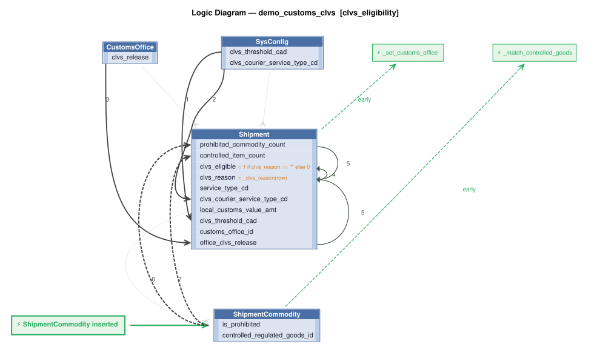

# Logic Flow — demo_customs_clvs [clvs_eligibility]

> Scoped to requirement: **clvs_eligibility**

<table>
<tr valign="top">
<td width="65%">



</td>
<td width="35%">

### Rules

1. `customs_office_clvs_release = copy(clvs_release)`<br>
2. `clvs_eligible = 1 if clvs_reason == "" else 0`<br>
3. `clvs_reason = _clvs_reason(row)` — Derive clvs_reason: comma-delimited short reasons why the shipment fails CLVS eligibility (blank if eligible).<br>
4. `prohibited_commodity_count = count(ShipmentCommodity where is_prohibited)`<br>
5. `controlled_commodity_count = count(ShipmentCommodity where controlled_regulated_goods_id)`<br>
6. `Shipment` → `_set_customs_office` (early) — Shipment event: looks up the CustomsOffice whose office_code is the planned clearance location and sets<br>
7. `ShipmentCommodity` → `_match_controlled_goods` (early) — ShipmentCommodity event: looks up ControlledRegulatedGood by the first ten digits of the harmonized tariff number

</td>
</tr>
</table>

## Requirements

```
Feature: CVLS Eligibility

Scenario: Shipment at or below the LVS threshold is eligible
  Given a shipment imported by an authorized CLVS courier
  And the shipment has an estimated value for duty not exceeding CAD $3,300
  And the shipment has no prohibited commodity lines (ShipmentCommodity.is_prohibited = 1)
  And the shipment has no controlled or regulatory goods (lookup using first ten digits of the harmonized tariff number)
  And the shipment is released at a CBSA-designated customs office
  When the shipment eligibility is evaluated
  Then the shipment shall be eligible for the CLVS Program
  And set the clvs_reason as a comma delimited list of short all reasons why failed (or blank)

version: 1.0
created: 2026-11-01
created_by: claude-sonnet-5-5 (valjhuber@gmail.com)
```

---
_Generated 2026-11-01 10:06_
