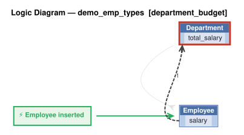

# Logic Flow — demo_emp_types [department_budget]

> Scoped to requirement: **department_budget**

<table>
<tr valign="top">
<td width="65%">



</td>
<td width="35%">

### Rules

1. `total_salary = sum(salary)`<br>
2. constraint: `Department`

</td>
</tr>
</table>

## Requirements

```
Departments have a name and a budget.
Department.total_salary = sum of Employee.salary (all types).
Department.total_salary must not exceed Department.budget.
A user with the manager role may exceed the budget; other users may not.

version: 1.0
created: 2026-10-29T17:48:00
created_by: claude-opus-5-5 (valjhuber@gmail.com)
```

---
_Generated 2026-10-29 17:50_
