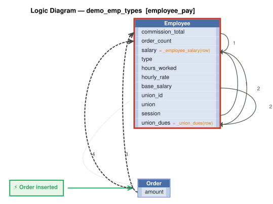

# Logic Flow — demo_emp_types [employee_pay]

> Scoped to requirement: **employee_pay**

<table>
<tr valign="top">
<td width="65%">



</td>
<td width="35%">

### Rules

1. `salary = _employee_salary(row)` — Derive salary: hourly = hours_worked * hourly_rate; commissioned = base_salary + commission_total; salaried = entered value.<br>
2. `union_dues = _union_dues(row)` — Derive union_dues: hours_worked * union.dues_rate for hourly employees with a union, else 0.<br>
3. `commission_total = sum(amount)`<br>
4. `order_count = count(Order)`<br>
5. constraint: `Employee`

</td>
</tr>
</table>

## Requirements

```
Employees have a name, dept, and salary.
Employees have a type that is one of: 'salaried', 'hourly', or 'commissioned'.

Hourly employees are employees with hours_worked (REAL) and hourly_rate (REAL).
Hourly employees: salary = hours_worked * hourly_rate.
Hourly employees: salary must not exceed 5000 per week.
Hourly employees may be assigned to a Union (optional); only Hourly employees may have a union_id.
Unions have a name and a dues_rate (REAL).
Hourly employees: union_dues = hours_worked * union.dues_rate (0 if no union assigned).

Commissioned employees are employees who can have Orders; only Commissioned employees may have Orders.
Each Order has an amount and a customer name.
Commissioned employees: commission_total = sum of Order.amount.
Commissioned employees: salary = base_salary + commission_total.

version: 1.0
created: 2026-10-29T17:48:00
created_by: claude-opus-5-5 (valjhuber@gmail.com)
```

---
_Generated 2026-10-29 17:50_
