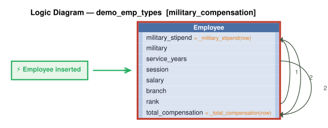

# Logic Flow — demo_emp_types [military_compensation]

> Scoped to requirement: **military_compensation**

<table>
<tr valign="top">
<td width="65%">



</td>
<td width="35%">

### Rules

1. `military_stipend = _military_stipend(row)` — Derive military_stipend: service_years * SysConfig.military_stipend_per_service_year for military employees, 0 otherwise.<br>
2. `total_compensation = _total_compensation(row)` — Derive total_compensation: salary + military_stipend for military employees; salary for non-military.<br>
3. constraint: `Employee`

</td>
</tr>
</table>

## Requirements

```
Employees may also have a military classification, independent of employment type.
Military employees have a branch (TEXT: 'Army', 'Navy', 'Air Force', 'Marines', 'Coast Guard'),
a rank (TEXT), and service_years (INTEGER).
Military employees receive a military_stipend (REAL) = service_years * 100.
Total compensation for military employees = salary + military_stipend.
Total compensation for non-military employees = salary.

version: 1.0
created: 2026-10-29T17:48:00
created_by: claude-opus-5-5 (valjhuber@gmail.com)
```

---
_Generated 2026-10-29 17:50_
