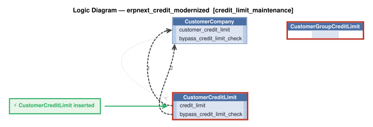
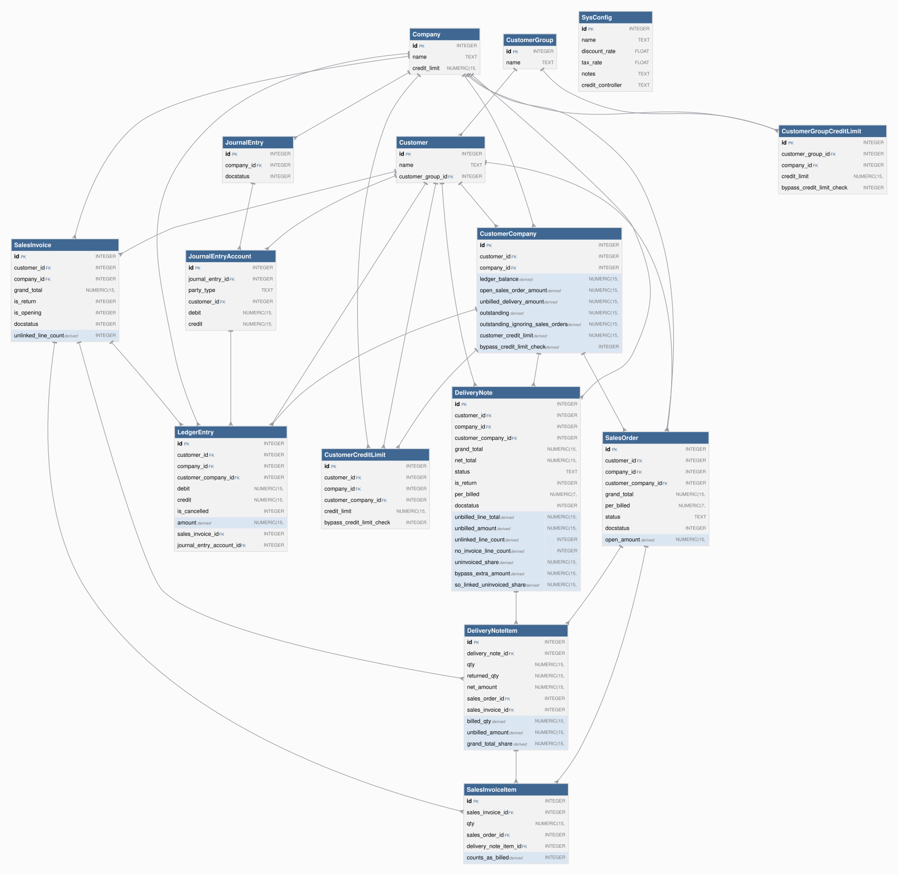

# Requirements Traceability Report

This report shows requirements, the rules created from them, and the tests created from those rules.

This project began as natural-language requirements, fleshed out by AI into a running system of business rules that are *executable documentation*. This report is how you govern the result.

A governable system is one you can **read**, **trust**, and **maintain**: each requirement is listed beside the rules that implement it (*read*); the tests and logic logs show those rules running (*trust*); re-run it after any change and it flags the gaps — an untested requirement, an untraced rule, a channel no test checks (*maintain*).

It is generated from the project's own files, nothing written by hand, so it is as current as the last run and covers the whole project, not a sample. Open **Background** (below the summary) for what the terms mean, how to read the report, and what it can and can't tell you.


**Project:** erpnext_credit_modernized &nbsp;|&nbsp; **Generated:** October 29, 2026 18:30 &nbsp;|&nbsp; **Rules:** 32 &nbsp;|&nbsp; **Test scenarios:** 52 &nbsp;|&nbsp; **Generator:** requirements_traceability_report.py 2.13

**Last test run:** October 29, 2026 18:30, took 2.2 s (0m before this report; test results and logic logs below are from that run)


&nbsp;
&nbsp;

## At a Glance

**✅ 4 requirement(s), all implemented; 4 tested; 52 of 52 scenarios passed; last run 0m ago.**

| | |
|---|---|
| Requirements | 4 (4 implemented) |
| Tested | 4 of 4 |
| Last test run | ✅ 52 passed, 0 failed (October 29, 2026 18:30, 0m ago); took 2.2 s |
| Rules | 32 (15 declarative, 13 Python functions, 4 Python events) |
| Rules shown running in a test log | 26 of 32 |
| Security | enabled (Keycloak provider); 10 role(s), 0 row-level grant(s) |

_Status: ✅ every requirement is implemented and tested, all scenarios pass, and the results are current. ⚠ a requirement is untested or unimplemented, there is no test run, or files changed since the last run. ❌ a scenario failed. This reports what was traced and tested, not that the system is correct._

<details markdown>
<summary>Background: what this report is, and how to read it</summary>

&nbsp;

<details markdown>
<summary>Requirements are business policies, expressed in natural language</summary>

<br>

A **requirement** is a statement of business behavior - how data is computed, validated, and transmitted - written in plain language. It lives in the project at `docs/requirements/<name>/requirements.md`.  For example:

&nbsp;

```
On Placing Orders, Check Credit
    1. The Customer's balance does not exceed the credit limit
    2. The Customer's balance is the sum of the unshipped Order amount_total
    3. The Order's amount_total is the sum of the Item amount
    4. The Item amount is the quantity * unit_price
    5. The Item unit_price is copied from the Product unit_price
```

</details>

&nbsp;

<details markdown>
<summary>Rules implement requirements</summary>

<br>

A requirement is written at a high level, and AI fills in details as it builds — as it should — so the requirement no longer says exactly what the system does. The rules do. That's a Goldilocks answer to the question of what you review:

* **Requirements say too little** — incomplete by design; AI fills in the details.
* **Code says too much** — business language in, hundreds of lines of procedural code out. The work moves from writing to reading, and if you can't read it, you can't govern it.
* **Rules are just right** — close to the requirement's own level, but complete and deterministic.

Code could be treated like machine language — never read, only trusted — if it were produced deterministically. Generation from natural language isn't. Rules restore that contract: a readable source, deterministically executed.

The requirements above become rules like this:

```
Rule.copy(derive=models.Item.unit_price, from_parent=models.Product.unit_price)
Rule.formula(derive=models.Item.amount,
             as_expression=lambda row: row.quantity * row.unit_price)
Rule.sum(derive=models.Order.amount_total, as_sum_of=models.Item.amount)
Rule.sum(derive=models.Customer.balance, as_sum_of=models.Order.amount_total,
         where=lambda row: row.date_shipped is None)
Rule.constraint(
    validate=models.Customer,
    as_condition=lambda row: row.balance <= row.credit_limit,
    error_msg="balance ({row.balance}) exceeds credit limit ({row.credit_limit})")
```

Rules are ***executable documentation*** that you can read and trust:

* **Read:** rules stay near the requirement's level, so this report can list them side by side and you can check one against the other. 5 rules vs. ~200 lines in our [A/B test](https://github.com/ApiLogicServer/ApiLogicServer-src/blob/main/api_logic_server_cli/prototypes/manager/samples/basic_demo_logic_gov/logic/procedural/declarative-vs-procedural-comparison.md) — **~40x less to review**, whether generated or hand-coded.
* **Trust:** the document is enforced, not just descriptive.
    * **What you read is what runs** — no drift between description and behavior.
    * **Dependencies:** with code, you analyze every execution path to know it runs at the right times. With rules: if the rule is there, it runs, in the right order.
    * **All sources and paths:** the engine hooks into every commit — API, UI or agent — insert, update and delete, including related rows. No bypass.
    * **Seeing is believing:** each scenario in *Tests and Results* below embeds its logic log — every rule that ran, in order, with old and new values.

Better AI makes generating code easier. It doesn't change what you have to read. The problem is the representation, not the capability. And governance is active, not just process: the engine enforces the rules on every transaction, and this report — regenerated from the project itself — shows it happening.

&nbsp;

</details>

&nbsp;

<details markdown>
<summary>Process overview: creation and iteration</summary>

<br>


In two phases. First, `genai-logic create` builds a working system from the database: API, Admin App, data model. Then behavior is added from requirements — the typical sequence, each step a request to an AI assistant:

1. Write each requirement in natural language, in `docs/requirements/<name>/requirements.md`.
2. `implement reqs <name>` — creates the rules, API endpoints and Kafka integrations.
3. `create tests from rules` — writes the test scenarios and steps.
4. `run the tests` — starts the server if needed, runs the suite, reports pass/fail.
5. `run the requirements traceability report` — regenerates this report.

Optional: `create logic diagram for each requirement` (needs Graphviz).

What makes steps 3–5 possible: rules are high-level enough that AI can read them too. The tests, the logic diagrams and this report are all generated by reading the same rules you review — where logic is Python code, the report can only quote its docstring.

The report connects the chain: requirement → rules and handlers → tests → logic log. How *this* project was actually built is recorded under Provenance.

</details>

&nbsp;

<details markdown>
<summary>How to read this report</summary>

<br>

| If you are...  | Start with                                                        | Look for                                                                                     |
| -------------- | ----------------------------------------------------------------- | -------------------------------------------------------------------------------------------- |
| Business owner | *Requirements in detail*                                          | The requirement text, then the **Tests** line under it: does a test exist, and did it pass?  |
| Auditor        | *Coverage summary*, *Rule coverage by tests*, *Messages and APIs* | Gaps (untested, untraced), the date of the last test run, and how each rule was shown to run |
| Developer      | *Tests and Results*                                               | Each scenario's logic log: every rule that ran, in order, with old and new values            |

</details>

&nbsp;

<details markdown>
<summary>What this report can and can't tell you</summary>

<br>

**It shows**

- Which files and rules implement each requirement, read from the project's source.
- Which scenarios ran in the last test run, and whether each passed.
- Which rules the engine logged as running in each scenario.

**It doesn't show**

- Whether the requirements are right or complete. It traces what was written down.
- Whether an event did anything. Events run on every commit of their class and decide for themselves whether to act, so appearing in the log doesn't mean the event had an effect.
- Whether a constraint works. A constraint appears in the log only when it rejects a transaction, so look for a scenario that makes it reject.
- Whether a message arrived. Unless a test step looks for it on the broker or endpoint, a passing scenario doesn't prove delivery. The *Messages and APIs* table flags channels no test mentions.
- Whether the results are current. They are as old as the last test run, shown in the header, which also warns if files changed since.
- Which version of a requirement the code was built from, or which clause of a requirement a given rule serves.

</details>

&nbsp;

<details markdown>
<summary>Terms</summary>

<br>

| Term        | Meaning                                                                                              |
| ----------- | ---------------------------------------------------------------------------------------------------- |
| Requirement | A statement of business behavior, in plain language; the unit this report traces.                    |
| Rule        | A declaration about data (sum, count, formula, copy, constraint) that the engine enforces at every commit. |
| Event       | Python code the engine calls when a row of a given class changes (for example, to publish a message). |
| Handler     | Code that serves an API endpoint or consumes a Kafka topic.                                          |
| Scenario    | One Behave test: a short Given / When / Then script run against the live API.                        |
| Logic log   | The engine's record of every rule it ran in a transaction, nested to show cascades (an Item change adjusts its Order, which adjusts its Customer). |
| Phase       | The step of a commit: ROW LOGIC (derivations, constraints), COMMIT LOGIC (checks that need finished totals), AFTER_FLUSH LOGIC (events that need database-assigned keys, such as publishing). |
| Seen        | The engine reported running the rule in that scenario's log.                                         |

</details>

</details>


&nbsp;
&nbsp;

## Contents

- [Requirements Coverage](#requirements-coverage)
- [Data Model](#data-model)
- [Security (RBAC)](#security-rbac)
- [Messages and APIs](#messages-and-apis)
- [Tests and Results](#tests-and-results)
- [Provenance](#provenance)


&nbsp;
&nbsp;

## Requirements Coverage

Every requirement should have rules that implement it, and tests that prove it. This section checks that chain in both directions: a requirement missing rules or tests is a gap, and rules or tests that belong to no requirement are flagged too. The matching uses the `Feature:` names and `§N` tags that requirements, code and tests share.


&nbsp;

### Coverage summary

| Measure | Result |
|---|---|
| Requirements | 4 |
| Implemented (at least one file) | 4 of 4 |
| Tested (at least one scenario) | 4 of 4 |
| Implementation not traced to a requirement | `logic/logic_discovery/ledger_posting.py`, `logic/logic_discovery/outstanding_amount.py`, `security/declare_security.py`, `logic/logic_discovery/system/all_classes_stamping.py` |
| Tests not traced to a requirement | none |
| Test results (last run) | ✅ 52 passed, 0 failed; took 2.2 s |
| Scenarios with a logic log | 52 of 52 |
| Rules seen in at least one scenario's log | 26 of 32 - not seen: `SalesOrder: _sales_order_credit_check()`, `DeliveryNote: _delivery_note_credit_check()`, `SalesInvoice: _sales_invoice_credit_check()`, `JournalEntry: _journal_entry_credit_check()`, `each_class.early_row_event → _link_customer_company()` (1 not counted: the engine's log does not name `all classes.early_row_event → handle_all()`, so it cannot be matched) |

_Test results are as current as the last run (see the header). A gap is any requirement with no implementation or no test._

<details markdown>
<summary>How to read this table</summary>

Test results are read from `logs/behave.log`, so they are only as current as that run. Not recorded here: which version of a requirement the code was built against, and which clause of a requirement a given rule serves.

</details>


&nbsp;

### Traceability matrix

| Requirement | Implemented by | Rules | Tests |
|---|---|---|---|
| §2 The credit limit that applies | [logic/logic_discovery/credit_check.py](../../logic/logic_discovery/credit_check.py) | 11 | ✅ 6 scenario(s): 6 passed |
| §4 The credit check | [logic/logic_discovery/credit_check.py](../../logic/logic_discovery/credit_check.py) | 11 | ✅ 20 scenario(s): 20 passed |
| §5 Where the check runs | [logic/logic_discovery/credit_check.py](../../logic/logic_discovery/credit_check.py) | 11 | ✅ 17 scenario(s): 17 passed |
| §6 Maintaining limits | [logic/logic_discovery/credit_limit_maintenance.py](../../logic/logic_discovery/credit_limit_maintenance.py)<br>[api/api_discovery/copy_credit_limits_from_group.py](../../api/api_discovery/copy_credit_limits_from_group.py) | 5 | ✅ 9 scenario(s): 9 passed |


&nbsp;

### Rule coverage by tests

| Rule | Requirement | Seen in |
|---|---|---|
| `DeliveryNote.unlinked_line_count = count(DeliveryNoteItem) where sales_order_id is None and sales_invoice_id is None` | §2 The credit limit that applies; §4 The credit check; §5 Where the check runs | 14: Delivered but not billed amount; Billed and returned quantities reduce the unbilled amount; Cancelled invoice and return invoice do not count as billed; +11 more |
| `DeliveryNote.no_invoice_line_count = count(DeliveryNoteItem) where sales_invoice_id is None` | §2 The credit limit that applies; §4 The credit check; §5 Where the check runs | 14: Delivered but not billed amount; Billed and returned quantities reduce the unbilled amount; Cancelled invoice and return invoice do not count as billed; +11 more |
| `DeliveryNoteItem.grand_total_share = _delivery_line_grand_total_share()` | §2 The credit limit that applies; §4 The credit check; §5 Where the check runs | 14: Delivered but not billed amount; Billed and returned quantities reduce the unbilled amount; Cancelled invoice and return invoice do not count as billed; +11 more |
| `DeliveryNote.uninvoiced_share = sum(DeliveryNoteItem.grand_total_share) where sales_invoice_id is None` | §2 The credit limit that applies; §4 The credit check; §5 Where the check runs | 14: Delivered but not billed amount; Billed and returned quantities reduce the unbilled amount; Cancelled invoice and return invoice do not count as billed; +11 more |
| `DeliveryNote.so_linked_uninvoiced_share = sum(DeliveryNoteItem.grand_total_share) where sales_invoice_id is None and sales_order_id is not None` | §2 The credit limit that applies; §4 The credit check; §5 Where the check runs | 14: Delivered but not billed amount; Billed and returned quantities reduce the unbilled amount; Cancelled invoice and return invoice do not count as billed; +11 more |
| `DeliveryNote.bypass_extra_amount = _delivery_note_bypass_extra_amount()` | §2 The credit limit that applies; §4 The credit check; §5 Where the check runs | 14: Delivered but not billed amount; Billed and returned quantities reduce the unbilled amount; Cancelled invoice and return invoice do not count as billed; +11 more |
| `SalesInvoice.unlinked_line_count = count(SalesInvoiceItem) where sales_order_id is None and delivery_note_item_id is None` | §2 The credit limit that applies; §4 The credit check; §5 Where the check runs | 8: Billed and returned quantities reduce the unbilled amount; Cancelled invoice and return invoice do not count as billed; Invoice line deleted or moved to another delivery line; +5 more |
| `SalesOrder: _sales_order_credit_check()` | §2 The credit limit that applies; §4 The credit check; §5 Where the check runs | ⚠ not seen in any scenario's log |
| `DeliveryNote: _delivery_note_credit_check()` | §2 The credit limit that applies; §4 The credit check; §5 Where the check runs | ⚠ not seen in any scenario's log |
| `SalesInvoice: _sales_invoice_credit_check()` | §2 The credit limit that applies; §4 The credit check; §5 Where the check runs | ⚠ not seen in any scenario's log |
| `JournalEntry: _journal_entry_credit_check()` | §2 The credit limit that applies; §4 The credit check; §5 Where the check runs | ⚠ not seen in any scenario's log |
| `CustomerCreditLimit: _customer_row_unique()` | §6 Maintaining limits | 1: Second customer row for the same company is rejected |
| `CustomerGroupCreditLimit: _group_row_unique()` | §6 Maintaining limits | 1: Second group row for the same company is rejected |
| `CustomerCreditLimit: _limit_covers_outstanding()` | §6 Maintaining limits | 1: Second customer row for the same company is rejected |
| `CustomerCompany.customer_credit_limit = sum(CustomerCreditLimit.credit_limit)` | §6 Maintaining limits | 14: Sales Order with the bypass flag is not checked; Delivery Note with the flag adds Sales Order linked lines as extra; Delivery Note with the flag is rejected when ledger plus extra exceeds the limit; +11 more |
| `CustomerCompany.bypass_credit_limit_check = sum(CustomerCreditLimit.bypass_credit_limit_check)` | §6 Maintaining limits | 14: Sales Order with the bypass flag is not checked; Delivery Note with the flag adds Sales Order linked lines as extra; Delivery Note with the flag is rejected when ledger plus extra exceeds the limit; +11 more |
| `SalesInvoice.early_row_event → _post_sales_invoice()` | (none) | 8: Billed and returned quantities reduce the unbilled amount; Cancelled invoice and return invoice do not count as billed; Invoice line deleted or moved to another delivery line; +5 more |
| `JournalEntry.early_row_event → _post_journal_entry()` | (none) | 2: Journal Entry with a customer debit is checked; Journal Entry with only a customer credit is not checked |
| `each_class.early_row_event → _link_customer_company()` | (none) | ⚠ not seen in any scenario's log |
| `LedgerEntry.amount = (debit or 0) - (credit or 0)` | (none) | 25: Ledger entries roll up to the ledger balance; Cancelled ledger entry leaves and re-enters the balance; Deleted ledger entry leaves the balance; +22 more |
| `CustomerCompany.ledger_balance = sum(LedgerEntry.amount) where is_cancelled != 1` | (none) | 25: Ledger entries roll up to the ledger balance; Cancelled ledger entry leaves and re-enters the balance; Deleted ledger entry leaves the balance; +22 more |
| `SalesOrder.open_amount = _sales_order_open_amount()` | (none) | 21: Open Sales Order amount follows per billed; Open Sales Order amount follows grand total; Closed and draft Sales Orders are not open; +18 more |
| `CustomerCompany.open_sales_order_amount = sum(SalesOrder.open_amount)` | (none) | 21: Open Sales Order amount follows per billed; Open Sales Order amount follows grand total; Closed and draft Sales Orders are not open; +18 more |
| `SalesInvoiceItem.counts_as_billed = _invoice_line_counts_as_billed()` | (none) | 8: Billed and returned quantities reduce the unbilled amount; Cancelled invoice and return invoice do not count as billed; Invoice line deleted or moved to another delivery line; +5 more |
| `DeliveryNoteItem.billed_qty = sum(SalesInvoiceItem.qty) where counts_as_billed == 1` | (none) | 8: Billed and returned quantities reduce the unbilled amount; Cancelled invoice and return invoice do not count as billed; Invoice line deleted or moved to another delivery line; +5 more |
| `DeliveryNoteItem.unbilled_amount = _delivery_line_unbilled_amount()` | (none) | 14: Delivered but not billed amount; Billed and returned quantities reduce the unbilled amount; Cancelled invoice and return invoice do not count as billed; +11 more |
| `DeliveryNote.unbilled_line_total = sum(DeliveryNoteItem.unbilled_amount)` | (none) | 14: Delivered but not billed amount; Billed and returned quantities reduce the unbilled amount; Cancelled invoice and return invoice do not count as billed; +11 more |
| `DeliveryNote.unbilled_amount = _delivery_note_unbilled_amount()` | (none) | 14: Delivered but not billed amount; Billed and returned quantities reduce the unbilled amount; Cancelled invoice and return invoice do not count as billed; +11 more |
| `CustomerCompany.unbilled_delivery_amount = sum(DeliveryNote.unbilled_amount)` | (none) | 14: Delivered but not billed amount; Billed and returned quantities reduce the unbilled amount; Cancelled invoice and return invoice do not count as billed; +11 more |
| `CustomerCompany.outstanding = (ledger_balance or 0) + (open_sales_order_amount or 0) + (unbilled_delivery_amount or 0)` | (none) | 41: Ledger entries roll up to the ledger balance; Cancelled ledger entry leaves and re-enters the balance; Deleted ledger entry leaves the balance; +38 more |
| `CustomerCompany.outstanding_ignoring_sales_orders = (ledger_balance or 0) + (unbilled_delivery_amount or 0)` | (none) | 29: Ledger entries roll up to the ledger balance; Cancelled ledger entry leaves and re-enters the balance; Deleted ledger entry leaves the balance; +26 more |
| `all classes.early_row_event → handle_all()` | (none) | n/a - cannot be matched to the engine's log |

_"Seen" means the engine's log shows the rule ran, not proof that it took effect._

<details markdown>
<summary>How to read this table</summary>

"Seen" means the engine reported running the rule in that scenario's logic log. A scenario can only contribute if it has a log (see the coverage summary): a test that does not open one writes into whichever log was open last, and its rules are then credited to that scenario, or to the shared log. An event's function runs on every commit of its class, and its own condition decides whether it acts, so seen does not mean it took effect. A constraint appears in the log only when it rejects a transaction, so it is seen only in scenarios that make it reject. "Not seen" therefore means no log shows it, not that no test ran it.

</details>


&nbsp;

### Requirements in detail

**32 rules** in 5 files: 15 declarative (sum, count, copy, formula and constraint expressions), 13 backed by a Python function, 4 events (Python).

_Declarative rules are read straight from their declarations. Functions and events are Python code, so for those the report shows the docstring — it does not analyze the code._

Each requirement is followed by the rules and handlers in the files that implement it. Logic diagrams are shown (click to expand) where they exist.

<details markdown>
<summary>How to create or refresh the logic diagrams</summary>

Needs Graphviz (`brew install graphviz`). Tell your AI assistant:

```
create logic diagram for each requirement
```

or run this from the Manager root (`genai-logic`):

```
python system/ApiLogicServer-Internal-Dev/logic_diagram_gv.py erpnext_credit_modernized --each
```

Each diagram is saved under `docs/requirements/<name>/logic_diagrams/`. Then regenerate this report (`python requirements_traceability_report.py run`, from `test/api_logic_server_behave`).

</details>

&nbsp;


#### §2 The credit limit that applies

Tests: ✅ 6 scenario(s): 6 passed

```
Feature: Credit Limit Lookup

For a customer and company, the first match wins:
1. The customer's own credit-limit row for that company, if its `credit_limit` is not zero.
2. Otherwise the customer's Customer Group's row for that company, but only if that row's `bypass_credit_limit_check` is off.
3. Otherwise the company's default `credit_limit`.

A limit of 0 or empty means no limit: no credit check is made.

---
```

| Rule / item | Type | Logic | Description | Where |
|---|---|---|---|---|
| `DeliveryNote.unlinked_line_count = count(DeliveryNoteItem) where sales_order_id is None and sales_invoice_id is None` | count | declarative |  | [credit_check.py](../../logic/logic_discovery/credit_check.py) |
| `DeliveryNote.no_invoice_line_count = count(DeliveryNoteItem) where sales_invoice_id is None` | count | declarative |  | [credit_check.py](../../logic/logic_discovery/credit_check.py) |
| `DeliveryNoteItem.grand_total_share = _delivery_line_grand_total_share()` | formula | Python function | Derive grand_total_share: line net_amount / note net_total x note grand_total (0 when the note's net_total is 0). | [credit_check.py](../../logic/logic_discovery/credit_check.py) |
| `DeliveryNote.uninvoiced_share = sum(DeliveryNoteItem.grand_total_share) where sales_invoice_id is None` | sum | declarative |  | [credit_check.py](../../logic/logic_discovery/credit_check.py) |
| `DeliveryNote.so_linked_uninvoiced_share = sum(DeliveryNoteItem.grand_total_share) where sales_invoice_id is None and sales_order_id is not None` | sum | declarative |  | [credit_check.py](../../logic/logic_discovery/credit_check.py) |
| `DeliveryNote.bypass_extra_amount = _delivery_note_bypass_extra_amount()` | formula | Python function | Derive bypass_extra_amount: the note's grand_total if its net_total is 0; else the grand-total share of lines with no Sales Invoice link that have a Sales Order link - or of every such line while the note is a draft. | [credit_check.py](../../logic/logic_discovery/credit_check.py) |
| `SalesInvoice.unlinked_line_count = count(SalesInvoiceItem) where sales_order_id is None and delivery_note_item_id is None` | count | declarative |  | [credit_check.py](../../logic/logic_discovery/credit_check.py) |
| `SalesOrder: _sales_order_credit_check()` | commit_constraint | Python function | Derive (constraint) Sales Order credit check: a submitted, not Closed Sales Order - on submit, update after submit or reopen from Closed - is checked with check(customer, company) unless the customer's row bypasses the check. | [credit_check.py](../../logic/logic_discovery/credit_check.py) |
| `DeliveryNote: _delivery_note_credit_check()` | commit_constraint | Python function | Derive (constraint) Delivery Note credit check on submit (not a return, per_billed below 100): flag off - checked if a line has no SO and no SI link; flag on - checked if a line has no SI link, ignoring Sales Orders, plus bypass_extra_amount. | [credit_check.py](../../logic/logic_discovery/credit_check.py) |
| `SalesInvoice: _sales_invoice_credit_check()` | commit_constraint | Python function | Derive (constraint) Sales Invoice credit check on submit (not a return, not opening): checked if the flag is on or a line has neither a Sales Order nor a Delivery Note link, with check(customer, company, ignore=flag). | [credit_check.py](../../logic/logic_discovery/credit_check.py) |
| `JournalEntry: _journal_entry_credit_check()` | commit_constraint | Python function | Derive (constraint) Journal Entry credit check on submit: for each customer with a line debit above 0, check(customer, company, ignore=flag). | [credit_check.py](../../logic/logic_discovery/credit_check.py) |

<details markdown>
<summary>Logic diagram: credit_check</summary>


</details>

#### §4 The credit check

Tests: ✅ 20 scenario(s): 20 passed

```
Feature: Credit Check

`check(customer, company, ignore_open_sales_orders, extra_amount)`:
1. Find the limit (section 2). If there is none, stop.
2. Outstanding is section 3 (omitting part 2 if `ignore_open_sales_orders`), plus `extra_amount`.
3. If the limit is above 0 and outstanding is strictly greater than the limit, the transaction is rejected with a message giving the customer, outstanding and limit. Outstanding equal to the limit is allowed.
4. A user who holds the credit controller role (Accounts Settings) is not rejected. If no credit controller role is set, nobody is excused.

---
```

| Rule / item | Type | Logic | Description | Where |
|---|---|---|---|---|
| `DeliveryNote.unlinked_line_count = count(DeliveryNoteItem) where sales_order_id is None and sales_invoice_id is None` | count | declarative |  | [credit_check.py](../../logic/logic_discovery/credit_check.py) |
| `DeliveryNote.no_invoice_line_count = count(DeliveryNoteItem) where sales_invoice_id is None` | count | declarative |  | [credit_check.py](../../logic/logic_discovery/credit_check.py) |
| `DeliveryNoteItem.grand_total_share = _delivery_line_grand_total_share()` | formula | Python function | Derive grand_total_share: line net_amount / note net_total x note grand_total (0 when the note's net_total is 0). | [credit_check.py](../../logic/logic_discovery/credit_check.py) |
| `DeliveryNote.uninvoiced_share = sum(DeliveryNoteItem.grand_total_share) where sales_invoice_id is None` | sum | declarative |  | [credit_check.py](../../logic/logic_discovery/credit_check.py) |
| `DeliveryNote.so_linked_uninvoiced_share = sum(DeliveryNoteItem.grand_total_share) where sales_invoice_id is None and sales_order_id is not None` | sum | declarative |  | [credit_check.py](../../logic/logic_discovery/credit_check.py) |
| `DeliveryNote.bypass_extra_amount = _delivery_note_bypass_extra_amount()` | formula | Python function | Derive bypass_extra_amount: the note's grand_total if its net_total is 0; else the grand-total share of lines with no Sales Invoice link that have a Sales Order link - or of every such line while the note is a draft. | [credit_check.py](../../logic/logic_discovery/credit_check.py) |
| `SalesInvoice.unlinked_line_count = count(SalesInvoiceItem) where sales_order_id is None and delivery_note_item_id is None` | count | declarative |  | [credit_check.py](../../logic/logic_discovery/credit_check.py) |
| `SalesOrder: _sales_order_credit_check()` | commit_constraint | Python function | Derive (constraint) Sales Order credit check: a submitted, not Closed Sales Order - on submit, update after submit or reopen from Closed - is checked with check(customer, company) unless the customer's row bypasses the check. | [credit_check.py](../../logic/logic_discovery/credit_check.py) |
| `DeliveryNote: _delivery_note_credit_check()` | commit_constraint | Python function | Derive (constraint) Delivery Note credit check on submit (not a return, per_billed below 100): flag off - checked if a line has no SO and no SI link; flag on - checked if a line has no SI link, ignoring Sales Orders, plus bypass_extra_amount. | [credit_check.py](../../logic/logic_discovery/credit_check.py) |
| `SalesInvoice: _sales_invoice_credit_check()` | commit_constraint | Python function | Derive (constraint) Sales Invoice credit check on submit (not a return, not opening): checked if the flag is on or a line has neither a Sales Order nor a Delivery Note link, with check(customer, company, ignore=flag). | [credit_check.py](../../logic/logic_discovery/credit_check.py) |
| `JournalEntry: _journal_entry_credit_check()` | commit_constraint | Python function | Derive (constraint) Journal Entry credit check on submit: for each customer with a line debit above 0, check(customer, company, ignore=flag). | [credit_check.py](../../logic/logic_discovery/credit_check.py) |

<details markdown>
<summary>Logic diagram: credit_check</summary>


</details>

#### §5 Where the check runs

Tests: ✅ 17 scenario(s): 17 passed

```
Feature: Credit Check On Documents

The customer's credit-limit row for the company is read for its `bypass_credit_limit_check` flag (off if there is no row).

* **Sales Order**: on submit, on update after submit, and when reopened from Closed. If the flag is on, no check is made. Otherwise `check(customer, company)`.
* **Delivery Note** (not a return; skipped when `per_billed` is 100): on submit.
  * Flag off: the check is made only if some line has neither a Sales Order nor a Sales Invoice link. `check(customer, company, ignore=false, extra=0)`.
  * Flag on: the check is made if some line has no Sales Invoice link. For each line with no Sales Invoice link, if the line has a Sales Order link or the note is a draft, add `line net amount / note net total × note grand total` to `extra`. If the note's net total is 0, `extra` is the note's grand total. `check(customer, company, ignore=true, extra)`.
* **Sales Invoice** (not a return, not an opening invoice): on submit. The check is made if the flag is on, or if some line has neither a Sales Order nor a Delivery Note link. `check(customer, company, ignore=flag)`.
* **Journal Entry**: on submit, for each customer that has a line with a debit above 0: `check(customer, company, ignore=flag)`.
```

| Rule / item | Type | Logic | Description | Where |
|---|---|---|---|---|
| `DeliveryNote.unlinked_line_count = count(DeliveryNoteItem) where sales_order_id is None and sales_invoice_id is None` | count | declarative |  | [credit_check.py](../../logic/logic_discovery/credit_check.py) |
| `DeliveryNote.no_invoice_line_count = count(DeliveryNoteItem) where sales_invoice_id is None` | count | declarative |  | [credit_check.py](../../logic/logic_discovery/credit_check.py) |
| `DeliveryNoteItem.grand_total_share = _delivery_line_grand_total_share()` | formula | Python function | Derive grand_total_share: line net_amount / note net_total x note grand_total (0 when the note's net_total is 0). | [credit_check.py](../../logic/logic_discovery/credit_check.py) |
| `DeliveryNote.uninvoiced_share = sum(DeliveryNoteItem.grand_total_share) where sales_invoice_id is None` | sum | declarative |  | [credit_check.py](../../logic/logic_discovery/credit_check.py) |
| `DeliveryNote.so_linked_uninvoiced_share = sum(DeliveryNoteItem.grand_total_share) where sales_invoice_id is None and sales_order_id is not None` | sum | declarative |  | [credit_check.py](../../logic/logic_discovery/credit_check.py) |
| `DeliveryNote.bypass_extra_amount = _delivery_note_bypass_extra_amount()` | formula | Python function | Derive bypass_extra_amount: the note's grand_total if its net_total is 0; else the grand-total share of lines with no Sales Invoice link that have a Sales Order link - or of every such line while the note is a draft. | [credit_check.py](../../logic/logic_discovery/credit_check.py) |
| `SalesInvoice.unlinked_line_count = count(SalesInvoiceItem) where sales_order_id is None and delivery_note_item_id is None` | count | declarative |  | [credit_check.py](../../logic/logic_discovery/credit_check.py) |
| `SalesOrder: _sales_order_credit_check()` | commit_constraint | Python function | Derive (constraint) Sales Order credit check: a submitted, not Closed Sales Order - on submit, update after submit or reopen from Closed - is checked with check(customer, company) unless the customer's row bypasses the check. | [credit_check.py](../../logic/logic_discovery/credit_check.py) |
| `DeliveryNote: _delivery_note_credit_check()` | commit_constraint | Python function | Derive (constraint) Delivery Note credit check on submit (not a return, per_billed below 100): flag off - checked if a line has no SO and no SI link; flag on - checked if a line has no SI link, ignoring Sales Orders, plus bypass_extra_amount. | [credit_check.py](../../logic/logic_discovery/credit_check.py) |
| `SalesInvoice: _sales_invoice_credit_check()` | commit_constraint | Python function | Derive (constraint) Sales Invoice credit check on submit (not a return, not opening): checked if the flag is on or a line has neither a Sales Order nor a Delivery Note link, with check(customer, company, ignore=flag). | [credit_check.py](../../logic/logic_discovery/credit_check.py) |
| `JournalEntry: _journal_entry_credit_check()` | commit_constraint | Python function | Derive (constraint) Journal Entry credit check on submit: for each customer with a line debit above 0, check(customer, company, ignore=flag). | [credit_check.py](../../logic/logic_discovery/credit_check.py) |

<details markdown>
<summary>Logic diagram: credit_check</summary>


</details>

#### §6 Maintaining limits

Tests: ✅ 9 scenario(s): 9 passed

```
Feature: Credit Limit Maintenance

* A Customer or Customer Group with two credit-limit rows for the same company is rejected.
* When a Customer's credit-limit rows change, each row with a non-zero `credit_limit` must be at least the customer's current outstanding for that company (with Sales Orders ignored when that row's flag is on). Otherwise the change is rejected. A row with a zero limit is allowed.
* **Copy from group**: an action on a Customer replaces its credit-limit rows with copies of its Customer Group's rows (company, `credit_limit`, flag).
```

| Rule / item | Type | Logic | Description | Where |
|---|---|---|---|---|
| `CustomerCreditLimit: _customer_row_unique()` | constraint | Python function | Derive (constraint) CustomerCreditLimit uniqueness: a customer has at most one credit-limit row per company. | [credit_limit_maintenance.py](../../logic/logic_discovery/credit_limit_maintenance.py) |
| `CustomerGroupCreditLimit: _group_row_unique()` | constraint | Python function | Derive (constraint) CustomerGroupCreditLimit uniqueness: a customer group has at most one credit-limit row per company. | [credit_limit_maintenance.py](../../logic/logic_discovery/credit_limit_maintenance.py) |
| `CustomerCreditLimit: _limit_covers_outstanding()` | constraint | Python function | Derive (constraint) CustomerCreditLimit maintenance: when the row is inserted or its limit, flag, customer or company changes, a non-zero credit_limit must be at least the customer's current outstanding for the company (Sales Orders ignored when the row's flag is on); a zero limit is allowed. | [credit_limit_maintenance.py](../../logic/logic_discovery/credit_limit_maintenance.py) |
| `CustomerCompany.customer_credit_limit = sum(CustomerCreditLimit.credit_limit)` | sum | declarative |  | [credit_limit_maintenance.py](../../logic/logic_discovery/credit_limit_maintenance.py) |
| `CustomerCompany.bypass_credit_limit_check = sum(CustomerCreditLimit.bypass_credit_limit_check)` | sum | declarative |  | [credit_limit_maintenance.py](../../logic/logic_discovery/credit_limit_maintenance.py) |
| `copy_credit_limits_from_group.py` | module |  | Feature: Credit Limit Maintenance | [copy_credit_limits_from_group.py](../../api/api_discovery/copy_credit_limits_from_group.py) |

<details markdown>
<summary>Logic diagram: credit_limit_maintenance</summary>



</details>

#### Rules not traced to a requirement

| Rule / item | Type | Logic | Description | Where |
|---|---|---|---|---|
| `SalesInvoice.early_row_event → _post_sales_invoice()` | early_row_event | event (Python) | SalesInvoice event: on submit posts one LedgerEntry for the customer and company - a debit of grand_total, or a credit for a return - and on cancel sets is_cancelled on the entries it posted (early, so the posting is in outstanding before the credit check). | [ledger_posting.py](../../logic/logic_discovery/ledger_posting.py) |
| `JournalEntry.early_row_event → _post_journal_entry()` | early_row_event | event (Python) | JournalEntry event: on submit posts one LedgerEntry per customer line (party_type Customer) with the line's debit and credit, and on cancel sets is_cancelled on the entries those lines posted. | [ledger_posting.py](../../logic/logic_discovery/ledger_posting.py) |
| `each_class.early_row_event → _link_customer_company()` | early_row_event | event (Python) | LedgerEntry / SalesOrder / DeliveryNote / CustomerCreditLimit event: sets customer_company (the per-customer, per-company outstanding bucket) from customer_id and company_id, creating the bucket on first use, so the Rule.sum rules below roll this row into the right customer and company. | [outstanding_amount.py](../../logic/logic_discovery/outstanding_amount.py) |
| `LedgerEntry.amount = (debit or 0) - (credit or 0)` | formula | declarative |  | [outstanding_amount.py](../../logic/logic_discovery/outstanding_amount.py) |
| `CustomerCompany.ledger_balance = sum(LedgerEntry.amount) where is_cancelled != 1` | sum | declarative |  | [outstanding_amount.py](../../logic/logic_discovery/outstanding_amount.py) |
| `SalesOrder.open_amount = _sales_order_open_amount()` | formula | Python function | Derive open_amount: grand_total x (100 - per_billed) / 100 for a submitted Sales Order that is not Closed and is billed below 100%, else 0. | [outstanding_amount.py](../../logic/logic_discovery/outstanding_amount.py) |
| `CustomerCompany.open_sales_order_amount = sum(SalesOrder.open_amount)` | sum | declarative |  | [outstanding_amount.py](../../logic/logic_discovery/outstanding_amount.py) |
| `SalesInvoiceItem.counts_as_billed = _invoice_line_counts_as_billed()` | formula | Python function | Derive counts_as_billed: 1 when the line's Sales Invoice is submitted and is not a return, else 0 (feeds the delivery line's billed quantity). | [outstanding_amount.py](../../logic/logic_discovery/outstanding_amount.py) |
| `DeliveryNoteItem.billed_qty = sum(SalesInvoiceItem.qty) where counts_as_billed == 1` | sum | declarative |  | [outstanding_amount.py](../../logic/logic_discovery/outstanding_amount.py) |
| `DeliveryNoteItem.unbilled_amount = _delivery_line_unbilled_amount()` | formula | Python function | Derive unbilled_amount: for a line with no Sales Order and no Sales Invoice link whose qty exceeds billed + returned qty, net_amount x (qty - billed - returned) / qty / note net_total x note grand_total; else 0. | [outstanding_amount.py](../../logic/logic_discovery/outstanding_amount.py) |
| `DeliveryNote.unbilled_line_total = sum(DeliveryNoteItem.unbilled_amount)` | sum | declarative |  | [outstanding_amount.py](../../logic/logic_discovery/outstanding_amount.py) |
| `DeliveryNote.unbilled_amount = _delivery_note_unbilled_amount()` | formula | Python function | Derive unbilled_amount: the sum of the lines' unbilled amounts for a submitted Delivery Note that is not Closed or Stopped and has net_total above 0, else 0. | [outstanding_amount.py](../../logic/logic_discovery/outstanding_amount.py) |
| `CustomerCompany.unbilled_delivery_amount = sum(DeliveryNote.unbilled_amount)` | sum | declarative |  | [outstanding_amount.py](../../logic/logic_discovery/outstanding_amount.py) |
| `CustomerCompany.outstanding = (ledger_balance or 0) + (open_sales_order_amount or 0) + (unbilled_delivery_amount or 0)` | formula | declarative |  | [outstanding_amount.py](../../logic/logic_discovery/outstanding_amount.py) |
| `CustomerCompany.outstanding_ignoring_sales_orders = (ledger_balance or 0) + (unbilled_delivery_amount or 0)` | formula | declarative |  | [outstanding_amount.py](../../logic/logic_discovery/outstanding_amount.py) |
| `all classes.early_row_event → handle_all()` | early_row_event_all_classes | event (Python) | Generic handler - executed for every row update across all classes. | [all_classes_stamping.py](../../logic/logic_discovery/system/all_classes_stamping.py) |


&nbsp;
&nbsp;

## Data Model

The tables the rules run over. Shaded columns are derived by rules — no code writes them.



_Generated from `docs/db.dbml` (parents above children; shaded rows are derived by rules). To use your own layout, save it as `docs/db_diagram.png`._


&nbsp;

### Derived columns

| Table | Column | Rule | Definition |
|---|---|---|---|
| DeliveryNote | unlinked_line_count | count | `DeliveryNote.unlinked_line_count = count(DeliveryNoteItem) where sales_order_id is None and sales_invoice_id is None` |
| DeliveryNote | no_invoice_line_count | count | `DeliveryNote.no_invoice_line_count = count(DeliveryNoteItem) where sales_invoice_id is None` |
| DeliveryNoteItem | grand_total_share | formula | `DeliveryNoteItem.grand_total_share = _delivery_line_grand_total_share()` |
| DeliveryNote | uninvoiced_share | sum | `DeliveryNote.uninvoiced_share = sum(DeliveryNoteItem.grand_total_share) where sales_invoice_id is None` |
| DeliveryNote | so_linked_uninvoiced_share | sum | `DeliveryNote.so_linked_uninvoiced_share = sum(DeliveryNoteItem.grand_total_share) where sales_invoice_id is None and sales_order_id is not None` |
| DeliveryNote | bypass_extra_amount | formula | `DeliveryNote.bypass_extra_amount = _delivery_note_bypass_extra_amount()` |
| SalesInvoice | unlinked_line_count | count | `SalesInvoice.unlinked_line_count = count(SalesInvoiceItem) where sales_order_id is None and delivery_note_item_id is None` |
| CustomerCompany | customer_credit_limit | sum | `CustomerCompany.customer_credit_limit = sum(CustomerCreditLimit.credit_limit)` |
| CustomerCompany | bypass_credit_limit_check | sum | `CustomerCompany.bypass_credit_limit_check = sum(CustomerCreditLimit.bypass_credit_limit_check)` |
| LedgerEntry | amount | formula | `LedgerEntry.amount = (debit or 0) - (credit or 0)` |
| CustomerCompany | ledger_balance | sum | `CustomerCompany.ledger_balance = sum(LedgerEntry.amount) where is_cancelled != 1` |
| SalesOrder | open_amount | formula | `SalesOrder.open_amount = _sales_order_open_amount()` |
| CustomerCompany | open_sales_order_amount | sum | `CustomerCompany.open_sales_order_amount = sum(SalesOrder.open_amount)` |
| SalesInvoiceItem | counts_as_billed | formula | `SalesInvoiceItem.counts_as_billed = _invoice_line_counts_as_billed()` |
| DeliveryNoteItem | billed_qty | sum | `DeliveryNoteItem.billed_qty = sum(SalesInvoiceItem.qty) where counts_as_billed == 1` |
| DeliveryNoteItem | unbilled_amount | formula | `DeliveryNoteItem.unbilled_amount = _delivery_line_unbilled_amount()` |
| DeliveryNote | unbilled_line_total | sum | `DeliveryNote.unbilled_line_total = sum(DeliveryNoteItem.unbilled_amount)` |
| DeliveryNote | unbilled_amount | formula | `DeliveryNote.unbilled_amount = _delivery_note_unbilled_amount()` |
| CustomerCompany | unbilled_delivery_amount | sum | `CustomerCompany.unbilled_delivery_amount = sum(DeliveryNote.unbilled_amount)` |
| CustomerCompany | outstanding | formula | `CustomerCompany.outstanding = (ledger_balance or 0) + (open_sales_order_amount or 0) + (unbilled_delivery_amount or 0)` |
| CustomerCompany | outstanding_ignoring_sales_orders | formula | `CustomerCompany.outstanding_ignoring_sales_orders = (ledger_balance or 0) + (unbilled_delivery_amount or 0)` |


&nbsp;
&nbsp;

## Security (RBAC)

Who can do what: each role's permissions, and which rows each role can see.

**Security enabled: yes** (`SECURITY_ENABLED` in `config/default.env`).


&nbsp;

### Roles and CRUD (DefaultRolePermission)

| Role | Read | Insert | Update | Delete |
|---|---|---|---|---|
| sa | ✅ | ✅ | ✅ | ✅ |
| tenant | ✅ | — | — | ✅ |
| CS_ADMIN | ✅ | ✅ | ✅ | ✅ |
| manager | ✅ | ✅ | ✅ | — |
| teller | ✅ | ✅ | ✅ | — |
| customer | ✅ | ✅ | ✅ | — |
| readonly | ✅ | — | — | — |
| public | ✅ | — | — | — |
| default-roles-kcals | ✅ | ✅ | ✅ | — |
| uma_authorization | ✅ | ✅ | ✅ | — |


&nbsp;

### Row-level grants (Grant)

None declared (`Grant`).


&nbsp;
&nbsp;

## Messages and APIs

How data enters and leaves beyond the standard API: Kafka topics in and out, custom HTTP endpoints — and whether any test touches each one.

No Kafka topics or custom API endpoints found.


&nbsp;
&nbsp;

## Tests and Results

**✅ 52 scenario(s): 52 passed, 0 failed; took 2.2 s** (from the last run, `logs/behave.log`).

Each test drives the running system the way any client would — create an order, change a quantity, ship it — and checks the result.

**The logic log** is what makes them more than pass/fail. Business rules run inside the server on every commit, so the server records exactly what they did, and this report embeds that record for each scenario. Two things to look for:

1. **It shows every rule that runs.** Each line is one rule execution, with the row's state, old and new values. You see not just that a test passed, but which rules ran and what each one changed.
2. **The nesting shows multi-table chaining.** Indentation follows the cascade: a change to an Item adjusts its Order, which adjusts its Customer.

<details markdown>
<summary>How to read the logic log</summary>

Open a scenario's "Rules exercised and logic log" block to see it. The log is shown in full, attribute values included, because those values are what you diagnose from when a rule produces an unexpected result.

To read a log line:

```
....Order[16] {Update - Adjusting order: amount_total} id: 16, customer_id: 19, amount_total:  [0.0-->] 90.0

```

- The leading dots are the depth in the cascade: Item (2 dots), its Order (4), its Customer (6).
- `Order[16]` is the row; `{...}` is the rule or action that ran; the rest is the row's attribute values at that step.
- `[0.0-->] 90.0` marks a value the rules changed, with its old and new value.
- The log is in phases: **ROW LOGIC** (derivations and constraints, as rows change), **COMMIT LOGIC** (checks that need the finished aggregates), and **AFTER_FLUSH LOGIC** (events that need database-assigned keys, such as the Kafka publish).

More: [Logic Log](https://apilogicserver.github.io/Docs/Logic-Debug/#logic-log).

</details>

&nbsp;

<details markdown>
<summary>How to add more tests, and run them</summary>

**1. Have AI create them.** This project's context tells your AI assistant how (`.github/copilot-instructions.md`, `docs/training/testing.md`). Just say:

```

create tests from rules

```

The assistant reads `database/models.py`, the logic files and the custom APIs, then writes `.feature` files and step implementations under `test/api_logic_server_behave/features/`. Then say `run the tests` and `run the requirements traceability report` and the assistant does both.

Or, to have each requirement's tests linked in the Tests column above (it matches on `Feature:` name), say which names to use:

```

create tests from rules, one Feature per requirement, named exactly:
- Credit Limit Lookup
- Credit Check
- Credit Check On Documents
- Credit Limit Maintenance

```

_Tests with other names still run and appear below; they just aren't linked to a requirement._

**2. You can also define tests manually.** Add a `<name>.feature` file (Gherkin) under `test/api_logic_server_behave/features/` and its steps under `features/steps/`. The steps call the running API, so tests exercise the same rules as any client. See `docs/training/testing.md` for the patterns that keep tests repeatable.

**Or run them yourself** (server running, from `test/api_logic_server_behave`):

```

python behave_run.py --outfile=logs/behave.log
python requirements_traceability_report.py run

```

</details>

&nbsp;
&nbsp;

### Feature: Credit Check  
  Background:   # features/credit_check.feature:3  

&nbsp;
&nbsp;

#### Scenario: Ledger entries roll up to the ledger balance ✅ (0.09 s)
&emsp;  Scenario: Ledger entries roll up to the ledger balance  
&emsp;&emsp;    Given a new credit scenario  
&emsp;&emsp;    And a company "Acme" with default credit limit 1000  
&emsp;&emsp;    And a customer group "Commercial"  
&emsp;&emsp;    And a customer "Alice" in group "Commercial"  
&emsp;&emsp;    And a customer "Bob" in group "Commercial"  
&emsp;&emsp;    When a ledger entry with debit 300 and credit 50 is posted for "Alice" at "Acme"  
&emsp;&emsp;    Then the transaction is accepted  
&emsp;&emsp;    And the ledger_balance for "Alice" at "Acme" is 250  
&emsp;&emsp;    When the ledger entry debit is changed to 400  
&emsp;&emsp;    Then the ledger_balance for "Alice" at "Acme" is 350  
&emsp;&emsp;    And the outstanding for "Alice" at "Acme" is 350  

<details markdown>
<summary>Rules exercised and logic log (2 transactions)</summary>


&nbsp;
&nbsp;


**Rules Used** in Scenario: Ledger entries roll up to the ledger balance
```
  CustomerCompany  
    1. Derive CustomerCompany.outstanding as Formula (1): Rule.formula(derive=models.CustomerCompany.outsta [...]  
    2. Derive CustomerCompany.outstanding_ignoring_sales_orders as Formula (2): Rule.formula(derive=models.CustomerCompany.outsta [...]  
    3. Derive CustomerCompany.ledger_balance as Sum(LedgerEntry.amount Where Rule.sum(derive=models.CustomerCompany.ledger_balance, as_sum_of=models.LedgerEntry.amount, where=lambda row: row.is_cancelled != 1))  
  LedgerEntry  
    4. Derive LedgerEntry.amount as Formula (1): Rule.formula(derive=models.LedgerEntry.amount, as [...]  
    5. RowEvent LedgerEntry._link_customer_company()  
```
**Logic Log** in Scenario: Ledger entries roll up to the ledger balance (2 transactions)
```
Logic Phase:		ROW LOGIC		(session=0x10a0c7770) (sqlalchemy before_flush)			 - 2026-10-29 18:30:28,647 - logic_logger - INFO
..LedgerEntry[None] {Insert - client} id: None, customer_id: 79, company_id: 58, customer_company_id: None, debit: 300, credit: 50, is_cancelled: 0, amount: None, sales_invoice_id: None, journal_entry_account_id: None  row: 0x10a249860  session: 0x10a0c7770  ins_upd_dlt: ins, initial: ins - 2026-10-29 18:30:28,647 - logic_logger - INFO
..LedgerEntry[None] {server_defaults: amount } id: None, customer_id: 79, company_id: 58, customer_company_id: None, debit: 300, credit: 50, is_cancelled: 0, amount: 0, sales_invoice_id: None, journal_entry_account_id: None  row: 0x10a249860  session: 0x10a0c7770  ins_upd_dlt: ins, initial: ins - 2026-10-29 18:30:28,647 - logic_logger - INFO
..LedgerEntry[None] {created CustomerCompany 57 for customer 79 / company 58} id: None, customer_id: 79, company_id: 58, customer_company_id: None, debit: 300, credit: 50, is_cancelled: 0, amount: 0, sales_invoice_id: None, journal_entry_account_id: None  row: 0x10a249860  session: 0x10a0c7770  ins_upd_dlt: ins, initial: ins - 2026-10-29 18:30:28,649 - logic_logger - INFO
..LedgerEntry[None] {Formula amount} id: None, customer_id: 79, company_id: 58, customer_company_id: 57, debit: 300, credit: 50, is_cancelled: 0, amount: 250, sales_invoice_id: None, journal_entry_account_id: None  row: 0x10a249860  session: 0x10a0c7770  ins_upd_dlt: ins, initial: ins - 2026-10-29 18:30:28,649 - logic_logger - INFO
....CustomerCompany[57] {Update - Adjusting customer_company: ledger_balance} id: 57, customer_id: 79, company_id: 58, ledger_balance:  [0.00-->] 250.00, open_sales_order_amount: 0.00, unbilled_delivery_amount: 0.00, outstanding: 0.00, outstanding_ignoring_sales_orders: 0.00, customer_credit_limit: 0.00, bypass_credit_limit_check: 0  row: 0x10a24b960  session: 0x10a0c7770  ins_upd_dlt: upd, initial: upd - 2026-10-29 18:30:28,649 - logic_logger - INFO
....CustomerCompany[57] {Formula outstanding} id: 57, customer_id: 79, company_id: 58, ledger_balance:  [0.00-->] 250.00, open_sales_order_amount: 0.00, unbilled_delivery_amount: 0.00, outstanding:  [0.00-->] 250.00, outstanding_ignoring_sales_orders: 0.00, customer_credit_limit: 0.00, bypass_credit_limit_check: 0  row: 0x10a24b960  session: 0x10a0c7770  ins_upd_dlt: upd, initial: upd - 2026-10-29 18:30:28,650 - logic_logger - INFO
....CustomerCompany[57] {Formula outstanding_ignoring_sales_orders} id: 57, customer_id: 79, company_id: 58, ledger_balance:  [0.00-->] 250.00, open_sales_order_amount: 0.00, unbilled_delivery_amount: 0.00, outstanding:  [0.00-->] 250.00, outstanding_ignoring_sales_orders:  [0.00-->] 250.00, customer_credit_limit: 0.00, bypass_credit_limit_check: 0  row: 0x10a24b960  session: 0x10a0c7770  ins_upd_dlt: upd, initial: upd - 2026-10-29 18:30:28,650 - logic_logger - INFO
Logic Phase:		COMMIT LOGIC		(session=0x10a0c7770)   										 - 2026-10-29 18:30:28,650 - logic_logger - INFO
Logic Phase:		AFTER_FLUSH LOGIC	(session=0x10a0c7770)   										 - 2026-10-29 18:30:28,651 - logic_logger - INFO


Logic Phase:		ROW LOGIC		(session=0x10a7cbf00) (sqlalchemy before_flush)			 - 2026-10-29 18:30:28,661 - logic_logger - INFO
..LedgerEntry[33] {Update - client} id: 33, customer_id: 79, company_id: 58, customer_company_id: 57, debit:  [300.00-->] 400, credit: 50.00, is_cancelled: 0, amount: 250.00, sales_invoice_id: None, journal_entry_account_id: None  row: 0x10a249f40  session: 0x10a7cbf00  ins_upd_dlt: upd, initial: upd - 2026-10-29 18:30:28,661 - logic_logger - INFO
..LedgerEntry[33] {Formula amount} id: 33, customer_id: 79, company_id: 58, customer_company_id: 57, debit:  [300.00-->] 400, credit: 50.00, is_cancelled: 0, amount:  [250.00-->] 350.00, sales_invoice_id: None, journal_entry_account_id: None  row: 0x10a249f40  session: 0x10a7cbf00  ins_upd_dlt: upd, initial: upd - 2026-10-29 18:30:28,662 - logic_logger - INFO
....CustomerCompany[57] {Update - Adjusting customer_company: ledger_balance} id: 57, customer_id: 79, company_id: 58, ledger_balance:  [250.00-->] 350.00, open_sales_order_amount: 0.00, unbilled_delivery_amount: 0.00, outstanding: 250.00, outstanding_ignoring_sales_orders: 250.00, customer_credit_limit: 0.00, bypass_credit_limit_check: 0  row: 0x10a24b960  session: 0x10a7cbf00  ins_upd_dlt: upd, initial: upd - 2026-10-29 18:30:28,662 - logic_logger - INFO
....CustomerCompany[57] {Formula outstanding} id: 57, customer_id: 79, company_id: 58, ledger_balance:  [250.00-->] 350.00, open_sales_order_amount: 0.00, unbilled_delivery_amount: 0.00, outstanding:  [250.00-->] 350.00, outstanding_ignoring_sales_orders: 250.00, customer_credit_limit: 0.00, bypass_credit_limit_check: 0  row: 0x10a24b960  session: 0x10a7cbf00  ins_upd_dlt: upd, initial: upd - 2026-10-29 18:30:28,662 - logic_logger - INFO
....CustomerCompany[57] {Formula outstanding_ignoring_sales_orders} id: 57, customer_id: 79, company_id: 58, ledger_balance:  [250.00-->] 350.00, open_sales_order_amount: 0.00, unbilled_delivery_amount: 0.00, outstanding:  [250.00-->] 350.00, outstanding_ignoring_sales_orders:  [250.00-->] 350.00, customer_credit_limit: 0.00, bypass_credit_limit_check: 0  row: 0x10a24b960  session: 0x10a7cbf00  ins_upd_dlt: upd, initial: upd - 2026-10-29 18:30:28,662 - logic_logger - INFO
Logic Phase:		COMMIT LOGIC		(session=0x10a7cbf00)   										 - 2026-10-29 18:30:28,663 - logic_logger - INFO
Logic Phase:		AFTER_FLUSH LOGIC	(session=0x10a7cbf00)   										 - 2026-10-29 18:30:28,663 - logic_logger - INFO

```
</details>

&nbsp;
&nbsp;

#### Scenario: Cancelled ledger entry leaves and re-enters the balance ✅ (0.04 s)
&emsp;  Scenario: Cancelled ledger entry leaves and re-enters the balance  
&emsp;&emsp;    Given a new credit scenario  
&emsp;&emsp;    And a company "Acme" with default credit limit 1000  
&emsp;&emsp;    And a customer group "Commercial"  
&emsp;&emsp;    And a customer "Alice" in group "Commercial"  
&emsp;&emsp;    And a customer "Bob" in group "Commercial"  
&emsp;&emsp;    When a ledger entry with debit 300 and credit 0 is posted for "Alice" at "Acme"  
&emsp;&emsp;    And the ledger entry is cancelled  
&emsp;&emsp;    Then the ledger_balance for "Alice" at "Acme" is 0  
&emsp;&emsp;    When the ledger entry is uncancelled  
&emsp;&emsp;    Then the ledger_balance for "Alice" at "Acme" is 300  

<details markdown>
<summary>Rules exercised and logic log (3 transactions)</summary>


&nbsp;
&nbsp;


**Rules Used** in Scenario: Cancelled ledger entry leaves and re-enters the balance
```
  CustomerCompany  
    1. Derive CustomerCompany.outstanding as Formula (1): Rule.formula(derive=models.CustomerCompany.outsta [...]  
    2. Derive CustomerCompany.outstanding_ignoring_sales_orders as Formula (2): Rule.formula(derive=models.CustomerCompany.outsta [...]  
    3. Derive CustomerCompany.ledger_balance as Sum(LedgerEntry.amount Where Rule.sum(derive=models.CustomerCompany.ledger_balance, as_sum_of=models.LedgerEntry.amount, where=lambda row: row.is_cancelled != 1))  
  LedgerEntry  
    4. Derive LedgerEntry.amount as Formula (1): Rule.formula(derive=models.LedgerEntry.amount, as [...]  
    5. RowEvent LedgerEntry._link_customer_company()  
```
**Logic Log** in Scenario: Cancelled ledger entry leaves and re-enters the balance (3 transactions)
```
Logic Phase:		ROW LOGIC		(session=0x10b20c7c0) (sqlalchemy before_flush)			 - 2026-10-29 18:30:28,708 - logic_logger - INFO
..LedgerEntry[None] {Insert - client} id: None, customer_id: 81, company_id: 59, customer_company_id: None, debit: 300, credit: 0, is_cancelled: 0, amount: None, sales_invoice_id: None, journal_entry_account_id: None  row: 0x10a24b280  session: 0x10b20c7c0  ins_upd_dlt: ins, initial: ins - 2026-10-29 18:30:28,708 - logic_logger - INFO
..LedgerEntry[None] {server_defaults: amount } id: None, customer_id: 81, company_id: 59, customer_company_id: None, debit: 300, credit: 0, is_cancelled: 0, amount: 0, sales_invoice_id: None, journal_entry_account_id: None  row: 0x10a24b280  session: 0x10b20c7c0  ins_upd_dlt: ins, initial: ins - 2026-10-29 18:30:28,708 - logic_logger - INFO
..LedgerEntry[None] {created CustomerCompany 58 for customer 81 / company 59} id: None, customer_id: 81, company_id: 59, customer_company_id: None, debit: 300, credit: 0, is_cancelled: 0, amount: 0, sales_invoice_id: None, journal_entry_account_id: None  row: 0x10a24b280  session: 0x10b20c7c0  ins_upd_dlt: ins, initial: ins - 2026-10-29 18:30:28,709 - logic_logger - INFO
..LedgerEntry[None] {Formula amount} id: None, customer_id: 81, company_id: 59, customer_company_id: 58, debit: 300, credit: 0, is_cancelled: 0, amount: 300, sales_invoice_id: None, journal_entry_account_id: None  row: 0x10a24b280  session: 0x10b20c7c0  ins_upd_dlt: ins, initial: ins - 2026-10-29 18:30:28,709 - logic_logger - INFO
....CustomerCompany[58] {Update - Adjusting customer_company: ledger_balance} id: 58, customer_id: 81, company_id: 59, ledger_balance:  [0.00-->] 300.00, open_sales_order_amount: 0.00, unbilled_delivery_amount: 0.00, outstanding: 0.00, outstanding_ignoring_sales_orders: 0.00, customer_credit_limit: 0.00, bypass_credit_limit_check: 0  row: 0x10a24bd80  session: 0x10b20c7c0  ins_upd_dlt: upd, initial: upd - 2026-10-29 18:30:28,709 - logic_logger - INFO
....CustomerCompany[58] {Formula outstanding} id: 58, customer_id: 81, company_id: 59, ledger_balance:  [0.00-->] 300.00, open_sales_order_amount: 0.00, unbilled_delivery_amount: 0.00, outstanding:  [0.00-->] 300.00, outstanding_ignoring_sales_orders: 0.00, customer_credit_limit: 0.00, bypass_credit_limit_check: 0  row: 0x10a24bd80  session: 0x10b20c7c0  ins_upd_dlt: upd, initial: upd - 2026-10-29 18:30:28,709 - logic_logger - INFO
....CustomerCompany[58] {Formula outstanding_ignoring_sales_orders} id: 58, customer_id: 81, company_id: 59, ledger_balance:  [0.00-->] 300.00, open_sales_order_amount: 0.00, unbilled_delivery_amount: 0.00, outstanding:  [0.00-->] 300.00, outstanding_ignoring_sales_orders:  [0.00-->] 300.00, customer_credit_limit: 0.00, bypass_credit_limit_check: 0  row: 0x10a24bd80  session: 0x10b20c7c0  ins_upd_dlt: upd, initial: upd - 2026-10-29 18:30:28,710 - logic_logger - INFO
Logic Phase:		COMMIT LOGIC		(session=0x10b20c7c0)   										 - 2026-10-29 18:30:28,710 - logic_logger - INFO
Logic Phase:		AFTER_FLUSH LOGIC	(session=0x10b20c7c0)   										 - 2026-10-29 18:30:28,710 - logic_logger - INFO


Logic Phase:		ROW LOGIC		(session=0x10b20d370) (sqlalchemy before_flush)			 - 2026-10-29 18:30:28,714 - logic_logger - INFO
..LedgerEntry[34] {Update - client} id: 34, customer_id: 81, company_id: 59, customer_company_id: 58, debit: 300.00, credit: 0.00, is_cancelled:  [0-->] 1, amount: 300.00, sales_invoice_id: None, journal_entry_account_id: None  row: 0x10a24ba10  session: 0x10b20d370  ins_upd_dlt: upd, initial: upd - 2026-10-29 18:30:28,714 - logic_logger - INFO
..LedgerEntry[34] {Prune Formula: amount [['debit', 'credit']]} id: 34, customer_id: 81, company_id: 59, customer_company_id: 58, debit: 300.00, credit: 0.00, is_cancelled:  [0-->] 1, amount: 300.00, sales_invoice_id: None, journal_entry_account_id: None  row: 0x10a24ba10  session: 0x10b20d370  ins_upd_dlt: upd, initial: upd - 2026-10-29 18:30:28,714 - logic_logger - INFO
....CustomerCompany[58] {Update - Adjusting customer_company: ledger_balance} id: 58, customer_id: 81, company_id: 59, ledger_balance:  [300.00-->] 0.00, open_sales_order_amount: 0.00, unbilled_delivery_amount: 0.00, outstanding: 300.00, outstanding_ignoring_sales_orders: 300.00, customer_credit_limit: 0.00, bypass_credit_limit_check: 0  row: 0x10a24b800  session: 0x10b20d370  ins_upd_dlt: upd, initial: upd - 2026-10-29 18:30:28,714 - logic_logger - INFO
....CustomerCompany[58] {Formula outstanding} id: 58, customer_id: 81, company_id: 59, ledger_balance:  [300.00-->] 0.00, open_sales_order_amount: 0.00, unbilled_delivery_amount: 0.00, outstanding:  [300.00-->] 0, outstanding_ignoring_sales_orders: 300.00, customer_credit_limit: 0.00, bypass_credit_limit_check: 0  row: 0x10a24b800  session: 0x10b20d370  ins_upd_dlt: upd, initial: upd - 2026-10-29 18:30:28,714 - logic_logger - INFO
....CustomerCompany[58] {Formula outstanding_ignoring_sales_orders} id: 58, customer_id: 81, company_id: 59, ledger_balance:  [300.00-->] 0.00, open_sales_order_amount: 0.00, unbilled_delivery_amount: 0.00, outstanding:  [300.00-->] 0, outstanding_ignoring_sales_orders:  [300.00-->] 0, customer_credit_limit: 0.00, bypass_credit_limit_check: 0  row: 0x10a24b800  session: 0x10b20d370  ins_upd_dlt: upd, initial: upd - 2026-10-29 18:30:28,715 - logic_logger - INFO
Logic Phase:		COMMIT LOGIC		(session=0x10b20d370)   										 - 2026-10-29 18:30:28,715 - logic_logger - INFO
Logic Phase:		AFTER_FLUSH LOGIC	(session=0x10b20d370)   										 - 2026-10-29 18:30:28,715 - logic_logger - INFO


Logic Phase:		ROW LOGIC		(session=0x10b20d9d0) (sqlalchemy before_flush)			 - 2026-10-29 18:30:28,722 - logic_logger - INFO
..LedgerEntry[34] {Update - client} id: 34, customer_id: 81, company_id: 59, customer_company_id: 58, debit: 300.00, credit: 0.00, is_cancelled:  [1-->] 0, amount: 300.00, sales_invoice_id: None, journal_entry_account_id: None  row: 0x10a24b330  session: 0x10b20d9d0  ins_upd_dlt: upd, initial: upd - 2026-10-29 18:30:28,722 - logic_logger - INFO
..LedgerEntry[34] {Prune Formula: amount [['debit', 'credit']]} id: 34, customer_id: 81, company_id: 59, customer_company_id: 58, debit: 300.00, credit: 0.00, is_cancelled:  [1-->] 0, amount: 300.00, sales_invoice_id: None, journal_entry_account_id: None  row: 0x10a24b330  session: 0x10b20d9d0  ins_upd_dlt: upd, initial: upd - 2026-10-29 18:30:28,722 - logic_logger - INFO
....CustomerCompany[58] {Update - Adjusting customer_company: ledger_balance} id: 58, customer_id: 81, company_id: 59, ledger_balance:  [0.00-->] 300.00, open_sales_order_amount: 0.00, unbilled_delivery_amount: 0.00, outstanding: 0.00, outstanding_ignoring_sales_orders: 0.00, customer_credit_limit: 0.00, bypass_credit_limit_check: 0  row: 0x10a24be30  session: 0x10b20d9d0  ins_upd_dlt: upd, initial: upd - 2026-10-29 18:30:28,723 - logic_logger - INFO
....CustomerCompany[58] {Formula outstanding} id: 58, customer_id: 81, company_id: 59, ledger_balance:  [0.00-->] 300.00, open_sales_order_amount: 0.00, unbilled_delivery_amount: 0.00, outstanding:  [0.00-->] 300.00, outstanding_ignoring_sales_orders: 0.00, customer_credit_limit: 0.00, bypass_credit_limit_check: 0  row: 0x10a24be30  session: 0x10b20d9d0  ins_upd_dlt: upd, initial: upd - 2026-10-29 18:30:28,723 - logic_logger - INFO
....CustomerCompany[58] {Formula outstanding_ignoring_sales_orders} id: 58, customer_id: 81, company_id: 59, ledger_balance:  [0.00-->] 300.00, open_sales_order_amount: 0.00, unbilled_delivery_amount: 0.00, outstanding:  [0.00-->] 300.00, outstanding_ignoring_sales_orders:  [0.00-->] 300.00, customer_credit_limit: 0.00, bypass_credit_limit_check: 0  row: 0x10a24be30  session: 0x10b20d9d0  ins_upd_dlt: upd, initial: upd - 2026-10-29 18:30:28,723 - logic_logger - INFO
Logic Phase:		COMMIT LOGIC		(session=0x10b20d9d0)   										 - 2026-10-29 18:30:28,723 - logic_logger - INFO
Logic Phase:		AFTER_FLUSH LOGIC	(session=0x10b20d9d0)   										 - 2026-10-29 18:30:28,723 - logic_logger - INFO

```
</details>

&nbsp;
&nbsp;

#### Scenario: Deleted ledger entry leaves the balance ✅ (0.03 s)
&emsp;  Scenario: Deleted ledger entry leaves the balance  
&emsp;&emsp;    Given a new credit scenario  
&emsp;&emsp;    And a company "Acme" with default credit limit 1000  
&emsp;&emsp;    And a customer group "Commercial"  
&emsp;&emsp;    And a customer "Alice" in group "Commercial"  
&emsp;&emsp;    And a customer "Bob" in group "Commercial"  
&emsp;&emsp;    When a ledger entry with debit 300 and credit 0 is posted for "Alice" at "Acme"  
&emsp;&emsp;    And the ledger entry is deleted  
&emsp;&emsp;    Then the ledger_balance for "Alice" at "Acme" is 0  

<details markdown>
<summary>Rules exercised and logic log (2 transactions)</summary>


&nbsp;
&nbsp;


**Rules Used** in Scenario: Deleted ledger entry leaves the balance
```
  CustomerCompany  
    1. Derive CustomerCompany.outstanding as Formula (1): Rule.formula(derive=models.CustomerCompany.outsta [...]  
    2. Derive CustomerCompany.outstanding_ignoring_sales_orders as Formula (2): Rule.formula(derive=models.CustomerCompany.outsta [...]  
    3. Derive CustomerCompany.ledger_balance as Sum(LedgerEntry.amount Where Rule.sum(derive=models.CustomerCompany.ledger_balance, as_sum_of=models.LedgerEntry.amount, where=lambda row: row.is_cancelled != 1))  
  LedgerEntry  
    4. Derive LedgerEntry.amount as Formula (1): Rule.formula(derive=models.LedgerEntry.amount, as [...]  
    5. RowEvent LedgerEntry._link_customer_company()  
```
**Logic Log** in Scenario: Deleted ledger entry leaves the balance (2 transactions)
```
Logic Phase:		ROW LOGIC		(session=0x10b20d590) (sqlalchemy before_flush)			 - 2026-10-29 18:30:28,744 - logic_logger - INFO
..LedgerEntry[None] {Insert - client} id: None, customer_id: 83, company_id: 60, customer_company_id: None, debit: 300, credit: 0, is_cancelled: 0, amount: None, sales_invoice_id: None, journal_entry_account_id: None  row: 0x10a249de0  session: 0x10b20d590  ins_upd_dlt: ins, initial: ins - 2026-10-29 18:30:28,744 - logic_logger - INFO
..LedgerEntry[None] {server_defaults: amount } id: None, customer_id: 83, company_id: 60, customer_company_id: None, debit: 300, credit: 0, is_cancelled: 0, amount: 0, sales_invoice_id: None, journal_entry_account_id: None  row: 0x10a249de0  session: 0x10b20d590  ins_upd_dlt: ins, initial: ins - 2026-10-29 18:30:28,744 - logic_logger - INFO
..LedgerEntry[None] {created CustomerCompany 59 for customer 83 / company 60} id: None, customer_id: 83, company_id: 60, customer_company_id: None, debit: 300, credit: 0, is_cancelled: 0, amount: 0, sales_invoice_id: None, journal_entry_account_id: None  row: 0x10a249de0  session: 0x10b20d590  ins_upd_dlt: ins, initial: ins - 2026-10-29 18:30:28,745 - logic_logger - INFO
..LedgerEntry[None] {Formula amount} id: None, customer_id: 83, company_id: 60, customer_company_id: 59, debit: 300, credit: 0, is_cancelled: 0, amount: 300, sales_invoice_id: None, journal_entry_account_id: None  row: 0x10a249de0  session: 0x10b20d590  ins_upd_dlt: ins, initial: ins - 2026-10-29 18:30:28,745 - logic_logger - INFO
....CustomerCompany[59] {Update - Adjusting customer_company: ledger_balance} id: 59, customer_id: 83, company_id: 60, ledger_balance:  [0.00-->] 300.00, open_sales_order_amount: 0.00, unbilled_delivery_amount: 0.00, outstanding: 0.00, outstanding_ignoring_sales_orders: 0.00, customer_credit_limit: 0.00, bypass_credit_limit_check: 0  row: 0x10a24bac0  session: 0x10b20d590  ins_upd_dlt: upd, initial: upd - 2026-10-29 18:30:28,746 - logic_logger - INFO
....CustomerCompany[59] {Formula outstanding} id: 59, customer_id: 83, company_id: 60, ledger_balance:  [0.00-->] 300.00, open_sales_order_amount: 0.00, unbilled_delivery_amount: 0.00, outstanding:  [0.00-->] 300.00, outstanding_ignoring_sales_orders: 0.00, customer_credit_limit: 0.00, bypass_credit_limit_check: 0  row: 0x10a24bac0  session: 0x10b20d590  ins_upd_dlt: upd, initial: upd - 2026-10-29 18:30:28,746 - logic_logger - INFO
....CustomerCompany[59] {Formula outstanding_ignoring_sales_orders} id: 59, customer_id: 83, company_id: 60, ledger_balance:  [0.00-->] 300.00, open_sales_order_amount: 0.00, unbilled_delivery_amount: 0.00, outstanding:  [0.00-->] 300.00, outstanding_ignoring_sales_orders:  [0.00-->] 300.00, customer_credit_limit: 0.00, bypass_credit_limit_check: 0  row: 0x10a24bac0  session: 0x10b20d590  ins_upd_dlt: upd, initial: upd - 2026-10-29 18:30:28,746 - logic_logger - INFO
Logic Phase:		COMMIT LOGIC		(session=0x10b20d590)   										 - 2026-10-29 18:30:28,746 - logic_logger - INFO
Logic Phase:		AFTER_FLUSH LOGIC	(session=0x10b20d590)   										 - 2026-10-29 18:30:28,747 - logic_logger - INFO


Logic Phase:		ROW LOGIC		(session=0x10a7cbf00) (sqlalchemy before_flush)			 - 2026-10-29 18:30:28,750 - logic_logger - INFO
..LedgerEntry[35] {Delete - client} id: 35, customer_id: 83, company_id: 60, customer_company_id: 59, debit: 300.00, credit: 0.00, is_cancelled: 0, amount: 300.00, sales_invoice_id: None, journal_entry_account_id: None  row: 0x10a249f40  session: 0x10a7cbf00  ins_upd_dlt: dlt, initial: dlt - 2026-10-29 18:30:28,750 - logic_logger - INFO
....CustomerCompany[59] {Update - Adjusting customer_company: ledger_balance} id: 59, customer_id: 83, company_id: 60, ledger_balance:  [300.00-->] 0.00, open_sales_order_amount: 0.00, unbilled_delivery_amount: 0.00, outstanding: 300.00, outstanding_ignoring_sales_orders: 300.00, customer_credit_limit: 0.00, bypass_credit_limit_check: 0  row: 0x10a24b1d0  session: 0x10a7cbf00  ins_upd_dlt: upd, initial: upd - 2026-10-29 18:30:28,751 - logic_logger - INFO
....CustomerCompany[59] {Formula outstanding} id: 59, customer_id: 83, company_id: 60, ledger_balance:  [300.00-->] 0.00, open_sales_order_amount: 0.00, unbilled_delivery_amount: 0.00, outstanding:  [300.00-->] 0, outstanding_ignoring_sales_orders: 300.00, customer_credit_limit: 0.00, bypass_credit_limit_check: 0  row: 0x10a24b1d0  session: 0x10a7cbf00  ins_upd_dlt: upd, initial: upd - 2026-10-29 18:30:28,751 - logic_logger - INFO
....CustomerCompany[59] {Formula outstanding_ignoring_sales_orders} id: 59, customer_id: 83, company_id: 60, ledger_balance:  [300.00-->] 0.00, open_sales_order_amount: 0.00, unbilled_delivery_amount: 0.00, outstanding:  [300.00-->] 0, outstanding_ignoring_sales_orders:  [300.00-->] 0, customer_credit_limit: 0.00, bypass_credit_limit_check: 0  row: 0x10a24b1d0  session: 0x10a7cbf00  ins_upd_dlt: upd, initial: upd - 2026-10-29 18:30:28,751 - logic_logger - INFO
Logic Phase:		COMMIT LOGIC		(session=0x10a7cbf00)   										 - 2026-10-29 18:30:28,751 - logic_logger - INFO
Logic Phase:		AFTER_FLUSH LOGIC	(session=0x10a7cbf00)   										 - 2026-10-29 18:30:28,752 - logic_logger - INFO

```
</details>

&nbsp;
&nbsp;

#### Scenario: Ledger entry moved to another customer adjusts both ✅ (0.03 s)
&emsp;  Scenario: Ledger entry moved to another customer adjusts both  
&emsp;&emsp;    Given a new credit scenario  
&emsp;&emsp;    And a company "Acme" with default credit limit 1000  
&emsp;&emsp;    And a customer group "Commercial"  
&emsp;&emsp;    And a customer "Alice" in group "Commercial"  
&emsp;&emsp;    And a customer "Bob" in group "Commercial"  
&emsp;&emsp;    When a ledger entry with debit 300 and credit 0 is posted for "Alice" at "Acme"  
&emsp;&emsp;    And the ledger entry is moved to customer "Bob"  
&emsp;&emsp;    Then the ledger_balance for "Alice" at "Acme" is 0  
&emsp;&emsp;    And the ledger_balance for "Bob" at "Acme" is 300  

<details markdown>
<summary>Rules exercised and logic log (2 transactions)</summary>


&nbsp;
&nbsp;


**Rules Used** in Scenario: Ledger entry moved to another customer adjusts both
```
  CustomerCompany  
    1. Derive CustomerCompany.outstanding as Formula (1): Rule.formula(derive=models.CustomerCompany.outsta [...]  
    2. Derive CustomerCompany.outstanding_ignoring_sales_orders as Formula (2): Rule.formula(derive=models.CustomerCompany.outsta [...]  
    3. Derive CustomerCompany.ledger_balance as Sum(LedgerEntry.amount Where Rule.sum(derive=models.CustomerCompany.ledger_balance, as_sum_of=models.LedgerEntry.amount, where=lambda row: row.is_cancelled != 1))  
  LedgerEntry  
    4. Derive LedgerEntry.amount as Formula (1): Rule.formula(derive=models.LedgerEntry.amount, as [...]  
    5. RowEvent LedgerEntry._link_customer_company()  
```
**Logic Log** in Scenario: Ledger entry moved to another customer adjusts both (2 transactions)
```
Logic Phase:		ROW LOGIC		(session=0x10b20c5a0) (sqlalchemy before_flush)			 - 2026-10-29 18:30:28,771 - logic_logger - INFO
..LedgerEntry[None] {Insert - client} id: None, customer_id: 85, company_id: 61, customer_company_id: None, debit: 300, credit: 0, is_cancelled: 0, amount: None, sales_invoice_id: None, journal_entry_account_id: None  row: 0x10a24b960  session: 0x10b20c5a0  ins_upd_dlt: ins, initial: ins - 2026-10-29 18:30:28,771 - logic_logger - INFO
..LedgerEntry[None] {server_defaults: amount } id: None, customer_id: 85, company_id: 61, customer_company_id: None, debit: 300, credit: 0, is_cancelled: 0, amount: 0, sales_invoice_id: None, journal_entry_account_id: None  row: 0x10a24b960  session: 0x10b20c5a0  ins_upd_dlt: ins, initial: ins - 2026-10-29 18:30:28,771 - logic_logger - INFO
..LedgerEntry[None] {created CustomerCompany 60 for customer 85 / company 61} id: None, customer_id: 85, company_id: 61, customer_company_id: None, debit: 300, credit: 0, is_cancelled: 0, amount: 0, sales_invoice_id: None, journal_entry_account_id: None  row: 0x10a24b960  session: 0x10b20c5a0  ins_upd_dlt: ins, initial: ins - 2026-10-29 18:30:28,772 - logic_logger - INFO
..LedgerEntry[None] {Formula amount} id: None, customer_id: 85, company_id: 61, customer_company_id: 60, debit: 300, credit: 0, is_cancelled: 0, amount: 300, sales_invoice_id: None, journal_entry_account_id: None  row: 0x10a24b960  session: 0x10b20c5a0  ins_upd_dlt: ins, initial: ins - 2026-10-29 18:30:28,772 - logic_logger - INFO
....CustomerCompany[60] {Update - Adjusting customer_company: ledger_balance} id: 60, customer_id: 85, company_id: 61, ledger_balance:  [0.00-->] 300.00, open_sales_order_amount: 0.00, unbilled_delivery_amount: 0.00, outstanding: 0.00, outstanding_ignoring_sales_orders: 0.00, customer_credit_limit: 0.00, bypass_credit_limit_check: 0  row: 0x10b2fc1b0  session: 0x10b20c5a0  ins_upd_dlt: upd, initial: upd - 2026-10-29 18:30:28,772 - logic_logger - INFO
....CustomerCompany[60] {Formula outstanding} id: 60, customer_id: 85, company_id: 61, ledger_balance:  [0.00-->] 300.00, open_sales_order_amount: 0.00, unbilled_delivery_amount: 0.00, outstanding:  [0.00-->] 300.00, outstanding_ignoring_sales_orders: 0.00, customer_credit_limit: 0.00, bypass_credit_limit_check: 0  row: 0x10b2fc1b0  session: 0x10b20c5a0  ins_upd_dlt: upd, initial: upd - 2026-10-29 18:30:28,772 - logic_logger - INFO
....CustomerCompany[60] {Formula outstanding_ignoring_sales_orders} id: 60, customer_id: 85, company_id: 61, ledger_balance:  [0.00-->] 300.00, open_sales_order_amount: 0.00, unbilled_delivery_amount: 0.00, outstanding:  [0.00-->] 300.00, outstanding_ignoring_sales_orders:  [0.00-->] 300.00, customer_credit_limit: 0.00, bypass_credit_limit_check: 0  row: 0x10b2fc1b0  session: 0x10b20c5a0  ins_upd_dlt: upd, initial: upd - 2026-10-29 18:30:28,772 - logic_logger - INFO
Logic Phase:		COMMIT LOGIC		(session=0x10b20c5a0)   										 - 2026-10-29 18:30:28,773 - logic_logger - INFO
Logic Phase:		AFTER_FLUSH LOGIC	(session=0x10b20c5a0)   										 - 2026-10-29 18:30:28,774 - logic_logger - INFO


Logic Phase:		ROW LOGIC		(session=0x10a7cbf00) (sqlalchemy before_flush)			 - 2026-10-29 18:30:28,777 - logic_logger - INFO
..LedgerEntry[36] {Update - client} id: 36, customer_id:  [85-->] 86, company_id: 61, customer_company_id: 60, debit: 300.00, credit: 0.00, is_cancelled: 0, amount: 300.00, sales_invoice_id: None, journal_entry_account_id: None  row: 0x10a24b3e0  session: 0x10a7cbf00  ins_upd_dlt: upd, initial: upd - 2026-10-29 18:30:28,777 - logic_logger - INFO
..LedgerEntry[36] {created CustomerCompany 61 for customer 86 / company 61} id: 36, customer_id:  [85-->] 86, company_id: 61, customer_company_id: 60, debit: 300.00, credit: 0.00, is_cancelled: 0, amount: 300.00, sales_invoice_id: None, journal_entry_account_id: None  row: 0x10a24b3e0  session: 0x10a7cbf00  ins_upd_dlt: upd, initial: upd - 2026-10-29 18:30:28,778 - logic_logger - INFO
..LedgerEntry[36] {Prune Formula: amount [['debit', 'credit']]} id: 36, customer_id:  [85-->] 86, company_id: 61, customer_company_id:  [60-->] 61, debit: 300.00, credit: 0.00, is_cancelled: 0, amount: 300.00, sales_invoice_id: None, journal_entry_account_id: None  row: 0x10a24b3e0  session: 0x10a7cbf00  ins_upd_dlt: upd, initial: upd - 2026-10-29 18:30:28,778 - logic_logger - INFO
....CustomerCompany[61] {Update - Adjusting customer_company: ledger_balance, ledger_balance} id: 61, customer_id: 86, company_id: 61, ledger_balance:  [0.00-->] 300.00, open_sales_order_amount: 0.00, unbilled_delivery_amount: 0.00, outstanding: 0.00, outstanding_ignoring_sales_orders: 0.00, customer_credit_limit: 0.00, bypass_credit_limit_check: 0  row: 0x10a24bcd0  session: 0x10a7cbf00  ins_upd_dlt: upd, initial: upd - 2026-10-29 18:30:28,778 - logic_logger - INFO
....CustomerCompany[61] {Formula outstanding} id: 61, customer_id: 86, company_id: 61, ledger_balance:  [0.00-->] 300.00, open_sales_order_amount: 0.00, unbilled_delivery_amount: 0.00, outstanding:  [0.00-->] 300.00, outstanding_ignoring_sales_orders: 0.00, customer_credit_limit: 0.00, bypass_credit_limit_check: 0  row: 0x10a24bcd0  session: 0x10a7cbf00  ins_upd_dlt: upd, initial: upd - 2026-10-29 18:30:28,778 - logic_logger - INFO
....CustomerCompany[61] {Formula outstanding_ignoring_sales_orders} id: 61, customer_id: 86, company_id: 61, ledger_balance:  [0.00-->] 300.00, open_sales_order_amount: 0.00, unbilled_delivery_amount: 0.00, outstanding:  [0.00-->] 300.00, outstanding_ignoring_sales_orders:  [0.00-->] 300.00, customer_credit_limit: 0.00, bypass_credit_limit_check: 0  row: 0x10a24bcd0  session: 0x10a7cbf00  ins_upd_dlt: upd, initial: upd - 2026-10-29 18:30:28,778 - logic_logger - INFO
....CustomerCompany[60] {Update - Adjusting Old customer_company} id: 60, customer_id: 85, company_id: 61, ledger_balance:  [300.00-->] 0.00, open_sales_order_amount: 0.00, unbilled_delivery_amount: 0.00, outstanding: 300.00, outstanding_ignoring_sales_orders: 300.00, customer_credit_limit: 0.00, bypass_credit_limit_check: 0  row: 0x10a24be30  session: 0x10a7cbf00  ins_upd_dlt: upd, initial: upd - 2026-10-29 18:30:28,779 - logic_logger - INFO
....CustomerCompany[60] {Formula outstanding} id: 60, customer_id: 85, company_id: 61, ledger_balance:  [300.00-->] 0.00, open_sales_order_amount: 0.00, unbilled_delivery_amount: 0.00, outstanding:  [300.00-->] 0, outstanding_ignoring_sales_orders: 300.00, customer_credit_limit: 0.00, bypass_credit_limit_check: 0  row: 0x10a24be30  session: 0x10a7cbf00  ins_upd_dlt: upd, initial: upd - 2026-10-29 18:30:28,779 - logic_logger - INFO
....CustomerCompany[60] {Formula outstanding_ignoring_sales_orders} id: 60, customer_id: 85, company_id: 61, ledger_balance:  [300.00-->] 0.00, open_sales_order_amount: 0.00, unbilled_delivery_amount: 0.00, outstanding:  [300.00-->] 0, outstanding_ignoring_sales_orders:  [300.00-->] 0, customer_credit_limit: 0.00, bypass_credit_limit_check: 0  row: 0x10a24be30  session: 0x10a7cbf00  ins_upd_dlt: upd, initial: upd - 2026-10-29 18:30:28,779 - logic_logger - INFO
Logic Phase:		COMMIT LOGIC		(session=0x10a7cbf00)   										 - 2026-10-29 18:30:28,779 - logic_logger - INFO
Logic Phase:		AFTER_FLUSH LOGIC	(session=0x10a7cbf00)   										 - 2026-10-29 18:30:28,780 - logic_logger - INFO

```
</details>

&nbsp;
&nbsp;

#### Scenario: Open Sales Order amount follows per billed ✅ (0.04 s)
&emsp;  Scenario: Open Sales Order amount follows per billed  
&emsp;&emsp;    Given a new credit scenario  
&emsp;&emsp;    And a company "Acme" with default credit limit 1000  
&emsp;&emsp;    And a customer group "Commercial"  
&emsp;&emsp;    And a customer "Alice" in group "Commercial"  
&emsp;&emsp;    And a customer "Bob" in group "Commercial"  
&emsp;&emsp;    When a submitted Sales Order of 500 is entered for "Alice" at "Acme"  
&emsp;&emsp;    Then the open_sales_order_amount for "Alice" at "Acme" is 500  
&emsp;&emsp;    When the Sales Order per_billed is changed to 40  
&emsp;&emsp;    Then the open_sales_order_amount for "Alice" at "Acme" is 300  
&emsp;&emsp;    When the Sales Order per_billed is changed to 100  
&emsp;&emsp;    Then the open_sales_order_amount for "Alice" at "Acme" is 0  

<details markdown>
<summary>Rules exercised and logic log (2 transactions)</summary>


&nbsp;
&nbsp;


**Rules Used** in Scenario: Open Sales Order amount follows per billed
```
  CustomerCompany  
    1. Derive CustomerCompany.open_sales_order_amount as Sum(SalesOrder.open_amount Where  - None)  
    2. Derive CustomerCompany.outstanding as Formula (1): Rule.formula(derive=models.CustomerCompany.outsta [...]  
  SalesOrder  
    3. RowEvent SalesOrder._link_customer_company()  
    4. Derive SalesOrder.open_amount as Formula (1): <function>  
```
**Logic Log** in Scenario: Open Sales Order amount follows per billed (2 transactions)
```
Logic Phase:		ROW LOGIC		(session=0x10b20c050) (sqlalchemy before_flush)			 - 2026-10-29 18:30:28,845 - logic_logger - INFO
..SalesOrder[None] {Insert - client} id: None, customer_id: 89, company_id: 63, customer_company_id: None, grand_total: 500, per_billed: 0, status: To Deliver and Bill, docstatus: 1, open_amount: None  row: 0x10b1f0050  session: 0x10b20c050  ins_upd_dlt: ins, initial: ins - 2026-10-29 18:30:28,846 - logic_logger - INFO
..SalesOrder[None] {server_defaults: open_amount } id: None, customer_id: 89, company_id: 63, customer_company_id: None, grand_total: 500, per_billed: 0, status: To Deliver and Bill, docstatus: 1, open_amount: 0  row: 0x10b1f0050  session: 0x10b20c050  ins_upd_dlt: ins, initial: ins - 2026-10-29 18:30:28,846 - logic_logger - INFO
..SalesOrder[None] {created CustomerCompany 63 for customer 89 / company 63} id: None, customer_id: 89, company_id: 63, customer_company_id: None, grand_total: 500, per_billed: 0, status: To Deliver and Bill, docstatus: 1, open_amount: 0  row: 0x10b1f0050  session: 0x10b20c050  ins_upd_dlt: ins, initial: ins - 2026-10-29 18:30:28,846 - logic_logger - INFO
..SalesOrder[None] {Formula open_amount} id: None, customer_id: 89, company_id: 63, customer_company_id: 63, grand_total: 500, per_billed: 0, status: To Deliver and Bill, docstatus: 1, open_amount: 500  row: 0x10b1f0050  session: 0x10b20c050  ins_upd_dlt: ins, initial: ins - 2026-10-29 18:30:28,847 - logic_logger - INFO
....CustomerCompany[63] {Update - Adjusting customer_company: open_sales_order_amount} id: 63, customer_id: 89, company_id: 63, ledger_balance: 0.00, open_sales_order_amount:  [0.00-->] 500.00, unbilled_delivery_amount: 0.00, outstanding: 0.00, outstanding_ignoring_sales_orders: 0.00, customer_credit_limit: 0.00, bypass_credit_limit_check: 0  row: 0x10b2fc050  session: 0x10b20c050  ins_upd_dlt: upd, initial: upd - 2026-10-29 18:30:28,847 - logic_logger - INFO
....CustomerCompany[63] {Formula outstanding} id: 63, customer_id: 89, company_id: 63, ledger_balance: 0.00, open_sales_order_amount:  [0.00-->] 500.00, unbilled_delivery_amount: 0.00, outstanding:  [0.00-->] 500.00, outstanding_ignoring_sales_orders: 0.00, customer_credit_limit: 0.00, bypass_credit_limit_check: 0  row: 0x10b2fc050  session: 0x10b20c050  ins_upd_dlt: upd, initial: upd - 2026-10-29 18:30:28,847 - logic_logger - INFO
....CustomerCompany[63] {Prune Formula: outstanding_ignoring_sales_orders [['ledger_balance', 'unbilled_delivery_amount']]} id: 63, customer_id: 89, company_id: 63, ledger_balance: 0.00, open_sales_order_amount:  [0.00-->] 500.00, unbilled_delivery_amount: 0.00, outstanding:  [0.00-->] 500.00, outstanding_ignoring_sales_orders: 0.00, customer_credit_limit: 0.00, bypass_credit_limit_check: 0  row: 0x10b2fc050  session: 0x10b20c050  ins_upd_dlt: upd, initial: upd - 2026-10-29 18:30:28,847 - logic_logger - INFO
Logic Phase:		COMMIT LOGIC		(session=0x10b20c050)   										 - 2026-10-29 18:30:28,847 - logic_logger - INFO
Logic Phase:		AFTER_FLUSH LOGIC	(session=0x10b20c050)   										 - 2026-10-29 18:30:28,848 - logic_logger - INFO
..SalesOrder[28] {Commit Constraint} id: 28, customer_id: 89, company_id: 63, customer_company_id: 63, grand_total: 500, per_billed: 0, status: To Deliver and Bill, docstatus: 1, open_amount: 500  row: 0x10b1f0050  session: 0x10b20c050  ins_upd_dlt: ins, initial: ins - 2026-10-29 18:30:28,848 - logic_logger - INFO
..SalesOrder[28] {credit check passed: outstanding 500.00 <= limit 1000.00} id: 28, customer_id: 89, company_id: 63, customer_company_id: 63, grand_total: 500, per_billed: 0, status: To Deliver and Bill, docstatus: 1, open_amount: 500  row: 0x10b1f0050  session: 0x10b20c050  ins_upd_dlt: ins, initial: ins - 2026-10-29 18:30:28,848 - logic_logger - INFO


Logic Phase:		ROW LOGIC		(session=0x10b20de10) (sqlalchemy before_flush)			 - 2026-10-29 18:30:28,851 - logic_logger - INFO
..SalesOrder[28] {Update - client} id: 28, customer_id: 89, company_id: 63, customer_company_id: 63, grand_total:  [500.00-->] 600, per_billed: 0.0000, status: To Deliver and Bill, docstatus: 1, open_amount: 500.00  row: 0x10b31e8f0  session: 0x10b20de10  ins_upd_dlt: upd, initial: upd - 2026-10-29 18:30:28,851 - logic_logger - INFO
..SalesOrder[28] {Formula open_amount} id: 28, customer_id: 89, company_id: 63, customer_company_id: 63, grand_total:  [500.00-->] 600, per_billed: 0.0000, status: To Deliver and Bill, docstatus: 1, open_amount:  [500.00-->] 600.0000  row: 0x10b31e8f0  session: 0x10b20de10  ins_upd_dlt: upd, initial: upd - 2026-10-29 18:30:28,852 - logic_logger - INFO
....CustomerCompany[63] {Update - Adjusting customer_company: open_sales_order_amount} id: 63, customer_id: 89, company_id: 63, ledger_balance: 0.00, open_sales_order_amount:  [500.00-->] 600.0000, unbilled_delivery_amount: 0.00, outstanding: 500.00, outstanding_ignoring_sales_orders: 0.00, customer_credit_limit: 0.00, bypass_credit_limit_check: 0  row: 0x10b2fc520  session: 0x10b20de10  ins_upd_dlt: upd, initial: upd - 2026-10-29 18:30:28,852 - logic_logger - INFO
....CustomerCompany[63] {Formula outstanding} id: 63, customer_id: 89, company_id: 63, ledger_balance: 0.00, open_sales_order_amount:  [500.00-->] 600.0000, unbilled_delivery_amount: 0.00, outstanding:  [500.00-->] 600.0000, outstanding_ignoring_sales_orders: 0.00, customer_credit_limit: 0.00, bypass_credit_limit_check: 0  row: 0x10b2fc520  session: 0x10b20de10  ins_upd_dlt: upd, initial: upd - 2026-10-29 18:30:28,852 - logic_logger - INFO
....CustomerCompany[63] {Prune Formula: outstanding_ignoring_sales_orders [['ledger_balance', 'unbilled_delivery_amount']]} id: 63, customer_id: 89, company_id: 63, ledger_balance: 0.00, open_sales_order_amount:  [500.00-->] 600.0000, unbilled_delivery_amount: 0.00, outstanding:  [500.00-->] 600.0000, outstanding_ignoring_sales_orders: 0.00, customer_credit_limit: 0.00, bypass_credit_limit_check: 0  row: 0x10b2fc520  session: 0x10b20de10  ins_upd_dlt: upd, initial: upd - 2026-10-29 18:30:28,852 - logic_logger - INFO
Logic Phase:		COMMIT LOGIC		(session=0x10b20de10)   										 - 2026-10-29 18:30:28,852 - logic_logger - INFO
Logic Phase:		AFTER_FLUSH LOGIC	(session=0x10b20de10)   										 - 2026-10-29 18:30:28,853 - logic_logger - INFO
..SalesOrder[28] {Commit Constraint} id: 28, customer_id: 89, company_id: 63, customer_company_id: 63, grand_total:  [500.00-->] 600, per_billed: 0.0000, status: To Deliver and Bill, docstatus: 1, open_amount:  [500.00-->] 600.0000  row: 0x10b31e8f0  session: 0x10b20de10  ins_upd_dlt: upd, initial: upd - 2026-10-29 18:30:28,853 - logic_logger - INFO
..SalesOrder[28] {credit check passed: outstanding 600.0000 <= limit 1000.00} id: 28, customer_id: 89, company_id: 63, customer_company_id: 63, grand_total:  [500.00-->] 600, per_billed: 0.0000, status: To Deliver and Bill, docstatus: 1, open_amount:  [500.00-->] 600.0000  row: 0x10b31e8f0  session: 0x10b20de10  ins_upd_dlt: upd, initial: upd - 2026-10-29 18:30:28,853 - logic_logger - INFO

```
</details>

&nbsp;
&nbsp;

#### Scenario: Open Sales Order amount follows grand total ✅ (0.03 s)
&emsp;  Scenario: Open Sales Order amount follows grand total  
&emsp;&emsp;    Given a new credit scenario  
&emsp;&emsp;    And a company "Acme" with default credit limit 1000  
&emsp;&emsp;    And a customer group "Commercial"  
&emsp;&emsp;    And a customer "Alice" in group "Commercial"  
&emsp;&emsp;    And a customer "Bob" in group "Commercial"  
&emsp;&emsp;    When a submitted Sales Order of 500 is entered for "Alice" at "Acme"  
&emsp;&emsp;    And the Sales Order grand_total is changed to 600  
&emsp;&emsp;    Then the open_sales_order_amount for "Alice" at "Acme" is 600  

<details markdown>
<summary>Rules exercised and logic log (2 transactions)</summary>


&nbsp;
&nbsp;


**Rules Used** in Scenario: Open Sales Order amount follows grand total
```
  CustomerCompany  
    1. Derive CustomerCompany.open_sales_order_amount as Sum(SalesOrder.open_amount Where  - None)  
    2. Derive CustomerCompany.outstanding as Formula (1): Rule.formula(derive=models.CustomerCompany.outsta [...]  
  SalesOrder  
    3. RowEvent SalesOrder._link_customer_company()  
    4. Derive SalesOrder.open_amount as Formula (1): <function>  
```
**Logic Log** in Scenario: Open Sales Order amount follows grand total (2 transactions)
```
Logic Phase:		ROW LOGIC		(session=0x10b20c050) (sqlalchemy before_flush)			 - 2026-10-29 18:30:28,845 - logic_logger - INFO
..SalesOrder[None] {Insert - client} id: None, customer_id: 89, company_id: 63, customer_company_id: None, grand_total: 500, per_billed: 0, status: To Deliver and Bill, docstatus: 1, open_amount: None  row: 0x10b1f0050  session: 0x10b20c050  ins_upd_dlt: ins, initial: ins - 2026-10-29 18:30:28,846 - logic_logger - INFO
..SalesOrder[None] {server_defaults: open_amount } id: None, customer_id: 89, company_id: 63, customer_company_id: None, grand_total: 500, per_billed: 0, status: To Deliver and Bill, docstatus: 1, open_amount: 0  row: 0x10b1f0050  session: 0x10b20c050  ins_upd_dlt: ins, initial: ins - 2026-10-29 18:30:28,846 - logic_logger - INFO
..SalesOrder[None] {created CustomerCompany 63 for customer 89 / company 63} id: None, customer_id: 89, company_id: 63, customer_company_id: None, grand_total: 500, per_billed: 0, status: To Deliver and Bill, docstatus: 1, open_amount: 0  row: 0x10b1f0050  session: 0x10b20c050  ins_upd_dlt: ins, initial: ins - 2026-10-29 18:30:28,846 - logic_logger - INFO
..SalesOrder[None] {Formula open_amount} id: None, customer_id: 89, company_id: 63, customer_company_id: 63, grand_total: 500, per_billed: 0, status: To Deliver and Bill, docstatus: 1, open_amount: 500  row: 0x10b1f0050  session: 0x10b20c050  ins_upd_dlt: ins, initial: ins - 2026-10-29 18:30:28,847 - logic_logger - INFO
....CustomerCompany[63] {Update - Adjusting customer_company: open_sales_order_amount} id: 63, customer_id: 89, company_id: 63, ledger_balance: 0.00, open_sales_order_amount:  [0.00-->] 500.00, unbilled_delivery_amount: 0.00, outstanding: 0.00, outstanding_ignoring_sales_orders: 0.00, customer_credit_limit: 0.00, bypass_credit_limit_check: 0  row: 0x10b2fc050  session: 0x10b20c050  ins_upd_dlt: upd, initial: upd - 2026-10-29 18:30:28,847 - logic_logger - INFO
....CustomerCompany[63] {Formula outstanding} id: 63, customer_id: 89, company_id: 63, ledger_balance: 0.00, open_sales_order_amount:  [0.00-->] 500.00, unbilled_delivery_amount: 0.00, outstanding:  [0.00-->] 500.00, outstanding_ignoring_sales_orders: 0.00, customer_credit_limit: 0.00, bypass_credit_limit_check: 0  row: 0x10b2fc050  session: 0x10b20c050  ins_upd_dlt: upd, initial: upd - 2026-10-29 18:30:28,847 - logic_logger - INFO
....CustomerCompany[63] {Prune Formula: outstanding_ignoring_sales_orders [['ledger_balance', 'unbilled_delivery_amount']]} id: 63, customer_id: 89, company_id: 63, ledger_balance: 0.00, open_sales_order_amount:  [0.00-->] 500.00, unbilled_delivery_amount: 0.00, outstanding:  [0.00-->] 500.00, outstanding_ignoring_sales_orders: 0.00, customer_credit_limit: 0.00, bypass_credit_limit_check: 0  row: 0x10b2fc050  session: 0x10b20c050  ins_upd_dlt: upd, initial: upd - 2026-10-29 18:30:28,847 - logic_logger - INFO
Logic Phase:		COMMIT LOGIC		(session=0x10b20c050)   										 - 2026-10-29 18:30:28,847 - logic_logger - INFO
Logic Phase:		AFTER_FLUSH LOGIC	(session=0x10b20c050)   										 - 2026-10-29 18:30:28,848 - logic_logger - INFO
..SalesOrder[28] {Commit Constraint} id: 28, customer_id: 89, company_id: 63, customer_company_id: 63, grand_total: 500, per_billed: 0, status: To Deliver and Bill, docstatus: 1, open_amount: 500  row: 0x10b1f0050  session: 0x10b20c050  ins_upd_dlt: ins, initial: ins - 2026-10-29 18:30:28,848 - logic_logger - INFO
..SalesOrder[28] {credit check passed: outstanding 500.00 <= limit 1000.00} id: 28, customer_id: 89, company_id: 63, customer_company_id: 63, grand_total: 500, per_billed: 0, status: To Deliver and Bill, docstatus: 1, open_amount: 500  row: 0x10b1f0050  session: 0x10b20c050  ins_upd_dlt: ins, initial: ins - 2026-10-29 18:30:28,848 - logic_logger - INFO


Logic Phase:		ROW LOGIC		(session=0x10b20de10) (sqlalchemy before_flush)			 - 2026-10-29 18:30:28,851 - logic_logger - INFO
..SalesOrder[28] {Update - client} id: 28, customer_id: 89, company_id: 63, customer_company_id: 63, grand_total:  [500.00-->] 600, per_billed: 0.0000, status: To Deliver and Bill, docstatus: 1, open_amount: 500.00  row: 0x10b31e8f0  session: 0x10b20de10  ins_upd_dlt: upd, initial: upd - 2026-10-29 18:30:28,851 - logic_logger - INFO
..SalesOrder[28] {Formula open_amount} id: 28, customer_id: 89, company_id: 63, customer_company_id: 63, grand_total:  [500.00-->] 600, per_billed: 0.0000, status: To Deliver and Bill, docstatus: 1, open_amount:  [500.00-->] 600.0000  row: 0x10b31e8f0  session: 0x10b20de10  ins_upd_dlt: upd, initial: upd - 2026-10-29 18:30:28,852 - logic_logger - INFO
....CustomerCompany[63] {Update - Adjusting customer_company: open_sales_order_amount} id: 63, customer_id: 89, company_id: 63, ledger_balance: 0.00, open_sales_order_amount:  [500.00-->] 600.0000, unbilled_delivery_amount: 0.00, outstanding: 500.00, outstanding_ignoring_sales_orders: 0.00, customer_credit_limit: 0.00, bypass_credit_limit_check: 0  row: 0x10b2fc520  session: 0x10b20de10  ins_upd_dlt: upd, initial: upd - 2026-10-29 18:30:28,852 - logic_logger - INFO
....CustomerCompany[63] {Formula outstanding} id: 63, customer_id: 89, company_id: 63, ledger_balance: 0.00, open_sales_order_amount:  [500.00-->] 600.0000, unbilled_delivery_amount: 0.00, outstanding:  [500.00-->] 600.0000, outstanding_ignoring_sales_orders: 0.00, customer_credit_limit: 0.00, bypass_credit_limit_check: 0  row: 0x10b2fc520  session: 0x10b20de10  ins_upd_dlt: upd, initial: upd - 2026-10-29 18:30:28,852 - logic_logger - INFO
....CustomerCompany[63] {Prune Formula: outstanding_ignoring_sales_orders [['ledger_balance', 'unbilled_delivery_amount']]} id: 63, customer_id: 89, company_id: 63, ledger_balance: 0.00, open_sales_order_amount:  [500.00-->] 600.0000, unbilled_delivery_amount: 0.00, outstanding:  [500.00-->] 600.0000, outstanding_ignoring_sales_orders: 0.00, customer_credit_limit: 0.00, bypass_credit_limit_check: 0  row: 0x10b2fc520  session: 0x10b20de10  ins_upd_dlt: upd, initial: upd - 2026-10-29 18:30:28,852 - logic_logger - INFO
Logic Phase:		COMMIT LOGIC		(session=0x10b20de10)   										 - 2026-10-29 18:30:28,852 - logic_logger - INFO
Logic Phase:		AFTER_FLUSH LOGIC	(session=0x10b20de10)   										 - 2026-10-29 18:30:28,853 - logic_logger - INFO
..SalesOrder[28] {Commit Constraint} id: 28, customer_id: 89, company_id: 63, customer_company_id: 63, grand_total:  [500.00-->] 600, per_billed: 0.0000, status: To Deliver and Bill, docstatus: 1, open_amount:  [500.00-->] 600.0000  row: 0x10b31e8f0  session: 0x10b20de10  ins_upd_dlt: upd, initial: upd - 2026-10-29 18:30:28,853 - logic_logger - INFO
..SalesOrder[28] {credit check passed: outstanding 600.0000 <= limit 1000.00} id: 28, customer_id: 89, company_id: 63, customer_company_id: 63, grand_total:  [500.00-->] 600, per_billed: 0.0000, status: To Deliver and Bill, docstatus: 1, open_amount:  [500.00-->] 600.0000  row: 0x10b31e8f0  session: 0x10b20de10  ins_upd_dlt: upd, initial: upd - 2026-10-29 18:30:28,853 - logic_logger - INFO

```
</details>

&nbsp;
&nbsp;

#### Scenario: Closed and draft Sales Orders are not open ✅ (0.04 s)
&emsp;  Scenario: Closed and draft Sales Orders are not open  
&emsp;&emsp;    Given a new credit scenario  
&emsp;&emsp;    And a company "Acme" with default credit limit 1000  
&emsp;&emsp;    And a customer group "Commercial"  
&emsp;&emsp;    And a customer "Alice" in group "Commercial"  
&emsp;&emsp;    And a customer "Bob" in group "Commercial"  
&emsp;&emsp;    When a draft Sales Order of 500 is entered for "Alice" at "Acme"  
&emsp;&emsp;    Then the open_sales_order_amount for "Alice" at "Acme" is 0  
&emsp;&emsp;    When the Sales Order is submitted  
&emsp;&emsp;    Then the open_sales_order_amount for "Alice" at "Acme" is 500  
&emsp;&emsp;    When the Sales Order status is changed to "Closed"  
&emsp;&emsp;    Then the open_sales_order_amount for "Alice" at "Acme" is 0  
&emsp;&emsp;    When the Sales Order status is changed to "To Deliver and Bill"  
&emsp;&emsp;    Then the open_sales_order_amount for "Alice" at "Acme" is 500  

<details markdown>
<summary>Rules exercised and logic log (4 transactions)</summary>


&nbsp;
&nbsp;


**Rules Used** in Scenario: Closed and draft Sales Orders are not open
```
  CustomerCompany  
    1. Derive CustomerCompany.open_sales_order_amount as Sum(SalesOrder.open_amount Where  - None)  
    2. Derive CustomerCompany.outstanding as Formula (1): Rule.formula(derive=models.CustomerCompany.outsta [...]  
  SalesOrder  
    3. RowEvent SalesOrder._link_customer_company()  
    4. Derive SalesOrder.open_amount as Formula (1): <function>  
```
**Logic Log** in Scenario: Closed and draft Sales Orders are not open (4 transactions)
```
Logic Phase:		ROW LOGIC		(session=0x10b20ce20) (sqlalchemy before_flush)			 - 2026-10-29 18:30:28,873 - logic_logger - INFO
..SalesOrder[None] {Insert - client} id: None, customer_id: 91, company_id: 64, customer_company_id: None, grand_total: 500, per_billed: 0, status: Draft, docstatus: 0, open_amount: None  row: 0x10b29a8f0  session: 0x10b20ce20  ins_upd_dlt: ins, initial: ins - 2026-10-29 18:30:28,873 - logic_logger - INFO
..SalesOrder[None] {server_defaults: open_amount } id: None, customer_id: 91, company_id: 64, customer_company_id: None, grand_total: 500, per_billed: 0, status: Draft, docstatus: 0, open_amount: 0  row: 0x10b29a8f0  session: 0x10b20ce20  ins_upd_dlt: ins, initial: ins - 2026-10-29 18:30:28,874 - logic_logger - INFO
..SalesOrder[None] {created CustomerCompany 64 for customer 91 / company 64} id: None, customer_id: 91, company_id: 64, customer_company_id: None, grand_total: 500, per_billed: 0, status: Draft, docstatus: 0, open_amount: 0  row: 0x10b29a8f0  session: 0x10b20ce20  ins_upd_dlt: ins, initial: ins - 2026-10-29 18:30:28,875 - logic_logger - INFO
Logic Phase:		COMMIT LOGIC		(session=0x10b20ce20)   										 - 2026-10-29 18:30:28,875 - logic_logger - INFO
Logic Phase:		AFTER_FLUSH LOGIC	(session=0x10b20ce20)   										 - 2026-10-29 18:30:28,875 - logic_logger - INFO
..SalesOrder[29] {Commit Constraint} id: 29, customer_id: 91, company_id: 64, customer_company_id: 64, grand_total: 500, per_billed: 0, status: Draft, docstatus: 0, open_amount: 0  row: 0x10b29a8f0  session: 0x10b20ce20  ins_upd_dlt: ins, initial: ins - 2026-10-29 18:30:28,875 - logic_logger - INFO


Logic Phase:		ROW LOGIC		(session=0x10b20dd00) (sqlalchemy before_flush)			 - 2026-10-29 18:30:28,881 - logic_logger - INFO
..SalesOrder[29] {Update - client} id: 29, customer_id: 91, company_id: 64, customer_company_id: 64, grand_total: 500.00, per_billed: 0.0000, status:  [Draft-->] To Deliver and Bill, docstatus:  [0-->] 1, open_amount: 0.00  row: 0x10b31caf0  session: 0x10b20dd00  ins_upd_dlt: upd, initial: upd - 2026-10-29 18:30:28,881 - logic_logger - INFO
..SalesOrder[29] {Formula open_amount} id: 29, customer_id: 91, company_id: 64, customer_company_id: 64, grand_total: 500.00, per_billed: 0.0000, status:  [Draft-->] To Deliver and Bill, docstatus:  [0-->] 1, open_amount:  [0.00-->] 500.000000  row: 0x10b31caf0  session: 0x10b20dd00  ins_upd_dlt: upd, initial: upd - 2026-10-29 18:30:28,881 - logic_logger - INFO
....CustomerCompany[64] {Update - Adjusting customer_company: open_sales_order_amount} id: 64, customer_id: 91, company_id: 64, ledger_balance: 0.00, open_sales_order_amount:  [0.00-->] 500.000000, unbilled_delivery_amount: 0.00, outstanding: 0.00, outstanding_ignoring_sales_orders: 0.00, customer_credit_limit: 0.00, bypass_credit_limit_check: 0  row: 0x10b2fc310  session: 0x10b20dd00  ins_upd_dlt: upd, initial: upd - 2026-10-29 18:30:28,881 - logic_logger - INFO
....CustomerCompany[64] {Formula outstanding} id: 64, customer_id: 91, company_id: 64, ledger_balance: 0.00, open_sales_order_amount:  [0.00-->] 500.000000, unbilled_delivery_amount: 0.00, outstanding:  [0.00-->] 500.000000, outstanding_ignoring_sales_orders: 0.00, customer_credit_limit: 0.00, bypass_credit_limit_check: 0  row: 0x10b2fc310  session: 0x10b20dd00  ins_upd_dlt: upd, initial: upd - 2026-10-29 18:30:28,881 - logic_logger - INFO
....CustomerCompany[64] {Prune Formula: outstanding_ignoring_sales_orders [['ledger_balance', 'unbilled_delivery_amount']]} id: 64, customer_id: 91, company_id: 64, ledger_balance: 0.00, open_sales_order_amount:  [0.00-->] 500.000000, unbilled_delivery_amount: 0.00, outstanding:  [0.00-->] 500.000000, outstanding_ignoring_sales_orders: 0.00, customer_credit_limit: 0.00, bypass_credit_limit_check: 0  row: 0x10b2fc310  session: 0x10b20dd00  ins_upd_dlt: upd, initial: upd - 2026-10-29 18:30:28,881 - logic_logger - INFO
Logic Phase:		COMMIT LOGIC		(session=0x10b20dd00)   										 - 2026-10-29 18:30:28,882 - logic_logger - INFO
Logic Phase:		AFTER_FLUSH LOGIC	(session=0x10b20dd00)   										 - 2026-10-29 18:30:28,882 - logic_logger - INFO
..SalesOrder[29] {Commit Constraint} id: 29, customer_id: 91, company_id: 64, customer_company_id: 64, grand_total: 500.00, per_billed: 0.0000, status:  [Draft-->] To Deliver and Bill, docstatus:  [0-->] 1, open_amount:  [0.00-->] 500.000000  row: 0x10b31caf0  session: 0x10b20dd00  ins_upd_dlt: upd, initial: upd - 2026-10-29 18:30:28,882 - logic_logger - INFO
..SalesOrder[29] {credit check passed: outstanding 500.000000 <= limit 1000.00} id: 29, customer_id: 91, company_id: 64, customer_company_id: 64, grand_total: 500.00, per_billed: 0.0000, status:  [Draft-->] To Deliver and Bill, docstatus:  [0-->] 1, open_amount:  [0.00-->] 500.000000  row: 0x10b31caf0  session: 0x10b20dd00  ins_upd_dlt: upd, initial: upd - 2026-10-29 18:30:28,883 - logic_logger - INFO


Logic Phase:		ROW LOGIC		(session=0x10a7cbf00) (sqlalchemy before_flush)			 - 2026-10-29 18:30:28,889 - logic_logger - INFO
..SalesOrder[29] {Update - client} id: 29, customer_id: 91, company_id: 64, customer_company_id: 64, grand_total: 500.00, per_billed: 0.0000, status:  [To Deliver and Bill-->] Closed, docstatus: 1, open_amount: 500.00  row: 0x10b298eb0  session: 0x10a7cbf00  ins_upd_dlt: upd, initial: upd - 2026-10-29 18:30:28,889 - logic_logger - INFO
..SalesOrder[29] {Formula open_amount} id: 29, customer_id: 91, company_id: 64, customer_company_id: 64, grand_total: 500.00, per_billed: 0.0000, status:  [To Deliver and Bill-->] Closed, docstatus: 1, open_amount:  [500.00-->] 0  row: 0x10b298eb0  session: 0x10a7cbf00  ins_upd_dlt: upd, initial: upd - 2026-10-29 18:30:28,889 - logic_logger - INFO
....CustomerCompany[64] {Update - Adjusting customer_company: open_sales_order_amount} id: 64, customer_id: 91, company_id: 64, ledger_balance: 0.00, open_sales_order_amount:  [500.00-->] 0.00, unbilled_delivery_amount: 0.00, outstanding: 500.00, outstanding_ignoring_sales_orders: 0.00, customer_credit_limit: 0.00, bypass_credit_limit_check: 0  row: 0x10a24be30  session: 0x10a7cbf00  ins_upd_dlt: upd, initial: upd - 2026-10-29 18:30:28,890 - logic_logger - INFO
....CustomerCompany[64] {Formula outstanding} id: 64, customer_id: 91, company_id: 64, ledger_balance: 0.00, open_sales_order_amount:  [500.00-->] 0.00, unbilled_delivery_amount: 0.00, outstanding:  [500.00-->] 0, outstanding_ignoring_sales_orders: 0.00, customer_credit_limit: 0.00, bypass_credit_limit_check: 0  row: 0x10a24be30  session: 0x10a7cbf00  ins_upd_dlt: upd, initial: upd - 2026-10-29 18:30:28,890 - logic_logger - INFO
....CustomerCompany[64] {Prune Formula: outstanding_ignoring_sales_orders [['ledger_balance', 'unbilled_delivery_amount']]} id: 64, customer_id: 91, company_id: 64, ledger_balance: 0.00, open_sales_order_amount:  [500.00-->] 0.00, unbilled_delivery_amount: 0.00, outstanding:  [500.00-->] 0, outstanding_ignoring_sales_orders: 0.00, customer_credit_limit: 0.00, bypass_credit_limit_check: 0  row: 0x10a24be30  session: 0x10a7cbf00  ins_upd_dlt: upd, initial: upd - 2026-10-29 18:30:28,890 - logic_logger - INFO
Logic Phase:		COMMIT LOGIC		(session=0x10a7cbf00)   										 - 2026-10-29 18:30:28,890 - logic_logger - INFO
Logic Phase:		AFTER_FLUSH LOGIC	(session=0x10a7cbf00)   										 - 2026-10-29 18:30:28,891 - logic_logger - INFO
..SalesOrder[29] {Commit Constraint} id: 29, customer_id: 91, company_id: 64, customer_company_id: 64, grand_total: 500.00, per_billed: 0.0000, status:  [To Deliver and Bill-->] Closed, docstatus: 1, open_amount:  [500.00-->] 0  row: 0x10b298eb0  session: 0x10a7cbf00  ins_upd_dlt: upd, initial: upd - 2026-10-29 18:30:28,891 - logic_logger - INFO


Logic Phase:		ROW LOGIC		(session=0x10b20df20) (sqlalchemy before_flush)			 - 2026-10-29 18:30:28,897 - logic_logger - INFO
..SalesOrder[29] {Update - client} id: 29, customer_id: 91, company_id: 64, customer_company_id: 64, grand_total: 500.00, per_billed: 0.0000, status:  [Closed-->] To Deliver and Bill, docstatus: 1, open_amount: 0.00  row: 0x10b31ddb0  session: 0x10b20df20  ins_upd_dlt: upd, initial: upd - 2026-10-29 18:30:28,897 - logic_logger - INFO
..SalesOrder[29] {Formula open_amount} id: 29, customer_id: 91, company_id: 64, customer_company_id: 64, grand_total: 500.00, per_billed: 0.0000, status:  [Closed-->] To Deliver and Bill, docstatus: 1, open_amount:  [0.00-->] 500.000000  row: 0x10b31ddb0  session: 0x10b20df20  ins_upd_dlt: upd, initial: upd - 2026-10-29 18:30:28,897 - logic_logger - INFO
....CustomerCompany[64] {Update - Adjusting customer_company: open_sales_order_amount} id: 64, customer_id: 91, company_id: 64, ledger_balance: 0.00, open_sales_order_amount:  [0.00-->] 500.000000, unbilled_delivery_amount: 0.00, outstanding: 0.00, outstanding_ignoring_sales_orders: 0.00, customer_credit_limit: 0.00, bypass_credit_limit_check: 0  row: 0x10a24b3e0  session: 0x10b20df20  ins_upd_dlt: upd, initial: upd - 2026-10-29 18:30:28,897 - logic_logger - INFO
....CustomerCompany[64] {Formula outstanding} id: 64, customer_id: 91, company_id: 64, ledger_balance: 0.00, open_sales_order_amount:  [0.00-->] 500.000000, unbilled_delivery_amount: 0.00, outstanding:  [0.00-->] 500.000000, outstanding_ignoring_sales_orders: 0.00, customer_credit_limit: 0.00, bypass_credit_limit_check: 0  row: 0x10a24b3e0  session: 0x10b20df20  ins_upd_dlt: upd, initial: upd - 2026-10-29 18:30:28,897 - logic_logger - INFO
....CustomerCompany[64] {Prune Formula: outstanding_ignoring_sales_orders [['ledger_balance', 'unbilled_delivery_amount']]} id: 64, customer_id: 91, company_id: 64, ledger_balance: 0.00, open_sales_order_amount:  [0.00-->] 500.000000, unbilled_delivery_amount: 0.00, outstanding:  [0.00-->] 500.000000, outstanding_ignoring_sales_orders: 0.00, customer_credit_limit: 0.00, bypass_credit_limit_check: 0  row: 0x10a24b3e0  session: 0x10b20df20  ins_upd_dlt: upd, initial: upd - 2026-10-29 18:30:28,897 - logic_logger - INFO
Logic Phase:		COMMIT LOGIC		(session=0x10b20df20)   										 - 2026-10-29 18:30:28,898 - logic_logger - INFO
Logic Phase:		AFTER_FLUSH LOGIC	(session=0x10b20df20)   										 - 2026-10-29 18:30:28,898 - logic_logger - INFO
..SalesOrder[29] {Commit Constraint} id: 29, customer_id: 91, company_id: 64, customer_company_id: 64, grand_total: 500.00, per_billed: 0.0000, status:  [Closed-->] To Deliver and Bill, docstatus: 1, open_amount:  [0.00-->] 500.000000  row: 0x10b31ddb0  session: 0x10b20df20  ins_upd_dlt: upd, initial: upd - 2026-10-29 18:30:28,898 - logic_logger - INFO
..SalesOrder[29] {credit check passed: outstanding 500.000000 <= limit 1000.00} id: 29, customer_id: 91, company_id: 64, customer_company_id: 64, grand_total: 500.00, per_billed: 0.0000, status:  [Closed-->] To Deliver and Bill, docstatus: 1, open_amount:  [0.00-->] 500.000000  row: 0x10b31ddb0  session: 0x10b20df20  ins_upd_dlt: upd, initial: upd - 2026-10-29 18:30:28,899 - logic_logger - INFO

```
</details>

&nbsp;
&nbsp;

#### Scenario: Sales Order deleted and moved ✅ (0.04 s)
&emsp;  Scenario: Sales Order deleted and moved  
&emsp;&emsp;    Given a new credit scenario  
&emsp;&emsp;    And a company "Acme" with default credit limit 1000  
&emsp;&emsp;    And a customer group "Commercial"  
&emsp;&emsp;    And a customer "Alice" in group "Commercial"  
&emsp;&emsp;    And a customer "Bob" in group "Commercial"  
&emsp;&emsp;    When a submitted Sales Order of 500 is entered for "Alice" at "Acme"  
&emsp;&emsp;    And the Sales Order is moved to customer "Bob"  
&emsp;&emsp;    Then the open_sales_order_amount for "Alice" at "Acme" is 0  
&emsp;&emsp;    And the open_sales_order_amount for "Bob" at "Acme" is 500  
&emsp;&emsp;    When the Sales Order is deleted  
&emsp;&emsp;    Then the open_sales_order_amount for "Bob" at "Acme" is 0  

<details markdown>
<summary>Rules exercised and logic log (3 transactions)</summary>


&nbsp;
&nbsp;


**Rules Used** in Scenario: Sales Order deleted and moved
```
  CustomerCompany  
    1. Derive CustomerCompany.open_sales_order_amount as Sum(SalesOrder.open_amount Where  - None)  
    2. Derive CustomerCompany.outstanding as Formula (1): Rule.formula(derive=models.CustomerCompany.outsta [...]  
  SalesOrder  
    3. RowEvent SalesOrder._link_customer_company()  
    4. Derive SalesOrder.open_amount as Formula (1): <function>  
```
**Logic Log** in Scenario: Sales Order deleted and moved (3 transactions)
```
Logic Phase:		ROW LOGIC		(session=0x10b20d370) (sqlalchemy before_flush)			 - 2026-10-29 18:30:28,920 - logic_logger - INFO
..SalesOrder[None] {Insert - client} id: None, customer_id: 93, company_id: 65, customer_company_id: None, grand_total: 500, per_billed: 0, status: To Deliver and Bill, docstatus: 1, open_amount: None  row: 0x10b298eb0  session: 0x10b20d370  ins_upd_dlt: ins, initial: ins - 2026-10-29 18:30:28,920 - logic_logger - INFO
..SalesOrder[None] {server_defaults: open_amount } id: None, customer_id: 93, company_id: 65, customer_company_id: None, grand_total: 500, per_billed: 0, status: To Deliver and Bill, docstatus: 1, open_amount: 0  row: 0x10b298eb0  session: 0x10b20d370  ins_upd_dlt: ins, initial: ins - 2026-10-29 18:30:28,920 - logic_logger - INFO
..SalesOrder[None] {created CustomerCompany 65 for customer 93 / company 65} id: None, customer_id: 93, company_id: 65, customer_company_id: None, grand_total: 500, per_billed: 0, status: To Deliver and Bill, docstatus: 1, open_amount: 0  row: 0x10b298eb0  session: 0x10b20d370  ins_upd_dlt: ins, initial: ins - 2026-10-29 18:30:28,921 - logic_logger - INFO
..SalesOrder[None] {Formula open_amount} id: None, customer_id: 93, company_id: 65, customer_company_id: 65, grand_total: 500, per_billed: 0, status: To Deliver and Bill, docstatus: 1, open_amount: 500  row: 0x10b298eb0  session: 0x10b20d370  ins_upd_dlt: ins, initial: ins - 2026-10-29 18:30:28,921 - logic_logger - INFO
....CustomerCompany[65] {Update - Adjusting customer_company: open_sales_order_amount} id: 65, customer_id: 93, company_id: 65, ledger_balance: 0.00, open_sales_order_amount:  [0.00-->] 500.00, unbilled_delivery_amount: 0.00, outstanding: 0.00, outstanding_ignoring_sales_orders: 0.00, customer_credit_limit: 0.00, bypass_credit_limit_check: 0  row: 0x10b2fc680  session: 0x10b20d370  ins_upd_dlt: upd, initial: upd - 2026-10-29 18:30:28,921 - logic_logger - INFO
....CustomerCompany[65] {Formula outstanding} id: 65, customer_id: 93, company_id: 65, ledger_balance: 0.00, open_sales_order_amount:  [0.00-->] 500.00, unbilled_delivery_amount: 0.00, outstanding:  [0.00-->] 500.00, outstanding_ignoring_sales_orders: 0.00, customer_credit_limit: 0.00, bypass_credit_limit_check: 0  row: 0x10b2fc680  session: 0x10b20d370  ins_upd_dlt: upd, initial: upd - 2026-10-29 18:30:28,921 - logic_logger - INFO
....CustomerCompany[65] {Prune Formula: outstanding_ignoring_sales_orders [['ledger_balance', 'unbilled_delivery_amount']]} id: 65, customer_id: 93, company_id: 65, ledger_balance: 0.00, open_sales_order_amount:  [0.00-->] 500.00, unbilled_delivery_amount: 0.00, outstanding:  [0.00-->] 500.00, outstanding_ignoring_sales_orders: 0.00, customer_credit_limit: 0.00, bypass_credit_limit_check: 0  row: 0x10b2fc680  session: 0x10b20d370  ins_upd_dlt: upd, initial: upd - 2026-10-29 18:30:28,921 - logic_logger - INFO
Logic Phase:		COMMIT LOGIC		(session=0x10b20d370)   										 - 2026-10-29 18:30:28,922 - logic_logger - INFO
Logic Phase:		AFTER_FLUSH LOGIC	(session=0x10b20d370)   										 - 2026-10-29 18:30:28,922 - logic_logger - INFO
..SalesOrder[30] {Commit Constraint} id: 30, customer_id: 93, company_id: 65, customer_company_id: 65, grand_total: 500, per_billed: 0, status: To Deliver and Bill, docstatus: 1, open_amount: 500  row: 0x10b298eb0  session: 0x10b20d370  ins_upd_dlt: ins, initial: ins - 2026-10-29 18:30:28,922 - logic_logger - INFO
..SalesOrder[30] {credit check passed: outstanding 500.00 <= limit 1000.00} id: 30, customer_id: 93, company_id: 65, customer_company_id: 65, grand_total: 500, per_billed: 0, status: To Deliver and Bill, docstatus: 1, open_amount: 500  row: 0x10b298eb0  session: 0x10b20d370  ins_upd_dlt: ins, initial: ins - 2026-10-29 18:30:28,922 - logic_logger - INFO


Logic Phase:		ROW LOGIC		(session=0x10b20c050) (sqlalchemy before_flush)			 - 2026-10-29 18:30:28,926 - logic_logger - INFO
..SalesOrder[30] {Update - client} id: 30, customer_id:  [93-->] 94, company_id: 65, customer_company_id: 65, grand_total: 500.00, per_billed: 0.0000, status: To Deliver and Bill, docstatus: 1, open_amount: 500.00  row: 0x10b31de50  session: 0x10b20c050  ins_upd_dlt: upd, initial: upd - 2026-10-29 18:30:28,926 - logic_logger - INFO
..SalesOrder[30] {created CustomerCompany 66 for customer 94 / company 65} id: 30, customer_id:  [93-->] 94, company_id: 65, customer_company_id: 65, grand_total: 500.00, per_billed: 0.0000, status: To Deliver and Bill, docstatus: 1, open_amount: 500.00  row: 0x10b31de50  session: 0x10b20c050  ins_upd_dlt: upd, initial: upd - 2026-10-29 18:30:28,927 - logic_logger - INFO
..SalesOrder[30] {Prune Formula: open_amount [['docstatus', 'status', 'grand_total', 'per_billed']]} id: 30, customer_id:  [93-->] 94, company_id: 65, customer_company_id:  [65-->] 66, grand_total: 500.00, per_billed: 0.0000, status: To Deliver and Bill, docstatus: 1, open_amount: 500.00  row: 0x10b31de50  session: 0x10b20c050  ins_upd_dlt: upd, initial: upd - 2026-10-29 18:30:28,927 - logic_logger - INFO
....CustomerCompany[66] {Update - Adjusting customer_company: open_sales_order_amount, open_sales_order_amount} id: 66, customer_id: 94, company_id: 65, ledger_balance: 0.00, open_sales_order_amount:  [0.00-->] 500.00, unbilled_delivery_amount: 0.00, outstanding: 0.00, outstanding_ignoring_sales_orders: 0.00, customer_credit_limit: 0.00, bypass_credit_limit_check: 0  row: 0x10b2fc050  session: 0x10b20c050  ins_upd_dlt: upd, initial: upd - 2026-10-29 18:30:28,927 - logic_logger - INFO
....CustomerCompany[66] {Formula outstanding} id: 66, customer_id: 94, company_id: 65, ledger_balance: 0.00, open_sales_order_amount:  [0.00-->] 500.00, unbilled_delivery_amount: 0.00, outstanding:  [0.00-->] 500.00, outstanding_ignoring_sales_orders: 0.00, customer_credit_limit: 0.00, bypass_credit_limit_check: 0  row: 0x10b2fc050  session: 0x10b20c050  ins_upd_dlt: upd, initial: upd - 2026-10-29 18:30:28,927 - logic_logger - INFO
....CustomerCompany[66] {Prune Formula: outstanding_ignoring_sales_orders [['ledger_balance', 'unbilled_delivery_amount']]} id: 66, customer_id: 94, company_id: 65, ledger_balance: 0.00, open_sales_order_amount:  [0.00-->] 500.00, unbilled_delivery_amount: 0.00, outstanding:  [0.00-->] 500.00, outstanding_ignoring_sales_orders: 0.00, customer_credit_limit: 0.00, bypass_credit_limit_check: 0  row: 0x10b2fc050  session: 0x10b20c050  ins_upd_dlt: upd, initial: upd - 2026-10-29 18:30:28,927 - logic_logger - INFO
....CustomerCompany[65] {Update - Adjusting Old customer_company} id: 65, customer_id: 93, company_id: 65, ledger_balance: 0.00, open_sales_order_amount:  [500.00-->] 0.00, unbilled_delivery_amount: 0.00, outstanding: 500.00, outstanding_ignoring_sales_orders: 0.00, customer_credit_limit: 0.00, bypass_credit_limit_check: 0  row: 0x10b2fc100  session: 0x10b20c050  ins_upd_dlt: upd, initial: upd - 2026-10-29 18:30:28,927 - logic_logger - INFO
....CustomerCompany[65] {Formula outstanding} id: 65, customer_id: 93, company_id: 65, ledger_balance: 0.00, open_sales_order_amount:  [500.00-->] 0.00, unbilled_delivery_amount: 0.00, outstanding:  [500.00-->] 0, outstanding_ignoring_sales_orders: 0.00, customer_credit_limit: 0.00, bypass_credit_limit_check: 0  row: 0x10b2fc100  session: 0x10b20c050  ins_upd_dlt: upd, initial: upd - 2026-10-29 18:30:28,927 - logic_logger - INFO
....CustomerCompany[65] {Prune Formula: outstanding_ignoring_sales_orders [['ledger_balance', 'unbilled_delivery_amount']]} id: 65, customer_id: 93, company_id: 65, ledger_balance: 0.00, open_sales_order_amount:  [500.00-->] 0.00, unbilled_delivery_amount: 0.00, outstanding:  [500.00-->] 0, outstanding_ignoring_sales_orders: 0.00, customer_credit_limit: 0.00, bypass_credit_limit_check: 0  row: 0x10b2fc100  session: 0x10b20c050  ins_upd_dlt: upd, initial: upd - 2026-10-29 18:30:28,927 - logic_logger - INFO
Logic Phase:		COMMIT LOGIC		(session=0x10b20c050)   										 - 2026-10-29 18:30:28,928 - logic_logger - INFO
Logic Phase:		AFTER_FLUSH LOGIC	(session=0x10b20c050)   										 - 2026-10-29 18:30:28,928 - logic_logger - INFO
..SalesOrder[30] {Commit Constraint} id: 30, customer_id:  [93-->] 94, company_id: 65, customer_company_id:  [65-->] 66, grand_total: 500.00, per_billed: 0.0000, status: To Deliver and Bill, docstatus: 1, open_amount: 500.00  row: 0x10b31de50  session: 0x10b20c050  ins_upd_dlt: upd, initial: upd - 2026-10-29 18:30:28,928 - logic_logger - INFO
..SalesOrder[30] {credit check passed: outstanding 500.00 <= limit 1000.00} id: 30, customer_id:  [93-->] 94, company_id: 65, customer_company_id:  [65-->] 66, grand_total: 500.00, per_billed: 0.0000, status: To Deliver and Bill, docstatus: 1, open_amount: 500.00  row: 0x10b31de50  session: 0x10b20c050  ins_upd_dlt: upd, initial: upd - 2026-10-29 18:30:28,929 - logic_logger - INFO


Logic Phase:		ROW LOGIC		(session=0x10b20c6b0) (sqlalchemy before_flush)			 - 2026-10-29 18:30:28,939 - logic_logger - INFO
..SalesOrder[30] {Delete - client} id: 30, customer_id: 94, company_id: 65, customer_company_id: 66, grand_total: 500.00, per_billed: 0.0000, status: To Deliver and Bill, docstatus: 1, open_amount: 500.00  row: 0x10b31d770  session: 0x10b20c6b0  ins_upd_dlt: dlt, initial: dlt - 2026-10-29 18:30:28,939 - logic_logger - INFO
....CustomerCompany[66] {Update - Adjusting customer_company: open_sales_order_amount} id: 66, customer_id: 94, company_id: 65, ledger_balance: 0.00, open_sales_order_amount:  [500.00-->] 0.00, unbilled_delivery_amount: 0.00, outstanding: 500.00, outstanding_ignoring_sales_orders: 0.00, customer_credit_limit: 0.00, bypass_credit_limit_check: 0  row: 0x10a24b8b0  session: 0x10b20c6b0  ins_upd_dlt: upd, initial: upd - 2026-10-29 18:30:28,939 - logic_logger - INFO
....CustomerCompany[66] {Formula outstanding} id: 66, customer_id: 94, company_id: 65, ledger_balance: 0.00, open_sales_order_amount:  [500.00-->] 0.00, unbilled_delivery_amount: 0.00, outstanding:  [500.00-->] 0, outstanding_ignoring_sales_orders: 0.00, customer_credit_limit: 0.00, bypass_credit_limit_check: 0  row: 0x10a24b8b0  session: 0x10b20c6b0  ins_upd_dlt: upd, initial: upd - 2026-10-29 18:30:28,939 - logic_logger - INFO
....CustomerCompany[66] {Prune Formula: outstanding_ignoring_sales_orders [['ledger_balance', 'unbilled_delivery_amount']]} id: 66, customer_id: 94, company_id: 65, ledger_balance: 0.00, open_sales_order_amount:  [500.00-->] 0.00, unbilled_delivery_amount: 0.00, outstanding:  [500.00-->] 0, outstanding_ignoring_sales_orders: 0.00, customer_credit_limit: 0.00, bypass_credit_limit_check: 0  row: 0x10a24b8b0  session: 0x10b20c6b0  ins_upd_dlt: upd, initial: upd - 2026-10-29 18:30:28,939 - logic_logger - INFO
Logic Phase:		COMMIT LOGIC		(session=0x10b20c6b0)   										 - 2026-10-29 18:30:28,940 - logic_logger - INFO
Logic Phase:		AFTER_FLUSH LOGIC	(session=0x10b20c6b0)   										 - 2026-10-29 18:30:28,941 - logic_logger - INFO

```
</details>

&nbsp;
&nbsp;

#### Scenario: Delivered but not billed amount ✅ (0.04 s)
&emsp;  Scenario: Delivered but not billed amount  
&emsp;&emsp;    Given a new credit scenario  
&emsp;&emsp;    And a company "Acme" with default credit limit 1000  
&emsp;&emsp;    And a customer group "Commercial"  
&emsp;&emsp;    And a customer "Alice" in group "Commercial"  
&emsp;&emsp;    And a customer "Bob" in group "Commercial"  
&emsp;&emsp;    When a draft Delivery Note is entered for "Alice" at "Acme" with net total 100 and grand total 110  
&emsp;&emsp;    And a delivery line with qty 10 and net amount 100 is added  
&emsp;&emsp;    Then the unbilled_delivery_amount for "Alice" at "Acme" is 0  
&emsp;&emsp;    When the Delivery Note is submitted  
&emsp;&emsp;    Then the transaction is accepted  
&emsp;&emsp;    And the unbilled_delivery_amount for "Alice" at "Acme" is 110  

<details markdown>
<summary>Rules exercised and logic log (3 transactions)</summary>


&nbsp;
&nbsp;


**Rules Used** in Scenario: Delivered but not billed amount
```
  CustomerCompany  
    1. Derive CustomerCompany.unbilled_delivery_amount as Sum(DeliveryNote.unbilled_amount Where  - None)  
    2. Derive CustomerCompany.outstanding as Formula (1): Rule.formula(derive=models.CustomerCompany.outsta [...]  
    3. Derive CustomerCompany.outstanding_ignoring_sales_orders as Formula (2): Rule.formula(derive=models.CustomerCompany.outsta [...]  
  DeliveryNote  
    4. RowEvent DeliveryNote._link_customer_company()  
    5. Derive DeliveryNote.bypass_extra_amount as Formula (1): <function>  
    6. Derive DeliveryNote.unbilled_amount as Formula (2): <function>  
    7. Derive DeliveryNote.uninvoiced_share as Sum(DeliveryNoteItem.grand_total_share Where Rule.sum(derive=models.DeliveryNote.uninvoiced_share, as_sum_of=models.DeliveryNoteItem.grand_total_share, where=lambda row: row.sales_invoice_id is None))  
    8. Derive DeliveryNote.unlinked_line_count as Count(DeliveryNoteItem Where Rule.count(derive=models.DeliveryNote.unlinked_line_count, as_count_of=models.DeliveryNoteItem, where=lambda row: row.sales_order_id is None and row.sales_invoice_id is None))  
    9. Derive DeliveryNote.so_linked_uninvoiced_share as Sum(DeliveryNoteItem.grand_total_share Where Rule.sum(derive=models.DeliveryNote.so_linked_uninvoiced_share, as_sum_of=models.DeliveryNoteItem.grand_total_share, where=lambda row: row.sales_invoice_id is None and row.sales_order_id is not None))  
    10. Derive DeliveryNote.unbilled_line_total as Sum(DeliveryNoteItem.unbilled_amount Where  - None)  
    11. Derive DeliveryNote.no_invoice_line_count as Count(DeliveryNoteItem Where Rule.count(derive=models.DeliveryNote.no_invoice_line_count, as_count_of=models.DeliveryNoteItem, where=lambda row: row.sales_invoice_id is None))  
  DeliveryNoteItem  
    12. Derive DeliveryNoteItem.grand_total_share as Formula (1): <function>  
    13. Derive DeliveryNoteItem.unbilled_amount as Formula (2): <function>  
```
**Logic Log** in Scenario: Delivered but not billed amount (3 transactions)
```
Logic Phase:		ROW LOGIC		(session=0x10b20de10) (sqlalchemy before_flush)			 - 2026-10-29 18:30:28,961 - logic_logger - INFO
..DeliveryNote[None] {Insert - client} id: None, customer_id: 95, company_id: 66, customer_company_id: None, grand_total: 110, net_total: 100, status: Draft, is_return: 0, per_billed: 0, docstatus: 0, unbilled_line_total: None, unbilled_amount: None, unlinked_line_count: None, no_invoice_line_count: None, uninvoiced_share: None, bypass_extra_amount: None, so_linked_uninvoiced_share: None  row: 0x10b370050  session: 0x10b20de10  ins_upd_dlt: ins, initial: ins - 2026-10-29 18:30:28,961 - logic_logger - INFO
..DeliveryNote[None] {server_defaults: unbilled_line_total unbilled_amount unlinked_line_count no_invoice_line_count uninvoiced_share bypass_extra_amount so_linked_uninvoiced_share } id: None, customer_id: 95, company_id: 66, customer_company_id: None, grand_total: 110, net_total: 100, status: Draft, is_return: 0, per_billed: 0, docstatus: 0, unbilled_line_total: 0, unbilled_amount: 0, unlinked_line_count: 0, no_invoice_line_count: 0, uninvoiced_share: 0, bypass_extra_amount: 0, so_linked_uninvoiced_share: 0  row: 0x10b370050  session: 0x10b20de10  ins_upd_dlt: ins, initial: ins - 2026-10-29 18:30:28,961 - logic_logger - INFO
..DeliveryNote[None] {server aggregate_defaults: unbilled_line_total unlinked_line_count no_invoice_line_count uninvoiced_share so_linked_uninvoiced_share } id: None, customer_id: 95, company_id: 66, customer_company_id: None, grand_total: 110, net_total: 100, status: Draft, is_return: 0, per_billed: 0, docstatus: 0, unbilled_line_total: 0, unbilled_amount: 0, unlinked_line_count: 0, no_invoice_line_count: 0, uninvoiced_share: 0, bypass_extra_amount: 0, so_linked_uninvoiced_share: 0  row: 0x10b370050  session: 0x10b20de10  ins_upd_dlt: ins, initial: ins - 2026-10-29 18:30:28,961 - logic_logger - INFO
..DeliveryNote[None] {created CustomerCompany 67 for customer 95 / company 66} id: None, customer_id: 95, company_id: 66, customer_company_id: None, grand_total: 110, net_total: 100, status: Draft, is_return: 0, per_billed: 0, docstatus: 0, unbilled_line_total: 0, unbilled_amount: 0, unlinked_line_count: 0, no_invoice_line_count: 0, uninvoiced_share: 0, bypass_extra_amount: 0, so_linked_uninvoiced_share: 0  row: 0x10b370050  session: 0x10b20de10  ins_upd_dlt: ins, initial: ins - 2026-10-29 18:30:28,962 - logic_logger - INFO
Logic Phase:		COMMIT LOGIC		(session=0x10b20de10)   										 - 2026-10-29 18:30:28,962 - logic_logger - INFO
Logic Phase:		AFTER_FLUSH LOGIC	(session=0x10b20de10)   										 - 2026-10-29 18:30:28,963 - logic_logger - INFO
..DeliveryNote[16] {Commit Constraint} id: 16, customer_id: 95, company_id: 66, customer_company_id: 67, grand_total: 110, net_total: 100, status: Draft, is_return: 0, per_billed: 0, docstatus: 0, unbilled_line_total: 0, unbilled_amount: 0, unlinked_line_count: 0, no_invoice_line_count: 0, uninvoiced_share: 0, bypass_extra_amount: 0, so_linked_uninvoiced_share: 0  row: 0x10b370050  session: 0x10b20de10  ins_upd_dlt: ins, initial: ins - 2026-10-29 18:30:28,963 - logic_logger - INFO


Logic Phase:		ROW LOGIC		(session=0x10b20dd00) (sqlalchemy before_flush)			 - 2026-10-29 18:30:28,967 - logic_logger - INFO
..DeliveryNoteItem[None] {Insert - client} id: None, delivery_note_id: 16, qty: 10, returned_qty: 0, net_amount: 100, sales_order_id: None, sales_invoice_id: None, billed_qty: None, unbilled_amount: None, grand_total_share: None  row: 0x10a24b3e0  session: 0x10b20dd00  ins_upd_dlt: ins, initial: ins - 2026-10-29 18:30:28,967 - logic_logger - INFO
..DeliveryNoteItem[None] {server_defaults: billed_qty unbilled_amount grand_total_share } id: None, delivery_note_id: 16, qty: 10, returned_qty: 0, net_amount: 100, sales_order_id: None, sales_invoice_id: None, billed_qty: 0, unbilled_amount: 0, grand_total_share: 0  row: 0x10a24b3e0  session: 0x10b20dd00  ins_upd_dlt: ins, initial: ins - 2026-10-29 18:30:28,967 - logic_logger - INFO
..DeliveryNoteItem[None] {server aggregate_defaults: billed_qty } id: None, delivery_note_id: 16, qty: 10, returned_qty: 0, net_amount: 100, sales_order_id: None, sales_invoice_id: None, billed_qty: 0, unbilled_amount: 0, grand_total_share: 0  row: 0x10a24b3e0  session: 0x10b20dd00  ins_upd_dlt: ins, initial: ins - 2026-10-29 18:30:28,967 - logic_logger - INFO
..DeliveryNoteItem[None] {Formula grand_total_share} id: None, delivery_note_id: 16, qty: 10, returned_qty: 0, net_amount: 100, sales_order_id: None, sales_invoice_id: None, billed_qty: 0, unbilled_amount: 0, grand_total_share: 110.00  row: 0x10a24b3e0  session: 0x10b20dd00  ins_upd_dlt: ins, initial: ins - 2026-10-29 18:30:28,969 - logic_logger - INFO
..DeliveryNoteItem[None] {Formula unbilled_amount} id: None, delivery_note_id: 16, qty: 10, returned_qty: 0, net_amount: 100, sales_order_id: None, sales_invoice_id: None, billed_qty: 0, unbilled_amount: 110.00, grand_total_share: 110.00  row: 0x10a24b3e0  session: 0x10b20dd00  ins_upd_dlt: ins, initial: ins - 2026-10-29 18:30:28,969 - logic_logger - INFO
....DeliveryNote[16] {Update - Adjusting delivery_note: unlinked_line_count, no_invoice_line_count, uninvoiced_share, unbilled_line_total} id: 16, customer_id: 95, company_id: 66, customer_company_id: 67, grand_total: 110.00, net_total: 100.00, status: Draft, is_return: 0, per_billed: 0.0000, docstatus: 0, unbilled_line_total:  [0.00-->] 110.00, unbilled_amount: 0.00, unlinked_line_count:  [0-->] 1, no_invoice_line_count:  [0-->] 1, uninvoiced_share:  [0.00-->] 110.00, bypass_extra_amount: 0.00, so_linked_uninvoiced_share: 0.00  row: 0x10b370050  session: 0x10b20dd00  ins_upd_dlt: upd, initial: upd - 2026-10-29 18:30:28,969 - logic_logger - INFO
....DeliveryNote[16] {Formula bypass_extra_amount} id: 16, customer_id: 95, company_id: 66, customer_company_id: 67, grand_total: 110.00, net_total: 100.00, status: Draft, is_return: 0, per_billed: 0.0000, docstatus: 0, unbilled_line_total:  [0.00-->] 110.00, unbilled_amount: 0.00, unlinked_line_count:  [0-->] 1, no_invoice_line_count:  [0-->] 1, uninvoiced_share:  [0.00-->] 110.00, bypass_extra_amount:  [0.00-->] 110.00, so_linked_uninvoiced_share: 0.00  row: 0x10b370050  session: 0x10b20dd00  ins_upd_dlt: upd, initial: upd - 2026-10-29 18:30:28,969 - logic_logger - INFO
Logic Phase:		COMMIT LOGIC		(session=0x10b20dd00)   										 - 2026-10-29 18:30:28,970 - logic_logger - INFO
Logic Phase:		AFTER_FLUSH LOGIC	(session=0x10b20dd00)   										 - 2026-10-29 18:30:28,970 - logic_logger - INFO
....DeliveryNote[16] {Commit Constraint} id: 16, customer_id: 95, company_id: 66, customer_company_id: 67, grand_total: 110.00, net_total: 100.00, status: Draft, is_return: 0, per_billed: 0.0000, docstatus: 0, unbilled_line_total:  [0.00-->] 110.00, unbilled_amount: 0.00, unlinked_line_count:  [0-->] 1, no_invoice_line_count:  [0-->] 1, uninvoiced_share:  [0.00-->] 110.00, bypass_extra_amount:  [0.00-->] 110.00, so_linked_uninvoiced_share: 0.00  row: 0x10b370050  session: 0x10b20dd00  ins_upd_dlt: upd, initial: upd - 2026-10-29 18:30:28,970 - logic_logger - INFO


Logic Phase:		ROW LOGIC		(session=0x10a7cbf00) (sqlalchemy before_flush)			 - 2026-10-29 18:30:28,977 - logic_logger - INFO
..DeliveryNote[16] {Update - client} id: 16, customer_id: 95, company_id: 66, customer_company_id: 67, grand_total: 110.00, net_total: 100.00, status:  [Draft-->] Submitted, is_return: 0, per_billed: 0.0000, docstatus:  [0-->] 1, unbilled_line_total: 110.00, unbilled_amount: 0.00, unlinked_line_count: 1, no_invoice_line_count: 1, uninvoiced_share: 110.00, bypass_extra_amount: 110.00, so_linked_uninvoiced_share: 0.00  row: 0x10b370b90  session: 0x10a7cbf00  ins_upd_dlt: upd, initial: upd - 2026-10-29 18:30:28,977 - logic_logger - INFO
..DeliveryNote[16] {Formula bypass_extra_amount} id: 16, customer_id: 95, company_id: 66, customer_company_id: 67, grand_total: 110.00, net_total: 100.00, status:  [Draft-->] Submitted, is_return: 0, per_billed: 0.0000, docstatus:  [0-->] 1, unbilled_line_total: 110.00, unbilled_amount: 0.00, unlinked_line_count: 1, no_invoice_line_count: 1, uninvoiced_share: 110.00, bypass_extra_amount:  [110.00-->] 0.00, so_linked_uninvoiced_share: 0.00  row: 0x10b370b90  session: 0x10a7cbf00  ins_upd_dlt: upd, initial: upd - 2026-10-29 18:30:28,978 - logic_logger - INFO
..DeliveryNote[16] {Formula unbilled_amount} id: 16, customer_id: 95, company_id: 66, customer_company_id: 67, grand_total: 110.00, net_total: 100.00, status:  [Draft-->] Submitted, is_return: 0, per_billed: 0.0000, docstatus:  [0-->] 1, unbilled_line_total: 110.00, unbilled_amount:  [0.00-->] 110.00, unlinked_line_count: 1, no_invoice_line_count: 1, uninvoiced_share: 110.00, bypass_extra_amount:  [110.00-->] 0.00, so_linked_uninvoiced_share: 0.00  row: 0x10b370b90  session: 0x10a7cbf00  ins_upd_dlt: upd, initial: upd - 2026-10-29 18:30:28,978 - logic_logger - INFO
....CustomerCompany[67] {Update - Adjusting customer_company: unbilled_delivery_amount} id: 67, customer_id: 95, company_id: 66, ledger_balance: 0.00, open_sales_order_amount: 0.00, unbilled_delivery_amount:  [0.00-->] 110.00, outstanding: 0.00, outstanding_ignoring_sales_orders: 0.00, customer_credit_limit: 0.00, bypass_credit_limit_check: 0  row: 0x10a24bc20  session: 0x10a7cbf00  ins_upd_dlt: upd, initial: upd - 2026-10-29 18:30:28,978 - logic_logger - INFO
....CustomerCompany[67] {Formula outstanding} id: 67, customer_id: 95, company_id: 66, ledger_balance: 0.00, open_sales_order_amount: 0.00, unbilled_delivery_amount:  [0.00-->] 110.00, outstanding:  [0.00-->] 110.00, outstanding_ignoring_sales_orders: 0.00, customer_credit_limit: 0.00, bypass_credit_limit_check: 0  row: 0x10a24bc20  session: 0x10a7cbf00  ins_upd_dlt: upd, initial: upd - 2026-10-29 18:30:28,978 - logic_logger - INFO
....CustomerCompany[67] {Formula outstanding_ignoring_sales_orders} id: 67, customer_id: 95, company_id: 66, ledger_balance: 0.00, open_sales_order_amount: 0.00, unbilled_delivery_amount:  [0.00-->] 110.00, outstanding:  [0.00-->] 110.00, outstanding_ignoring_sales_orders:  [0.00-->] 110.00, customer_credit_limit: 0.00, bypass_credit_limit_check: 0  row: 0x10a24bc20  session: 0x10a7cbf00  ins_upd_dlt: upd, initial: upd - 2026-10-29 18:30:28,978 - logic_logger - INFO
Logic Phase:		COMMIT LOGIC		(session=0x10a7cbf00)   										 - 2026-10-29 18:30:28,979 - logic_logger - INFO
Logic Phase:		AFTER_FLUSH LOGIC	(session=0x10a7cbf00)   										 - 2026-10-29 18:30:28,979 - logic_logger - INFO
..DeliveryNote[16] {Commit Constraint} id: 16, customer_id: 95, company_id: 66, customer_company_id: 67, grand_total: 110.00, net_total: 100.00, status:  [Draft-->] Submitted, is_return: 0, per_billed: 0.0000, docstatus:  [0-->] 1, unbilled_line_total: 110.00, unbilled_amount:  [0.00-->] 110.00, unlinked_line_count: 1, no_invoice_line_count: 1, uninvoiced_share: 110.00, bypass_extra_amount:  [110.00-->] 0.00, so_linked_uninvoiced_share: 0.00  row: 0x10b370b90  session: 0x10a7cbf00  ins_upd_dlt: upd, initial: upd - 2026-10-29 18:30:28,979 - logic_logger - INFO
..DeliveryNote[16] {credit check passed: outstanding 110.00 <= limit 1000.00} id: 16, customer_id: 95, company_id: 66, customer_company_id: 67, grand_total: 110.00, net_total: 100.00, status:  [Draft-->] Submitted, is_return: 0, per_billed: 0.0000, docstatus:  [0-->] 1, unbilled_line_total: 110.00, unbilled_amount:  [0.00-->] 110.00, unlinked_line_count: 1, no_invoice_line_count: 1, uninvoiced_share: 110.00, bypass_extra_amount:  [110.00-->] 0.00, so_linked_uninvoiced_share: 0.00  row: 0x10b370b90  session: 0x10a7cbf00  ins_upd_dlt: upd, initial: upd - 2026-10-29 18:30:28,980 - logic_logger - INFO

```
</details>

&nbsp;
&nbsp;

#### Scenario: Billed and returned quantities reduce the unbilled amount ✅ (0.08 s)
&emsp;  Scenario: Billed and returned quantities reduce the unbilled amount  
&emsp;&emsp;    Given a new credit scenario  
&emsp;&emsp;    And a company "Acme" with default credit limit 1000  
&emsp;&emsp;    And a customer group "Commercial"  
&emsp;&emsp;    And a customer "Alice" in group "Commercial"  
&emsp;&emsp;    And a customer "Bob" in group "Commercial"  
&emsp;&emsp;    When a draft Delivery Note is entered for "Alice" at "Acme" with net total 100 and grand total 110  
&emsp;&emsp;    And a delivery line with qty 10 and net amount 100 is added  
&emsp;&emsp;    And the Delivery Note is submitted  
&emsp;&emsp;    And a draft Sales Invoice of 0 is entered for "Alice" at "Acme"  
&emsp;&emsp;    And an invoice line with qty 4 billing the delivery line is added  
&emsp;&emsp;    Then the delivery line billed_qty is 0  
&emsp;&emsp;    When the Sales Invoice is submitted  
&emsp;&emsp;    Then the delivery line billed_qty is 4  
&emsp;&emsp;    And the unbilled_delivery_amount for "Alice" at "Acme" is 66  
&emsp;&emsp;    When the delivery line returned_qty is changed to 2  
&emsp;&emsp;    Then the unbilled_delivery_amount for "Alice" at "Acme" is 44  
&emsp;&emsp;    When the invoice line qty is changed to 5  
&emsp;&emsp;    Then the delivery line billed_qty is 5  
&emsp;&emsp;    And the unbilled_delivery_amount for "Alice" at "Acme" is 33  

<details markdown>
<summary>Rules exercised and logic log (8 transactions)</summary>


&nbsp;
&nbsp;


**Rules Used** in Scenario: Billed and returned quantities reduce the unbilled amount
```
  CustomerCompany  
    1. Derive CustomerCompany.unbilled_delivery_amount as Sum(DeliveryNote.unbilled_amount Where  - None)  
    2. Derive CustomerCompany.outstanding as Formula (1): Rule.formula(derive=models.CustomerCompany.outsta [...]  
    3. Derive CustomerCompany.outstanding_ignoring_sales_orders as Formula (2): Rule.formula(derive=models.CustomerCompany.outsta [...]  
    4. Derive CustomerCompany.ledger_balance as Sum(LedgerEntry.amount Where Rule.sum(derive=models.CustomerCompany.ledger_balance, as_sum_of=models.LedgerEntry.amount, where=lambda row: row.is_cancelled != 1))  
  DeliveryNote  
    5. RowEvent DeliveryNote._link_customer_company()  
    6. Derive DeliveryNote.bypass_extra_amount as Formula (1): <function>  
    7. Derive DeliveryNote.unbilled_amount as Formula (2): <function>  
    8. Derive DeliveryNote.uninvoiced_share as Sum(DeliveryNoteItem.grand_total_share Where Rule.sum(derive=models.DeliveryNote.uninvoiced_share, as_sum_of=models.DeliveryNoteItem.grand_total_share, where=lambda row: row.sales_invoice_id is None))  
    9. Derive DeliveryNote.unlinked_line_count as Count(DeliveryNoteItem Where Rule.count(derive=models.DeliveryNote.unlinked_line_count, as_count_of=models.DeliveryNoteItem, where=lambda row: row.sales_order_id is None and row.sales_invoice_id is None))  
    10. Derive DeliveryNote.so_linked_uninvoiced_share as Sum(DeliveryNoteItem.grand_total_share Where Rule.sum(derive=models.DeliveryNote.so_linked_uninvoiced_share, as_sum_of=models.DeliveryNoteItem.grand_total_share, where=lambda row: row.sales_invoice_id is None and row.sales_order_id is not None))  
    11. Derive DeliveryNote.unbilled_line_total as Sum(DeliveryNoteItem.unbilled_amount Where  - None)  
    12. Derive DeliveryNote.no_invoice_line_count as Count(DeliveryNoteItem Where Rule.count(derive=models.DeliveryNote.no_invoice_line_count, as_count_of=models.DeliveryNoteItem, where=lambda row: row.sales_invoice_id is None))  
  DeliveryNoteItem  
    13. Derive DeliveryNoteItem.grand_total_share as Formula (1): <function>  
    14. Derive DeliveryNoteItem.unbilled_amount as Formula (2): <function>  
    15. Derive DeliveryNoteItem.billed_qty as Sum(SalesInvoiceItem.qty Where Rule.sum(derive=models.DeliveryNoteItem.billed_qty, as_sum_of=models.SalesInvoiceItem.qty, where=lambda row: row.counts_as_billed == 1))  
  SalesInvoice  
    16. RowEvent SalesInvoice._post_sales_invoice()  
    17. Derive SalesInvoice.unlinked_line_count as Count(SalesInvoiceItem Where Rule.count(derive=models.SalesInvoice.unlinked_line_count, as_count_of=models.SalesInvoiceItem, where=lambda row: row.sales_order_id is None and row.delivery_note_item_id is None))  
  SalesInvoiceItem  
    18. Derive SalesInvoiceItem.counts_as_billed as Formula (1): <function>  
  LedgerEntry  
    19. Derive LedgerEntry.amount as Formula (1): Rule.formula(derive=models.LedgerEntry.amount, as [...]  
    20. RowEvent LedgerEntry._link_customer_company()  
```
**Logic Log** in Scenario: Billed and returned quantities reduce the unbilled amount (8 transactions)
```
Logic Phase:		ROW LOGIC		(session=0x10b20cf30) (sqlalchemy before_flush)			 - 2026-10-29 18:30:29,001 - logic_logger - INFO
..DeliveryNote[None] {Insert - client} id: None, customer_id: 97, company_id: 67, customer_company_id: None, grand_total: 110, net_total: 100, status: Draft, is_return: 0, per_billed: 0, docstatus: 0, unbilled_line_total: None, unbilled_amount: None, unlinked_line_count: None, no_invoice_line_count: None, uninvoiced_share: None, bypass_extra_amount: None, so_linked_uninvoiced_share: None  row: 0x10b370c80  session: 0x10b20cf30  ins_upd_dlt: ins, initial: ins - 2026-10-29 18:30:29,001 - logic_logger - INFO
..DeliveryNote[None] {server_defaults: unbilled_line_total unbilled_amount unlinked_line_count no_invoice_line_count uninvoiced_share bypass_extra_amount so_linked_uninvoiced_share } id: None, customer_id: 97, company_id: 67, customer_company_id: None, grand_total: 110, net_total: 100, status: Draft, is_return: 0, per_billed: 0, docstatus: 0, unbilled_line_total: 0, unbilled_amount: 0, unlinked_line_count: 0, no_invoice_line_count: 0, uninvoiced_share: 0, bypass_extra_amount: 0, so_linked_uninvoiced_share: 0  row: 0x10b370c80  session: 0x10b20cf30  ins_upd_dlt: ins, initial: ins - 2026-10-29 18:30:29,001 - logic_logger - INFO
..DeliveryNote[None] {server aggregate_defaults: unbilled_line_total unlinked_line_count no_invoice_line_count uninvoiced_share so_linked_uninvoiced_share } id: None, customer_id: 97, company_id: 67, customer_company_id: None, grand_total: 110, net_total: 100, status: Draft, is_return: 0, per_billed: 0, docstatus: 0, unbilled_line_total: 0, unbilled_amount: 0, unlinked_line_count: 0, no_invoice_line_count: 0, uninvoiced_share: 0, bypass_extra_amount: 0, so_linked_uninvoiced_share: 0  row: 0x10b370c80  session: 0x10b20cf30  ins_upd_dlt: ins, initial: ins - 2026-10-29 18:30:29,001 - logic_logger - INFO
..DeliveryNote[None] {created CustomerCompany 68 for customer 97 / company 67} id: None, customer_id: 97, company_id: 67, customer_company_id: None, grand_total: 110, net_total: 100, status: Draft, is_return: 0, per_billed: 0, docstatus: 0, unbilled_line_total: 0, unbilled_amount: 0, unlinked_line_count: 0, no_invoice_line_count: 0, uninvoiced_share: 0, bypass_extra_amount: 0, so_linked_uninvoiced_share: 0  row: 0x10b370c80  session: 0x10b20cf30  ins_upd_dlt: ins, initial: ins - 2026-10-29 18:30:29,002 - logic_logger - INFO
Logic Phase:		COMMIT LOGIC		(session=0x10b20cf30)   										 - 2026-10-29 18:30:29,002 - logic_logger - INFO
Logic Phase:		AFTER_FLUSH LOGIC	(session=0x10b20cf30)   										 - 2026-10-29 18:30:29,003 - logic_logger - INFO
..DeliveryNote[17] {Commit Constraint} id: 17, customer_id: 97, company_id: 67, customer_company_id: 68, grand_total: 110, net_total: 100, status: Draft, is_return: 0, per_billed: 0, docstatus: 0, unbilled_line_total: 0, unbilled_amount: 0, unlinked_line_count: 0, no_invoice_line_count: 0, uninvoiced_share: 0, bypass_extra_amount: 0, so_linked_uninvoiced_share: 0  row: 0x10b370c80  session: 0x10b20cf30  ins_upd_dlt: ins, initial: ins - 2026-10-29 18:30:29,003 - logic_logger - INFO


Logic Phase:		ROW LOGIC		(session=0x10b20c380) (sqlalchemy before_flush)			 - 2026-10-29 18:30:29,006 - logic_logger - INFO
..DeliveryNoteItem[None] {Insert - client} id: None, delivery_note_id: 17, qty: 10, returned_qty: 0, net_amount: 100, sales_order_id: None, sales_invoice_id: None, billed_qty: None, unbilled_amount: None, grand_total_share: None  row: 0x10a24b490  session: 0x10b20c380  ins_upd_dlt: ins, initial: ins - 2026-10-29 18:30:29,006 - logic_logger - INFO
..DeliveryNoteItem[None] {server_defaults: billed_qty unbilled_amount grand_total_share } id: None, delivery_note_id: 17, qty: 10, returned_qty: 0, net_amount: 100, sales_order_id: None, sales_invoice_id: None, billed_qty: 0, unbilled_amount: 0, grand_total_share: 0  row: 0x10a24b490  session: 0x10b20c380  ins_upd_dlt: ins, initial: ins - 2026-10-29 18:30:29,006 - logic_logger - INFO
..DeliveryNoteItem[None] {server aggregate_defaults: billed_qty } id: None, delivery_note_id: 17, qty: 10, returned_qty: 0, net_amount: 100, sales_order_id: None, sales_invoice_id: None, billed_qty: 0, unbilled_amount: 0, grand_total_share: 0  row: 0x10a24b490  session: 0x10b20c380  ins_upd_dlt: ins, initial: ins - 2026-10-29 18:30:29,006 - logic_logger - INFO
..DeliveryNoteItem[None] {Formula grand_total_share} id: None, delivery_note_id: 17, qty: 10, returned_qty: 0, net_amount: 100, sales_order_id: None, sales_invoice_id: None, billed_qty: 0, unbilled_amount: 0, grand_total_share: 110.00  row: 0x10a24b490  session: 0x10b20c380  ins_upd_dlt: ins, initial: ins - 2026-10-29 18:30:29,006 - logic_logger - INFO
..DeliveryNoteItem[None] {Formula unbilled_amount} id: None, delivery_note_id: 17, qty: 10, returned_qty: 0, net_amount: 100, sales_order_id: None, sales_invoice_id: None, billed_qty: 0, unbilled_amount: 110.00, grand_total_share: 110.00  row: 0x10a24b490  session: 0x10b20c380  ins_upd_dlt: ins, initial: ins - 2026-10-29 18:30:29,007 - logic_logger - INFO
....DeliveryNote[17] {Update - Adjusting delivery_note: unlinked_line_count, no_invoice_line_count, uninvoiced_share, unbilled_line_total} id: 17, customer_id: 97, company_id: 67, customer_company_id: 68, grand_total: 110.00, net_total: 100.00, status: Draft, is_return: 0, per_billed: 0.0000, docstatus: 0, unbilled_line_total:  [0.00-->] 110.00, unbilled_amount: 0.00, unlinked_line_count:  [0-->] 1, no_invoice_line_count:  [0-->] 1, uninvoiced_share:  [0.00-->] 110.00, bypass_extra_amount: 0.00, so_linked_uninvoiced_share: 0.00  row: 0x10b371040  session: 0x10b20c380  ins_upd_dlt: upd, initial: upd - 2026-10-29 18:30:29,007 - logic_logger - INFO
....DeliveryNote[17] {Formula bypass_extra_amount} id: 17, customer_id: 97, company_id: 67, customer_company_id: 68, grand_total: 110.00, net_total: 100.00, status: Draft, is_return: 0, per_billed: 0.0000, docstatus: 0, unbilled_line_total:  [0.00-->] 110.00, unbilled_amount: 0.00, unlinked_line_count:  [0-->] 1, no_invoice_line_count:  [0-->] 1, uninvoiced_share:  [0.00-->] 110.00, bypass_extra_amount:  [0.00-->] 110.00, so_linked_uninvoiced_share: 0.00  row: 0x10b371040  session: 0x10b20c380  ins_upd_dlt: upd, initial: upd - 2026-10-29 18:30:29,007 - logic_logger - INFO
Logic Phase:		COMMIT LOGIC		(session=0x10b20c380)   										 - 2026-10-29 18:30:29,007 - logic_logger - INFO
Logic Phase:		AFTER_FLUSH LOGIC	(session=0x10b20c380)   										 - 2026-10-29 18:30:29,008 - logic_logger - INFO
....DeliveryNote[17] {Commit Constraint} id: 17, customer_id: 97, company_id: 67, customer_company_id: 68, grand_total: 110.00, net_total: 100.00, status: Draft, is_return: 0, per_billed: 0.0000, docstatus: 0, unbilled_line_total:  [0.00-->] 110.00, unbilled_amount: 0.00, unlinked_line_count:  [0-->] 1, no_invoice_line_count:  [0-->] 1, uninvoiced_share:  [0.00-->] 110.00, bypass_extra_amount:  [0.00-->] 110.00, so_linked_uninvoiced_share: 0.00  row: 0x10b371040  session: 0x10b20c380  ins_upd_dlt: upd, initial: upd - 2026-10-29 18:30:29,008 - logic_logger - INFO


Logic Phase:		ROW LOGIC		(session=0x10b20dbf0) (sqlalchemy before_flush)			 - 2026-10-29 18:30:29,011 - logic_logger - INFO
..DeliveryNote[17] {Update - client} id: 17, customer_id: 97, company_id: 67, customer_company_id: 68, grand_total: 110.00, net_total: 100.00, status:  [Draft-->] Submitted, is_return: 0, per_billed: 0.0000, docstatus:  [0-->] 1, unbilled_line_total: 110.00, unbilled_amount: 0.00, unlinked_line_count: 1, no_invoice_line_count: 1, uninvoiced_share: 110.00, bypass_extra_amount: 110.00, so_linked_uninvoiced_share: 0.00  row: 0x10b370f50  session: 0x10b20dbf0  ins_upd_dlt: upd, initial: upd - 2026-10-29 18:30:29,011 - logic_logger - INFO
..DeliveryNote[17] {Formula bypass_extra_amount} id: 17, customer_id: 97, company_id: 67, customer_company_id: 68, grand_total: 110.00, net_total: 100.00, status:  [Draft-->] Submitted, is_return: 0, per_billed: 0.0000, docstatus:  [0-->] 1, unbilled_line_total: 110.00, unbilled_amount: 0.00, unlinked_line_count: 1, no_invoice_line_count: 1, uninvoiced_share: 110.00, bypass_extra_amount:  [110.00-->] 0.00, so_linked_uninvoiced_share: 0.00  row: 0x10b370f50  session: 0x10b20dbf0  ins_upd_dlt: upd, initial: upd - 2026-10-29 18:30:29,012 - logic_logger - INFO
..DeliveryNote[17] {Formula unbilled_amount} id: 17, customer_id: 97, company_id: 67, customer_company_id: 68, grand_total: 110.00, net_total: 100.00, status:  [Draft-->] Submitted, is_return: 0, per_billed: 0.0000, docstatus:  [0-->] 1, unbilled_line_total: 110.00, unbilled_amount:  [0.00-->] 110.00, unlinked_line_count: 1, no_invoice_line_count: 1, uninvoiced_share: 110.00, bypass_extra_amount:  [110.00-->] 0.00, so_linked_uninvoiced_share: 0.00  row: 0x10b370f50  session: 0x10b20dbf0  ins_upd_dlt: upd, initial: upd - 2026-10-29 18:30:29,012 - logic_logger - INFO
....CustomerCompany[68] {Update - Adjusting customer_company: unbilled_delivery_amount} id: 68, customer_id: 97, company_id: 67, ledger_balance: 0.00, open_sales_order_amount: 0.00, unbilled_delivery_amount:  [0.00-->] 110.00, outstanding: 0.00, outstanding_ignoring_sales_orders: 0.00, customer_credit_limit: 0.00, bypass_credit_limit_check: 0  row: 0x10b2fc5d0  session: 0x10b20dbf0  ins_upd_dlt: upd, initial: upd - 2026-10-29 18:30:29,012 - logic_logger - INFO
....CustomerCompany[68] {Formula outstanding} id: 68, customer_id: 97, company_id: 67, ledger_balance: 0.00, open_sales_order_amount: 0.00, unbilled_delivery_amount:  [0.00-->] 110.00, outstanding:  [0.00-->] 110.00, outstanding_ignoring_sales_orders: 0.00, customer_credit_limit: 0.00, bypass_credit_limit_check: 0  row: 0x10b2fc5d0  session: 0x10b20dbf0  ins_upd_dlt: upd, initial: upd - 2026-10-29 18:30:29,012 - logic_logger - INFO
....CustomerCompany[68] {Formula outstanding_ignoring_sales_orders} id: 68, customer_id: 97, company_id: 67, ledger_balance: 0.00, open_sales_order_amount: 0.00, unbilled_delivery_amount:  [0.00-->] 110.00, outstanding:  [0.00-->] 110.00, outstanding_ignoring_sales_orders:  [0.00-->] 110.00, customer_credit_limit: 0.00, bypass_credit_limit_check: 0  row: 0x10b2fc5d0  session: 0x10b20dbf0  ins_upd_dlt: upd, initial: upd - 2026-10-29 18:30:29,012 - logic_logger - INFO
Logic Phase:		COMMIT LOGIC		(session=0x10b20dbf0)   										 - 2026-10-29 18:30:29,013 - logic_logger - INFO
Logic Phase:		AFTER_FLUSH LOGIC	(session=0x10b20dbf0)   										 - 2026-10-29 18:30:29,013 - logic_logger - INFO
..DeliveryNote[17] {Commit Constraint} id: 17, customer_id: 97, company_id: 67, customer_company_id: 68, grand_total: 110.00, net_total: 100.00, status:  [Draft-->] Submitted, is_return: 0, per_billed: 0.0000, docstatus:  [0-->] 1, unbilled_line_total: 110.00, unbilled_amount:  [0.00-->] 110.00, unlinked_line_count: 1, no_invoice_line_count: 1, uninvoiced_share: 110.00, bypass_extra_amount:  [110.00-->] 0.00, so_linked_uninvoiced_share: 0.00  row: 0x10b370f50  session: 0x10b20dbf0  ins_upd_dlt: upd, initial: upd - 2026-10-29 18:30:29,013 - logic_logger - INFO
..DeliveryNote[17] {credit check passed: outstanding 110.00 <= limit 1000.00} id: 17, customer_id: 97, company_id: 67, customer_company_id: 68, grand_total: 110.00, net_total: 100.00, status:  [Draft-->] Submitted, is_return: 0, per_billed: 0.0000, docstatus:  [0-->] 1, unbilled_line_total: 110.00, unbilled_amount:  [0.00-->] 110.00, unlinked_line_count: 1, no_invoice_line_count: 1, uninvoiced_share: 110.00, bypass_extra_amount:  [110.00-->] 0.00, so_linked_uninvoiced_share: 0.00  row: 0x10b370f50  session: 0x10b20dbf0  ins_upd_dlt: upd, initial: upd - 2026-10-29 18:30:29,014 - logic_logger - INFO


Logic Phase:		ROW LOGIC		(session=0x10a7cbf00) (sqlalchemy before_flush)			 - 2026-10-29 18:30:29,017 - logic_logger - INFO
..SalesInvoice[None] {Insert - client} id: None, customer_id: 97, company_id: 67, grand_total: 0, is_return: 0, is_opening: 0, docstatus: 0, unlinked_line_count: None  row: 0x10b2cc0f0  session: 0x10a7cbf00  ins_upd_dlt: ins, initial: ins - 2026-10-29 18:30:29,017 - logic_logger - INFO
..SalesInvoice[None] {server_defaults: unlinked_line_count } id: None, customer_id: 97, company_id: 67, grand_total: 0, is_return: 0, is_opening: 0, docstatus: 0, unlinked_line_count: 0  row: 0x10b2cc0f0  session: 0x10a7cbf00  ins_upd_dlt: ins, initial: ins - 2026-10-29 18:30:29,018 - logic_logger - INFO
..SalesInvoice[None] {server aggregate_defaults: unlinked_line_count } id: None, customer_id: 97, company_id: 67, grand_total: 0, is_return: 0, is_opening: 0, docstatus: 0, unlinked_line_count: 0  row: 0x10b2cc0f0  session: 0x10a7cbf00  ins_upd_dlt: ins, initial: ins - 2026-10-29 18:30:29,018 - logic_logger - INFO
Logic Phase:		COMMIT LOGIC		(session=0x10a7cbf00)   										 - 2026-10-29 18:30:29,018 - logic_logger - INFO
Logic Phase:		AFTER_FLUSH LOGIC	(session=0x10a7cbf00)   										 - 2026-10-29 18:30:29,019 - logic_logger - INFO
..SalesInvoice[15] {Commit Constraint} id: 15, customer_id: 97, company_id: 67, grand_total: 0, is_return: 0, is_opening: 0, docstatus: 0, unlinked_line_count: 0  row: 0x10b2cc0f0  session: 0x10a7cbf00  ins_upd_dlt: ins, initial: ins - 2026-10-29 18:30:29,019 - logic_logger - INFO


Logic Phase:		ROW LOGIC		(session=0x10b20c380) (sqlalchemy before_flush)			 - 2026-10-29 18:30:29,022 - logic_logger - INFO
..SalesInvoiceItem[None] {Insert - client} id: None, sales_invoice_id: 15, qty: 4, sales_order_id: None, delivery_note_item_id: 18, counts_as_billed: None  row: 0x10b37b1d0  session: 0x10b20c380  ins_upd_dlt: ins, initial: ins - 2026-10-29 18:30:29,022 - logic_logger - INFO
..SalesInvoiceItem[None] {server_defaults: counts_as_billed } id: None, sales_invoice_id: 15, qty: 4, sales_order_id: None, delivery_note_item_id: 18, counts_as_billed: 0  row: 0x10b37b1d0  session: 0x10b20c380  ins_upd_dlt: ins, initial: ins - 2026-10-29 18:30:29,022 - logic_logger - INFO
Logic Phase:		COMMIT LOGIC		(session=0x10b20c380)   										 - 2026-10-29 18:30:29,023 - logic_logger - INFO
Logic Phase:		AFTER_FLUSH LOGIC	(session=0x10b20c380)   										 - 2026-10-29 18:30:29,024 - logic_logger - INFO


Logic Phase:		ROW LOGIC		(session=0x10b20cf30) (sqlalchemy before_flush)			 - 2026-10-29 18:30:29,029 - logic_logger - INFO
..SalesInvoice[15] {Update - client} id: 15, customer_id: 97, company_id: 67, grand_total: 0.00, is_return: 0, is_opening: 0, docstatus:  [0-->] 1, unlinked_line_count: 0  row: 0x10b3d8cd0  session: 0x10b20cf30  ins_upd_dlt: upd, initial: upd - 2026-10-29 18:30:29,029 - logic_logger - INFO
....LedgerEntry[None] {server_defaults: debit credit is_cancelled amount } id: None, customer_id: None, company_id: None, customer_company_id: None, debit: 0, credit: 0, is_cancelled: 0, amount: 0, sales_invoice_id: None, journal_entry_account_id: None  row: 0x10a24b490  session: 0x10b20cf30  ins_upd_dlt: ins, initial: ins - 2026-10-29 18:30:29,030 - logic_logger - INFO
....LedgerEntry[None] {Insert - Sales Invoice submitted} id: None, customer_id: 97, company_id: 67, customer_company_id: None, debit: 0.00, credit: 0, is_cancelled: 0, amount: 0, sales_invoice_id: None, journal_entry_account_id: None  row: 0x10a24b490  session: 0x10b20cf30  ins_upd_dlt: ins, initial: ins - 2026-10-29 18:30:29,030 - logic_logger - INFO
....SalesInvoiceItem[15] {Update - Cascading sales_invoice.docstatus (,...)} id: 15, sales_invoice_id: 15, qty: 4.0000, sales_order_id: None, delivery_note_item_id: 18, counts_as_billed: 0  row: 0x10b1bd5d0  session: 0x10b20cf30  ins_upd_dlt: upd, initial: upd - 2026-10-29 18:30:29,031 - logic_logger - INFO
....SalesInvoiceItem[15] {Formula counts_as_billed} id: 15, sales_invoice_id: 15, qty: 4.0000, sales_order_id: None, delivery_note_item_id: 18, counts_as_billed:  [0-->] 1  row: 0x10b1bd5d0  session: 0x10b20cf30  ins_upd_dlt: upd, initial: upd - 2026-10-29 18:30:29,031 - logic_logger - INFO
......DeliveryNoteItem[18] {Update - Adjusting delivery_note_item: billed_qty} id: 18, delivery_note_id: 17, qty: 10.0000, returned_qty: 0.0000, net_amount: 100.00, sales_order_id: None, sales_invoice_id: None, billed_qty:  [0.0000-->] 4.0000, unbilled_amount: 110.00, grand_total_share: 110.00  row: 0x10a24bcd0  session: 0x10b20cf30  ins_upd_dlt: upd, initial: upd - 2026-10-29 18:30:29,032 - logic_logger - INFO
......DeliveryNoteItem[18] {Prune Formula: grand_total_share [['net_amount', 'delivery_note.net_total', 'delivery_note.grand_total']]} id: 18, delivery_note_id: 17, qty: 10.0000, returned_qty: 0.0000, net_amount: 100.00, sales_order_id: None, sales_invoice_id: None, billed_qty:  [0.0000-->] 4.0000, unbilled_amount: 110.00, grand_total_share: 110.00  row: 0x10a24bcd0  session: 0x10b20cf30  ins_upd_dlt: upd, initial: upd - 2026-10-29 18:30:29,032 - logic_logger - INFO
......DeliveryNoteItem[18] {Formula unbilled_amount} id: 18, delivery_note_id: 17, qty: 10.0000, returned_qty: 0.0000, net_amount: 100.00, sales_order_id: None, sales_invoice_id: None, billed_qty:  [0.0000-->] 4.0000, unbilled_amount:  [110.00-->] 66.000, grand_total_share: 110.00  row: 0x10a24bcd0  session: 0x10b20cf30  ins_upd_dlt: upd, initial: upd - 2026-10-29 18:30:29,032 - logic_logger - INFO
........DeliveryNote[17] {Update - Adjusting delivery_note: unbilled_line_total} id: 17, customer_id: 97, company_id: 67, customer_company_id: 68, grand_total: 110.00, net_total: 100.00, status: Submitted, is_return: 0, per_billed: 0.0000, docstatus: 1, unbilled_line_total:  [110.00-->] 66.000, unbilled_amount: 110.00, unlinked_line_count: 1, no_invoice_line_count: 1, uninvoiced_share: 110.00, bypass_extra_amount: 0.00, so_linked_uninvoiced_share: 0.00  row: 0x10b2d8500  session: 0x10b20cf30  ins_upd_dlt: upd, initial: upd - 2026-10-29 18:30:29,032 - logic_logger - INFO
........DeliveryNote[17] {Prune Formula: bypass_extra_amount [['docstatus', 'net_total', 'grand_total', 'uninvoiced_share', 'so_linked_uninvoiced_share']]} id: 17, customer_id: 97, company_id: 67, customer_company_id: 68, grand_total: 110.00, net_total: 100.00, status: Submitted, is_return: 0, per_billed: 0.0000, docstatus: 1, unbilled_line_total:  [110.00-->] 66.000, unbilled_amount: 110.00, unlinked_line_count: 1, no_invoice_line_count: 1, uninvoiced_share: 110.00, bypass_extra_amount: 0.00, so_linked_uninvoiced_share: 0.00  row: 0x10b2d8500  session: 0x10b20cf30  ins_upd_dlt: upd, initial: upd - 2026-10-29 18:30:29,032 - logic_logger - INFO
........DeliveryNote[17] {Formula unbilled_amount} id: 17, customer_id: 97, company_id: 67, customer_company_id: 68, grand_total: 110.00, net_total: 100.00, status: Submitted, is_return: 0, per_billed: 0.0000, docstatus: 1, unbilled_line_total:  [110.00-->] 66.000, unbilled_amount:  [110.00-->] 66.000, unlinked_line_count: 1, no_invoice_line_count: 1, uninvoiced_share: 110.00, bypass_extra_amount: 0.00, so_linked_uninvoiced_share: 0.00  row: 0x10b2d8500  session: 0x10b20cf30  ins_upd_dlt: upd, initial: upd - 2026-10-29 18:30:29,032 - logic_logger - INFO
..........CustomerCompany[68] {Update - Adjusting customer_company: unbilled_delivery_amount} id: 68, customer_id: 97, company_id: 67, ledger_balance: 0.00, open_sales_order_amount: 0.00, unbilled_delivery_amount:  [110.00-->] 66.000, outstanding: 110.00, outstanding_ignoring_sales_orders: 110.00, customer_credit_limit: 0.00, bypass_credit_limit_check: 0  row: 0x10b2fc3c0  session: 0x10b20cf30  ins_upd_dlt: upd, initial: upd - 2026-10-29 18:30:29,033 - logic_logger - INFO
..........CustomerCompany[68] {Formula outstanding} id: 68, customer_id: 97, company_id: 67, ledger_balance: 0.00, open_sales_order_amount: 0.00, unbilled_delivery_amount:  [110.00-->] 66.000, outstanding:  [110.00-->] 66.000, outstanding_ignoring_sales_orders: 110.00, customer_credit_limit: 0.00, bypass_credit_limit_check: 0  row: 0x10b2fc3c0  session: 0x10b20cf30  ins_upd_dlt: upd, initial: upd - 2026-10-29 18:30:29,033 - logic_logger - INFO
..........CustomerCompany[68] {Formula outstanding_ignoring_sales_orders} id: 68, customer_id: 97, company_id: 67, ledger_balance: 0.00, open_sales_order_amount: 0.00, unbilled_delivery_amount:  [110.00-->] 66.000, outstanding:  [110.00-->] 66.000, outstanding_ignoring_sales_orders:  [110.00-->] 66.000, customer_credit_limit: 0.00, bypass_credit_limit_check: 0  row: 0x10b2fc3c0  session: 0x10b20cf30  ins_upd_dlt: upd, initial: upd - 2026-10-29 18:30:29,033 - logic_logger - INFO
Logic Phase:		COMMIT LOGIC		(session=0x10b20cf30)   										 - 2026-10-29 18:30:29,033 - logic_logger - INFO
Logic Phase:		AFTER_FLUSH LOGIC	(session=0x10b20cf30)   										 - 2026-10-29 18:30:29,035 - logic_logger - INFO
........DeliveryNote[17] {Commit Constraint} id: 17, customer_id: 97, company_id: 67, customer_company_id: 68, grand_total: 110.00, net_total: 100.00, status: Submitted, is_return: 0, per_billed: 0.0000, docstatus: 1, unbilled_line_total:  [110.00-->] 66.000, unbilled_amount:  [110.00-->] 66.000, unlinked_line_count: 1, no_invoice_line_count: 1, uninvoiced_share: 110.00, bypass_extra_amount: 0.00, so_linked_uninvoiced_share: 0.00  row: 0x10b2d8500  session: 0x10b20cf30  ins_upd_dlt: upd, initial: upd - 2026-10-29 18:30:29,035 - logic_logger - INFO
..SalesInvoice[15] {Commit Constraint} id: 15, customer_id: 97, company_id: 67, grand_total: 0.00, is_return: 0, is_opening: 0, docstatus:  [0-->] 1, unlinked_line_count: 0  row: 0x10b3d8cd0  session: 0x10b20cf30  ins_upd_dlt: upd, initial: upd - 2026-10-29 18:30:29,035 - logic_logger - INFO


Logic Phase:		ROW LOGIC		(session=0x10a7cbf00) (sqlalchemy before_flush)			 - 2026-10-29 18:30:29,044 - logic_logger - INFO
..DeliveryNoteItem[18] {Update - client} id: 18, delivery_note_id: 17, qty: 10.0000, returned_qty:  [0.0000-->] 2, net_amount: 100.00, sales_order_id: None, sales_invoice_id: None, billed_qty: 4.0000, unbilled_amount: 66.00, grand_total_share: 110.00  row: 0x10a24b800  session: 0x10a7cbf00  ins_upd_dlt: upd, initial: upd - 2026-10-29 18:30:29,044 - logic_logger - INFO
..DeliveryNoteItem[18] {Prune Formula: grand_total_share [['net_amount', 'delivery_note.net_total', 'delivery_note.grand_total']]} id: 18, delivery_note_id: 17, qty: 10.0000, returned_qty:  [0.0000-->] 2, net_amount: 100.00, sales_order_id: None, sales_invoice_id: None, billed_qty: 4.0000, unbilled_amount: 66.00, grand_total_share: 110.00  row: 0x10a24b800  session: 0x10a7cbf00  ins_upd_dlt: upd, initial: upd - 2026-10-29 18:30:29,044 - logic_logger - INFO
..DeliveryNoteItem[18] {Formula unbilled_amount} id: 18, delivery_note_id: 17, qty: 10.0000, returned_qty:  [0.0000-->] 2, net_amount: 100.00, sales_order_id: None, sales_invoice_id: None, billed_qty: 4.0000, unbilled_amount:  [66.00-->] 44.000, grand_total_share: 110.00  row: 0x10a24b800  session: 0x10a7cbf00  ins_upd_dlt: upd, initial: upd - 2026-10-29 18:30:29,045 - logic_logger - INFO
....DeliveryNote[17] {Update - Adjusting delivery_note: unbilled_line_total} id: 17, customer_id: 97, company_id: 67, customer_company_id: 68, grand_total: 110.00, net_total: 100.00, status: Submitted, is_return: 0, per_billed: 0.0000, docstatus: 1, unbilled_line_total:  [66.00-->] 44.000, unbilled_amount: 66.00, unlinked_line_count: 1, no_invoice_line_count: 1, uninvoiced_share: 110.00, bypass_extra_amount: 0.00, so_linked_uninvoiced_share: 0.00  row: 0x10b2d8230  session: 0x10a7cbf00  ins_upd_dlt: upd, initial: upd - 2026-10-29 18:30:29,045 - logic_logger - INFO
....DeliveryNote[17] {Prune Formula: bypass_extra_amount [['docstatus', 'net_total', 'grand_total', 'uninvoiced_share', 'so_linked_uninvoiced_share']]} id: 17, customer_id: 97, company_id: 67, customer_company_id: 68, grand_total: 110.00, net_total: 100.00, status: Submitted, is_return: 0, per_billed: 0.0000, docstatus: 1, unbilled_line_total:  [66.00-->] 44.000, unbilled_amount: 66.00, unlinked_line_count: 1, no_invoice_line_count: 1, uninvoiced_share: 110.00, bypass_extra_amount: 0.00, so_linked_uninvoiced_share: 0.00  row: 0x10b2d8230  session: 0x10a7cbf00  ins_upd_dlt: upd, initial: upd - 2026-10-29 18:30:29,045 - logic_logger - INFO
....DeliveryNote[17] {Formula unbilled_amount} id: 17, customer_id: 97, company_id: 67, customer_company_id: 68, grand_total: 110.00, net_total: 100.00, status: Submitted, is_return: 0, per_billed: 0.0000, docstatus: 1, unbilled_line_total:  [66.00-->] 44.000, unbilled_amount:  [66.00-->] 44.000, unlinked_line_count: 1, no_invoice_line_count: 1, uninvoiced_share: 110.00, bypass_extra_amount: 0.00, so_linked_uninvoiced_share: 0.00  row: 0x10b2d8230  session: 0x10a7cbf00  ins_upd_dlt: upd, initial: upd - 2026-10-29 18:30:29,045 - logic_logger - INFO
......CustomerCompany[68] {Update - Adjusting customer_company: unbilled_delivery_amount} id: 68, customer_id: 97, company_id: 67, ledger_balance: 0.00, open_sales_order_amount: 0.00, unbilled_delivery_amount:  [66.00-->] 44.000, outstanding: 66.00, outstanding_ignoring_sales_orders: 66.00, customer_credit_limit: 0.00, bypass_credit_limit_check: 0  row: 0x10b2fc7e0  session: 0x10a7cbf00  ins_upd_dlt: upd, initial: upd - 2026-10-29 18:30:29,045 - logic_logger - INFO
......CustomerCompany[68] {Formula outstanding} id: 68, customer_id: 97, company_id: 67, ledger_balance: 0.00, open_sales_order_amount: 0.00, unbilled_delivery_amount:  [66.00-->] 44.000, outstanding:  [66.00-->] 44.000, outstanding_ignoring_sales_orders: 66.00, customer_credit_limit: 0.00, bypass_credit_limit_check: 0  row: 0x10b2fc7e0  session: 0x10a7cbf00  ins_upd_dlt: upd, initial: upd - 2026-10-29 18:30:29,045 - logic_logger - INFO
......CustomerCompany[68] {Formula outstanding_ignoring_sales_orders} id: 68, customer_id: 97, company_id: 67, ledger_balance: 0.00, open_sales_order_amount: 0.00, unbilled_delivery_amount:  [66.00-->] 44.000, outstanding:  [66.00-->] 44.000, outstanding_ignoring_sales_orders:  [66.00-->] 44.000, customer_credit_limit: 0.00, bypass_credit_limit_check: 0  row: 0x10b2fc7e0  session: 0x10a7cbf00  ins_upd_dlt: upd, initial: upd - 2026-10-29 18:30:29,045 - logic_logger - INFO
Logic Phase:		COMMIT LOGIC		(session=0x10a7cbf00)   										 - 2026-10-29 18:30:29,046 - logic_logger - INFO
Logic Phase:		AFTER_FLUSH LOGIC	(session=0x10a7cbf00)   										 - 2026-10-29 18:30:29,046 - logic_logger - INFO
....DeliveryNote[17] {Commit Constraint} id: 17, customer_id: 97, company_id: 67, customer_company_id: 68, grand_total: 110.00, net_total: 100.00, status: Submitted, is_return: 0, per_billed: 0.0000, docstatus: 1, unbilled_line_total:  [66.00-->] 44.000, unbilled_amount:  [66.00-->] 44.000, unlinked_line_count: 1, no_invoice_line_count: 1, uninvoiced_share: 110.00, bypass_extra_amount: 0.00, so_linked_uninvoiced_share: 0.00  row: 0x10b2d8230  session: 0x10a7cbf00  ins_upd_dlt: upd, initial: upd - 2026-10-29 18:30:29,046 - logic_logger - INFO


Logic Phase:		ROW LOGIC		(session=0x10b20c9e0) (sqlalchemy before_flush)			 - 2026-10-29 18:30:29,053 - logic_logger - INFO
..SalesInvoiceItem[15] {Update - client} id: 15, sales_invoice_id: 15, qty:  [4.0000-->] 5, sales_order_id: None, delivery_note_item_id: 18, counts_as_billed: 1  row: 0x10b277350  session: 0x10b20c9e0  ins_upd_dlt: upd, initial: upd - 2026-10-29 18:30:29,053 - logic_logger - INFO
..SalesInvoiceItem[15] {Prune Formula: counts_as_billed [['sales_invoice.docstatus', 'sales_invoice.is_return']]} id: 15, sales_invoice_id: 15, qty:  [4.0000-->] 5, sales_order_id: None, delivery_note_item_id: 18, counts_as_billed: 1  row: 0x10b277350  session: 0x10b20c9e0  ins_upd_dlt: upd, initial: upd - 2026-10-29 18:30:29,053 - logic_logger - INFO
....DeliveryNoteItem[18] {Update - Adjusting delivery_note_item: billed_qty} id: 18, delivery_note_id: 17, qty: 10.0000, returned_qty: 2.0000, net_amount: 100.00, sales_order_id: None, sales_invoice_id: None, billed_qty:  [4.0000-->] 5.0000, unbilled_amount: 44.00, grand_total_share: 110.00  row: 0x10b2fc940  session: 0x10b20c9e0  ins_upd_dlt: upd, initial: upd - 2026-10-29 18:30:29,053 - logic_logger - INFO
....DeliveryNoteItem[18] {Prune Formula: grand_total_share [['net_amount', 'delivery_note.net_total', 'delivery_note.grand_total']]} id: 18, delivery_note_id: 17, qty: 10.0000, returned_qty: 2.0000, net_amount: 100.00, sales_order_id: None, sales_invoice_id: None, billed_qty:  [4.0000-->] 5.0000, unbilled_amount: 44.00, grand_total_share: 110.00  row: 0x10b2fc940  session: 0x10b20c9e0  ins_upd_dlt: upd, initial: upd - 2026-10-29 18:30:29,054 - logic_logger - INFO
....DeliveryNoteItem[18] {Formula unbilled_amount} id: 18, delivery_note_id: 17, qty: 10.0000, returned_qty: 2.0000, net_amount: 100.00, sales_order_id: None, sales_invoice_id: None, billed_qty:  [4.0000-->] 5.0000, unbilled_amount:  [44.00-->] 33.000, grand_total_share: 110.00  row: 0x10b2fc940  session: 0x10b20c9e0  ins_upd_dlt: upd, initial: upd - 2026-10-29 18:30:29,054 - logic_logger - INFO
......DeliveryNote[17] {Update - Adjusting delivery_note: unbilled_line_total} id: 17, customer_id: 97, company_id: 67, customer_company_id: 68, grand_total: 110.00, net_total: 100.00, status: Submitted, is_return: 0, per_billed: 0.0000, docstatus: 1, unbilled_line_total:  [44.00-->] 33.000, unbilled_amount: 44.00, unlinked_line_count: 1, no_invoice_line_count: 1, uninvoiced_share: 110.00, bypass_extra_amount: 0.00, so_linked_uninvoiced_share: 0.00  row: 0x10b2dbc50  session: 0x10b20c9e0  ins_upd_dlt: upd, initial: upd - 2026-10-29 18:30:29,054 - logic_logger - INFO
......DeliveryNote[17] {Prune Formula: bypass_extra_amount [['docstatus', 'net_total', 'grand_total', 'uninvoiced_share', 'so_linked_uninvoiced_share']]} id: 17, customer_id: 97, company_id: 67, customer_company_id: 68, grand_total: 110.00, net_total: 100.00, status: Submitted, is_return: 0, per_billed: 0.0000, docstatus: 1, unbilled_line_total:  [44.00-->] 33.000, unbilled_amount: 44.00, unlinked_line_count: 1, no_invoice_line_count: 1, uninvoiced_share: 110.00, bypass_extra_amount: 0.00, so_linked_uninvoiced_share: 0.00  row: 0x10b2dbc50  session: 0x10b20c9e0  ins_upd_dlt: upd, initial: upd - 2026-10-29 18:30:29,054 - logic_logger - INFO
......DeliveryNote[17] {Formula unbilled_amount} id: 17, customer_id: 97, company_id: 67, customer_company_id: 68, grand_total: 110.00, net_total: 100.00, status: Submitted, is_return: 0, per_billed: 0.0000, docstatus: 1, unbilled_line_total:  [44.00-->] 33.000, unbilled_amount:  [44.00-->] 33.000, unlinked_line_count: 1, no_invoice_line_count: 1, uninvoiced_share: 110.00, bypass_extra_amount: 0.00, so_linked_uninvoiced_share: 0.00  row: 0x10b2dbc50  session: 0x10b20c9e0  ins_upd_dlt: upd, initial: upd - 2026-10-29 18:30:29,054 - logic_logger - INFO
........CustomerCompany[68] {Update - Adjusting customer_company: unbilled_delivery_amount} id: 68, customer_id: 97, company_id: 67, ledger_balance: 0.00, open_sales_order_amount: 0.00, unbilled_delivery_amount:  [44.00-->] 33.000, outstanding: 44.00, outstanding_ignoring_sales_orders: 44.00, customer_credit_limit: 0.00, bypass_credit_limit_check: 0  row: 0x10b2fcb50  session: 0x10b20c9e0  ins_upd_dlt: upd, initial: upd - 2026-10-29 18:30:29,054 - logic_logger - INFO
........CustomerCompany[68] {Formula outstanding} id: 68, customer_id: 97, company_id: 67, ledger_balance: 0.00, open_sales_order_amount: 0.00, unbilled_delivery_amount:  [44.00-->] 33.000, outstanding:  [44.00-->] 33.000, outstanding_ignoring_sales_orders: 44.00, customer_credit_limit: 0.00, bypass_credit_limit_check: 0  row: 0x10b2fcb50  session: 0x10b20c9e0  ins_upd_dlt: upd, initial: upd - 2026-10-29 18:30:29,054 - logic_logger - INFO
........CustomerCompany[68] {Formula outstanding_ignoring_sales_orders} id: 68, customer_id: 97, company_id: 67, ledger_balance: 0.00, open_sales_order_amount: 0.00, unbilled_delivery_amount:  [44.00-->] 33.000, outstanding:  [44.00-->] 33.000, outstanding_ignoring_sales_orders:  [44.00-->] 33.000, customer_credit_limit: 0.00, bypass_credit_limit_check: 0  row: 0x10b2fcb50  session: 0x10b20c9e0  ins_upd_dlt: upd, initial: upd - 2026-10-29 18:30:29,054 - logic_logger - INFO
Logic Phase:		COMMIT LOGIC		(session=0x10b20c9e0)   										 - 2026-10-29 18:30:29,055 - logic_logger - INFO
Logic Phase:		AFTER_FLUSH LOGIC	(session=0x10b20c9e0)   										 - 2026-10-29 18:30:29,055 - logic_logger - INFO
......DeliveryNote[17] {Commit Constraint} id: 17, customer_id: 97, company_id: 67, customer_company_id: 68, grand_total: 110.00, net_total: 100.00, status: Submitted, is_return: 0, per_billed: 0.0000, docstatus: 1, unbilled_line_total:  [44.00-->] 33.000, unbilled_amount:  [44.00-->] 33.000, unlinked_line_count: 1, no_invoice_line_count: 1, uninvoiced_share: 110.00, bypass_extra_amount: 0.00, so_linked_uninvoiced_share: 0.00  row: 0x10b2dbc50  session: 0x10b20c9e0  ins_upd_dlt: upd, initial: upd - 2026-10-29 18:30:29,056 - logic_logger - INFO

```
</details>

&nbsp;
&nbsp;

#### Scenario: Cancelled invoice and return invoice do not count as billed ✅ (0.08 s)
&emsp;  Scenario: Cancelled invoice and return invoice do not count as billed  
&emsp;&emsp;    Given a new credit scenario  
&emsp;&emsp;    And a company "Acme" with default credit limit 1000  
&emsp;&emsp;    And a customer group "Commercial"  
&emsp;&emsp;    And a customer "Alice" in group "Commercial"  
&emsp;&emsp;    And a customer "Bob" in group "Commercial"  
&emsp;&emsp;    When a draft Delivery Note is entered for "Alice" at "Acme" with net total 100 and grand total 100  
&emsp;&emsp;    And a delivery line with qty 10 and net amount 100 is added  
&emsp;&emsp;    And the Delivery Note is submitted  
&emsp;&emsp;    And a draft return Sales Invoice of 0 is entered for "Alice" at "Acme"  
&emsp;&emsp;    And an invoice line with qty 4 billing the delivery line is added  
&emsp;&emsp;    And the Sales Invoice is submitted  
&emsp;&emsp;    Then the delivery line billed_qty is 0  
&emsp;&emsp;    When a draft Sales Invoice of 0 is entered for "Alice" at "Acme"  
&emsp;&emsp;    And an invoice line with qty 4 billing the delivery line is added  
&emsp;&emsp;    And the Sales Invoice is submitted  
&emsp;&emsp;    Then the delivery line billed_qty is 4  
&emsp;&emsp;    When the Sales Invoice is cancelled  
&emsp;&emsp;    Then the delivery line billed_qty is 0  
&emsp;&emsp;    And the unbilled_delivery_amount for "Alice" at "Acme" is 100  

<details markdown>
<summary>Rules exercised and logic log (10 transactions)</summary>


&nbsp;
&nbsp;


**Rules Used** in Scenario: Cancelled invoice and return invoice do not count as billed
```
  CustomerCompany  
    1. Derive CustomerCompany.unbilled_delivery_amount as Sum(DeliveryNote.unbilled_amount Where  - None)  
    2. Derive CustomerCompany.outstanding as Formula (1): Rule.formula(derive=models.CustomerCompany.outsta [...]  
    3. Derive CustomerCompany.outstanding_ignoring_sales_orders as Formula (2): Rule.formula(derive=models.CustomerCompany.outsta [...]  
    4. Derive CustomerCompany.ledger_balance as Sum(LedgerEntry.amount Where Rule.sum(derive=models.CustomerCompany.ledger_balance, as_sum_of=models.LedgerEntry.amount, where=lambda row: row.is_cancelled != 1))  
  DeliveryNote  
    5. RowEvent DeliveryNote._link_customer_company()  
    6. Derive DeliveryNote.bypass_extra_amount as Formula (1): <function>  
    7. Derive DeliveryNote.unbilled_amount as Formula (2): <function>  
    8. Derive DeliveryNote.uninvoiced_share as Sum(DeliveryNoteItem.grand_total_share Where Rule.sum(derive=models.DeliveryNote.uninvoiced_share, as_sum_of=models.DeliveryNoteItem.grand_total_share, where=lambda row: row.sales_invoice_id is None))  
    9. Derive DeliveryNote.unlinked_line_count as Count(DeliveryNoteItem Where Rule.count(derive=models.DeliveryNote.unlinked_line_count, as_count_of=models.DeliveryNoteItem, where=lambda row: row.sales_order_id is None and row.sales_invoice_id is None))  
    10. Derive DeliveryNote.so_linked_uninvoiced_share as Sum(DeliveryNoteItem.grand_total_share Where Rule.sum(derive=models.DeliveryNote.so_linked_uninvoiced_share, as_sum_of=models.DeliveryNoteItem.grand_total_share, where=lambda row: row.sales_invoice_id is None and row.sales_order_id is not None))  
    11. Derive DeliveryNote.unbilled_line_total as Sum(DeliveryNoteItem.unbilled_amount Where  - None)  
    12. Derive DeliveryNote.no_invoice_line_count as Count(DeliveryNoteItem Where Rule.count(derive=models.DeliveryNote.no_invoice_line_count, as_count_of=models.DeliveryNoteItem, where=lambda row: row.sales_invoice_id is None))  
  DeliveryNoteItem  
    13. Derive DeliveryNoteItem.grand_total_share as Formula (1): <function>  
    14. Derive DeliveryNoteItem.unbilled_amount as Formula (2): <function>  
    15. Derive DeliveryNoteItem.billed_qty as Sum(SalesInvoiceItem.qty Where Rule.sum(derive=models.DeliveryNoteItem.billed_qty, as_sum_of=models.SalesInvoiceItem.qty, where=lambda row: row.counts_as_billed == 1))  
  SalesInvoice  
    16. RowEvent SalesInvoice._post_sales_invoice()  
    17. Derive SalesInvoice.unlinked_line_count as Count(SalesInvoiceItem Where Rule.count(derive=models.SalesInvoice.unlinked_line_count, as_count_of=models.SalesInvoiceItem, where=lambda row: row.sales_order_id is None and row.delivery_note_item_id is None))  
  SalesInvoiceItem  
    18. Derive SalesInvoiceItem.counts_as_billed as Formula (1): <function>  
  LedgerEntry  
    19. Derive LedgerEntry.amount as Formula (1): Rule.formula(derive=models.LedgerEntry.amount, as [...]  
    20. RowEvent LedgerEntry._link_customer_company()  
```
**Logic Log** in Scenario: Cancelled invoice and return invoice do not count as billed (10 transactions)
```
Logic Phase:		ROW LOGIC		(session=0x10b20c050) (sqlalchemy before_flush)			 - 2026-10-29 18:30:29,078 - logic_logger - INFO
..DeliveryNote[None] {Insert - client} id: None, customer_id: 99, company_id: 68, customer_company_id: None, grand_total: 100, net_total: 100, status: Draft, is_return: 0, per_billed: 0, docstatus: 0, unbilled_line_total: None, unbilled_amount: None, unlinked_line_count: None, no_invoice_line_count: None, uninvoiced_share: None, bypass_extra_amount: None, so_linked_uninvoiced_share: None  row: 0x10b372d50  session: 0x10b20c050  ins_upd_dlt: ins, initial: ins - 2026-10-29 18:30:29,078 - logic_logger - INFO
..DeliveryNote[None] {server_defaults: unbilled_line_total unbilled_amount unlinked_line_count no_invoice_line_count uninvoiced_share bypass_extra_amount so_linked_uninvoiced_share } id: None, customer_id: 99, company_id: 68, customer_company_id: None, grand_total: 100, net_total: 100, status: Draft, is_return: 0, per_billed: 0, docstatus: 0, unbilled_line_total: 0, unbilled_amount: 0, unlinked_line_count: 0, no_invoice_line_count: 0, uninvoiced_share: 0, bypass_extra_amount: 0, so_linked_uninvoiced_share: 0  row: 0x10b372d50  session: 0x10b20c050  ins_upd_dlt: ins, initial: ins - 2026-10-29 18:30:29,078 - logic_logger - INFO
..DeliveryNote[None] {server aggregate_defaults: unbilled_line_total unlinked_line_count no_invoice_line_count uninvoiced_share so_linked_uninvoiced_share } id: None, customer_id: 99, company_id: 68, customer_company_id: None, grand_total: 100, net_total: 100, status: Draft, is_return: 0, per_billed: 0, docstatus: 0, unbilled_line_total: 0, unbilled_amount: 0, unlinked_line_count: 0, no_invoice_line_count: 0, uninvoiced_share: 0, bypass_extra_amount: 0, so_linked_uninvoiced_share: 0  row: 0x10b372d50  session: 0x10b20c050  ins_upd_dlt: ins, initial: ins - 2026-10-29 18:30:29,078 - logic_logger - INFO
..DeliveryNote[None] {created CustomerCompany 69 for customer 99 / company 68} id: None, customer_id: 99, company_id: 68, customer_company_id: None, grand_total: 100, net_total: 100, status: Draft, is_return: 0, per_billed: 0, docstatus: 0, unbilled_line_total: 0, unbilled_amount: 0, unlinked_line_count: 0, no_invoice_line_count: 0, uninvoiced_share: 0, bypass_extra_amount: 0, so_linked_uninvoiced_share: 0  row: 0x10b372d50  session: 0x10b20c050  ins_upd_dlt: ins, initial: ins - 2026-10-29 18:30:29,079 - logic_logger - INFO
Logic Phase:		COMMIT LOGIC		(session=0x10b20c050)   										 - 2026-10-29 18:30:29,079 - logic_logger - INFO
Logic Phase:		AFTER_FLUSH LOGIC	(session=0x10b20c050)   										 - 2026-10-29 18:30:29,080 - logic_logger - INFO
..DeliveryNote[18] {Commit Constraint} id: 18, customer_id: 99, company_id: 68, customer_company_id: 69, grand_total: 100, net_total: 100, status: Draft, is_return: 0, per_billed: 0, docstatus: 0, unbilled_line_total: 0, unbilled_amount: 0, unlinked_line_count: 0, no_invoice_line_count: 0, uninvoiced_share: 0, bypass_extra_amount: 0, so_linked_uninvoiced_share: 0  row: 0x10b372d50  session: 0x10b20c050  ins_upd_dlt: ins, initial: ins - 2026-10-29 18:30:29,080 - logic_logger - INFO


Logic Phase:		ROW LOGIC		(session=0x10b20c380) (sqlalchemy before_flush)			 - 2026-10-29 18:30:29,083 - logic_logger - INFO
..DeliveryNoteItem[None] {Insert - client} id: None, delivery_note_id: 18, qty: 10, returned_qty: 0, net_amount: 100, sales_order_id: None, sales_invoice_id: None, billed_qty: None, unbilled_amount: None, grand_total_share: None  row: 0x10a24bac0  session: 0x10b20c380  ins_upd_dlt: ins, initial: ins - 2026-10-29 18:30:29,083 - logic_logger - INFO
..DeliveryNoteItem[None] {server_defaults: billed_qty unbilled_amount grand_total_share } id: None, delivery_note_id: 18, qty: 10, returned_qty: 0, net_amount: 100, sales_order_id: None, sales_invoice_id: None, billed_qty: 0, unbilled_amount: 0, grand_total_share: 0  row: 0x10a24bac0  session: 0x10b20c380  ins_upd_dlt: ins, initial: ins - 2026-10-29 18:30:29,083 - logic_logger - INFO
..DeliveryNoteItem[None] {server aggregate_defaults: billed_qty } id: None, delivery_note_id: 18, qty: 10, returned_qty: 0, net_amount: 100, sales_order_id: None, sales_invoice_id: None, billed_qty: 0, unbilled_amount: 0, grand_total_share: 0  row: 0x10a24bac0  session: 0x10b20c380  ins_upd_dlt: ins, initial: ins - 2026-10-29 18:30:29,083 - logic_logger - INFO
..DeliveryNoteItem[None] {Formula grand_total_share} id: None, delivery_note_id: 18, qty: 10, returned_qty: 0, net_amount: 100, sales_order_id: None, sales_invoice_id: None, billed_qty: 0, unbilled_amount: 0, grand_total_share: 100.00  row: 0x10a24bac0  session: 0x10b20c380  ins_upd_dlt: ins, initial: ins - 2026-10-29 18:30:29,084 - logic_logger - INFO
..DeliveryNoteItem[None] {Formula unbilled_amount} id: None, delivery_note_id: 18, qty: 10, returned_qty: 0, net_amount: 100, sales_order_id: None, sales_invoice_id: None, billed_qty: 0, unbilled_amount: 100.00, grand_total_share: 100.00  row: 0x10a24bac0  session: 0x10b20c380  ins_upd_dlt: ins, initial: ins - 2026-10-29 18:30:29,084 - logic_logger - INFO
....DeliveryNote[18] {Update - Adjusting delivery_note: unlinked_line_count, no_invoice_line_count, uninvoiced_share, unbilled_line_total} id: 18, customer_id: 99, company_id: 68, customer_company_id: 69, grand_total: 100.00, net_total: 100.00, status: Draft, is_return: 0, per_billed: 0.0000, docstatus: 0, unbilled_line_total:  [0.00-->] 100.00, unbilled_amount: 0.00, unlinked_line_count:  [0-->] 1, no_invoice_line_count:  [0-->] 1, uninvoiced_share:  [0.00-->] 100.00, bypass_extra_amount: 0.00, so_linked_uninvoiced_share: 0.00  row: 0x10b2d97c0  session: 0x10b20c380  ins_upd_dlt: upd, initial: upd - 2026-10-29 18:30:29,084 - logic_logger - INFO
....DeliveryNote[18] {Formula bypass_extra_amount} id: 18, customer_id: 99, company_id: 68, customer_company_id: 69, grand_total: 100.00, net_total: 100.00, status: Draft, is_return: 0, per_billed: 0.0000, docstatus: 0, unbilled_line_total:  [0.00-->] 100.00, unbilled_amount: 0.00, unlinked_line_count:  [0-->] 1, no_invoice_line_count:  [0-->] 1, uninvoiced_share:  [0.00-->] 100.00, bypass_extra_amount:  [0.00-->] 100.00, so_linked_uninvoiced_share: 0.00  row: 0x10b2d97c0  session: 0x10b20c380  ins_upd_dlt: upd, initial: upd - 2026-10-29 18:30:29,084 - logic_logger - INFO
Logic Phase:		COMMIT LOGIC		(session=0x10b20c380)   										 - 2026-10-29 18:30:29,084 - logic_logger - INFO
Logic Phase:		AFTER_FLUSH LOGIC	(session=0x10b20c380)   										 - 2026-10-29 18:30:29,085 - logic_logger - INFO
....DeliveryNote[18] {Commit Constraint} id: 18, customer_id: 99, company_id: 68, customer_company_id: 69, grand_total: 100.00, net_total: 100.00, status: Draft, is_return: 0, per_billed: 0.0000, docstatus: 0, unbilled_line_total:  [0.00-->] 100.00, unbilled_amount: 0.00, unlinked_line_count:  [0-->] 1, no_invoice_line_count:  [0-->] 1, uninvoiced_share:  [0.00-->] 100.00, bypass_extra_amount:  [0.00-->] 100.00, so_linked_uninvoiced_share: 0.00  row: 0x10b2d97c0  session: 0x10b20c380  ins_upd_dlt: upd, initial: upd - 2026-10-29 18:30:29,085 - logic_logger - INFO


Logic Phase:		ROW LOGIC		(session=0x10b20dae0) (sqlalchemy before_flush)			 - 2026-10-29 18:30:29,088 - logic_logger - INFO
..DeliveryNote[18] {Update - client} id: 18, customer_id: 99, company_id: 68, customer_company_id: 69, grand_total: 100.00, net_total: 100.00, status:  [Draft-->] Submitted, is_return: 0, per_billed: 0.0000, docstatus:  [0-->] 1, unbilled_line_total: 100.00, unbilled_amount: 0.00, unlinked_line_count: 1, no_invoice_line_count: 1, uninvoiced_share: 100.00, bypass_extra_amount: 100.00, so_linked_uninvoiced_share: 0.00  row: 0x10b2d8050  session: 0x10b20dae0  ins_upd_dlt: upd, initial: upd - 2026-10-29 18:30:29,088 - logic_logger - INFO
..DeliveryNote[18] {Formula bypass_extra_amount} id: 18, customer_id: 99, company_id: 68, customer_company_id: 69, grand_total: 100.00, net_total: 100.00, status:  [Draft-->] Submitted, is_return: 0, per_billed: 0.0000, docstatus:  [0-->] 1, unbilled_line_total: 100.00, unbilled_amount: 0.00, unlinked_line_count: 1, no_invoice_line_count: 1, uninvoiced_share: 100.00, bypass_extra_amount:  [100.00-->] 0.00, so_linked_uninvoiced_share: 0.00  row: 0x10b2d8050  session: 0x10b20dae0  ins_upd_dlt: upd, initial: upd - 2026-10-29 18:30:29,089 - logic_logger - INFO
..DeliveryNote[18] {Formula unbilled_amount} id: 18, customer_id: 99, company_id: 68, customer_company_id: 69, grand_total: 100.00, net_total: 100.00, status:  [Draft-->] Submitted, is_return: 0, per_billed: 0.0000, docstatus:  [0-->] 1, unbilled_line_total: 100.00, unbilled_amount:  [0.00-->] 100.00, unlinked_line_count: 1, no_invoice_line_count: 1, uninvoiced_share: 100.00, bypass_extra_amount:  [100.00-->] 0.00, so_linked_uninvoiced_share: 0.00  row: 0x10b2d8050  session: 0x10b20dae0  ins_upd_dlt: upd, initial: upd - 2026-10-29 18:30:29,089 - logic_logger - INFO
....CustomerCompany[69] {Update - Adjusting customer_company: unbilled_delivery_amount} id: 69, customer_id: 99, company_id: 68, ledger_balance: 0.00, open_sales_order_amount: 0.00, unbilled_delivery_amount:  [0.00-->] 100.00, outstanding: 0.00, outstanding_ignoring_sales_orders: 0.00, customer_credit_limit: 0.00, bypass_credit_limit_check: 0  row: 0x10b2fcec0  session: 0x10b20dae0  ins_upd_dlt: upd, initial: upd - 2026-10-29 18:30:29,089 - logic_logger - INFO
....CustomerCompany[69] {Formula outstanding} id: 69, customer_id: 99, company_id: 68, ledger_balance: 0.00, open_sales_order_amount: 0.00, unbilled_delivery_amount:  [0.00-->] 100.00, outstanding:  [0.00-->] 100.00, outstanding_ignoring_sales_orders: 0.00, customer_credit_limit: 0.00, bypass_credit_limit_check: 0  row: 0x10b2fcec0  session: 0x10b20dae0  ins_upd_dlt: upd, initial: upd - 2026-10-29 18:30:29,089 - logic_logger - INFO
....CustomerCompany[69] {Formula outstanding_ignoring_sales_orders} id: 69, customer_id: 99, company_id: 68, ledger_balance: 0.00, open_sales_order_amount: 0.00, unbilled_delivery_amount:  [0.00-->] 100.00, outstanding:  [0.00-->] 100.00, outstanding_ignoring_sales_orders:  [0.00-->] 100.00, customer_credit_limit: 0.00, bypass_credit_limit_check: 0  row: 0x10b2fcec0  session: 0x10b20dae0  ins_upd_dlt: upd, initial: upd - 2026-10-29 18:30:29,089 - logic_logger - INFO
Logic Phase:		COMMIT LOGIC		(session=0x10b20dae0)   										 - 2026-10-29 18:30:29,089 - logic_logger - INFO
Logic Phase:		AFTER_FLUSH LOGIC	(session=0x10b20dae0)   										 - 2026-10-29 18:30:29,090 - logic_logger - INFO
..DeliveryNote[18] {Commit Constraint} id: 18, customer_id: 99, company_id: 68, customer_company_id: 69, grand_total: 100.00, net_total: 100.00, status:  [Draft-->] Submitted, is_return: 0, per_billed: 0.0000, docstatus:  [0-->] 1, unbilled_line_total: 100.00, unbilled_amount:  [0.00-->] 100.00, unlinked_line_count: 1, no_invoice_line_count: 1, uninvoiced_share: 100.00, bypass_extra_amount:  [100.00-->] 0.00, so_linked_uninvoiced_share: 0.00  row: 0x10b2d8050  session: 0x10b20dae0  ins_upd_dlt: upd, initial: upd - 2026-10-29 18:30:29,090 - logic_logger - INFO
..DeliveryNote[18] {credit check passed: outstanding 100.00 <= limit 1000.00} id: 18, customer_id: 99, company_id: 68, customer_company_id: 69, grand_total: 100.00, net_total: 100.00, status:  [Draft-->] Submitted, is_return: 0, per_billed: 0.0000, docstatus:  [0-->] 1, unbilled_line_total: 100.00, unbilled_amount:  [0.00-->] 100.00, unlinked_line_count: 1, no_invoice_line_count: 1, uninvoiced_share: 100.00, bypass_extra_amount:  [100.00-->] 0.00, so_linked_uninvoiced_share: 0.00  row: 0x10b2d8050  session: 0x10b20dae0  ins_upd_dlt: upd, initial: upd - 2026-10-29 18:30:29,091 - logic_logger - INFO


Logic Phase:		ROW LOGIC		(session=0x10b20e140) (sqlalchemy before_flush)			 - 2026-10-29 18:30:29,094 - logic_logger - INFO
..SalesInvoice[None] {Insert - client} id: None, customer_id: 99, company_id: 68, grand_total: 0, is_return: 1, is_opening: 0, docstatus: 0, unlinked_line_count: None  row: 0x10b3fa990  session: 0x10b20e140  ins_upd_dlt: ins, initial: ins - 2026-10-29 18:30:29,094 - logic_logger - INFO
..SalesInvoice[None] {server_defaults: unlinked_line_count } id: None, customer_id: 99, company_id: 68, grand_total: 0, is_return: 1, is_opening: 0, docstatus: 0, unlinked_line_count: 0  row: 0x10b3fa990  session: 0x10b20e140  ins_upd_dlt: ins, initial: ins - 2026-10-29 18:30:29,094 - logic_logger - INFO
..SalesInvoice[None] {server aggregate_defaults: unlinked_line_count } id: None, customer_id: 99, company_id: 68, grand_total: 0, is_return: 1, is_opening: 0, docstatus: 0, unlinked_line_count: 0  row: 0x10b3fa990  session: 0x10b20e140  ins_upd_dlt: ins, initial: ins - 2026-10-29 18:30:29,094 - logic_logger - INFO
Logic Phase:		COMMIT LOGIC		(session=0x10b20e140)   										 - 2026-10-29 18:30:29,095 - logic_logger - INFO
Logic Phase:		AFTER_FLUSH LOGIC	(session=0x10b20e140)   										 - 2026-10-29 18:30:29,095 - logic_logger - INFO
..SalesInvoice[16] {Commit Constraint} id: 16, customer_id: 99, company_id: 68, grand_total: 0, is_return: 1, is_opening: 0, docstatus: 0, unlinked_line_count: 0  row: 0x10b3fa990  session: 0x10b20e140  ins_upd_dlt: ins, initial: ins - 2026-10-29 18:30:29,095 - logic_logger - INFO


Logic Phase:		ROW LOGIC		(session=0x10a7cbf00) (sqlalchemy before_flush)			 - 2026-10-29 18:30:29,098 - logic_logger - INFO
..SalesInvoiceItem[None] {Insert - client} id: None, sales_invoice_id: 16, qty: 4, sales_order_id: None, delivery_note_item_id: 19, counts_as_billed: None  row: 0x10b3783d0  session: 0x10a7cbf00  ins_upd_dlt: ins, initial: ins - 2026-10-29 18:30:29,098 - logic_logger - INFO
..SalesInvoiceItem[None] {server_defaults: counts_as_billed } id: None, sales_invoice_id: 16, qty: 4, sales_order_id: None, delivery_note_item_id: 19, counts_as_billed: 0  row: 0x10b3783d0  session: 0x10a7cbf00  ins_upd_dlt: ins, initial: ins - 2026-10-29 18:30:29,098 - logic_logger - INFO
Logic Phase:		COMMIT LOGIC		(session=0x10a7cbf00)   										 - 2026-10-29 18:30:29,099 - logic_logger - INFO
Logic Phase:		AFTER_FLUSH LOGIC	(session=0x10a7cbf00)   										 - 2026-10-29 18:30:29,099 - logic_logger - INFO


Logic Phase:		ROW LOGIC		(session=0x10b20d7b0) (sqlalchemy before_flush)			 - 2026-10-29 18:30:29,103 - logic_logger - INFO
..SalesInvoice[16] {Update - client} id: 16, customer_id: 99, company_id: 68, grand_total: 0.00, is_return: 1, is_opening: 0, docstatus:  [0-->] 1, unlinked_line_count: 0  row: 0x10b3fab70  session: 0x10b20d7b0  ins_upd_dlt: upd, initial: upd - 2026-10-29 18:30:29,103 - logic_logger - INFO
....LedgerEntry[None] {server_defaults: debit credit is_cancelled amount } id: None, customer_id: None, company_id: None, customer_company_id: None, debit: 0, credit: 0, is_cancelled: 0, amount: 0, sales_invoice_id: None, journal_entry_account_id: None  row: 0x10b2fc680  session: 0x10b20d7b0  ins_upd_dlt: ins, initial: ins - 2026-10-29 18:30:29,103 - logic_logger - INFO
....LedgerEntry[None] {Insert - Sales Invoice submitted} id: None, customer_id: 99, company_id: 68, customer_company_id: None, debit: 0, credit: 0.00, is_cancelled: 0, amount: 0, sales_invoice_id: None, journal_entry_account_id: None  row: 0x10b2fc680  session: 0x10b20d7b0  ins_upd_dlt: ins, initial: ins - 2026-10-29 18:30:29,103 - logic_logger - INFO
....SalesInvoiceItem[16] {Update - Cascading sales_invoice.docstatus (,...)} id: 16, sales_invoice_id: 16, qty: 4.0000, sales_order_id: None, delivery_note_item_id: 19, counts_as_billed: 0  row: 0x10b307850  session: 0x10b20d7b0  ins_upd_dlt: upd, initial: upd - 2026-10-29 18:30:29,104 - logic_logger - INFO
Logic Phase:		COMMIT LOGIC		(session=0x10b20d7b0)   										 - 2026-10-29 18:30:29,104 - logic_logger - INFO
Logic Phase:		AFTER_FLUSH LOGIC	(session=0x10b20d7b0)   										 - 2026-10-29 18:30:29,105 - logic_logger - INFO
..SalesInvoice[16] {Commit Constraint} id: 16, customer_id: 99, company_id: 68, grand_total: 0.00, is_return: 1, is_opening: 0, docstatus:  [0-->] 1, unlinked_line_count: 0  row: 0x10b3fab70  session: 0x10b20d7b0  ins_upd_dlt: upd, initial: upd - 2026-10-29 18:30:29,105 - logic_logger - INFO


Logic Phase:		ROW LOGIC		(session=0x10b20c050) (sqlalchemy before_flush)			 - 2026-10-29 18:30:29,110 - logic_logger - INFO
..SalesInvoice[None] {Insert - client} id: None, customer_id: 99, company_id: 68, grand_total: 0, is_return: 0, is_opening: 0, docstatus: 0, unlinked_line_count: None  row: 0x10b3f8e10  session: 0x10b20c050  ins_upd_dlt: ins, initial: ins - 2026-10-29 18:30:29,110 - logic_logger - INFO
..SalesInvoice[None] {server_defaults: unlinked_line_count } id: None, customer_id: 99, company_id: 68, grand_total: 0, is_return: 0, is_opening: 0, docstatus: 0, unlinked_line_count: 0  row: 0x10b3f8e10  session: 0x10b20c050  ins_upd_dlt: ins, initial: ins - 2026-10-29 18:30:29,110 - logic_logger - INFO
..SalesInvoice[None] {server aggregate_defaults: unlinked_line_count } id: None, customer_id: 99, company_id: 68, grand_total: 0, is_return: 0, is_opening: 0, docstatus: 0, unlinked_line_count: 0  row: 0x10b3f8e10  session: 0x10b20c050  ins_upd_dlt: ins, initial: ins - 2026-10-29 18:30:29,110 - logic_logger - INFO
Logic Phase:		COMMIT LOGIC		(session=0x10b20c050)   										 - 2026-10-29 18:30:29,111 - logic_logger - INFO
Logic Phase:		AFTER_FLUSH LOGIC	(session=0x10b20c050)   										 - 2026-10-29 18:30:29,111 - logic_logger - INFO
..SalesInvoice[17] {Commit Constraint} id: 17, customer_id: 99, company_id: 68, grand_total: 0, is_return: 0, is_opening: 0, docstatus: 0, unlinked_line_count: 0  row: 0x10b3f8e10  session: 0x10b20c050  ins_upd_dlt: ins, initial: ins - 2026-10-29 18:30:29,112 - logic_logger - INFO


Logic Phase:		ROW LOGIC		(session=0x10b20e360) (sqlalchemy before_flush)			 - 2026-10-29 18:30:29,115 - logic_logger - INFO
..SalesInvoiceItem[None] {Insert - client} id: None, sales_invoice_id: 17, qty: 4, sales_order_id: None, delivery_note_item_id: 19, counts_as_billed: None  row: 0x10b1cdfd0  session: 0x10b20e360  ins_upd_dlt: ins, initial: ins - 2026-10-29 18:30:29,115 - logic_logger - INFO
..SalesInvoiceItem[None] {server_defaults: counts_as_billed } id: None, sales_invoice_id: 17, qty: 4, sales_order_id: None, delivery_note_item_id: 19, counts_as_billed: 0  row: 0x10b1cdfd0  session: 0x10b20e360  ins_upd_dlt: ins, initial: ins - 2026-10-29 18:30:29,115 - logic_logger - INFO
Logic Phase:		COMMIT LOGIC		(session=0x10b20e360)   										 - 2026-10-29 18:30:29,116 - logic_logger - INFO
Logic Phase:		AFTER_FLUSH LOGIC	(session=0x10b20e360)   										 - 2026-10-29 18:30:29,116 - logic_logger - INFO


Logic Phase:		ROW LOGIC		(session=0x10b20d8c0) (sqlalchemy before_flush)			 - 2026-10-29 18:30:29,120 - logic_logger - INFO
..SalesInvoice[17] {Update - client} id: 17, customer_id: 99, company_id: 68, grand_total: 0.00, is_return: 0, is_opening: 0, docstatus:  [0-->] 1, unlinked_line_count: 0  row: 0x10b3db890  session: 0x10b20d8c0  ins_upd_dlt: upd, initial: upd - 2026-10-29 18:30:29,120 - logic_logger - INFO
....LedgerEntry[None] {server_defaults: debit credit is_cancelled amount } id: None, customer_id: None, company_id: None, customer_company_id: None, debit: 0, credit: 0, is_cancelled: 0, amount: 0, sales_invoice_id: None, journal_entry_account_id: None  row: 0x10b2fc260  session: 0x10b20d8c0  ins_upd_dlt: ins, initial: ins - 2026-10-29 18:30:29,120 - logic_logger - INFO
....LedgerEntry[None] {Insert - Sales Invoice submitted} id: None, customer_id: 99, company_id: 68, customer_company_id: None, debit: 0.00, credit: 0, is_cancelled: 0, amount: 0, sales_invoice_id: None, journal_entry_account_id: None  row: 0x10b2fc260  session: 0x10b20d8c0  ins_upd_dlt: ins, initial: ins - 2026-10-29 18:30:29,120 - logic_logger - INFO
....SalesInvoiceItem[17] {Update - Cascading sales_invoice.docstatus (,...)} id: 17, sales_invoice_id: 17, qty: 4.0000, sales_order_id: None, delivery_note_item_id: 19, counts_as_billed: 0  row: 0x10b3fd650  session: 0x10b20d8c0  ins_upd_dlt: upd, initial: upd - 2026-10-29 18:30:29,121 - logic_logger - INFO
....SalesInvoiceItem[17] {Formula counts_as_billed} id: 17, sales_invoice_id: 17, qty: 4.0000, sales_order_id: None, delivery_note_item_id: 19, counts_as_billed:  [0-->] 1  row: 0x10b3fd650  session: 0x10b20d8c0  ins_upd_dlt: upd, initial: upd - 2026-10-29 18:30:29,121 - logic_logger - INFO
......DeliveryNoteItem[19] {Update - Adjusting delivery_note_item: billed_qty} id: 19, delivery_note_id: 18, qty: 10.0000, returned_qty: 0.0000, net_amount: 100.00, sales_order_id: None, sales_invoice_id: None, billed_qty:  [0.0000-->] 4.0000, unbilled_amount: 100.00, grand_total_share: 100.00  row: 0x10b2fd4f0  session: 0x10b20d8c0  ins_upd_dlt: upd, initial: upd - 2026-10-29 18:30:29,122 - logic_logger - INFO
......DeliveryNoteItem[19] {Prune Formula: grand_total_share [['net_amount', 'delivery_note.net_total', 'delivery_note.grand_total']]} id: 19, delivery_note_id: 18, qty: 10.0000, returned_qty: 0.0000, net_amount: 100.00, sales_order_id: None, sales_invoice_id: None, billed_qty:  [0.0000-->] 4.0000, unbilled_amount: 100.00, grand_total_share: 100.00  row: 0x10b2fd4f0  session: 0x10b20d8c0  ins_upd_dlt: upd, initial: upd - 2026-10-29 18:30:29,122 - logic_logger - INFO
......DeliveryNoteItem[19] {Formula unbilled_amount} id: 19, delivery_note_id: 18, qty: 10.0000, returned_qty: 0.0000, net_amount: 100.00, sales_order_id: None, sales_invoice_id: None, billed_qty:  [0.0000-->] 4.0000, unbilled_amount:  [100.00-->] 60.000, grand_total_share: 100.00  row: 0x10b2fd4f0  session: 0x10b20d8c0  ins_upd_dlt: upd, initial: upd - 2026-10-29 18:30:29,122 - logic_logger - INFO
........DeliveryNote[18] {Update - Adjusting delivery_note: unbilled_line_total} id: 18, customer_id: 99, company_id: 68, customer_company_id: 69, grand_total: 100.00, net_total: 100.00, status: Submitted, is_return: 0, per_billed: 0.0000, docstatus: 1, unbilled_line_total:  [100.00-->] 60.000, unbilled_amount: 100.00, unlinked_line_count: 1, no_invoice_line_count: 1, uninvoiced_share: 100.00, bypass_extra_amount: 0.00, so_linked_uninvoiced_share: 0.00  row: 0x10b2d8410  session: 0x10b20d8c0  ins_upd_dlt: upd, initial: upd - 2026-10-29 18:30:29,122 - logic_logger - INFO
........DeliveryNote[18] {Prune Formula: bypass_extra_amount [['docstatus', 'net_total', 'grand_total', 'uninvoiced_share', 'so_linked_uninvoiced_share']]} id: 18, customer_id: 99, company_id: 68, customer_company_id: 69, grand_total: 100.00, net_total: 100.00, status: Submitted, is_return: 0, per_billed: 0.0000, docstatus: 1, unbilled_line_total:  [100.00-->] 60.000, unbilled_amount: 100.00, unlinked_line_count: 1, no_invoice_line_count: 1, uninvoiced_share: 100.00, bypass_extra_amount: 0.00, so_linked_uninvoiced_share: 0.00  row: 0x10b2d8410  session: 0x10b20d8c0  ins_upd_dlt: upd, initial: upd - 2026-10-29 18:30:29,122 - logic_logger - INFO
........DeliveryNote[18] {Formula unbilled_amount} id: 18, customer_id: 99, company_id: 68, customer_company_id: 69, grand_total: 100.00, net_total: 100.00, status: Submitted, is_return: 0, per_billed: 0.0000, docstatus: 1, unbilled_line_total:  [100.00-->] 60.000, unbilled_amount:  [100.00-->] 60.000, unlinked_line_count: 1, no_invoice_line_count: 1, uninvoiced_share: 100.00, bypass_extra_amount: 0.00, so_linked_uninvoiced_share: 0.00  row: 0x10b2d8410  session: 0x10b20d8c0  ins_upd_dlt: upd, initial: upd - 2026-10-29 18:30:29,122 - logic_logger - INFO
..........CustomerCompany[69] {Update - Adjusting customer_company: unbilled_delivery_amount} id: 69, customer_id: 99, company_id: 68, ledger_balance: 0.00, open_sales_order_amount: 0.00, unbilled_delivery_amount:  [100.00-->] 60.000, outstanding: 100.00, outstanding_ignoring_sales_orders: 100.00, customer_credit_limit: 0.00, bypass_credit_limit_check: 0  row: 0x10b2fd390  session: 0x10b20d8c0  ins_upd_dlt: upd, initial: upd - 2026-10-29 18:30:29,122 - logic_logger - INFO
..........CustomerCompany[69] {Formula outstanding} id: 69, customer_id: 99, company_id: 68, ledger_balance: 0.00, open_sales_order_amount: 0.00, unbilled_delivery_amount:  [100.00-->] 60.000, outstanding:  [100.00-->] 60.000, outstanding_ignoring_sales_orders: 100.00, customer_credit_limit: 0.00, bypass_credit_limit_check: 0  row: 0x10b2fd390  session: 0x10b20d8c0  ins_upd_dlt: upd, initial: upd - 2026-10-29 18:30:29,122 - logic_logger - INFO
..........CustomerCompany[69] {Formula outstanding_ignoring_sales_orders} id: 69, customer_id: 99, company_id: 68, ledger_balance: 0.00, open_sales_order_amount: 0.00, unbilled_delivery_amount:  [100.00-->] 60.000, outstanding:  [100.00-->] 60.000, outstanding_ignoring_sales_orders:  [100.00-->] 60.000, customer_credit_limit: 0.00, bypass_credit_limit_check: 0  row: 0x10b2fd390  session: 0x10b20d8c0  ins_upd_dlt: upd, initial: upd - 2026-10-29 18:30:29,122 - logic_logger - INFO
Logic Phase:		COMMIT LOGIC		(session=0x10b20d8c0)   										 - 2026-10-29 18:30:29,123 - logic_logger - INFO
Logic Phase:		AFTER_FLUSH LOGIC	(session=0x10b20d8c0)   										 - 2026-10-29 18:30:29,124 - logic_logger - INFO
........DeliveryNote[18] {Commit Constraint} id: 18, customer_id: 99, company_id: 68, customer_company_id: 69, grand_total: 100.00, net_total: 100.00, status: Submitted, is_return: 0, per_billed: 0.0000, docstatus: 1, unbilled_line_total:  [100.00-->] 60.000, unbilled_amount:  [100.00-->] 60.000, unlinked_line_count: 1, no_invoice_line_count: 1, uninvoiced_share: 100.00, bypass_extra_amount: 0.00, so_linked_uninvoiced_share: 0.00  row: 0x10b2d8410  session: 0x10b20d8c0  ins_upd_dlt: upd, initial: upd - 2026-10-29 18:30:29,124 - logic_logger - INFO
..SalesInvoice[17] {Commit Constraint} id: 17, customer_id: 99, company_id: 68, grand_total: 0.00, is_return: 0, is_opening: 0, docstatus:  [0-->] 1, unlinked_line_count: 0  row: 0x10b3db890  session: 0x10b20d8c0  ins_upd_dlt: upd, initial: upd - 2026-10-29 18:30:29,124 - logic_logger - INFO


Logic Phase:		ROW LOGIC		(session=0x10a7cbf00) (sqlalchemy before_flush)			 - 2026-10-29 18:30:29,131 - logic_logger - INFO
..SalesInvoice[17] {Update - client} id: 17, customer_id: 99, company_id: 68, grand_total: 0.00, is_return: 0, is_opening: 0, docstatus:  [1-->] 2, unlinked_line_count: 0  row: 0x10b3d99f0  session: 0x10a7cbf00  ins_upd_dlt: upd, initial: upd - 2026-10-29 18:30:29,131 - logic_logger - INFO
....LedgerEntry[39] {Update - Sales Invoice cancelled} id: 39, customer_id: 99, company_id: 68, customer_company_id: 69, debit: 0.00, credit: 0.00, is_cancelled:  [0-->] 1, amount: 0.00, sales_invoice_id: 17, journal_entry_account_id: None  row: 0x10a24bb70  session: 0x10a7cbf00  ins_upd_dlt: upd, initial: upd - 2026-10-29 18:30:29,131 - logic_logger - INFO
....LedgerEntry[39] {Prune Formula: amount [['debit', 'credit']]} id: 39, customer_id: 99, company_id: 68, customer_company_id: 69, debit: 0.00, credit: 0.00, is_cancelled:  [0-->] 1, amount: 0.00, sales_invoice_id: 17, journal_entry_account_id: None  row: 0x10a24bb70  session: 0x10a7cbf00  ins_upd_dlt: upd, initial: upd - 2026-10-29 18:30:29,132 - logic_logger - INFO
....SalesInvoiceItem[17] {Update - Cascading sales_invoice.docstatus (,...)} id: 17, sales_invoice_id: 17, qty: 4.0000, sales_order_id: None, delivery_note_item_id: 19, counts_as_billed: 1  row: 0x10b2f78d0  session: 0x10a7cbf00  ins_upd_dlt: upd, initial: upd - 2026-10-29 18:30:29,132 - logic_logger - INFO
....SalesInvoiceItem[17] {Formula counts_as_billed} id: 17, sales_invoice_id: 17, qty: 4.0000, sales_order_id: None, delivery_note_item_id: 19, counts_as_billed:  [1-->] 0  row: 0x10b2f78d0  session: 0x10a7cbf00  ins_upd_dlt: upd, initial: upd - 2026-10-29 18:30:29,132 - logic_logger - INFO
......DeliveryNoteItem[19] {Update - Adjusting delivery_note_item: billed_qty} id: 19, delivery_note_id: 18, qty: 10.0000, returned_qty: 0.0000, net_amount: 100.00, sales_order_id: None, sales_invoice_id: None, billed_qty:  [4.0000-->] 0.0000, unbilled_amount: 60.00, grand_total_share: 100.00  row: 0x10b2fc9f0  session: 0x10a7cbf00  ins_upd_dlt: upd, initial: upd - 2026-10-29 18:30:29,132 - logic_logger - INFO
......DeliveryNoteItem[19] {Prune Formula: grand_total_share [['net_amount', 'delivery_note.net_total', 'delivery_note.grand_total']]} id: 19, delivery_note_id: 18, qty: 10.0000, returned_qty: 0.0000, net_amount: 100.00, sales_order_id: None, sales_invoice_id: None, billed_qty:  [4.0000-->] 0.0000, unbilled_amount: 60.00, grand_total_share: 100.00  row: 0x10b2fc9f0  session: 0x10a7cbf00  ins_upd_dlt: upd, initial: upd - 2026-10-29 18:30:29,133 - logic_logger - INFO
......DeliveryNoteItem[19] {Formula unbilled_amount} id: 19, delivery_note_id: 18, qty: 10.0000, returned_qty: 0.0000, net_amount: 100.00, sales_order_id: None, sales_invoice_id: None, billed_qty:  [4.0000-->] 0.0000, unbilled_amount:  [60.00-->] 100.00, grand_total_share: 100.00  row: 0x10b2fc9f0  session: 0x10a7cbf00  ins_upd_dlt: upd, initial: upd - 2026-10-29 18:30:29,133 - logic_logger - INFO
........DeliveryNote[18] {Update - Adjusting delivery_note: unbilled_line_total} id: 18, customer_id: 99, company_id: 68, customer_company_id: 69, grand_total: 100.00, net_total: 100.00, status: Submitted, is_return: 0, per_billed: 0.0000, docstatus: 1, unbilled_line_total:  [60.00-->] 100.00, unbilled_amount: 60.00, unlinked_line_count: 1, no_invoice_line_count: 1, uninvoiced_share: 100.00, bypass_extra_amount: 0.00, so_linked_uninvoiced_share: 0.00  row: 0x10b2d98b0  session: 0x10a7cbf00  ins_upd_dlt: upd, initial: upd - 2026-10-29 18:30:29,133 - logic_logger - INFO
........DeliveryNote[18] {Prune Formula: bypass_extra_amount [['docstatus', 'net_total', 'grand_total', 'uninvoiced_share', 'so_linked_uninvoiced_share']]} id: 18, customer_id: 99, company_id: 68, customer_company_id: 69, grand_total: 100.00, net_total: 100.00, status: Submitted, is_return: 0, per_billed: 0.0000, docstatus: 1, unbilled_line_total:  [60.00-->] 100.00, unbilled_amount: 60.00, unlinked_line_count: 1, no_invoice_line_count: 1, uninvoiced_share: 100.00, bypass_extra_amount: 0.00, so_linked_uninvoiced_share: 0.00  row: 0x10b2d98b0  session: 0x10a7cbf00  ins_upd_dlt: upd, initial: upd - 2026-10-29 18:30:29,133 - logic_logger - INFO
........DeliveryNote[18] {Formula unbilled_amount} id: 18, customer_id: 99, company_id: 68, customer_company_id: 69, grand_total: 100.00, net_total: 100.00, status: Submitted, is_return: 0, per_billed: 0.0000, docstatus: 1, unbilled_line_total:  [60.00-->] 100.00, unbilled_amount:  [60.00-->] 100.00, unlinked_line_count: 1, no_invoice_line_count: 1, uninvoiced_share: 100.00, bypass_extra_amount: 0.00, so_linked_uninvoiced_share: 0.00  row: 0x10b2d98b0  session: 0x10a7cbf00  ins_upd_dlt: upd, initial: upd - 2026-10-29 18:30:29,133 - logic_logger - INFO
..........CustomerCompany[69] {Update - Adjusting customer_company: unbilled_delivery_amount} id: 69, customer_id: 99, company_id: 68, ledger_balance: 0.00, open_sales_order_amount: 0.00, unbilled_delivery_amount:  [60.00-->] 100.00, outstanding: 60.00, outstanding_ignoring_sales_orders: 60.00, customer_credit_limit: 0.00, bypass_credit_limit_check: 0  row: 0x10b2fd230  session: 0x10a7cbf00  ins_upd_dlt: upd, initial: upd - 2026-10-29 18:30:29,133 - logic_logger - INFO
..........CustomerCompany[69] {Formula outstanding} id: 69, customer_id: 99, company_id: 68, ledger_balance: 0.00, open_sales_order_amount: 0.00, unbilled_delivery_amount:  [60.00-->] 100.00, outstanding:  [60.00-->] 100.00, outstanding_ignoring_sales_orders: 60.00, customer_credit_limit: 0.00, bypass_credit_limit_check: 0  row: 0x10b2fd230  session: 0x10a7cbf00  ins_upd_dlt: upd, initial: upd - 2026-10-29 18:30:29,133 - logic_logger - INFO
..........CustomerCompany[69] {Formula outstanding_ignoring_sales_orders} id: 69, customer_id: 99, company_id: 68, ledger_balance: 0.00, open_sales_order_amount: 0.00, unbilled_delivery_amount:  [60.00-->] 100.00, outstanding:  [60.00-->] 100.00, outstanding_ignoring_sales_orders:  [60.00-->] 100.00, customer_credit_limit: 0.00, bypass_credit_limit_check: 0  row: 0x10b2fd230  session: 0x10a7cbf00  ins_upd_dlt: upd, initial: upd - 2026-10-29 18:30:29,133 - logic_logger - INFO
Logic Phase:		COMMIT LOGIC		(session=0x10a7cbf00)   										 - 2026-10-29 18:30:29,134 - logic_logger - INFO
Logic Phase:		AFTER_FLUSH LOGIC	(session=0x10a7cbf00)   										 - 2026-10-29 18:30:29,134 - logic_logger - INFO
........DeliveryNote[18] {Commit Constraint} id: 18, customer_id: 99, company_id: 68, customer_company_id: 69, grand_total: 100.00, net_total: 100.00, status: Submitted, is_return: 0, per_billed: 0.0000, docstatus: 1, unbilled_line_total:  [60.00-->] 100.00, unbilled_amount:  [60.00-->] 100.00, unlinked_line_count: 1, no_invoice_line_count: 1, uninvoiced_share: 100.00, bypass_extra_amount: 0.00, so_linked_uninvoiced_share: 0.00  row: 0x10b2d98b0  session: 0x10a7cbf00  ins_upd_dlt: upd, initial: upd - 2026-10-29 18:30:29,135 - logic_logger - INFO
..SalesInvoice[17] {Commit Constraint} id: 17, customer_id: 99, company_id: 68, grand_total: 0.00, is_return: 0, is_opening: 0, docstatus:  [1-->] 2, unlinked_line_count: 0  row: 0x10b3d99f0  session: 0x10a7cbf00  ins_upd_dlt: upd, initial: upd - 2026-10-29 18:30:29,135 - logic_logger - INFO

```
</details>

&nbsp;
&nbsp;

#### Scenario: Invoice line deleted or moved to another delivery line ✅ (0.07 s)
&emsp;  Scenario: Invoice line deleted or moved to another delivery line  
&emsp;&emsp;    Given a new credit scenario  
&emsp;&emsp;    And a company "Acme" with default credit limit 1000  
&emsp;&emsp;    And a customer group "Commercial"  
&emsp;&emsp;    And a customer "Alice" in group "Commercial"  
&emsp;&emsp;    And a customer "Bob" in group "Commercial"  
&emsp;&emsp;    When a draft Delivery Note is entered for "Alice" at "Acme" with net total 200 and grand total 200  
&emsp;&emsp;    And a delivery line with qty 10 and net amount 100 is added  
&emsp;&emsp;    And a second delivery line with qty 10 and net amount 100 is added  
&emsp;&emsp;    And the Delivery Note is submitted  
&emsp;&emsp;    And a draft Sales Invoice of 0 is entered for "Alice" at "Acme"  
&emsp;&emsp;    And an invoice line with qty 4 billing the delivery line is added  
&emsp;&emsp;    And the Sales Invoice is submitted  
&emsp;&emsp;    When the invoice line is moved to the second delivery line  
&emsp;&emsp;    Then the delivery line billed_qty is 0  
&emsp;&emsp;    And the second delivery line billed_qty is 4  
&emsp;&emsp;    When the invoice line is deleted  
&emsp;&emsp;    Then the second delivery line billed_qty is 0  

<details markdown>
<summary>Rules exercised and logic log (9 transactions)</summary>


&nbsp;
&nbsp;


**Rules Used** in Scenario: Invoice line deleted or moved to another delivery line
```
  CustomerCompany  
    1. Derive CustomerCompany.unbilled_delivery_amount as Sum(DeliveryNote.unbilled_amount Where  - None)  
    2. Derive CustomerCompany.outstanding as Formula (1): Rule.formula(derive=models.CustomerCompany.outsta [...]  
    3. Derive CustomerCompany.outstanding_ignoring_sales_orders as Formula (2): Rule.formula(derive=models.CustomerCompany.outsta [...]  
    4. Derive CustomerCompany.ledger_balance as Sum(LedgerEntry.amount Where Rule.sum(derive=models.CustomerCompany.ledger_balance, as_sum_of=models.LedgerEntry.amount, where=lambda row: row.is_cancelled != 1))  
  DeliveryNote  
    5. RowEvent DeliveryNote._link_customer_company()  
    6. Derive DeliveryNote.bypass_extra_amount as Formula (1): <function>  
    7. Derive DeliveryNote.unbilled_amount as Formula (2): <function>  
    8. Derive DeliveryNote.uninvoiced_share as Sum(DeliveryNoteItem.grand_total_share Where Rule.sum(derive=models.DeliveryNote.uninvoiced_share, as_sum_of=models.DeliveryNoteItem.grand_total_share, where=lambda row: row.sales_invoice_id is None))  
    9. Derive DeliveryNote.unlinked_line_count as Count(DeliveryNoteItem Where Rule.count(derive=models.DeliveryNote.unlinked_line_count, as_count_of=models.DeliveryNoteItem, where=lambda row: row.sales_order_id is None and row.sales_invoice_id is None))  
    10. Derive DeliveryNote.so_linked_uninvoiced_share as Sum(DeliveryNoteItem.grand_total_share Where Rule.sum(derive=models.DeliveryNote.so_linked_uninvoiced_share, as_sum_of=models.DeliveryNoteItem.grand_total_share, where=lambda row: row.sales_invoice_id is None and row.sales_order_id is not None))  
    11. Derive DeliveryNote.unbilled_line_total as Sum(DeliveryNoteItem.unbilled_amount Where  - None)  
    12. Derive DeliveryNote.no_invoice_line_count as Count(DeliveryNoteItem Where Rule.count(derive=models.DeliveryNote.no_invoice_line_count, as_count_of=models.DeliveryNoteItem, where=lambda row: row.sales_invoice_id is None))  
  DeliveryNoteItem  
    13. Derive DeliveryNoteItem.grand_total_share as Formula (1): <function>  
    14. Derive DeliveryNoteItem.unbilled_amount as Formula (2): <function>  
    15. Derive DeliveryNoteItem.billed_qty as Sum(SalesInvoiceItem.qty Where Rule.sum(derive=models.DeliveryNoteItem.billed_qty, as_sum_of=models.SalesInvoiceItem.qty, where=lambda row: row.counts_as_billed == 1))  
  SalesInvoice  
    16. RowEvent SalesInvoice._post_sales_invoice()  
    17. Derive SalesInvoice.unlinked_line_count as Count(SalesInvoiceItem Where Rule.count(derive=models.SalesInvoice.unlinked_line_count, as_count_of=models.SalesInvoiceItem, where=lambda row: row.sales_order_id is None and row.delivery_note_item_id is None))  
  SalesInvoiceItem  
    18. Derive SalesInvoiceItem.counts_as_billed as Formula (1): <function>  
  LedgerEntry  
    19. Derive LedgerEntry.amount as Formula (1): Rule.formula(derive=models.LedgerEntry.amount, as [...]  
    20. RowEvent LedgerEntry._link_customer_company()  
```
**Logic Log** in Scenario: Invoice line deleted or moved to another delivery line (9 transactions)
```
Logic Phase:		ROW LOGIC		(session=0x10b20df20) (sqlalchemy before_flush)			 - 2026-10-29 18:30:29,159 - logic_logger - INFO
..DeliveryNote[None] {Insert - client} id: None, customer_id: 101, company_id: 69, customer_company_id: None, grand_total: 200, net_total: 200, status: Draft, is_return: 0, per_billed: 0, docstatus: 0, unbilled_line_total: None, unbilled_amount: None, unlinked_line_count: None, no_invoice_line_count: None, uninvoiced_share: None, bypass_extra_amount: None, so_linked_uninvoiced_share: None  row: 0x10b372d50  session: 0x10b20df20  ins_upd_dlt: ins, initial: ins - 2026-10-29 18:30:29,159 - logic_logger - INFO
..DeliveryNote[None] {server_defaults: unbilled_line_total unbilled_amount unlinked_line_count no_invoice_line_count uninvoiced_share bypass_extra_amount so_linked_uninvoiced_share } id: None, customer_id: 101, company_id: 69, customer_company_id: None, grand_total: 200, net_total: 200, status: Draft, is_return: 0, per_billed: 0, docstatus: 0, unbilled_line_total: 0, unbilled_amount: 0, unlinked_line_count: 0, no_invoice_line_count: 0, uninvoiced_share: 0, bypass_extra_amount: 0, so_linked_uninvoiced_share: 0  row: 0x10b372d50  session: 0x10b20df20  ins_upd_dlt: ins, initial: ins - 2026-10-29 18:30:29,159 - logic_logger - INFO
..DeliveryNote[None] {server aggregate_defaults: unbilled_line_total unlinked_line_count no_invoice_line_count uninvoiced_share so_linked_uninvoiced_share } id: None, customer_id: 101, company_id: 69, customer_company_id: None, grand_total: 200, net_total: 200, status: Draft, is_return: 0, per_billed: 0, docstatus: 0, unbilled_line_total: 0, unbilled_amount: 0, unlinked_line_count: 0, no_invoice_line_count: 0, uninvoiced_share: 0, bypass_extra_amount: 0, so_linked_uninvoiced_share: 0  row: 0x10b372d50  session: 0x10b20df20  ins_upd_dlt: ins, initial: ins - 2026-10-29 18:30:29,159 - logic_logger - INFO
..DeliveryNote[None] {created CustomerCompany 70 for customer 101 / company 69} id: None, customer_id: 101, company_id: 69, customer_company_id: None, grand_total: 200, net_total: 200, status: Draft, is_return: 0, per_billed: 0, docstatus: 0, unbilled_line_total: 0, unbilled_amount: 0, unlinked_line_count: 0, no_invoice_line_count: 0, uninvoiced_share: 0, bypass_extra_amount: 0, so_linked_uninvoiced_share: 0  row: 0x10b372d50  session: 0x10b20df20  ins_upd_dlt: ins, initial: ins - 2026-10-29 18:30:29,160 - logic_logger - INFO
Logic Phase:		COMMIT LOGIC		(session=0x10b20df20)   										 - 2026-10-29 18:30:29,160 - logic_logger - INFO
Logic Phase:		AFTER_FLUSH LOGIC	(session=0x10b20df20)   										 - 2026-10-29 18:30:29,161 - logic_logger - INFO
..DeliveryNote[19] {Commit Constraint} id: 19, customer_id: 101, company_id: 69, customer_company_id: 70, grand_total: 200, net_total: 200, status: Draft, is_return: 0, per_billed: 0, docstatus: 0, unbilled_line_total: 0, unbilled_amount: 0, unlinked_line_count: 0, no_invoice_line_count: 0, uninvoiced_share: 0, bypass_extra_amount: 0, so_linked_uninvoiced_share: 0  row: 0x10b372d50  session: 0x10b20df20  ins_upd_dlt: ins, initial: ins - 2026-10-29 18:30:29,161 - logic_logger - INFO


Logic Phase:		ROW LOGIC		(session=0x10b20d7b0) (sqlalchemy before_flush)			 - 2026-10-29 18:30:29,164 - logic_logger - INFO
..DeliveryNoteItem[None] {Insert - client} id: None, delivery_note_id: 19, qty: 10, returned_qty: 0, net_amount: 100, sales_order_id: None, sales_invoice_id: None, billed_qty: None, unbilled_amount: None, grand_total_share: None  row: 0x10a24a0a0  session: 0x10b20d7b0  ins_upd_dlt: ins, initial: ins - 2026-10-29 18:30:29,164 - logic_logger - INFO
..DeliveryNoteItem[None] {server_defaults: billed_qty unbilled_amount grand_total_share } id: None, delivery_note_id: 19, qty: 10, returned_qty: 0, net_amount: 100, sales_order_id: None, sales_invoice_id: None, billed_qty: 0, unbilled_amount: 0, grand_total_share: 0  row: 0x10a24a0a0  session: 0x10b20d7b0  ins_upd_dlt: ins, initial: ins - 2026-10-29 18:30:29,164 - logic_logger - INFO
..DeliveryNoteItem[None] {server aggregate_defaults: billed_qty } id: None, delivery_note_id: 19, qty: 10, returned_qty: 0, net_amount: 100, sales_order_id: None, sales_invoice_id: None, billed_qty: 0, unbilled_amount: 0, grand_total_share: 0  row: 0x10a24a0a0  session: 0x10b20d7b0  ins_upd_dlt: ins, initial: ins - 2026-10-29 18:30:29,164 - logic_logger - INFO
..DeliveryNoteItem[None] {Formula grand_total_share} id: None, delivery_note_id: 19, qty: 10, returned_qty: 0, net_amount: 100, sales_order_id: None, sales_invoice_id: None, billed_qty: 0, unbilled_amount: 0, grand_total_share: 100.000  row: 0x10a24a0a0  session: 0x10b20d7b0  ins_upd_dlt: ins, initial: ins - 2026-10-29 18:30:29,165 - logic_logger - INFO
..DeliveryNoteItem[None] {Formula unbilled_amount} id: None, delivery_note_id: 19, qty: 10, returned_qty: 0, net_amount: 100, sales_order_id: None, sales_invoice_id: None, billed_qty: 0, unbilled_amount: 100.000, grand_total_share: 100.000  row: 0x10a24a0a0  session: 0x10b20d7b0  ins_upd_dlt: ins, initial: ins - 2026-10-29 18:30:29,165 - logic_logger - INFO
....DeliveryNote[19] {Update - Adjusting delivery_note: unlinked_line_count, no_invoice_line_count, uninvoiced_share, unbilled_line_total} id: 19, customer_id: 101, company_id: 69, customer_company_id: 70, grand_total: 200.00, net_total: 200.00, status: Draft, is_return: 0, per_billed: 0.0000, docstatus: 0, unbilled_line_total:  [0.00-->] 100.000, unbilled_amount: 0.00, unlinked_line_count:  [0-->] 1, no_invoice_line_count:  [0-->] 1, uninvoiced_share:  [0.00-->] 100.000, bypass_extra_amount: 0.00, so_linked_uninvoiced_share: 0.00  row: 0x10b2d9a90  session: 0x10b20d7b0  ins_upd_dlt: upd, initial: upd - 2026-10-29 18:30:29,165 - logic_logger - INFO
....DeliveryNote[19] {Formula bypass_extra_amount} id: 19, customer_id: 101, company_id: 69, customer_company_id: 70, grand_total: 200.00, net_total: 200.00, status: Draft, is_return: 0, per_billed: 0.0000, docstatus: 0, unbilled_line_total:  [0.00-->] 100.000, unbilled_amount: 0.00, unlinked_line_count:  [0-->] 1, no_invoice_line_count:  [0-->] 1, uninvoiced_share:  [0.00-->] 100.000, bypass_extra_amount:  [0.00-->] 100.000, so_linked_uninvoiced_share: 0.00  row: 0x10b2d9a90  session: 0x10b20d7b0  ins_upd_dlt: upd, initial: upd - 2026-10-29 18:30:29,165 - logic_logger - INFO
Logic Phase:		COMMIT LOGIC		(session=0x10b20d7b0)   										 - 2026-10-29 18:30:29,166 - logic_logger - INFO
Logic Phase:		AFTER_FLUSH LOGIC	(session=0x10b20d7b0)   										 - 2026-10-29 18:30:29,166 - logic_logger - INFO
....DeliveryNote[19] {Commit Constraint} id: 19, customer_id: 101, company_id: 69, customer_company_id: 70, grand_total: 200.00, net_total: 200.00, status: Draft, is_return: 0, per_billed: 0.0000, docstatus: 0, unbilled_line_total:  [0.00-->] 100.000, unbilled_amount: 0.00, unlinked_line_count:  [0-->] 1, no_invoice_line_count:  [0-->] 1, uninvoiced_share:  [0.00-->] 100.000, bypass_extra_amount:  [0.00-->] 100.000, so_linked_uninvoiced_share: 0.00  row: 0x10b2d9a90  session: 0x10b20d7b0  ins_upd_dlt: upd, initial: upd - 2026-10-29 18:30:29,166 - logic_logger - INFO


Logic Phase:		ROW LOGIC		(session=0x10b20e580) (sqlalchemy before_flush)			 - 2026-10-29 18:30:29,169 - logic_logger - INFO
..DeliveryNoteItem[None] {Insert - client} id: None, delivery_note_id: 19, qty: 10, returned_qty: 0, net_amount: 100, sales_order_id: None, sales_invoice_id: None, billed_qty: None, unbilled_amount: None, grand_total_share: None  row: 0x10a24b800  session: 0x10b20e580  ins_upd_dlt: ins, initial: ins - 2026-10-29 18:30:29,169 - logic_logger - INFO
..DeliveryNoteItem[None] {server_defaults: billed_qty unbilled_amount grand_total_share } id: None, delivery_note_id: 19, qty: 10, returned_qty: 0, net_amount: 100, sales_order_id: None, sales_invoice_id: None, billed_qty: 0, unbilled_amount: 0, grand_total_share: 0  row: 0x10a24b800  session: 0x10b20e580  ins_upd_dlt: ins, initial: ins - 2026-10-29 18:30:29,169 - logic_logger - INFO
..DeliveryNoteItem[None] {server aggregate_defaults: billed_qty } id: None, delivery_note_id: 19, qty: 10, returned_qty: 0, net_amount: 100, sales_order_id: None, sales_invoice_id: None, billed_qty: 0, unbilled_amount: 0, grand_total_share: 0  row: 0x10a24b800  session: 0x10b20e580  ins_upd_dlt: ins, initial: ins - 2026-10-29 18:30:29,170 - logic_logger - INFO
..DeliveryNoteItem[None] {Formula grand_total_share} id: None, delivery_note_id: 19, qty: 10, returned_qty: 0, net_amount: 100, sales_order_id: None, sales_invoice_id: None, billed_qty: 0, unbilled_amount: 0, grand_total_share: 100.000  row: 0x10a24b800  session: 0x10b20e580  ins_upd_dlt: ins, initial: ins - 2026-10-29 18:30:29,170 - logic_logger - INFO
..DeliveryNoteItem[None] {Formula unbilled_amount} id: None, delivery_note_id: 19, qty: 10, returned_qty: 0, net_amount: 100, sales_order_id: None, sales_invoice_id: None, billed_qty: 0, unbilled_amount: 100.000, grand_total_share: 100.000  row: 0x10a24b800  session: 0x10b20e580  ins_upd_dlt: ins, initial: ins - 2026-10-29 18:30:29,170 - logic_logger - INFO
....DeliveryNote[19] {Update - Adjusting delivery_note: unlinked_line_count, no_invoice_line_count, uninvoiced_share, unbilled_line_total} id: 19, customer_id: 101, company_id: 69, customer_company_id: 70, grand_total: 200.00, net_total: 200.00, status: Draft, is_return: 0, per_billed: 0.0000, docstatus: 0, unbilled_line_total:  [100.00-->] 200.000, unbilled_amount: 0.00, unlinked_line_count:  [1-->] 2, no_invoice_line_count:  [1-->] 2, uninvoiced_share:  [100.00-->] 200.000, bypass_extra_amount: 100.00, so_linked_uninvoiced_share: 0.00  row: 0x10b2d96d0  session: 0x10b20e580  ins_upd_dlt: upd, initial: upd - 2026-10-29 18:30:29,170 - logic_logger - INFO
....DeliveryNote[19] {Formula bypass_extra_amount} id: 19, customer_id: 101, company_id: 69, customer_company_id: 70, grand_total: 200.00, net_total: 200.00, status: Draft, is_return: 0, per_billed: 0.0000, docstatus: 0, unbilled_line_total:  [100.00-->] 200.000, unbilled_amount: 0.00, unlinked_line_count:  [1-->] 2, no_invoice_line_count:  [1-->] 2, uninvoiced_share:  [100.00-->] 200.000, bypass_extra_amount:  [100.00-->] 200.000, so_linked_uninvoiced_share: 0.00  row: 0x10b2d96d0  session: 0x10b20e580  ins_upd_dlt: upd, initial: upd - 2026-10-29 18:30:29,170 - logic_logger - INFO
Logic Phase:		COMMIT LOGIC		(session=0x10b20e580)   										 - 2026-10-29 18:30:29,171 - logic_logger - INFO
Logic Phase:		AFTER_FLUSH LOGIC	(session=0x10b20e580)   										 - 2026-10-29 18:30:29,171 - logic_logger - INFO
....DeliveryNote[19] {Commit Constraint} id: 19, customer_id: 101, company_id: 69, customer_company_id: 70, grand_total: 200.00, net_total: 200.00, status: Draft, is_return: 0, per_billed: 0.0000, docstatus: 0, unbilled_line_total:  [100.00-->] 200.000, unbilled_amount: 0.00, unlinked_line_count:  [1-->] 2, no_invoice_line_count:  [1-->] 2, uninvoiced_share:  [100.00-->] 200.000, bypass_extra_amount:  [100.00-->] 200.000, so_linked_uninvoiced_share: 0.00  row: 0x10b2d96d0  session: 0x10b20e580  ins_upd_dlt: upd, initial: upd - 2026-10-29 18:30:29,171 - logic_logger - INFO


Logic Phase:		ROW LOGIC		(session=0x10b20e250) (sqlalchemy before_flush)			 - 2026-10-29 18:30:29,174 - logic_logger - INFO
..DeliveryNote[19] {Update - client} id: 19, customer_id: 101, company_id: 69, customer_company_id: 70, grand_total: 200.00, net_total: 200.00, status:  [Draft-->] Submitted, is_return: 0, per_billed: 0.0000, docstatus:  [0-->] 1, unbilled_line_total: 200.00, unbilled_amount: 0.00, unlinked_line_count: 2, no_invoice_line_count: 2, uninvoiced_share: 200.00, bypass_extra_amount: 200.00, so_linked_uninvoiced_share: 0.00  row: 0x10b2d9d60  session: 0x10b20e250  ins_upd_dlt: upd, initial: upd - 2026-10-29 18:30:29,174 - logic_logger - INFO
..DeliveryNote[19] {Formula bypass_extra_amount} id: 19, customer_id: 101, company_id: 69, customer_company_id: 70, grand_total: 200.00, net_total: 200.00, status:  [Draft-->] Submitted, is_return: 0, per_billed: 0.0000, docstatus:  [0-->] 1, unbilled_line_total: 200.00, unbilled_amount: 0.00, unlinked_line_count: 2, no_invoice_line_count: 2, uninvoiced_share: 200.00, bypass_extra_amount:  [200.00-->] 0.00, so_linked_uninvoiced_share: 0.00  row: 0x10b2d9d60  session: 0x10b20e250  ins_upd_dlt: upd, initial: upd - 2026-10-29 18:30:29,175 - logic_logger - INFO
..DeliveryNote[19] {Formula unbilled_amount} id: 19, customer_id: 101, company_id: 69, customer_company_id: 70, grand_total: 200.00, net_total: 200.00, status:  [Draft-->] Submitted, is_return: 0, per_billed: 0.0000, docstatus:  [0-->] 1, unbilled_line_total: 200.00, unbilled_amount:  [0.00-->] 200.00, unlinked_line_count: 2, no_invoice_line_count: 2, uninvoiced_share: 200.00, bypass_extra_amount:  [200.00-->] 0.00, so_linked_uninvoiced_share: 0.00  row: 0x10b2d9d60  session: 0x10b20e250  ins_upd_dlt: upd, initial: upd - 2026-10-29 18:30:29,175 - logic_logger - INFO
....CustomerCompany[70] {Update - Adjusting customer_company: unbilled_delivery_amount} id: 70, customer_id: 101, company_id: 69, ledger_balance: 0.00, open_sales_order_amount: 0.00, unbilled_delivery_amount:  [0.00-->] 200.00, outstanding: 0.00, outstanding_ignoring_sales_orders: 0.00, customer_credit_limit: 0.00, bypass_credit_limit_check: 0  row: 0x10b2fd0d0  session: 0x10b20e250  ins_upd_dlt: upd, initial: upd - 2026-10-29 18:30:29,175 - logic_logger - INFO
....CustomerCompany[70] {Formula outstanding} id: 70, customer_id: 101, company_id: 69, ledger_balance: 0.00, open_sales_order_amount: 0.00, unbilled_delivery_amount:  [0.00-->] 200.00, outstanding:  [0.00-->] 200.00, outstanding_ignoring_sales_orders: 0.00, customer_credit_limit: 0.00, bypass_credit_limit_check: 0  row: 0x10b2fd0d0  session: 0x10b20e250  ins_upd_dlt: upd, initial: upd - 2026-10-29 18:30:29,175 - logic_logger - INFO
....CustomerCompany[70] {Formula outstanding_ignoring_sales_orders} id: 70, customer_id: 101, company_id: 69, ledger_balance: 0.00, open_sales_order_amount: 0.00, unbilled_delivery_amount:  [0.00-->] 200.00, outstanding:  [0.00-->] 200.00, outstanding_ignoring_sales_orders:  [0.00-->] 200.00, customer_credit_limit: 0.00, bypass_credit_limit_check: 0  row: 0x10b2fd0d0  session: 0x10b20e250  ins_upd_dlt: upd, initial: upd - 2026-10-29 18:30:29,175 - logic_logger - INFO
Logic Phase:		COMMIT LOGIC		(session=0x10b20e250)   										 - 2026-10-29 18:30:29,175 - logic_logger - INFO
Logic Phase:		AFTER_FLUSH LOGIC	(session=0x10b20e250)   										 - 2026-10-29 18:30:29,176 - logic_logger - INFO
..DeliveryNote[19] {Commit Constraint} id: 19, customer_id: 101, company_id: 69, customer_company_id: 70, grand_total: 200.00, net_total: 200.00, status:  [Draft-->] Submitted, is_return: 0, per_billed: 0.0000, docstatus:  [0-->] 1, unbilled_line_total: 200.00, unbilled_amount:  [0.00-->] 200.00, unlinked_line_count: 2, no_invoice_line_count: 2, uninvoiced_share: 200.00, bypass_extra_amount:  [200.00-->] 0.00, so_linked_uninvoiced_share: 0.00  row: 0x10b2d9d60  session: 0x10b20e250  ins_upd_dlt: upd, initial: upd - 2026-10-29 18:30:29,176 - logic_logger - INFO
..DeliveryNote[19] {credit check passed: outstanding 200.00 <= limit 1000.00} id: 19, customer_id: 101, company_id: 69, customer_company_id: 70, grand_total: 200.00, net_total: 200.00, status:  [Draft-->] Submitted, is_return: 0, per_billed: 0.0000, docstatus:  [0-->] 1, unbilled_line_total: 200.00, unbilled_amount:  [0.00-->] 200.00, unlinked_line_count: 2, no_invoice_line_count: 2, uninvoiced_share: 200.00, bypass_extra_amount:  [200.00-->] 0.00, so_linked_uninvoiced_share: 0.00  row: 0x10b2d9d60  session: 0x10b20e250  ins_upd_dlt: upd, initial: upd - 2026-10-29 18:30:29,177 - logic_logger - INFO


Logic Phase:		ROW LOGIC		(session=0x10b20d9d0) (sqlalchemy before_flush)			 - 2026-10-29 18:30:29,180 - logic_logger - INFO
..SalesInvoice[None] {Insert - client} id: None, customer_id: 101, company_id: 69, grand_total: 0, is_return: 0, is_opening: 0, docstatus: 0, unlinked_line_count: None  row: 0x10b3f89b0  session: 0x10b20d9d0  ins_upd_dlt: ins, initial: ins - 2026-10-29 18:30:29,180 - logic_logger - INFO
..SalesInvoice[None] {server_defaults: unlinked_line_count } id: None, customer_id: 101, company_id: 69, grand_total: 0, is_return: 0, is_opening: 0, docstatus: 0, unlinked_line_count: 0  row: 0x10b3f89b0  session: 0x10b20d9d0  ins_upd_dlt: ins, initial: ins - 2026-10-29 18:30:29,180 - logic_logger - INFO
..SalesInvoice[None] {server aggregate_defaults: unlinked_line_count } id: None, customer_id: 101, company_id: 69, grand_total: 0, is_return: 0, is_opening: 0, docstatus: 0, unlinked_line_count: 0  row: 0x10b3f89b0  session: 0x10b20d9d0  ins_upd_dlt: ins, initial: ins - 2026-10-29 18:30:29,180 - logic_logger - INFO
Logic Phase:		COMMIT LOGIC		(session=0x10b20d9d0)   										 - 2026-10-29 18:30:29,181 - logic_logger - INFO
Logic Phase:		AFTER_FLUSH LOGIC	(session=0x10b20d9d0)   										 - 2026-10-29 18:30:29,181 - logic_logger - INFO
..SalesInvoice[18] {Commit Constraint} id: 18, customer_id: 101, company_id: 69, grand_total: 0, is_return: 0, is_opening: 0, docstatus: 0, unlinked_line_count: 0  row: 0x10b3f89b0  session: 0x10b20d9d0  ins_upd_dlt: ins, initial: ins - 2026-10-29 18:30:29,181 - logic_logger - INFO


Logic Phase:		ROW LOGIC		(session=0x10b20e690) (sqlalchemy before_flush)			 - 2026-10-29 18:30:29,184 - logic_logger - INFO
..SalesInvoiceItem[None] {Insert - client} id: None, sales_invoice_id: 18, qty: 4, sales_order_id: None, delivery_note_item_id: 20, counts_as_billed: None  row: 0x10a44b850  session: 0x10b20e690  ins_upd_dlt: ins, initial: ins - 2026-10-29 18:30:29,184 - logic_logger - INFO
..SalesInvoiceItem[None] {server_defaults: counts_as_billed } id: None, sales_invoice_id: 18, qty: 4, sales_order_id: None, delivery_note_item_id: 20, counts_as_billed: 0  row: 0x10a44b850  session: 0x10b20e690  ins_upd_dlt: ins, initial: ins - 2026-10-29 18:30:29,184 - logic_logger - INFO
Logic Phase:		COMMIT LOGIC		(session=0x10b20e690)   										 - 2026-10-29 18:30:29,185 - logic_logger - INFO
Logic Phase:		AFTER_FLUSH LOGIC	(session=0x10b20e690)   										 - 2026-10-29 18:30:29,185 - logic_logger - INFO


Logic Phase:		ROW LOGIC		(session=0x10b20d6a0) (sqlalchemy before_flush)			 - 2026-10-29 18:30:29,189 - logic_logger - INFO
..SalesInvoice[18] {Update - client} id: 18, customer_id: 101, company_id: 69, grand_total: 0.00, is_return: 0, is_opening: 0, docstatus:  [0-->] 1, unlinked_line_count: 0  row: 0x10b40fcf0  session: 0x10b20d6a0  ins_upd_dlt: upd, initial: upd - 2026-10-29 18:30:29,189 - logic_logger - INFO
....LedgerEntry[None] {server_defaults: debit credit is_cancelled amount } id: None, customer_id: None, company_id: None, customer_company_id: None, debit: 0, credit: 0, is_cancelled: 0, amount: 0, sales_invoice_id: None, journal_entry_account_id: None  row: 0x10b2fdb20  session: 0x10b20d6a0  ins_upd_dlt: ins, initial: ins - 2026-10-29 18:30:29,189 - logic_logger - INFO
....LedgerEntry[None] {Insert - Sales Invoice submitted} id: None, customer_id: 101, company_id: 69, customer_company_id: None, debit: 0.00, credit: 0, is_cancelled: 0, amount: 0, sales_invoice_id: None, journal_entry_account_id: None  row: 0x10b2fdb20  session: 0x10b20d6a0  ins_upd_dlt: ins, initial: ins - 2026-10-29 18:30:29,189 - logic_logger - INFO
....SalesInvoiceItem[18] {Update - Cascading sales_invoice.docstatus (,...)} id: 18, sales_invoice_id: 18, qty: 4.0000, sales_order_id: None, delivery_note_item_id: 20, counts_as_billed: 0  row: 0x10b3060d0  session: 0x10b20d6a0  ins_upd_dlt: upd, initial: upd - 2026-10-29 18:30:29,191 - logic_logger - INFO
....SalesInvoiceItem[18] {Formula counts_as_billed} id: 18, sales_invoice_id: 18, qty: 4.0000, sales_order_id: None, delivery_note_item_id: 20, counts_as_billed:  [0-->] 1  row: 0x10b3060d0  session: 0x10b20d6a0  ins_upd_dlt: upd, initial: upd - 2026-10-29 18:30:29,191 - logic_logger - INFO
......DeliveryNoteItem[20] {Update - Adjusting delivery_note_item: billed_qty} id: 20, delivery_note_id: 19, qty: 10.0000, returned_qty: 0.0000, net_amount: 100.00, sales_order_id: None, sales_invoice_id: None, billed_qty:  [0.0000-->] 4.0000, unbilled_amount: 100.00, grand_total_share: 100.00  row: 0x10b2fdbd0  session: 0x10b20d6a0  ins_upd_dlt: upd, initial: upd - 2026-10-29 18:30:29,191 - logic_logger - INFO
......DeliveryNoteItem[20] {Prune Formula: grand_total_share [['net_amount', 'delivery_note.net_total', 'delivery_note.grand_total']]} id: 20, delivery_note_id: 19, qty: 10.0000, returned_qty: 0.0000, net_amount: 100.00, sales_order_id: None, sales_invoice_id: None, billed_qty:  [0.0000-->] 4.0000, unbilled_amount: 100.00, grand_total_share: 100.00  row: 0x10b2fdbd0  session: 0x10b20d6a0  ins_upd_dlt: upd, initial: upd - 2026-10-29 18:30:29,191 - logic_logger - INFO
......DeliveryNoteItem[20] {Formula unbilled_amount} id: 20, delivery_note_id: 19, qty: 10.0000, returned_qty: 0.0000, net_amount: 100.00, sales_order_id: None, sales_invoice_id: None, billed_qty:  [0.0000-->] 4.0000, unbilled_amount:  [100.00-->] 60.000, grand_total_share: 100.00  row: 0x10b2fdbd0  session: 0x10b20d6a0  ins_upd_dlt: upd, initial: upd - 2026-10-29 18:30:29,191 - logic_logger - INFO
........DeliveryNote[19] {Update - Adjusting delivery_note: unbilled_line_total} id: 19, customer_id: 101, company_id: 69, customer_company_id: 70, grand_total: 200.00, net_total: 200.00, status: Submitted, is_return: 0, per_billed: 0.0000, docstatus: 1, unbilled_line_total:  [200.00-->] 160.000, unbilled_amount: 200.00, unlinked_line_count: 2, no_invoice_line_count: 2, uninvoiced_share: 200.00, bypass_extra_amount: 0.00, so_linked_uninvoiced_share: 0.00  row: 0x10b2d96d0  session: 0x10b20d6a0  ins_upd_dlt: upd, initial: upd - 2026-10-29 18:30:29,191 - logic_logger - INFO
........DeliveryNote[19] {Prune Formula: bypass_extra_amount [['docstatus', 'net_total', 'grand_total', 'uninvoiced_share', 'so_linked_uninvoiced_share']]} id: 19, customer_id: 101, company_id: 69, customer_company_id: 70, grand_total: 200.00, net_total: 200.00, status: Submitted, is_return: 0, per_billed: 0.0000, docstatus: 1, unbilled_line_total:  [200.00-->] 160.000, unbilled_amount: 200.00, unlinked_line_count: 2, no_invoice_line_count: 2, uninvoiced_share: 200.00, bypass_extra_amount: 0.00, so_linked_uninvoiced_share: 0.00  row: 0x10b2d96d0  session: 0x10b20d6a0  ins_upd_dlt: upd, initial: upd - 2026-10-29 18:30:29,192 - logic_logger - INFO
........DeliveryNote[19] {Formula unbilled_amount} id: 19, customer_id: 101, company_id: 69, customer_company_id: 70, grand_total: 200.00, net_total: 200.00, status: Submitted, is_return: 0, per_billed: 0.0000, docstatus: 1, unbilled_line_total:  [200.00-->] 160.000, unbilled_amount:  [200.00-->] 160.000, unlinked_line_count: 2, no_invoice_line_count: 2, uninvoiced_share: 200.00, bypass_extra_amount: 0.00, so_linked_uninvoiced_share: 0.00  row: 0x10b2d96d0  session: 0x10b20d6a0  ins_upd_dlt: upd, initial: upd - 2026-10-29 18:30:29,192 - logic_logger - INFO
..........CustomerCompany[70] {Update - Adjusting customer_company: unbilled_delivery_amount} id: 70, customer_id: 101, company_id: 69, ledger_balance: 0.00, open_sales_order_amount: 0.00, unbilled_delivery_amount:  [200.00-->] 160.000, outstanding: 200.00, outstanding_ignoring_sales_orders: 200.00, customer_credit_limit: 0.00, bypass_credit_limit_check: 0  row: 0x10a24bee0  session: 0x10b20d6a0  ins_upd_dlt: upd, initial: upd - 2026-10-29 18:30:29,192 - logic_logger - INFO
..........CustomerCompany[70] {Formula outstanding} id: 70, customer_id: 101, company_id: 69, ledger_balance: 0.00, open_sales_order_amount: 0.00, unbilled_delivery_amount:  [200.00-->] 160.000, outstanding:  [200.00-->] 160.000, outstanding_ignoring_sales_orders: 200.00, customer_credit_limit: 0.00, bypass_credit_limit_check: 0  row: 0x10a24bee0  session: 0x10b20d6a0  ins_upd_dlt: upd, initial: upd - 2026-10-29 18:30:29,192 - logic_logger - INFO
..........CustomerCompany[70] {Formula outstanding_ignoring_sales_orders} id: 70, customer_id: 101, company_id: 69, ledger_balance: 0.00, open_sales_order_amount: 0.00, unbilled_delivery_amount:  [200.00-->] 160.000, outstanding:  [200.00-->] 160.000, outstanding_ignoring_sales_orders:  [200.00-->] 160.000, customer_credit_limit: 0.00, bypass_credit_limit_check: 0  row: 0x10a24bee0  session: 0x10b20d6a0  ins_upd_dlt: upd, initial: upd - 2026-10-29 18:30:29,192 - logic_logger - INFO
Logic Phase:		COMMIT LOGIC		(session=0x10b20d6a0)   										 - 2026-10-29 18:30:29,192 - logic_logger - INFO
Logic Phase:		AFTER_FLUSH LOGIC	(session=0x10b20d6a0)   										 - 2026-10-29 18:30:29,193 - logic_logger - INFO
........DeliveryNote[19] {Commit Constraint} id: 19, customer_id: 101, company_id: 69, customer_company_id: 70, grand_total: 200.00, net_total: 200.00, status: Submitted, is_return: 0, per_billed: 0.0000, docstatus: 1, unbilled_line_total:  [200.00-->] 160.000, unbilled_amount:  [200.00-->] 160.000, unlinked_line_count: 2, no_invoice_line_count: 2, uninvoiced_share: 200.00, bypass_extra_amount: 0.00, so_linked_uninvoiced_share: 0.00  row: 0x10b2d96d0  session: 0x10b20d6a0  ins_upd_dlt: upd, initial: upd - 2026-10-29 18:30:29,194 - logic_logger - INFO
..SalesInvoice[18] {Commit Constraint} id: 18, customer_id: 101, company_id: 69, grand_total: 0.00, is_return: 0, is_opening: 0, docstatus:  [0-->] 1, unlinked_line_count: 0  row: 0x10b40fcf0  session: 0x10b20d6a0  ins_upd_dlt: upd, initial: upd - 2026-10-29 18:30:29,194 - logic_logger - INFO


Logic Phase:		ROW LOGIC		(session=0x10a7cbf00) (sqlalchemy before_flush)			 - 2026-10-29 18:30:29,198 - logic_logger - INFO
..SalesInvoiceItem[18] {Update - client} id: 18, sales_invoice_id: 18, qty: 4.0000, sales_order_id: None, delivery_note_item_id:  [20-->] 21, counts_as_billed: 1  row: 0x10b305bd0  session: 0x10a7cbf00  ins_upd_dlt: upd, initial: upd - 2026-10-29 18:30:29,198 - logic_logger - INFO
..SalesInvoiceItem[18] {Prune Formula: counts_as_billed [['sales_invoice.docstatus', 'sales_invoice.is_return']]} id: 18, sales_invoice_id: 18, qty: 4.0000, sales_order_id: None, delivery_note_item_id:  [20-->] 21, counts_as_billed: 1  row: 0x10b305bd0  session: 0x10a7cbf00  ins_upd_dlt: upd, initial: upd - 2026-10-29 18:30:29,198 - logic_logger - INFO
....DeliveryNoteItem[21] {Update - Adjusting delivery_note_item: billed_qty, billed_qty} id: 21, delivery_note_id: 19, qty: 10.0000, returned_qty: 0.0000, net_amount: 100.00, sales_order_id: None, sales_invoice_id: None, billed_qty:  [0.0000-->] 4.0000, unbilled_amount: 100.00, grand_total_share: 100.00  row: 0x10b2fd860  session: 0x10a7cbf00  ins_upd_dlt: upd, initial: upd - 2026-10-29 18:30:29,198 - logic_logger - INFO
....DeliveryNoteItem[21] {Prune Formula: grand_total_share [['net_amount', 'delivery_note.net_total', 'delivery_note.grand_total']]} id: 21, delivery_note_id: 19, qty: 10.0000, returned_qty: 0.0000, net_amount: 100.00, sales_order_id: None, sales_invoice_id: None, billed_qty:  [0.0000-->] 4.0000, unbilled_amount: 100.00, grand_total_share: 100.00  row: 0x10b2fd860  session: 0x10a7cbf00  ins_upd_dlt: upd, initial: upd - 2026-10-29 18:30:29,199 - logic_logger - INFO
....DeliveryNoteItem[21] {Formula unbilled_amount} id: 21, delivery_note_id: 19, qty: 10.0000, returned_qty: 0.0000, net_amount: 100.00, sales_order_id: None, sales_invoice_id: None, billed_qty:  [0.0000-->] 4.0000, unbilled_amount:  [100.00-->] 60.000, grand_total_share: 100.00  row: 0x10b2fd860  session: 0x10a7cbf00  ins_upd_dlt: upd, initial: upd - 2026-10-29 18:30:29,199 - logic_logger - INFO
......DeliveryNote[19] {Update - Adjusting delivery_note: unbilled_line_total} id: 19, customer_id: 101, company_id: 69, customer_company_id: 70, grand_total: 200.00, net_total: 200.00, status: Submitted, is_return: 0, per_billed: 0.0000, docstatus: 1, unbilled_line_total:  [160.00-->] 120.000, unbilled_amount: 160.00, unlinked_line_count: 2, no_invoice_line_count: 2, uninvoiced_share: 200.00, bypass_extra_amount: 0.00, so_linked_uninvoiced_share: 0.00  row: 0x10b2d9a90  session: 0x10a7cbf00  ins_upd_dlt: upd, initial: upd - 2026-10-29 18:30:29,199 - logic_logger - INFO
......DeliveryNote[19] {Prune Formula: bypass_extra_amount [['docstatus', 'net_total', 'grand_total', 'uninvoiced_share', 'so_linked_uninvoiced_share']]} id: 19, customer_id: 101, company_id: 69, customer_company_id: 70, grand_total: 200.00, net_total: 200.00, status: Submitted, is_return: 0, per_billed: 0.0000, docstatus: 1, unbilled_line_total:  [160.00-->] 120.000, unbilled_amount: 160.00, unlinked_line_count: 2, no_invoice_line_count: 2, uninvoiced_share: 200.00, bypass_extra_amount: 0.00, so_linked_uninvoiced_share: 0.00  row: 0x10b2d9a90  session: 0x10a7cbf00  ins_upd_dlt: upd, initial: upd - 2026-10-29 18:30:29,199 - logic_logger - INFO
......DeliveryNote[19] {Formula unbilled_amount} id: 19, customer_id: 101, company_id: 69, customer_company_id: 70, grand_total: 200.00, net_total: 200.00, status: Submitted, is_return: 0, per_billed: 0.0000, docstatus: 1, unbilled_line_total:  [160.00-->] 120.000, unbilled_amount:  [160.00-->] 120.000, unlinked_line_count: 2, no_invoice_line_count: 2, uninvoiced_share: 200.00, bypass_extra_amount: 0.00, so_linked_uninvoiced_share: 0.00  row: 0x10b2d9a90  session: 0x10a7cbf00  ins_upd_dlt: upd, initial: upd - 2026-10-29 18:30:29,199 - logic_logger - INFO
........CustomerCompany[70] {Update - Adjusting customer_company: unbilled_delivery_amount} id: 70, customer_id: 101, company_id: 69, ledger_balance: 0.00, open_sales_order_amount: 0.00, unbilled_delivery_amount:  [160.00-->] 120.000, outstanding: 160.00, outstanding_ignoring_sales_orders: 160.00, customer_credit_limit: 0.00, bypass_credit_limit_check: 0  row: 0x10b2fc9f0  session: 0x10a7cbf00  ins_upd_dlt: upd, initial: upd - 2026-10-29 18:30:29,199 - logic_logger - INFO
........CustomerCompany[70] {Formula outstanding} id: 70, customer_id: 101, company_id: 69, ledger_balance: 0.00, open_sales_order_amount: 0.00, unbilled_delivery_amount:  [160.00-->] 120.000, outstanding:  [160.00-->] 120.000, outstanding_ignoring_sales_orders: 160.00, customer_credit_limit: 0.00, bypass_credit_limit_check: 0  row: 0x10b2fc9f0  session: 0x10a7cbf00  ins_upd_dlt: upd, initial: upd - 2026-10-29 18:30:29,199 - logic_logger - INFO
........CustomerCompany[70] {Formula outstanding_ignoring_sales_orders} id: 70, customer_id: 101, company_id: 69, ledger_balance: 0.00, open_sales_order_amount: 0.00, unbilled_delivery_amount:  [160.00-->] 120.000, outstanding:  [160.00-->] 120.000, outstanding_ignoring_sales_orders:  [160.00-->] 120.000, customer_credit_limit: 0.00, bypass_credit_limit_check: 0  row: 0x10b2fc9f0  session: 0x10a7cbf00  ins_upd_dlt: upd, initial: upd - 2026-10-29 18:30:29,199 - logic_logger - INFO
....DeliveryNoteItem[20] {Update - Adjusting Old delivery_note_item} id: 20, delivery_note_id: 19, qty: 10.0000, returned_qty: 0.0000, net_amount: 100.00, sales_order_id: None, sales_invoice_id: None, billed_qty:  [4.0000-->] 0.0000, unbilled_amount: 60.00, grand_total_share: 100.00  row: 0x10b2fd0d0  session: 0x10a7cbf00  ins_upd_dlt: upd, initial: upd - 2026-10-29 18:30:29,200 - logic_logger - INFO
....DeliveryNoteItem[20] {Prune Formula: grand_total_share [['net_amount', 'delivery_note.net_total', 'delivery_note.grand_total']]} id: 20, delivery_note_id: 19, qty: 10.0000, returned_qty: 0.0000, net_amount: 100.00, sales_order_id: None, sales_invoice_id: None, billed_qty:  [4.0000-->] 0.0000, unbilled_amount: 60.00, grand_total_share: 100.00  row: 0x10b2fd0d0  session: 0x10a7cbf00  ins_upd_dlt: upd, initial: upd - 2026-10-29 18:30:29,200 - logic_logger - INFO
....DeliveryNoteItem[20] {Formula unbilled_amount} id: 20, delivery_note_id: 19, qty: 10.0000, returned_qty: 0.0000, net_amount: 100.00, sales_order_id: None, sales_invoice_id: None, billed_qty:  [4.0000-->] 0.0000, unbilled_amount:  [60.00-->] 100.000, grand_total_share: 100.00  row: 0x10b2fd0d0  session: 0x10a7cbf00  ins_upd_dlt: upd, initial: upd - 2026-10-29 18:30:29,200 - logic_logger - INFO
......DeliveryNote[19] {Update - Adjusting delivery_note: unbilled_line_total} id: 19, customer_id: 101, company_id: 69, customer_company_id: 70, grand_total: 200.00, net_total: 200.00, status: Submitted, is_return: 0, per_billed: 0.0000, docstatus: 1, unbilled_line_total:  [120.000-->] 160.000, unbilled_amount: 120.000, unlinked_line_count: 2, no_invoice_line_count: 2, uninvoiced_share: 200.00, bypass_extra_amount: 0.00, so_linked_uninvoiced_share: 0.00  row: 0x10b2d9a90  session: 0x10a7cbf00  ins_upd_dlt: upd, initial: upd - 2026-10-29 18:30:29,200 - logic_logger - INFO
......DeliveryNote[19] {Event nesting suppressed: _link_customer_company} id: 19, customer_id: 101, company_id: 69, customer_company_id: 70, grand_total: 200.00, net_total: 200.00, status: Submitted, is_return: 0, per_billed: 0.0000, docstatus: 1, unbilled_line_total:  [120.000-->] 160.000, unbilled_amount: 120.000, unlinked_line_count: 2, no_invoice_line_count: 2, uninvoiced_share: 200.00, bypass_extra_amount: 0.00, so_linked_uninvoiced_share: 0.00  row: 0x10b2d9a90  session: 0x10a7cbf00  ins_upd_dlt: upd, initial: upd - 2026-10-29 18:30:29,200 - logic_logger - INFO
......DeliveryNote[19] {Prune Formula: bypass_extra_amount [['docstatus', 'net_total', 'grand_total', 'uninvoiced_share', 'so_linked_uninvoiced_share']]} id: 19, customer_id: 101, company_id: 69, customer_company_id: 70, grand_total: 200.00, net_total: 200.00, status: Submitted, is_return: 0, per_billed: 0.0000, docstatus: 1, unbilled_line_total:  [120.000-->] 160.000, unbilled_amount: 120.000, unlinked_line_count: 2, no_invoice_line_count: 2, uninvoiced_share: 200.00, bypass_extra_amount: 0.00, so_linked_uninvoiced_share: 0.00  row: 0x10b2d9a90  session: 0x10a7cbf00  ins_upd_dlt: upd, initial: upd - 2026-10-29 18:30:29,200 - logic_logger - INFO
......DeliveryNote[19] {Formula unbilled_amount} id: 19, customer_id: 101, company_id: 69, customer_company_id: 70, grand_total: 200.00, net_total: 200.00, status: Submitted, is_return: 0, per_billed: 0.0000, docstatus: 1, unbilled_line_total:  [120.000-->] 160.000, unbilled_amount:  [120.000-->] 160.000, unlinked_line_count: 2, no_invoice_line_count: 2, uninvoiced_share: 200.00, bypass_extra_amount: 0.00, so_linked_uninvoiced_share: 0.00  row: 0x10b2d9a90  session: 0x10a7cbf00  ins_upd_dlt: upd, initial: upd - 2026-10-29 18:30:29,200 - logic_logger - INFO
........CustomerCompany[70] {Update - Adjusting customer_company: unbilled_delivery_amount} id: 70, customer_id: 101, company_id: 69, ledger_balance: 0.00, open_sales_order_amount: 0.00, unbilled_delivery_amount:  [120.000-->] 160.000, outstanding: 120.000, outstanding_ignoring_sales_orders: 120.000, customer_credit_limit: 0.00, bypass_credit_limit_check: 0  row: 0x10b2fc9f0  session: 0x10a7cbf00  ins_upd_dlt: upd, initial: upd - 2026-10-29 18:30:29,200 - logic_logger - INFO
........CustomerCompany[70] {Formula outstanding} id: 70, customer_id: 101, company_id: 69, ledger_balance: 0.00, open_sales_order_amount: 0.00, unbilled_delivery_amount:  [120.000-->] 160.000, outstanding:  [120.000-->] 160.000, outstanding_ignoring_sales_orders: 120.000, customer_credit_limit: 0.00, bypass_credit_limit_check: 0  row: 0x10b2fc9f0  session: 0x10a7cbf00  ins_upd_dlt: upd, initial: upd - 2026-10-29 18:30:29,200 - logic_logger - INFO
........CustomerCompany[70] {Formula outstanding_ignoring_sales_orders} id: 70, customer_id: 101, company_id: 69, ledger_balance: 0.00, open_sales_order_amount: 0.00, unbilled_delivery_amount:  [120.000-->] 160.000, outstanding:  [120.000-->] 160.000, outstanding_ignoring_sales_orders:  [120.000-->] 160.000, customer_credit_limit: 0.00, bypass_credit_limit_check: 0  row: 0x10b2fc9f0  session: 0x10a7cbf00  ins_upd_dlt: upd, initial: upd - 2026-10-29 18:30:29,200 - logic_logger - INFO
Logic Phase:		COMMIT LOGIC		(session=0x10a7cbf00)   										 - 2026-10-29 18:30:29,201 - logic_logger - INFO
Logic Phase:		AFTER_FLUSH LOGIC	(session=0x10a7cbf00)   										 - 2026-10-29 18:30:29,202 - logic_logger - INFO
......DeliveryNote[19] {Commit Constraint} id: 19, customer_id: 101, company_id: 69, customer_company_id: 70, grand_total: 200.00, net_total: 200.00, status: Submitted, is_return: 0, per_billed: 0.0000, docstatus: 1, unbilled_line_total: 160.000, unbilled_amount: 160.000, unlinked_line_count: 2, no_invoice_line_count: 2, uninvoiced_share: 200.00, bypass_extra_amount: 0.00, so_linked_uninvoiced_share: 0.00  row: 0x10b2d9a90  session: 0x10a7cbf00  ins_upd_dlt: upd, initial: upd - 2026-10-29 18:30:29,202 - logic_logger - INFO


Logic Phase:		ROW LOGIC		(session=0x10b20c7c0) (sqlalchemy before_flush)			 - 2026-10-29 18:30:29,209 - logic_logger - INFO
..SalesInvoiceItem[18] {Delete - client} id: 18, sales_invoice_id: 18, qty: 4.0000, sales_order_id: None, delivery_note_item_id: 21, counts_as_billed: 1  row: 0x10b2f6ad0  session: 0x10b20c7c0  ins_upd_dlt: dlt, initial: dlt - 2026-10-29 18:30:29,209 - logic_logger - INFO
....DeliveryNoteItem[21] {Update - Adjusting delivery_note_item: billed_qty} id: 21, delivery_note_id: 19, qty: 10.0000, returned_qty: 0.0000, net_amount: 100.00, sales_order_id: None, sales_invoice_id: None, billed_qty:  [4.0000-->] 0.0000, unbilled_amount: 60.00, grand_total_share: 100.00  row: 0x10b2fc7e0  session: 0x10b20c7c0  ins_upd_dlt: upd, initial: upd - 2026-10-29 18:30:29,210 - logic_logger - INFO
....DeliveryNoteItem[21] {Prune Formula: grand_total_share [['net_amount', 'delivery_note.net_total', 'delivery_note.grand_total']]} id: 21, delivery_note_id: 19, qty: 10.0000, returned_qty: 0.0000, net_amount: 100.00, sales_order_id: None, sales_invoice_id: None, billed_qty:  [4.0000-->] 0.0000, unbilled_amount: 60.00, grand_total_share: 100.00  row: 0x10b2fc7e0  session: 0x10b20c7c0  ins_upd_dlt: upd, initial: upd - 2026-10-29 18:30:29,210 - logic_logger - INFO
....DeliveryNoteItem[21] {Formula unbilled_amount} id: 21, delivery_note_id: 19, qty: 10.0000, returned_qty: 0.0000, net_amount: 100.00, sales_order_id: None, sales_invoice_id: None, billed_qty:  [4.0000-->] 0.0000, unbilled_amount:  [60.00-->] 100.000, grand_total_share: 100.00  row: 0x10b2fc7e0  session: 0x10b20c7c0  ins_upd_dlt: upd, initial: upd - 2026-10-29 18:30:29,210 - logic_logger - INFO
......DeliveryNote[19] {Update - Adjusting delivery_note: unbilled_line_total} id: 19, customer_id: 101, company_id: 69, customer_company_id: 70, grand_total: 200.00, net_total: 200.00, status: Submitted, is_return: 0, per_billed: 0.0000, docstatus: 1, unbilled_line_total:  [160.00-->] 200.000, unbilled_amount: 160.00, unlinked_line_count: 2, no_invoice_line_count: 2, uninvoiced_share: 200.00, bypass_extra_amount: 0.00, so_linked_uninvoiced_share: 0.00  row: 0x10b2d8f50  session: 0x10b20c7c0  ins_upd_dlt: upd, initial: upd - 2026-10-29 18:30:29,210 - logic_logger - INFO
......DeliveryNote[19] {Prune Formula: bypass_extra_amount [['docstatus', 'net_total', 'grand_total', 'uninvoiced_share', 'so_linked_uninvoiced_share']]} id: 19, customer_id: 101, company_id: 69, customer_company_id: 70, grand_total: 200.00, net_total: 200.00, status: Submitted, is_return: 0, per_billed: 0.0000, docstatus: 1, unbilled_line_total:  [160.00-->] 200.000, unbilled_amount: 160.00, unlinked_line_count: 2, no_invoice_line_count: 2, uninvoiced_share: 200.00, bypass_extra_amount: 0.00, so_linked_uninvoiced_share: 0.00  row: 0x10b2d8f50  session: 0x10b20c7c0  ins_upd_dlt: upd, initial: upd - 2026-10-29 18:30:29,210 - logic_logger - INFO
......DeliveryNote[19] {Formula unbilled_amount} id: 19, customer_id: 101, company_id: 69, customer_company_id: 70, grand_total: 200.00, net_total: 200.00, status: Submitted, is_return: 0, per_billed: 0.0000, docstatus: 1, unbilled_line_total:  [160.00-->] 200.000, unbilled_amount:  [160.00-->] 200.000, unlinked_line_count: 2, no_invoice_line_count: 2, uninvoiced_share: 200.00, bypass_extra_amount: 0.00, so_linked_uninvoiced_share: 0.00  row: 0x10b2d8f50  session: 0x10b20c7c0  ins_upd_dlt: upd, initial: upd - 2026-10-29 18:30:29,210 - logic_logger - INFO
........CustomerCompany[70] {Update - Adjusting customer_company: unbilled_delivery_amount} id: 70, customer_id: 101, company_id: 69, ledger_balance: 0.00, open_sales_order_amount: 0.00, unbilled_delivery_amount:  [160.00-->] 200.000, outstanding: 160.00, outstanding_ignoring_sales_orders: 160.00, customer_credit_limit: 0.00, bypass_credit_limit_check: 0  row: 0x10b2fdde0  session: 0x10b20c7c0  ins_upd_dlt: upd, initial: upd - 2026-10-29 18:30:29,210 - logic_logger - INFO
........CustomerCompany[70] {Formula outstanding} id: 70, customer_id: 101, company_id: 69, ledger_balance: 0.00, open_sales_order_amount: 0.00, unbilled_delivery_amount:  [160.00-->] 200.000, outstanding:  [160.00-->] 200.000, outstanding_ignoring_sales_orders: 160.00, customer_credit_limit: 0.00, bypass_credit_limit_check: 0  row: 0x10b2fdde0  session: 0x10b20c7c0  ins_upd_dlt: upd, initial: upd - 2026-10-29 18:30:29,211 - logic_logger - INFO
........CustomerCompany[70] {Formula outstanding_ignoring_sales_orders} id: 70, customer_id: 101, company_id: 69, ledger_balance: 0.00, open_sales_order_amount: 0.00, unbilled_delivery_amount:  [160.00-->] 200.000, outstanding:  [160.00-->] 200.000, outstanding_ignoring_sales_orders:  [160.00-->] 200.000, customer_credit_limit: 0.00, bypass_credit_limit_check: 0  row: 0x10b2fdde0  session: 0x10b20c7c0  ins_upd_dlt: upd, initial: upd - 2026-10-29 18:30:29,211 - logic_logger - INFO
Logic Phase:		COMMIT LOGIC		(session=0x10b20c7c0)   										 - 2026-10-29 18:30:29,211 - logic_logger - INFO
Logic Phase:		AFTER_FLUSH LOGIC	(session=0x10b20c7c0)   										 - 2026-10-29 18:30:29,212 - logic_logger - INFO
......DeliveryNote[19] {Commit Constraint} id: 19, customer_id: 101, company_id: 69, customer_company_id: 70, grand_total: 200.00, net_total: 200.00, status: Submitted, is_return: 0, per_billed: 0.0000, docstatus: 1, unbilled_line_total:  [160.00-->] 200.000, unbilled_amount:  [160.00-->] 200.000, unlinked_line_count: 2, no_invoice_line_count: 2, uninvoiced_share: 200.00, bypass_extra_amount: 0.00, so_linked_uninvoiced_share: 0.00  row: 0x10b2d8f50  session: 0x10b20c7c0  ins_upd_dlt: upd, initial: upd - 2026-10-29 18:30:29,212 - logic_logger - INFO

```
</details>

&nbsp;
&nbsp;

#### Scenario: Delivery lines linked to a Sales Order or Invoice are not unbilled ✅ (0.05 s)
&emsp;  Scenario: Delivery lines linked to a Sales Order or Invoice are not unbilled  
&emsp;&emsp;    Given a new credit scenario  
&emsp;&emsp;    And a company "Acme" with default credit limit 1000  
&emsp;&emsp;    And a customer group "Commercial"  
&emsp;&emsp;    And a customer "Alice" in group "Commercial"  
&emsp;&emsp;    And a customer "Bob" in group "Commercial"  
&emsp;&emsp;    When a submitted Sales Order of 100 is entered for "Alice" at "Acme"  
&emsp;&emsp;    And a draft Delivery Note is entered for "Alice" at "Acme" with net total 100 and grand total 100  
&emsp;&emsp;    And a delivery line with qty 10 and net amount 100 is added  
&emsp;&emsp;    And the Delivery Note is submitted  
&emsp;&emsp;    Then the unbilled_delivery_amount for "Alice" at "Acme" is 100  
&emsp;&emsp;    When the delivery line is linked to the Sales Order  
&emsp;&emsp;    Then the unbilled_delivery_amount for "Alice" at "Acme" is 0  
&emsp;&emsp;    And the Delivery Note unlinked_line_count is 0  

<details markdown>
<summary>Rules exercised and logic log (5 transactions)</summary>


&nbsp;
&nbsp;


**Rules Used** in Scenario: Delivery lines linked to a Sales Order or Invoice are not unbilled
```
  CustomerCompany  
    1. Derive CustomerCompany.open_sales_order_amount as Sum(SalesOrder.open_amount Where  - None)  
    2. Derive CustomerCompany.outstanding as Formula (1): Rule.formula(derive=models.CustomerCompany.outsta [...]  
    3. Derive CustomerCompany.unbilled_delivery_amount as Sum(DeliveryNote.unbilled_amount Where  - None)  
    4. Derive CustomerCompany.outstanding_ignoring_sales_orders as Formula (2): Rule.formula(derive=models.CustomerCompany.outsta [...]  
  SalesOrder  
    5. RowEvent SalesOrder._link_customer_company()  
    6. Derive SalesOrder.open_amount as Formula (1): <function>  
  DeliveryNote  
    7. RowEvent DeliveryNote._link_customer_company()  
    8. Derive DeliveryNote.bypass_extra_amount as Formula (1): <function>  
    9. Derive DeliveryNote.unbilled_amount as Formula (2): <function>  
    10. Derive DeliveryNote.uninvoiced_share as Sum(DeliveryNoteItem.grand_total_share Where Rule.sum(derive=models.DeliveryNote.uninvoiced_share, as_sum_of=models.DeliveryNoteItem.grand_total_share, where=lambda row: row.sales_invoice_id is None))  
    11. Derive DeliveryNote.unlinked_line_count as Count(DeliveryNoteItem Where Rule.count(derive=models.DeliveryNote.unlinked_line_count, as_count_of=models.DeliveryNoteItem, where=lambda row: row.sales_order_id is None and row.sales_invoice_id is None))  
    12. Derive DeliveryNote.so_linked_uninvoiced_share as Sum(DeliveryNoteItem.grand_total_share Where Rule.sum(derive=models.DeliveryNote.so_linked_uninvoiced_share, as_sum_of=models.DeliveryNoteItem.grand_total_share, where=lambda row: row.sales_invoice_id is None and row.sales_order_id is not None))  
    13. Derive DeliveryNote.unbilled_line_total as Sum(DeliveryNoteItem.unbilled_amount Where  - None)  
    14. Derive DeliveryNote.no_invoice_line_count as Count(DeliveryNoteItem Where Rule.count(derive=models.DeliveryNote.no_invoice_line_count, as_count_of=models.DeliveryNoteItem, where=lambda row: row.sales_invoice_id is None))  
  DeliveryNoteItem  
    15. Derive DeliveryNoteItem.grand_total_share as Formula (1): <function>  
    16. Derive DeliveryNoteItem.unbilled_amount as Formula (2): <function>  
```
**Logic Log** in Scenario: Delivery lines linked to a Sales Order or Invoice are not unbilled (5 transactions)
```
Logic Phase:		ROW LOGIC		(session=0x10b20e580) (sqlalchemy before_flush)			 - 2026-10-29 18:30:29,233 - logic_logger - INFO
..SalesOrder[None] {Insert - client} id: None, customer_id: 103, company_id: 70, customer_company_id: None, grand_total: 100, per_billed: 0, status: To Deliver and Bill, docstatus: 1, open_amount: None  row: 0x10b40ead0  session: 0x10b20e580  ins_upd_dlt: ins, initial: ins - 2026-10-29 18:30:29,233 - logic_logger - INFO
..SalesOrder[None] {server_defaults: open_amount } id: None, customer_id: 103, company_id: 70, customer_company_id: None, grand_total: 100, per_billed: 0, status: To Deliver and Bill, docstatus: 1, open_amount: 0  row: 0x10b40ead0  session: 0x10b20e580  ins_upd_dlt: ins, initial: ins - 2026-10-29 18:30:29,233 - logic_logger - INFO
..SalesOrder[None] {created CustomerCompany 71 for customer 103 / company 70} id: None, customer_id: 103, company_id: 70, customer_company_id: None, grand_total: 100, per_billed: 0, status: To Deliver and Bill, docstatus: 1, open_amount: 0  row: 0x10b40ead0  session: 0x10b20e580  ins_upd_dlt: ins, initial: ins - 2026-10-29 18:30:29,234 - logic_logger - INFO
..SalesOrder[None] {Formula open_amount} id: None, customer_id: 103, company_id: 70, customer_company_id: 71, grand_total: 100, per_billed: 0, status: To Deliver and Bill, docstatus: 1, open_amount: 100  row: 0x10b40ead0  session: 0x10b20e580  ins_upd_dlt: ins, initial: ins - 2026-10-29 18:30:29,234 - logic_logger - INFO
....CustomerCompany[71] {Update - Adjusting customer_company: open_sales_order_amount} id: 71, customer_id: 103, company_id: 70, ledger_balance: 0.00, open_sales_order_amount:  [0.00-->] 100.00, unbilled_delivery_amount: 0.00, outstanding: 0.00, outstanding_ignoring_sales_orders: 0.00, customer_credit_limit: 0.00, bypass_credit_limit_check: 0  row: 0x10b2fdf40  session: 0x10b20e580  ins_upd_dlt: upd, initial: upd - 2026-10-29 18:30:29,234 - logic_logger - INFO
....CustomerCompany[71] {Formula outstanding} id: 71, customer_id: 103, company_id: 70, ledger_balance: 0.00, open_sales_order_amount:  [0.00-->] 100.00, unbilled_delivery_amount: 0.00, outstanding:  [0.00-->] 100.00, outstanding_ignoring_sales_orders: 0.00, customer_credit_limit: 0.00, bypass_credit_limit_check: 0  row: 0x10b2fdf40  session: 0x10b20e580  ins_upd_dlt: upd, initial: upd - 2026-10-29 18:30:29,234 - logic_logger - INFO
....CustomerCompany[71] {Prune Formula: outstanding_ignoring_sales_orders [['ledger_balance', 'unbilled_delivery_amount']]} id: 71, customer_id: 103, company_id: 70, ledger_balance: 0.00, open_sales_order_amount:  [0.00-->] 100.00, unbilled_delivery_amount: 0.00, outstanding:  [0.00-->] 100.00, outstanding_ignoring_sales_orders: 0.00, customer_credit_limit: 0.00, bypass_credit_limit_check: 0  row: 0x10b2fdf40  session: 0x10b20e580  ins_upd_dlt: upd, initial: upd - 2026-10-29 18:30:29,234 - logic_logger - INFO
Logic Phase:		COMMIT LOGIC		(session=0x10b20e580)   										 - 2026-10-29 18:30:29,235 - logic_logger - INFO
Logic Phase:		AFTER_FLUSH LOGIC	(session=0x10b20e580)   										 - 2026-10-29 18:30:29,235 - logic_logger - INFO
..SalesOrder[31] {Commit Constraint} id: 31, customer_id: 103, company_id: 70, customer_company_id: 71, grand_total: 100, per_billed: 0, status: To Deliver and Bill, docstatus: 1, open_amount: 100  row: 0x10b40ead0  session: 0x10b20e580  ins_upd_dlt: ins, initial: ins - 2026-10-29 18:30:29,235 - logic_logger - INFO
..SalesOrder[31] {credit check passed: outstanding 100.00 <= limit 1000.00} id: 31, customer_id: 103, company_id: 70, customer_company_id: 71, grand_total: 100, per_billed: 0, status: To Deliver and Bill, docstatus: 1, open_amount: 100  row: 0x10b40ead0  session: 0x10b20e580  ins_upd_dlt: ins, initial: ins - 2026-10-29 18:30:29,236 - logic_logger - INFO


Logic Phase:		ROW LOGIC		(session=0x10b20d480) (sqlalchemy before_flush)			 - 2026-10-29 18:30:29,239 - logic_logger - INFO
..DeliveryNote[None] {Insert - client} id: None, customer_id: 103, company_id: 70, customer_company_id: None, grand_total: 100, net_total: 100, status: Draft, is_return: 0, per_billed: 0, docstatus: 0, unbilled_line_total: None, unbilled_amount: None, unlinked_line_count: None, no_invoice_line_count: None, uninvoiced_share: None, bypass_extra_amount: None, so_linked_uninvoiced_share: None  row: 0x10b372210  session: 0x10b20d480  ins_upd_dlt: ins, initial: ins - 2026-10-29 18:30:29,239 - logic_logger - INFO
..DeliveryNote[None] {server_defaults: unbilled_line_total unbilled_amount unlinked_line_count no_invoice_line_count uninvoiced_share bypass_extra_amount so_linked_uninvoiced_share } id: None, customer_id: 103, company_id: 70, customer_company_id: None, grand_total: 100, net_total: 100, status: Draft, is_return: 0, per_billed: 0, docstatus: 0, unbilled_line_total: 0, unbilled_amount: 0, unlinked_line_count: 0, no_invoice_line_count: 0, uninvoiced_share: 0, bypass_extra_amount: 0, so_linked_uninvoiced_share: 0  row: 0x10b372210  session: 0x10b20d480  ins_upd_dlt: ins, initial: ins - 2026-10-29 18:30:29,239 - logic_logger - INFO
..DeliveryNote[None] {server aggregate_defaults: unbilled_line_total unlinked_line_count no_invoice_line_count uninvoiced_share so_linked_uninvoiced_share } id: None, customer_id: 103, company_id: 70, customer_company_id: None, grand_total: 100, net_total: 100, status: Draft, is_return: 0, per_billed: 0, docstatus: 0, unbilled_line_total: 0, unbilled_amount: 0, unlinked_line_count: 0, no_invoice_line_count: 0, uninvoiced_share: 0, bypass_extra_amount: 0, so_linked_uninvoiced_share: 0  row: 0x10b372210  session: 0x10b20d480  ins_upd_dlt: ins, initial: ins - 2026-10-29 18:30:29,239 - logic_logger - INFO
Logic Phase:		COMMIT LOGIC		(session=0x10b20d480)   										 - 2026-10-29 18:30:29,240 - logic_logger - INFO
Logic Phase:		AFTER_FLUSH LOGIC	(session=0x10b20d480)   										 - 2026-10-29 18:30:29,241 - logic_logger - INFO
..DeliveryNote[20] {Commit Constraint} id: 20, customer_id: 103, company_id: 70, customer_company_id: 71, grand_total: 100, net_total: 100, status: Draft, is_return: 0, per_billed: 0, docstatus: 0, unbilled_line_total: 0, unbilled_amount: 0, unlinked_line_count: 0, no_invoice_line_count: 0, uninvoiced_share: 0, bypass_extra_amount: 0, so_linked_uninvoiced_share: 0  row: 0x10b372210  session: 0x10b20d480  ins_upd_dlt: ins, initial: ins - 2026-10-29 18:30:29,241 - logic_logger - INFO


Logic Phase:		ROW LOGIC		(session=0x10b20c7c0) (sqlalchemy before_flush)			 - 2026-10-29 18:30:29,244 - logic_logger - INFO
..DeliveryNoteItem[None] {Insert - client} id: None, delivery_note_id: 20, qty: 10, returned_qty: 0, net_amount: 100, sales_order_id: None, sales_invoice_id: None, billed_qty: None, unbilled_amount: None, grand_total_share: None  row: 0x10a24a0a0  session: 0x10b20c7c0  ins_upd_dlt: ins, initial: ins - 2026-10-29 18:30:29,245 - logic_logger - INFO
..DeliveryNoteItem[None] {server_defaults: billed_qty unbilled_amount grand_total_share } id: None, delivery_note_id: 20, qty: 10, returned_qty: 0, net_amount: 100, sales_order_id: None, sales_invoice_id: None, billed_qty: 0, unbilled_amount: 0, grand_total_share: 0  row: 0x10a24a0a0  session: 0x10b20c7c0  ins_upd_dlt: ins, initial: ins - 2026-10-29 18:30:29,245 - logic_logger - INFO
..DeliveryNoteItem[None] {server aggregate_defaults: billed_qty } id: None, delivery_note_id: 20, qty: 10, returned_qty: 0, net_amount: 100, sales_order_id: None, sales_invoice_id: None, billed_qty: 0, unbilled_amount: 0, grand_total_share: 0  row: 0x10a24a0a0  session: 0x10b20c7c0  ins_upd_dlt: ins, initial: ins - 2026-10-29 18:30:29,245 - logic_logger - INFO
..DeliveryNoteItem[None] {Formula grand_total_share} id: None, delivery_note_id: 20, qty: 10, returned_qty: 0, net_amount: 100, sales_order_id: None, sales_invoice_id: None, billed_qty: 0, unbilled_amount: 0, grand_total_share: 100.00  row: 0x10a24a0a0  session: 0x10b20c7c0  ins_upd_dlt: ins, initial: ins - 2026-10-29 18:30:29,245 - logic_logger - INFO
..DeliveryNoteItem[None] {Formula unbilled_amount} id: None, delivery_note_id: 20, qty: 10, returned_qty: 0, net_amount: 100, sales_order_id: None, sales_invoice_id: None, billed_qty: 0, unbilled_amount: 100.00, grand_total_share: 100.00  row: 0x10a24a0a0  session: 0x10b20c7c0  ins_upd_dlt: ins, initial: ins - 2026-10-29 18:30:29,245 - logic_logger - INFO
....DeliveryNote[20] {Update - Adjusting delivery_note: unlinked_line_count, no_invoice_line_count, uninvoiced_share, unbilled_line_total} id: 20, customer_id: 103, company_id: 70, customer_company_id: 71, grand_total: 100.00, net_total: 100.00, status: Draft, is_return: 0, per_billed: 0.0000, docstatus: 0, unbilled_line_total:  [0.00-->] 100.00, unbilled_amount: 0.00, unlinked_line_count:  [0-->] 1, no_invoice_line_count:  [0-->] 1, uninvoiced_share:  [0.00-->] 100.00, bypass_extra_amount: 0.00, so_linked_uninvoiced_share: 0.00  row: 0x10b2d9d60  session: 0x10b20c7c0  ins_upd_dlt: upd, initial: upd - 2026-10-29 18:30:29,245 - logic_logger - INFO
....DeliveryNote[20] {Formula bypass_extra_amount} id: 20, customer_id: 103, company_id: 70, customer_company_id: 71, grand_total: 100.00, net_total: 100.00, status: Draft, is_return: 0, per_billed: 0.0000, docstatus: 0, unbilled_line_total:  [0.00-->] 100.00, unbilled_amount: 0.00, unlinked_line_count:  [0-->] 1, no_invoice_line_count:  [0-->] 1, uninvoiced_share:  [0.00-->] 100.00, bypass_extra_amount:  [0.00-->] 100.00, so_linked_uninvoiced_share: 0.00  row: 0x10b2d9d60  session: 0x10b20c7c0  ins_upd_dlt: upd, initial: upd - 2026-10-29 18:30:29,246 - logic_logger - INFO
Logic Phase:		COMMIT LOGIC		(session=0x10b20c7c0)   										 - 2026-10-29 18:30:29,246 - logic_logger - INFO
Logic Phase:		AFTER_FLUSH LOGIC	(session=0x10b20c7c0)   										 - 2026-10-29 18:30:29,246 - logic_logger - INFO
....DeliveryNote[20] {Commit Constraint} id: 20, customer_id: 103, company_id: 70, customer_company_id: 71, grand_total: 100.00, net_total: 100.00, status: Draft, is_return: 0, per_billed: 0.0000, docstatus: 0, unbilled_line_total:  [0.00-->] 100.00, unbilled_amount: 0.00, unlinked_line_count:  [0-->] 1, no_invoice_line_count:  [0-->] 1, uninvoiced_share:  [0.00-->] 100.00, bypass_extra_amount:  [0.00-->] 100.00, so_linked_uninvoiced_share: 0.00  row: 0x10b2d9d60  session: 0x10b20c7c0  ins_upd_dlt: upd, initial: upd - 2026-10-29 18:30:29,246 - logic_logger - INFO


Logic Phase:		ROW LOGIC		(session=0x10b20e8b0) (sqlalchemy before_flush)			 - 2026-10-29 18:30:29,250 - logic_logger - INFO
..DeliveryNote[20] {Update - client} id: 20, customer_id: 103, company_id: 70, customer_company_id: 71, grand_total: 100.00, net_total: 100.00, status:  [Draft-->] Submitted, is_return: 0, per_billed: 0.0000, docstatus:  [0-->] 1, unbilled_line_total: 100.00, unbilled_amount: 0.00, unlinked_line_count: 1, no_invoice_line_count: 1, uninvoiced_share: 100.00, bypass_extra_amount: 100.00, so_linked_uninvoiced_share: 0.00  row: 0x10b2d85f0  session: 0x10b20e8b0  ins_upd_dlt: upd, initial: upd - 2026-10-29 18:30:29,250 - logic_logger - INFO
..DeliveryNote[20] {Formula bypass_extra_amount} id: 20, customer_id: 103, company_id: 70, customer_company_id: 71, grand_total: 100.00, net_total: 100.00, status:  [Draft-->] Submitted, is_return: 0, per_billed: 0.0000, docstatus:  [0-->] 1, unbilled_line_total: 100.00, unbilled_amount: 0.00, unlinked_line_count: 1, no_invoice_line_count: 1, uninvoiced_share: 100.00, bypass_extra_amount:  [100.00-->] 0.00, so_linked_uninvoiced_share: 0.00  row: 0x10b2d85f0  session: 0x10b20e8b0  ins_upd_dlt: upd, initial: upd - 2026-10-29 18:30:29,251 - logic_logger - INFO
..DeliveryNote[20] {Formula unbilled_amount} id: 20, customer_id: 103, company_id: 70, customer_company_id: 71, grand_total: 100.00, net_total: 100.00, status:  [Draft-->] Submitted, is_return: 0, per_billed: 0.0000, docstatus:  [0-->] 1, unbilled_line_total: 100.00, unbilled_amount:  [0.00-->] 100.00, unlinked_line_count: 1, no_invoice_line_count: 1, uninvoiced_share: 100.00, bypass_extra_amount:  [100.00-->] 0.00, so_linked_uninvoiced_share: 0.00  row: 0x10b2d85f0  session: 0x10b20e8b0  ins_upd_dlt: upd, initial: upd - 2026-10-29 18:30:29,251 - logic_logger - INFO
....CustomerCompany[71] {Update - Adjusting customer_company: unbilled_delivery_amount} id: 71, customer_id: 103, company_id: 70, ledger_balance: 0.00, open_sales_order_amount: 100.00, unbilled_delivery_amount:  [0.00-->] 100.00, outstanding: 100.00, outstanding_ignoring_sales_orders: 0.00, customer_credit_limit: 0.00, bypass_credit_limit_check: 0  row: 0x10b2fcf70  session: 0x10b20e8b0  ins_upd_dlt: upd, initial: upd - 2026-10-29 18:30:29,251 - logic_logger - INFO
....CustomerCompany[71] {Formula outstanding} id: 71, customer_id: 103, company_id: 70, ledger_balance: 0.00, open_sales_order_amount: 100.00, unbilled_delivery_amount:  [0.00-->] 100.00, outstanding:  [100.00-->] 200.00, outstanding_ignoring_sales_orders: 0.00, customer_credit_limit: 0.00, bypass_credit_limit_check: 0  row: 0x10b2fcf70  session: 0x10b20e8b0  ins_upd_dlt: upd, initial: upd - 2026-10-29 18:30:29,251 - logic_logger - INFO
....CustomerCompany[71] {Formula outstanding_ignoring_sales_orders} id: 71, customer_id: 103, company_id: 70, ledger_balance: 0.00, open_sales_order_amount: 100.00, unbilled_delivery_amount:  [0.00-->] 100.00, outstanding:  [100.00-->] 200.00, outstanding_ignoring_sales_orders:  [0.00-->] 100.00, customer_credit_limit: 0.00, bypass_credit_limit_check: 0  row: 0x10b2fcf70  session: 0x10b20e8b0  ins_upd_dlt: upd, initial: upd - 2026-10-29 18:30:29,251 - logic_logger - INFO
Logic Phase:		COMMIT LOGIC		(session=0x10b20e8b0)   										 - 2026-10-29 18:30:29,251 - logic_logger - INFO
Logic Phase:		AFTER_FLUSH LOGIC	(session=0x10b20e8b0)   										 - 2026-10-29 18:30:29,252 - logic_logger - INFO
..DeliveryNote[20] {Commit Constraint} id: 20, customer_id: 103, company_id: 70, customer_company_id: 71, grand_total: 100.00, net_total: 100.00, status:  [Draft-->] Submitted, is_return: 0, per_billed: 0.0000, docstatus:  [0-->] 1, unbilled_line_total: 100.00, unbilled_amount:  [0.00-->] 100.00, unlinked_line_count: 1, no_invoice_line_count: 1, uninvoiced_share: 100.00, bypass_extra_amount:  [100.00-->] 0.00, so_linked_uninvoiced_share: 0.00  row: 0x10b2d85f0  session: 0x10b20e8b0  ins_upd_dlt: upd, initial: upd - 2026-10-29 18:30:29,252 - logic_logger - INFO
..DeliveryNote[20] {credit check passed: outstanding 200.00 <= limit 1000.00} id: 20, customer_id: 103, company_id: 70, customer_company_id: 71, grand_total: 100.00, net_total: 100.00, status:  [Draft-->] Submitted, is_return: 0, per_billed: 0.0000, docstatus:  [0-->] 1, unbilled_line_total: 100.00, unbilled_amount:  [0.00-->] 100.00, unlinked_line_count: 1, no_invoice_line_count: 1, uninvoiced_share: 100.00, bypass_extra_amount:  [100.00-->] 0.00, so_linked_uninvoiced_share: 0.00  row: 0x10b2d85f0  session: 0x10b20e8b0  ins_upd_dlt: upd, initial: upd - 2026-10-29 18:30:29,253 - logic_logger - INFO


Logic Phase:		ROW LOGIC		(session=0x10a7cbf00) (sqlalchemy before_flush)			 - 2026-10-29 18:30:29,259 - logic_logger - INFO
..DeliveryNoteItem[22] {Update - client} id: 22, delivery_note_id: 20, qty: 10.0000, returned_qty: 0.0000, net_amount: 100.00, sales_order_id:  [None-->] 31, sales_invoice_id: None, billed_qty: 0.0000, unbilled_amount: 100.00, grand_total_share: 100.00  row: 0x10a24a0a0  session: 0x10a7cbf00  ins_upd_dlt: upd, initial: upd - 2026-10-29 18:30:29,260 - logic_logger - INFO
..DeliveryNoteItem[22] {Prune Formula: grand_total_share [['net_amount', 'delivery_note.net_total', 'delivery_note.grand_total']]} id: 22, delivery_note_id: 20, qty: 10.0000, returned_qty: 0.0000, net_amount: 100.00, sales_order_id:  [None-->] 31, sales_invoice_id: None, billed_qty: 0.0000, unbilled_amount: 100.00, grand_total_share: 100.00  row: 0x10a24a0a0  session: 0x10a7cbf00  ins_upd_dlt: upd, initial: upd - 2026-10-29 18:30:29,260 - logic_logger - INFO
..DeliveryNoteItem[22] {Formula unbilled_amount} id: 22, delivery_note_id: 20, qty: 10.0000, returned_qty: 0.0000, net_amount: 100.00, sales_order_id:  [None-->] 31, sales_invoice_id: None, billed_qty: 0.0000, unbilled_amount:  [100.00-->] 0, grand_total_share: 100.00  row: 0x10a24a0a0  session: 0x10a7cbf00  ins_upd_dlt: upd, initial: upd - 2026-10-29 18:30:29,260 - logic_logger - INFO
....DeliveryNote[20] {Update - Adjusting delivery_note: unlinked_line_count, so_linked_uninvoiced_share, unbilled_line_total} id: 20, customer_id: 103, company_id: 70, customer_company_id: 71, grand_total: 100.00, net_total: 100.00, status: Submitted, is_return: 0, per_billed: 0.0000, docstatus: 1, unbilled_line_total:  [100.00-->] 0.00, unbilled_amount: 100.00, unlinked_line_count:  [1-->] 0, no_invoice_line_count: 1, uninvoiced_share: 100.00, bypass_extra_amount: 0.00, so_linked_uninvoiced_share:  [0.00-->] 100.00  row: 0x10b283980  session: 0x10a7cbf00  ins_upd_dlt: upd, initial: upd - 2026-10-29 18:30:29,260 - logic_logger - INFO
....DeliveryNote[20] {Formula bypass_extra_amount} id: 20, customer_id: 103, company_id: 70, customer_company_id: 71, grand_total: 100.00, net_total: 100.00, status: Submitted, is_return: 0, per_billed: 0.0000, docstatus: 1, unbilled_line_total:  [100.00-->] 0.00, unbilled_amount: 100.00, unlinked_line_count:  [1-->] 0, no_invoice_line_count: 1, uninvoiced_share: 100.00, bypass_extra_amount:  [0.00-->] 100.00, so_linked_uninvoiced_share:  [0.00-->] 100.00  row: 0x10b283980  session: 0x10a7cbf00  ins_upd_dlt: upd, initial: upd - 2026-10-29 18:30:29,260 - logic_logger - INFO
....DeliveryNote[20] {Formula unbilled_amount} id: 20, customer_id: 103, company_id: 70, customer_company_id: 71, grand_total: 100.00, net_total: 100.00, status: Submitted, is_return: 0, per_billed: 0.0000, docstatus: 1, unbilled_line_total:  [100.00-->] 0.00, unbilled_amount:  [100.00-->] 0.00, unlinked_line_count:  [1-->] 0, no_invoice_line_count: 1, uninvoiced_share: 100.00, bypass_extra_amount:  [0.00-->] 100.00, so_linked_uninvoiced_share:  [0.00-->] 100.00  row: 0x10b283980  session: 0x10a7cbf00  ins_upd_dlt: upd, initial: upd - 2026-10-29 18:30:29,260 - logic_logger - INFO
......CustomerCompany[71] {Update - Adjusting customer_company: unbilled_delivery_amount} id: 71, customer_id: 103, company_id: 70, ledger_balance: 0.00, open_sales_order_amount: 100.00, unbilled_delivery_amount:  [100.00-->] 0.00, outstanding: 200.00, outstanding_ignoring_sales_orders: 100.00, customer_credit_limit: 0.00, bypass_credit_limit_check: 0  row: 0x10b2fcc00  session: 0x10a7cbf00  ins_upd_dlt: upd, initial: upd - 2026-10-29 18:30:29,260 - logic_logger - INFO
......CustomerCompany[71] {Formula outstanding} id: 71, customer_id: 103, company_id: 70, ledger_balance: 0.00, open_sales_order_amount: 100.00, unbilled_delivery_amount:  [100.00-->] 0.00, outstanding:  [200.00-->] 100.00, outstanding_ignoring_sales_orders: 100.00, customer_credit_limit: 0.00, bypass_credit_limit_check: 0  row: 0x10b2fcc00  session: 0x10a7cbf00  ins_upd_dlt: upd, initial: upd - 2026-10-29 18:30:29,261 - logic_logger - INFO
......CustomerCompany[71] {Formula outstanding_ignoring_sales_orders} id: 71, customer_id: 103, company_id: 70, ledger_balance: 0.00, open_sales_order_amount: 100.00, unbilled_delivery_amount:  [100.00-->] 0.00, outstanding:  [200.00-->] 100.00, outstanding_ignoring_sales_orders:  [100.00-->] 0, customer_credit_limit: 0.00, bypass_credit_limit_check: 0  row: 0x10b2fcc00  session: 0x10a7cbf00  ins_upd_dlt: upd, initial: upd - 2026-10-29 18:30:29,261 - logic_logger - INFO
Logic Phase:		COMMIT LOGIC		(session=0x10a7cbf00)   										 - 2026-10-29 18:30:29,261 - logic_logger - INFO
Logic Phase:		AFTER_FLUSH LOGIC	(session=0x10a7cbf00)   										 - 2026-10-29 18:30:29,262 - logic_logger - INFO
....DeliveryNote[20] {Commit Constraint} id: 20, customer_id: 103, company_id: 70, customer_company_id: 71, grand_total: 100.00, net_total: 100.00, status: Submitted, is_return: 0, per_billed: 0.0000, docstatus: 1, unbilled_line_total:  [100.00-->] 0.00, unbilled_amount:  [100.00-->] 0.00, unlinked_line_count:  [1-->] 0, no_invoice_line_count: 1, uninvoiced_share: 100.00, bypass_extra_amount:  [0.00-->] 100.00, so_linked_uninvoiced_share:  [0.00-->] 100.00  row: 0x10b283980  session: 0x10a7cbf00  ins_upd_dlt: upd, initial: upd - 2026-10-29 18:30:29,262 - logic_logger - INFO

```
</details>

&nbsp;
&nbsp;

#### Scenario: Closed Delivery Note and moved Delivery Note ✅ (0.07 s)
&emsp;  Scenario: Closed Delivery Note and moved Delivery Note  
&emsp;&emsp;    Given a new credit scenario  
&emsp;&emsp;    And a company "Acme" with default credit limit 1000  
&emsp;&emsp;    And a customer group "Commercial"  
&emsp;&emsp;    And a customer "Alice" in group "Commercial"  
&emsp;&emsp;    And a customer "Bob" in group "Commercial"  
&emsp;&emsp;    When a draft Delivery Note is entered for "Alice" at "Acme" with net total 100 and grand total 100  
&emsp;&emsp;    And a delivery line with qty 10 and net amount 100 is added  
&emsp;&emsp;    And the Delivery Note is submitted  
&emsp;&emsp;    And the Delivery Note is moved to customer "Bob"  
&emsp;&emsp;    Then the unbilled_delivery_amount for "Alice" at "Acme" is 0  
&emsp;&emsp;    And the unbilled_delivery_amount for "Bob" at "Acme" is 100  
&emsp;&emsp;    When the Delivery Note status is changed to "Closed"  
&emsp;&emsp;    Then the unbilled_delivery_amount for "Bob" at "Acme" is 0  
&emsp;&emsp;    When the delivery line is deleted  
&emsp;&emsp;    And the Delivery Note status is changed to "Submitted"  
&emsp;&emsp;    Then the unbilled_delivery_amount for "Bob" at "Acme" is 0  

<details markdown>
<summary>Rules exercised and logic log (7 transactions)</summary>


&nbsp;
&nbsp;


**Rules Used** in Scenario: Closed Delivery Note and moved Delivery Note
```
  CustomerCompany  
    1. Derive CustomerCompany.unbilled_delivery_amount as Sum(DeliveryNote.unbilled_amount Where  - None)  
    2. Derive CustomerCompany.outstanding as Formula (1): Rule.formula(derive=models.CustomerCompany.outsta [...]  
    3. Derive CustomerCompany.outstanding_ignoring_sales_orders as Formula (2): Rule.formula(derive=models.CustomerCompany.outsta [...]  
  DeliveryNote  
    4. RowEvent DeliveryNote._link_customer_company()  
    5. Derive DeliveryNote.bypass_extra_amount as Formula (1): <function>  
    6. Derive DeliveryNote.unbilled_amount as Formula (2): <function>  
    7. Derive DeliveryNote.uninvoiced_share as Sum(DeliveryNoteItem.grand_total_share Where Rule.sum(derive=models.DeliveryNote.uninvoiced_share, as_sum_of=models.DeliveryNoteItem.grand_total_share, where=lambda row: row.sales_invoice_id is None))  
    8. Derive DeliveryNote.unlinked_line_count as Count(DeliveryNoteItem Where Rule.count(derive=models.DeliveryNote.unlinked_line_count, as_count_of=models.DeliveryNoteItem, where=lambda row: row.sales_order_id is None and row.sales_invoice_id is None))  
    9. Derive DeliveryNote.so_linked_uninvoiced_share as Sum(DeliveryNoteItem.grand_total_share Where Rule.sum(derive=models.DeliveryNote.so_linked_uninvoiced_share, as_sum_of=models.DeliveryNoteItem.grand_total_share, where=lambda row: row.sales_invoice_id is None and row.sales_order_id is not None))  
    10. Derive DeliveryNote.unbilled_line_total as Sum(DeliveryNoteItem.unbilled_amount Where  - None)  
    11. Derive DeliveryNote.no_invoice_line_count as Count(DeliveryNoteItem Where Rule.count(derive=models.DeliveryNote.no_invoice_line_count, as_count_of=models.DeliveryNoteItem, where=lambda row: row.sales_invoice_id is None))  
  DeliveryNoteItem  
    12. Derive DeliveryNoteItem.grand_total_share as Formula (1): <function>  
    13. Derive DeliveryNoteItem.unbilled_amount as Formula (2): <function>  
```
**Logic Log** in Scenario: Closed Delivery Note and moved Delivery Note (7 transactions)
```
Logic Phase:		ROW LOGIC		(session=0x10b20e8b0) (sqlalchemy before_flush)			 - 2026-10-29 18:30:29,285 - logic_logger - INFO
..DeliveryNote[None] {Insert - client} id: None, customer_id: 105, company_id: 71, customer_company_id: None, grand_total: 100, net_total: 100, status: Draft, is_return: 0, per_billed: 0, docstatus: 0, unbilled_line_total: None, unbilled_amount: None, unlinked_line_count: None, no_invoice_line_count: None, uninvoiced_share: None, bypass_extra_amount: None, so_linked_uninvoiced_share: None  row: 0x10b372300  session: 0x10b20e8b0  ins_upd_dlt: ins, initial: ins - 2026-10-29 18:30:29,285 - logic_logger - INFO
..DeliveryNote[None] {server_defaults: unbilled_line_total unbilled_amount unlinked_line_count no_invoice_line_count uninvoiced_share bypass_extra_amount so_linked_uninvoiced_share } id: None, customer_id: 105, company_id: 71, customer_company_id: None, grand_total: 100, net_total: 100, status: Draft, is_return: 0, per_billed: 0, docstatus: 0, unbilled_line_total: 0, unbilled_amount: 0, unlinked_line_count: 0, no_invoice_line_count: 0, uninvoiced_share: 0, bypass_extra_amount: 0, so_linked_uninvoiced_share: 0  row: 0x10b372300  session: 0x10b20e8b0  ins_upd_dlt: ins, initial: ins - 2026-10-29 18:30:29,285 - logic_logger - INFO
..DeliveryNote[None] {server aggregate_defaults: unbilled_line_total unlinked_line_count no_invoice_line_count uninvoiced_share so_linked_uninvoiced_share } id: None, customer_id: 105, company_id: 71, customer_company_id: None, grand_total: 100, net_total: 100, status: Draft, is_return: 0, per_billed: 0, docstatus: 0, unbilled_line_total: 0, unbilled_amount: 0, unlinked_line_count: 0, no_invoice_line_count: 0, uninvoiced_share: 0, bypass_extra_amount: 0, so_linked_uninvoiced_share: 0  row: 0x10b372300  session: 0x10b20e8b0  ins_upd_dlt: ins, initial: ins - 2026-10-29 18:30:29,285 - logic_logger - INFO
..DeliveryNote[None] {created CustomerCompany 72 for customer 105 / company 71} id: None, customer_id: 105, company_id: 71, customer_company_id: None, grand_total: 100, net_total: 100, status: Draft, is_return: 0, per_billed: 0, docstatus: 0, unbilled_line_total: 0, unbilled_amount: 0, unlinked_line_count: 0, no_invoice_line_count: 0, uninvoiced_share: 0, bypass_extra_amount: 0, so_linked_uninvoiced_share: 0  row: 0x10b372300  session: 0x10b20e8b0  ins_upd_dlt: ins, initial: ins - 2026-10-29 18:30:29,287 - logic_logger - INFO
Logic Phase:		COMMIT LOGIC		(session=0x10b20e8b0)   										 - 2026-10-29 18:30:29,288 - logic_logger - INFO
Logic Phase:		AFTER_FLUSH LOGIC	(session=0x10b20e8b0)   										 - 2026-10-29 18:30:29,288 - logic_logger - INFO
..DeliveryNote[21] {Commit Constraint} id: 21, customer_id: 105, company_id: 71, customer_company_id: 72, grand_total: 100, net_total: 100, status: Draft, is_return: 0, per_billed: 0, docstatus: 0, unbilled_line_total: 0, unbilled_amount: 0, unlinked_line_count: 0, no_invoice_line_count: 0, uninvoiced_share: 0, bypass_extra_amount: 0, so_linked_uninvoiced_share: 0  row: 0x10b372300  session: 0x10b20e8b0  ins_upd_dlt: ins, initial: ins - 2026-10-29 18:30:29,288 - logic_logger - INFO


Logic Phase:		ROW LOGIC		(session=0x10b20ce20) (sqlalchemy before_flush)			 - 2026-10-29 18:30:29,291 - logic_logger - INFO
..DeliveryNoteItem[None] {Insert - client} id: None, delivery_note_id: 21, qty: 10, returned_qty: 0, net_amount: 100, sales_order_id: None, sales_invoice_id: None, billed_qty: None, unbilled_amount: None, grand_total_share: None  row: 0x10a24bee0  session: 0x10b20ce20  ins_upd_dlt: ins, initial: ins - 2026-10-29 18:30:29,291 - logic_logger - INFO
..DeliveryNoteItem[None] {server_defaults: billed_qty unbilled_amount grand_total_share } id: None, delivery_note_id: 21, qty: 10, returned_qty: 0, net_amount: 100, sales_order_id: None, sales_invoice_id: None, billed_qty: 0, unbilled_amount: 0, grand_total_share: 0  row: 0x10a24bee0  session: 0x10b20ce20  ins_upd_dlt: ins, initial: ins - 2026-10-29 18:30:29,292 - logic_logger - INFO
..DeliveryNoteItem[None] {server aggregate_defaults: billed_qty } id: None, delivery_note_id: 21, qty: 10, returned_qty: 0, net_amount: 100, sales_order_id: None, sales_invoice_id: None, billed_qty: 0, unbilled_amount: 0, grand_total_share: 0  row: 0x10a24bee0  session: 0x10b20ce20  ins_upd_dlt: ins, initial: ins - 2026-10-29 18:30:29,292 - logic_logger - INFO
..DeliveryNoteItem[None] {Formula grand_total_share} id: None, delivery_note_id: 21, qty: 10, returned_qty: 0, net_amount: 100, sales_order_id: None, sales_invoice_id: None, billed_qty: 0, unbilled_amount: 0, grand_total_share: 100.00  row: 0x10a24bee0  session: 0x10b20ce20  ins_upd_dlt: ins, initial: ins - 2026-10-29 18:30:29,292 - logic_logger - INFO
..DeliveryNoteItem[None] {Formula unbilled_amount} id: None, delivery_note_id: 21, qty: 10, returned_qty: 0, net_amount: 100, sales_order_id: None, sales_invoice_id: None, billed_qty: 0, unbilled_amount: 100.00, grand_total_share: 100.00  row: 0x10a24bee0  session: 0x10b20ce20  ins_upd_dlt: ins, initial: ins - 2026-10-29 18:30:29,292 - logic_logger - INFO
....DeliveryNote[21] {Update - Adjusting delivery_note: unlinked_line_count, no_invoice_line_count, uninvoiced_share, unbilled_line_total} id: 21, customer_id: 105, company_id: 71, customer_company_id: 72, grand_total: 100.00, net_total: 100.00, status: Draft, is_return: 0, per_billed: 0.0000, docstatus: 0, unbilled_line_total:  [0.00-->] 100.00, unbilled_amount: 0.00, unlinked_line_count:  [0-->] 1, no_invoice_line_count:  [0-->] 1, uninvoiced_share:  [0.00-->] 100.00, bypass_extra_amount: 0.00, so_linked_uninvoiced_share: 0.00  row: 0x10b283890  session: 0x10b20ce20  ins_upd_dlt: upd, initial: upd - 2026-10-29 18:30:29,292 - logic_logger - INFO
....DeliveryNote[21] {Formula bypass_extra_amount} id: 21, customer_id: 105, company_id: 71, customer_company_id: 72, grand_total: 100.00, net_total: 100.00, status: Draft, is_return: 0, per_billed: 0.0000, docstatus: 0, unbilled_line_total:  [0.00-->] 100.00, unbilled_amount: 0.00, unlinked_line_count:  [0-->] 1, no_invoice_line_count:  [0-->] 1, uninvoiced_share:  [0.00-->] 100.00, bypass_extra_amount:  [0.00-->] 100.00, so_linked_uninvoiced_share: 0.00  row: 0x10b283890  session: 0x10b20ce20  ins_upd_dlt: upd, initial: upd - 2026-10-29 18:30:29,293 - logic_logger - INFO
Logic Phase:		COMMIT LOGIC		(session=0x10b20ce20)   										 - 2026-10-29 18:30:29,293 - logic_logger - INFO
Logic Phase:		AFTER_FLUSH LOGIC	(session=0x10b20ce20)   										 - 2026-10-29 18:30:29,293 - logic_logger - INFO
....DeliveryNote[21] {Commit Constraint} id: 21, customer_id: 105, company_id: 71, customer_company_id: 72, grand_total: 100.00, net_total: 100.00, status: Draft, is_return: 0, per_billed: 0.0000, docstatus: 0, unbilled_line_total:  [0.00-->] 100.00, unbilled_amount: 0.00, unlinked_line_count:  [0-->] 1, no_invoice_line_count:  [0-->] 1, uninvoiced_share:  [0.00-->] 100.00, bypass_extra_amount:  [0.00-->] 100.00, so_linked_uninvoiced_share: 0.00  row: 0x10b283890  session: 0x10b20ce20  ins_upd_dlt: upd, initial: upd - 2026-10-29 18:30:29,293 - logic_logger - INFO


Logic Phase:		ROW LOGIC		(session=0x10b20e7a0) (sqlalchemy before_flush)			 - 2026-10-29 18:30:29,297 - logic_logger - INFO
..DeliveryNote[21] {Update - client} id: 21, customer_id: 105, company_id: 71, customer_company_id: 72, grand_total: 100.00, net_total: 100.00, status:  [Draft-->] Submitted, is_return: 0, per_billed: 0.0000, docstatus:  [0-->] 1, unbilled_line_total: 100.00, unbilled_amount: 0.00, unlinked_line_count: 1, no_invoice_line_count: 1, uninvoiced_share: 100.00, bypass_extra_amount: 100.00, so_linked_uninvoiced_share: 0.00  row: 0x10b283b60  session: 0x10b20e7a0  ins_upd_dlt: upd, initial: upd - 2026-10-29 18:30:29,297 - logic_logger - INFO
..DeliveryNote[21] {Formula bypass_extra_amount} id: 21, customer_id: 105, company_id: 71, customer_company_id: 72, grand_total: 100.00, net_total: 100.00, status:  [Draft-->] Submitted, is_return: 0, per_billed: 0.0000, docstatus:  [0-->] 1, unbilled_line_total: 100.00, unbilled_amount: 0.00, unlinked_line_count: 1, no_invoice_line_count: 1, uninvoiced_share: 100.00, bypass_extra_amount:  [100.00-->] 0.00, so_linked_uninvoiced_share: 0.00  row: 0x10b283b60  session: 0x10b20e7a0  ins_upd_dlt: upd, initial: upd - 2026-10-29 18:30:29,297 - logic_logger - INFO
..DeliveryNote[21] {Formula unbilled_amount} id: 21, customer_id: 105, company_id: 71, customer_company_id: 72, grand_total: 100.00, net_total: 100.00, status:  [Draft-->] Submitted, is_return: 0, per_billed: 0.0000, docstatus:  [0-->] 1, unbilled_line_total: 100.00, unbilled_amount:  [0.00-->] 100.00, unlinked_line_count: 1, no_invoice_line_count: 1, uninvoiced_share: 100.00, bypass_extra_amount:  [100.00-->] 0.00, so_linked_uninvoiced_share: 0.00  row: 0x10b283b60  session: 0x10b20e7a0  ins_upd_dlt: upd, initial: upd - 2026-10-29 18:30:29,297 - logic_logger - INFO
....CustomerCompany[72] {Update - Adjusting customer_company: unbilled_delivery_amount} id: 72, customer_id: 105, company_id: 71, ledger_balance: 0.00, open_sales_order_amount: 0.00, unbilled_delivery_amount:  [0.00-->] 100.00, outstanding: 0.00, outstanding_ignoring_sales_orders: 0.00, customer_credit_limit: 0.00, bypass_credit_limit_check: 0  row: 0x10a24bcd0  session: 0x10b20e7a0  ins_upd_dlt: upd, initial: upd - 2026-10-29 18:30:29,298 - logic_logger - INFO
....CustomerCompany[72] {Formula outstanding} id: 72, customer_id: 105, company_id: 71, ledger_balance: 0.00, open_sales_order_amount: 0.00, unbilled_delivery_amount:  [0.00-->] 100.00, outstanding:  [0.00-->] 100.00, outstanding_ignoring_sales_orders: 0.00, customer_credit_limit: 0.00, bypass_credit_limit_check: 0  row: 0x10a24bcd0  session: 0x10b20e7a0  ins_upd_dlt: upd, initial: upd - 2026-10-29 18:30:29,298 - logic_logger - INFO
....CustomerCompany[72] {Formula outstanding_ignoring_sales_orders} id: 72, customer_id: 105, company_id: 71, ledger_balance: 0.00, open_sales_order_amount: 0.00, unbilled_delivery_amount:  [0.00-->] 100.00, outstanding:  [0.00-->] 100.00, outstanding_ignoring_sales_orders:  [0.00-->] 100.00, customer_credit_limit: 0.00, bypass_credit_limit_check: 0  row: 0x10a24bcd0  session: 0x10b20e7a0  ins_upd_dlt: upd, initial: upd - 2026-10-29 18:30:29,298 - logic_logger - INFO
Logic Phase:		COMMIT LOGIC		(session=0x10b20e7a0)   										 - 2026-10-29 18:30:29,298 - logic_logger - INFO
Logic Phase:		AFTER_FLUSH LOGIC	(session=0x10b20e7a0)   										 - 2026-10-29 18:30:29,298 - logic_logger - INFO
..DeliveryNote[21] {Commit Constraint} id: 21, customer_id: 105, company_id: 71, customer_company_id: 72, grand_total: 100.00, net_total: 100.00, status:  [Draft-->] Submitted, is_return: 0, per_billed: 0.0000, docstatus:  [0-->] 1, unbilled_line_total: 100.00, unbilled_amount:  [0.00-->] 100.00, unlinked_line_count: 1, no_invoice_line_count: 1, uninvoiced_share: 100.00, bypass_extra_amount:  [100.00-->] 0.00, so_linked_uninvoiced_share: 0.00  row: 0x10b283b60  session: 0x10b20e7a0  ins_upd_dlt: upd, initial: upd - 2026-10-29 18:30:29,299 - logic_logger - INFO
..DeliveryNote[21] {credit check passed: outstanding 100.00 <= limit 1000.00} id: 21, customer_id: 105, company_id: 71, customer_company_id: 72, grand_total: 100.00, net_total: 100.00, status:  [Draft-->] Submitted, is_return: 0, per_billed: 0.0000, docstatus:  [0-->] 1, unbilled_line_total: 100.00, unbilled_amount:  [0.00-->] 100.00, unlinked_line_count: 1, no_invoice_line_count: 1, uninvoiced_share: 100.00, bypass_extra_amount:  [100.00-->] 0.00, so_linked_uninvoiced_share: 0.00  row: 0x10b283b60  session: 0x10b20e7a0  ins_upd_dlt: upd, initial: upd - 2026-10-29 18:30:29,299 - logic_logger - INFO


Logic Phase:		ROW LOGIC		(session=0x10b20e250) (sqlalchemy before_flush)			 - 2026-10-29 18:30:29,303 - logic_logger - INFO
..DeliveryNote[21] {Update - client} id: 21, customer_id:  [105-->] 106, company_id: 71, customer_company_id: 72, grand_total: 100.00, net_total: 100.00, status: Submitted, is_return: 0, per_billed: 0.0000, docstatus: 1, unbilled_line_total: 100.00, unbilled_amount: 100.00, unlinked_line_count: 1, no_invoice_line_count: 1, uninvoiced_share: 100.00, bypass_extra_amount: 0.00, so_linked_uninvoiced_share: 0.00  row: 0x10b283c50  session: 0x10b20e250  ins_upd_dlt: upd, initial: upd - 2026-10-29 18:30:29,303 - logic_logger - INFO
..DeliveryNote[21] {created CustomerCompany 73 for customer 106 / company 71} id: 21, customer_id:  [105-->] 106, company_id: 71, customer_company_id: 72, grand_total: 100.00, net_total: 100.00, status: Submitted, is_return: 0, per_billed: 0.0000, docstatus: 1, unbilled_line_total: 100.00, unbilled_amount: 100.00, unlinked_line_count: 1, no_invoice_line_count: 1, uninvoiced_share: 100.00, bypass_extra_amount: 0.00, so_linked_uninvoiced_share: 0.00  row: 0x10b283c50  session: 0x10b20e250  ins_upd_dlt: upd, initial: upd - 2026-10-29 18:30:29,304 - logic_logger - INFO
..DeliveryNote[21] {Prune Formula: bypass_extra_amount [['docstatus', 'net_total', 'grand_total', 'uninvoiced_share', 'so_linked_uninvoiced_share']]} id: 21, customer_id:  [105-->] 106, company_id: 71, customer_company_id:  [72-->] 73, grand_total: 100.00, net_total: 100.00, status: Submitted, is_return: 0, per_billed: 0.0000, docstatus: 1, unbilled_line_total: 100.00, unbilled_amount: 100.00, unlinked_line_count: 1, no_invoice_line_count: 1, uninvoiced_share: 100.00, bypass_extra_amount: 0.00, so_linked_uninvoiced_share: 0.00  row: 0x10b283c50  session: 0x10b20e250  ins_upd_dlt: upd, initial: upd - 2026-10-29 18:30:29,304 - logic_logger - INFO
..DeliveryNote[21] {Prune Formula: unbilled_amount [['docstatus', 'status', 'net_total', 'unbilled_line_total']]} id: 21, customer_id:  [105-->] 106, company_id: 71, customer_company_id:  [72-->] 73, grand_total: 100.00, net_total: 100.00, status: Submitted, is_return: 0, per_billed: 0.0000, docstatus: 1, unbilled_line_total: 100.00, unbilled_amount: 100.00, unlinked_line_count: 1, no_invoice_line_count: 1, uninvoiced_share: 100.00, bypass_extra_amount: 0.00, so_linked_uninvoiced_share: 0.00  row: 0x10b283c50  session: 0x10b20e250  ins_upd_dlt: upd, initial: upd - 2026-10-29 18:30:29,304 - logic_logger - INFO
....CustomerCompany[73] {Update - Adjusting customer_company: unbilled_delivery_amount, unbilled_delivery_amount} id: 73, customer_id: 106, company_id: 71, ledger_balance: 0.00, open_sales_order_amount: 0.00, unbilled_delivery_amount:  [0.00-->] 100.00, outstanding: 0.00, outstanding_ignoring_sales_orders: 0.00, customer_credit_limit: 0.00, bypass_credit_limit_check: 0  row: 0x10b2fdff0  session: 0x10b20e250  ins_upd_dlt: upd, initial: upd - 2026-10-29 18:30:29,304 - logic_logger - INFO
....CustomerCompany[73] {Formula outstanding} id: 73, customer_id: 106, company_id: 71, ledger_balance: 0.00, open_sales_order_amount: 0.00, unbilled_delivery_amount:  [0.00-->] 100.00, outstanding:  [0.00-->] 100.00, outstanding_ignoring_sales_orders: 0.00, customer_credit_limit: 0.00, bypass_credit_limit_check: 0  row: 0x10b2fdff0  session: 0x10b20e250  ins_upd_dlt: upd, initial: upd - 2026-10-29 18:30:29,304 - logic_logger - INFO
....CustomerCompany[73] {Formula outstanding_ignoring_sales_orders} id: 73, customer_id: 106, company_id: 71, ledger_balance: 0.00, open_sales_order_amount: 0.00, unbilled_delivery_amount:  [0.00-->] 100.00, outstanding:  [0.00-->] 100.00, outstanding_ignoring_sales_orders:  [0.00-->] 100.00, customer_credit_limit: 0.00, bypass_credit_limit_check: 0  row: 0x10b2fdff0  session: 0x10b20e250  ins_upd_dlt: upd, initial: upd - 2026-10-29 18:30:29,304 - logic_logger - INFO
....CustomerCompany[72] {Update - Adjusting Old customer_company} id: 72, customer_id: 105, company_id: 71, ledger_balance: 0.00, open_sales_order_amount: 0.00, unbilled_delivery_amount:  [100.00-->] 0.00, outstanding: 100.00, outstanding_ignoring_sales_orders: 100.00, customer_credit_limit: 0.00, bypass_credit_limit_check: 0  row: 0x10b2fd2e0  session: 0x10b20e250  ins_upd_dlt: upd, initial: upd - 2026-10-29 18:30:29,305 - logic_logger - INFO
....CustomerCompany[72] {Formula outstanding} id: 72, customer_id: 105, company_id: 71, ledger_balance: 0.00, open_sales_order_amount: 0.00, unbilled_delivery_amount:  [100.00-->] 0.00, outstanding:  [100.00-->] 0, outstanding_ignoring_sales_orders: 100.00, customer_credit_limit: 0.00, bypass_credit_limit_check: 0  row: 0x10b2fd2e0  session: 0x10b20e250  ins_upd_dlt: upd, initial: upd - 2026-10-29 18:30:29,305 - logic_logger - INFO
....CustomerCompany[72] {Formula outstanding_ignoring_sales_orders} id: 72, customer_id: 105, company_id: 71, ledger_balance: 0.00, open_sales_order_amount: 0.00, unbilled_delivery_amount:  [100.00-->] 0.00, outstanding:  [100.00-->] 0, outstanding_ignoring_sales_orders:  [100.00-->] 0, customer_credit_limit: 0.00, bypass_credit_limit_check: 0  row: 0x10b2fd2e0  session: 0x10b20e250  ins_upd_dlt: upd, initial: upd - 2026-10-29 18:30:29,305 - logic_logger - INFO
Logic Phase:		COMMIT LOGIC		(session=0x10b20e250)   										 - 2026-10-29 18:30:29,305 - logic_logger - INFO
Logic Phase:		AFTER_FLUSH LOGIC	(session=0x10b20e250)   										 - 2026-10-29 18:30:29,306 - logic_logger - INFO
..DeliveryNote[21] {Commit Constraint} id: 21, customer_id:  [105-->] 106, company_id: 71, customer_company_id:  [72-->] 73, grand_total: 100.00, net_total: 100.00, status: Submitted, is_return: 0, per_billed: 0.0000, docstatus: 1, unbilled_line_total: 100.00, unbilled_amount: 100.00, unlinked_line_count: 1, no_invoice_line_count: 1, uninvoiced_share: 100.00, bypass_extra_amount: 0.00, so_linked_uninvoiced_share: 0.00  row: 0x10b283c50  session: 0x10b20e250  ins_upd_dlt: upd, initial: upd - 2026-10-29 18:30:29,306 - logic_logger - INFO


Logic Phase:		ROW LOGIC		(session=0x10a7cbf00) (sqlalchemy before_flush)			 - 2026-10-29 18:30:29,316 - logic_logger - INFO
..DeliveryNote[21] {Update - client} id: 21, customer_id: 106, company_id: 71, customer_company_id: 73, grand_total: 100.00, net_total: 100.00, status:  [Submitted-->] Closed, is_return: 0, per_billed: 0.0000, docstatus: 1, unbilled_line_total: 100.00, unbilled_amount: 100.00, unlinked_line_count: 1, no_invoice_line_count: 1, uninvoiced_share: 100.00, bypass_extra_amount: 0.00, so_linked_uninvoiced_share: 0.00  row: 0x10b2834d0  session: 0x10a7cbf00  ins_upd_dlt: upd, initial: upd - 2026-10-29 18:30:29,316 - logic_logger - INFO
..DeliveryNote[21] {Prune Formula: bypass_extra_amount [['docstatus', 'net_total', 'grand_total', 'uninvoiced_share', 'so_linked_uninvoiced_share']]} id: 21, customer_id: 106, company_id: 71, customer_company_id: 73, grand_total: 100.00, net_total: 100.00, status:  [Submitted-->] Closed, is_return: 0, per_billed: 0.0000, docstatus: 1, unbilled_line_total: 100.00, unbilled_amount: 100.00, unlinked_line_count: 1, no_invoice_line_count: 1, uninvoiced_share: 100.00, bypass_extra_amount: 0.00, so_linked_uninvoiced_share: 0.00  row: 0x10b2834d0  session: 0x10a7cbf00  ins_upd_dlt: upd, initial: upd - 2026-10-29 18:30:29,316 - logic_logger - INFO
..DeliveryNote[21] {Formula unbilled_amount} id: 21, customer_id: 106, company_id: 71, customer_company_id: 73, grand_total: 100.00, net_total: 100.00, status:  [Submitted-->] Closed, is_return: 0, per_billed: 0.0000, docstatus: 1, unbilled_line_total: 100.00, unbilled_amount:  [100.00-->] 0, unlinked_line_count: 1, no_invoice_line_count: 1, uninvoiced_share: 100.00, bypass_extra_amount: 0.00, so_linked_uninvoiced_share: 0.00  row: 0x10b2834d0  session: 0x10a7cbf00  ins_upd_dlt: upd, initial: upd - 2026-10-29 18:30:29,316 - logic_logger - INFO
....CustomerCompany[73] {Update - Adjusting customer_company: unbilled_delivery_amount} id: 73, customer_id: 106, company_id: 71, ledger_balance: 0.00, open_sales_order_amount: 0.00, unbilled_delivery_amount:  [100.00-->] 0.00, outstanding: 100.00, outstanding_ignoring_sales_orders: 100.00, customer_credit_limit: 0.00, bypass_credit_limit_check: 0  row: 0x10a24bc20  session: 0x10a7cbf00  ins_upd_dlt: upd, initial: upd - 2026-10-29 18:30:29,316 - logic_logger - INFO
....CustomerCompany[73] {Formula outstanding} id: 73, customer_id: 106, company_id: 71, ledger_balance: 0.00, open_sales_order_amount: 0.00, unbilled_delivery_amount:  [100.00-->] 0.00, outstanding:  [100.00-->] 0, outstanding_ignoring_sales_orders: 100.00, customer_credit_limit: 0.00, bypass_credit_limit_check: 0  row: 0x10a24bc20  session: 0x10a7cbf00  ins_upd_dlt: upd, initial: upd - 2026-10-29 18:30:29,316 - logic_logger - INFO
....CustomerCompany[73] {Formula outstanding_ignoring_sales_orders} id: 73, customer_id: 106, company_id: 71, ledger_balance: 0.00, open_sales_order_amount: 0.00, unbilled_delivery_amount:  [100.00-->] 0.00, outstanding:  [100.00-->] 0, outstanding_ignoring_sales_orders:  [100.00-->] 0, customer_credit_limit: 0.00, bypass_credit_limit_check: 0  row: 0x10a24bc20  session: 0x10a7cbf00  ins_upd_dlt: upd, initial: upd - 2026-10-29 18:30:29,316 - logic_logger - INFO
Logic Phase:		COMMIT LOGIC		(session=0x10a7cbf00)   										 - 2026-10-29 18:30:29,317 - logic_logger - INFO
Logic Phase:		AFTER_FLUSH LOGIC	(session=0x10a7cbf00)   										 - 2026-10-29 18:30:29,317 - logic_logger - INFO
..DeliveryNote[21] {Commit Constraint} id: 21, customer_id: 106, company_id: 71, customer_company_id: 73, grand_total: 100.00, net_total: 100.00, status:  [Submitted-->] Closed, is_return: 0, per_billed: 0.0000, docstatus: 1, unbilled_line_total: 100.00, unbilled_amount:  [100.00-->] 0, unlinked_line_count: 1, no_invoice_line_count: 1, uninvoiced_share: 100.00, bypass_extra_amount: 0.00, so_linked_uninvoiced_share: 0.00  row: 0x10b2834d0  session: 0x10a7cbf00  ins_upd_dlt: upd, initial: upd - 2026-10-29 18:30:29,318 - logic_logger - INFO


Logic Phase:		ROW LOGIC		(session=0x10b20e7a0) (sqlalchemy before_flush)			 - 2026-10-29 18:30:29,325 - logic_logger - INFO
..DeliveryNoteItem[23] {Delete - client} id: 23, delivery_note_id: 21, qty: 10.0000, returned_qty: 0.0000, net_amount: 100.00, sales_order_id: None, sales_invoice_id: None, billed_qty: 0.0000, unbilled_amount: 100.00, grand_total_share: 100.00  row: 0x10a24bcd0  session: 0x10b20e7a0  ins_upd_dlt: dlt, initial: dlt - 2026-10-29 18:30:29,325 - logic_logger - INFO
....DeliveryNote[21] {Update - Adjusting delivery_note: unlinked_line_count, no_invoice_line_count, uninvoiced_share, unbilled_line_total} id: 21, customer_id: 106, company_id: 71, customer_company_id: 73, grand_total: 100.00, net_total: 100.00, status: Closed, is_return: 0, per_billed: 0.0000, docstatus: 1, unbilled_line_total:  [100.00-->] 0.00, unbilled_amount: 0.00, unlinked_line_count:  [1-->] 0, no_invoice_line_count:  [1-->] 0, uninvoiced_share:  [100.00-->] 0.00, bypass_extra_amount: 0.00, so_linked_uninvoiced_share: 0.00  row: 0x10b2d9c70  session: 0x10b20e7a0  ins_upd_dlt: upd, initial: upd - 2026-10-29 18:30:29,325 - logic_logger - INFO
Logic Phase:		COMMIT LOGIC		(session=0x10b20e7a0)   										 - 2026-10-29 18:30:29,326 - logic_logger - INFO
Logic Phase:		AFTER_FLUSH LOGIC	(session=0x10b20e7a0)   										 - 2026-10-29 18:30:29,326 - logic_logger - INFO
....DeliveryNote[21] {Commit Constraint} id: 21, customer_id: 106, company_id: 71, customer_company_id: 73, grand_total: 100.00, net_total: 100.00, status: Closed, is_return: 0, per_billed: 0.0000, docstatus: 1, unbilled_line_total:  [100.00-->] 0.00, unbilled_amount: 0.00, unlinked_line_count:  [1-->] 0, no_invoice_line_count:  [1-->] 0, uninvoiced_share:  [100.00-->] 0.00, bypass_extra_amount: 0.00, so_linked_uninvoiced_share: 0.00  row: 0x10b2d9c70  session: 0x10b20e7a0  ins_upd_dlt: upd, initial: upd - 2026-10-29 18:30:29,327 - logic_logger - INFO


Logic Phase:		ROW LOGIC		(session=0x10b20ce20) (sqlalchemy before_flush)			 - 2026-10-29 18:30:29,329 - logic_logger - INFO
..DeliveryNote[21] {Update - client} id: 21, customer_id: 106, company_id: 71, customer_company_id: 73, grand_total: 100.00, net_total: 100.00, status:  [Closed-->] Submitted, is_return: 0, per_billed: 0.0000, docstatus: 1, unbilled_line_total: 0.00, unbilled_amount: 0.00, unlinked_line_count: 0, no_invoice_line_count: 0, uninvoiced_share: 0.00, bypass_extra_amount: 0.00, so_linked_uninvoiced_share: 0.00  row: 0x10b2d8410  session: 0x10b20ce20  ins_upd_dlt: upd, initial: upd - 2026-10-29 18:30:29,329 - logic_logger - INFO
..DeliveryNote[21] {Prune Formula: bypass_extra_amount [['docstatus', 'net_total', 'grand_total', 'uninvoiced_share', 'so_linked_uninvoiced_share']]} id: 21, customer_id: 106, company_id: 71, customer_company_id: 73, grand_total: 100.00, net_total: 100.00, status:  [Closed-->] Submitted, is_return: 0, per_billed: 0.0000, docstatus: 1, unbilled_line_total: 0.00, unbilled_amount: 0.00, unlinked_line_count: 0, no_invoice_line_count: 0, uninvoiced_share: 0.00, bypass_extra_amount: 0.00, so_linked_uninvoiced_share: 0.00  row: 0x10b2d8410  session: 0x10b20ce20  ins_upd_dlt: upd, initial: upd - 2026-10-29 18:30:29,330 - logic_logger - INFO
Logic Phase:		COMMIT LOGIC		(session=0x10b20ce20)   										 - 2026-10-29 18:30:29,330 - logic_logger - INFO
Logic Phase:		AFTER_FLUSH LOGIC	(session=0x10b20ce20)   										 - 2026-10-29 18:30:29,330 - logic_logger - INFO
..DeliveryNote[21] {Commit Constraint} id: 21, customer_id: 106, company_id: 71, customer_company_id: 73, grand_total: 100.00, net_total: 100.00, status:  [Closed-->] Submitted, is_return: 0, per_billed: 0.0000, docstatus: 1, unbilled_line_total: 0.00, unbilled_amount: 0.00, unlinked_line_count: 0, no_invoice_line_count: 0, uninvoiced_share: 0.00, bypass_extra_amount: 0.00, so_linked_uninvoiced_share: 0.00  row: 0x10b2d8410  session: 0x10b20ce20  ins_upd_dlt: upd, initial: upd - 2026-10-29 18:30:29,330 - logic_logger - INFO

```
</details>

&nbsp;
&nbsp;

#### Scenario: Outstanding is the sum of the three parts ✅ (0.05 s)
&emsp;  Scenario: Outstanding is the sum of the three parts  
&emsp;&emsp;    Given a new credit scenario  
&emsp;&emsp;    And a company "Acme" with default credit limit 1000  
&emsp;&emsp;    And a customer group "Commercial"  
&emsp;&emsp;    And a customer "Alice" in group "Commercial"  
&emsp;&emsp;    And a customer "Bob" in group "Commercial"  
&emsp;&emsp;    When a ledger entry with debit 100 and credit 0 is posted for "Alice" at "Acme"  
&emsp;&emsp;    And a submitted Sales Order of 200 is entered for "Alice" at "Acme"  
&emsp;&emsp;    And a draft Delivery Note is entered for "Alice" at "Acme" with net total 300 and grand total 300  
&emsp;&emsp;    And a delivery line with qty 1 and net amount 300 is added  
&emsp;&emsp;    And the Delivery Note is submitted  
&emsp;&emsp;    Then the outstanding for "Alice" at "Acme" is 600  
&emsp;&emsp;    And the outstanding_ignoring_sales_orders for "Alice" at "Acme" is 400  

<details markdown>
<summary>Rules exercised and logic log (5 transactions)</summary>


&nbsp;
&nbsp;


**Rules Used** in Scenario: Outstanding is the sum of the three parts
```
  CustomerCompany  
    1. Derive CustomerCompany.outstanding as Formula (1): Rule.formula(derive=models.CustomerCompany.outsta [...]  
    2. Derive CustomerCompany.outstanding_ignoring_sales_orders as Formula (2): Rule.formula(derive=models.CustomerCompany.outsta [...]  
    3. Derive CustomerCompany.ledger_balance as Sum(LedgerEntry.amount Where Rule.sum(derive=models.CustomerCompany.ledger_balance, as_sum_of=models.LedgerEntry.amount, where=lambda row: row.is_cancelled != 1))  
    4. Derive CustomerCompany.open_sales_order_amount as Sum(SalesOrder.open_amount Where  - None)  
    5. Derive CustomerCompany.unbilled_delivery_amount as Sum(DeliveryNote.unbilled_amount Where  - None)  
  LedgerEntry  
    6. Derive LedgerEntry.amount as Formula (1): Rule.formula(derive=models.LedgerEntry.amount, as [...]  
    7. RowEvent LedgerEntry._link_customer_company()  
  SalesOrder  
    8. RowEvent SalesOrder._link_customer_company()  
    9. Derive SalesOrder.open_amount as Formula (1): <function>  
  DeliveryNote  
    10. RowEvent DeliveryNote._link_customer_company()  
    11. Derive DeliveryNote.bypass_extra_amount as Formula (1): <function>  
    12. Derive DeliveryNote.unbilled_amount as Formula (2): <function>  
    13. Derive DeliveryNote.uninvoiced_share as Sum(DeliveryNoteItem.grand_total_share Where Rule.sum(derive=models.DeliveryNote.uninvoiced_share, as_sum_of=models.DeliveryNoteItem.grand_total_share, where=lambda row: row.sales_invoice_id is None))  
    14. Derive DeliveryNote.unlinked_line_count as Count(DeliveryNoteItem Where Rule.count(derive=models.DeliveryNote.unlinked_line_count, as_count_of=models.DeliveryNoteItem, where=lambda row: row.sales_order_id is None and row.sales_invoice_id is None))  
    15. Derive DeliveryNote.so_linked_uninvoiced_share as Sum(DeliveryNoteItem.grand_total_share Where Rule.sum(derive=models.DeliveryNote.so_linked_uninvoiced_share, as_sum_of=models.DeliveryNoteItem.grand_total_share, where=lambda row: row.sales_invoice_id is None and row.sales_order_id is not None))  
    16. Derive DeliveryNote.unbilled_line_total as Sum(DeliveryNoteItem.unbilled_amount Where  - None)  
    17. Derive DeliveryNote.no_invoice_line_count as Count(DeliveryNoteItem Where Rule.count(derive=models.DeliveryNote.no_invoice_line_count, as_count_of=models.DeliveryNoteItem, where=lambda row: row.sales_invoice_id is None))  
  DeliveryNoteItem  
    18. Derive DeliveryNoteItem.grand_total_share as Formula (1): <function>  
    19. Derive DeliveryNoteItem.unbilled_amount as Formula (2): <function>  
```
**Logic Log** in Scenario: Outstanding is the sum of the three parts (5 transactions)
```
Logic Phase:		ROW LOGIC		(session=0x10b20df20) (sqlalchemy before_flush)			 - 2026-10-29 18:30:29,358 - logic_logger - INFO
..LedgerEntry[None] {Insert - client} id: None, customer_id: 107, company_id: 72, customer_company_id: None, debit: 100, credit: 0, is_cancelled: 0, amount: None, sales_invoice_id: None, journal_entry_account_id: None  row: 0x10a24bac0  session: 0x10b20df20  ins_upd_dlt: ins, initial: ins - 2026-10-29 18:30:29,358 - logic_logger - INFO
..LedgerEntry[None] {server_defaults: amount } id: None, customer_id: 107, company_id: 72, customer_company_id: None, debit: 100, credit: 0, is_cancelled: 0, amount: 0, sales_invoice_id: None, journal_entry_account_id: None  row: 0x10a24bac0  session: 0x10b20df20  ins_upd_dlt: ins, initial: ins - 2026-10-29 18:30:29,358 - logic_logger - INFO
..LedgerEntry[None] {created CustomerCompany 74 for customer 107 / company 72} id: None, customer_id: 107, company_id: 72, customer_company_id: None, debit: 100, credit: 0, is_cancelled: 0, amount: 0, sales_invoice_id: None, journal_entry_account_id: None  row: 0x10a24bac0  session: 0x10b20df20  ins_upd_dlt: ins, initial: ins - 2026-10-29 18:30:29,360 - logic_logger - INFO
..LedgerEntry[None] {Formula amount} id: None, customer_id: 107, company_id: 72, customer_company_id: 74, debit: 100, credit: 0, is_cancelled: 0, amount: 100, sales_invoice_id: None, journal_entry_account_id: None  row: 0x10a24bac0  session: 0x10b20df20  ins_upd_dlt: ins, initial: ins - 2026-10-29 18:30:29,360 - logic_logger - INFO
....CustomerCompany[74] {Update - Adjusting customer_company: ledger_balance} id: 74, customer_id: 107, company_id: 72, ledger_balance:  [0.00-->] 100.00, open_sales_order_amount: 0.00, unbilled_delivery_amount: 0.00, outstanding: 0.00, outstanding_ignoring_sales_orders: 0.00, customer_credit_limit: 0.00, bypass_credit_limit_check: 0  row: 0x10b2fc680  session: 0x10b20df20  ins_upd_dlt: upd, initial: upd - 2026-10-29 18:30:29,360 - logic_logger - INFO
....CustomerCompany[74] {Formula outstanding} id: 74, customer_id: 107, company_id: 72, ledger_balance:  [0.00-->] 100.00, open_sales_order_amount: 0.00, unbilled_delivery_amount: 0.00, outstanding:  [0.00-->] 100.00, outstanding_ignoring_sales_orders: 0.00, customer_credit_limit: 0.00, bypass_credit_limit_check: 0  row: 0x10b2fc680  session: 0x10b20df20  ins_upd_dlt: upd, initial: upd - 2026-10-29 18:30:29,360 - logic_logger - INFO
....CustomerCompany[74] {Formula outstanding_ignoring_sales_orders} id: 74, customer_id: 107, company_id: 72, ledger_balance:  [0.00-->] 100.00, open_sales_order_amount: 0.00, unbilled_delivery_amount: 0.00, outstanding:  [0.00-->] 100.00, outstanding_ignoring_sales_orders:  [0.00-->] 100.00, customer_credit_limit: 0.00, bypass_credit_limit_check: 0  row: 0x10b2fc680  session: 0x10b20df20  ins_upd_dlt: upd, initial: upd - 2026-10-29 18:30:29,360 - logic_logger - INFO
Logic Phase:		COMMIT LOGIC		(session=0x10b20df20)   										 - 2026-10-29 18:30:29,360 - logic_logger - INFO
Logic Phase:		AFTER_FLUSH LOGIC	(session=0x10b20df20)   										 - 2026-10-29 18:30:29,361 - logic_logger - INFO


Logic Phase:		ROW LOGIC		(session=0x10b20d370) (sqlalchemy before_flush)			 - 2026-10-29 18:30:29,364 - logic_logger - INFO
..SalesOrder[None] {Insert - client} id: None, customer_id: 107, company_id: 72, customer_company_id: None, grand_total: 200, per_billed: 0, status: To Deliver and Bill, docstatus: 1, open_amount: None  row: 0x10b3d8410  session: 0x10b20d370  ins_upd_dlt: ins, initial: ins - 2026-10-29 18:30:29,364 - logic_logger - INFO
..SalesOrder[None] {server_defaults: open_amount } id: None, customer_id: 107, company_id: 72, customer_company_id: None, grand_total: 200, per_billed: 0, status: To Deliver and Bill, docstatus: 1, open_amount: 0  row: 0x10b3d8410  session: 0x10b20d370  ins_upd_dlt: ins, initial: ins - 2026-10-29 18:30:29,364 - logic_logger - INFO
..SalesOrder[None] {Formula open_amount} id: None, customer_id: 107, company_id: 72, customer_company_id: 74, grand_total: 200, per_billed: 0, status: To Deliver and Bill, docstatus: 1, open_amount: 200  row: 0x10b3d8410  session: 0x10b20d370  ins_upd_dlt: ins, initial: ins - 2026-10-29 18:30:29,365 - logic_logger - INFO
....CustomerCompany[74] {Update - Adjusting customer_company: open_sales_order_amount} id: 74, customer_id: 107, company_id: 72, ledger_balance: 100.00, open_sales_order_amount:  [0.00-->] 200.00, unbilled_delivery_amount: 0.00, outstanding: 100.00, outstanding_ignoring_sales_orders: 100.00, customer_credit_limit: 0.00, bypass_credit_limit_check: 0  row: 0x10b2fdd30  session: 0x10b20d370  ins_upd_dlt: upd, initial: upd - 2026-10-29 18:30:29,365 - logic_logger - INFO
....CustomerCompany[74] {Formula outstanding} id: 74, customer_id: 107, company_id: 72, ledger_balance: 100.00, open_sales_order_amount:  [0.00-->] 200.00, unbilled_delivery_amount: 0.00, outstanding:  [100.00-->] 300.00, outstanding_ignoring_sales_orders: 100.00, customer_credit_limit: 0.00, bypass_credit_limit_check: 0  row: 0x10b2fdd30  session: 0x10b20d370  ins_upd_dlt: upd, initial: upd - 2026-10-29 18:30:29,365 - logic_logger - INFO
....CustomerCompany[74] {Prune Formula: outstanding_ignoring_sales_orders [['ledger_balance', 'unbilled_delivery_amount']]} id: 74, customer_id: 107, company_id: 72, ledger_balance: 100.00, open_sales_order_amount:  [0.00-->] 200.00, unbilled_delivery_amount: 0.00, outstanding:  [100.00-->] 300.00, outstanding_ignoring_sales_orders: 100.00, customer_credit_limit: 0.00, bypass_credit_limit_check: 0  row: 0x10b2fdd30  session: 0x10b20d370  ins_upd_dlt: upd, initial: upd - 2026-10-29 18:30:29,365 - logic_logger - INFO
Logic Phase:		COMMIT LOGIC		(session=0x10b20d370)   										 - 2026-10-29 18:30:29,365 - logic_logger - INFO
Logic Phase:		AFTER_FLUSH LOGIC	(session=0x10b20d370)   										 - 2026-10-29 18:30:29,366 - logic_logger - INFO
..SalesOrder[32] {Commit Constraint} id: 32, customer_id: 107, company_id: 72, customer_company_id: 74, grand_total: 200, per_billed: 0, status: To Deliver and Bill, docstatus: 1, open_amount: 200  row: 0x10b3d8410  session: 0x10b20d370  ins_upd_dlt: ins, initial: ins - 2026-10-29 18:30:29,366 - logic_logger - INFO
..SalesOrder[32] {credit check passed: outstanding 300.00 <= limit 1000.00} id: 32, customer_id: 107, company_id: 72, customer_company_id: 74, grand_total: 200, per_billed: 0, status: To Deliver and Bill, docstatus: 1, open_amount: 200  row: 0x10b3d8410  session: 0x10b20d370  ins_upd_dlt: ins, initial: ins - 2026-10-29 18:30:29,367 - logic_logger - INFO


Logic Phase:		ROW LOGIC		(session=0x10b20d6a0) (sqlalchemy before_flush)			 - 2026-10-29 18:30:29,370 - logic_logger - INFO
..DeliveryNote[None] {Insert - client} id: None, customer_id: 107, company_id: 72, customer_company_id: None, grand_total: 300, net_total: 300, status: Draft, is_return: 0, per_billed: 0, docstatus: 0, unbilled_line_total: None, unbilled_amount: None, unlinked_line_count: None, no_invoice_line_count: None, uninvoiced_share: None, bypass_extra_amount: None, so_linked_uninvoiced_share: None  row: 0x10b2b3f20  session: 0x10b20d6a0  ins_upd_dlt: ins, initial: ins - 2026-10-29 18:30:29,370 - logic_logger - INFO
..DeliveryNote[None] {server_defaults: unbilled_line_total unbilled_amount unlinked_line_count no_invoice_line_count uninvoiced_share bypass_extra_amount so_linked_uninvoiced_share } id: None, customer_id: 107, company_id: 72, customer_company_id: None, grand_total: 300, net_total: 300, status: Draft, is_return: 0, per_billed: 0, docstatus: 0, unbilled_line_total: 0, unbilled_amount: 0, unlinked_line_count: 0, no_invoice_line_count: 0, uninvoiced_share: 0, bypass_extra_amount: 0, so_linked_uninvoiced_share: 0  row: 0x10b2b3f20  session: 0x10b20d6a0  ins_upd_dlt: ins, initial: ins - 2026-10-29 18:30:29,370 - logic_logger - INFO
..DeliveryNote[None] {server aggregate_defaults: unbilled_line_total unlinked_line_count no_invoice_line_count uninvoiced_share so_linked_uninvoiced_share } id: None, customer_id: 107, company_id: 72, customer_company_id: None, grand_total: 300, net_total: 300, status: Draft, is_return: 0, per_billed: 0, docstatus: 0, unbilled_line_total: 0, unbilled_amount: 0, unlinked_line_count: 0, no_invoice_line_count: 0, uninvoiced_share: 0, bypass_extra_amount: 0, so_linked_uninvoiced_share: 0  row: 0x10b2b3f20  session: 0x10b20d6a0  ins_upd_dlt: ins, initial: ins - 2026-10-29 18:30:29,370 - logic_logger - INFO
Logic Phase:		COMMIT LOGIC		(session=0x10b20d6a0)   										 - 2026-10-29 18:30:29,371 - logic_logger - INFO
Logic Phase:		AFTER_FLUSH LOGIC	(session=0x10b20d6a0)   										 - 2026-10-29 18:30:29,371 - logic_logger - INFO
..DeliveryNote[22] {Commit Constraint} id: 22, customer_id: 107, company_id: 72, customer_company_id: 74, grand_total: 300, net_total: 300, status: Draft, is_return: 0, per_billed: 0, docstatus: 0, unbilled_line_total: 0, unbilled_amount: 0, unlinked_line_count: 0, no_invoice_line_count: 0, uninvoiced_share: 0, bypass_extra_amount: 0, so_linked_uninvoiced_share: 0  row: 0x10b2b3f20  session: 0x10b20d6a0  ins_upd_dlt: ins, initial: ins - 2026-10-29 18:30:29,371 - logic_logger - INFO


Logic Phase:		ROW LOGIC		(session=0x10b20e690) (sqlalchemy before_flush)			 - 2026-10-29 18:30:29,375 - logic_logger - INFO
..DeliveryNoteItem[None] {Insert - client} id: None, delivery_note_id: 22, qty: 1, returned_qty: 0, net_amount: 300, sales_order_id: None, sales_invoice_id: None, billed_qty: None, unbilled_amount: None, grand_total_share: None  row: 0x10a249860  session: 0x10b20e690  ins_upd_dlt: ins, initial: ins - 2026-10-29 18:30:29,375 - logic_logger - INFO
..DeliveryNoteItem[None] {server_defaults: billed_qty unbilled_amount grand_total_share } id: None, delivery_note_id: 22, qty: 1, returned_qty: 0, net_amount: 300, sales_order_id: None, sales_invoice_id: None, billed_qty: 0, unbilled_amount: 0, grand_total_share: 0  row: 0x10a249860  session: 0x10b20e690  ins_upd_dlt: ins, initial: ins - 2026-10-29 18:30:29,375 - logic_logger - INFO
..DeliveryNoteItem[None] {server aggregate_defaults: billed_qty } id: None, delivery_note_id: 22, qty: 1, returned_qty: 0, net_amount: 300, sales_order_id: None, sales_invoice_id: None, billed_qty: 0, unbilled_amount: 0, grand_total_share: 0  row: 0x10a249860  session: 0x10b20e690  ins_upd_dlt: ins, initial: ins - 2026-10-29 18:30:29,375 - logic_logger - INFO
..DeliveryNoteItem[None] {Formula grand_total_share} id: None, delivery_note_id: 22, qty: 1, returned_qty: 0, net_amount: 300, sales_order_id: None, sales_invoice_id: None, billed_qty: 0, unbilled_amount: 0, grand_total_share: 300.00  row: 0x10a249860  session: 0x10b20e690  ins_upd_dlt: ins, initial: ins - 2026-10-29 18:30:29,375 - logic_logger - INFO
..DeliveryNoteItem[None] {Formula unbilled_amount} id: None, delivery_note_id: 22, qty: 1, returned_qty: 0, net_amount: 300, sales_order_id: None, sales_invoice_id: None, billed_qty: 0, unbilled_amount: 300.00, grand_total_share: 300.00  row: 0x10a249860  session: 0x10b20e690  ins_upd_dlt: ins, initial: ins - 2026-10-29 18:30:29,375 - logic_logger - INFO
....DeliveryNote[22] {Update - Adjusting delivery_note: unlinked_line_count, no_invoice_line_count, uninvoiced_share, unbilled_line_total} id: 22, customer_id: 107, company_id: 72, customer_company_id: 74, grand_total: 300.00, net_total: 300.00, status: Draft, is_return: 0, per_billed: 0.0000, docstatus: 0, unbilled_line_total:  [0.00-->] 300.00, unbilled_amount: 0.00, unlinked_line_count:  [0-->] 1, no_invoice_line_count:  [0-->] 1, uninvoiced_share:  [0.00-->] 300.00, bypass_extra_amount: 0.00, so_linked_uninvoiced_share: 0.00  row: 0x10b283b60  session: 0x10b20e690  ins_upd_dlt: upd, initial: upd - 2026-10-29 18:30:29,376 - logic_logger - INFO
....DeliveryNote[22] {Formula bypass_extra_amount} id: 22, customer_id: 107, company_id: 72, customer_company_id: 74, grand_total: 300.00, net_total: 300.00, status: Draft, is_return: 0, per_billed: 0.0000, docstatus: 0, unbilled_line_total:  [0.00-->] 300.00, unbilled_amount: 0.00, unlinked_line_count:  [0-->] 1, no_invoice_line_count:  [0-->] 1, uninvoiced_share:  [0.00-->] 300.00, bypass_extra_amount:  [0.00-->] 300.00, so_linked_uninvoiced_share: 0.00  row: 0x10b283b60  session: 0x10b20e690  ins_upd_dlt: upd, initial: upd - 2026-10-29 18:30:29,376 - logic_logger - INFO
Logic Phase:		COMMIT LOGIC		(session=0x10b20e690)   										 - 2026-10-29 18:30:29,376 - logic_logger - INFO
Logic Phase:		AFTER_FLUSH LOGIC	(session=0x10b20e690)   										 - 2026-10-29 18:30:29,376 - logic_logger - INFO
....DeliveryNote[22] {Commit Constraint} id: 22, customer_id: 107, company_id: 72, customer_company_id: 74, grand_total: 300.00, net_total: 300.00, status: Draft, is_return: 0, per_billed: 0.0000, docstatus: 0, unbilled_line_total:  [0.00-->] 300.00, unbilled_amount: 0.00, unlinked_line_count:  [0-->] 1, no_invoice_line_count:  [0-->] 1, uninvoiced_share:  [0.00-->] 300.00, bypass_extra_amount:  [0.00-->] 300.00, so_linked_uninvoiced_share: 0.00  row: 0x10b283b60  session: 0x10b20e690  ins_upd_dlt: upd, initial: upd - 2026-10-29 18:30:29,376 - logic_logger - INFO


Logic Phase:		ROW LOGIC		(session=0x10a7cbf00) (sqlalchemy before_flush)			 - 2026-10-29 18:30:29,380 - logic_logger - INFO
..DeliveryNote[22] {Update - client} id: 22, customer_id: 107, company_id: 72, customer_company_id: 74, grand_total: 300.00, net_total: 300.00, status:  [Draft-->] Submitted, is_return: 0, per_billed: 0.0000, docstatus:  [0-->] 1, unbilled_line_total: 300.00, unbilled_amount: 0.00, unlinked_line_count: 1, no_invoice_line_count: 1, uninvoiced_share: 300.00, bypass_extra_amount: 300.00, so_linked_uninvoiced_share: 0.00  row: 0x10b2834d0  session: 0x10a7cbf00  ins_upd_dlt: upd, initial: upd - 2026-10-29 18:30:29,380 - logic_logger - INFO
..DeliveryNote[22] {Formula bypass_extra_amount} id: 22, customer_id: 107, company_id: 72, customer_company_id: 74, grand_total: 300.00, net_total: 300.00, status:  [Draft-->] Submitted, is_return: 0, per_billed: 0.0000, docstatus:  [0-->] 1, unbilled_line_total: 300.00, unbilled_amount: 0.00, unlinked_line_count: 1, no_invoice_line_count: 1, uninvoiced_share: 300.00, bypass_extra_amount:  [300.00-->] 0.00, so_linked_uninvoiced_share: 0.00  row: 0x10b2834d0  session: 0x10a7cbf00  ins_upd_dlt: upd, initial: upd - 2026-10-29 18:30:29,380 - logic_logger - INFO
..DeliveryNote[22] {Formula unbilled_amount} id: 22, customer_id: 107, company_id: 72, customer_company_id: 74, grand_total: 300.00, net_total: 300.00, status:  [Draft-->] Submitted, is_return: 0, per_billed: 0.0000, docstatus:  [0-->] 1, unbilled_line_total: 300.00, unbilled_amount:  [0.00-->] 300.00, unlinked_line_count: 1, no_invoice_line_count: 1, uninvoiced_share: 300.00, bypass_extra_amount:  [300.00-->] 0.00, so_linked_uninvoiced_share: 0.00  row: 0x10b2834d0  session: 0x10a7cbf00  ins_upd_dlt: upd, initial: upd - 2026-10-29 18:30:29,380 - logic_logger - INFO
....CustomerCompany[74] {Update - Adjusting customer_company: unbilled_delivery_amount} id: 74, customer_id: 107, company_id: 72, ledger_balance: 100.00, open_sales_order_amount: 200.00, unbilled_delivery_amount:  [0.00-->] 300.00, outstanding: 300.00, outstanding_ignoring_sales_orders: 100.00, customer_credit_limit: 0.00, bypass_credit_limit_check: 0  row: 0x10b2fcaa0  session: 0x10a7cbf00  ins_upd_dlt: upd, initial: upd - 2026-10-29 18:30:29,380 - logic_logger - INFO
....CustomerCompany[74] {Formula outstanding} id: 74, customer_id: 107, company_id: 72, ledger_balance: 100.00, open_sales_order_amount: 200.00, unbilled_delivery_amount:  [0.00-->] 300.00, outstanding:  [300.00-->] 600.00, outstanding_ignoring_sales_orders: 100.00, customer_credit_limit: 0.00, bypass_credit_limit_check: 0  row: 0x10b2fcaa0  session: 0x10a7cbf00  ins_upd_dlt: upd, initial: upd - 2026-10-29 18:30:29,381 - logic_logger - INFO
....CustomerCompany[74] {Formula outstanding_ignoring_sales_orders} id: 74, customer_id: 107, company_id: 72, ledger_balance: 100.00, open_sales_order_amount: 200.00, unbilled_delivery_amount:  [0.00-->] 300.00, outstanding:  [300.00-->] 600.00, outstanding_ignoring_sales_orders:  [100.00-->] 400.00, customer_credit_limit: 0.00, bypass_credit_limit_check: 0  row: 0x10b2fcaa0  session: 0x10a7cbf00  ins_upd_dlt: upd, initial: upd - 2026-10-29 18:30:29,381 - logic_logger - INFO
Logic Phase:		COMMIT LOGIC		(session=0x10a7cbf00)   										 - 2026-10-29 18:30:29,381 - logic_logger - INFO
Logic Phase:		AFTER_FLUSH LOGIC	(session=0x10a7cbf00)   										 - 2026-10-29 18:30:29,381 - logic_logger - INFO
..DeliveryNote[22] {Commit Constraint} id: 22, customer_id: 107, company_id: 72, customer_company_id: 74, grand_total: 300.00, net_total: 300.00, status:  [Draft-->] Submitted, is_return: 0, per_billed: 0.0000, docstatus:  [0-->] 1, unbilled_line_total: 300.00, unbilled_amount:  [0.00-->] 300.00, unlinked_line_count: 1, no_invoice_line_count: 1, uninvoiced_share: 300.00, bypass_extra_amount:  [300.00-->] 0.00, so_linked_uninvoiced_share: 0.00  row: 0x10b2834d0  session: 0x10a7cbf00  ins_upd_dlt: upd, initial: upd - 2026-10-29 18:30:29,381 - logic_logger - INFO
..DeliveryNote[22] {credit check passed: outstanding 600.00 <= limit 1000.00} id: 22, customer_id: 107, company_id: 72, customer_company_id: 74, grand_total: 300.00, net_total: 300.00, status:  [Draft-->] Submitted, is_return: 0, per_billed: 0.0000, docstatus:  [0-->] 1, unbilled_line_total: 300.00, unbilled_amount:  [0.00-->] 300.00, unlinked_line_count: 1, no_invoice_line_count: 1, uninvoiced_share: 300.00, bypass_extra_amount:  [300.00-->] 0.00, so_linked_uninvoiced_share: 0.00  row: 0x10b2834d0  session: 0x10a7cbf00  ins_upd_dlt: upd, initial: upd - 2026-10-29 18:30:29,382 - logic_logger - INFO

```
</details>

&nbsp;
&nbsp;

#### Scenario: Outstanding equal to the limit is allowed ✅ (0.02 s)
&emsp;  Scenario: Outstanding equal to the limit is allowed  
&emsp;&emsp;    Given a new credit scenario  
&emsp;&emsp;    And a company "Acme" with default credit limit 1000  
&emsp;&emsp;    And a customer group "Commercial"  
&emsp;&emsp;    And a customer "Alice" in group "Commercial"  
&emsp;&emsp;    And a customer "Bob" in group "Commercial"  
&emsp;&emsp;    When a submitted Sales Order of 1000 is entered for "Alice" at "Acme"  
&emsp;&emsp;    Then the transaction is accepted  
&emsp;&emsp;    And the logic log shows "credit check passed"  

<details markdown>
<summary>Rules exercised and logic log (1 transaction)</summary>


&nbsp;
&nbsp;


**Rules Used** in Scenario: Outstanding equal to the limit is allowed
```
  CustomerCompany  
    1. Derive CustomerCompany.open_sales_order_amount as Sum(SalesOrder.open_amount Where  - None)  
    2. Derive CustomerCompany.outstanding as Formula (1): Rule.formula(derive=models.CustomerCompany.outsta [...]  
  SalesOrder  
    3. RowEvent SalesOrder._link_customer_company()  
    4. Derive SalesOrder.open_amount as Formula (1): <function>  
```
**Logic Log** in Scenario: Outstanding equal to the limit is allowed (1 transaction)
```
Logic Phase:		ROW LOGIC		(session=0x10b20dae0) (sqlalchemy before_flush)			 - 2026-10-29 18:30:29,405 - logic_logger - INFO
..SalesOrder[None] {Insert - client} id: None, customer_id: 109, company_id: 73, customer_company_id: None, grand_total: 1000, per_billed: 0, status: To Deliver and Bill, docstatus: 1, open_amount: None  row: 0x10b3dacb0  session: 0x10b20dae0  ins_upd_dlt: ins, initial: ins - 2026-10-29 18:30:29,405 - logic_logger - INFO
..SalesOrder[None] {server_defaults: open_amount } id: None, customer_id: 109, company_id: 73, customer_company_id: None, grand_total: 1000, per_billed: 0, status: To Deliver and Bill, docstatus: 1, open_amount: 0  row: 0x10b3dacb0  session: 0x10b20dae0  ins_upd_dlt: ins, initial: ins - 2026-10-29 18:30:29,405 - logic_logger - INFO
..SalesOrder[None] {created CustomerCompany 75 for customer 109 / company 73} id: None, customer_id: 109, company_id: 73, customer_company_id: None, grand_total: 1000, per_billed: 0, status: To Deliver and Bill, docstatus: 1, open_amount: 0  row: 0x10b3dacb0  session: 0x10b20dae0  ins_upd_dlt: ins, initial: ins - 2026-10-29 18:30:29,406 - logic_logger - INFO
..SalesOrder[None] {Formula open_amount} id: None, customer_id: 109, company_id: 73, customer_company_id: 75, grand_total: 1000, per_billed: 0, status: To Deliver and Bill, docstatus: 1, open_amount: 1000  row: 0x10b3dacb0  session: 0x10b20dae0  ins_upd_dlt: ins, initial: ins - 2026-10-29 18:30:29,406 - logic_logger - INFO
....CustomerCompany[75] {Update - Adjusting customer_company: open_sales_order_amount} id: 75, customer_id: 109, company_id: 73, ledger_balance: 0.00, open_sales_order_amount:  [0.00-->] 1000.00, unbilled_delivery_amount: 0.00, outstanding: 0.00, outstanding_ignoring_sales_orders: 0.00, customer_credit_limit: 0.00, bypass_credit_limit_check: 0  row: 0x10b2fcaa0  session: 0x10b20dae0  ins_upd_dlt: upd, initial: upd - 2026-10-29 18:30:29,406 - logic_logger - INFO
....CustomerCompany[75] {Formula outstanding} id: 75, customer_id: 109, company_id: 73, ledger_balance: 0.00, open_sales_order_amount:  [0.00-->] 1000.00, unbilled_delivery_amount: 0.00, outstanding:  [0.00-->] 1000.00, outstanding_ignoring_sales_orders: 0.00, customer_credit_limit: 0.00, bypass_credit_limit_check: 0  row: 0x10b2fcaa0  session: 0x10b20dae0  ins_upd_dlt: upd, initial: upd - 2026-10-29 18:30:29,407 - logic_logger - INFO
....CustomerCompany[75] {Prune Formula: outstanding_ignoring_sales_orders [['ledger_balance', 'unbilled_delivery_amount']]} id: 75, customer_id: 109, company_id: 73, ledger_balance: 0.00, open_sales_order_amount:  [0.00-->] 1000.00, unbilled_delivery_amount: 0.00, outstanding:  [0.00-->] 1000.00, outstanding_ignoring_sales_orders: 0.00, customer_credit_limit: 0.00, bypass_credit_limit_check: 0  row: 0x10b2fcaa0  session: 0x10b20dae0  ins_upd_dlt: upd, initial: upd - 2026-10-29 18:30:29,407 - logic_logger - INFO
Logic Phase:		COMMIT LOGIC		(session=0x10b20dae0)   										 - 2026-10-29 18:30:29,407 - logic_logger - INFO
Logic Phase:		AFTER_FLUSH LOGIC	(session=0x10b20dae0)   										 - 2026-10-29 18:30:29,407 - logic_logger - INFO
..SalesOrder[33] {Commit Constraint} id: 33, customer_id: 109, company_id: 73, customer_company_id: 75, grand_total: 1000, per_billed: 0, status: To Deliver and Bill, docstatus: 1, open_amount: 1000  row: 0x10b3dacb0  session: 0x10b20dae0  ins_upd_dlt: ins, initial: ins - 2026-10-29 18:30:29,407 - logic_logger - INFO
..SalesOrder[33] {credit check passed: outstanding 1000.00 <= limit 1000.00} id: 33, customer_id: 109, company_id: 73, customer_company_id: 75, grand_total: 1000, per_billed: 0, status: To Deliver and Bill, docstatus: 1, open_amount: 1000  row: 0x10b3dacb0  session: 0x10b20dae0  ins_upd_dlt: ins, initial: ins - 2026-10-29 18:30:29,408 - logic_logger - INFO

```
</details>

&nbsp;
&nbsp;

#### Scenario: Outstanding above the limit is rejected ✅ (0.03 s)
&emsp;  Scenario: Outstanding above the limit is rejected  
&emsp;&emsp;    Given a new credit scenario  
&emsp;&emsp;    And a company "Acme" with default credit limit 1000  
&emsp;&emsp;    And a customer group "Commercial"  
&emsp;&emsp;    And a customer "Alice" in group "Commercial"  
&emsp;&emsp;    And a customer "Bob" in group "Commercial"  
&emsp;&emsp;    When a ledger entry with debit 600 and credit 0 is posted for "Alice" at "Acme"  
&emsp;&emsp;    And a submitted Sales Order of 401 is entered for "Alice" at "Acme"  
&emsp;&emsp;    Then the transaction is rejected with "Credit limit has been crossed for customer"  
&emsp;&emsp;    And the open_sales_order_amount for "Alice" at "Acme" is 0  

<details markdown>
<summary>Rules exercised and logic log (1 transaction)</summary>


&nbsp;
&nbsp;


**Rules Used** in Scenario: Outstanding above the limit is rejected
```
  CustomerCompany  
    1. Derive CustomerCompany.outstanding as Formula (1): Rule.formula(derive=models.CustomerCompany.outsta [...]  
    2. Derive CustomerCompany.outstanding_ignoring_sales_orders as Formula (2): Rule.formula(derive=models.CustomerCompany.outsta [...]  
    3. Derive CustomerCompany.ledger_balance as Sum(LedgerEntry.amount Where Rule.sum(derive=models.CustomerCompany.ledger_balance, as_sum_of=models.LedgerEntry.amount, where=lambda row: row.is_cancelled != 1))  
  LedgerEntry  
    4. Derive LedgerEntry.amount as Formula (1): Rule.formula(derive=models.LedgerEntry.amount, as [...]  
    5. RowEvent LedgerEntry._link_customer_company()  
```
**Logic Log** in Scenario: Outstanding above the limit is rejected (1 transaction)
```
Logic Phase:		ROW LOGIC		(session=0x10b20e7a0) (sqlalchemy before_flush)			 - 2026-10-29 18:30:29,425 - logic_logger - INFO
..LedgerEntry[None] {Insert - client} id: None, customer_id: 111, company_id: 74, customer_company_id: None, debit: 600, credit: 0, is_cancelled: 0, amount: None, sales_invoice_id: None, journal_entry_account_id: None  row: 0x10a24b800  session: 0x10b20e7a0  ins_upd_dlt: ins, initial: ins - 2026-10-29 18:30:29,425 - logic_logger - INFO
..LedgerEntry[None] {server_defaults: amount } id: None, customer_id: 111, company_id: 74, customer_company_id: None, debit: 600, credit: 0, is_cancelled: 0, amount: 0, sales_invoice_id: None, journal_entry_account_id: None  row: 0x10a24b800  session: 0x10b20e7a0  ins_upd_dlt: ins, initial: ins - 2026-10-29 18:30:29,425 - logic_logger - INFO
..LedgerEntry[None] {created CustomerCompany 76 for customer 111 / company 74} id: None, customer_id: 111, company_id: 74, customer_company_id: None, debit: 600, credit: 0, is_cancelled: 0, amount: 0, sales_invoice_id: None, journal_entry_account_id: None  row: 0x10a24b800  session: 0x10b20e7a0  ins_upd_dlt: ins, initial: ins - 2026-10-29 18:30:29,426 - logic_logger - INFO
..LedgerEntry[None] {Formula amount} id: None, customer_id: 111, company_id: 74, customer_company_id: 76, debit: 600, credit: 0, is_cancelled: 0, amount: 600, sales_invoice_id: None, journal_entry_account_id: None  row: 0x10a24b800  session: 0x10b20e7a0  ins_upd_dlt: ins, initial: ins - 2026-10-29 18:30:29,426 - logic_logger - INFO
....CustomerCompany[76] {Update - Adjusting customer_company: ledger_balance} id: 76, customer_id: 111, company_id: 74, ledger_balance:  [0.00-->] 600.00, open_sales_order_amount: 0.00, unbilled_delivery_amount: 0.00, outstanding: 0.00, outstanding_ignoring_sales_orders: 0.00, customer_credit_limit: 0.00, bypass_credit_limit_check: 0  row: 0x10b2fdc80  session: 0x10b20e7a0  ins_upd_dlt: upd, initial: upd - 2026-10-29 18:30:29,427 - logic_logger - INFO
....CustomerCompany[76] {Formula outstanding} id: 76, customer_id: 111, company_id: 74, ledger_balance:  [0.00-->] 600.00, open_sales_order_amount: 0.00, unbilled_delivery_amount: 0.00, outstanding:  [0.00-->] 600.00, outstanding_ignoring_sales_orders: 0.00, customer_credit_limit: 0.00, bypass_credit_limit_check: 0  row: 0x10b2fdc80  session: 0x10b20e7a0  ins_upd_dlt: upd, initial: upd - 2026-10-29 18:30:29,427 - logic_logger - INFO
....CustomerCompany[76] {Formula outstanding_ignoring_sales_orders} id: 76, customer_id: 111, company_id: 74, ledger_balance:  [0.00-->] 600.00, open_sales_order_amount: 0.00, unbilled_delivery_amount: 0.00, outstanding:  [0.00-->] 600.00, outstanding_ignoring_sales_orders:  [0.00-->] 600.00, customer_credit_limit: 0.00, bypass_credit_limit_check: 0  row: 0x10b2fdc80  session: 0x10b20e7a0  ins_upd_dlt: upd, initial: upd - 2026-10-29 18:30:29,427 - logic_logger - INFO
Logic Phase:		COMMIT LOGIC		(session=0x10b20e7a0)   										 - 2026-10-29 18:30:29,427 - logic_logger - INFO
Logic Phase:		AFTER_FLUSH LOGIC	(session=0x10b20e7a0)   										 - 2026-10-29 18:30:29,428 - logic_logger - INFO

```
</details>

&nbsp;
&nbsp;

#### Scenario: Credit controller is not rejected ✅ (0.04 s)
&emsp;  Scenario: Credit controller is not rejected  
&emsp;&emsp;    Given a new credit scenario  
&emsp;&emsp;    And a company "Acme" with default credit limit 1000  
&emsp;&emsp;    And a customer group "Commercial"  
&emsp;&emsp;    And a customer "Alice" in group "Commercial"  
&emsp;&emsp;    And a customer "Bob" in group "Commercial"  
&emsp;&emsp;    Given the user is "sam"  
&emsp;&emsp;    When a submitted Sales Order of 1500 is entered for "Alice" at "Acme"  
&emsp;&emsp;    Then the transaction is accepted  
&emsp;&emsp;    And the logic log shows "allowed for credit controller role"  

<details markdown>
<summary>Rules exercised and logic log (1 transaction)</summary>


&nbsp;
&nbsp;


**Rules Used** in Scenario: Credit controller is not rejected
```
  CustomerCompany  
    1. Derive CustomerCompany.open_sales_order_amount as Sum(SalesOrder.open_amount Where  - None)  
    2. Derive CustomerCompany.outstanding as Formula (1): Rule.formula(derive=models.CustomerCompany.outsta [...]  
  SalesOrder  
    3. RowEvent SalesOrder._link_customer_company()  
    4. Derive SalesOrder.open_amount as Formula (1): <function>  
```
**Logic Log** in Scenario: Credit controller is not rejected (1 transaction)
```
Logic Phase:		ROW LOGIC		(session=0x10a7cbf00) (sqlalchemy before_flush)			 - 2026-10-29 18:30:29,481 - logic_logger - INFO
..SalesOrder[None] {Insert - client} id: None, customer_id: 113, company_id: 75, customer_company_id: None, grand_total: 1500, per_billed: 0, status: To Deliver and Bill, docstatus: 1, open_amount: None  row: 0x10b24b9d0  session: 0x10a7cbf00  ins_upd_dlt: ins, initial: ins - 2026-10-29 18:30:29,481 - logic_logger - INFO
..SalesOrder[None] {server_defaults: open_amount } id: None, customer_id: 113, company_id: 75, customer_company_id: None, grand_total: 1500, per_billed: 0, status: To Deliver and Bill, docstatus: 1, open_amount: 0  row: 0x10b24b9d0  session: 0x10a7cbf00  ins_upd_dlt: ins, initial: ins - 2026-10-29 18:30:29,481 - logic_logger - INFO
..SalesOrder[None] {created CustomerCompany 77 for customer 113 / company 75} id: None, customer_id: 113, company_id: 75, customer_company_id: None, grand_total: 1500, per_billed: 0, status: To Deliver and Bill, docstatus: 1, open_amount: 0  row: 0x10b24b9d0  session: 0x10a7cbf00  ins_upd_dlt: ins, initial: ins - 2026-10-29 18:30:29,482 - logic_logger - INFO
..SalesOrder[None] {Formula open_amount} id: None, customer_id: 113, company_id: 75, customer_company_id: 77, grand_total: 1500, per_billed: 0, status: To Deliver and Bill, docstatus: 1, open_amount: 1500  row: 0x10b24b9d0  session: 0x10a7cbf00  ins_upd_dlt: ins, initial: ins - 2026-10-29 18:30:29,482 - logic_logger - INFO
....CustomerCompany[77] {Update - Adjusting customer_company: open_sales_order_amount} id: 77, customer_id: 113, company_id: 75, ledger_balance: 0.00, open_sales_order_amount:  [0.00-->] 1500.00, unbilled_delivery_amount: 0.00, outstanding: 0.00, outstanding_ignoring_sales_orders: 0.00, customer_credit_limit: 0.00, bypass_credit_limit_check: 0  row: 0x10a24a0a0  session: 0x10a7cbf00  ins_upd_dlt: upd, initial: upd - 2026-10-29 18:30:29,482 - logic_logger - INFO
....CustomerCompany[77] {Formula outstanding} id: 77, customer_id: 113, company_id: 75, ledger_balance: 0.00, open_sales_order_amount:  [0.00-->] 1500.00, unbilled_delivery_amount: 0.00, outstanding:  [0.00-->] 1500.00, outstanding_ignoring_sales_orders: 0.00, customer_credit_limit: 0.00, bypass_credit_limit_check: 0  row: 0x10a24a0a0  session: 0x10a7cbf00  ins_upd_dlt: upd, initial: upd - 2026-10-29 18:30:29,483 - logic_logger - INFO
....CustomerCompany[77] {Prune Formula: outstanding_ignoring_sales_orders [['ledger_balance', 'unbilled_delivery_amount']]} id: 77, customer_id: 113, company_id: 75, ledger_balance: 0.00, open_sales_order_amount:  [0.00-->] 1500.00, unbilled_delivery_amount: 0.00, outstanding:  [0.00-->] 1500.00, outstanding_ignoring_sales_orders: 0.00, customer_credit_limit: 0.00, bypass_credit_limit_check: 0  row: 0x10a24a0a0  session: 0x10a7cbf00  ins_upd_dlt: upd, initial: upd - 2026-10-29 18:30:29,483 - logic_logger - INFO
Logic Phase:		COMMIT LOGIC		(session=0x10a7cbf00)   										 - 2026-10-29 18:30:29,483 - logic_logger - INFO
Logic Phase:		AFTER_FLUSH LOGIC	(session=0x10a7cbf00)   										 - 2026-10-29 18:30:29,484 - logic_logger - INFO
..SalesOrder[34] {Commit Constraint} id: 34, customer_id: 113, company_id: 75, customer_company_id: 77, grand_total: 1500, per_billed: 0, status: To Deliver and Bill, docstatus: 1, open_amount: 1500  row: 0x10b24b9d0  session: 0x10a7cbf00  ins_upd_dlt: ins, initial: ins - 2026-10-29 18:30:29,484 - logic_logger - INFO
..SalesOrder[34] {credit limit crossed (1500.00 > 1000.00) - allowed for credit controller role} id: 34, customer_id: 113, company_id: 75, customer_company_id: 77, grand_total: 1500, per_billed: 0, status: To Deliver and Bill, docstatus: 1, open_amount: 1500  row: 0x10b24b9d0  session: 0x10a7cbf00  ins_upd_dlt: ins, initial: ins - 2026-10-29 18:30:29,484 - logic_logger - INFO

```
</details>

&nbsp;
&nbsp;

#### Scenario: Admin is not a credit controller ✅ (0.02 s)
&emsp;  Scenario: Admin is not a credit controller  
&emsp;&emsp;    Given a new credit scenario  
&emsp;&emsp;    And a company "Acme" with default credit limit 1000  
&emsp;&emsp;    And a customer group "Commercial"  
&emsp;&emsp;    And a customer "Alice" in group "Commercial"  
&emsp;&emsp;    And a customer "Bob" in group "Commercial"  
&emsp;&emsp;    Given the user is "admin"  
&emsp;&emsp;    When a submitted Sales Order of 1500 is entered for "Alice" at "Acme"  
&emsp;&emsp;    Then the transaction is rejected with "(1500.00/1000.00)"  

_No rules fired in this scenario's logic log._

&nbsp;
&nbsp;

#### Scenario: No credit controller role set excuses nobody ✅ (0.03 s)
&emsp;  Scenario: No credit controller role set excuses nobody  
&emsp;&emsp;    Given a new credit scenario  
&emsp;&emsp;    And a company "Acme" with default credit limit 1000  
&emsp;&emsp;    And a customer group "Commercial"  
&emsp;&emsp;    And a customer "Alice" in group "Commercial"  
&emsp;&emsp;    And a customer "Bob" in group "Commercial"  
&emsp;&emsp;    Given the user is "sam"  
&emsp;&emsp;    When a submitted Sales Order of 1500 is entered for "Alice" at "Acme" with no credit controller role set  
&emsp;&emsp;    Then the transaction is rejected with "(1500.00/1000.00)"  

_No rules fired in this scenario's logic log._

&nbsp;
&nbsp;

### Feature: Credit Check On Documents  
  Background:   # features/credit_check_on_documents.feature:3  

&nbsp;
&nbsp;

#### Scenario: Sales Order with the bypass flag is not checked ✅ (0.03 s)
&emsp;  Scenario: Sales Order with the bypass flag is not checked  
&emsp;&emsp;    Given a new credit scenario  
&emsp;&emsp;    And a company "Acme" with default credit limit 1000  
&emsp;&emsp;    And a customer group "Commercial"  
&emsp;&emsp;    And a customer "Alice" in group "Commercial"  
&emsp;&emsp;    Given customer "Alice" has a credit limit of 1000 at "Acme" bypassing the Sales Order check  
&emsp;&emsp;    When a submitted Sales Order of 5000 is entered for "Alice" at "Acme"  
&emsp;&emsp;    Then the transaction is accepted  
&emsp;&emsp;    And the logic log shows "credit check bypassed at Sales Order"  

<details markdown>
<summary>Rules exercised and logic log (2 transactions)</summary>


&nbsp;
&nbsp;


**Rules Used** in Scenario: Sales Order with the bypass flag is not checked
```
  CustomerCompany  
    1. Derive CustomerCompany.bypass_credit_limit_check as Sum(CustomerCreditLimit.bypass_credit_limit_check Where  - None)  
    2. Derive CustomerCompany.customer_credit_limit as Sum(CustomerCreditLimit.credit_limit Where  - None)  
    3. Derive CustomerCompany.open_sales_order_amount as Sum(SalesOrder.open_amount Where  - None)  
    4. Derive CustomerCompany.outstanding as Formula (1): Rule.formula(derive=models.CustomerCompany.outsta [...]  
  CustomerCreditLimit  
    5. RowEvent CustomerCreditLimit._link_customer_company()  
  SalesOrder  
    6. RowEvent SalesOrder._link_customer_company()  
    7. Derive SalesOrder.open_amount as Formula (1): <function>  
```
**Logic Log** in Scenario: Sales Order with the bypass flag is not checked (2 transactions)
```
Logic Phase:		ROW LOGIC		(session=0x10b20df20) (sqlalchemy before_flush)			 - 2026-10-29 18:30:29,550 - logic_logger - INFO
..CustomerCreditLimit[None] {Insert - client} id: None, customer_id: 119, company_id: 78, customer_company_id: None, credit_limit: 1000, bypass_credit_limit_check: 1  row: 0x10b5834d0  session: 0x10b20df20  ins_upd_dlt: ins, initial: ins - 2026-10-29 18:30:29,550 - logic_logger - INFO
..CustomerCreditLimit[None] {created CustomerCompany 78 for customer 119 / company 78} id: None, customer_id: 119, company_id: 78, customer_company_id: None, credit_limit: 1000, bypass_credit_limit_check: 1  row: 0x10b5834d0  session: 0x10b20df20  ins_upd_dlt: ins, initial: ins - 2026-10-29 18:30:29,551 - logic_logger - INFO
....CustomerCompany[78] {Update - Adjusting customer_company: customer_credit_limit, bypass_credit_limit_check} id: 78, customer_id: 119, company_id: 78, ledger_balance: 0.00, open_sales_order_amount: 0.00, unbilled_delivery_amount: 0.00, outstanding: 0.00, outstanding_ignoring_sales_orders: 0.00, customer_credit_limit:  [0.00-->] 1000.00, bypass_credit_limit_check:  [0-->] 1  row: 0x10b2fe780  session: 0x10b20df20  ins_upd_dlt: upd, initial: upd - 2026-10-29 18:30:29,551 - logic_logger - INFO
....CustomerCompany[78] {Prune Formula: outstanding [['ledger_balance', 'open_sales_order_amount', 'unbilled_delivery_amount']]} id: 78, customer_id: 119, company_id: 78, ledger_balance: 0.00, open_sales_order_amount: 0.00, unbilled_delivery_amount: 0.00, outstanding: 0.00, outstanding_ignoring_sales_orders: 0.00, customer_credit_limit:  [0.00-->] 1000.00, bypass_credit_limit_check:  [0-->] 1  row: 0x10b2fe780  session: 0x10b20df20  ins_upd_dlt: upd, initial: upd - 2026-10-29 18:30:29,551 - logic_logger - INFO
....CustomerCompany[78] {Prune Formula: outstanding_ignoring_sales_orders [['ledger_balance', 'unbilled_delivery_amount']]} id: 78, customer_id: 119, company_id: 78, ledger_balance: 0.00, open_sales_order_amount: 0.00, unbilled_delivery_amount: 0.00, outstanding: 0.00, outstanding_ignoring_sales_orders: 0.00, customer_credit_limit:  [0.00-->] 1000.00, bypass_credit_limit_check:  [0-->] 1  row: 0x10b2fe780  session: 0x10b20df20  ins_upd_dlt: upd, initial: upd - 2026-10-29 18:30:29,551 - logic_logger - INFO
Logic Phase:		COMMIT LOGIC		(session=0x10b20df20)   										 - 2026-10-29 18:30:29,552 - logic_logger - INFO
Logic Phase:		AFTER_FLUSH LOGIC	(session=0x10b20df20)   										 - 2026-10-29 18:30:29,553 - logic_logger - INFO


Logic Phase:		ROW LOGIC		(session=0x10b20e360) (sqlalchemy before_flush)			 - 2026-10-29 18:30:29,558 - logic_logger - INFO
..SalesOrder[None] {Insert - client} id: None, customer_id: 119, company_id: 78, customer_company_id: None, grand_total: 5000, per_billed: 0, status: To Deliver and Bill, docstatus: 1, open_amount: None  row: 0x10b40ce10  session: 0x10b20e360  ins_upd_dlt: ins, initial: ins - 2026-10-29 18:30:29,558 - logic_logger - INFO
..SalesOrder[None] {server_defaults: open_amount } id: None, customer_id: 119, company_id: 78, customer_company_id: None, grand_total: 5000, per_billed: 0, status: To Deliver and Bill, docstatus: 1, open_amount: 0  row: 0x10b40ce10  session: 0x10b20e360  ins_upd_dlt: ins, initial: ins - 2026-10-29 18:30:29,558 - logic_logger - INFO
..SalesOrder[None] {Formula open_amount} id: None, customer_id: 119, company_id: 78, customer_company_id: 78, grand_total: 5000, per_billed: 0, status: To Deliver and Bill, docstatus: 1, open_amount: 5000  row: 0x10b40ce10  session: 0x10b20e360  ins_upd_dlt: ins, initial: ins - 2026-10-29 18:30:29,559 - logic_logger - INFO
....CustomerCompany[78] {Update - Adjusting customer_company: open_sales_order_amount} id: 78, customer_id: 119, company_id: 78, ledger_balance: 0.00, open_sales_order_amount:  [0.00-->] 5000.00, unbilled_delivery_amount: 0.00, outstanding: 0.00, outstanding_ignoring_sales_orders: 0.00, customer_credit_limit: 1000.00, bypass_credit_limit_check: 1  row: 0x10b2fe620  session: 0x10b20e360  ins_upd_dlt: upd, initial: upd - 2026-10-29 18:30:29,560 - logic_logger - INFO
....CustomerCompany[78] {Formula outstanding} id: 78, customer_id: 119, company_id: 78, ledger_balance: 0.00, open_sales_order_amount:  [0.00-->] 5000.00, unbilled_delivery_amount: 0.00, outstanding:  [0.00-->] 5000.00, outstanding_ignoring_sales_orders: 0.00, customer_credit_limit: 1000.00, bypass_credit_limit_check: 1  row: 0x10b2fe620  session: 0x10b20e360  ins_upd_dlt: upd, initial: upd - 2026-10-29 18:30:29,560 - logic_logger - INFO
....CustomerCompany[78] {Prune Formula: outstanding_ignoring_sales_orders [['ledger_balance', 'unbilled_delivery_amount']]} id: 78, customer_id: 119, company_id: 78, ledger_balance: 0.00, open_sales_order_amount:  [0.00-->] 5000.00, unbilled_delivery_amount: 0.00, outstanding:  [0.00-->] 5000.00, outstanding_ignoring_sales_orders: 0.00, customer_credit_limit: 1000.00, bypass_credit_limit_check: 1  row: 0x10b2fe620  session: 0x10b20e360  ins_upd_dlt: upd, initial: upd - 2026-10-29 18:30:29,560 - logic_logger - INFO
Logic Phase:		COMMIT LOGIC		(session=0x10b20e360)   										 - 2026-10-29 18:30:29,560 - logic_logger - INFO
Logic Phase:		AFTER_FLUSH LOGIC	(session=0x10b20e360)   										 - 2026-10-29 18:30:29,561 - logic_logger - INFO
..SalesOrder[35] {Commit Constraint} id: 35, customer_id: 119, company_id: 78, customer_company_id: 78, grand_total: 5000, per_billed: 0, status: To Deliver and Bill, docstatus: 1, open_amount: 5000  row: 0x10b40ce10  session: 0x10b20e360  ins_upd_dlt: ins, initial: ins - 2026-10-29 18:30:29,561 - logic_logger - INFO
..SalesOrder[35] {credit check bypassed at Sales Order (customer credit-limit row flag)} id: 35, customer_id: 119, company_id: 78, customer_company_id: 78, grand_total: 5000, per_billed: 0, status: To Deliver and Bill, docstatus: 1, open_amount: 5000  row: 0x10b40ce10  session: 0x10b20e360  ins_upd_dlt: ins, initial: ins - 2026-10-29 18:30:29,561 - logic_logger - INFO

```
</details>

&nbsp;
&nbsp;

#### Scenario: Draft Sales Order is checked on submit ✅ (0.02 s)
&emsp;  Scenario: Draft Sales Order is checked on submit  
&emsp;&emsp;    Given a new credit scenario  
&emsp;&emsp;    And a company "Acme" with default credit limit 1000  
&emsp;&emsp;    And a customer group "Commercial"  
&emsp;&emsp;    And a customer "Alice" in group "Commercial"  
&emsp;&emsp;    When a draft Sales Order of 1500 is entered for "Alice" at "Acme"  
&emsp;&emsp;    Then the transaction is accepted  
&emsp;&emsp;    When the Sales Order is submitted  
&emsp;&emsp;    Then the transaction is rejected with "(1500.00/1000.00)"  

<details markdown>
<summary>Rules exercised and logic log (1 transaction)</summary>


&nbsp;
&nbsp;


**Rules Used** in Scenario: Draft Sales Order is checked on submit
```
  CustomerCompany  
    1. Derive CustomerCompany.open_sales_order_amount as Sum(SalesOrder.open_amount Where  - None)  
  SalesOrder  
    2. RowEvent SalesOrder._link_customer_company()  
    3. Derive SalesOrder.open_amount as Formula (1): <function>  
```
**Logic Log** in Scenario: Draft Sales Order is checked on submit (1 transaction)
```
Logic Phase:		ROW LOGIC		(session=0x10a7cbf00) (sqlalchemy before_flush)			 - 2026-10-29 18:30:29,576 - logic_logger - INFO
..SalesOrder[None] {Insert - client} id: None, customer_id: 120, company_id: 79, customer_company_id: None, grand_total: 1500, per_billed: 0, status: Draft, docstatus: 0, open_amount: None  row: 0x10b382f30  session: 0x10a7cbf00  ins_upd_dlt: ins, initial: ins - 2026-10-29 18:30:29,576 - logic_logger - INFO
..SalesOrder[None] {server_defaults: open_amount } id: None, customer_id: 120, company_id: 79, customer_company_id: None, grand_total: 1500, per_billed: 0, status: Draft, docstatus: 0, open_amount: 0  row: 0x10b382f30  session: 0x10a7cbf00  ins_upd_dlt: ins, initial: ins - 2026-10-29 18:30:29,576 - logic_logger - INFO
..SalesOrder[None] {created CustomerCompany 79 for customer 120 / company 79} id: None, customer_id: 120, company_id: 79, customer_company_id: None, grand_total: 1500, per_billed: 0, status: Draft, docstatus: 0, open_amount: 0  row: 0x10b382f30  session: 0x10a7cbf00  ins_upd_dlt: ins, initial: ins - 2026-10-29 18:30:29,577 - logic_logger - INFO
Logic Phase:		COMMIT LOGIC		(session=0x10a7cbf00)   										 - 2026-10-29 18:30:29,577 - logic_logger - INFO
Logic Phase:		AFTER_FLUSH LOGIC	(session=0x10a7cbf00)   										 - 2026-10-29 18:30:29,577 - logic_logger - INFO
..SalesOrder[36] {Commit Constraint} id: 36, customer_id: 120, company_id: 79, customer_company_id: 79, grand_total: 1500, per_billed: 0, status: Draft, docstatus: 0, open_amount: 0  row: 0x10b382f30  session: 0x10a7cbf00  ins_upd_dlt: ins, initial: ins - 2026-10-29 18:30:29,578 - logic_logger - INFO

```
</details>

&nbsp;
&nbsp;

#### Scenario: Sales Order is checked on update after submit ✅ (0.02 s)
&emsp;  Scenario: Sales Order is checked on update after submit  
&emsp;&emsp;    Given a new credit scenario  
&emsp;&emsp;    And a company "Acme" with default credit limit 1000  
&emsp;&emsp;    And a customer group "Commercial"  
&emsp;&emsp;    And a customer "Alice" in group "Commercial"  
&emsp;&emsp;    When a submitted Sales Order of 900 is entered for "Alice" at "Acme"  
&emsp;&emsp;    And the Sales Order grand_total is changed to 1100  
&emsp;&emsp;    Then the transaction is rejected with "(1100.00/1000.00)"  

<details markdown>
<summary>Rules exercised and logic log (1 transaction)</summary>


&nbsp;
&nbsp;


**Rules Used** in Scenario: Sales Order is checked on update after submit
```
  CustomerCompany  
    1. Derive CustomerCompany.open_sales_order_amount as Sum(SalesOrder.open_amount Where  - None)  
    2. Derive CustomerCompany.outstanding as Formula (1): Rule.formula(derive=models.CustomerCompany.outsta [...]  
  SalesOrder  
    3. RowEvent SalesOrder._link_customer_company()  
    4. Derive SalesOrder.open_amount as Formula (1): <function>  
```
**Logic Log** in Scenario: Sales Order is checked on update after submit (1 transaction)
```
Logic Phase:		ROW LOGIC		(session=0x10b20ecf0) (sqlalchemy before_flush)			 - 2026-10-29 18:30:29,597 - logic_logger - INFO
..SalesOrder[None] {Insert - client} id: None, customer_id: 121, company_id: 80, customer_company_id: None, grand_total: 900, per_billed: 0, status: To Deliver and Bill, docstatus: 1, open_amount: None  row: 0x10b447250  session: 0x10b20ecf0  ins_upd_dlt: ins, initial: ins - 2026-10-29 18:30:29,597 - logic_logger - INFO
..SalesOrder[None] {server_defaults: open_amount } id: None, customer_id: 121, company_id: 80, customer_company_id: None, grand_total: 900, per_billed: 0, status: To Deliver and Bill, docstatus: 1, open_amount: 0  row: 0x10b447250  session: 0x10b20ecf0  ins_upd_dlt: ins, initial: ins - 2026-10-29 18:30:29,597 - logic_logger - INFO
..SalesOrder[None] {created CustomerCompany 80 for customer 121 / company 80} id: None, customer_id: 121, company_id: 80, customer_company_id: None, grand_total: 900, per_billed: 0, status: To Deliver and Bill, docstatus: 1, open_amount: 0  row: 0x10b447250  session: 0x10b20ecf0  ins_upd_dlt: ins, initial: ins - 2026-10-29 18:30:29,598 - logic_logger - INFO
..SalesOrder[None] {Formula open_amount} id: None, customer_id: 121, company_id: 80, customer_company_id: 80, grand_total: 900, per_billed: 0, status: To Deliver and Bill, docstatus: 1, open_amount: 900  row: 0x10b447250  session: 0x10b20ecf0  ins_upd_dlt: ins, initial: ins - 2026-10-29 18:30:29,598 - logic_logger - INFO
....CustomerCompany[80] {Update - Adjusting customer_company: open_sales_order_amount} id: 80, customer_id: 121, company_id: 80, ledger_balance: 0.00, open_sales_order_amount:  [0.00-->] 900.00, unbilled_delivery_amount: 0.00, outstanding: 0.00, outstanding_ignoring_sales_orders: 0.00, customer_credit_limit: 0.00, bypass_credit_limit_check: 0  row: 0x10b2fe200  session: 0x10b20ecf0  ins_upd_dlt: upd, initial: upd - 2026-10-29 18:30:29,598 - logic_logger - INFO
....CustomerCompany[80] {Formula outstanding} id: 80, customer_id: 121, company_id: 80, ledger_balance: 0.00, open_sales_order_amount:  [0.00-->] 900.00, unbilled_delivery_amount: 0.00, outstanding:  [0.00-->] 900.00, outstanding_ignoring_sales_orders: 0.00, customer_credit_limit: 0.00, bypass_credit_limit_check: 0  row: 0x10b2fe200  session: 0x10b20ecf0  ins_upd_dlt: upd, initial: upd - 2026-10-29 18:30:29,598 - logic_logger - INFO
....CustomerCompany[80] {Prune Formula: outstanding_ignoring_sales_orders [['ledger_balance', 'unbilled_delivery_amount']]} id: 80, customer_id: 121, company_id: 80, ledger_balance: 0.00, open_sales_order_amount:  [0.00-->] 900.00, unbilled_delivery_amount: 0.00, outstanding:  [0.00-->] 900.00, outstanding_ignoring_sales_orders: 0.00, customer_credit_limit: 0.00, bypass_credit_limit_check: 0  row: 0x10b2fe200  session: 0x10b20ecf0  ins_upd_dlt: upd, initial: upd - 2026-10-29 18:30:29,598 - logic_logger - INFO
Logic Phase:		COMMIT LOGIC		(session=0x10b20ecf0)   										 - 2026-10-29 18:30:29,598 - logic_logger - INFO
Logic Phase:		AFTER_FLUSH LOGIC	(session=0x10b20ecf0)   										 - 2026-10-29 18:30:29,599 - logic_logger - INFO
..SalesOrder[37] {Commit Constraint} id: 37, customer_id: 121, company_id: 80, customer_company_id: 80, grand_total: 900, per_billed: 0, status: To Deliver and Bill, docstatus: 1, open_amount: 900  row: 0x10b447250  session: 0x10b20ecf0  ins_upd_dlt: ins, initial: ins - 2026-10-29 18:30:29,599 - logic_logger - INFO
..SalesOrder[37] {credit check passed: outstanding 900.00 <= limit 1000.00} id: 37, customer_id: 121, company_id: 80, customer_company_id: 80, grand_total: 900, per_billed: 0, status: To Deliver and Bill, docstatus: 1, open_amount: 900  row: 0x10b447250  session: 0x10b20ecf0  ins_upd_dlt: ins, initial: ins - 2026-10-29 18:30:29,599 - logic_logger - INFO

```
</details>

&nbsp;
&nbsp;

#### Scenario: Sales Order is checked when reopened from Closed ✅ (0.03 s)
&emsp;  Scenario: Sales Order is checked when reopened from Closed  
&emsp;&emsp;    Given a new credit scenario  
&emsp;&emsp;    And a company "Acme" with default credit limit 1000  
&emsp;&emsp;    And a customer group "Commercial"  
&emsp;&emsp;    And a customer "Alice" in group "Commercial"  
&emsp;&emsp;    When a submitted Sales Order of 900 is entered for "Alice" at "Acme"  
&emsp;&emsp;    And the Sales Order status is changed to "Closed"  
&emsp;&emsp;    And a ledger entry with debit 500 and credit 0 is posted for "Alice" at "Acme"  
&emsp;&emsp;    When the Sales Order status is changed to "To Deliver and Bill"  
&emsp;&emsp;    Then the transaction is rejected with "(1400.00/1000.00)"  

<details markdown>
<summary>Rules exercised and logic log (3 transactions)</summary>


&nbsp;
&nbsp;


**Rules Used** in Scenario: Sales Order is checked when reopened from Closed
```
  CustomerCompany  
    1. Derive CustomerCompany.open_sales_order_amount as Sum(SalesOrder.open_amount Where  - None)  
    2. Derive CustomerCompany.outstanding as Formula (1): Rule.formula(derive=models.CustomerCompany.outsta [...]  
    3. Derive CustomerCompany.outstanding_ignoring_sales_orders as Formula (2): Rule.formula(derive=models.CustomerCompany.outsta [...]  
    4. Derive CustomerCompany.ledger_balance as Sum(LedgerEntry.amount Where Rule.sum(derive=models.CustomerCompany.ledger_balance, as_sum_of=models.LedgerEntry.amount, where=lambda row: row.is_cancelled != 1))  
  SalesOrder  
    5. RowEvent SalesOrder._link_customer_company()  
    6. Derive SalesOrder.open_amount as Formula (1): <function>  
  LedgerEntry  
    7. Derive LedgerEntry.amount as Formula (1): Rule.formula(derive=models.LedgerEntry.amount, as [...]  
    8. RowEvent LedgerEntry._link_customer_company()  
```
**Logic Log** in Scenario: Sales Order is checked when reopened from Closed (3 transactions)
```
Logic Phase:		ROW LOGIC		(session=0x10b20ebe0) (sqlalchemy before_flush)			 - 2026-10-29 18:30:29,620 - logic_logger - INFO
..SalesOrder[None] {Insert - client} id: None, customer_id: 122, company_id: 81, customer_company_id: None, grand_total: 900, per_billed: 0, status: To Deliver and Bill, docstatus: 1, open_amount: None  row: 0x10b59efd0  session: 0x10b20ebe0  ins_upd_dlt: ins, initial: ins - 2026-10-29 18:30:29,620 - logic_logger - INFO
..SalesOrder[None] {server_defaults: open_amount } id: None, customer_id: 122, company_id: 81, customer_company_id: None, grand_total: 900, per_billed: 0, status: To Deliver and Bill, docstatus: 1, open_amount: 0  row: 0x10b59efd0  session: 0x10b20ebe0  ins_upd_dlt: ins, initial: ins - 2026-10-29 18:30:29,620 - logic_logger - INFO
..SalesOrder[None] {created CustomerCompany 81 for customer 122 / company 81} id: None, customer_id: 122, company_id: 81, customer_company_id: None, grand_total: 900, per_billed: 0, status: To Deliver and Bill, docstatus: 1, open_amount: 0  row: 0x10b59efd0  session: 0x10b20ebe0  ins_upd_dlt: ins, initial: ins - 2026-10-29 18:30:29,621 - logic_logger - INFO
..SalesOrder[None] {Formula open_amount} id: None, customer_id: 122, company_id: 81, customer_company_id: 81, grand_total: 900, per_billed: 0, status: To Deliver and Bill, docstatus: 1, open_amount: 900  row: 0x10b59efd0  session: 0x10b20ebe0  ins_upd_dlt: ins, initial: ins - 2026-10-29 18:30:29,621 - logic_logger - INFO
....CustomerCompany[81] {Update - Adjusting customer_company: open_sales_order_amount} id: 81, customer_id: 122, company_id: 81, ledger_balance: 0.00, open_sales_order_amount:  [0.00-->] 900.00, unbilled_delivery_amount: 0.00, outstanding: 0.00, outstanding_ignoring_sales_orders: 0.00, customer_credit_limit: 0.00, bypass_credit_limit_check: 0  row: 0x10b2fde90  session: 0x10b20ebe0  ins_upd_dlt: upd, initial: upd - 2026-10-29 18:30:29,621 - logic_logger - INFO
....CustomerCompany[81] {Formula outstanding} id: 81, customer_id: 122, company_id: 81, ledger_balance: 0.00, open_sales_order_amount:  [0.00-->] 900.00, unbilled_delivery_amount: 0.00, outstanding:  [0.00-->] 900.00, outstanding_ignoring_sales_orders: 0.00, customer_credit_limit: 0.00, bypass_credit_limit_check: 0  row: 0x10b2fde90  session: 0x10b20ebe0  ins_upd_dlt: upd, initial: upd - 2026-10-29 18:30:29,621 - logic_logger - INFO
....CustomerCompany[81] {Prune Formula: outstanding_ignoring_sales_orders [['ledger_balance', 'unbilled_delivery_amount']]} id: 81, customer_id: 122, company_id: 81, ledger_balance: 0.00, open_sales_order_amount:  [0.00-->] 900.00, unbilled_delivery_amount: 0.00, outstanding:  [0.00-->] 900.00, outstanding_ignoring_sales_orders: 0.00, customer_credit_limit: 0.00, bypass_credit_limit_check: 0  row: 0x10b2fde90  session: 0x10b20ebe0  ins_upd_dlt: upd, initial: upd - 2026-10-29 18:30:29,621 - logic_logger - INFO
Logic Phase:		COMMIT LOGIC		(session=0x10b20ebe0)   										 - 2026-10-29 18:30:29,622 - logic_logger - INFO
Logic Phase:		AFTER_FLUSH LOGIC	(session=0x10b20ebe0)   										 - 2026-10-29 18:30:29,622 - logic_logger - INFO
..SalesOrder[38] {Commit Constraint} id: 38, customer_id: 122, company_id: 81, customer_company_id: 81, grand_total: 900, per_billed: 0, status: To Deliver and Bill, docstatus: 1, open_amount: 900  row: 0x10b59efd0  session: 0x10b20ebe0  ins_upd_dlt: ins, initial: ins - 2026-10-29 18:30:29,622 - logic_logger - INFO
..SalesOrder[38] {credit check passed: outstanding 900.00 <= limit 1000.00} id: 38, customer_id: 122, company_id: 81, customer_company_id: 81, grand_total: 900, per_billed: 0, status: To Deliver and Bill, docstatus: 1, open_amount: 900  row: 0x10b59efd0  session: 0x10b20ebe0  ins_upd_dlt: ins, initial: ins - 2026-10-29 18:30:29,623 - logic_logger - INFO


Logic Phase:		ROW LOGIC		(session=0x10b20c380) (sqlalchemy before_flush)			 - 2026-10-29 18:30:29,626 - logic_logger - INFO
..SalesOrder[38] {Update - client} id: 38, customer_id: 122, company_id: 81, customer_company_id: 81, grand_total: 900.00, per_billed: 0.0000, status:  [To Deliver and Bill-->] Closed, docstatus: 1, open_amount: 900.00  row: 0x10b3d9950  session: 0x10b20c380  ins_upd_dlt: upd, initial: upd - 2026-10-29 18:30:29,626 - logic_logger - INFO
..SalesOrder[38] {Formula open_amount} id: 38, customer_id: 122, company_id: 81, customer_company_id: 81, grand_total: 900.00, per_billed: 0.0000, status:  [To Deliver and Bill-->] Closed, docstatus: 1, open_amount:  [900.00-->] 0  row: 0x10b3d9950  session: 0x10b20c380  ins_upd_dlt: upd, initial: upd - 2026-10-29 18:30:29,626 - logic_logger - INFO
....CustomerCompany[81] {Update - Adjusting customer_company: open_sales_order_amount} id: 81, customer_id: 122, company_id: 81, ledger_balance: 0.00, open_sales_order_amount:  [900.00-->] 0.00, unbilled_delivery_amount: 0.00, outstanding: 900.00, outstanding_ignoring_sales_orders: 0.00, customer_credit_limit: 0.00, bypass_credit_limit_check: 0  row: 0x10b2fe200  session: 0x10b20c380  ins_upd_dlt: upd, initial: upd - 2026-10-29 18:30:29,626 - logic_logger - INFO
....CustomerCompany[81] {Formula outstanding} id: 81, customer_id: 122, company_id: 81, ledger_balance: 0.00, open_sales_order_amount:  [900.00-->] 0.00, unbilled_delivery_amount: 0.00, outstanding:  [900.00-->] 0, outstanding_ignoring_sales_orders: 0.00, customer_credit_limit: 0.00, bypass_credit_limit_check: 0  row: 0x10b2fe200  session: 0x10b20c380  ins_upd_dlt: upd, initial: upd - 2026-10-29 18:30:29,627 - logic_logger - INFO
....CustomerCompany[81] {Prune Formula: outstanding_ignoring_sales_orders [['ledger_balance', 'unbilled_delivery_amount']]} id: 81, customer_id: 122, company_id: 81, ledger_balance: 0.00, open_sales_order_amount:  [900.00-->] 0.00, unbilled_delivery_amount: 0.00, outstanding:  [900.00-->] 0, outstanding_ignoring_sales_orders: 0.00, customer_credit_limit: 0.00, bypass_credit_limit_check: 0  row: 0x10b2fe200  session: 0x10b20c380  ins_upd_dlt: upd, initial: upd - 2026-10-29 18:30:29,627 - logic_logger - INFO
Logic Phase:		COMMIT LOGIC		(session=0x10b20c380)   										 - 2026-10-29 18:30:29,627 - logic_logger - INFO
Logic Phase:		AFTER_FLUSH LOGIC	(session=0x10b20c380)   										 - 2026-10-29 18:30:29,627 - logic_logger - INFO
..SalesOrder[38] {Commit Constraint} id: 38, customer_id: 122, company_id: 81, customer_company_id: 81, grand_total: 900.00, per_billed: 0.0000, status:  [To Deliver and Bill-->] Closed, docstatus: 1, open_amount:  [900.00-->] 0  row: 0x10b3d9950  session: 0x10b20c380  ins_upd_dlt: upd, initial: upd - 2026-10-29 18:30:29,627 - logic_logger - INFO


Logic Phase:		ROW LOGIC		(session=0x10b20c050) (sqlalchemy before_flush)			 - 2026-10-29 18:30:29,630 - logic_logger - INFO
..LedgerEntry[None] {Insert - client} id: None, customer_id: 122, company_id: 81, customer_company_id: None, debit: 500, credit: 0, is_cancelled: 0, amount: None, sales_invoice_id: None, journal_entry_account_id: None  row: 0x10a24a0a0  session: 0x10b20c050  ins_upd_dlt: ins, initial: ins - 2026-10-29 18:30:29,630 - logic_logger - INFO
..LedgerEntry[None] {server_defaults: amount } id: None, customer_id: 122, company_id: 81, customer_company_id: None, debit: 500, credit: 0, is_cancelled: 0, amount: 0, sales_invoice_id: None, journal_entry_account_id: None  row: 0x10a24a0a0  session: 0x10b20c050  ins_upd_dlt: ins, initial: ins - 2026-10-29 18:30:29,630 - logic_logger - INFO
..LedgerEntry[None] {Formula amount} id: None, customer_id: 122, company_id: 81, customer_company_id: 81, debit: 500, credit: 0, is_cancelled: 0, amount: 500, sales_invoice_id: None, journal_entry_account_id: None  row: 0x10a24a0a0  session: 0x10b20c050  ins_upd_dlt: ins, initial: ins - 2026-10-29 18:30:29,631 - logic_logger - INFO
....CustomerCompany[81] {Update - Adjusting customer_company: ledger_balance} id: 81, customer_id: 122, company_id: 81, ledger_balance:  [0.00-->] 500.00, open_sales_order_amount: 0.00, unbilled_delivery_amount: 0.00, outstanding: 0.00, outstanding_ignoring_sales_orders: 0.00, customer_credit_limit: 0.00, bypass_credit_limit_check: 0  row: 0x10b2feba0  session: 0x10b20c050  ins_upd_dlt: upd, initial: upd - 2026-10-29 18:30:29,631 - logic_logger - INFO
....CustomerCompany[81] {Formula outstanding} id: 81, customer_id: 122, company_id: 81, ledger_balance:  [0.00-->] 500.00, open_sales_order_amount: 0.00, unbilled_delivery_amount: 0.00, outstanding:  [0.00-->] 500.00, outstanding_ignoring_sales_orders: 0.00, customer_credit_limit: 0.00, bypass_credit_limit_check: 0  row: 0x10b2feba0  session: 0x10b20c050  ins_upd_dlt: upd, initial: upd - 2026-10-29 18:30:29,631 - logic_logger - INFO
....CustomerCompany[81] {Formula outstanding_ignoring_sales_orders} id: 81, customer_id: 122, company_id: 81, ledger_balance:  [0.00-->] 500.00, open_sales_order_amount: 0.00, unbilled_delivery_amount: 0.00, outstanding:  [0.00-->] 500.00, outstanding_ignoring_sales_orders:  [0.00-->] 500.00, customer_credit_limit: 0.00, bypass_credit_limit_check: 0  row: 0x10b2feba0  session: 0x10b20c050  ins_upd_dlt: upd, initial: upd - 2026-10-29 18:30:29,631 - logic_logger - INFO
Logic Phase:		COMMIT LOGIC		(session=0x10b20c050)   										 - 2026-10-29 18:30:29,632 - logic_logger - INFO
Logic Phase:		AFTER_FLUSH LOGIC	(session=0x10b20c050)   										 - 2026-10-29 18:30:29,632 - logic_logger - INFO

```
</details>

&nbsp;
&nbsp;

#### Scenario: Delivery Note without the flag is checked when a line is unlinked ✅ (0.03 s)
&emsp;  Scenario: Delivery Note without the flag is checked when a line is unlinked  
&emsp;&emsp;    Given a new credit scenario  
&emsp;&emsp;    And a company "Acme" with default credit limit 1000  
&emsp;&emsp;    And a customer group "Commercial"  
&emsp;&emsp;    And a customer "Alice" in group "Commercial"  
&emsp;&emsp;    When a draft Delivery Note is entered for "Alice" at "Acme" with net total 1200 and grand total 1200  
&emsp;&emsp;    And a delivery line with qty 1 and net amount 1200 is added  
&emsp;&emsp;    And the Delivery Note is submitted  
&emsp;&emsp;    Then the transaction is rejected with "(1200.00/1000.00)"  

<details markdown>
<summary>Rules exercised and logic log (5 transactions)</summary>


&nbsp;
&nbsp;


**Rules Used** in Scenario: Delivery Note without the flag is checked when a line is unlinked
```
  CustomerCompany  
    1. Derive CustomerCompany.outstanding as Formula (1): Rule.formula(derive=models.CustomerCompany.outsta [...]  
    2. Derive CustomerCompany.outstanding_ignoring_sales_orders as Formula (2): Rule.formula(derive=models.CustomerCompany.outsta [...]  
    3. Derive CustomerCompany.ledger_balance as Sum(LedgerEntry.amount Where Rule.sum(derive=models.CustomerCompany.ledger_balance, as_sum_of=models.LedgerEntry.amount, where=lambda row: row.is_cancelled != 1))  
    4. Derive CustomerCompany.open_sales_order_amount as Sum(SalesOrder.open_amount Where  - None)  
    5. Derive CustomerCompany.unbilled_delivery_amount as Sum(DeliveryNote.unbilled_amount Where  - None)  
  LedgerEntry  
    6. Derive LedgerEntry.amount as Formula (1): Rule.formula(derive=models.LedgerEntry.amount, as [...]  
    7. RowEvent LedgerEntry._link_customer_company()  
  SalesOrder  
    8. RowEvent SalesOrder._link_customer_company()  
    9. Derive SalesOrder.open_amount as Formula (1): <function>  
  DeliveryNote  
    10. RowEvent DeliveryNote._link_customer_company()  
    11. Derive DeliveryNote.bypass_extra_amount as Formula (1): <function>  
    12. Derive DeliveryNote.unbilled_amount as Formula (2): <function>  
    13. Derive DeliveryNote.uninvoiced_share as Sum(DeliveryNoteItem.grand_total_share Where Rule.sum(derive=models.DeliveryNote.uninvoiced_share, as_sum_of=models.DeliveryNoteItem.grand_total_share, where=lambda row: row.sales_invoice_id is None))  
    14. Derive DeliveryNote.unlinked_line_count as Count(DeliveryNoteItem Where Rule.count(derive=models.DeliveryNote.unlinked_line_count, as_count_of=models.DeliveryNoteItem, where=lambda row: row.sales_order_id is None and row.sales_invoice_id is None))  
    15. Derive DeliveryNote.so_linked_uninvoiced_share as Sum(DeliveryNoteItem.grand_total_share Where Rule.sum(derive=models.DeliveryNote.so_linked_uninvoiced_share, as_sum_of=models.DeliveryNoteItem.grand_total_share, where=lambda row: row.sales_invoice_id is None and row.sales_order_id is not None))  
    16. Derive DeliveryNote.unbilled_line_total as Sum(DeliveryNoteItem.unbilled_amount Where  - None)  
    17. Derive DeliveryNote.no_invoice_line_count as Count(DeliveryNoteItem Where Rule.count(derive=models.DeliveryNote.no_invoice_line_count, as_count_of=models.DeliveryNoteItem, where=lambda row: row.sales_invoice_id is None))  
  DeliveryNoteItem  
    18. Derive DeliveryNoteItem.grand_total_share as Formula (1): <function>  
    19. Derive DeliveryNoteItem.unbilled_amount as Formula (2): <function>  
```
**Logic Log** in Scenario: Delivery Note without the flag is checked when a line is unlinked (5 transactions)
```
Logic Phase:		ROW LOGIC		(session=0x10b20f9b0) (sqlalchemy before_flush)			 - 2026-10-29 18:30:29,679 - logic_logger - INFO
..LedgerEntry[None] {Insert - client} id: None, customer_id: 124, company_id: 83, customer_company_id: None, debit: 1200, credit: 0, is_cancelled: 0, amount: None, sales_invoice_id: None, journal_entry_account_id: None  row: 0x10a249ff0  session: 0x10b20f9b0  ins_upd_dlt: ins, initial: ins - 2026-10-29 18:30:29,679 - logic_logger - INFO
..LedgerEntry[None] {server_defaults: amount } id: None, customer_id: 124, company_id: 83, customer_company_id: None, debit: 1200, credit: 0, is_cancelled: 0, amount: 0, sales_invoice_id: None, journal_entry_account_id: None  row: 0x10a249ff0  session: 0x10b20f9b0  ins_upd_dlt: ins, initial: ins - 2026-10-29 18:30:29,679 - logic_logger - INFO
..LedgerEntry[None] {created CustomerCompany 83 for customer 124 / company 83} id: None, customer_id: 124, company_id: 83, customer_company_id: None, debit: 1200, credit: 0, is_cancelled: 0, amount: 0, sales_invoice_id: None, journal_entry_account_id: None  row: 0x10a249ff0  session: 0x10b20f9b0  ins_upd_dlt: ins, initial: ins - 2026-10-29 18:30:29,680 - logic_logger - INFO
..LedgerEntry[None] {Formula amount} id: None, customer_id: 124, company_id: 83, customer_company_id: 83, debit: 1200, credit: 0, is_cancelled: 0, amount: 1200, sales_invoice_id: None, journal_entry_account_id: None  row: 0x10a249ff0  session: 0x10b20f9b0  ins_upd_dlt: ins, initial: ins - 2026-10-29 18:30:29,680 - logic_logger - INFO
....CustomerCompany[83] {Update - Adjusting customer_company: ledger_balance} id: 83, customer_id: 124, company_id: 83, ledger_balance:  [0.00-->] 1200.00, open_sales_order_amount: 0.00, unbilled_delivery_amount: 0.00, outstanding: 0.00, outstanding_ignoring_sales_orders: 0.00, customer_credit_limit: 0.00, bypass_credit_limit_check: 0  row: 0x10a24bb70  session: 0x10b20f9b0  ins_upd_dlt: upd, initial: upd - 2026-10-29 18:30:29,680 - logic_logger - INFO
....CustomerCompany[83] {Formula outstanding} id: 83, customer_id: 124, company_id: 83, ledger_balance:  [0.00-->] 1200.00, open_sales_order_amount: 0.00, unbilled_delivery_amount: 0.00, outstanding:  [0.00-->] 1200.00, outstanding_ignoring_sales_orders: 0.00, customer_credit_limit: 0.00, bypass_credit_limit_check: 0  row: 0x10a24bb70  session: 0x10b20f9b0  ins_upd_dlt: upd, initial: upd - 2026-10-29 18:30:29,680 - logic_logger - INFO
....CustomerCompany[83] {Formula outstanding_ignoring_sales_orders} id: 83, customer_id: 124, company_id: 83, ledger_balance:  [0.00-->] 1200.00, open_sales_order_amount: 0.00, unbilled_delivery_amount: 0.00, outstanding:  [0.00-->] 1200.00, outstanding_ignoring_sales_orders:  [0.00-->] 1200.00, customer_credit_limit: 0.00, bypass_credit_limit_check: 0  row: 0x10a24bb70  session: 0x10b20f9b0  ins_upd_dlt: upd, initial: upd - 2026-10-29 18:30:29,680 - logic_logger - INFO
Logic Phase:		COMMIT LOGIC		(session=0x10b20f9b0)   										 - 2026-10-29 18:30:29,681 - logic_logger - INFO
Logic Phase:		AFTER_FLUSH LOGIC	(session=0x10b20f9b0)   										 - 2026-10-29 18:30:29,681 - logic_logger - INFO


Logic Phase:		ROW LOGIC		(session=0x10a7cbf00) (sqlalchemy before_flush)			 - 2026-10-29 18:30:29,684 - logic_logger - INFO
..SalesOrder[None] {Insert - client} id: None, customer_id: 124, company_id: 83, customer_company_id: None, grand_total: 0, per_billed: 0, status: Draft, docstatus: 0, open_amount: None  row: 0x10b59f7f0  session: 0x10a7cbf00  ins_upd_dlt: ins, initial: ins - 2026-10-29 18:30:29,684 - logic_logger - INFO
..SalesOrder[None] {server_defaults: open_amount } id: None, customer_id: 124, company_id: 83, customer_company_id: None, grand_total: 0, per_billed: 0, status: Draft, docstatus: 0, open_amount: 0  row: 0x10b59f7f0  session: 0x10a7cbf00  ins_upd_dlt: ins, initial: ins - 2026-10-29 18:30:29,684 - logic_logger - INFO
Logic Phase:		COMMIT LOGIC		(session=0x10a7cbf00)   										 - 2026-10-29 18:30:29,685 - logic_logger - INFO
Logic Phase:		AFTER_FLUSH LOGIC	(session=0x10a7cbf00)   										 - 2026-10-29 18:30:29,686 - logic_logger - INFO
..SalesOrder[39] {Commit Constraint} id: 39, customer_id: 124, company_id: 83, customer_company_id: 83, grand_total: 0, per_billed: 0, status: Draft, docstatus: 0, open_amount: 0  row: 0x10b59f7f0  session: 0x10a7cbf00  ins_upd_dlt: ins, initial: ins - 2026-10-29 18:30:29,686 - logic_logger - INFO


Logic Phase:		ROW LOGIC		(session=0x10b20d8c0) (sqlalchemy before_flush)			 - 2026-10-29 18:30:29,689 - logic_logger - INFO
..DeliveryNote[None] {Insert - client} id: None, customer_id: 124, company_id: 83, customer_company_id: None, grand_total: 100, net_total: 100, status: Draft, is_return: 0, per_billed: 0, docstatus: 0, unbilled_line_total: None, unbilled_amount: None, unlinked_line_count: None, no_invoice_line_count: None, uninvoiced_share: None, bypass_extra_amount: None, so_linked_uninvoiced_share: None  row: 0x10b2db7a0  session: 0x10b20d8c0  ins_upd_dlt: ins, initial: ins - 2026-10-29 18:30:29,689 - logic_logger - INFO
..DeliveryNote[None] {server_defaults: unbilled_line_total unbilled_amount unlinked_line_count no_invoice_line_count uninvoiced_share bypass_extra_amount so_linked_uninvoiced_share } id: None, customer_id: 124, company_id: 83, customer_company_id: None, grand_total: 100, net_total: 100, status: Draft, is_return: 0, per_billed: 0, docstatus: 0, unbilled_line_total: 0, unbilled_amount: 0, unlinked_line_count: 0, no_invoice_line_count: 0, uninvoiced_share: 0, bypass_extra_amount: 0, so_linked_uninvoiced_share: 0  row: 0x10b2db7a0  session: 0x10b20d8c0  ins_upd_dlt: ins, initial: ins - 2026-10-29 18:30:29,689 - logic_logger - INFO
..DeliveryNote[None] {server aggregate_defaults: unbilled_line_total unlinked_line_count no_invoice_line_count uninvoiced_share so_linked_uninvoiced_share } id: None, customer_id: 124, company_id: 83, customer_company_id: None, grand_total: 100, net_total: 100, status: Draft, is_return: 0, per_billed: 0, docstatus: 0, unbilled_line_total: 0, unbilled_amount: 0, unlinked_line_count: 0, no_invoice_line_count: 0, uninvoiced_share: 0, bypass_extra_amount: 0, so_linked_uninvoiced_share: 0  row: 0x10b2db7a0  session: 0x10b20d8c0  ins_upd_dlt: ins, initial: ins - 2026-10-29 18:30:29,690 - logic_logger - INFO
Logic Phase:		COMMIT LOGIC		(session=0x10b20d8c0)   										 - 2026-10-29 18:30:29,690 - logic_logger - INFO
Logic Phase:		AFTER_FLUSH LOGIC	(session=0x10b20d8c0)   										 - 2026-10-29 18:30:29,691 - logic_logger - INFO
..DeliveryNote[24] {Commit Constraint} id: 24, customer_id: 124, company_id: 83, customer_company_id: 83, grand_total: 100, net_total: 100, status: Draft, is_return: 0, per_billed: 0, docstatus: 0, unbilled_line_total: 0, unbilled_amount: 0, unlinked_line_count: 0, no_invoice_line_count: 0, uninvoiced_share: 0, bypass_extra_amount: 0, so_linked_uninvoiced_share: 0  row: 0x10b2db7a0  session: 0x10b20d8c0  ins_upd_dlt: ins, initial: ins - 2026-10-29 18:30:29,691 - logic_logger - INFO


Logic Phase:		ROW LOGIC		(session=0x10b20e360) (sqlalchemy before_flush)			 - 2026-10-29 18:30:29,694 - logic_logger - INFO
..DeliveryNoteItem[None] {Insert - client} id: None, delivery_note_id: 24, qty: 1, returned_qty: 0, net_amount: 100, sales_order_id: 39, sales_invoice_id: None, billed_qty: None, unbilled_amount: None, grand_total_share: None  row: 0x10a249e90  session: 0x10b20e360  ins_upd_dlt: ins, initial: ins - 2026-10-29 18:30:29,694 - logic_logger - INFO
..DeliveryNoteItem[None] {server_defaults: billed_qty unbilled_amount grand_total_share } id: None, delivery_note_id: 24, qty: 1, returned_qty: 0, net_amount: 100, sales_order_id: 39, sales_invoice_id: None, billed_qty: 0, unbilled_amount: 0, grand_total_share: 0  row: 0x10a249e90  session: 0x10b20e360  ins_upd_dlt: ins, initial: ins - 2026-10-29 18:30:29,694 - logic_logger - INFO
..DeliveryNoteItem[None] {server aggregate_defaults: billed_qty } id: None, delivery_note_id: 24, qty: 1, returned_qty: 0, net_amount: 100, sales_order_id: 39, sales_invoice_id: None, billed_qty: 0, unbilled_amount: 0, grand_total_share: 0  row: 0x10a249e90  session: 0x10b20e360  ins_upd_dlt: ins, initial: ins - 2026-10-29 18:30:29,694 - logic_logger - INFO
..DeliveryNoteItem[None] {Formula grand_total_share} id: None, delivery_note_id: 24, qty: 1, returned_qty: 0, net_amount: 100, sales_order_id: 39, sales_invoice_id: None, billed_qty: 0, unbilled_amount: 0, grand_total_share: 100.00  row: 0x10a249e90  session: 0x10b20e360  ins_upd_dlt: ins, initial: ins - 2026-10-29 18:30:29,695 - logic_logger - INFO
....DeliveryNote[24] {Update - Adjusting delivery_note: no_invoice_line_count, uninvoiced_share, so_linked_uninvoiced_share} id: 24, customer_id: 124, company_id: 83, customer_company_id: 83, grand_total: 100.00, net_total: 100.00, status: Draft, is_return: 0, per_billed: 0.0000, docstatus: 0, unbilled_line_total: 0.00, unbilled_amount: 0.00, unlinked_line_count: 0, no_invoice_line_count:  [0-->] 1, uninvoiced_share:  [0.00-->] 100.00, bypass_extra_amount: 0.00, so_linked_uninvoiced_share:  [0.00-->] 100.00  row: 0x10b2dbc50  session: 0x10b20e360  ins_upd_dlt: upd, initial: upd - 2026-10-29 18:30:29,696 - logic_logger - INFO
....DeliveryNote[24] {Formula bypass_extra_amount} id: 24, customer_id: 124, company_id: 83, customer_company_id: 83, grand_total: 100.00, net_total: 100.00, status: Draft, is_return: 0, per_billed: 0.0000, docstatus: 0, unbilled_line_total: 0.00, unbilled_amount: 0.00, unlinked_line_count: 0, no_invoice_line_count:  [0-->] 1, uninvoiced_share:  [0.00-->] 100.00, bypass_extra_amount:  [0.00-->] 100.00, so_linked_uninvoiced_share:  [0.00-->] 100.00  row: 0x10b2dbc50  session: 0x10b20e360  ins_upd_dlt: upd, initial: upd - 2026-10-29 18:30:29,696 - logic_logger - INFO
....DeliveryNote[24] {Prune Formula: unbilled_amount [['docstatus', 'status', 'net_total', 'unbilled_line_total']]} id: 24, customer_id: 124, company_id: 83, customer_company_id: 83, grand_total: 100.00, net_total: 100.00, status: Draft, is_return: 0, per_billed: 0.0000, docstatus: 0, unbilled_line_total: 0.00, unbilled_amount: 0.00, unlinked_line_count: 0, no_invoice_line_count:  [0-->] 1, uninvoiced_share:  [0.00-->] 100.00, bypass_extra_amount:  [0.00-->] 100.00, so_linked_uninvoiced_share:  [0.00-->] 100.00  row: 0x10b2dbc50  session: 0x10b20e360  ins_upd_dlt: upd, initial: upd - 2026-10-29 18:30:29,696 - logic_logger - INFO
Logic Phase:		COMMIT LOGIC		(session=0x10b20e360)   										 - 2026-10-29 18:30:29,696 - logic_logger - INFO
Logic Phase:		AFTER_FLUSH LOGIC	(session=0x10b20e360)   										 - 2026-10-29 18:30:29,697 - logic_logger - INFO
....DeliveryNote[24] {Commit Constraint} id: 24, customer_id: 124, company_id: 83, customer_company_id: 83, grand_total: 100.00, net_total: 100.00, status: Draft, is_return: 0, per_billed: 0.0000, docstatus: 0, unbilled_line_total: 0.00, unbilled_amount: 0.00, unlinked_line_count: 0, no_invoice_line_count:  [0-->] 1, uninvoiced_share:  [0.00-->] 100.00, bypass_extra_amount:  [0.00-->] 100.00, so_linked_uninvoiced_share:  [0.00-->] 100.00  row: 0x10b2dbc50  session: 0x10b20e360  ins_upd_dlt: upd, initial: upd - 2026-10-29 18:30:29,697 - logic_logger - INFO


Logic Phase:		ROW LOGIC		(session=0x10b20ebe0) (sqlalchemy before_flush)			 - 2026-10-29 18:30:29,700 - logic_logger - INFO
..DeliveryNote[24] {Update - client} id: 24, customer_id: 124, company_id: 83, customer_company_id: 83, grand_total: 100.00, net_total: 100.00, status:  [Draft-->] Submitted, is_return: 0, per_billed: 0.0000, docstatus:  [0-->] 1, unbilled_line_total: 0.00, unbilled_amount: 0.00, unlinked_line_count: 0, no_invoice_line_count: 1, uninvoiced_share: 100.00, bypass_extra_amount: 100.00, so_linked_uninvoiced_share: 100.00  row: 0x10b2d9a90  session: 0x10b20ebe0  ins_upd_dlt: upd, initial: upd - 2026-10-29 18:30:29,701 - logic_logger - INFO
Logic Phase:		COMMIT LOGIC		(session=0x10b20ebe0)   										 - 2026-10-29 18:30:29,701 - logic_logger - INFO
Logic Phase:		AFTER_FLUSH LOGIC	(session=0x10b20ebe0)   										 - 2026-10-29 18:30:29,701 - logic_logger - INFO
..DeliveryNote[24] {Commit Constraint} id: 24, customer_id: 124, company_id: 83, customer_company_id: 83, grand_total: 100.00, net_total: 100.00, status:  [Draft-->] Submitted, is_return: 0, per_billed: 0.0000, docstatus:  [0-->] 1, unbilled_line_total: 0.00, unbilled_amount: 0.00, unlinked_line_count: 0, no_invoice_line_count: 1, uninvoiced_share: 100.00, bypass_extra_amount: 100.00, so_linked_uninvoiced_share: 100.00  row: 0x10b2d9a90  session: 0x10b20ebe0  ins_upd_dlt: upd, initial: upd - 2026-10-29 18:30:29,701 - logic_logger - INFO

```
</details>

&nbsp;
&nbsp;

#### Scenario: Delivery Note without the flag and with only linked lines is not checked ✅ (0.04 s)
&emsp;  Scenario: Delivery Note without the flag and with only linked lines is not checked  
&emsp;&emsp;    Given a new credit scenario  
&emsp;&emsp;    And a company "Acme" with default credit limit 1000  
&emsp;&emsp;    And a customer group "Commercial"  
&emsp;&emsp;    And a customer "Alice" in group "Commercial"  
&emsp;&emsp;    When a ledger entry with debit 1200 and credit 0 is posted for "Alice" at "Acme"  
&emsp;&emsp;    And a draft Sales Order of 0 is entered for "Alice" at "Acme"  
&emsp;&emsp;    And a draft Delivery Note is entered for "Alice" at "Acme" with net total 100 and grand total 100  
&emsp;&emsp;    And a delivery line with qty 1 and net amount 100 linked to the Sales Order is added  
&emsp;&emsp;    And the Delivery Note is submitted  
&emsp;&emsp;    Then the transaction is accepted  
&emsp;&emsp;    And the Delivery Note unlinked_line_count is 0  

<details markdown>
<summary>Rules exercised and logic log (5 transactions)</summary>


&nbsp;
&nbsp;


**Rules Used** in Scenario: Delivery Note without the flag and with only linked lines is not checked
```
  CustomerCompany  
    1. Derive CustomerCompany.outstanding as Formula (1): Rule.formula(derive=models.CustomerCompany.outsta [...]  
    2. Derive CustomerCompany.outstanding_ignoring_sales_orders as Formula (2): Rule.formula(derive=models.CustomerCompany.outsta [...]  
    3. Derive CustomerCompany.ledger_balance as Sum(LedgerEntry.amount Where Rule.sum(derive=models.CustomerCompany.ledger_balance, as_sum_of=models.LedgerEntry.amount, where=lambda row: row.is_cancelled != 1))  
    4. Derive CustomerCompany.open_sales_order_amount as Sum(SalesOrder.open_amount Where  - None)  
    5. Derive CustomerCompany.unbilled_delivery_amount as Sum(DeliveryNote.unbilled_amount Where  - None)  
  LedgerEntry  
    6. Derive LedgerEntry.amount as Formula (1): Rule.formula(derive=models.LedgerEntry.amount, as [...]  
    7. RowEvent LedgerEntry._link_customer_company()  
  SalesOrder  
    8. RowEvent SalesOrder._link_customer_company()  
    9. Derive SalesOrder.open_amount as Formula (1): <function>  
  DeliveryNote  
    10. RowEvent DeliveryNote._link_customer_company()  
    11. Derive DeliveryNote.bypass_extra_amount as Formula (1): <function>  
    12. Derive DeliveryNote.unbilled_amount as Formula (2): <function>  
    13. Derive DeliveryNote.uninvoiced_share as Sum(DeliveryNoteItem.grand_total_share Where Rule.sum(derive=models.DeliveryNote.uninvoiced_share, as_sum_of=models.DeliveryNoteItem.grand_total_share, where=lambda row: row.sales_invoice_id is None))  
    14. Derive DeliveryNote.unlinked_line_count as Count(DeliveryNoteItem Where Rule.count(derive=models.DeliveryNote.unlinked_line_count, as_count_of=models.DeliveryNoteItem, where=lambda row: row.sales_order_id is None and row.sales_invoice_id is None))  
    15. Derive DeliveryNote.so_linked_uninvoiced_share as Sum(DeliveryNoteItem.grand_total_share Where Rule.sum(derive=models.DeliveryNote.so_linked_uninvoiced_share, as_sum_of=models.DeliveryNoteItem.grand_total_share, where=lambda row: row.sales_invoice_id is None and row.sales_order_id is not None))  
    16. Derive DeliveryNote.unbilled_line_total as Sum(DeliveryNoteItem.unbilled_amount Where  - None)  
    17. Derive DeliveryNote.no_invoice_line_count as Count(DeliveryNoteItem Where Rule.count(derive=models.DeliveryNote.no_invoice_line_count, as_count_of=models.DeliveryNoteItem, where=lambda row: row.sales_invoice_id is None))  
  DeliveryNoteItem  
    18. Derive DeliveryNoteItem.grand_total_share as Formula (1): <function>  
    19. Derive DeliveryNoteItem.unbilled_amount as Formula (2): <function>  
```
**Logic Log** in Scenario: Delivery Note without the flag and with only linked lines is not checked (5 transactions)
```
Logic Phase:		ROW LOGIC		(session=0x10b20f9b0) (sqlalchemy before_flush)			 - 2026-10-29 18:30:29,679 - logic_logger - INFO
..LedgerEntry[None] {Insert - client} id: None, customer_id: 124, company_id: 83, customer_company_id: None, debit: 1200, credit: 0, is_cancelled: 0, amount: None, sales_invoice_id: None, journal_entry_account_id: None  row: 0x10a249ff0  session: 0x10b20f9b0  ins_upd_dlt: ins, initial: ins - 2026-10-29 18:30:29,679 - logic_logger - INFO
..LedgerEntry[None] {server_defaults: amount } id: None, customer_id: 124, company_id: 83, customer_company_id: None, debit: 1200, credit: 0, is_cancelled: 0, amount: 0, sales_invoice_id: None, journal_entry_account_id: None  row: 0x10a249ff0  session: 0x10b20f9b0  ins_upd_dlt: ins, initial: ins - 2026-10-29 18:30:29,679 - logic_logger - INFO
..LedgerEntry[None] {created CustomerCompany 83 for customer 124 / company 83} id: None, customer_id: 124, company_id: 83, customer_company_id: None, debit: 1200, credit: 0, is_cancelled: 0, amount: 0, sales_invoice_id: None, journal_entry_account_id: None  row: 0x10a249ff0  session: 0x10b20f9b0  ins_upd_dlt: ins, initial: ins - 2026-10-29 18:30:29,680 - logic_logger - INFO
..LedgerEntry[None] {Formula amount} id: None, customer_id: 124, company_id: 83, customer_company_id: 83, debit: 1200, credit: 0, is_cancelled: 0, amount: 1200, sales_invoice_id: None, journal_entry_account_id: None  row: 0x10a249ff0  session: 0x10b20f9b0  ins_upd_dlt: ins, initial: ins - 2026-10-29 18:30:29,680 - logic_logger - INFO
....CustomerCompany[83] {Update - Adjusting customer_company: ledger_balance} id: 83, customer_id: 124, company_id: 83, ledger_balance:  [0.00-->] 1200.00, open_sales_order_amount: 0.00, unbilled_delivery_amount: 0.00, outstanding: 0.00, outstanding_ignoring_sales_orders: 0.00, customer_credit_limit: 0.00, bypass_credit_limit_check: 0  row: 0x10a24bb70  session: 0x10b20f9b0  ins_upd_dlt: upd, initial: upd - 2026-10-29 18:30:29,680 - logic_logger - INFO
....CustomerCompany[83] {Formula outstanding} id: 83, customer_id: 124, company_id: 83, ledger_balance:  [0.00-->] 1200.00, open_sales_order_amount: 0.00, unbilled_delivery_amount: 0.00, outstanding:  [0.00-->] 1200.00, outstanding_ignoring_sales_orders: 0.00, customer_credit_limit: 0.00, bypass_credit_limit_check: 0  row: 0x10a24bb70  session: 0x10b20f9b0  ins_upd_dlt: upd, initial: upd - 2026-10-29 18:30:29,680 - logic_logger - INFO
....CustomerCompany[83] {Formula outstanding_ignoring_sales_orders} id: 83, customer_id: 124, company_id: 83, ledger_balance:  [0.00-->] 1200.00, open_sales_order_amount: 0.00, unbilled_delivery_amount: 0.00, outstanding:  [0.00-->] 1200.00, outstanding_ignoring_sales_orders:  [0.00-->] 1200.00, customer_credit_limit: 0.00, bypass_credit_limit_check: 0  row: 0x10a24bb70  session: 0x10b20f9b0  ins_upd_dlt: upd, initial: upd - 2026-10-29 18:30:29,680 - logic_logger - INFO
Logic Phase:		COMMIT LOGIC		(session=0x10b20f9b0)   										 - 2026-10-29 18:30:29,681 - logic_logger - INFO
Logic Phase:		AFTER_FLUSH LOGIC	(session=0x10b20f9b0)   										 - 2026-10-29 18:30:29,681 - logic_logger - INFO


Logic Phase:		ROW LOGIC		(session=0x10a7cbf00) (sqlalchemy before_flush)			 - 2026-10-29 18:30:29,684 - logic_logger - INFO
..SalesOrder[None] {Insert - client} id: None, customer_id: 124, company_id: 83, customer_company_id: None, grand_total: 0, per_billed: 0, status: Draft, docstatus: 0, open_amount: None  row: 0x10b59f7f0  session: 0x10a7cbf00  ins_upd_dlt: ins, initial: ins - 2026-10-29 18:30:29,684 - logic_logger - INFO
..SalesOrder[None] {server_defaults: open_amount } id: None, customer_id: 124, company_id: 83, customer_company_id: None, grand_total: 0, per_billed: 0, status: Draft, docstatus: 0, open_amount: 0  row: 0x10b59f7f0  session: 0x10a7cbf00  ins_upd_dlt: ins, initial: ins - 2026-10-29 18:30:29,684 - logic_logger - INFO
Logic Phase:		COMMIT LOGIC		(session=0x10a7cbf00)   										 - 2026-10-29 18:30:29,685 - logic_logger - INFO
Logic Phase:		AFTER_FLUSH LOGIC	(session=0x10a7cbf00)   										 - 2026-10-29 18:30:29,686 - logic_logger - INFO
..SalesOrder[39] {Commit Constraint} id: 39, customer_id: 124, company_id: 83, customer_company_id: 83, grand_total: 0, per_billed: 0, status: Draft, docstatus: 0, open_amount: 0  row: 0x10b59f7f0  session: 0x10a7cbf00  ins_upd_dlt: ins, initial: ins - 2026-10-29 18:30:29,686 - logic_logger - INFO


Logic Phase:		ROW LOGIC		(session=0x10b20d8c0) (sqlalchemy before_flush)			 - 2026-10-29 18:30:29,689 - logic_logger - INFO
..DeliveryNote[None] {Insert - client} id: None, customer_id: 124, company_id: 83, customer_company_id: None, grand_total: 100, net_total: 100, status: Draft, is_return: 0, per_billed: 0, docstatus: 0, unbilled_line_total: None, unbilled_amount: None, unlinked_line_count: None, no_invoice_line_count: None, uninvoiced_share: None, bypass_extra_amount: None, so_linked_uninvoiced_share: None  row: 0x10b2db7a0  session: 0x10b20d8c0  ins_upd_dlt: ins, initial: ins - 2026-10-29 18:30:29,689 - logic_logger - INFO
..DeliveryNote[None] {server_defaults: unbilled_line_total unbilled_amount unlinked_line_count no_invoice_line_count uninvoiced_share bypass_extra_amount so_linked_uninvoiced_share } id: None, customer_id: 124, company_id: 83, customer_company_id: None, grand_total: 100, net_total: 100, status: Draft, is_return: 0, per_billed: 0, docstatus: 0, unbilled_line_total: 0, unbilled_amount: 0, unlinked_line_count: 0, no_invoice_line_count: 0, uninvoiced_share: 0, bypass_extra_amount: 0, so_linked_uninvoiced_share: 0  row: 0x10b2db7a0  session: 0x10b20d8c0  ins_upd_dlt: ins, initial: ins - 2026-10-29 18:30:29,689 - logic_logger - INFO
..DeliveryNote[None] {server aggregate_defaults: unbilled_line_total unlinked_line_count no_invoice_line_count uninvoiced_share so_linked_uninvoiced_share } id: None, customer_id: 124, company_id: 83, customer_company_id: None, grand_total: 100, net_total: 100, status: Draft, is_return: 0, per_billed: 0, docstatus: 0, unbilled_line_total: 0, unbilled_amount: 0, unlinked_line_count: 0, no_invoice_line_count: 0, uninvoiced_share: 0, bypass_extra_amount: 0, so_linked_uninvoiced_share: 0  row: 0x10b2db7a0  session: 0x10b20d8c0  ins_upd_dlt: ins, initial: ins - 2026-10-29 18:30:29,690 - logic_logger - INFO
Logic Phase:		COMMIT LOGIC		(session=0x10b20d8c0)   										 - 2026-10-29 18:30:29,690 - logic_logger - INFO
Logic Phase:		AFTER_FLUSH LOGIC	(session=0x10b20d8c0)   										 - 2026-10-29 18:30:29,691 - logic_logger - INFO
..DeliveryNote[24] {Commit Constraint} id: 24, customer_id: 124, company_id: 83, customer_company_id: 83, grand_total: 100, net_total: 100, status: Draft, is_return: 0, per_billed: 0, docstatus: 0, unbilled_line_total: 0, unbilled_amount: 0, unlinked_line_count: 0, no_invoice_line_count: 0, uninvoiced_share: 0, bypass_extra_amount: 0, so_linked_uninvoiced_share: 0  row: 0x10b2db7a0  session: 0x10b20d8c0  ins_upd_dlt: ins, initial: ins - 2026-10-29 18:30:29,691 - logic_logger - INFO


Logic Phase:		ROW LOGIC		(session=0x10b20e360) (sqlalchemy before_flush)			 - 2026-10-29 18:30:29,694 - logic_logger - INFO
..DeliveryNoteItem[None] {Insert - client} id: None, delivery_note_id: 24, qty: 1, returned_qty: 0, net_amount: 100, sales_order_id: 39, sales_invoice_id: None, billed_qty: None, unbilled_amount: None, grand_total_share: None  row: 0x10a249e90  session: 0x10b20e360  ins_upd_dlt: ins, initial: ins - 2026-10-29 18:30:29,694 - logic_logger - INFO
..DeliveryNoteItem[None] {server_defaults: billed_qty unbilled_amount grand_total_share } id: None, delivery_note_id: 24, qty: 1, returned_qty: 0, net_amount: 100, sales_order_id: 39, sales_invoice_id: None, billed_qty: 0, unbilled_amount: 0, grand_total_share: 0  row: 0x10a249e90  session: 0x10b20e360  ins_upd_dlt: ins, initial: ins - 2026-10-29 18:30:29,694 - logic_logger - INFO
..DeliveryNoteItem[None] {server aggregate_defaults: billed_qty } id: None, delivery_note_id: 24, qty: 1, returned_qty: 0, net_amount: 100, sales_order_id: 39, sales_invoice_id: None, billed_qty: 0, unbilled_amount: 0, grand_total_share: 0  row: 0x10a249e90  session: 0x10b20e360  ins_upd_dlt: ins, initial: ins - 2026-10-29 18:30:29,694 - logic_logger - INFO
..DeliveryNoteItem[None] {Formula grand_total_share} id: None, delivery_note_id: 24, qty: 1, returned_qty: 0, net_amount: 100, sales_order_id: 39, sales_invoice_id: None, billed_qty: 0, unbilled_amount: 0, grand_total_share: 100.00  row: 0x10a249e90  session: 0x10b20e360  ins_upd_dlt: ins, initial: ins - 2026-10-29 18:30:29,695 - logic_logger - INFO
....DeliveryNote[24] {Update - Adjusting delivery_note: no_invoice_line_count, uninvoiced_share, so_linked_uninvoiced_share} id: 24, customer_id: 124, company_id: 83, customer_company_id: 83, grand_total: 100.00, net_total: 100.00, status: Draft, is_return: 0, per_billed: 0.0000, docstatus: 0, unbilled_line_total: 0.00, unbilled_amount: 0.00, unlinked_line_count: 0, no_invoice_line_count:  [0-->] 1, uninvoiced_share:  [0.00-->] 100.00, bypass_extra_amount: 0.00, so_linked_uninvoiced_share:  [0.00-->] 100.00  row: 0x10b2dbc50  session: 0x10b20e360  ins_upd_dlt: upd, initial: upd - 2026-10-29 18:30:29,696 - logic_logger - INFO
....DeliveryNote[24] {Formula bypass_extra_amount} id: 24, customer_id: 124, company_id: 83, customer_company_id: 83, grand_total: 100.00, net_total: 100.00, status: Draft, is_return: 0, per_billed: 0.0000, docstatus: 0, unbilled_line_total: 0.00, unbilled_amount: 0.00, unlinked_line_count: 0, no_invoice_line_count:  [0-->] 1, uninvoiced_share:  [0.00-->] 100.00, bypass_extra_amount:  [0.00-->] 100.00, so_linked_uninvoiced_share:  [0.00-->] 100.00  row: 0x10b2dbc50  session: 0x10b20e360  ins_upd_dlt: upd, initial: upd - 2026-10-29 18:30:29,696 - logic_logger - INFO
....DeliveryNote[24] {Prune Formula: unbilled_amount [['docstatus', 'status', 'net_total', 'unbilled_line_total']]} id: 24, customer_id: 124, company_id: 83, customer_company_id: 83, grand_total: 100.00, net_total: 100.00, status: Draft, is_return: 0, per_billed: 0.0000, docstatus: 0, unbilled_line_total: 0.00, unbilled_amount: 0.00, unlinked_line_count: 0, no_invoice_line_count:  [0-->] 1, uninvoiced_share:  [0.00-->] 100.00, bypass_extra_amount:  [0.00-->] 100.00, so_linked_uninvoiced_share:  [0.00-->] 100.00  row: 0x10b2dbc50  session: 0x10b20e360  ins_upd_dlt: upd, initial: upd - 2026-10-29 18:30:29,696 - logic_logger - INFO
Logic Phase:		COMMIT LOGIC		(session=0x10b20e360)   										 - 2026-10-29 18:30:29,696 - logic_logger - INFO
Logic Phase:		AFTER_FLUSH LOGIC	(session=0x10b20e360)   										 - 2026-10-29 18:30:29,697 - logic_logger - INFO
....DeliveryNote[24] {Commit Constraint} id: 24, customer_id: 124, company_id: 83, customer_company_id: 83, grand_total: 100.00, net_total: 100.00, status: Draft, is_return: 0, per_billed: 0.0000, docstatus: 0, unbilled_line_total: 0.00, unbilled_amount: 0.00, unlinked_line_count: 0, no_invoice_line_count:  [0-->] 1, uninvoiced_share:  [0.00-->] 100.00, bypass_extra_amount:  [0.00-->] 100.00, so_linked_uninvoiced_share:  [0.00-->] 100.00  row: 0x10b2dbc50  session: 0x10b20e360  ins_upd_dlt: upd, initial: upd - 2026-10-29 18:30:29,697 - logic_logger - INFO


Logic Phase:		ROW LOGIC		(session=0x10b20ebe0) (sqlalchemy before_flush)			 - 2026-10-29 18:30:29,700 - logic_logger - INFO
..DeliveryNote[24] {Update - client} id: 24, customer_id: 124, company_id: 83, customer_company_id: 83, grand_total: 100.00, net_total: 100.00, status:  [Draft-->] Submitted, is_return: 0, per_billed: 0.0000, docstatus:  [0-->] 1, unbilled_line_total: 0.00, unbilled_amount: 0.00, unlinked_line_count: 0, no_invoice_line_count: 1, uninvoiced_share: 100.00, bypass_extra_amount: 100.00, so_linked_uninvoiced_share: 100.00  row: 0x10b2d9a90  session: 0x10b20ebe0  ins_upd_dlt: upd, initial: upd - 2026-10-29 18:30:29,701 - logic_logger - INFO
Logic Phase:		COMMIT LOGIC		(session=0x10b20ebe0)   										 - 2026-10-29 18:30:29,701 - logic_logger - INFO
Logic Phase:		AFTER_FLUSH LOGIC	(session=0x10b20ebe0)   										 - 2026-10-29 18:30:29,701 - logic_logger - INFO
..DeliveryNote[24] {Commit Constraint} id: 24, customer_id: 124, company_id: 83, customer_company_id: 83, grand_total: 100.00, net_total: 100.00, status:  [Draft-->] Submitted, is_return: 0, per_billed: 0.0000, docstatus:  [0-->] 1, unbilled_line_total: 0.00, unbilled_amount: 0.00, unlinked_line_count: 0, no_invoice_line_count: 1, uninvoiced_share: 100.00, bypass_extra_amount: 100.00, so_linked_uninvoiced_share: 100.00  row: 0x10b2d9a90  session: 0x10b20ebe0  ins_upd_dlt: upd, initial: upd - 2026-10-29 18:30:29,701 - logic_logger - INFO

```
</details>

&nbsp;
&nbsp;

#### Scenario: Delivery Note with the flag adds Sales Order linked lines as extra ✅ (0.04 s)
&emsp;  Scenario: Delivery Note with the flag adds Sales Order linked lines as extra  
&emsp;&emsp;    Given a new credit scenario  
&emsp;&emsp;    And a company "Acme" with default credit limit 1000  
&emsp;&emsp;    And a customer group "Commercial"  
&emsp;&emsp;    And a customer "Alice" in group "Commercial"  
&emsp;&emsp;    Given customer "Alice" has a credit limit of 1000 at "Acme" bypassing the Sales Order check  
&emsp;&emsp;    When a submitted Sales Order of 900 is entered for "Alice" at "Acme"  
&emsp;&emsp;    And a draft Delivery Note is entered for "Alice" at "Acme" with net total 900 and grand total 900  
&emsp;&emsp;    And a delivery line with qty 1 and net amount 900 linked to the Sales Order is added  
&emsp;&emsp;    Then the Delivery Note so_linked_uninvoiced_share is 900  
&emsp;&emsp;    When the Delivery Note is submitted  
&emsp;&emsp;    Then the transaction is accepted  
&emsp;&emsp;    And the Delivery Note bypass_extra_amount is 900  

<details markdown>
<summary>Rules exercised and logic log (3 transactions)</summary>


&nbsp;
&nbsp;


**Rules Used** in Scenario: Delivery Note with the flag adds Sales Order linked lines as extra
```
  CustomerCompany  
    1. Derive CustomerCompany.bypass_credit_limit_check as Sum(CustomerCreditLimit.bypass_credit_limit_check Where  - None)  
    2. Derive CustomerCompany.customer_credit_limit as Sum(CustomerCreditLimit.credit_limit Where  - None)  
    3. Derive CustomerCompany.unbilled_delivery_amount as Sum(DeliveryNote.unbilled_amount Where  - None)  
  CustomerCreditLimit  
    4. RowEvent CustomerCreditLimit._link_customer_company()  
  DeliveryNote  
    5. RowEvent DeliveryNote._link_customer_company()  
    6. Derive DeliveryNote.bypass_extra_amount as Formula (1): <function>  
    7. Derive DeliveryNote.unbilled_amount as Formula (2): <function>  
    8. Derive DeliveryNote.uninvoiced_share as Sum(DeliveryNoteItem.grand_total_share Where Rule.sum(derive=models.DeliveryNote.uninvoiced_share, as_sum_of=models.DeliveryNoteItem.grand_total_share, where=lambda row: row.sales_invoice_id is None))  
    9. Derive DeliveryNote.unlinked_line_count as Count(DeliveryNoteItem Where Rule.count(derive=models.DeliveryNote.unlinked_line_count, as_count_of=models.DeliveryNoteItem, where=lambda row: row.sales_order_id is None and row.sales_invoice_id is None))  
    10. Derive DeliveryNote.so_linked_uninvoiced_share as Sum(DeliveryNoteItem.grand_total_share Where Rule.sum(derive=models.DeliveryNote.so_linked_uninvoiced_share, as_sum_of=models.DeliveryNoteItem.grand_total_share, where=lambda row: row.sales_invoice_id is None and row.sales_order_id is not None))  
    11. Derive DeliveryNote.unbilled_line_total as Sum(DeliveryNoteItem.unbilled_amount Where  - None)  
    12. Derive DeliveryNote.no_invoice_line_count as Count(DeliveryNoteItem Where Rule.count(derive=models.DeliveryNote.no_invoice_line_count, as_count_of=models.DeliveryNoteItem, where=lambda row: row.sales_invoice_id is None))  
  DeliveryNoteItem  
    13. Derive DeliveryNoteItem.grand_total_share as Formula (1): <function>  
    14. Derive DeliveryNoteItem.unbilled_amount as Formula (2): <function>  
```
**Logic Log** in Scenario: Delivery Note with the flag adds Sales Order linked lines as extra (3 transactions)
```
Logic Phase:		ROW LOGIC		(session=0x10b20f9b0) (sqlalchemy before_flush)			 - 2026-10-29 18:30:29,799 - logic_logger - INFO
..CustomerCreditLimit[None] {Insert - client} id: None, customer_id: 127, company_id: 86, customer_company_id: None, credit_limit: 1000, bypass_credit_limit_check: 1  row: 0x10b304e50  session: 0x10b20f9b0  ins_upd_dlt: ins, initial: ins - 2026-10-29 18:30:29,799 - logic_logger - INFO
..CustomerCreditLimit[None] {created CustomerCompany 86 for customer 127 / company 86} id: None, customer_id: 127, company_id: 86, customer_company_id: None, credit_limit: 1000, bypass_credit_limit_check: 1  row: 0x10b304e50  session: 0x10b20f9b0  ins_upd_dlt: ins, initial: ins - 2026-10-29 18:30:29,800 - logic_logger - INFO
....CustomerCompany[86] {Update - Adjusting customer_company: customer_credit_limit, bypass_credit_limit_check} id: 86, customer_id: 127, company_id: 86, ledger_balance: 0.00, open_sales_order_amount: 0.00, unbilled_delivery_amount: 0.00, outstanding: 0.00, outstanding_ignoring_sales_orders: 0.00, customer_credit_limit:  [0.00-->] 1000.00, bypass_credit_limit_check:  [0-->] 1  row: 0x10b2ff120  session: 0x10b20f9b0  ins_upd_dlt: upd, initial: upd - 2026-10-29 18:30:29,800 - logic_logger - INFO
....CustomerCompany[86] {Prune Formula: outstanding [['ledger_balance', 'open_sales_order_amount', 'unbilled_delivery_amount']]} id: 86, customer_id: 127, company_id: 86, ledger_balance: 0.00, open_sales_order_amount: 0.00, unbilled_delivery_amount: 0.00, outstanding: 0.00, outstanding_ignoring_sales_orders: 0.00, customer_credit_limit:  [0.00-->] 1000.00, bypass_credit_limit_check:  [0-->] 1  row: 0x10b2ff120  session: 0x10b20f9b0  ins_upd_dlt: upd, initial: upd - 2026-10-29 18:30:29,801 - logic_logger - INFO
....CustomerCompany[86] {Prune Formula: outstanding_ignoring_sales_orders [['ledger_balance', 'unbilled_delivery_amount']]} id: 86, customer_id: 127, company_id: 86, ledger_balance: 0.00, open_sales_order_amount: 0.00, unbilled_delivery_amount: 0.00, outstanding: 0.00, outstanding_ignoring_sales_orders: 0.00, customer_credit_limit:  [0.00-->] 1000.00, bypass_credit_limit_check:  [0-->] 1  row: 0x10b2ff120  session: 0x10b20f9b0  ins_upd_dlt: upd, initial: upd - 2026-10-29 18:30:29,801 - logic_logger - INFO
Logic Phase:		COMMIT LOGIC		(session=0x10b20f9b0)   										 - 2026-10-29 18:30:29,801 - logic_logger - INFO
Logic Phase:		AFTER_FLUSH LOGIC	(session=0x10b20f9b0)   										 - 2026-10-29 18:30:29,802 - logic_logger - INFO


Logic Phase:		ROW LOGIC		(session=0x10b20d8c0) (sqlalchemy before_flush)			 - 2026-10-29 18:30:29,804 - logic_logger - INFO
..DeliveryNote[None] {Insert - client} id: None, customer_id: 127, company_id: 86, customer_company_id: None, grand_total: 1100, net_total: 0, status: Draft, is_return: 0, per_billed: 0, docstatus: 0, unbilled_line_total: None, unbilled_amount: None, unlinked_line_count: None, no_invoice_line_count: None, uninvoiced_share: None, bypass_extra_amount: None, so_linked_uninvoiced_share: None  row: 0x10b2dad50  session: 0x10b20d8c0  ins_upd_dlt: ins, initial: ins - 2026-10-29 18:30:29,804 - logic_logger - INFO
..DeliveryNote[None] {server_defaults: unbilled_line_total unbilled_amount unlinked_line_count no_invoice_line_count uninvoiced_share bypass_extra_amount so_linked_uninvoiced_share } id: None, customer_id: 127, company_id: 86, customer_company_id: None, grand_total: 1100, net_total: 0, status: Draft, is_return: 0, per_billed: 0, docstatus: 0, unbilled_line_total: 0, unbilled_amount: 0, unlinked_line_count: 0, no_invoice_line_count: 0, uninvoiced_share: 0, bypass_extra_amount: 0, so_linked_uninvoiced_share: 0  row: 0x10b2dad50  session: 0x10b20d8c0  ins_upd_dlt: ins, initial: ins - 2026-10-29 18:30:29,805 - logic_logger - INFO
..DeliveryNote[None] {server aggregate_defaults: unbilled_line_total unlinked_line_count no_invoice_line_count uninvoiced_share so_linked_uninvoiced_share } id: None, customer_id: 127, company_id: 86, customer_company_id: None, grand_total: 1100, net_total: 0, status: Draft, is_return: 0, per_billed: 0, docstatus: 0, unbilled_line_total: 0, unbilled_amount: 0, unlinked_line_count: 0, no_invoice_line_count: 0, uninvoiced_share: 0, bypass_extra_amount: 0, so_linked_uninvoiced_share: 0  row: 0x10b2dad50  session: 0x10b20d8c0  ins_upd_dlt: ins, initial: ins - 2026-10-29 18:30:29,805 - logic_logger - INFO
..DeliveryNote[None] {Formula bypass_extra_amount} id: None, customer_id: 127, company_id: 86, customer_company_id: 86, grand_total: 1100, net_total: 0, status: Draft, is_return: 0, per_billed: 0, docstatus: 0, unbilled_line_total: 0, unbilled_amount: 0, unlinked_line_count: 0, no_invoice_line_count: 0, uninvoiced_share: 0, bypass_extra_amount: 1100, so_linked_uninvoiced_share: 0  row: 0x10b2dad50  session: 0x10b20d8c0  ins_upd_dlt: ins, initial: ins - 2026-10-29 18:30:29,805 - logic_logger - INFO
Logic Phase:		COMMIT LOGIC		(session=0x10b20d8c0)   										 - 2026-10-29 18:30:29,806 - logic_logger - INFO
Logic Phase:		AFTER_FLUSH LOGIC	(session=0x10b20d8c0)   										 - 2026-10-29 18:30:29,806 - logic_logger - INFO
..DeliveryNote[27] {Commit Constraint} id: 27, customer_id: 127, company_id: 86, customer_company_id: 86, grand_total: 1100, net_total: 0, status: Draft, is_return: 0, per_billed: 0, docstatus: 0, unbilled_line_total: 0, unbilled_amount: 0, unlinked_line_count: 0, no_invoice_line_count: 0, uninvoiced_share: 0, bypass_extra_amount: 1100, so_linked_uninvoiced_share: 0  row: 0x10b2dad50  session: 0x10b20d8c0  ins_upd_dlt: ins, initial: ins - 2026-10-29 18:30:29,806 - logic_logger - INFO


Logic Phase:		ROW LOGIC		(session=0x10b20df20) (sqlalchemy before_flush)			 - 2026-10-29 18:30:29,809 - logic_logger - INFO
..DeliveryNoteItem[None] {Insert - client} id: None, delivery_note_id: 27, qty: 1, returned_qty: 0, net_amount: 0, sales_order_id: None, sales_invoice_id: None, billed_qty: None, unbilled_amount: None, grand_total_share: None  row: 0x10b2ff1d0  session: 0x10b20df20  ins_upd_dlt: ins, initial: ins - 2026-10-29 18:30:29,809 - logic_logger - INFO
..DeliveryNoteItem[None] {server_defaults: billed_qty unbilled_amount grand_total_share } id: None, delivery_note_id: 27, qty: 1, returned_qty: 0, net_amount: 0, sales_order_id: None, sales_invoice_id: None, billed_qty: 0, unbilled_amount: 0, grand_total_share: 0  row: 0x10b2ff1d0  session: 0x10b20df20  ins_upd_dlt: ins, initial: ins - 2026-10-29 18:30:29,809 - logic_logger - INFO
..DeliveryNoteItem[None] {server aggregate_defaults: billed_qty } id: None, delivery_note_id: 27, qty: 1, returned_qty: 0, net_amount: 0, sales_order_id: None, sales_invoice_id: None, billed_qty: 0, unbilled_amount: 0, grand_total_share: 0  row: 0x10b2ff1d0  session: 0x10b20df20  ins_upd_dlt: ins, initial: ins - 2026-10-29 18:30:29,809 - logic_logger - INFO
....DeliveryNote[27] {Update - Adjusting delivery_note: unlinked_line_count, no_invoice_line_count} id: 27, customer_id: 127, company_id: 86, customer_company_id: 86, grand_total: 1100.00, net_total: 0.00, status: Draft, is_return: 0, per_billed: 0.0000, docstatus: 0, unbilled_line_total: 0.00, unbilled_amount: 0.00, unlinked_line_count:  [0-->] 1, no_invoice_line_count:  [0-->] 1, uninvoiced_share: 0.00, bypass_extra_amount: 1100.00, so_linked_uninvoiced_share: 0.00  row: 0x10b2dae40  session: 0x10b20df20  ins_upd_dlt: upd, initial: upd - 2026-10-29 18:30:29,810 - logic_logger - INFO
....DeliveryNote[27] {Prune Formula: bypass_extra_amount [['docstatus', 'net_total', 'grand_total', 'uninvoiced_share', 'so_linked_uninvoiced_share']]} id: 27, customer_id: 127, company_id: 86, customer_company_id: 86, grand_total: 1100.00, net_total: 0.00, status: Draft, is_return: 0, per_billed: 0.0000, docstatus: 0, unbilled_line_total: 0.00, unbilled_amount: 0.00, unlinked_line_count:  [0-->] 1, no_invoice_line_count:  [0-->] 1, uninvoiced_share: 0.00, bypass_extra_amount: 1100.00, so_linked_uninvoiced_share: 0.00  row: 0x10b2dae40  session: 0x10b20df20  ins_upd_dlt: upd, initial: upd - 2026-10-29 18:30:29,810 - logic_logger - INFO
....DeliveryNote[27] {Prune Formula: unbilled_amount [['docstatus', 'status', 'net_total', 'unbilled_line_total']]} id: 27, customer_id: 127, company_id: 86, customer_company_id: 86, grand_total: 1100.00, net_total: 0.00, status: Draft, is_return: 0, per_billed: 0.0000, docstatus: 0, unbilled_line_total: 0.00, unbilled_amount: 0.00, unlinked_line_count:  [0-->] 1, no_invoice_line_count:  [0-->] 1, uninvoiced_share: 0.00, bypass_extra_amount: 1100.00, so_linked_uninvoiced_share: 0.00  row: 0x10b2dae40  session: 0x10b20df20  ins_upd_dlt: upd, initial: upd - 2026-10-29 18:30:29,810 - logic_logger - INFO
Logic Phase:		COMMIT LOGIC		(session=0x10b20df20)   										 - 2026-10-29 18:30:29,810 - logic_logger - INFO
Logic Phase:		AFTER_FLUSH LOGIC	(session=0x10b20df20)   										 - 2026-10-29 18:30:29,811 - logic_logger - INFO
....DeliveryNote[27] {Commit Constraint} id: 27, customer_id: 127, company_id: 86, customer_company_id: 86, grand_total: 1100.00, net_total: 0.00, status: Draft, is_return: 0, per_billed: 0.0000, docstatus: 0, unbilled_line_total: 0.00, unbilled_amount: 0.00, unlinked_line_count:  [0-->] 1, no_invoice_line_count:  [0-->] 1, uninvoiced_share: 0.00, bypass_extra_amount: 1100.00, so_linked_uninvoiced_share: 0.00  row: 0x10b2dae40  session: 0x10b20df20  ins_upd_dlt: upd, initial: upd - 2026-10-29 18:30:29,811 - logic_logger - INFO

```
</details>

&nbsp;
&nbsp;

#### Scenario: Delivery Note with the flag is rejected when ledger plus extra exceeds the limit ✅ (0.04 s)
&emsp;  Scenario: Delivery Note with the flag is rejected when ledger plus extra exceeds the limit  
&emsp;&emsp;    Given a new credit scenario  
&emsp;&emsp;    And a company "Acme" with default credit limit 1000  
&emsp;&emsp;    And a customer group "Commercial"  
&emsp;&emsp;    And a customer "Alice" in group "Commercial"  
&emsp;&emsp;    Given customer "Alice" has a credit limit of 1000 at "Acme" bypassing the Sales Order check  
&emsp;&emsp;    When a ledger entry with debit 200 and credit 0 is posted for "Alice" at "Acme"  
&emsp;&emsp;    And a submitted Sales Order of 900 is entered for "Alice" at "Acme"  
&emsp;&emsp;    And a draft Delivery Note is entered for "Alice" at "Acme" with net total 900 and grand total 900  
&emsp;&emsp;    And a delivery line with qty 1 and net amount 900 linked to the Sales Order is added  
&emsp;&emsp;    And the Delivery Note is submitted  
&emsp;&emsp;    Then the transaction is rejected with "(1100.00/1000.00)"  

<details markdown>
<summary>Rules exercised and logic log (3 transactions)</summary>


&nbsp;
&nbsp;


**Rules Used** in Scenario: Delivery Note with the flag is rejected when ledger plus extra exceeds the limit
```
  CustomerCompany  
    1. Derive CustomerCompany.bypass_credit_limit_check as Sum(CustomerCreditLimit.bypass_credit_limit_check Where  - None)  
    2. Derive CustomerCompany.customer_credit_limit as Sum(CustomerCreditLimit.credit_limit Where  - None)  
    3. Derive CustomerCompany.unbilled_delivery_amount as Sum(DeliveryNote.unbilled_amount Where  - None)  
  CustomerCreditLimit  
    4. RowEvent CustomerCreditLimit._link_customer_company()  
  DeliveryNote  
    5. RowEvent DeliveryNote._link_customer_company()  
    6. Derive DeliveryNote.bypass_extra_amount as Formula (1): <function>  
    7. Derive DeliveryNote.unbilled_amount as Formula (2): <function>  
    8. Derive DeliveryNote.uninvoiced_share as Sum(DeliveryNoteItem.grand_total_share Where Rule.sum(derive=models.DeliveryNote.uninvoiced_share, as_sum_of=models.DeliveryNoteItem.grand_total_share, where=lambda row: row.sales_invoice_id is None))  
    9. Derive DeliveryNote.unlinked_line_count as Count(DeliveryNoteItem Where Rule.count(derive=models.DeliveryNote.unlinked_line_count, as_count_of=models.DeliveryNoteItem, where=lambda row: row.sales_order_id is None and row.sales_invoice_id is None))  
    10. Derive DeliveryNote.so_linked_uninvoiced_share as Sum(DeliveryNoteItem.grand_total_share Where Rule.sum(derive=models.DeliveryNote.so_linked_uninvoiced_share, as_sum_of=models.DeliveryNoteItem.grand_total_share, where=lambda row: row.sales_invoice_id is None and row.sales_order_id is not None))  
    11. Derive DeliveryNote.unbilled_line_total as Sum(DeliveryNoteItem.unbilled_amount Where  - None)  
    12. Derive DeliveryNote.no_invoice_line_count as Count(DeliveryNoteItem Where Rule.count(derive=models.DeliveryNote.no_invoice_line_count, as_count_of=models.DeliveryNoteItem, where=lambda row: row.sales_invoice_id is None))  
  DeliveryNoteItem  
    13. Derive DeliveryNoteItem.grand_total_share as Formula (1): <function>  
    14. Derive DeliveryNoteItem.unbilled_amount as Formula (2): <function>  
```
**Logic Log** in Scenario: Delivery Note with the flag is rejected when ledger plus extra exceeds the limit (3 transactions)
```
Logic Phase:		ROW LOGIC		(session=0x10b20f9b0) (sqlalchemy before_flush)			 - 2026-10-29 18:30:29,799 - logic_logger - INFO
..CustomerCreditLimit[None] {Insert - client} id: None, customer_id: 127, company_id: 86, customer_company_id: None, credit_limit: 1000, bypass_credit_limit_check: 1  row: 0x10b304e50  session: 0x10b20f9b0  ins_upd_dlt: ins, initial: ins - 2026-10-29 18:30:29,799 - logic_logger - INFO
..CustomerCreditLimit[None] {created CustomerCompany 86 for customer 127 / company 86} id: None, customer_id: 127, company_id: 86, customer_company_id: None, credit_limit: 1000, bypass_credit_limit_check: 1  row: 0x10b304e50  session: 0x10b20f9b0  ins_upd_dlt: ins, initial: ins - 2026-10-29 18:30:29,800 - logic_logger - INFO
....CustomerCompany[86] {Update - Adjusting customer_company: customer_credit_limit, bypass_credit_limit_check} id: 86, customer_id: 127, company_id: 86, ledger_balance: 0.00, open_sales_order_amount: 0.00, unbilled_delivery_amount: 0.00, outstanding: 0.00, outstanding_ignoring_sales_orders: 0.00, customer_credit_limit:  [0.00-->] 1000.00, bypass_credit_limit_check:  [0-->] 1  row: 0x10b2ff120  session: 0x10b20f9b0  ins_upd_dlt: upd, initial: upd - 2026-10-29 18:30:29,800 - logic_logger - INFO
....CustomerCompany[86] {Prune Formula: outstanding [['ledger_balance', 'open_sales_order_amount', 'unbilled_delivery_amount']]} id: 86, customer_id: 127, company_id: 86, ledger_balance: 0.00, open_sales_order_amount: 0.00, unbilled_delivery_amount: 0.00, outstanding: 0.00, outstanding_ignoring_sales_orders: 0.00, customer_credit_limit:  [0.00-->] 1000.00, bypass_credit_limit_check:  [0-->] 1  row: 0x10b2ff120  session: 0x10b20f9b0  ins_upd_dlt: upd, initial: upd - 2026-10-29 18:30:29,801 - logic_logger - INFO
....CustomerCompany[86] {Prune Formula: outstanding_ignoring_sales_orders [['ledger_balance', 'unbilled_delivery_amount']]} id: 86, customer_id: 127, company_id: 86, ledger_balance: 0.00, open_sales_order_amount: 0.00, unbilled_delivery_amount: 0.00, outstanding: 0.00, outstanding_ignoring_sales_orders: 0.00, customer_credit_limit:  [0.00-->] 1000.00, bypass_credit_limit_check:  [0-->] 1  row: 0x10b2ff120  session: 0x10b20f9b0  ins_upd_dlt: upd, initial: upd - 2026-10-29 18:30:29,801 - logic_logger - INFO
Logic Phase:		COMMIT LOGIC		(session=0x10b20f9b0)   										 - 2026-10-29 18:30:29,801 - logic_logger - INFO
Logic Phase:		AFTER_FLUSH LOGIC	(session=0x10b20f9b0)   										 - 2026-10-29 18:30:29,802 - logic_logger - INFO


Logic Phase:		ROW LOGIC		(session=0x10b20d8c0) (sqlalchemy before_flush)			 - 2026-10-29 18:30:29,804 - logic_logger - INFO
..DeliveryNote[None] {Insert - client} id: None, customer_id: 127, company_id: 86, customer_company_id: None, grand_total: 1100, net_total: 0, status: Draft, is_return: 0, per_billed: 0, docstatus: 0, unbilled_line_total: None, unbilled_amount: None, unlinked_line_count: None, no_invoice_line_count: None, uninvoiced_share: None, bypass_extra_amount: None, so_linked_uninvoiced_share: None  row: 0x10b2dad50  session: 0x10b20d8c0  ins_upd_dlt: ins, initial: ins - 2026-10-29 18:30:29,804 - logic_logger - INFO
..DeliveryNote[None] {server_defaults: unbilled_line_total unbilled_amount unlinked_line_count no_invoice_line_count uninvoiced_share bypass_extra_amount so_linked_uninvoiced_share } id: None, customer_id: 127, company_id: 86, customer_company_id: None, grand_total: 1100, net_total: 0, status: Draft, is_return: 0, per_billed: 0, docstatus: 0, unbilled_line_total: 0, unbilled_amount: 0, unlinked_line_count: 0, no_invoice_line_count: 0, uninvoiced_share: 0, bypass_extra_amount: 0, so_linked_uninvoiced_share: 0  row: 0x10b2dad50  session: 0x10b20d8c0  ins_upd_dlt: ins, initial: ins - 2026-10-29 18:30:29,805 - logic_logger - INFO
..DeliveryNote[None] {server aggregate_defaults: unbilled_line_total unlinked_line_count no_invoice_line_count uninvoiced_share so_linked_uninvoiced_share } id: None, customer_id: 127, company_id: 86, customer_company_id: None, grand_total: 1100, net_total: 0, status: Draft, is_return: 0, per_billed: 0, docstatus: 0, unbilled_line_total: 0, unbilled_amount: 0, unlinked_line_count: 0, no_invoice_line_count: 0, uninvoiced_share: 0, bypass_extra_amount: 0, so_linked_uninvoiced_share: 0  row: 0x10b2dad50  session: 0x10b20d8c0  ins_upd_dlt: ins, initial: ins - 2026-10-29 18:30:29,805 - logic_logger - INFO
..DeliveryNote[None] {Formula bypass_extra_amount} id: None, customer_id: 127, company_id: 86, customer_company_id: 86, grand_total: 1100, net_total: 0, status: Draft, is_return: 0, per_billed: 0, docstatus: 0, unbilled_line_total: 0, unbilled_amount: 0, unlinked_line_count: 0, no_invoice_line_count: 0, uninvoiced_share: 0, bypass_extra_amount: 1100, so_linked_uninvoiced_share: 0  row: 0x10b2dad50  session: 0x10b20d8c0  ins_upd_dlt: ins, initial: ins - 2026-10-29 18:30:29,805 - logic_logger - INFO
Logic Phase:		COMMIT LOGIC		(session=0x10b20d8c0)   										 - 2026-10-29 18:30:29,806 - logic_logger - INFO
Logic Phase:		AFTER_FLUSH LOGIC	(session=0x10b20d8c0)   										 - 2026-10-29 18:30:29,806 - logic_logger - INFO
..DeliveryNote[27] {Commit Constraint} id: 27, customer_id: 127, company_id: 86, customer_company_id: 86, grand_total: 1100, net_total: 0, status: Draft, is_return: 0, per_billed: 0, docstatus: 0, unbilled_line_total: 0, unbilled_amount: 0, unlinked_line_count: 0, no_invoice_line_count: 0, uninvoiced_share: 0, bypass_extra_amount: 1100, so_linked_uninvoiced_share: 0  row: 0x10b2dad50  session: 0x10b20d8c0  ins_upd_dlt: ins, initial: ins - 2026-10-29 18:30:29,806 - logic_logger - INFO


Logic Phase:		ROW LOGIC		(session=0x10b20df20) (sqlalchemy before_flush)			 - 2026-10-29 18:30:29,809 - logic_logger - INFO
..DeliveryNoteItem[None] {Insert - client} id: None, delivery_note_id: 27, qty: 1, returned_qty: 0, net_amount: 0, sales_order_id: None, sales_invoice_id: None, billed_qty: None, unbilled_amount: None, grand_total_share: None  row: 0x10b2ff1d0  session: 0x10b20df20  ins_upd_dlt: ins, initial: ins - 2026-10-29 18:30:29,809 - logic_logger - INFO
..DeliveryNoteItem[None] {server_defaults: billed_qty unbilled_amount grand_total_share } id: None, delivery_note_id: 27, qty: 1, returned_qty: 0, net_amount: 0, sales_order_id: None, sales_invoice_id: None, billed_qty: 0, unbilled_amount: 0, grand_total_share: 0  row: 0x10b2ff1d0  session: 0x10b20df20  ins_upd_dlt: ins, initial: ins - 2026-10-29 18:30:29,809 - logic_logger - INFO
..DeliveryNoteItem[None] {server aggregate_defaults: billed_qty } id: None, delivery_note_id: 27, qty: 1, returned_qty: 0, net_amount: 0, sales_order_id: None, sales_invoice_id: None, billed_qty: 0, unbilled_amount: 0, grand_total_share: 0  row: 0x10b2ff1d0  session: 0x10b20df20  ins_upd_dlt: ins, initial: ins - 2026-10-29 18:30:29,809 - logic_logger - INFO
....DeliveryNote[27] {Update - Adjusting delivery_note: unlinked_line_count, no_invoice_line_count} id: 27, customer_id: 127, company_id: 86, customer_company_id: 86, grand_total: 1100.00, net_total: 0.00, status: Draft, is_return: 0, per_billed: 0.0000, docstatus: 0, unbilled_line_total: 0.00, unbilled_amount: 0.00, unlinked_line_count:  [0-->] 1, no_invoice_line_count:  [0-->] 1, uninvoiced_share: 0.00, bypass_extra_amount: 1100.00, so_linked_uninvoiced_share: 0.00  row: 0x10b2dae40  session: 0x10b20df20  ins_upd_dlt: upd, initial: upd - 2026-10-29 18:30:29,810 - logic_logger - INFO
....DeliveryNote[27] {Prune Formula: bypass_extra_amount [['docstatus', 'net_total', 'grand_total', 'uninvoiced_share', 'so_linked_uninvoiced_share']]} id: 27, customer_id: 127, company_id: 86, customer_company_id: 86, grand_total: 1100.00, net_total: 0.00, status: Draft, is_return: 0, per_billed: 0.0000, docstatus: 0, unbilled_line_total: 0.00, unbilled_amount: 0.00, unlinked_line_count:  [0-->] 1, no_invoice_line_count:  [0-->] 1, uninvoiced_share: 0.00, bypass_extra_amount: 1100.00, so_linked_uninvoiced_share: 0.00  row: 0x10b2dae40  session: 0x10b20df20  ins_upd_dlt: upd, initial: upd - 2026-10-29 18:30:29,810 - logic_logger - INFO
....DeliveryNote[27] {Prune Formula: unbilled_amount [['docstatus', 'status', 'net_total', 'unbilled_line_total']]} id: 27, customer_id: 127, company_id: 86, customer_company_id: 86, grand_total: 1100.00, net_total: 0.00, status: Draft, is_return: 0, per_billed: 0.0000, docstatus: 0, unbilled_line_total: 0.00, unbilled_amount: 0.00, unlinked_line_count:  [0-->] 1, no_invoice_line_count:  [0-->] 1, uninvoiced_share: 0.00, bypass_extra_amount: 1100.00, so_linked_uninvoiced_share: 0.00  row: 0x10b2dae40  session: 0x10b20df20  ins_upd_dlt: upd, initial: upd - 2026-10-29 18:30:29,810 - logic_logger - INFO
Logic Phase:		COMMIT LOGIC		(session=0x10b20df20)   										 - 2026-10-29 18:30:29,810 - logic_logger - INFO
Logic Phase:		AFTER_FLUSH LOGIC	(session=0x10b20df20)   										 - 2026-10-29 18:30:29,811 - logic_logger - INFO
....DeliveryNote[27] {Commit Constraint} id: 27, customer_id: 127, company_id: 86, customer_company_id: 86, grand_total: 1100.00, net_total: 0.00, status: Draft, is_return: 0, per_billed: 0.0000, docstatus: 0, unbilled_line_total: 0.00, unbilled_amount: 0.00, unlinked_line_count:  [0-->] 1, no_invoice_line_count:  [0-->] 1, uninvoiced_share: 0.00, bypass_extra_amount: 1100.00, so_linked_uninvoiced_share: 0.00  row: 0x10b2dae40  session: 0x10b20df20  ins_upd_dlt: upd, initial: upd - 2026-10-29 18:30:29,811 - logic_logger - INFO

```
</details>

&nbsp;
&nbsp;

#### Scenario: Delivery Note with the flag and zero net total uses the grand total as extra ✅ (0.03 s)
&emsp;  Scenario: Delivery Note with the flag and zero net total uses the grand total as extra  
&emsp;&emsp;    Given a new credit scenario  
&emsp;&emsp;    And a company "Acme" with default credit limit 1000  
&emsp;&emsp;    And a customer group "Commercial"  
&emsp;&emsp;    And a customer "Alice" in group "Commercial"  
&emsp;&emsp;    Given customer "Alice" has a credit limit of 1000 at "Acme" bypassing the Sales Order check  
&emsp;&emsp;    When a draft Delivery Note is entered for "Alice" at "Acme" with net total 0 and grand total 1100  
&emsp;&emsp;    And a delivery line with qty 1 and net amount 0 is added  
&emsp;&emsp;    Then the Delivery Note bypass_extra_amount is 1100  
&emsp;&emsp;    When the Delivery Note is submitted  
&emsp;&emsp;    Then the transaction is rejected with "(1100.00/1000.00)"  

<details markdown>
<summary>Rules exercised and logic log (3 transactions)</summary>


&nbsp;
&nbsp;


**Rules Used** in Scenario: Delivery Note with the flag and zero net total uses the grand total as extra
```
  CustomerCompany  
    1. Derive CustomerCompany.bypass_credit_limit_check as Sum(CustomerCreditLimit.bypass_credit_limit_check Where  - None)  
    2. Derive CustomerCompany.customer_credit_limit as Sum(CustomerCreditLimit.credit_limit Where  - None)  
    3. Derive CustomerCompany.unbilled_delivery_amount as Sum(DeliveryNote.unbilled_amount Where  - None)  
  CustomerCreditLimit  
    4. RowEvent CustomerCreditLimit._link_customer_company()  
  DeliveryNote  
    5. RowEvent DeliveryNote._link_customer_company()  
    6. Derive DeliveryNote.bypass_extra_amount as Formula (1): <function>  
    7. Derive DeliveryNote.unbilled_amount as Formula (2): <function>  
    8. Derive DeliveryNote.uninvoiced_share as Sum(DeliveryNoteItem.grand_total_share Where Rule.sum(derive=models.DeliveryNote.uninvoiced_share, as_sum_of=models.DeliveryNoteItem.grand_total_share, where=lambda row: row.sales_invoice_id is None))  
    9. Derive DeliveryNote.unlinked_line_count as Count(DeliveryNoteItem Where Rule.count(derive=models.DeliveryNote.unlinked_line_count, as_count_of=models.DeliveryNoteItem, where=lambda row: row.sales_order_id is None and row.sales_invoice_id is None))  
    10. Derive DeliveryNote.so_linked_uninvoiced_share as Sum(DeliveryNoteItem.grand_total_share Where Rule.sum(derive=models.DeliveryNote.so_linked_uninvoiced_share, as_sum_of=models.DeliveryNoteItem.grand_total_share, where=lambda row: row.sales_invoice_id is None and row.sales_order_id is not None))  
    11. Derive DeliveryNote.unbilled_line_total as Sum(DeliveryNoteItem.unbilled_amount Where  - None)  
    12. Derive DeliveryNote.no_invoice_line_count as Count(DeliveryNoteItem Where Rule.count(derive=models.DeliveryNote.no_invoice_line_count, as_count_of=models.DeliveryNoteItem, where=lambda row: row.sales_invoice_id is None))  
  DeliveryNoteItem  
    13. Derive DeliveryNoteItem.grand_total_share as Formula (1): <function>  
    14. Derive DeliveryNoteItem.unbilled_amount as Formula (2): <function>  
```
**Logic Log** in Scenario: Delivery Note with the flag and zero net total uses the grand total as extra (3 transactions)
```
Logic Phase:		ROW LOGIC		(session=0x10b20f9b0) (sqlalchemy before_flush)			 - 2026-10-29 18:30:29,799 - logic_logger - INFO
..CustomerCreditLimit[None] {Insert - client} id: None, customer_id: 127, company_id: 86, customer_company_id: None, credit_limit: 1000, bypass_credit_limit_check: 1  row: 0x10b304e50  session: 0x10b20f9b0  ins_upd_dlt: ins, initial: ins - 2026-10-29 18:30:29,799 - logic_logger - INFO
..CustomerCreditLimit[None] {created CustomerCompany 86 for customer 127 / company 86} id: None, customer_id: 127, company_id: 86, customer_company_id: None, credit_limit: 1000, bypass_credit_limit_check: 1  row: 0x10b304e50  session: 0x10b20f9b0  ins_upd_dlt: ins, initial: ins - 2026-10-29 18:30:29,800 - logic_logger - INFO
....CustomerCompany[86] {Update - Adjusting customer_company: customer_credit_limit, bypass_credit_limit_check} id: 86, customer_id: 127, company_id: 86, ledger_balance: 0.00, open_sales_order_amount: 0.00, unbilled_delivery_amount: 0.00, outstanding: 0.00, outstanding_ignoring_sales_orders: 0.00, customer_credit_limit:  [0.00-->] 1000.00, bypass_credit_limit_check:  [0-->] 1  row: 0x10b2ff120  session: 0x10b20f9b0  ins_upd_dlt: upd, initial: upd - 2026-10-29 18:30:29,800 - logic_logger - INFO
....CustomerCompany[86] {Prune Formula: outstanding [['ledger_balance', 'open_sales_order_amount', 'unbilled_delivery_amount']]} id: 86, customer_id: 127, company_id: 86, ledger_balance: 0.00, open_sales_order_amount: 0.00, unbilled_delivery_amount: 0.00, outstanding: 0.00, outstanding_ignoring_sales_orders: 0.00, customer_credit_limit:  [0.00-->] 1000.00, bypass_credit_limit_check:  [0-->] 1  row: 0x10b2ff120  session: 0x10b20f9b0  ins_upd_dlt: upd, initial: upd - 2026-10-29 18:30:29,801 - logic_logger - INFO
....CustomerCompany[86] {Prune Formula: outstanding_ignoring_sales_orders [['ledger_balance', 'unbilled_delivery_amount']]} id: 86, customer_id: 127, company_id: 86, ledger_balance: 0.00, open_sales_order_amount: 0.00, unbilled_delivery_amount: 0.00, outstanding: 0.00, outstanding_ignoring_sales_orders: 0.00, customer_credit_limit:  [0.00-->] 1000.00, bypass_credit_limit_check:  [0-->] 1  row: 0x10b2ff120  session: 0x10b20f9b0  ins_upd_dlt: upd, initial: upd - 2026-10-29 18:30:29,801 - logic_logger - INFO
Logic Phase:		COMMIT LOGIC		(session=0x10b20f9b0)   										 - 2026-10-29 18:30:29,801 - logic_logger - INFO
Logic Phase:		AFTER_FLUSH LOGIC	(session=0x10b20f9b0)   										 - 2026-10-29 18:30:29,802 - logic_logger - INFO


Logic Phase:		ROW LOGIC		(session=0x10b20d8c0) (sqlalchemy before_flush)			 - 2026-10-29 18:30:29,804 - logic_logger - INFO
..DeliveryNote[None] {Insert - client} id: None, customer_id: 127, company_id: 86, customer_company_id: None, grand_total: 1100, net_total: 0, status: Draft, is_return: 0, per_billed: 0, docstatus: 0, unbilled_line_total: None, unbilled_amount: None, unlinked_line_count: None, no_invoice_line_count: None, uninvoiced_share: None, bypass_extra_amount: None, so_linked_uninvoiced_share: None  row: 0x10b2dad50  session: 0x10b20d8c0  ins_upd_dlt: ins, initial: ins - 2026-10-29 18:30:29,804 - logic_logger - INFO
..DeliveryNote[None] {server_defaults: unbilled_line_total unbilled_amount unlinked_line_count no_invoice_line_count uninvoiced_share bypass_extra_amount so_linked_uninvoiced_share } id: None, customer_id: 127, company_id: 86, customer_company_id: None, grand_total: 1100, net_total: 0, status: Draft, is_return: 0, per_billed: 0, docstatus: 0, unbilled_line_total: 0, unbilled_amount: 0, unlinked_line_count: 0, no_invoice_line_count: 0, uninvoiced_share: 0, bypass_extra_amount: 0, so_linked_uninvoiced_share: 0  row: 0x10b2dad50  session: 0x10b20d8c0  ins_upd_dlt: ins, initial: ins - 2026-10-29 18:30:29,805 - logic_logger - INFO
..DeliveryNote[None] {server aggregate_defaults: unbilled_line_total unlinked_line_count no_invoice_line_count uninvoiced_share so_linked_uninvoiced_share } id: None, customer_id: 127, company_id: 86, customer_company_id: None, grand_total: 1100, net_total: 0, status: Draft, is_return: 0, per_billed: 0, docstatus: 0, unbilled_line_total: 0, unbilled_amount: 0, unlinked_line_count: 0, no_invoice_line_count: 0, uninvoiced_share: 0, bypass_extra_amount: 0, so_linked_uninvoiced_share: 0  row: 0x10b2dad50  session: 0x10b20d8c0  ins_upd_dlt: ins, initial: ins - 2026-10-29 18:30:29,805 - logic_logger - INFO
..DeliveryNote[None] {Formula bypass_extra_amount} id: None, customer_id: 127, company_id: 86, customer_company_id: 86, grand_total: 1100, net_total: 0, status: Draft, is_return: 0, per_billed: 0, docstatus: 0, unbilled_line_total: 0, unbilled_amount: 0, unlinked_line_count: 0, no_invoice_line_count: 0, uninvoiced_share: 0, bypass_extra_amount: 1100, so_linked_uninvoiced_share: 0  row: 0x10b2dad50  session: 0x10b20d8c0  ins_upd_dlt: ins, initial: ins - 2026-10-29 18:30:29,805 - logic_logger - INFO
Logic Phase:		COMMIT LOGIC		(session=0x10b20d8c0)   										 - 2026-10-29 18:30:29,806 - logic_logger - INFO
Logic Phase:		AFTER_FLUSH LOGIC	(session=0x10b20d8c0)   										 - 2026-10-29 18:30:29,806 - logic_logger - INFO
..DeliveryNote[27] {Commit Constraint} id: 27, customer_id: 127, company_id: 86, customer_company_id: 86, grand_total: 1100, net_total: 0, status: Draft, is_return: 0, per_billed: 0, docstatus: 0, unbilled_line_total: 0, unbilled_amount: 0, unlinked_line_count: 0, no_invoice_line_count: 0, uninvoiced_share: 0, bypass_extra_amount: 1100, so_linked_uninvoiced_share: 0  row: 0x10b2dad50  session: 0x10b20d8c0  ins_upd_dlt: ins, initial: ins - 2026-10-29 18:30:29,806 - logic_logger - INFO


Logic Phase:		ROW LOGIC		(session=0x10b20df20) (sqlalchemy before_flush)			 - 2026-10-29 18:30:29,809 - logic_logger - INFO
..DeliveryNoteItem[None] {Insert - client} id: None, delivery_note_id: 27, qty: 1, returned_qty: 0, net_amount: 0, sales_order_id: None, sales_invoice_id: None, billed_qty: None, unbilled_amount: None, grand_total_share: None  row: 0x10b2ff1d0  session: 0x10b20df20  ins_upd_dlt: ins, initial: ins - 2026-10-29 18:30:29,809 - logic_logger - INFO
..DeliveryNoteItem[None] {server_defaults: billed_qty unbilled_amount grand_total_share } id: None, delivery_note_id: 27, qty: 1, returned_qty: 0, net_amount: 0, sales_order_id: None, sales_invoice_id: None, billed_qty: 0, unbilled_amount: 0, grand_total_share: 0  row: 0x10b2ff1d0  session: 0x10b20df20  ins_upd_dlt: ins, initial: ins - 2026-10-29 18:30:29,809 - logic_logger - INFO
..DeliveryNoteItem[None] {server aggregate_defaults: billed_qty } id: None, delivery_note_id: 27, qty: 1, returned_qty: 0, net_amount: 0, sales_order_id: None, sales_invoice_id: None, billed_qty: 0, unbilled_amount: 0, grand_total_share: 0  row: 0x10b2ff1d0  session: 0x10b20df20  ins_upd_dlt: ins, initial: ins - 2026-10-29 18:30:29,809 - logic_logger - INFO
....DeliveryNote[27] {Update - Adjusting delivery_note: unlinked_line_count, no_invoice_line_count} id: 27, customer_id: 127, company_id: 86, customer_company_id: 86, grand_total: 1100.00, net_total: 0.00, status: Draft, is_return: 0, per_billed: 0.0000, docstatus: 0, unbilled_line_total: 0.00, unbilled_amount: 0.00, unlinked_line_count:  [0-->] 1, no_invoice_line_count:  [0-->] 1, uninvoiced_share: 0.00, bypass_extra_amount: 1100.00, so_linked_uninvoiced_share: 0.00  row: 0x10b2dae40  session: 0x10b20df20  ins_upd_dlt: upd, initial: upd - 2026-10-29 18:30:29,810 - logic_logger - INFO
....DeliveryNote[27] {Prune Formula: bypass_extra_amount [['docstatus', 'net_total', 'grand_total', 'uninvoiced_share', 'so_linked_uninvoiced_share']]} id: 27, customer_id: 127, company_id: 86, customer_company_id: 86, grand_total: 1100.00, net_total: 0.00, status: Draft, is_return: 0, per_billed: 0.0000, docstatus: 0, unbilled_line_total: 0.00, unbilled_amount: 0.00, unlinked_line_count:  [0-->] 1, no_invoice_line_count:  [0-->] 1, uninvoiced_share: 0.00, bypass_extra_amount: 1100.00, so_linked_uninvoiced_share: 0.00  row: 0x10b2dae40  session: 0x10b20df20  ins_upd_dlt: upd, initial: upd - 2026-10-29 18:30:29,810 - logic_logger - INFO
....DeliveryNote[27] {Prune Formula: unbilled_amount [['docstatus', 'status', 'net_total', 'unbilled_line_total']]} id: 27, customer_id: 127, company_id: 86, customer_company_id: 86, grand_total: 1100.00, net_total: 0.00, status: Draft, is_return: 0, per_billed: 0.0000, docstatus: 0, unbilled_line_total: 0.00, unbilled_amount: 0.00, unlinked_line_count:  [0-->] 1, no_invoice_line_count:  [0-->] 1, uninvoiced_share: 0.00, bypass_extra_amount: 1100.00, so_linked_uninvoiced_share: 0.00  row: 0x10b2dae40  session: 0x10b20df20  ins_upd_dlt: upd, initial: upd - 2026-10-29 18:30:29,810 - logic_logger - INFO
Logic Phase:		COMMIT LOGIC		(session=0x10b20df20)   										 - 2026-10-29 18:30:29,810 - logic_logger - INFO
Logic Phase:		AFTER_FLUSH LOGIC	(session=0x10b20df20)   										 - 2026-10-29 18:30:29,811 - logic_logger - INFO
....DeliveryNote[27] {Commit Constraint} id: 27, customer_id: 127, company_id: 86, customer_company_id: 86, grand_total: 1100.00, net_total: 0.00, status: Draft, is_return: 0, per_billed: 0.0000, docstatus: 0, unbilled_line_total: 0.00, unbilled_amount: 0.00, unlinked_line_count:  [0-->] 1, no_invoice_line_count:  [0-->] 1, uninvoiced_share: 0.00, bypass_extra_amount: 1100.00, so_linked_uninvoiced_share: 0.00  row: 0x10b2dae40  session: 0x10b20df20  ins_upd_dlt: upd, initial: upd - 2026-10-29 18:30:29,811 - logic_logger - INFO

```
</details>

&nbsp;
&nbsp;

#### Scenario: Return and fully billed Delivery Notes are not checked ✅ (0.04 s)
&emsp;  Scenario: Return and fully billed Delivery Notes are not checked  
&emsp;&emsp;    Given a new credit scenario  
&emsp;&emsp;    And a company "Acme" with default credit limit 1000  
&emsp;&emsp;    And a customer group "Commercial"  
&emsp;&emsp;    And a customer "Alice" in group "Commercial"  
&emsp;&emsp;    When a draft return Delivery Note is entered for "Alice" at "Acme" with net total 1200 and grand total 1200  
&emsp;&emsp;    And a delivery line with qty 1 and net amount 1200 is added  
&emsp;&emsp;    And the Delivery Note is submitted  
&emsp;&emsp;    Then the transaction is accepted  
&emsp;&emsp;    When a draft Delivery Note billed 100 percent is entered for "Alice" at "Acme" with net total 300 and grand total 300  
&emsp;&emsp;    And a delivery line with qty 1 and net amount 300 is added  
&emsp;&emsp;    And the Delivery Note is submitted  
&emsp;&emsp;    Then the transaction is accepted  

<details markdown>
<summary>Rules exercised and logic log (6 transactions)</summary>


&nbsp;
&nbsp;


**Rules Used** in Scenario: Return and fully billed Delivery Notes are not checked
```
  CustomerCompany  
    1. Derive CustomerCompany.unbilled_delivery_amount as Sum(DeliveryNote.unbilled_amount Where  - None)  
    2. Derive CustomerCompany.outstanding as Formula (1): Rule.formula(derive=models.CustomerCompany.outsta [...]  
    3. Derive CustomerCompany.outstanding_ignoring_sales_orders as Formula (2): Rule.formula(derive=models.CustomerCompany.outsta [...]  
  DeliveryNote  
    4. RowEvent DeliveryNote._link_customer_company()  
    5. Derive DeliveryNote.bypass_extra_amount as Formula (1): <function>  
    6. Derive DeliveryNote.unbilled_amount as Formula (2): <function>  
    7. Derive DeliveryNote.uninvoiced_share as Sum(DeliveryNoteItem.grand_total_share Where Rule.sum(derive=models.DeliveryNote.uninvoiced_share, as_sum_of=models.DeliveryNoteItem.grand_total_share, where=lambda row: row.sales_invoice_id is None))  
    8. Derive DeliveryNote.unlinked_line_count as Count(DeliveryNoteItem Where Rule.count(derive=models.DeliveryNote.unlinked_line_count, as_count_of=models.DeliveryNoteItem, where=lambda row: row.sales_order_id is None and row.sales_invoice_id is None))  
    9. Derive DeliveryNote.so_linked_uninvoiced_share as Sum(DeliveryNoteItem.grand_total_share Where Rule.sum(derive=models.DeliveryNote.so_linked_uninvoiced_share, as_sum_of=models.DeliveryNoteItem.grand_total_share, where=lambda row: row.sales_invoice_id is None and row.sales_order_id is not None))  
    10. Derive DeliveryNote.unbilled_line_total as Sum(DeliveryNoteItem.unbilled_amount Where  - None)  
    11. Derive DeliveryNote.no_invoice_line_count as Count(DeliveryNoteItem Where Rule.count(derive=models.DeliveryNote.no_invoice_line_count, as_count_of=models.DeliveryNoteItem, where=lambda row: row.sales_invoice_id is None))  
  DeliveryNoteItem  
    12. Derive DeliveryNoteItem.grand_total_share as Formula (1): <function>  
    13. Derive DeliveryNoteItem.unbilled_amount as Formula (2): <function>  
```
**Logic Log** in Scenario: Return and fully billed Delivery Notes are not checked (6 transactions)
```
Logic Phase:		ROW LOGIC		(session=0x10b20c9e0) (sqlalchemy before_flush)			 - 2026-10-29 18:30:29,832 - logic_logger - INFO
..DeliveryNote[None] {Insert - client} id: None, customer_id: 128, company_id: 87, customer_company_id: None, grand_total: 1200, net_total: 1200, status: Draft, is_return: 1, per_billed: 0, docstatus: 0, unbilled_line_total: None, unbilled_amount: None, unlinked_line_count: None, no_invoice_line_count: None, uninvoiced_share: None, bypass_extra_amount: None, so_linked_uninvoiced_share: None  row: 0x10b2da990  session: 0x10b20c9e0  ins_upd_dlt: ins, initial: ins - 2026-10-29 18:30:29,832 - logic_logger - INFO
..DeliveryNote[None] {server_defaults: unbilled_line_total unbilled_amount unlinked_line_count no_invoice_line_count uninvoiced_share bypass_extra_amount so_linked_uninvoiced_share } id: None, customer_id: 128, company_id: 87, customer_company_id: None, grand_total: 1200, net_total: 1200, status: Draft, is_return: 1, per_billed: 0, docstatus: 0, unbilled_line_total: 0, unbilled_amount: 0, unlinked_line_count: 0, no_invoice_line_count: 0, uninvoiced_share: 0, bypass_extra_amount: 0, so_linked_uninvoiced_share: 0  row: 0x10b2da990  session: 0x10b20c9e0  ins_upd_dlt: ins, initial: ins - 2026-10-29 18:30:29,832 - logic_logger - INFO
..DeliveryNote[None] {server aggregate_defaults: unbilled_line_total unlinked_line_count no_invoice_line_count uninvoiced_share so_linked_uninvoiced_share } id: None, customer_id: 128, company_id: 87, customer_company_id: None, grand_total: 1200, net_total: 1200, status: Draft, is_return: 1, per_billed: 0, docstatus: 0, unbilled_line_total: 0, unbilled_amount: 0, unlinked_line_count: 0, no_invoice_line_count: 0, uninvoiced_share: 0, bypass_extra_amount: 0, so_linked_uninvoiced_share: 0  row: 0x10b2da990  session: 0x10b20c9e0  ins_upd_dlt: ins, initial: ins - 2026-10-29 18:30:29,832 - logic_logger - INFO
..DeliveryNote[None] {created CustomerCompany 87 for customer 128 / company 87} id: None, customer_id: 128, company_id: 87, customer_company_id: None, grand_total: 1200, net_total: 1200, status: Draft, is_return: 1, per_billed: 0, docstatus: 0, unbilled_line_total: 0, unbilled_amount: 0, unlinked_line_count: 0, no_invoice_line_count: 0, uninvoiced_share: 0, bypass_extra_amount: 0, so_linked_uninvoiced_share: 0  row: 0x10b2da990  session: 0x10b20c9e0  ins_upd_dlt: ins, initial: ins - 2026-10-29 18:30:29,833 - logic_logger - INFO
Logic Phase:		COMMIT LOGIC		(session=0x10b20c9e0)   										 - 2026-10-29 18:30:29,833 - logic_logger - INFO
Logic Phase:		AFTER_FLUSH LOGIC	(session=0x10b20c9e0)   										 - 2026-10-29 18:30:29,834 - logic_logger - INFO
..DeliveryNote[28] {Commit Constraint} id: 28, customer_id: 128, company_id: 87, customer_company_id: 87, grand_total: 1200, net_total: 1200, status: Draft, is_return: 1, per_billed: 0, docstatus: 0, unbilled_line_total: 0, unbilled_amount: 0, unlinked_line_count: 0, no_invoice_line_count: 0, uninvoiced_share: 0, bypass_extra_amount: 0, so_linked_uninvoiced_share: 0  row: 0x10b2da990  session: 0x10b20c9e0  ins_upd_dlt: ins, initial: ins - 2026-10-29 18:30:29,834 - logic_logger - INFO


Logic Phase:		ROW LOGIC		(session=0x10b20f130) (sqlalchemy before_flush)			 - 2026-10-29 18:30:29,837 - logic_logger - INFO
..DeliveryNoteItem[None] {Insert - client} id: None, delivery_note_id: 28, qty: 1, returned_qty: 0, net_amount: 1200, sales_order_id: None, sales_invoice_id: None, billed_qty: None, unbilled_amount: None, grand_total_share: None  row: 0x10a24bac0  session: 0x10b20f130  ins_upd_dlt: ins, initial: ins - 2026-10-29 18:30:29,837 - logic_logger - INFO
..DeliveryNoteItem[None] {server_defaults: billed_qty unbilled_amount grand_total_share } id: None, delivery_note_id: 28, qty: 1, returned_qty: 0, net_amount: 1200, sales_order_id: None, sales_invoice_id: None, billed_qty: 0, unbilled_amount: 0, grand_total_share: 0  row: 0x10a24bac0  session: 0x10b20f130  ins_upd_dlt: ins, initial: ins - 2026-10-29 18:30:29,837 - logic_logger - INFO
..DeliveryNoteItem[None] {server aggregate_defaults: billed_qty } id: None, delivery_note_id: 28, qty: 1, returned_qty: 0, net_amount: 1200, sales_order_id: None, sales_invoice_id: None, billed_qty: 0, unbilled_amount: 0, grand_total_share: 0  row: 0x10a24bac0  session: 0x10b20f130  ins_upd_dlt: ins, initial: ins - 2026-10-29 18:30:29,837 - logic_logger - INFO
..DeliveryNoteItem[None] {Formula grand_total_share} id: None, delivery_note_id: 28, qty: 1, returned_qty: 0, net_amount: 1200, sales_order_id: None, sales_invoice_id: None, billed_qty: 0, unbilled_amount: 0, grand_total_share: 1200.00  row: 0x10a24bac0  session: 0x10b20f130  ins_upd_dlt: ins, initial: ins - 2026-10-29 18:30:29,837 - logic_logger - INFO
..DeliveryNoteItem[None] {Formula unbilled_amount} id: None, delivery_note_id: 28, qty: 1, returned_qty: 0, net_amount: 1200, sales_order_id: None, sales_invoice_id: None, billed_qty: 0, unbilled_amount: 1200.00, grand_total_share: 1200.00  row: 0x10a24bac0  session: 0x10b20f130  ins_upd_dlt: ins, initial: ins - 2026-10-29 18:30:29,837 - logic_logger - INFO
....DeliveryNote[28] {Update - Adjusting delivery_note: unlinked_line_count, no_invoice_line_count, uninvoiced_share, unbilled_line_total} id: 28, customer_id: 128, company_id: 87, customer_company_id: 87, grand_total: 1200.00, net_total: 1200.00, status: Draft, is_return: 1, per_billed: 0.0000, docstatus: 0, unbilled_line_total:  [0.00-->] 1200.00, unbilled_amount: 0.00, unlinked_line_count:  [0-->] 1, no_invoice_line_count:  [0-->] 1, uninvoiced_share:  [0.00-->] 1200.00, bypass_extra_amount: 0.00, so_linked_uninvoiced_share: 0.00  row: 0x10b2db200  session: 0x10b20f130  ins_upd_dlt: upd, initial: upd - 2026-10-29 18:30:29,838 - logic_logger - INFO
....DeliveryNote[28] {Formula bypass_extra_amount} id: 28, customer_id: 128, company_id: 87, customer_company_id: 87, grand_total: 1200.00, net_total: 1200.00, status: Draft, is_return: 1, per_billed: 0.0000, docstatus: 0, unbilled_line_total:  [0.00-->] 1200.00, unbilled_amount: 0.00, unlinked_line_count:  [0-->] 1, no_invoice_line_count:  [0-->] 1, uninvoiced_share:  [0.00-->] 1200.00, bypass_extra_amount:  [0.00-->] 1200.00, so_linked_uninvoiced_share: 0.00  row: 0x10b2db200  session: 0x10b20f130  ins_upd_dlt: upd, initial: upd - 2026-10-29 18:30:29,838 - logic_logger - INFO
Logic Phase:		COMMIT LOGIC		(session=0x10b20f130)   										 - 2026-10-29 18:30:29,838 - logic_logger - INFO
Logic Phase:		AFTER_FLUSH LOGIC	(session=0x10b20f130)   										 - 2026-10-29 18:30:29,839 - logic_logger - INFO
....DeliveryNote[28] {Commit Constraint} id: 28, customer_id: 128, company_id: 87, customer_company_id: 87, grand_total: 1200.00, net_total: 1200.00, status: Draft, is_return: 1, per_billed: 0.0000, docstatus: 0, unbilled_line_total:  [0.00-->] 1200.00, unbilled_amount: 0.00, unlinked_line_count:  [0-->] 1, no_invoice_line_count:  [0-->] 1, uninvoiced_share:  [0.00-->] 1200.00, bypass_extra_amount:  [0.00-->] 1200.00, so_linked_uninvoiced_share: 0.00  row: 0x10b2db200  session: 0x10b20f130  ins_upd_dlt: upd, initial: upd - 2026-10-29 18:30:29,839 - logic_logger - INFO


Logic Phase:		ROW LOGIC		(session=0x10b20c6b0) (sqlalchemy before_flush)			 - 2026-10-29 18:30:29,842 - logic_logger - INFO
..DeliveryNote[28] {Update - client} id: 28, customer_id: 128, company_id: 87, customer_company_id: 87, grand_total: 1200.00, net_total: 1200.00, status:  [Draft-->] Submitted, is_return: 1, per_billed: 0.0000, docstatus:  [0-->] 1, unbilled_line_total: 1200.00, unbilled_amount: 0.00, unlinked_line_count: 1, no_invoice_line_count: 1, uninvoiced_share: 1200.00, bypass_extra_amount: 1200.00, so_linked_uninvoiced_share: 0.00  row: 0x10b2daf30  session: 0x10b20c6b0  ins_upd_dlt: upd, initial: upd - 2026-10-29 18:30:29,842 - logic_logger - INFO
..DeliveryNote[28] {Formula bypass_extra_amount} id: 28, customer_id: 128, company_id: 87, customer_company_id: 87, grand_total: 1200.00, net_total: 1200.00, status:  [Draft-->] Submitted, is_return: 1, per_billed: 0.0000, docstatus:  [0-->] 1, unbilled_line_total: 1200.00, unbilled_amount: 0.00, unlinked_line_count: 1, no_invoice_line_count: 1, uninvoiced_share: 1200.00, bypass_extra_amount:  [1200.00-->] 0.00, so_linked_uninvoiced_share: 0.00  row: 0x10b2daf30  session: 0x10b20c6b0  ins_upd_dlt: upd, initial: upd - 2026-10-29 18:30:29,842 - logic_logger - INFO
..DeliveryNote[28] {Formula unbilled_amount} id: 28, customer_id: 128, company_id: 87, customer_company_id: 87, grand_total: 1200.00, net_total: 1200.00, status:  [Draft-->] Submitted, is_return: 1, per_billed: 0.0000, docstatus:  [0-->] 1, unbilled_line_total: 1200.00, unbilled_amount:  [0.00-->] 1200.00, unlinked_line_count: 1, no_invoice_line_count: 1, uninvoiced_share: 1200.00, bypass_extra_amount:  [1200.00-->] 0.00, so_linked_uninvoiced_share: 0.00  row: 0x10b2daf30  session: 0x10b20c6b0  ins_upd_dlt: upd, initial: upd - 2026-10-29 18:30:29,843 - logic_logger - INFO
....CustomerCompany[87] {Update - Adjusting customer_company: unbilled_delivery_amount} id: 87, customer_id: 128, company_id: 87, ledger_balance: 0.00, open_sales_order_amount: 0.00, unbilled_delivery_amount:  [0.00-->] 1200.00, outstanding: 0.00, outstanding_ignoring_sales_orders: 0.00, customer_credit_limit: 0.00, bypass_credit_limit_check: 0  row: 0x10b2fe410  session: 0x10b20c6b0  ins_upd_dlt: upd, initial: upd - 2026-10-29 18:30:29,843 - logic_logger - INFO
....CustomerCompany[87] {Formula outstanding} id: 87, customer_id: 128, company_id: 87, ledger_balance: 0.00, open_sales_order_amount: 0.00, unbilled_delivery_amount:  [0.00-->] 1200.00, outstanding:  [0.00-->] 1200.00, outstanding_ignoring_sales_orders: 0.00, customer_credit_limit: 0.00, bypass_credit_limit_check: 0  row: 0x10b2fe410  session: 0x10b20c6b0  ins_upd_dlt: upd, initial: upd - 2026-10-29 18:30:29,843 - logic_logger - INFO
....CustomerCompany[87] {Formula outstanding_ignoring_sales_orders} id: 87, customer_id: 128, company_id: 87, ledger_balance: 0.00, open_sales_order_amount: 0.00, unbilled_delivery_amount:  [0.00-->] 1200.00, outstanding:  [0.00-->] 1200.00, outstanding_ignoring_sales_orders:  [0.00-->] 1200.00, customer_credit_limit: 0.00, bypass_credit_limit_check: 0  row: 0x10b2fe410  session: 0x10b20c6b0  ins_upd_dlt: upd, initial: upd - 2026-10-29 18:30:29,843 - logic_logger - INFO
Logic Phase:		COMMIT LOGIC		(session=0x10b20c6b0)   										 - 2026-10-29 18:30:29,843 - logic_logger - INFO
Logic Phase:		AFTER_FLUSH LOGIC	(session=0x10b20c6b0)   										 - 2026-10-29 18:30:29,844 - logic_logger - INFO
..DeliveryNote[28] {Commit Constraint} id: 28, customer_id: 128, company_id: 87, customer_company_id: 87, grand_total: 1200.00, net_total: 1200.00, status:  [Draft-->] Submitted, is_return: 1, per_billed: 0.0000, docstatus:  [0-->] 1, unbilled_line_total: 1200.00, unbilled_amount:  [0.00-->] 1200.00, unlinked_line_count: 1, no_invoice_line_count: 1, uninvoiced_share: 1200.00, bypass_extra_amount:  [1200.00-->] 0.00, so_linked_uninvoiced_share: 0.00  row: 0x10b2daf30  session: 0x10b20c6b0  ins_upd_dlt: upd, initial: upd - 2026-10-29 18:30:29,844 - logic_logger - INFO


Logic Phase:		ROW LOGIC		(session=0x10a7cbf00) (sqlalchemy before_flush)			 - 2026-10-29 18:30:29,847 - logic_logger - INFO
..DeliveryNote[None] {Insert - client} id: None, customer_id: 128, company_id: 87, customer_company_id: None, grand_total: 300, net_total: 300, status: Draft, is_return: 0, per_billed: 100, docstatus: 0, unbilled_line_total: None, unbilled_amount: None, unlinked_line_count: None, no_invoice_line_count: None, uninvoiced_share: None, bypass_extra_amount: None, so_linked_uninvoiced_share: None  row: 0x10b2dbb60  session: 0x10a7cbf00  ins_upd_dlt: ins, initial: ins - 2026-10-29 18:30:29,848 - logic_logger - INFO
..DeliveryNote[None] {server_defaults: unbilled_line_total unbilled_amount unlinked_line_count no_invoice_line_count uninvoiced_share bypass_extra_amount so_linked_uninvoiced_share } id: None, customer_id: 128, company_id: 87, customer_company_id: None, grand_total: 300, net_total: 300, status: Draft, is_return: 0, per_billed: 100, docstatus: 0, unbilled_line_total: 0, unbilled_amount: 0, unlinked_line_count: 0, no_invoice_line_count: 0, uninvoiced_share: 0, bypass_extra_amount: 0, so_linked_uninvoiced_share: 0  row: 0x10b2dbb60  session: 0x10a7cbf00  ins_upd_dlt: ins, initial: ins - 2026-10-29 18:30:29,848 - logic_logger - INFO
..DeliveryNote[None] {server aggregate_defaults: unbilled_line_total unlinked_line_count no_invoice_line_count uninvoiced_share so_linked_uninvoiced_share } id: None, customer_id: 128, company_id: 87, customer_company_id: None, grand_total: 300, net_total: 300, status: Draft, is_return: 0, per_billed: 100, docstatus: 0, unbilled_line_total: 0, unbilled_amount: 0, unlinked_line_count: 0, no_invoice_line_count: 0, uninvoiced_share: 0, bypass_extra_amount: 0, so_linked_uninvoiced_share: 0  row: 0x10b2dbb60  session: 0x10a7cbf00  ins_upd_dlt: ins, initial: ins - 2026-10-29 18:30:29,848 - logic_logger - INFO
Logic Phase:		COMMIT LOGIC		(session=0x10a7cbf00)   										 - 2026-10-29 18:30:29,849 - logic_logger - INFO
Logic Phase:		AFTER_FLUSH LOGIC	(session=0x10a7cbf00)   										 - 2026-10-29 18:30:29,849 - logic_logger - INFO
..DeliveryNote[29] {Commit Constraint} id: 29, customer_id: 128, company_id: 87, customer_company_id: 87, grand_total: 300, net_total: 300, status: Draft, is_return: 0, per_billed: 100, docstatus: 0, unbilled_line_total: 0, unbilled_amount: 0, unlinked_line_count: 0, no_invoice_line_count: 0, uninvoiced_share: 0, bypass_extra_amount: 0, so_linked_uninvoiced_share: 0  row: 0x10b2dbb60  session: 0x10a7cbf00  ins_upd_dlt: ins, initial: ins - 2026-10-29 18:30:29,849 - logic_logger - INFO


Logic Phase:		ROW LOGIC		(session=0x10b20f130) (sqlalchemy before_flush)			 - 2026-10-29 18:30:29,852 - logic_logger - INFO
..DeliveryNoteItem[None] {Insert - client} id: None, delivery_note_id: 29, qty: 1, returned_qty: 0, net_amount: 300, sales_order_id: None, sales_invoice_id: None, billed_qty: None, unbilled_amount: None, grand_total_share: None  row: 0x10a249e90  session: 0x10b20f130  ins_upd_dlt: ins, initial: ins - 2026-10-29 18:30:29,852 - logic_logger - INFO
..DeliveryNoteItem[None] {server_defaults: billed_qty unbilled_amount grand_total_share } id: None, delivery_note_id: 29, qty: 1, returned_qty: 0, net_amount: 300, sales_order_id: None, sales_invoice_id: None, billed_qty: 0, unbilled_amount: 0, grand_total_share: 0  row: 0x10a249e90  session: 0x10b20f130  ins_upd_dlt: ins, initial: ins - 2026-10-29 18:30:29,852 - logic_logger - INFO
..DeliveryNoteItem[None] {server aggregate_defaults: billed_qty } id: None, delivery_note_id: 29, qty: 1, returned_qty: 0, net_amount: 300, sales_order_id: None, sales_invoice_id: None, billed_qty: 0, unbilled_amount: 0, grand_total_share: 0  row: 0x10a249e90  session: 0x10b20f130  ins_upd_dlt: ins, initial: ins - 2026-10-29 18:30:29,852 - logic_logger - INFO
..DeliveryNoteItem[None] {Formula grand_total_share} id: None, delivery_note_id: 29, qty: 1, returned_qty: 0, net_amount: 300, sales_order_id: None, sales_invoice_id: None, billed_qty: 0, unbilled_amount: 0, grand_total_share: 300.00  row: 0x10a249e90  session: 0x10b20f130  ins_upd_dlt: ins, initial: ins - 2026-10-29 18:30:29,853 - logic_logger - INFO
..DeliveryNoteItem[None] {Formula unbilled_amount} id: None, delivery_note_id: 29, qty: 1, returned_qty: 0, net_amount: 300, sales_order_id: None, sales_invoice_id: None, billed_qty: 0, unbilled_amount: 300.00, grand_total_share: 300.00  row: 0x10a249e90  session: 0x10b20f130  ins_upd_dlt: ins, initial: ins - 2026-10-29 18:30:29,853 - logic_logger - INFO
....DeliveryNote[29] {Update - Adjusting delivery_note: unlinked_line_count, no_invoice_line_count, uninvoiced_share, unbilled_line_total} id: 29, customer_id: 128, company_id: 87, customer_company_id: 87, grand_total: 300.00, net_total: 300.00, status: Draft, is_return: 0, per_billed: 100.0000, docstatus: 0, unbilled_line_total:  [0.00-->] 300.00, unbilled_amount: 0.00, unlinked_line_count:  [0-->] 1, no_invoice_line_count:  [0-->] 1, uninvoiced_share:  [0.00-->] 300.00, bypass_extra_amount: 0.00, so_linked_uninvoiced_share: 0.00  row: 0x10b2db020  session: 0x10b20f130  ins_upd_dlt: upd, initial: upd - 2026-10-29 18:30:29,853 - logic_logger - INFO
....DeliveryNote[29] {Formula bypass_extra_amount} id: 29, customer_id: 128, company_id: 87, customer_company_id: 87, grand_total: 300.00, net_total: 300.00, status: Draft, is_return: 0, per_billed: 100.0000, docstatus: 0, unbilled_line_total:  [0.00-->] 300.00, unbilled_amount: 0.00, unlinked_line_count:  [0-->] 1, no_invoice_line_count:  [0-->] 1, uninvoiced_share:  [0.00-->] 300.00, bypass_extra_amount:  [0.00-->] 300.00, so_linked_uninvoiced_share: 0.00  row: 0x10b2db020  session: 0x10b20f130  ins_upd_dlt: upd, initial: upd - 2026-10-29 18:30:29,853 - logic_logger - INFO
Logic Phase:		COMMIT LOGIC		(session=0x10b20f130)   										 - 2026-10-29 18:30:29,853 - logic_logger - INFO
Logic Phase:		AFTER_FLUSH LOGIC	(session=0x10b20f130)   										 - 2026-10-29 18:30:29,854 - logic_logger - INFO
....DeliveryNote[29] {Commit Constraint} id: 29, customer_id: 128, company_id: 87, customer_company_id: 87, grand_total: 300.00, net_total: 300.00, status: Draft, is_return: 0, per_billed: 100.0000, docstatus: 0, unbilled_line_total:  [0.00-->] 300.00, unbilled_amount: 0.00, unlinked_line_count:  [0-->] 1, no_invoice_line_count:  [0-->] 1, uninvoiced_share:  [0.00-->] 300.00, bypass_extra_amount:  [0.00-->] 300.00, so_linked_uninvoiced_share: 0.00  row: 0x10b2db020  session: 0x10b20f130  ins_upd_dlt: upd, initial: upd - 2026-10-29 18:30:29,854 - logic_logger - INFO


Logic Phase:		ROW LOGIC		(session=0x10b20c9e0) (sqlalchemy before_flush)			 - 2026-10-29 18:30:29,857 - logic_logger - INFO
..DeliveryNote[29] {Update - client} id: 29, customer_id: 128, company_id: 87, customer_company_id: 87, grand_total: 300.00, net_total: 300.00, status:  [Draft-->] Submitted, is_return: 0, per_billed: 100.0000, docstatus:  [0-->] 1, unbilled_line_total: 300.00, unbilled_amount: 0.00, unlinked_line_count: 1, no_invoice_line_count: 1, uninvoiced_share: 300.00, bypass_extra_amount: 300.00, so_linked_uninvoiced_share: 0.00  row: 0x10b2db110  session: 0x10b20c9e0  ins_upd_dlt: upd, initial: upd - 2026-10-29 18:30:29,857 - logic_logger - INFO
..DeliveryNote[29] {Formula bypass_extra_amount} id: 29, customer_id: 128, company_id: 87, customer_company_id: 87, grand_total: 300.00, net_total: 300.00, status:  [Draft-->] Submitted, is_return: 0, per_billed: 100.0000, docstatus:  [0-->] 1, unbilled_line_total: 300.00, unbilled_amount: 0.00, unlinked_line_count: 1, no_invoice_line_count: 1, uninvoiced_share: 300.00, bypass_extra_amount:  [300.00-->] 0.00, so_linked_uninvoiced_share: 0.00  row: 0x10b2db110  session: 0x10b20c9e0  ins_upd_dlt: upd, initial: upd - 2026-10-29 18:30:29,858 - logic_logger - INFO
..DeliveryNote[29] {Formula unbilled_amount} id: 29, customer_id: 128, company_id: 87, customer_company_id: 87, grand_total: 300.00, net_total: 300.00, status:  [Draft-->] Submitted, is_return: 0, per_billed: 100.0000, docstatus:  [0-->] 1, unbilled_line_total: 300.00, unbilled_amount:  [0.00-->] 300.00, unlinked_line_count: 1, no_invoice_line_count: 1, uninvoiced_share: 300.00, bypass_extra_amount:  [300.00-->] 0.00, so_linked_uninvoiced_share: 0.00  row: 0x10b2db110  session: 0x10b20c9e0  ins_upd_dlt: upd, initial: upd - 2026-10-29 18:30:29,858 - logic_logger - INFO
....CustomerCompany[87] {Update - Adjusting customer_company: unbilled_delivery_amount} id: 87, customer_id: 128, company_id: 87, ledger_balance: 0.00, open_sales_order_amount: 0.00, unbilled_delivery_amount:  [1200.00-->] 1500.00, outstanding: 1200.00, outstanding_ignoring_sales_orders: 1200.00, customer_credit_limit: 0.00, bypass_credit_limit_check: 0  row: 0x10b2fe6d0  session: 0x10b20c9e0  ins_upd_dlt: upd, initial: upd - 2026-10-29 18:30:29,858 - logic_logger - INFO
....CustomerCompany[87] {Formula outstanding} id: 87, customer_id: 128, company_id: 87, ledger_balance: 0.00, open_sales_order_amount: 0.00, unbilled_delivery_amount:  [1200.00-->] 1500.00, outstanding:  [1200.00-->] 1500.00, outstanding_ignoring_sales_orders: 1200.00, customer_credit_limit: 0.00, bypass_credit_limit_check: 0  row: 0x10b2fe6d0  session: 0x10b20c9e0  ins_upd_dlt: upd, initial: upd - 2026-10-29 18:30:29,858 - logic_logger - INFO
....CustomerCompany[87] {Formula outstanding_ignoring_sales_orders} id: 87, customer_id: 128, company_id: 87, ledger_balance: 0.00, open_sales_order_amount: 0.00, unbilled_delivery_amount:  [1200.00-->] 1500.00, outstanding:  [1200.00-->] 1500.00, outstanding_ignoring_sales_orders:  [1200.00-->] 1500.00, customer_credit_limit: 0.00, bypass_credit_limit_check: 0  row: 0x10b2fe6d0  session: 0x10b20c9e0  ins_upd_dlt: upd, initial: upd - 2026-10-29 18:30:29,858 - logic_logger - INFO
Logic Phase:		COMMIT LOGIC		(session=0x10b20c9e0)   										 - 2026-10-29 18:30:29,858 - logic_logger - INFO
Logic Phase:		AFTER_FLUSH LOGIC	(session=0x10b20c9e0)   										 - 2026-10-29 18:30:29,859 - logic_logger - INFO
..DeliveryNote[29] {Commit Constraint} id: 29, customer_id: 128, company_id: 87, customer_company_id: 87, grand_total: 300.00, net_total: 300.00, status:  [Draft-->] Submitted, is_return: 0, per_billed: 100.0000, docstatus:  [0-->] 1, unbilled_line_total: 300.00, unbilled_amount:  [0.00-->] 300.00, unlinked_line_count: 1, no_invoice_line_count: 1, uninvoiced_share: 300.00, bypass_extra_amount:  [300.00-->] 0.00, so_linked_uninvoiced_share: 0.00  row: 0x10b2db110  session: 0x10b20c9e0  ins_upd_dlt: upd, initial: upd - 2026-10-29 18:30:29,859 - logic_logger - INFO

```
</details>

&nbsp;
&nbsp;

#### Scenario: Sales Invoice submit posts a debit and is checked ✅ (0.05 s)
&emsp;  Scenario: Sales Invoice submit posts a debit and is checked  
&emsp;&emsp;    Given a new credit scenario  
&emsp;&emsp;    And a company "Acme" with default credit limit 1000  
&emsp;&emsp;    And a customer group "Commercial"  
&emsp;&emsp;    And a customer "Alice" in group "Commercial"  
&emsp;&emsp;    When a draft Sales Invoice of 600 is entered for "Alice" at "Acme"  
&emsp;&emsp;    And an invoice line with qty 1 is added  
&emsp;&emsp;    And the Sales Invoice is submitted  
&emsp;&emsp;    Then the transaction is accepted  
&emsp;&emsp;    And the ledger_balance for "Alice" at "Acme" is 600  
&emsp;&emsp;    When a draft Sales Invoice of 401 is entered for "Alice" at "Acme"  
&emsp;&emsp;    And an invoice line with qty 1 is added  
&emsp;&emsp;    And the Sales Invoice is submitted  
&emsp;&emsp;    Then the transaction is rejected with "(1001.00/1000.00)"  
&emsp;&emsp;    And the ledger_balance for "Alice" at "Acme" is 600  

<details markdown>
<summary>Rules exercised and logic log (5 transactions)</summary>


&nbsp;
&nbsp;


**Rules Used** in Scenario: Sales Invoice submit posts a debit and is checked
```
  SalesInvoice  
    1. RowEvent SalesInvoice._post_sales_invoice()  
    2. Derive SalesInvoice.unlinked_line_count as Count(SalesInvoiceItem Where Rule.count(derive=models.SalesInvoice.unlinked_line_count, as_count_of=models.SalesInvoiceItem, where=lambda row: row.sales_order_id is None and row.delivery_note_item_id is None))  
  DeliveryNoteItem  
    3. Derive DeliveryNoteItem.billed_qty as Sum(SalesInvoiceItem.qty Where Rule.sum(derive=models.DeliveryNoteItem.billed_qty, as_sum_of=models.SalesInvoiceItem.qty, where=lambda row: row.counts_as_billed == 1))  
  SalesInvoiceItem  
    4. Derive SalesInvoiceItem.counts_as_billed as Formula (1): <function>  
  CustomerCompany  
    5. Derive CustomerCompany.outstanding as Formula (1): Rule.formula(derive=models.CustomerCompany.outsta [...]  
    6. Derive CustomerCompany.outstanding_ignoring_sales_orders as Formula (2): Rule.formula(derive=models.CustomerCompany.outsta [...]  
    7. Derive CustomerCompany.ledger_balance as Sum(LedgerEntry.amount Where Rule.sum(derive=models.CustomerCompany.ledger_balance, as_sum_of=models.LedgerEntry.amount, where=lambda row: row.is_cancelled != 1))  
  LedgerEntry  
    8. Derive LedgerEntry.amount as Formula (1): Rule.formula(derive=models.LedgerEntry.amount, as [...]  
    9. RowEvent LedgerEntry._link_customer_company()  
```
**Logic Log** in Scenario: Sales Invoice submit posts a debit and is checked (5 transactions)
```
Logic Phase:		ROW LOGIC		(session=0x10b20f460) (sqlalchemy before_flush)			 - 2026-10-29 18:30:29,873 - logic_logger - INFO
..SalesInvoice[None] {Insert - client} id: None, customer_id: 129, company_id: 88, grand_total: 600, is_return: 0, is_opening: 0, docstatus: 0, unlinked_line_count: None  row: 0x10b59ed50  session: 0x10b20f460  ins_upd_dlt: ins, initial: ins - 2026-10-29 18:30:29,873 - logic_logger - INFO
..SalesInvoice[None] {server_defaults: unlinked_line_count } id: None, customer_id: 129, company_id: 88, grand_total: 600, is_return: 0, is_opening: 0, docstatus: 0, unlinked_line_count: 0  row: 0x10b59ed50  session: 0x10b20f460  ins_upd_dlt: ins, initial: ins - 2026-10-29 18:30:29,873 - logic_logger - INFO
..SalesInvoice[None] {server aggregate_defaults: unlinked_line_count } id: None, customer_id: 129, company_id: 88, grand_total: 600, is_return: 0, is_opening: 0, docstatus: 0, unlinked_line_count: 0  row: 0x10b59ed50  session: 0x10b20f460  ins_upd_dlt: ins, initial: ins - 2026-10-29 18:30:29,873 - logic_logger - INFO
Logic Phase:		COMMIT LOGIC		(session=0x10b20f460)   										 - 2026-10-29 18:30:29,874 - logic_logger - INFO
Logic Phase:		AFTER_FLUSH LOGIC	(session=0x10b20f460)   										 - 2026-10-29 18:30:29,874 - logic_logger - INFO
..SalesInvoice[19] {Commit Constraint} id: 19, customer_id: 129, company_id: 88, grand_total: 600, is_return: 0, is_opening: 0, docstatus: 0, unlinked_line_count: 0  row: 0x10b59ed50  session: 0x10b20f460  ins_upd_dlt: ins, initial: ins - 2026-10-29 18:30:29,874 - logic_logger - INFO


Logic Phase:		ROW LOGIC		(session=0x10b20c050) (sqlalchemy before_flush)			 - 2026-10-29 18:30:29,877 - logic_logger - INFO
..SalesInvoiceItem[None] {Insert - client} id: None, sales_invoice_id: 19, qty: 1, sales_order_id: None, delivery_note_item_id: None, counts_as_billed: None  row: 0x10b3078d0  session: 0x10b20c050  ins_upd_dlt: ins, initial: ins - 2026-10-29 18:30:29,877 - logic_logger - INFO
..SalesInvoiceItem[None] {server_defaults: counts_as_billed } id: None, sales_invoice_id: 19, qty: 1, sales_order_id: None, delivery_note_item_id: None, counts_as_billed: 0  row: 0x10b3078d0  session: 0x10b20c050  ins_upd_dlt: ins, initial: ins - 2026-10-29 18:30:29,877 - logic_logger - INFO
....SalesInvoice[19] {Update - Adjusting sales_invoice: unlinked_line_count} id: 19, customer_id: 129, company_id: 88, grand_total: 600.00, is_return: 0, is_opening: 0, docstatus: 0, unlinked_line_count:  [0-->] 1  row: 0x10b447390  session: 0x10b20c050  ins_upd_dlt: upd, initial: upd - 2026-10-29 18:30:29,878 - logic_logger - INFO
Logic Phase:		COMMIT LOGIC		(session=0x10b20c050)   										 - 2026-10-29 18:30:29,878 - logic_logger - INFO
Logic Phase:		AFTER_FLUSH LOGIC	(session=0x10b20c050)   										 - 2026-10-29 18:30:29,879 - logic_logger - INFO
....SalesInvoice[19] {Commit Constraint} id: 19, customer_id: 129, company_id: 88, grand_total: 600.00, is_return: 0, is_opening: 0, docstatus: 0, unlinked_line_count:  [0-->] 1  row: 0x10b447390  session: 0x10b20c050  ins_upd_dlt: upd, initial: upd - 2026-10-29 18:30:29,879 - logic_logger - INFO


Logic Phase:		ROW LOGIC		(session=0x10a7cbf00) (sqlalchemy before_flush)			 - 2026-10-29 18:30:29,885 - logic_logger - INFO
..SalesInvoice[19] {Update - client} id: 19, customer_id: 129, company_id: 88, grand_total: 600.00, is_return: 0, is_opening: 0, docstatus:  [0-->] 1, unlinked_line_count: 1  row: 0x10b59e3f0  session: 0x10a7cbf00  ins_upd_dlt: upd, initial: upd - 2026-10-29 18:30:29,885 - logic_logger - INFO
....LedgerEntry[None] {server_defaults: debit credit is_cancelled amount } id: None, customer_id: None, company_id: None, customer_company_id: None, debit: 0, credit: 0, is_cancelled: 0, amount: 0, sales_invoice_id: None, journal_entry_account_id: None  row: 0x10a24a0a0  session: 0x10a7cbf00  ins_upd_dlt: ins, initial: ins - 2026-10-29 18:30:29,885 - logic_logger - INFO
....LedgerEntry[None] {Insert - Sales Invoice submitted} id: None, customer_id: 129, company_id: 88, customer_company_id: None, debit: 600.00, credit: 0, is_cancelled: 0, amount: 0, sales_invoice_id: None, journal_entry_account_id: None  row: 0x10a24a0a0  session: 0x10a7cbf00  ins_upd_dlt: ins, initial: ins - 2026-10-29 18:30:29,885 - logic_logger - INFO
....LedgerEntry[None] {created CustomerCompany 88 for customer 129 / company 88} id: None, customer_id: 129, company_id: 88, customer_company_id: None, debit: 600.00, credit: 0, is_cancelled: 0, amount: 0, sales_invoice_id: None, journal_entry_account_id: None  row: 0x10a24a0a0  session: 0x10a7cbf00  ins_upd_dlt: ins, initial: ins - 2026-10-29 18:30:29,886 - logic_logger - INFO
....LedgerEntry[None] {Formula amount} id: None, customer_id: 129, company_id: 88, customer_company_id: 88, debit: 600.00, credit: 0, is_cancelled: 0, amount: 600.00, sales_invoice_id: None, journal_entry_account_id: None  row: 0x10a24a0a0  session: 0x10a7cbf00  ins_upd_dlt: ins, initial: ins - 2026-10-29 18:30:29,886 - logic_logger - INFO
......CustomerCompany[88] {Update - Adjusting customer_company: ledger_balance} id: 88, customer_id: 129, company_id: 88, ledger_balance:  [0.00-->] 600.00, open_sales_order_amount: 0.00, unbilled_delivery_amount: 0.00, outstanding: 0.00, outstanding_ignoring_sales_orders: 0.00, customer_credit_limit: 0.00, bypass_credit_limit_check: 0  row: 0x10b2fc7e0  session: 0x10a7cbf00  ins_upd_dlt: upd, initial: upd - 2026-10-29 18:30:29,886 - logic_logger - INFO
......CustomerCompany[88] {Formula outstanding} id: 88, customer_id: 129, company_id: 88, ledger_balance:  [0.00-->] 600.00, open_sales_order_amount: 0.00, unbilled_delivery_amount: 0.00, outstanding:  [0.00-->] 600.00, outstanding_ignoring_sales_orders: 0.00, customer_credit_limit: 0.00, bypass_credit_limit_check: 0  row: 0x10b2fc7e0  session: 0x10a7cbf00  ins_upd_dlt: upd, initial: upd - 2026-10-29 18:30:29,887 - logic_logger - INFO
......CustomerCompany[88] {Formula outstanding_ignoring_sales_orders} id: 88, customer_id: 129, company_id: 88, ledger_balance:  [0.00-->] 600.00, open_sales_order_amount: 0.00, unbilled_delivery_amount: 0.00, outstanding:  [0.00-->] 600.00, outstanding_ignoring_sales_orders:  [0.00-->] 600.00, customer_credit_limit: 0.00, bypass_credit_limit_check: 0  row: 0x10b2fc7e0  session: 0x10a7cbf00  ins_upd_dlt: upd, initial: upd - 2026-10-29 18:30:29,887 - logic_logger - INFO
....SalesInvoiceItem[19] {Update - Cascading sales_invoice.docstatus (,...)} id: 19, sales_invoice_id: 19, qty: 1.0000, sales_order_id: None, delivery_note_item_id: None, counts_as_billed: 0  row: 0x10b591dd0  session: 0x10a7cbf00  ins_upd_dlt: upd, initial: upd - 2026-10-29 18:30:29,887 - logic_logger - INFO
....SalesInvoiceItem[19] {Formula counts_as_billed} id: 19, sales_invoice_id: 19, qty: 1.0000, sales_order_id: None, delivery_note_item_id: None, counts_as_billed:  [0-->] 1  row: 0x10b591dd0  session: 0x10a7cbf00  ins_upd_dlt: upd, initial: upd - 2026-10-29 18:30:29,887 - logic_logger - INFO
Logic Phase:		COMMIT LOGIC		(session=0x10a7cbf00)   										 - 2026-10-29 18:30:29,889 - logic_logger - INFO
Logic Phase:		AFTER_FLUSH LOGIC	(session=0x10a7cbf00)   										 - 2026-10-29 18:30:29,889 - logic_logger - INFO
..SalesInvoice[19] {Commit Constraint} id: 19, customer_id: 129, company_id: 88, grand_total: 600.00, is_return: 0, is_opening: 0, docstatus:  [0-->] 1, unlinked_line_count: 1  row: 0x10b59e3f0  session: 0x10a7cbf00  ins_upd_dlt: upd, initial: upd - 2026-10-29 18:30:29,889 - logic_logger - INFO
..SalesInvoice[19] {credit check passed: outstanding 600.00 <= limit 1000.00} id: 19, customer_id: 129, company_id: 88, grand_total: 600.00, is_return: 0, is_opening: 0, docstatus:  [0-->] 1, unlinked_line_count: 1  row: 0x10b59e3f0  session: 0x10a7cbf00  ins_upd_dlt: upd, initial: upd - 2026-10-29 18:30:29,890 - logic_logger - INFO


Logic Phase:		ROW LOGIC		(session=0x10b20d8c0) (sqlalchemy before_flush)			 - 2026-10-29 18:30:29,897 - logic_logger - INFO
..SalesInvoice[None] {Insert - client} id: None, customer_id: 129, company_id: 88, grand_total: 401, is_return: 0, is_opening: 0, docstatus: 0, unlinked_line_count: None  row: 0x10b59c0f0  session: 0x10b20d8c0  ins_upd_dlt: ins, initial: ins - 2026-10-29 18:30:29,897 - logic_logger - INFO
..SalesInvoice[None] {server_defaults: unlinked_line_count } id: None, customer_id: 129, company_id: 88, grand_total: 401, is_return: 0, is_opening: 0, docstatus: 0, unlinked_line_count: 0  row: 0x10b59c0f0  session: 0x10b20d8c0  ins_upd_dlt: ins, initial: ins - 2026-10-29 18:30:29,897 - logic_logger - INFO
..SalesInvoice[None] {server aggregate_defaults: unlinked_line_count } id: None, customer_id: 129, company_id: 88, grand_total: 401, is_return: 0, is_opening: 0, docstatus: 0, unlinked_line_count: 0  row: 0x10b59c0f0  session: 0x10b20d8c0  ins_upd_dlt: ins, initial: ins - 2026-10-29 18:30:29,897 - logic_logger - INFO
Logic Phase:		COMMIT LOGIC		(session=0x10b20d8c0)   										 - 2026-10-29 18:30:29,898 - logic_logger - INFO
Logic Phase:		AFTER_FLUSH LOGIC	(session=0x10b20d8c0)   										 - 2026-10-29 18:30:29,898 - logic_logger - INFO
..SalesInvoice[20] {Commit Constraint} id: 20, customer_id: 129, company_id: 88, grand_total: 401, is_return: 0, is_opening: 0, docstatus: 0, unlinked_line_count: 0  row: 0x10b59c0f0  session: 0x10b20d8c0  ins_upd_dlt: ins, initial: ins - 2026-10-29 18:30:29,898 - logic_logger - INFO


Logic Phase:		ROW LOGIC		(session=0x10b20e580) (sqlalchemy before_flush)			 - 2026-10-29 18:30:29,901 - logic_logger - INFO
..SalesInvoiceItem[None] {Insert - client} id: None, sales_invoice_id: 20, qty: 1, sales_order_id: None, delivery_note_item_id: None, counts_as_billed: None  row: 0x10a792150  session: 0x10b20e580  ins_upd_dlt: ins, initial: ins - 2026-10-29 18:30:29,901 - logic_logger - INFO
..SalesInvoiceItem[None] {server_defaults: counts_as_billed } id: None, sales_invoice_id: 20, qty: 1, sales_order_id: None, delivery_note_item_id: None, counts_as_billed: 0  row: 0x10a792150  session: 0x10b20e580  ins_upd_dlt: ins, initial: ins - 2026-10-29 18:30:29,901 - logic_logger - INFO
....SalesInvoice[20] {Update - Adjusting sales_invoice: unlinked_line_count} id: 20, customer_id: 129, company_id: 88, grand_total: 401.00, is_return: 0, is_opening: 0, docstatus: 0, unlinked_line_count:  [0-->] 1  row: 0x10b5c8cd0  session: 0x10b20e580  ins_upd_dlt: upd, initial: upd - 2026-10-29 18:30:29,901 - logic_logger - INFO
Logic Phase:		COMMIT LOGIC		(session=0x10b20e580)   										 - 2026-10-29 18:30:29,902 - logic_logger - INFO
Logic Phase:		AFTER_FLUSH LOGIC	(session=0x10b20e580)   										 - 2026-10-29 18:30:29,902 - logic_logger - INFO
....SalesInvoice[20] {Commit Constraint} id: 20, customer_id: 129, company_id: 88, grand_total: 401.00, is_return: 0, is_opening: 0, docstatus: 0, unlinked_line_count:  [0-->] 1  row: 0x10b5c8cd0  session: 0x10b20e580  ins_upd_dlt: upd, initial: upd - 2026-10-29 18:30:29,902 - logic_logger - INFO

```
</details>

&nbsp;
&nbsp;

#### Scenario: Sales Invoice billing a delivery line without the flag is not checked ✅ (0.05 s)
&emsp;  Scenario: Sales Invoice billing a delivery line without the flag is not checked  
&emsp;&emsp;    Given a new credit scenario  
&emsp;&emsp;    And a company "Acme" with default credit limit 1000  
&emsp;&emsp;    And a customer group "Commercial"  
&emsp;&emsp;    And a customer "Alice" in group "Commercial"  
&emsp;&emsp;    When a ledger entry with debit 1200 and credit 0 is posted for "Alice" at "Acme"  
&emsp;&emsp;    And a draft Delivery Note is entered for "Alice" at "Acme" with net total 100 and grand total 100  
&emsp;&emsp;    And a delivery line with qty 1 and net amount 100 is added  
&emsp;&emsp;    And a draft Sales Invoice of 100 is entered for "Alice" at "Acme"  
&emsp;&emsp;    And an invoice line with qty 1 billing the delivery line is added  
&emsp;&emsp;    And the Sales Invoice is submitted  
&emsp;&emsp;    Then the transaction is accepted  
&emsp;&emsp;    And the ledger_balance for "Alice" at "Acme" is 1300  

<details markdown>
<summary>Rules exercised and logic log (6 transactions)</summary>


&nbsp;
&nbsp;


**Rules Used** in Scenario: Sales Invoice billing a delivery line without the flag is not checked
```
  CustomerCompany  
    1. Derive CustomerCompany.outstanding as Formula (1): Rule.formula(derive=models.CustomerCompany.outsta [...]  
    2. Derive CustomerCompany.outstanding_ignoring_sales_orders as Formula (2): Rule.formula(derive=models.CustomerCompany.outsta [...]  
    3. Derive CustomerCompany.ledger_balance as Sum(LedgerEntry.amount Where Rule.sum(derive=models.CustomerCompany.ledger_balance, as_sum_of=models.LedgerEntry.amount, where=lambda row: row.is_cancelled != 1))  
    4. Derive CustomerCompany.unbilled_delivery_amount as Sum(DeliveryNote.unbilled_amount Where  - None)  
  LedgerEntry  
    5. Derive LedgerEntry.amount as Formula (1): Rule.formula(derive=models.LedgerEntry.amount, as [...]  
    6. RowEvent LedgerEntry._link_customer_company()  
  DeliveryNote  
    7. RowEvent DeliveryNote._link_customer_company()  
    8. Derive DeliveryNote.bypass_extra_amount as Formula (1): <function>  
    9. Derive DeliveryNote.unbilled_amount as Formula (2): <function>  
    10. Derive DeliveryNote.uninvoiced_share as Sum(DeliveryNoteItem.grand_total_share Where Rule.sum(derive=models.DeliveryNote.uninvoiced_share, as_sum_of=models.DeliveryNoteItem.grand_total_share, where=lambda row: row.sales_invoice_id is None))  
    11. Derive DeliveryNote.unlinked_line_count as Count(DeliveryNoteItem Where Rule.count(derive=models.DeliveryNote.unlinked_line_count, as_count_of=models.DeliveryNoteItem, where=lambda row: row.sales_order_id is None and row.sales_invoice_id is None))  
    12. Derive DeliveryNote.so_linked_uninvoiced_share as Sum(DeliveryNoteItem.grand_total_share Where Rule.sum(derive=models.DeliveryNote.so_linked_uninvoiced_share, as_sum_of=models.DeliveryNoteItem.grand_total_share, where=lambda row: row.sales_invoice_id is None and row.sales_order_id is not None))  
    13. Derive DeliveryNote.unbilled_line_total as Sum(DeliveryNoteItem.unbilled_amount Where  - None)  
    14. Derive DeliveryNote.no_invoice_line_count as Count(DeliveryNoteItem Where Rule.count(derive=models.DeliveryNote.no_invoice_line_count, as_count_of=models.DeliveryNoteItem, where=lambda row: row.sales_invoice_id is None))  
  DeliveryNoteItem  
    15. Derive DeliveryNoteItem.grand_total_share as Formula (1): <function>  
    16. Derive DeliveryNoteItem.unbilled_amount as Formula (2): <function>  
    17. Derive DeliveryNoteItem.billed_qty as Sum(SalesInvoiceItem.qty Where Rule.sum(derive=models.DeliveryNoteItem.billed_qty, as_sum_of=models.SalesInvoiceItem.qty, where=lambda row: row.counts_as_billed == 1))  
  SalesInvoice  
    18. RowEvent SalesInvoice._post_sales_invoice()  
    19. Derive SalesInvoice.unlinked_line_count as Count(SalesInvoiceItem Where Rule.count(derive=models.SalesInvoice.unlinked_line_count, as_count_of=models.SalesInvoiceItem, where=lambda row: row.sales_order_id is None and row.delivery_note_item_id is None))  
  SalesInvoiceItem  
    20. Derive SalesInvoiceItem.counts_as_billed as Formula (1): <function>  
```
**Logic Log** in Scenario: Sales Invoice billing a delivery line without the flag is not checked (6 transactions)
```
Logic Phase:		ROW LOGIC		(session=0x10b20d7b0) (sqlalchemy before_flush)			 - 2026-10-29 18:30:29,927 - logic_logger - INFO
..LedgerEntry[None] {Insert - client} id: None, customer_id: 130, company_id: 89, customer_company_id: None, debit: 1200, credit: 0, is_cancelled: 0, amount: None, sales_invoice_id: None, journal_entry_account_id: None  row: 0x10b2fdde0  session: 0x10b20d7b0  ins_upd_dlt: ins, initial: ins - 2026-10-29 18:30:29,927 - logic_logger - INFO
..LedgerEntry[None] {server_defaults: amount } id: None, customer_id: 130, company_id: 89, customer_company_id: None, debit: 1200, credit: 0, is_cancelled: 0, amount: 0, sales_invoice_id: None, journal_entry_account_id: None  row: 0x10b2fdde0  session: 0x10b20d7b0  ins_upd_dlt: ins, initial: ins - 2026-10-29 18:30:29,927 - logic_logger - INFO
..LedgerEntry[None] {created CustomerCompany 89 for customer 130 / company 89} id: None, customer_id: 130, company_id: 89, customer_company_id: None, debit: 1200, credit: 0, is_cancelled: 0, amount: 0, sales_invoice_id: None, journal_entry_account_id: None  row: 0x10b2fdde0  session: 0x10b20d7b0  ins_upd_dlt: ins, initial: ins - 2026-10-29 18:30:29,928 - logic_logger - INFO
..LedgerEntry[None] {Formula amount} id: None, customer_id: 130, company_id: 89, customer_company_id: 89, debit: 1200, credit: 0, is_cancelled: 0, amount: 1200, sales_invoice_id: None, journal_entry_account_id: None  row: 0x10b2fdde0  session: 0x10b20d7b0  ins_upd_dlt: ins, initial: ins - 2026-10-29 18:30:29,928 - logic_logger - INFO
....CustomerCompany[89] {Update - Adjusting customer_company: ledger_balance} id: 89, customer_id: 130, company_id: 89, ledger_balance:  [0.00-->] 1200.00, open_sales_order_amount: 0.00, unbilled_delivery_amount: 0.00, outstanding: 0.00, outstanding_ignoring_sales_orders: 0.00, customer_credit_limit: 0.00, bypass_credit_limit_check: 0  row: 0x10b2ff280  session: 0x10b20d7b0  ins_upd_dlt: upd, initial: upd - 2026-10-29 18:30:29,928 - logic_logger - INFO
....CustomerCompany[89] {Formula outstanding} id: 89, customer_id: 130, company_id: 89, ledger_balance:  [0.00-->] 1200.00, open_sales_order_amount: 0.00, unbilled_delivery_amount: 0.00, outstanding:  [0.00-->] 1200.00, outstanding_ignoring_sales_orders: 0.00, customer_credit_limit: 0.00, bypass_credit_limit_check: 0  row: 0x10b2ff280  session: 0x10b20d7b0  ins_upd_dlt: upd, initial: upd - 2026-10-29 18:30:29,928 - logic_logger - INFO
....CustomerCompany[89] {Formula outstanding_ignoring_sales_orders} id: 89, customer_id: 130, company_id: 89, ledger_balance:  [0.00-->] 1200.00, open_sales_order_amount: 0.00, unbilled_delivery_amount: 0.00, outstanding:  [0.00-->] 1200.00, outstanding_ignoring_sales_orders:  [0.00-->] 1200.00, customer_credit_limit: 0.00, bypass_credit_limit_check: 0  row: 0x10b2ff280  session: 0x10b20d7b0  ins_upd_dlt: upd, initial: upd - 2026-10-29 18:30:29,928 - logic_logger - INFO
Logic Phase:		COMMIT LOGIC		(session=0x10b20d7b0)   										 - 2026-10-29 18:30:29,929 - logic_logger - INFO
Logic Phase:		AFTER_FLUSH LOGIC	(session=0x10b20d7b0)   										 - 2026-10-29 18:30:29,929 - logic_logger - INFO


Logic Phase:		ROW LOGIC		(session=0x10a7cbf00) (sqlalchemy before_flush)			 - 2026-10-29 18:30:29,932 - logic_logger - INFO
..DeliveryNote[None] {Insert - client} id: None, customer_id: 130, company_id: 89, customer_company_id: None, grand_total: 100, net_total: 100, status: Draft, is_return: 0, per_billed: 0, docstatus: 0, unbilled_line_total: None, unbilled_amount: None, unlinked_line_count: None, no_invoice_line_count: None, uninvoiced_share: None, bypass_extra_amount: None, so_linked_uninvoiced_share: None  row: 0x10b2d9310  session: 0x10a7cbf00  ins_upd_dlt: ins, initial: ins - 2026-10-29 18:30:29,933 - logic_logger - INFO
..DeliveryNote[None] {server_defaults: unbilled_line_total unbilled_amount unlinked_line_count no_invoice_line_count uninvoiced_share bypass_extra_amount so_linked_uninvoiced_share } id: None, customer_id: 130, company_id: 89, customer_company_id: None, grand_total: 100, net_total: 100, status: Draft, is_return: 0, per_billed: 0, docstatus: 0, unbilled_line_total: 0, unbilled_amount: 0, unlinked_line_count: 0, no_invoice_line_count: 0, uninvoiced_share: 0, bypass_extra_amount: 0, so_linked_uninvoiced_share: 0  row: 0x10b2d9310  session: 0x10a7cbf00  ins_upd_dlt: ins, initial: ins - 2026-10-29 18:30:29,933 - logic_logger - INFO
..DeliveryNote[None] {server aggregate_defaults: unbilled_line_total unlinked_line_count no_invoice_line_count uninvoiced_share so_linked_uninvoiced_share } id: None, customer_id: 130, company_id: 89, customer_company_id: None, grand_total: 100, net_total: 100, status: Draft, is_return: 0, per_billed: 0, docstatus: 0, unbilled_line_total: 0, unbilled_amount: 0, unlinked_line_count: 0, no_invoice_line_count: 0, uninvoiced_share: 0, bypass_extra_amount: 0, so_linked_uninvoiced_share: 0  row: 0x10b2d9310  session: 0x10a7cbf00  ins_upd_dlt: ins, initial: ins - 2026-10-29 18:30:29,933 - logic_logger - INFO
Logic Phase:		COMMIT LOGIC		(session=0x10a7cbf00)   										 - 2026-10-29 18:30:29,934 - logic_logger - INFO
Logic Phase:		AFTER_FLUSH LOGIC	(session=0x10a7cbf00)   										 - 2026-10-29 18:30:29,934 - logic_logger - INFO
..DeliveryNote[30] {Commit Constraint} id: 30, customer_id: 130, company_id: 89, customer_company_id: 89, grand_total: 100, net_total: 100, status: Draft, is_return: 0, per_billed: 0, docstatus: 0, unbilled_line_total: 0, unbilled_amount: 0, unlinked_line_count: 0, no_invoice_line_count: 0, uninvoiced_share: 0, bypass_extra_amount: 0, so_linked_uninvoiced_share: 0  row: 0x10b2d9310  session: 0x10a7cbf00  ins_upd_dlt: ins, initial: ins - 2026-10-29 18:30:29,934 - logic_logger - INFO


Logic Phase:		ROW LOGIC		(session=0x10b20e140) (sqlalchemy before_flush)			 - 2026-10-29 18:30:29,937 - logic_logger - INFO
..DeliveryNoteItem[None] {Insert - client} id: None, delivery_note_id: 30, qty: 1, returned_qty: 0, net_amount: 100, sales_order_id: None, sales_invoice_id: None, billed_qty: None, unbilled_amount: None, grand_total_share: None  row: 0x10b2feba0  session: 0x10b20e140  ins_upd_dlt: ins, initial: ins - 2026-10-29 18:30:29,937 - logic_logger - INFO
..DeliveryNoteItem[None] {server_defaults: billed_qty unbilled_amount grand_total_share } id: None, delivery_note_id: 30, qty: 1, returned_qty: 0, net_amount: 100, sales_order_id: None, sales_invoice_id: None, billed_qty: 0, unbilled_amount: 0, grand_total_share: 0  row: 0x10b2feba0  session: 0x10b20e140  ins_upd_dlt: ins, initial: ins - 2026-10-29 18:30:29,937 - logic_logger - INFO
..DeliveryNoteItem[None] {server aggregate_defaults: billed_qty } id: None, delivery_note_id: 30, qty: 1, returned_qty: 0, net_amount: 100, sales_order_id: None, sales_invoice_id: None, billed_qty: 0, unbilled_amount: 0, grand_total_share: 0  row: 0x10b2feba0  session: 0x10b20e140  ins_upd_dlt: ins, initial: ins - 2026-10-29 18:30:29,937 - logic_logger - INFO
..DeliveryNoteItem[None] {Formula grand_total_share} id: None, delivery_note_id: 30, qty: 1, returned_qty: 0, net_amount: 100, sales_order_id: None, sales_invoice_id: None, billed_qty: 0, unbilled_amount: 0, grand_total_share: 100.00  row: 0x10b2feba0  session: 0x10b20e140  ins_upd_dlt: ins, initial: ins - 2026-10-29 18:30:29,938 - logic_logger - INFO
..DeliveryNoteItem[None] {Formula unbilled_amount} id: None, delivery_note_id: 30, qty: 1, returned_qty: 0, net_amount: 100, sales_order_id: None, sales_invoice_id: None, billed_qty: 0, unbilled_amount: 100.00, grand_total_share: 100.00  row: 0x10b2feba0  session: 0x10b20e140  ins_upd_dlt: ins, initial: ins - 2026-10-29 18:30:29,938 - logic_logger - INFO
....DeliveryNote[30] {Update - Adjusting delivery_note: unlinked_line_count, no_invoice_line_count, uninvoiced_share, unbilled_line_total} id: 30, customer_id: 130, company_id: 89, customer_company_id: 89, grand_total: 100.00, net_total: 100.00, status: Draft, is_return: 0, per_billed: 0.0000, docstatus: 0, unbilled_line_total:  [0.00-->] 100.00, unbilled_amount: 0.00, unlinked_line_count:  [0-->] 1, no_invoice_line_count:  [0-->] 1, uninvoiced_share:  [0.00-->] 100.00, bypass_extra_amount: 0.00, so_linked_uninvoiced_share: 0.00  row: 0x10b2db4d0  session: 0x10b20e140  ins_upd_dlt: upd, initial: upd - 2026-10-29 18:30:29,938 - logic_logger - INFO
....DeliveryNote[30] {Formula bypass_extra_amount} id: 30, customer_id: 130, company_id: 89, customer_company_id: 89, grand_total: 100.00, net_total: 100.00, status: Draft, is_return: 0, per_billed: 0.0000, docstatus: 0, unbilled_line_total:  [0.00-->] 100.00, unbilled_amount: 0.00, unlinked_line_count:  [0-->] 1, no_invoice_line_count:  [0-->] 1, uninvoiced_share:  [0.00-->] 100.00, bypass_extra_amount:  [0.00-->] 100.00, so_linked_uninvoiced_share: 0.00  row: 0x10b2db4d0  session: 0x10b20e140  ins_upd_dlt: upd, initial: upd - 2026-10-29 18:30:29,938 - logic_logger - INFO
Logic Phase:		COMMIT LOGIC		(session=0x10b20e140)   										 - 2026-10-29 18:30:29,939 - logic_logger - INFO
Logic Phase:		AFTER_FLUSH LOGIC	(session=0x10b20e140)   										 - 2026-10-29 18:30:29,939 - logic_logger - INFO
....DeliveryNote[30] {Commit Constraint} id: 30, customer_id: 130, company_id: 89, customer_company_id: 89, grand_total: 100.00, net_total: 100.00, status: Draft, is_return: 0, per_billed: 0.0000, docstatus: 0, unbilled_line_total:  [0.00-->] 100.00, unbilled_amount: 0.00, unlinked_line_count:  [0-->] 1, no_invoice_line_count:  [0-->] 1, uninvoiced_share:  [0.00-->] 100.00, bypass_extra_amount:  [0.00-->] 100.00, so_linked_uninvoiced_share: 0.00  row: 0x10b2db4d0  session: 0x10b20e140  ins_upd_dlt: upd, initial: upd - 2026-10-29 18:30:29,939 - logic_logger - INFO


Logic Phase:		ROW LOGIC		(session=0x10b20d480) (sqlalchemy before_flush)			 - 2026-10-29 18:30:29,943 - logic_logger - INFO
..SalesInvoice[None] {Insert - client} id: None, customer_id: 130, company_id: 89, grand_total: 100, is_return: 0, is_opening: 0, docstatus: 0, unlinked_line_count: None  row: 0x10b59ddb0  session: 0x10b20d480  ins_upd_dlt: ins, initial: ins - 2026-10-29 18:30:29,943 - logic_logger - INFO
..SalesInvoice[None] {server_defaults: unlinked_line_count } id: None, customer_id: 130, company_id: 89, grand_total: 100, is_return: 0, is_opening: 0, docstatus: 0, unlinked_line_count: 0  row: 0x10b59ddb0  session: 0x10b20d480  ins_upd_dlt: ins, initial: ins - 2026-10-29 18:30:29,943 - logic_logger - INFO
..SalesInvoice[None] {server aggregate_defaults: unlinked_line_count } id: None, customer_id: 130, company_id: 89, grand_total: 100, is_return: 0, is_opening: 0, docstatus: 0, unlinked_line_count: 0  row: 0x10b59ddb0  session: 0x10b20d480  ins_upd_dlt: ins, initial: ins - 2026-10-29 18:30:29,943 - logic_logger - INFO
Logic Phase:		COMMIT LOGIC		(session=0x10b20d480)   										 - 2026-10-29 18:30:29,943 - logic_logger - INFO
Logic Phase:		AFTER_FLUSH LOGIC	(session=0x10b20d480)   										 - 2026-10-29 18:30:29,944 - logic_logger - INFO
..SalesInvoice[21] {Commit Constraint} id: 21, customer_id: 130, company_id: 89, grand_total: 100, is_return: 0, is_opening: 0, docstatus: 0, unlinked_line_count: 0  row: 0x10b59ddb0  session: 0x10b20d480  ins_upd_dlt: ins, initial: ins - 2026-10-29 18:30:29,944 - logic_logger - INFO


Logic Phase:		ROW LOGIC		(session=0x10b20f020) (sqlalchemy before_flush)			 - 2026-10-29 18:30:29,947 - logic_logger - INFO
..SalesInvoiceItem[None] {Insert - client} id: None, sales_invoice_id: 21, qty: 1, sales_order_id: None, delivery_note_item_id: 32, counts_as_billed: None  row: 0x10b5e74d0  session: 0x10b20f020  ins_upd_dlt: ins, initial: ins - 2026-10-29 18:30:29,947 - logic_logger - INFO
..SalesInvoiceItem[None] {server_defaults: counts_as_billed } id: None, sales_invoice_id: 21, qty: 1, sales_order_id: None, delivery_note_item_id: 32, counts_as_billed: 0  row: 0x10b5e74d0  session: 0x10b20f020  ins_upd_dlt: ins, initial: ins - 2026-10-29 18:30:29,947 - logic_logger - INFO
Logic Phase:		COMMIT LOGIC		(session=0x10b20f020)   										 - 2026-10-29 18:30:29,948 - logic_logger - INFO
Logic Phase:		AFTER_FLUSH LOGIC	(session=0x10b20f020)   										 - 2026-10-29 18:30:29,948 - logic_logger - INFO


Logic Phase:		ROW LOGIC		(session=0x10b20c270) (sqlalchemy before_flush)			 - 2026-10-29 18:30:29,951 - logic_logger - INFO
..SalesInvoice[21] {Update - client} id: 21, customer_id: 130, company_id: 89, grand_total: 100.00, is_return: 0, is_opening: 0, docstatus:  [0-->] 1, unlinked_line_count: 0  row: 0x10b5cb4d0  session: 0x10b20c270  ins_upd_dlt: upd, initial: upd - 2026-10-29 18:30:29,951 - logic_logger - INFO
....LedgerEntry[None] {server_defaults: debit credit is_cancelled amount } id: None, customer_id: None, company_id: None, customer_company_id: None, debit: 0, credit: 0, is_cancelled: 0, amount: 0, sales_invoice_id: None, journal_entry_account_id: None  row: 0x10b2fdc80  session: 0x10b20c270  ins_upd_dlt: ins, initial: ins - 2026-10-29 18:30:29,951 - logic_logger - INFO
....LedgerEntry[None] {Insert - Sales Invoice submitted} id: None, customer_id: 130, company_id: 89, customer_company_id: None, debit: 100.00, credit: 0, is_cancelled: 0, amount: 0, sales_invoice_id: None, journal_entry_account_id: None  row: 0x10b2fdc80  session: 0x10b20c270  ins_upd_dlt: ins, initial: ins - 2026-10-29 18:30:29,952 - logic_logger - INFO
....LedgerEntry[None] {Formula amount} id: None, customer_id: 130, company_id: 89, customer_company_id: 89, debit: 100.00, credit: 0, is_cancelled: 0, amount: 100.00, sales_invoice_id: None, journal_entry_account_id: None  row: 0x10b2fdc80  session: 0x10b20c270  ins_upd_dlt: ins, initial: ins - 2026-10-29 18:30:29,952 - logic_logger - INFO
......CustomerCompany[89] {Update - Adjusting customer_company: ledger_balance} id: 89, customer_id: 130, company_id: 89, ledger_balance:  [1200.00-->] 1300.00, open_sales_order_amount: 0.00, unbilled_delivery_amount: 0.00, outstanding: 1200.00, outstanding_ignoring_sales_orders: 1200.00, customer_credit_limit: 0.00, bypass_credit_limit_check: 0  row: 0x10b2ffac0  session: 0x10b20c270  ins_upd_dlt: upd, initial: upd - 2026-10-29 18:30:29,952 - logic_logger - INFO
......CustomerCompany[89] {Formula outstanding} id: 89, customer_id: 130, company_id: 89, ledger_balance:  [1200.00-->] 1300.00, open_sales_order_amount: 0.00, unbilled_delivery_amount: 0.00, outstanding:  [1200.00-->] 1300.00, outstanding_ignoring_sales_orders: 1200.00, customer_credit_limit: 0.00, bypass_credit_limit_check: 0  row: 0x10b2ffac0  session: 0x10b20c270  ins_upd_dlt: upd, initial: upd - 2026-10-29 18:30:29,953 - logic_logger - INFO
......CustomerCompany[89] {Formula outstanding_ignoring_sales_orders} id: 89, customer_id: 130, company_id: 89, ledger_balance:  [1200.00-->] 1300.00, open_sales_order_amount: 0.00, unbilled_delivery_amount: 0.00, outstanding:  [1200.00-->] 1300.00, outstanding_ignoring_sales_orders:  [1200.00-->] 1300.00, customer_credit_limit: 0.00, bypass_credit_limit_check: 0  row: 0x10b2ffac0  session: 0x10b20c270  ins_upd_dlt: upd, initial: upd - 2026-10-29 18:30:29,953 - logic_logger - INFO
....SalesInvoiceItem[21] {Update - Cascading sales_invoice.docstatus (,...)} id: 21, sales_invoice_id: 21, qty: 1.0000, sales_order_id: None, delivery_note_item_id: 32, counts_as_billed: 0  row: 0x10b604850  session: 0x10b20c270  ins_upd_dlt: upd, initial: upd - 2026-10-29 18:30:29,953 - logic_logger - INFO
....SalesInvoiceItem[21] {Formula counts_as_billed} id: 21, sales_invoice_id: 21, qty: 1.0000, sales_order_id: None, delivery_note_item_id: 32, counts_as_billed:  [0-->] 1  row: 0x10b604850  session: 0x10b20c270  ins_upd_dlt: upd, initial: upd - 2026-10-29 18:30:29,953 - logic_logger - INFO
......DeliveryNoteItem[32] {Update - Adjusting delivery_note_item: billed_qty} id: 32, delivery_note_id: 30, qty: 1.0000, returned_qty: 0.0000, net_amount: 100.00, sales_order_id: None, sales_invoice_id: None, billed_qty:  [0.0000-->] 1.0000, unbilled_amount: 100.00, grand_total_share: 100.00  row: 0x10b2ffc20  session: 0x10b20c270  ins_upd_dlt: upd, initial: upd - 2026-10-29 18:30:29,954 - logic_logger - INFO
......DeliveryNoteItem[32] {Prune Formula: grand_total_share [['net_amount', 'delivery_note.net_total', 'delivery_note.grand_total']]} id: 32, delivery_note_id: 30, qty: 1.0000, returned_qty: 0.0000, net_amount: 100.00, sales_order_id: None, sales_invoice_id: None, billed_qty:  [0.0000-->] 1.0000, unbilled_amount: 100.00, grand_total_share: 100.00  row: 0x10b2ffc20  session: 0x10b20c270  ins_upd_dlt: upd, initial: upd - 2026-10-29 18:30:29,954 - logic_logger - INFO
......DeliveryNoteItem[32] {Formula unbilled_amount} id: 32, delivery_note_id: 30, qty: 1.0000, returned_qty: 0.0000, net_amount: 100.00, sales_order_id: None, sales_invoice_id: None, billed_qty:  [0.0000-->] 1.0000, unbilled_amount:  [100.00-->] 0, grand_total_share: 100.00  row: 0x10b2ffc20  session: 0x10b20c270  ins_upd_dlt: upd, initial: upd - 2026-10-29 18:30:29,954 - logic_logger - INFO
........DeliveryNote[30] {Update - Adjusting delivery_note: unbilled_line_total} id: 30, customer_id: 130, company_id: 89, customer_company_id: 89, grand_total: 100.00, net_total: 100.00, status: Draft, is_return: 0, per_billed: 0.0000, docstatus: 0, unbilled_line_total:  [100.00-->] 0.00, unbilled_amount: 0.00, unlinked_line_count: 1, no_invoice_line_count: 1, uninvoiced_share: 100.00, bypass_extra_amount: 100.00, so_linked_uninvoiced_share: 0.00  row: 0x10b2d8320  session: 0x10b20c270  ins_upd_dlt: upd, initial: upd - 2026-10-29 18:30:29,954 - logic_logger - INFO
........DeliveryNote[30] {Prune Formula: bypass_extra_amount [['docstatus', 'net_total', 'grand_total', 'uninvoiced_share', 'so_linked_uninvoiced_share']]} id: 30, customer_id: 130, company_id: 89, customer_company_id: 89, grand_total: 100.00, net_total: 100.00, status: Draft, is_return: 0, per_billed: 0.0000, docstatus: 0, unbilled_line_total:  [100.00-->] 0.00, unbilled_amount: 0.00, unlinked_line_count: 1, no_invoice_line_count: 1, uninvoiced_share: 100.00, bypass_extra_amount: 100.00, so_linked_uninvoiced_share: 0.00  row: 0x10b2d8320  session: 0x10b20c270  ins_upd_dlt: upd, initial: upd - 2026-10-29 18:30:29,954 - logic_logger - INFO
Logic Phase:		COMMIT LOGIC		(session=0x10b20c270)   										 - 2026-10-29 18:30:29,954 - logic_logger - INFO
Logic Phase:		AFTER_FLUSH LOGIC	(session=0x10b20c270)   										 - 2026-10-29 18:30:29,956 - logic_logger - INFO
........DeliveryNote[30] {Commit Constraint} id: 30, customer_id: 130, company_id: 89, customer_company_id: 89, grand_total: 100.00, net_total: 100.00, status: Draft, is_return: 0, per_billed: 0.0000, docstatus: 0, unbilled_line_total:  [100.00-->] 0.00, unbilled_amount: 0.00, unlinked_line_count: 1, no_invoice_line_count: 1, uninvoiced_share: 100.00, bypass_extra_amount: 100.00, so_linked_uninvoiced_share: 0.00  row: 0x10b2d8320  session: 0x10b20c270  ins_upd_dlt: upd, initial: upd - 2026-10-29 18:30:29,956 - logic_logger - INFO
..SalesInvoice[21] {Commit Constraint} id: 21, customer_id: 130, company_id: 89, grand_total: 100.00, is_return: 0, is_opening: 0, docstatus:  [0-->] 1, unlinked_line_count: 0  row: 0x10b5cb4d0  session: 0x10b20c270  ins_upd_dlt: upd, initial: upd - 2026-10-29 18:30:29,956 - logic_logger - INFO

```
</details>

&nbsp;
&nbsp;

#### Scenario: Sales Invoice with the flag is checked ignoring Sales Orders ✅ (0.05 s)
&emsp;  Scenario: Sales Invoice with the flag is checked ignoring Sales Orders  
&emsp;&emsp;    Given a new credit scenario  
&emsp;&emsp;    And a company "Acme" with default credit limit 1000  
&emsp;&emsp;    And a customer group "Commercial"  
&emsp;&emsp;    And a customer "Alice" in group "Commercial"  
&emsp;&emsp;    Given customer "Alice" has a credit limit of 1000 at "Acme" bypassing the Sales Order check  
&emsp;&emsp;    When a submitted Sales Order of 5000 is entered for "Alice" at "Acme"  
&emsp;&emsp;    And a draft Sales Invoice of 900 is entered for "Alice" at "Acme"  
&emsp;&emsp;    And an invoice line with qty 1 billing nothing but the Sales Order is added  
&emsp;&emsp;    And the Sales Invoice is submitted  
&emsp;&emsp;    Then the transaction is accepted  
&emsp;&emsp;    When a draft Sales Invoice of 101 is entered for "Alice" at "Acme"  
&emsp;&emsp;    And an invoice line with qty 1 billing nothing but the Sales Order is added  
&emsp;&emsp;    And the Sales Invoice is submitted  
&emsp;&emsp;    Then the transaction is rejected with "(1001.00/1000.00)"  

<details markdown>
<summary>Rules exercised and logic log (7 transactions)</summary>


&nbsp;
&nbsp;


**Rules Used** in Scenario: Sales Invoice with the flag is checked ignoring Sales Orders
```
  CustomerCompany  
    1. Derive CustomerCompany.bypass_credit_limit_check as Sum(CustomerCreditLimit.bypass_credit_limit_check Where  - None)  
    2. Derive CustomerCompany.customer_credit_limit as Sum(CustomerCreditLimit.credit_limit Where  - None)  
    3. Derive CustomerCompany.open_sales_order_amount as Sum(SalesOrder.open_amount Where  - None)  
    4. Derive CustomerCompany.outstanding as Formula (1): Rule.formula(derive=models.CustomerCompany.outsta [...]  
    5. Derive CustomerCompany.outstanding_ignoring_sales_orders as Formula (2): Rule.formula(derive=models.CustomerCompany.outsta [...]  
    6. Derive CustomerCompany.ledger_balance as Sum(LedgerEntry.amount Where Rule.sum(derive=models.CustomerCompany.ledger_balance, as_sum_of=models.LedgerEntry.amount, where=lambda row: row.is_cancelled != 1))  
  CustomerCreditLimit  
    7. RowEvent CustomerCreditLimit._link_customer_company()  
  SalesOrder  
    8. RowEvent SalesOrder._link_customer_company()  
    9. Derive SalesOrder.open_amount as Formula (1): <function>  
  SalesInvoice  
    10. RowEvent SalesInvoice._post_sales_invoice()  
    11. Derive SalesInvoice.unlinked_line_count as Count(SalesInvoiceItem Where Rule.count(derive=models.SalesInvoice.unlinked_line_count, as_count_of=models.SalesInvoiceItem, where=lambda row: row.sales_order_id is None and row.delivery_note_item_id is None))  
  DeliveryNoteItem  
    12. Derive DeliveryNoteItem.billed_qty as Sum(SalesInvoiceItem.qty Where Rule.sum(derive=models.DeliveryNoteItem.billed_qty, as_sum_of=models.SalesInvoiceItem.qty, where=lambda row: row.counts_as_billed == 1))  
  SalesInvoiceItem  
    13. Derive SalesInvoiceItem.counts_as_billed as Formula (1): <function>  
  LedgerEntry  
    14. Derive LedgerEntry.amount as Formula (1): Rule.formula(derive=models.LedgerEntry.amount, as [...]  
    15. RowEvent LedgerEntry._link_customer_company()  
```
**Logic Log** in Scenario: Sales Invoice with the flag is checked ignoring Sales Orders (7 transactions)
```
Logic Phase:		ROW LOGIC		(session=0x10b20d480) (sqlalchemy before_flush)			 - 2026-10-29 18:30:29,974 - logic_logger - INFO
..CustomerCreditLimit[None] {Insert - client} id: None, customer_id: 131, company_id: 90, customer_company_id: None, credit_limit: 1000, bypass_credit_limit_check: 1  row: 0x10b1ceed0  session: 0x10b20d480  ins_upd_dlt: ins, initial: ins - 2026-10-29 18:30:29,974 - logic_logger - INFO
..CustomerCreditLimit[None] {created CustomerCompany 90 for customer 131 / company 90} id: None, customer_id: 131, company_id: 90, customer_company_id: None, credit_limit: 1000, bypass_credit_limit_check: 1  row: 0x10b1ceed0  session: 0x10b20d480  ins_upd_dlt: ins, initial: ins - 2026-10-29 18:30:29,975 - logic_logger - INFO
....CustomerCompany[90] {Update - Adjusting customer_company: customer_credit_limit, bypass_credit_limit_check} id: 90, customer_id: 131, company_id: 90, ledger_balance: 0.00, open_sales_order_amount: 0.00, unbilled_delivery_amount: 0.00, outstanding: 0.00, outstanding_ignoring_sales_orders: 0.00, customer_credit_limit:  [0.00-->] 1000.00, bypass_credit_limit_check:  [0-->] 1  row: 0x10b2feaf0  session: 0x10b20d480  ins_upd_dlt: upd, initial: upd - 2026-10-29 18:30:29,975 - logic_logger - INFO
....CustomerCompany[90] {Prune Formula: outstanding [['ledger_balance', 'open_sales_order_amount', 'unbilled_delivery_amount']]} id: 90, customer_id: 131, company_id: 90, ledger_balance: 0.00, open_sales_order_amount: 0.00, unbilled_delivery_amount: 0.00, outstanding: 0.00, outstanding_ignoring_sales_orders: 0.00, customer_credit_limit:  [0.00-->] 1000.00, bypass_credit_limit_check:  [0-->] 1  row: 0x10b2feaf0  session: 0x10b20d480  ins_upd_dlt: upd, initial: upd - 2026-10-29 18:30:29,976 - logic_logger - INFO
....CustomerCompany[90] {Prune Formula: outstanding_ignoring_sales_orders [['ledger_balance', 'unbilled_delivery_amount']]} id: 90, customer_id: 131, company_id: 90, ledger_balance: 0.00, open_sales_order_amount: 0.00, unbilled_delivery_amount: 0.00, outstanding: 0.00, outstanding_ignoring_sales_orders: 0.00, customer_credit_limit:  [0.00-->] 1000.00, bypass_credit_limit_check:  [0-->] 1  row: 0x10b2feaf0  session: 0x10b20d480  ins_upd_dlt: upd, initial: upd - 2026-10-29 18:30:29,976 - logic_logger - INFO
Logic Phase:		COMMIT LOGIC		(session=0x10b20d480)   										 - 2026-10-29 18:30:29,976 - logic_logger - INFO
Logic Phase:		AFTER_FLUSH LOGIC	(session=0x10b20d480)   										 - 2026-10-29 18:30:29,977 - logic_logger - INFO


Logic Phase:		ROW LOGIC		(session=0x10b20dbf0) (sqlalchemy before_flush)			 - 2026-10-29 18:30:29,979 - logic_logger - INFO
..SalesOrder[None] {Insert - client} id: None, customer_id: 131, company_id: 90, customer_company_id: None, grand_total: 5000, per_billed: 0, status: To Deliver and Bill, docstatus: 1, open_amount: None  row: 0x10b59dc70  session: 0x10b20dbf0  ins_upd_dlt: ins, initial: ins - 2026-10-29 18:30:29,980 - logic_logger - INFO
..SalesOrder[None] {server_defaults: open_amount } id: None, customer_id: 131, company_id: 90, customer_company_id: None, grand_total: 5000, per_billed: 0, status: To Deliver and Bill, docstatus: 1, open_amount: 0  row: 0x10b59dc70  session: 0x10b20dbf0  ins_upd_dlt: ins, initial: ins - 2026-10-29 18:30:29,980 - logic_logger - INFO
..SalesOrder[None] {Formula open_amount} id: None, customer_id: 131, company_id: 90, customer_company_id: 90, grand_total: 5000, per_billed: 0, status: To Deliver and Bill, docstatus: 1, open_amount: 5000  row: 0x10b59dc70  session: 0x10b20dbf0  ins_upd_dlt: ins, initial: ins - 2026-10-29 18:30:29,980 - logic_logger - INFO
....CustomerCompany[90] {Update - Adjusting customer_company: open_sales_order_amount} id: 90, customer_id: 131, company_id: 90, ledger_balance: 0.00, open_sales_order_amount:  [0.00-->] 5000.00, unbilled_delivery_amount: 0.00, outstanding: 0.00, outstanding_ignoring_sales_orders: 0.00, customer_credit_limit: 1000.00, bypass_credit_limit_check: 1  row: 0x10b2fee60  session: 0x10b20dbf0  ins_upd_dlt: upd, initial: upd - 2026-10-29 18:30:29,980 - logic_logger - INFO
....CustomerCompany[90] {Formula outstanding} id: 90, customer_id: 131, company_id: 90, ledger_balance: 0.00, open_sales_order_amount:  [0.00-->] 5000.00, unbilled_delivery_amount: 0.00, outstanding:  [0.00-->] 5000.00, outstanding_ignoring_sales_orders: 0.00, customer_credit_limit: 1000.00, bypass_credit_limit_check: 1  row: 0x10b2fee60  session: 0x10b20dbf0  ins_upd_dlt: upd, initial: upd - 2026-10-29 18:30:29,981 - logic_logger - INFO
....CustomerCompany[90] {Prune Formula: outstanding_ignoring_sales_orders [['ledger_balance', 'unbilled_delivery_amount']]} id: 90, customer_id: 131, company_id: 90, ledger_balance: 0.00, open_sales_order_amount:  [0.00-->] 5000.00, unbilled_delivery_amount: 0.00, outstanding:  [0.00-->] 5000.00, outstanding_ignoring_sales_orders: 0.00, customer_credit_limit: 1000.00, bypass_credit_limit_check: 1  row: 0x10b2fee60  session: 0x10b20dbf0  ins_upd_dlt: upd, initial: upd - 2026-10-29 18:30:29,981 - logic_logger - INFO
Logic Phase:		COMMIT LOGIC		(session=0x10b20dbf0)   										 - 2026-10-29 18:30:29,981 - logic_logger - INFO
Logic Phase:		AFTER_FLUSH LOGIC	(session=0x10b20dbf0)   										 - 2026-10-29 18:30:29,981 - logic_logger - INFO
..SalesOrder[42] {Commit Constraint} id: 42, customer_id: 131, company_id: 90, customer_company_id: 90, grand_total: 5000, per_billed: 0, status: To Deliver and Bill, docstatus: 1, open_amount: 5000  row: 0x10b59dc70  session: 0x10b20dbf0  ins_upd_dlt: ins, initial: ins - 2026-10-29 18:30:29,982 - logic_logger - INFO
..SalesOrder[42] {credit check bypassed at Sales Order (customer credit-limit row flag)} id: 42, customer_id: 131, company_id: 90, customer_company_id: 90, grand_total: 5000, per_billed: 0, status: To Deliver and Bill, docstatus: 1, open_amount: 5000  row: 0x10b59dc70  session: 0x10b20dbf0  ins_upd_dlt: ins, initial: ins - 2026-10-29 18:30:29,982 - logic_logger - INFO


Logic Phase:		ROW LOGIC		(session=0x10b20c7c0) (sqlalchemy before_flush)			 - 2026-10-29 18:30:29,985 - logic_logger - INFO
..SalesInvoice[None] {Insert - client} id: None, customer_id: 131, company_id: 90, grand_total: 900, is_return: 0, is_opening: 0, docstatus: 0, unlinked_line_count: None  row: 0x10b5caad0  session: 0x10b20c7c0  ins_upd_dlt: ins, initial: ins - 2026-10-29 18:30:29,985 - logic_logger - INFO
..SalesInvoice[None] {server_defaults: unlinked_line_count } id: None, customer_id: 131, company_id: 90, grand_total: 900, is_return: 0, is_opening: 0, docstatus: 0, unlinked_line_count: 0  row: 0x10b5caad0  session: 0x10b20c7c0  ins_upd_dlt: ins, initial: ins - 2026-10-29 18:30:29,985 - logic_logger - INFO
..SalesInvoice[None] {server aggregate_defaults: unlinked_line_count } id: None, customer_id: 131, company_id: 90, grand_total: 900, is_return: 0, is_opening: 0, docstatus: 0, unlinked_line_count: 0  row: 0x10b5caad0  session: 0x10b20c7c0  ins_upd_dlt: ins, initial: ins - 2026-10-29 18:30:29,985 - logic_logger - INFO
Logic Phase:		COMMIT LOGIC		(session=0x10b20c7c0)   										 - 2026-10-29 18:30:29,986 - logic_logger - INFO
Logic Phase:		AFTER_FLUSH LOGIC	(session=0x10b20c7c0)   										 - 2026-10-29 18:30:29,986 - logic_logger - INFO
..SalesInvoice[22] {Commit Constraint} id: 22, customer_id: 131, company_id: 90, grand_total: 900, is_return: 0, is_opening: 0, docstatus: 0, unlinked_line_count: 0  row: 0x10b5caad0  session: 0x10b20c7c0  ins_upd_dlt: ins, initial: ins - 2026-10-29 18:30:29,986 - logic_logger - INFO


Logic Phase:		ROW LOGIC		(session=0x10b20d6a0) (sqlalchemy before_flush)			 - 2026-10-29 18:30:29,989 - logic_logger - INFO
..SalesInvoiceItem[None] {Insert - client} id: None, sales_invoice_id: 22, qty: 1, sales_order_id: 42, delivery_note_item_id: None, counts_as_billed: None  row: 0x10b592b50  session: 0x10b20d6a0  ins_upd_dlt: ins, initial: ins - 2026-10-29 18:30:29,989 - logic_logger - INFO
..SalesInvoiceItem[None] {server_defaults: counts_as_billed } id: None, sales_invoice_id: 22, qty: 1, sales_order_id: 42, delivery_note_item_id: None, counts_as_billed: 0  row: 0x10b592b50  session: 0x10b20d6a0  ins_upd_dlt: ins, initial: ins - 2026-10-29 18:30:29,989 - logic_logger - INFO
Logic Phase:		COMMIT LOGIC		(session=0x10b20d6a0)   										 - 2026-10-29 18:30:29,990 - logic_logger - INFO
Logic Phase:		AFTER_FLUSH LOGIC	(session=0x10b20d6a0)   										 - 2026-10-29 18:30:29,990 - logic_logger - INFO


Logic Phase:		ROW LOGIC		(session=0x10a7cbf00) (sqlalchemy before_flush)			 - 2026-10-29 18:30:29,993 - logic_logger - INFO
..SalesInvoice[22] {Update - client} id: 22, customer_id: 131, company_id: 90, grand_total: 900.00, is_return: 0, is_opening: 0, docstatus:  [0-->] 1, unlinked_line_count: 0  row: 0x10b59f2f0  session: 0x10a7cbf00  ins_upd_dlt: upd, initial: upd - 2026-10-29 18:30:29,993 - logic_logger - INFO
....LedgerEntry[None] {server_defaults: debit credit is_cancelled amount } id: None, customer_id: None, company_id: None, customer_company_id: None, debit: 0, credit: 0, is_cancelled: 0, amount: 0, sales_invoice_id: None, journal_entry_account_id: None  row: 0x10b2fe620  session: 0x10a7cbf00  ins_upd_dlt: ins, initial: ins - 2026-10-29 18:30:29,994 - logic_logger - INFO
....LedgerEntry[None] {Insert - Sales Invoice submitted} id: None, customer_id: 131, company_id: 90, customer_company_id: None, debit: 900.00, credit: 0, is_cancelled: 0, amount: 0, sales_invoice_id: None, journal_entry_account_id: None  row: 0x10b2fe620  session: 0x10a7cbf00  ins_upd_dlt: ins, initial: ins - 2026-10-29 18:30:29,994 - logic_logger - INFO
....LedgerEntry[None] {Formula amount} id: None, customer_id: 131, company_id: 90, customer_company_id: 90, debit: 900.00, credit: 0, is_cancelled: 0, amount: 900.00, sales_invoice_id: None, journal_entry_account_id: None  row: 0x10b2fe620  session: 0x10a7cbf00  ins_upd_dlt: ins, initial: ins - 2026-10-29 18:30:29,994 - logic_logger - INFO
......CustomerCompany[90] {Update - Adjusting customer_company: ledger_balance} id: 90, customer_id: 131, company_id: 90, ledger_balance:  [0.00-->] 900.00, open_sales_order_amount: 5000.00, unbilled_delivery_amount: 0.00, outstanding: 5000.00, outstanding_ignoring_sales_orders: 0.00, customer_credit_limit: 1000.00, bypass_credit_limit_check: 1  row: 0x10b2ff3e0  session: 0x10a7cbf00  ins_upd_dlt: upd, initial: upd - 2026-10-29 18:30:29,995 - logic_logger - INFO
......CustomerCompany[90] {Formula outstanding} id: 90, customer_id: 131, company_id: 90, ledger_balance:  [0.00-->] 900.00, open_sales_order_amount: 5000.00, unbilled_delivery_amount: 0.00, outstanding:  [5000.00-->] 5900.00, outstanding_ignoring_sales_orders: 0.00, customer_credit_limit: 1000.00, bypass_credit_limit_check: 1  row: 0x10b2ff3e0  session: 0x10a7cbf00  ins_upd_dlt: upd, initial: upd - 2026-10-29 18:30:29,995 - logic_logger - INFO
......CustomerCompany[90] {Formula outstanding_ignoring_sales_orders} id: 90, customer_id: 131, company_id: 90, ledger_balance:  [0.00-->] 900.00, open_sales_order_amount: 5000.00, unbilled_delivery_amount: 0.00, outstanding:  [5000.00-->] 5900.00, outstanding_ignoring_sales_orders:  [0.00-->] 900.00, customer_credit_limit: 1000.00, bypass_credit_limit_check: 1  row: 0x10b2ff3e0  session: 0x10a7cbf00  ins_upd_dlt: upd, initial: upd - 2026-10-29 18:30:29,995 - logic_logger - INFO
....SalesInvoiceItem[22] {Update - Cascading sales_invoice.docstatus (,...)} id: 22, sales_invoice_id: 22, qty: 1.0000, sales_order_id: 42, delivery_note_item_id: None, counts_as_billed: 0  row: 0x10b5f6c50  session: 0x10a7cbf00  ins_upd_dlt: upd, initial: upd - 2026-10-29 18:30:29,995 - logic_logger - INFO
....SalesInvoiceItem[22] {Formula counts_as_billed} id: 22, sales_invoice_id: 22, qty: 1.0000, sales_order_id: 42, delivery_note_item_id: None, counts_as_billed:  [0-->] 1  row: 0x10b5f6c50  session: 0x10a7cbf00  ins_upd_dlt: upd, initial: upd - 2026-10-29 18:30:29,995 - logic_logger - INFO
Logic Phase:		COMMIT LOGIC		(session=0x10a7cbf00)   										 - 2026-10-29 18:30:29,996 - logic_logger - INFO
Logic Phase:		AFTER_FLUSH LOGIC	(session=0x10a7cbf00)   										 - 2026-10-29 18:30:29,997 - logic_logger - INFO
..SalesInvoice[22] {Commit Constraint} id: 22, customer_id: 131, company_id: 90, grand_total: 900.00, is_return: 0, is_opening: 0, docstatus:  [0-->] 1, unlinked_line_count: 0  row: 0x10b59f2f0  session: 0x10a7cbf00  ins_upd_dlt: upd, initial: upd - 2026-10-29 18:30:29,997 - logic_logger - INFO
..SalesInvoice[22] {credit check passed: outstanding 900.00 <= limit 1000.00} id: 22, customer_id: 131, company_id: 90, grand_total: 900.00, is_return: 0, is_opening: 0, docstatus:  [0-->] 1, unlinked_line_count: 0  row: 0x10b59f2f0  session: 0x10a7cbf00  ins_upd_dlt: upd, initial: upd - 2026-10-29 18:30:29,997 - logic_logger - INFO


Logic Phase:		ROW LOGIC		(session=0x10b20e140) (sqlalchemy before_flush)			 - 2026-10-29 18:30:30,001 - logic_logger - INFO
..SalesInvoice[None] {Insert - client} id: None, customer_id: 131, company_id: 90, grand_total: 101, is_return: 0, is_opening: 0, docstatus: 0, unlinked_line_count: None  row: 0x10b3d8410  session: 0x10b20e140  ins_upd_dlt: ins, initial: ins - 2026-10-29 18:30:30,001 - logic_logger - INFO
..SalesInvoice[None] {server_defaults: unlinked_line_count } id: None, customer_id: 131, company_id: 90, grand_total: 101, is_return: 0, is_opening: 0, docstatus: 0, unlinked_line_count: 0  row: 0x10b3d8410  session: 0x10b20e140  ins_upd_dlt: ins, initial: ins - 2026-10-29 18:30:30,001 - logic_logger - INFO
..SalesInvoice[None] {server aggregate_defaults: unlinked_line_count } id: None, customer_id: 131, company_id: 90, grand_total: 101, is_return: 0, is_opening: 0, docstatus: 0, unlinked_line_count: 0  row: 0x10b3d8410  session: 0x10b20e140  ins_upd_dlt: ins, initial: ins - 2026-10-29 18:30:30,001 - logic_logger - INFO
Logic Phase:		COMMIT LOGIC		(session=0x10b20e140)   										 - 2026-10-29 18:30:30,001 - logic_logger - INFO
Logic Phase:		AFTER_FLUSH LOGIC	(session=0x10b20e140)   										 - 2026-10-29 18:30:30,002 - logic_logger - INFO
..SalesInvoice[23] {Commit Constraint} id: 23, customer_id: 131, company_id: 90, grand_total: 101, is_return: 0, is_opening: 0, docstatus: 0, unlinked_line_count: 0  row: 0x10b3d8410  session: 0x10b20e140  ins_upd_dlt: ins, initial: ins - 2026-10-29 18:30:30,002 - logic_logger - INFO


Logic Phase:		ROW LOGIC		(session=0x10b20dbf0) (sqlalchemy before_flush)			 - 2026-10-29 18:30:30,004 - logic_logger - INFO
..SalesInvoiceItem[None] {Insert - client} id: None, sales_invoice_id: 23, qty: 1, sales_order_id: 42, delivery_note_item_id: None, counts_as_billed: None  row: 0x10b5e7ed0  session: 0x10b20dbf0  ins_upd_dlt: ins, initial: ins - 2026-10-29 18:30:30,004 - logic_logger - INFO
..SalesInvoiceItem[None] {server_defaults: counts_as_billed } id: None, sales_invoice_id: 23, qty: 1, sales_order_id: 42, delivery_note_item_id: None, counts_as_billed: 0  row: 0x10b5e7ed0  session: 0x10b20dbf0  ins_upd_dlt: ins, initial: ins - 2026-10-29 18:30:30,004 - logic_logger - INFO
Logic Phase:		COMMIT LOGIC		(session=0x10b20dbf0)   										 - 2026-10-29 18:30:30,005 - logic_logger - INFO
Logic Phase:		AFTER_FLUSH LOGIC	(session=0x10b20dbf0)   										 - 2026-10-29 18:30:30,005 - logic_logger - INFO

```
</details>

&nbsp;
&nbsp;

#### Scenario: Return and opening Sales Invoices are not checked ✅ (0.05 s)
&emsp;  Scenario: Return and opening Sales Invoices are not checked  
&emsp;&emsp;    Given a new credit scenario  
&emsp;&emsp;    And a company "Acme" with default credit limit 1000  
&emsp;&emsp;    And a customer group "Commercial"  
&emsp;&emsp;    And a customer "Alice" in group "Commercial"  
&emsp;&emsp;    When a ledger entry with debit 1200 and credit 0 is posted for "Alice" at "Acme"  
&emsp;&emsp;    And a draft return Sales Invoice of 100 is entered for "Alice" at "Acme"  
&emsp;&emsp;    And an invoice line with qty 1 is added  
&emsp;&emsp;    And the Sales Invoice is submitted  
&emsp;&emsp;    Then the transaction is accepted  
&emsp;&emsp;    And the ledger_balance for "Alice" at "Acme" is 1100  
&emsp;&emsp;    When a draft opening Sales Invoice of 100 is entered for "Alice" at "Acme"  
&emsp;&emsp;    And an invoice line with qty 1 is added  
&emsp;&emsp;    And the Sales Invoice is submitted  
&emsp;&emsp;    Then the transaction is accepted  
&emsp;&emsp;    And the ledger_balance for "Alice" at "Acme" is 1200  

<details markdown>
<summary>Rules exercised and logic log (7 transactions)</summary>


&nbsp;
&nbsp;


**Rules Used** in Scenario: Return and opening Sales Invoices are not checked
```
  CustomerCompany  
    1. Derive CustomerCompany.outstanding as Formula (1): Rule.formula(derive=models.CustomerCompany.outsta [...]  
    2. Derive CustomerCompany.outstanding_ignoring_sales_orders as Formula (2): Rule.formula(derive=models.CustomerCompany.outsta [...]  
    3. Derive CustomerCompany.ledger_balance as Sum(LedgerEntry.amount Where Rule.sum(derive=models.CustomerCompany.ledger_balance, as_sum_of=models.LedgerEntry.amount, where=lambda row: row.is_cancelled != 1))  
  LedgerEntry  
    4. Derive LedgerEntry.amount as Formula (1): Rule.formula(derive=models.LedgerEntry.amount, as [...]  
    5. RowEvent LedgerEntry._link_customer_company()  
  SalesInvoice  
    6. RowEvent SalesInvoice._post_sales_invoice()  
    7. Derive SalesInvoice.unlinked_line_count as Count(SalesInvoiceItem Where Rule.count(derive=models.SalesInvoice.unlinked_line_count, as_count_of=models.SalesInvoiceItem, where=lambda row: row.sales_order_id is None and row.delivery_note_item_id is None))  
  DeliveryNoteItem  
    8. Derive DeliveryNoteItem.billed_qty as Sum(SalesInvoiceItem.qty Where Rule.sum(derive=models.DeliveryNoteItem.billed_qty, as_sum_of=models.SalesInvoiceItem.qty, where=lambda row: row.counts_as_billed == 1))  
  SalesInvoiceItem  
    9. Derive SalesInvoiceItem.counts_as_billed as Formula (1): <function>  
```
**Logic Log** in Scenario: Return and opening Sales Invoices are not checked (7 transactions)
```
Logic Phase:		ROW LOGIC		(session=0x10b20d6a0) (sqlalchemy before_flush)			 - 2026-10-29 18:30:30,027 - logic_logger - INFO
..LedgerEntry[None] {Insert - client} id: None, customer_id: 132, company_id: 91, customer_company_id: None, debit: 1200, credit: 0, is_cancelled: 0, amount: None, sales_invoice_id: None, journal_entry_account_id: None  row: 0x10b2ff750  session: 0x10b20d6a0  ins_upd_dlt: ins, initial: ins - 2026-10-29 18:30:30,027 - logic_logger - INFO
..LedgerEntry[None] {server_defaults: amount } id: None, customer_id: 132, company_id: 91, customer_company_id: None, debit: 1200, credit: 0, is_cancelled: 0, amount: 0, sales_invoice_id: None, journal_entry_account_id: None  row: 0x10b2ff750  session: 0x10b20d6a0  ins_upd_dlt: ins, initial: ins - 2026-10-29 18:30:30,027 - logic_logger - INFO
..LedgerEntry[None] {created CustomerCompany 91 for customer 132 / company 91} id: None, customer_id: 132, company_id: 91, customer_company_id: None, debit: 1200, credit: 0, is_cancelled: 0, amount: 0, sales_invoice_id: None, journal_entry_account_id: None  row: 0x10b2ff750  session: 0x10b20d6a0  ins_upd_dlt: ins, initial: ins - 2026-10-29 18:30:30,028 - logic_logger - INFO
..LedgerEntry[None] {Formula amount} id: None, customer_id: 132, company_id: 91, customer_company_id: 91, debit: 1200, credit: 0, is_cancelled: 0, amount: 1200, sales_invoice_id: None, journal_entry_account_id: None  row: 0x10b2ff750  session: 0x10b20d6a0  ins_upd_dlt: ins, initial: ins - 2026-10-29 18:30:30,028 - logic_logger - INFO
....CustomerCompany[91] {Update - Adjusting customer_company: ledger_balance} id: 91, customer_id: 132, company_id: 91, ledger_balance:  [0.00-->] 1200.00, open_sales_order_amount: 0.00, unbilled_delivery_amount: 0.00, outstanding: 0.00, outstanding_ignoring_sales_orders: 0.00, customer_credit_limit: 0.00, bypass_credit_limit_check: 0  row: 0x10b2fc3c0  session: 0x10b20d6a0  ins_upd_dlt: upd, initial: upd - 2026-10-29 18:30:30,028 - logic_logger - INFO
....CustomerCompany[91] {Formula outstanding} id: 91, customer_id: 132, company_id: 91, ledger_balance:  [0.00-->] 1200.00, open_sales_order_amount: 0.00, unbilled_delivery_amount: 0.00, outstanding:  [0.00-->] 1200.00, outstanding_ignoring_sales_orders: 0.00, customer_credit_limit: 0.00, bypass_credit_limit_check: 0  row: 0x10b2fc3c0  session: 0x10b20d6a0  ins_upd_dlt: upd, initial: upd - 2026-10-29 18:30:30,028 - logic_logger - INFO
....CustomerCompany[91] {Formula outstanding_ignoring_sales_orders} id: 91, customer_id: 132, company_id: 91, ledger_balance:  [0.00-->] 1200.00, open_sales_order_amount: 0.00, unbilled_delivery_amount: 0.00, outstanding:  [0.00-->] 1200.00, outstanding_ignoring_sales_orders:  [0.00-->] 1200.00, customer_credit_limit: 0.00, bypass_credit_limit_check: 0  row: 0x10b2fc3c0  session: 0x10b20d6a0  ins_upd_dlt: upd, initial: upd - 2026-10-29 18:30:30,028 - logic_logger - INFO
Logic Phase:		COMMIT LOGIC		(session=0x10b20d6a0)   										 - 2026-10-29 18:30:30,028 - logic_logger - INFO
Logic Phase:		AFTER_FLUSH LOGIC	(session=0x10b20d6a0)   										 - 2026-10-29 18:30:30,029 - logic_logger - INFO


Logic Phase:		ROW LOGIC		(session=0x10b20f020) (sqlalchemy before_flush)			 - 2026-10-29 18:30:30,032 - logic_logger - INFO
..SalesInvoice[None] {Insert - client} id: None, customer_id: 132, company_id: 91, grand_total: 100, is_return: 1, is_opening: 0, docstatus: 0, unlinked_line_count: None  row: 0x10b5c93b0  session: 0x10b20f020  ins_upd_dlt: ins, initial: ins - 2026-10-29 18:30:30,032 - logic_logger - INFO
..SalesInvoice[None] {server_defaults: unlinked_line_count } id: None, customer_id: 132, company_id: 91, grand_total: 100, is_return: 1, is_opening: 0, docstatus: 0, unlinked_line_count: 0  row: 0x10b5c93b0  session: 0x10b20f020  ins_upd_dlt: ins, initial: ins - 2026-10-29 18:30:30,032 - logic_logger - INFO
..SalesInvoice[None] {server aggregate_defaults: unlinked_line_count } id: None, customer_id: 132, company_id: 91, grand_total: 100, is_return: 1, is_opening: 0, docstatus: 0, unlinked_line_count: 0  row: 0x10b5c93b0  session: 0x10b20f020  ins_upd_dlt: ins, initial: ins - 2026-10-29 18:30:30,032 - logic_logger - INFO
Logic Phase:		COMMIT LOGIC		(session=0x10b20f020)   										 - 2026-10-29 18:30:30,033 - logic_logger - INFO
Logic Phase:		AFTER_FLUSH LOGIC	(session=0x10b20f020)   										 - 2026-10-29 18:30:30,033 - logic_logger - INFO
..SalesInvoice[24] {Commit Constraint} id: 24, customer_id: 132, company_id: 91, grand_total: 100, is_return: 1, is_opening: 0, docstatus: 0, unlinked_line_count: 0  row: 0x10b5c93b0  session: 0x10b20f020  ins_upd_dlt: ins, initial: ins - 2026-10-29 18:30:30,033 - logic_logger - INFO


Logic Phase:		ROW LOGIC		(session=0x10b20dae0) (sqlalchemy before_flush)			 - 2026-10-29 18:30:30,036 - logic_logger - INFO
..SalesInvoiceItem[None] {Insert - client} id: None, sales_invoice_id: 24, qty: 1, sales_order_id: None, delivery_note_item_id: None, counts_as_billed: None  row: 0x10b5f58d0  session: 0x10b20dae0  ins_upd_dlt: ins, initial: ins - 2026-10-29 18:30:30,036 - logic_logger - INFO
..SalesInvoiceItem[None] {server_defaults: counts_as_billed } id: None, sales_invoice_id: 24, qty: 1, sales_order_id: None, delivery_note_item_id: None, counts_as_billed: 0  row: 0x10b5f58d0  session: 0x10b20dae0  ins_upd_dlt: ins, initial: ins - 2026-10-29 18:30:30,036 - logic_logger - INFO
....SalesInvoice[24] {Update - Adjusting sales_invoice: unlinked_line_count} id: 24, customer_id: 132, company_id: 91, grand_total: 100.00, is_return: 1, is_opening: 0, docstatus: 0, unlinked_line_count:  [0-->] 1  row: 0x10b60d310  session: 0x10b20dae0  ins_upd_dlt: upd, initial: upd - 2026-10-29 18:30:30,037 - logic_logger - INFO
Logic Phase:		COMMIT LOGIC		(session=0x10b20dae0)   										 - 2026-10-29 18:30:30,037 - logic_logger - INFO
Logic Phase:		AFTER_FLUSH LOGIC	(session=0x10b20dae0)   										 - 2026-10-29 18:30:30,037 - logic_logger - INFO
....SalesInvoice[24] {Commit Constraint} id: 24, customer_id: 132, company_id: 91, grand_total: 100.00, is_return: 1, is_opening: 0, docstatus: 0, unlinked_line_count:  [0-->] 1  row: 0x10b60d310  session: 0x10b20dae0  ins_upd_dlt: upd, initial: upd - 2026-10-29 18:30:30,037 - logic_logger - INFO


Logic Phase:		ROW LOGIC		(session=0x10b20f8a0) (sqlalchemy before_flush)			 - 2026-10-29 18:30:30,040 - logic_logger - INFO
..SalesInvoice[24] {Update - client} id: 24, customer_id: 132, company_id: 91, grand_total: 100.00, is_return: 1, is_opening: 0, docstatus:  [0-->] 1, unlinked_line_count: 1  row: 0x10b60ee90  session: 0x10b20f8a0  ins_upd_dlt: upd, initial: upd - 2026-10-29 18:30:30,040 - logic_logger - INFO
....LedgerEntry[None] {server_defaults: debit credit is_cancelled amount } id: None, customer_id: None, company_id: None, customer_company_id: None, debit: 0, credit: 0, is_cancelled: 0, amount: 0, sales_invoice_id: None, journal_entry_account_id: None  row: 0x10b624940  session: 0x10b20f8a0  ins_upd_dlt: ins, initial: ins - 2026-10-29 18:30:30,041 - logic_logger - INFO
....LedgerEntry[None] {Insert - Sales Invoice submitted} id: None, customer_id: 132, company_id: 91, customer_company_id: None, debit: 0, credit: 100.00, is_cancelled: 0, amount: 0, sales_invoice_id: None, journal_entry_account_id: None  row: 0x10b624940  session: 0x10b20f8a0  ins_upd_dlt: ins, initial: ins - 2026-10-29 18:30:30,041 - logic_logger - INFO
....LedgerEntry[None] {Formula amount} id: None, customer_id: 132, company_id: 91, customer_company_id: 91, debit: 0, credit: 100.00, is_cancelled: 0, amount: -100.00, sales_invoice_id: None, journal_entry_account_id: None  row: 0x10b624940  session: 0x10b20f8a0  ins_upd_dlt: ins, initial: ins - 2026-10-29 18:30:30,041 - logic_logger - INFO
......CustomerCompany[91] {Update - Adjusting customer_company: ledger_balance} id: 91, customer_id: 132, company_id: 91, ledger_balance:  [1200.00-->] 1100.00, open_sales_order_amount: 0.00, unbilled_delivery_amount: 0.00, outstanding: 1200.00, outstanding_ignoring_sales_orders: 1200.00, customer_credit_limit: 0.00, bypass_credit_limit_check: 0  row: 0x10b624c00  session: 0x10b20f8a0  ins_upd_dlt: upd, initial: upd - 2026-10-29 18:30:30,042 - logic_logger - INFO
......CustomerCompany[91] {Formula outstanding} id: 91, customer_id: 132, company_id: 91, ledger_balance:  [1200.00-->] 1100.00, open_sales_order_amount: 0.00, unbilled_delivery_amount: 0.00, outstanding:  [1200.00-->] 1100.00, outstanding_ignoring_sales_orders: 1200.00, customer_credit_limit: 0.00, bypass_credit_limit_check: 0  row: 0x10b624c00  session: 0x10b20f8a0  ins_upd_dlt: upd, initial: upd - 2026-10-29 18:30:30,042 - logic_logger - INFO
......CustomerCompany[91] {Formula outstanding_ignoring_sales_orders} id: 91, customer_id: 132, company_id: 91, ledger_balance:  [1200.00-->] 1100.00, open_sales_order_amount: 0.00, unbilled_delivery_amount: 0.00, outstanding:  [1200.00-->] 1100.00, outstanding_ignoring_sales_orders:  [1200.00-->] 1100.00, customer_credit_limit: 0.00, bypass_credit_limit_check: 0  row: 0x10b624c00  session: 0x10b20f8a0  ins_upd_dlt: upd, initial: upd - 2026-10-29 18:30:30,042 - logic_logger - INFO
....SalesInvoiceItem[24] {Update - Cascading sales_invoice.docstatus (,...)} id: 24, sales_invoice_id: 24, qty: 1.0000, sales_order_id: None, delivery_note_item_id: None, counts_as_billed: 0  row: 0x10b606a50  session: 0x10b20f8a0  ins_upd_dlt: upd, initial: upd - 2026-10-29 18:30:30,042 - logic_logger - INFO
Logic Phase:		COMMIT LOGIC		(session=0x10b20f8a0)   										 - 2026-10-29 18:30:30,042 - logic_logger - INFO
Logic Phase:		AFTER_FLUSH LOGIC	(session=0x10b20f8a0)   										 - 2026-10-29 18:30:30,044 - logic_logger - INFO
..SalesInvoice[24] {Commit Constraint} id: 24, customer_id: 132, company_id: 91, grand_total: 100.00, is_return: 1, is_opening: 0, docstatus:  [0-->] 1, unlinked_line_count: 1  row: 0x10b60ee90  session: 0x10b20f8a0  ins_upd_dlt: upd, initial: upd - 2026-10-29 18:30:30,044 - logic_logger - INFO


Logic Phase:		ROW LOGIC		(session=0x10a7cbf00) (sqlalchemy before_flush)			 - 2026-10-29 18:30:30,050 - logic_logger - INFO
..SalesInvoice[None] {Insert - client} id: None, customer_id: 132, company_id: 91, grand_total: 100, is_return: 0, is_opening: 1, docstatus: 0, unlinked_line_count: None  row: 0x10b60f9d0  session: 0x10a7cbf00  ins_upd_dlt: ins, initial: ins - 2026-10-29 18:30:30,050 - logic_logger - INFO
..SalesInvoice[None] {server_defaults: unlinked_line_count } id: None, customer_id: 132, company_id: 91, grand_total: 100, is_return: 0, is_opening: 1, docstatus: 0, unlinked_line_count: 0  row: 0x10b60f9d0  session: 0x10a7cbf00  ins_upd_dlt: ins, initial: ins - 2026-10-29 18:30:30,050 - logic_logger - INFO
..SalesInvoice[None] {server aggregate_defaults: unlinked_line_count } id: None, customer_id: 132, company_id: 91, grand_total: 100, is_return: 0, is_opening: 1, docstatus: 0, unlinked_line_count: 0  row: 0x10b60f9d0  session: 0x10a7cbf00  ins_upd_dlt: ins, initial: ins - 2026-10-29 18:30:30,050 - logic_logger - INFO
Logic Phase:		COMMIT LOGIC		(session=0x10a7cbf00)   										 - 2026-10-29 18:30:30,050 - logic_logger - INFO
Logic Phase:		AFTER_FLUSH LOGIC	(session=0x10a7cbf00)   										 - 2026-10-29 18:30:30,051 - logic_logger - INFO
..SalesInvoice[25] {Commit Constraint} id: 25, customer_id: 132, company_id: 91, grand_total: 100, is_return: 0, is_opening: 1, docstatus: 0, unlinked_line_count: 0  row: 0x10b60f9d0  session: 0x10a7cbf00  ins_upd_dlt: ins, initial: ins - 2026-10-29 18:30:30,051 - logic_logger - INFO


Logic Phase:		ROW LOGIC		(session=0x10b20dae0) (sqlalchemy before_flush)			 - 2026-10-29 18:30:30,053 - logic_logger - INFO
..SalesInvoiceItem[None] {Insert - client} id: None, sales_invoice_id: 25, qty: 1, sales_order_id: None, delivery_note_item_id: None, counts_as_billed: None  row: 0x10b5f6ed0  session: 0x10b20dae0  ins_upd_dlt: ins, initial: ins - 2026-10-29 18:30:30,053 - logic_logger - INFO
..SalesInvoiceItem[None] {server_defaults: counts_as_billed } id: None, sales_invoice_id: 25, qty: 1, sales_order_id: None, delivery_note_item_id: None, counts_as_billed: 0  row: 0x10b5f6ed0  session: 0x10b20dae0  ins_upd_dlt: ins, initial: ins - 2026-10-29 18:30:30,054 - logic_logger - INFO
....SalesInvoice[25] {Update - Adjusting sales_invoice: unlinked_line_count} id: 25, customer_id: 132, company_id: 91, grand_total: 100.00, is_return: 0, is_opening: 1, docstatus: 0, unlinked_line_count:  [0-->] 1  row: 0x10b60c410  session: 0x10b20dae0  ins_upd_dlt: upd, initial: upd - 2026-10-29 18:30:30,054 - logic_logger - INFO
Logic Phase:		COMMIT LOGIC		(session=0x10b20dae0)   										 - 2026-10-29 18:30:30,054 - logic_logger - INFO
Logic Phase:		AFTER_FLUSH LOGIC	(session=0x10b20dae0)   										 - 2026-10-29 18:30:30,054 - logic_logger - INFO
....SalesInvoice[25] {Commit Constraint} id: 25, customer_id: 132, company_id: 91, grand_total: 100.00, is_return: 0, is_opening: 1, docstatus: 0, unlinked_line_count:  [0-->] 1  row: 0x10b60c410  session: 0x10b20dae0  ins_upd_dlt: upd, initial: upd - 2026-10-29 18:30:30,055 - logic_logger - INFO


Logic Phase:		ROW LOGIC		(session=0x10b20f020) (sqlalchemy before_flush)			 - 2026-10-29 18:30:30,057 - logic_logger - INFO
..SalesInvoice[25] {Update - client} id: 25, customer_id: 132, company_id: 91, grand_total: 100.00, is_return: 0, is_opening: 1, docstatus:  [0-->] 1, unlinked_line_count: 1  row: 0x10b31c730  session: 0x10b20f020  ins_upd_dlt: upd, initial: upd - 2026-10-29 18:30:30,057 - logic_logger - INFO
....LedgerEntry[None] {server_defaults: debit credit is_cancelled amount } id: None, customer_id: None, company_id: None, customer_company_id: None, debit: 0, credit: 0, is_cancelled: 0, amount: 0, sales_invoice_id: None, journal_entry_account_id: None  row: 0x10a249ff0  session: 0x10b20f020  ins_upd_dlt: ins, initial: ins - 2026-10-29 18:30:30,058 - logic_logger - INFO
....LedgerEntry[None] {Insert - Sales Invoice submitted} id: None, customer_id: 132, company_id: 91, customer_company_id: None, debit: 100.00, credit: 0, is_cancelled: 0, amount: 0, sales_invoice_id: None, journal_entry_account_id: None  row: 0x10a249ff0  session: 0x10b20f020  ins_upd_dlt: ins, initial: ins - 2026-10-29 18:30:30,058 - logic_logger - INFO
....LedgerEntry[None] {Formula amount} id: None, customer_id: 132, company_id: 91, customer_company_id: 91, debit: 100.00, credit: 0, is_cancelled: 0, amount: 100.00, sales_invoice_id: None, journal_entry_account_id: None  row: 0x10a249ff0  session: 0x10b20f020  ins_upd_dlt: ins, initial: ins - 2026-10-29 18:30:30,058 - logic_logger - INFO
......CustomerCompany[91] {Update - Adjusting customer_company: ledger_balance} id: 91, customer_id: 132, company_id: 91, ledger_balance:  [1100.00-->] 1200.00, open_sales_order_amount: 0.00, unbilled_delivery_amount: 0.00, outstanding: 1100.00, outstanding_ignoring_sales_orders: 1100.00, customer_credit_limit: 0.00, bypass_credit_limit_check: 0  row: 0x10b2ff540  session: 0x10b20f020  ins_upd_dlt: upd, initial: upd - 2026-10-29 18:30:30,059 - logic_logger - INFO
......CustomerCompany[91] {Formula outstanding} id: 91, customer_id: 132, company_id: 91, ledger_balance:  [1100.00-->] 1200.00, open_sales_order_amount: 0.00, unbilled_delivery_amount: 0.00, outstanding:  [1100.00-->] 1200.00, outstanding_ignoring_sales_orders: 1100.00, customer_credit_limit: 0.00, bypass_credit_limit_check: 0  row: 0x10b2ff540  session: 0x10b20f020  ins_upd_dlt: upd, initial: upd - 2026-10-29 18:30:30,059 - logic_logger - INFO
......CustomerCompany[91] {Formula outstanding_ignoring_sales_orders} id: 91, customer_id: 132, company_id: 91, ledger_balance:  [1100.00-->] 1200.00, open_sales_order_amount: 0.00, unbilled_delivery_amount: 0.00, outstanding:  [1100.00-->] 1200.00, outstanding_ignoring_sales_orders:  [1100.00-->] 1200.00, customer_credit_limit: 0.00, bypass_credit_limit_check: 0  row: 0x10b2ff540  session: 0x10b20f020  ins_upd_dlt: upd, initial: upd - 2026-10-29 18:30:30,059 - logic_logger - INFO
....SalesInvoiceItem[25] {Update - Cascading sales_invoice.docstatus (,...)} id: 25, sales_invoice_id: 25, qty: 1.0000, sales_order_id: None, delivery_note_item_id: None, counts_as_billed: 0  row: 0x10b582ad0  session: 0x10b20f020  ins_upd_dlt: upd, initial: upd - 2026-10-29 18:30:30,059 - logic_logger - INFO
....SalesInvoiceItem[25] {Formula counts_as_billed} id: 25, sales_invoice_id: 25, qty: 1.0000, sales_order_id: None, delivery_note_item_id: None, counts_as_billed:  [0-->] 1  row: 0x10b582ad0  session: 0x10b20f020  ins_upd_dlt: upd, initial: upd - 2026-10-29 18:30:30,059 - logic_logger - INFO
Logic Phase:		COMMIT LOGIC		(session=0x10b20f020)   										 - 2026-10-29 18:30:30,060 - logic_logger - INFO
Logic Phase:		AFTER_FLUSH LOGIC	(session=0x10b20f020)   										 - 2026-10-29 18:30:30,060 - logic_logger - INFO
..SalesInvoice[25] {Commit Constraint} id: 25, customer_id: 132, company_id: 91, grand_total: 100.00, is_return: 0, is_opening: 1, docstatus:  [0-->] 1, unlinked_line_count: 1  row: 0x10b31c730  session: 0x10b20f020  ins_upd_dlt: upd, initial: upd - 2026-10-29 18:30:30,060 - logic_logger - INFO

```
</details>

&nbsp;
&nbsp;

#### Scenario: Cancelled Sales Invoice sets its ledger entry cancelled ✅ (0.03 s)
&emsp;  Scenario: Cancelled Sales Invoice sets its ledger entry cancelled  
&emsp;&emsp;    Given a new credit scenario  
&emsp;&emsp;    And a company "Acme" with default credit limit 1000  
&emsp;&emsp;    And a customer group "Commercial"  
&emsp;&emsp;    And a customer "Alice" in group "Commercial"  
&emsp;&emsp;    When a draft Sales Invoice of 600 is entered for "Alice" at "Acme"  
&emsp;&emsp;    And an invoice line with qty 1 is added  
&emsp;&emsp;    And the Sales Invoice is submitted  
&emsp;&emsp;    And the Sales Invoice is cancelled  
&emsp;&emsp;    Then the transaction is accepted  
&emsp;&emsp;    And the ledger_balance for "Alice" at "Acme" is 0  

<details markdown>
<summary>Rules exercised and logic log (4 transactions)</summary>


&nbsp;
&nbsp;


**Rules Used** in Scenario: Cancelled Sales Invoice sets its ledger entry cancelled
```
  SalesInvoice  
    1. RowEvent SalesInvoice._post_sales_invoice()  
    2. Derive SalesInvoice.unlinked_line_count as Count(SalesInvoiceItem Where Rule.count(derive=models.SalesInvoice.unlinked_line_count, as_count_of=models.SalesInvoiceItem, where=lambda row: row.sales_order_id is None and row.delivery_note_item_id is None))  
  DeliveryNoteItem  
    3. Derive DeliveryNoteItem.billed_qty as Sum(SalesInvoiceItem.qty Where Rule.sum(derive=models.DeliveryNoteItem.billed_qty, as_sum_of=models.SalesInvoiceItem.qty, where=lambda row: row.counts_as_billed == 1))  
  SalesInvoiceItem  
    4. Derive SalesInvoiceItem.counts_as_billed as Formula (1): <function>  
  CustomerCompany  
    5. Derive CustomerCompany.outstanding as Formula (1): Rule.formula(derive=models.CustomerCompany.outsta [...]  
    6. Derive CustomerCompany.outstanding_ignoring_sales_orders as Formula (2): Rule.formula(derive=models.CustomerCompany.outsta [...]  
    7. Derive CustomerCompany.ledger_balance as Sum(LedgerEntry.amount Where Rule.sum(derive=models.CustomerCompany.ledger_balance, as_sum_of=models.LedgerEntry.amount, where=lambda row: row.is_cancelled != 1))  
  LedgerEntry  
    8. Derive LedgerEntry.amount as Formula (1): Rule.formula(derive=models.LedgerEntry.amount, as [...]  
    9. RowEvent LedgerEntry._link_customer_company()  
```
**Logic Log** in Scenario: Cancelled Sales Invoice sets its ledger entry cancelled (4 transactions)
```
Logic Phase:		ROW LOGIC		(session=0x10b20fce0) (sqlalchemy before_flush)			 - 2026-10-29 18:30:30,077 - logic_logger - INFO
..SalesInvoice[None] {Insert - client} id: None, customer_id: 133, company_id: 92, grand_total: 600, is_return: 0, is_opening: 0, docstatus: 0, unlinked_line_count: None  row: 0x10b60d8b0  session: 0x10b20fce0  ins_upd_dlt: ins, initial: ins - 2026-10-29 18:30:30,077 - logic_logger - INFO
..SalesInvoice[None] {server_defaults: unlinked_line_count } id: None, customer_id: 133, company_id: 92, grand_total: 600, is_return: 0, is_opening: 0, docstatus: 0, unlinked_line_count: 0  row: 0x10b60d8b0  session: 0x10b20fce0  ins_upd_dlt: ins, initial: ins - 2026-10-29 18:30:30,077 - logic_logger - INFO
..SalesInvoice[None] {server aggregate_defaults: unlinked_line_count } id: None, customer_id: 133, company_id: 92, grand_total: 600, is_return: 0, is_opening: 0, docstatus: 0, unlinked_line_count: 0  row: 0x10b60d8b0  session: 0x10b20fce0  ins_upd_dlt: ins, initial: ins - 2026-10-29 18:30:30,077 - logic_logger - INFO
Logic Phase:		COMMIT LOGIC		(session=0x10b20fce0)   										 - 2026-10-29 18:30:30,078 - logic_logger - INFO
Logic Phase:		AFTER_FLUSH LOGIC	(session=0x10b20fce0)   										 - 2026-10-29 18:30:30,078 - logic_logger - INFO
..SalesInvoice[26] {Commit Constraint} id: 26, customer_id: 133, company_id: 92, grand_total: 600, is_return: 0, is_opening: 0, docstatus: 0, unlinked_line_count: 0  row: 0x10b60d8b0  session: 0x10b20fce0  ins_upd_dlt: ins, initial: ins - 2026-10-29 18:30:30,078 - logic_logger - INFO


Logic Phase:		ROW LOGIC		(session=0x10b20d480) (sqlalchemy before_flush)			 - 2026-10-29 18:30:30,081 - logic_logger - INFO
..SalesInvoiceItem[None] {Insert - client} id: None, sales_invoice_id: 26, qty: 1, sales_order_id: None, delivery_note_item_id: None, counts_as_billed: None  row: 0x10b5e7ad0  session: 0x10b20d480  ins_upd_dlt: ins, initial: ins - 2026-10-29 18:30:30,081 - logic_logger - INFO
..SalesInvoiceItem[None] {server_defaults: counts_as_billed } id: None, sales_invoice_id: 26, qty: 1, sales_order_id: None, delivery_note_item_id: None, counts_as_billed: 0  row: 0x10b5e7ad0  session: 0x10b20d480  ins_upd_dlt: ins, initial: ins - 2026-10-29 18:30:30,081 - logic_logger - INFO
....SalesInvoice[26] {Update - Adjusting sales_invoice: unlinked_line_count} id: 26, customer_id: 133, company_id: 92, grand_total: 600.00, is_return: 0, is_opening: 0, docstatus: 0, unlinked_line_count:  [0-->] 1  row: 0x10b5cb250  session: 0x10b20d480  ins_upd_dlt: upd, initial: upd - 2026-10-29 18:30:30,081 - logic_logger - INFO
Logic Phase:		COMMIT LOGIC		(session=0x10b20d480)   										 - 2026-10-29 18:30:30,082 - logic_logger - INFO
Logic Phase:		AFTER_FLUSH LOGIC	(session=0x10b20d480)   										 - 2026-10-29 18:30:30,082 - logic_logger - INFO
....SalesInvoice[26] {Commit Constraint} id: 26, customer_id: 133, company_id: 92, grand_total: 600.00, is_return: 0, is_opening: 0, docstatus: 0, unlinked_line_count:  [0-->] 1  row: 0x10b5cb250  session: 0x10b20d480  ins_upd_dlt: upd, initial: upd - 2026-10-29 18:30:30,082 - logic_logger - INFO


Logic Phase:		ROW LOGIC		(session=0x10b20f460) (sqlalchemy before_flush)			 - 2026-10-29 18:30:30,085 - logic_logger - INFO
..SalesInvoice[26] {Update - client} id: 26, customer_id: 133, company_id: 92, grand_total: 600.00, is_return: 0, is_opening: 0, docstatus:  [0-->] 1, unlinked_line_count: 1  row: 0x10b5c8370  session: 0x10b20f460  ins_upd_dlt: upd, initial: upd - 2026-10-29 18:30:30,085 - logic_logger - INFO
....LedgerEntry[None] {server_defaults: debit credit is_cancelled amount } id: None, customer_id: None, company_id: None, customer_company_id: None, debit: 0, credit: 0, is_cancelled: 0, amount: 0, sales_invoice_id: None, journal_entry_account_id: None  row: 0x10b2ffa10  session: 0x10b20f460  ins_upd_dlt: ins, initial: ins - 2026-10-29 18:30:30,085 - logic_logger - INFO
....LedgerEntry[None] {Insert - Sales Invoice submitted} id: None, customer_id: 133, company_id: 92, customer_company_id: None, debit: 600.00, credit: 0, is_cancelled: 0, amount: 0, sales_invoice_id: None, journal_entry_account_id: None  row: 0x10b2ffa10  session: 0x10b20f460  ins_upd_dlt: ins, initial: ins - 2026-10-29 18:30:30,085 - logic_logger - INFO
....LedgerEntry[None] {created CustomerCompany 92 for customer 133 / company 92} id: None, customer_id: 133, company_id: 92, customer_company_id: None, debit: 600.00, credit: 0, is_cancelled: 0, amount: 0, sales_invoice_id: None, journal_entry_account_id: None  row: 0x10b2ffa10  session: 0x10b20f460  ins_upd_dlt: ins, initial: ins - 2026-10-29 18:30:30,086 - logic_logger - INFO
....LedgerEntry[None] {Formula amount} id: None, customer_id: 133, company_id: 92, customer_company_id: 92, debit: 600.00, credit: 0, is_cancelled: 0, amount: 600.00, sales_invoice_id: None, journal_entry_account_id: None  row: 0x10b2ffa10  session: 0x10b20f460  ins_upd_dlt: ins, initial: ins - 2026-10-29 18:30:30,086 - logic_logger - INFO
......CustomerCompany[92] {Update - Adjusting customer_company: ledger_balance} id: 92, customer_id: 133, company_id: 92, ledger_balance:  [0.00-->] 600.00, open_sales_order_amount: 0.00, unbilled_delivery_amount: 0.00, outstanding: 0.00, outstanding_ignoring_sales_orders: 0.00, customer_credit_limit: 0.00, bypass_credit_limit_check: 0  row: 0x10b2feba0  session: 0x10b20f460  ins_upd_dlt: upd, initial: upd - 2026-10-29 18:30:30,086 - logic_logger - INFO
......CustomerCompany[92] {Formula outstanding} id: 92, customer_id: 133, company_id: 92, ledger_balance:  [0.00-->] 600.00, open_sales_order_amount: 0.00, unbilled_delivery_amount: 0.00, outstanding:  [0.00-->] 600.00, outstanding_ignoring_sales_orders: 0.00, customer_credit_limit: 0.00, bypass_credit_limit_check: 0  row: 0x10b2feba0  session: 0x10b20f460  ins_upd_dlt: upd, initial: upd - 2026-10-29 18:30:30,087 - logic_logger - INFO
......CustomerCompany[92] {Formula outstanding_ignoring_sales_orders} id: 92, customer_id: 133, company_id: 92, ledger_balance:  [0.00-->] 600.00, open_sales_order_amount: 0.00, unbilled_delivery_amount: 0.00, outstanding:  [0.00-->] 600.00, outstanding_ignoring_sales_orders:  [0.00-->] 600.00, customer_credit_limit: 0.00, bypass_credit_limit_check: 0  row: 0x10b2feba0  session: 0x10b20f460  ins_upd_dlt: upd, initial: upd - 2026-10-29 18:30:30,087 - logic_logger - INFO
....SalesInvoiceItem[26] {Update - Cascading sales_invoice.docstatus (,...)} id: 26, sales_invoice_id: 26, qty: 1.0000, sales_order_id: None, delivery_note_item_id: None, counts_as_billed: 0  row: 0x10b583a50  session: 0x10b20f460  ins_upd_dlt: upd, initial: upd - 2026-10-29 18:30:30,087 - logic_logger - INFO
....SalesInvoiceItem[26] {Formula counts_as_billed} id: 26, sales_invoice_id: 26, qty: 1.0000, sales_order_id: None, delivery_note_item_id: None, counts_as_billed:  [0-->] 1  row: 0x10b583a50  session: 0x10b20f460  ins_upd_dlt: upd, initial: upd - 2026-10-29 18:30:30,087 - logic_logger - INFO
Logic Phase:		COMMIT LOGIC		(session=0x10b20f460)   										 - 2026-10-29 18:30:30,088 - logic_logger - INFO
Logic Phase:		AFTER_FLUSH LOGIC	(session=0x10b20f460)   										 - 2026-10-29 18:30:30,088 - logic_logger - INFO
..SalesInvoice[26] {Commit Constraint} id: 26, customer_id: 133, company_id: 92, grand_total: 600.00, is_return: 0, is_opening: 0, docstatus:  [0-->] 1, unlinked_line_count: 1  row: 0x10b5c8370  session: 0x10b20f460  ins_upd_dlt: upd, initial: upd - 2026-10-29 18:30:30,088 - logic_logger - INFO
..SalesInvoice[26] {credit check passed: outstanding 600.00 <= limit 1000.00} id: 26, customer_id: 133, company_id: 92, grand_total: 600.00, is_return: 0, is_opening: 0, docstatus:  [0-->] 1, unlinked_line_count: 1  row: 0x10b5c8370  session: 0x10b20f460  ins_upd_dlt: upd, initial: upd - 2026-10-29 18:30:30,089 - logic_logger - INFO


Logic Phase:		ROW LOGIC		(session=0x10b20d9d0) (sqlalchemy before_flush)			 - 2026-10-29 18:30:30,092 - logic_logger - INFO
..SalesInvoice[26] {Update - client} id: 26, customer_id: 133, company_id: 92, grand_total: 600.00, is_return: 0, is_opening: 0, docstatus:  [1-->] 2, unlinked_line_count: 1  row: 0x10b5cbbb0  session: 0x10b20d9d0  ins_upd_dlt: upd, initial: upd - 2026-10-29 18:30:30,092 - logic_logger - INFO
....LedgerEntry[53] {Update - Sales Invoice cancelled} id: 53, customer_id: 133, company_id: 92, customer_company_id: 92, debit: 600.00, credit: 0.00, is_cancelled:  [0-->] 1, amount: 600.00, sales_invoice_id: 26, journal_entry_account_id: None  row: 0x10b2fc3c0  session: 0x10b20d9d0  ins_upd_dlt: upd, initial: upd - 2026-10-29 18:30:30,093 - logic_logger - INFO
....LedgerEntry[53] {Prune Formula: amount [['debit', 'credit']]} id: 53, customer_id: 133, company_id: 92, customer_company_id: 92, debit: 600.00, credit: 0.00, is_cancelled:  [0-->] 1, amount: 600.00, sales_invoice_id: 26, journal_entry_account_id: None  row: 0x10b2fc3c0  session: 0x10b20d9d0  ins_upd_dlt: upd, initial: upd - 2026-10-29 18:30:30,093 - logic_logger - INFO
......CustomerCompany[92] {Update - Adjusting customer_company: ledger_balance} id: 92, customer_id: 133, company_id: 92, ledger_balance:  [600.00-->] 0.00, open_sales_order_amount: 0.00, unbilled_delivery_amount: 0.00, outstanding: 600.00, outstanding_ignoring_sales_orders: 600.00, customer_credit_limit: 0.00, bypass_credit_limit_check: 0  row: 0x10b2ff490  session: 0x10b20d9d0  ins_upd_dlt: upd, initial: upd - 2026-10-29 18:30:30,093 - logic_logger - INFO
......CustomerCompany[92] {Formula outstanding} id: 92, customer_id: 133, company_id: 92, ledger_balance:  [600.00-->] 0.00, open_sales_order_amount: 0.00, unbilled_delivery_amount: 0.00, outstanding:  [600.00-->] 0, outstanding_ignoring_sales_orders: 600.00, customer_credit_limit: 0.00, bypass_credit_limit_check: 0  row: 0x10b2ff490  session: 0x10b20d9d0  ins_upd_dlt: upd, initial: upd - 2026-10-29 18:30:30,093 - logic_logger - INFO
......CustomerCompany[92] {Formula outstanding_ignoring_sales_orders} id: 92, customer_id: 133, company_id: 92, ledger_balance:  [600.00-->] 0.00, open_sales_order_amount: 0.00, unbilled_delivery_amount: 0.00, outstanding:  [600.00-->] 0, outstanding_ignoring_sales_orders:  [600.00-->] 0, customer_credit_limit: 0.00, bypass_credit_limit_check: 0  row: 0x10b2ff490  session: 0x10b20d9d0  ins_upd_dlt: upd, initial: upd - 2026-10-29 18:30:30,093 - logic_logger - INFO
....SalesInvoiceItem[26] {Update - Cascading sales_invoice.docstatus (,...)} id: 26, sales_invoice_id: 26, qty: 1.0000, sales_order_id: None, delivery_note_item_id: None, counts_as_billed: 1  row: 0x10b379c50  session: 0x10b20d9d0  ins_upd_dlt: upd, initial: upd - 2026-10-29 18:30:30,094 - logic_logger - INFO
....SalesInvoiceItem[26] {Formula counts_as_billed} id: 26, sales_invoice_id: 26, qty: 1.0000, sales_order_id: None, delivery_note_item_id: None, counts_as_billed:  [1-->] 0  row: 0x10b379c50  session: 0x10b20d9d0  ins_upd_dlt: upd, initial: upd - 2026-10-29 18:30:30,094 - logic_logger - INFO
Logic Phase:		COMMIT LOGIC		(session=0x10b20d9d0)   										 - 2026-10-29 18:30:30,094 - logic_logger - INFO
Logic Phase:		AFTER_FLUSH LOGIC	(session=0x10b20d9d0)   										 - 2026-10-29 18:30:30,095 - logic_logger - INFO
..SalesInvoice[26] {Commit Constraint} id: 26, customer_id: 133, company_id: 92, grand_total: 600.00, is_return: 0, is_opening: 0, docstatus:  [1-->] 2, unlinked_line_count: 1  row: 0x10b5cbbb0  session: 0x10b20d9d0  ins_upd_dlt: upd, initial: upd - 2026-10-29 18:30:30,095 - logic_logger - INFO

```
</details>

&nbsp;
&nbsp;

#### Scenario: Journal Entry with a customer debit is checked ✅ (0.04 s)
&emsp;  Scenario: Journal Entry with a customer debit is checked  
&emsp;&emsp;    Given a new credit scenario  
&emsp;&emsp;    And a company "Acme" with default credit limit 1000  
&emsp;&emsp;    And a customer group "Commercial"  
&emsp;&emsp;    And a customer "Alice" in group "Commercial"  
&emsp;&emsp;    When a draft Journal Entry at "Acme" with a customer line for "Alice" with debit 700 and credit 0 is entered  
&emsp;&emsp;    And the Journal Entry is submitted  
&emsp;&emsp;    Then the transaction is accepted  
&emsp;&emsp;    And the ledger_balance for "Alice" at "Acme" is 700  
&emsp;&emsp;    When a draft Journal Entry at "Acme" with a customer line for "Alice" with debit 301 and credit 0 is entered  
&emsp;&emsp;    And the Journal Entry is submitted  
&emsp;&emsp;    Then the transaction is rejected with "(1001.00/1000.00)"  

<details markdown>
<summary>Rules exercised and logic log (3 transactions)</summary>


&nbsp;
&nbsp;


**Rules Used** in Scenario: Journal Entry with a customer debit is checked
```
  JournalEntry  
    1. RowEvent JournalEntry._post_journal_entry()  
  CustomerCompany  
    2. Derive CustomerCompany.outstanding as Formula (1): Rule.formula(derive=models.CustomerCompany.outsta [...]  
    3. Derive CustomerCompany.outstanding_ignoring_sales_orders as Formula (2): Rule.formula(derive=models.CustomerCompany.outsta [...]  
    4. Derive CustomerCompany.ledger_balance as Sum(LedgerEntry.amount Where Rule.sum(derive=models.CustomerCompany.ledger_balance, as_sum_of=models.LedgerEntry.amount, where=lambda row: row.is_cancelled != 1))  
  LedgerEntry  
    5. Derive LedgerEntry.amount as Formula (1): Rule.formula(derive=models.LedgerEntry.amount, as [...]  
    6. RowEvent LedgerEntry._link_customer_company()  
```
**Logic Log** in Scenario: Journal Entry with a customer debit is checked (3 transactions)
```
Logic Phase:		ROW LOGIC		(session=0x10b20e7a0) (sqlalchemy before_flush)			 - 2026-10-29 18:30:30,112 - logic_logger - INFO
..JournalEntry[None] {Insert - client} id: None, company_id: 93, docstatus: 0  row: 0x10b586970  session: 0x10b20e7a0  ins_upd_dlt: ins, initial: ins - 2026-10-29 18:30:30,112 - logic_logger - INFO
Logic Phase:		COMMIT LOGIC		(session=0x10b20e7a0)   										 - 2026-10-29 18:30:30,112 - logic_logger - INFO
Logic Phase:		AFTER_FLUSH LOGIC	(session=0x10b20e7a0)   										 - 2026-10-29 18:30:30,113 - logic_logger - INFO
..JournalEntry[4] {Commit Constraint} id: 4, company_id: 93, docstatus: 0  row: 0x10b586970  session: 0x10b20e7a0  ins_upd_dlt: ins, initial: ins - 2026-10-29 18:30:30,113 - logic_logger - INFO


Logic Phase:		ROW LOGIC		(session=0x10a7cbf00) (sqlalchemy before_flush)			 - 2026-10-29 18:30:30,120 - logic_logger - INFO
..JournalEntry[4] {Update - client} id: 4, company_id: 93, docstatus:  [0-->] 1  row: 0x10b5b56a0  session: 0x10a7cbf00  ins_upd_dlt: upd, initial: upd - 2026-10-29 18:30:30,120 - logic_logger - INFO
....LedgerEntry[None] {server_defaults: debit credit is_cancelled amount } id: None, customer_id: None, company_id: None, customer_company_id: None, debit: 0, credit: 0, is_cancelled: 0, amount: 0, sales_invoice_id: None, journal_entry_account_id: None  row: 0x10a24ba10  session: 0x10a7cbf00  ins_upd_dlt: ins, initial: ins - 2026-10-29 18:30:30,121 - logic_logger - INFO
....LedgerEntry[None] {Insert - Journal Entry submitted} id: None, customer_id: 134, company_id: 93, customer_company_id: None, debit: 700.00, credit: 0.00, is_cancelled: 0, amount: 0, sales_invoice_id: None, journal_entry_account_id: None  row: 0x10a24ba10  session: 0x10a7cbf00  ins_upd_dlt: ins, initial: ins - 2026-10-29 18:30:30,121 - logic_logger - INFO
....LedgerEntry[None] {created CustomerCompany 93 for customer 134 / company 93} id: None, customer_id: 134, company_id: 93, customer_company_id: None, debit: 700.00, credit: 0.00, is_cancelled: 0, amount: 0, sales_invoice_id: None, journal_entry_account_id: None  row: 0x10a24ba10  session: 0x10a7cbf00  ins_upd_dlt: ins, initial: ins - 2026-10-29 18:30:30,122 - logic_logger - INFO
....LedgerEntry[None] {Formula amount} id: None, customer_id: 134, company_id: 93, customer_company_id: 93, debit: 700.00, credit: 0.00, is_cancelled: 0, amount: 700.00, sales_invoice_id: None, journal_entry_account_id: None  row: 0x10a24ba10  session: 0x10a7cbf00  ins_upd_dlt: ins, initial: ins - 2026-10-29 18:30:30,122 - logic_logger - INFO
......CustomerCompany[93] {Update - Adjusting customer_company: ledger_balance} id: 93, customer_id: 134, company_id: 93, ledger_balance:  [0.00-->] 700.00, open_sales_order_amount: 0.00, unbilled_delivery_amount: 0.00, outstanding: 0.00, outstanding_ignoring_sales_orders: 0.00, customer_credit_limit: 0.00, bypass_credit_limit_check: 0  row: 0x10a24bcd0  session: 0x10a7cbf00  ins_upd_dlt: upd, initial: upd - 2026-10-29 18:30:30,122 - logic_logger - INFO
......CustomerCompany[93] {Formula outstanding} id: 93, customer_id: 134, company_id: 93, ledger_balance:  [0.00-->] 700.00, open_sales_order_amount: 0.00, unbilled_delivery_amount: 0.00, outstanding:  [0.00-->] 700.00, outstanding_ignoring_sales_orders: 0.00, customer_credit_limit: 0.00, bypass_credit_limit_check: 0  row: 0x10a24bcd0  session: 0x10a7cbf00  ins_upd_dlt: upd, initial: upd - 2026-10-29 18:30:30,122 - logic_logger - INFO
......CustomerCompany[93] {Formula outstanding_ignoring_sales_orders} id: 93, customer_id: 134, company_id: 93, ledger_balance:  [0.00-->] 700.00, open_sales_order_amount: 0.00, unbilled_delivery_amount: 0.00, outstanding:  [0.00-->] 700.00, outstanding_ignoring_sales_orders:  [0.00-->] 700.00, customer_credit_limit: 0.00, bypass_credit_limit_check: 0  row: 0x10a24bcd0  session: 0x10a7cbf00  ins_upd_dlt: upd, initial: upd - 2026-10-29 18:30:30,122 - logic_logger - INFO
Logic Phase:		COMMIT LOGIC		(session=0x10a7cbf00)   										 - 2026-10-29 18:30:30,122 - logic_logger - INFO
Logic Phase:		AFTER_FLUSH LOGIC	(session=0x10a7cbf00)   										 - 2026-10-29 18:30:30,123 - logic_logger - INFO
..JournalEntry[4] {Commit Constraint} id: 4, company_id: 93, docstatus:  [0-->] 1  row: 0x10b5b56a0  session: 0x10a7cbf00  ins_upd_dlt: upd, initial: upd - 2026-10-29 18:30:30,123 - logic_logger - INFO
..JournalEntry[4] {credit check passed: outstanding 700.00 <= limit 1000.00} id: 4, company_id: 93, docstatus:  [0-->] 1  row: 0x10b5b56a0  session: 0x10a7cbf00  ins_upd_dlt: upd, initial: upd - 2026-10-29 18:30:30,124 - logic_logger - INFO


Logic Phase:		ROW LOGIC		(session=0x10b20e140) (sqlalchemy before_flush)			 - 2026-10-29 18:30:30,130 - logic_logger - INFO
..JournalEntry[None] {Insert - client} id: None, company_id: 93, docstatus: 0  row: 0x10b5b4520  session: 0x10b20e140  ins_upd_dlt: ins, initial: ins - 2026-10-29 18:30:30,130 - logic_logger - INFO
Logic Phase:		COMMIT LOGIC		(session=0x10b20e140)   										 - 2026-10-29 18:30:30,130 - logic_logger - INFO
Logic Phase:		AFTER_FLUSH LOGIC	(session=0x10b20e140)   										 - 2026-10-29 18:30:30,131 - logic_logger - INFO
..JournalEntry[5] {Commit Constraint} id: 5, company_id: 93, docstatus: 0  row: 0x10b5b4520  session: 0x10b20e140  ins_upd_dlt: ins, initial: ins - 2026-10-29 18:30:30,131 - logic_logger - INFO

```
</details>

&nbsp;
&nbsp;

#### Scenario: Journal Entry with only a customer credit is not checked ✅ (0.04 s)
&emsp;  Scenario: Journal Entry with only a customer credit is not checked  
&emsp;&emsp;    Given a new credit scenario  
&emsp;&emsp;    And a company "Acme" with default credit limit 1000  
&emsp;&emsp;    And a customer group "Commercial"  
&emsp;&emsp;    And a customer "Alice" in group "Commercial"  
&emsp;&emsp;    When a ledger entry with debit 1500 and credit 0 is posted for "Alice" at "Acme"  
&emsp;&emsp;    And a draft Journal Entry at "Acme" with a customer line for "Alice" with debit 0 and credit 200 is entered  
&emsp;&emsp;    And the Journal Entry is submitted  
&emsp;&emsp;    Then the transaction is accepted  
&emsp;&emsp;    And the ledger_balance for "Alice" at "Acme" is 1300  
&emsp;&emsp;    When the Journal Entry is cancelled  
&emsp;&emsp;    Then the ledger_balance for "Alice" at "Acme" is 1500  

<details markdown>
<summary>Rules exercised and logic log (4 transactions)</summary>


&nbsp;
&nbsp;


**Rules Used** in Scenario: Journal Entry with only a customer credit is not checked
```
  CustomerCompany  
    1. Derive CustomerCompany.outstanding as Formula (1): Rule.formula(derive=models.CustomerCompany.outsta [...]  
    2. Derive CustomerCompany.outstanding_ignoring_sales_orders as Formula (2): Rule.formula(derive=models.CustomerCompany.outsta [...]  
    3. Derive CustomerCompany.ledger_balance as Sum(LedgerEntry.amount Where Rule.sum(derive=models.CustomerCompany.ledger_balance, as_sum_of=models.LedgerEntry.amount, where=lambda row: row.is_cancelled != 1))  
  LedgerEntry  
    4. Derive LedgerEntry.amount as Formula (1): Rule.formula(derive=models.LedgerEntry.amount, as [...]  
    5. RowEvent LedgerEntry._link_customer_company()  
  JournalEntry  
    6. RowEvent JournalEntry._post_journal_entry()  
```
**Logic Log** in Scenario: Journal Entry with only a customer credit is not checked (4 transactions)
```
Logic Phase:		ROW LOGIC		(session=0x10b20e580) (sqlalchemy before_flush)			 - 2026-10-29 18:30:30,155 - logic_logger - INFO
..LedgerEntry[None] {Insert - client} id: None, customer_id: 135, company_id: 94, customer_company_id: None, debit: 1500, credit: 0, is_cancelled: 0, amount: None, sales_invoice_id: None, journal_entry_account_id: None  row: 0x10b2ff800  session: 0x10b20e580  ins_upd_dlt: ins, initial: ins - 2026-10-29 18:30:30,155 - logic_logger - INFO
..LedgerEntry[None] {server_defaults: amount } id: None, customer_id: 135, company_id: 94, customer_company_id: None, debit: 1500, credit: 0, is_cancelled: 0, amount: 0, sales_invoice_id: None, journal_entry_account_id: None  row: 0x10b2ff800  session: 0x10b20e580  ins_upd_dlt: ins, initial: ins - 2026-10-29 18:30:30,155 - logic_logger - INFO
..LedgerEntry[None] {created CustomerCompany 94 for customer 135 / company 94} id: None, customer_id: 135, company_id: 94, customer_company_id: None, debit: 1500, credit: 0, is_cancelled: 0, amount: 0, sales_invoice_id: None, journal_entry_account_id: None  row: 0x10b2ff800  session: 0x10b20e580  ins_upd_dlt: ins, initial: ins - 2026-10-29 18:30:30,156 - logic_logger - INFO
..LedgerEntry[None] {Formula amount} id: None, customer_id: 135, company_id: 94, customer_company_id: 94, debit: 1500, credit: 0, is_cancelled: 0, amount: 1500, sales_invoice_id: None, journal_entry_account_id: None  row: 0x10b2ff800  session: 0x10b20e580  ins_upd_dlt: ins, initial: ins - 2026-10-29 18:30:30,156 - logic_logger - INFO
....CustomerCompany[94] {Update - Adjusting customer_company: ledger_balance} id: 94, customer_id: 135, company_id: 94, ledger_balance:  [0.00-->] 1500.00, open_sales_order_amount: 0.00, unbilled_delivery_amount: 0.00, outstanding: 0.00, outstanding_ignoring_sales_orders: 0.00, customer_credit_limit: 0.00, bypass_credit_limit_check: 0  row: 0x10b2ffd80  session: 0x10b20e580  ins_upd_dlt: upd, initial: upd - 2026-10-29 18:30:30,156 - logic_logger - INFO
....CustomerCompany[94] {Formula outstanding} id: 94, customer_id: 135, company_id: 94, ledger_balance:  [0.00-->] 1500.00, open_sales_order_amount: 0.00, unbilled_delivery_amount: 0.00, outstanding:  [0.00-->] 1500.00, outstanding_ignoring_sales_orders: 0.00, customer_credit_limit: 0.00, bypass_credit_limit_check: 0  row: 0x10b2ffd80  session: 0x10b20e580  ins_upd_dlt: upd, initial: upd - 2026-10-29 18:30:30,156 - logic_logger - INFO
....CustomerCompany[94] {Formula outstanding_ignoring_sales_orders} id: 94, customer_id: 135, company_id: 94, ledger_balance:  [0.00-->] 1500.00, open_sales_order_amount: 0.00, unbilled_delivery_amount: 0.00, outstanding:  [0.00-->] 1500.00, outstanding_ignoring_sales_orders:  [0.00-->] 1500.00, customer_credit_limit: 0.00, bypass_credit_limit_check: 0  row: 0x10b2ffd80  session: 0x10b20e580  ins_upd_dlt: upd, initial: upd - 2026-10-29 18:30:30,156 - logic_logger - INFO
Logic Phase:		COMMIT LOGIC		(session=0x10b20e580)   										 - 2026-10-29 18:30:30,157 - logic_logger - INFO
Logic Phase:		AFTER_FLUSH LOGIC	(session=0x10b20e580)   										 - 2026-10-29 18:30:30,157 - logic_logger - INFO


Logic Phase:		ROW LOGIC		(session=0x10b20e140) (sqlalchemy before_flush)			 - 2026-10-29 18:30:30,160 - logic_logger - INFO
..JournalEntry[None] {Insert - client} id: None, company_id: 94, docstatus: 0  row: 0x10b5b5010  session: 0x10b20e140  ins_upd_dlt: ins, initial: ins - 2026-10-29 18:30:30,160 - logic_logger - INFO
Logic Phase:		COMMIT LOGIC		(session=0x10b20e140)   										 - 2026-10-29 18:30:30,160 - logic_logger - INFO
Logic Phase:		AFTER_FLUSH LOGIC	(session=0x10b20e140)   										 - 2026-10-29 18:30:30,161 - logic_logger - INFO
..JournalEntry[6] {Commit Constraint} id: 6, company_id: 94, docstatus: 0  row: 0x10b5b5010  session: 0x10b20e140  ins_upd_dlt: ins, initial: ins - 2026-10-29 18:30:30,161 - logic_logger - INFO


Logic Phase:		ROW LOGIC		(session=0x10b20f130) (sqlalchemy before_flush)			 - 2026-10-29 18:30:30,167 - logic_logger - INFO
..JournalEntry[6] {Update - client} id: 6, company_id: 94, docstatus:  [0-->] 1  row: 0x10b352b30  session: 0x10b20f130  ins_upd_dlt: upd, initial: upd - 2026-10-29 18:30:30,167 - logic_logger - INFO
....LedgerEntry[None] {server_defaults: debit credit is_cancelled amount } id: None, customer_id: None, company_id: None, customer_company_id: None, debit: 0, credit: 0, is_cancelled: 0, amount: 0, sales_invoice_id: None, journal_entry_account_id: None  row: 0x10b2fe8e0  session: 0x10b20f130  ins_upd_dlt: ins, initial: ins - 2026-10-29 18:30:30,168 - logic_logger - INFO
....LedgerEntry[None] {Insert - Journal Entry submitted} id: None, customer_id: 135, company_id: 94, customer_company_id: None, debit: 0.00, credit: 200.00, is_cancelled: 0, amount: 0, sales_invoice_id: None, journal_entry_account_id: None  row: 0x10b2fe8e0  session: 0x10b20f130  ins_upd_dlt: ins, initial: ins - 2026-10-29 18:30:30,168 - logic_logger - INFO
....LedgerEntry[None] {Formula amount} id: None, customer_id: 135, company_id: 94, customer_company_id: 94, debit: 0.00, credit: 200.00, is_cancelled: 0, amount: -200.00, sales_invoice_id: None, journal_entry_account_id: None  row: 0x10b2fe8e0  session: 0x10b20f130  ins_upd_dlt: ins, initial: ins - 2026-10-29 18:30:30,169 - logic_logger - INFO
......CustomerCompany[94] {Update - Adjusting customer_company: ledger_balance} id: 94, customer_id: 135, company_id: 94, ledger_balance:  [1500.00-->] 1300.00, open_sales_order_amount: 0.00, unbilled_delivery_amount: 0.00, outstanding: 1500.00, outstanding_ignoring_sales_orders: 1500.00, customer_credit_limit: 0.00, bypass_credit_limit_check: 0  row: 0x10a24b1d0  session: 0x10b20f130  ins_upd_dlt: upd, initial: upd - 2026-10-29 18:30:30,169 - logic_logger - INFO
......CustomerCompany[94] {Formula outstanding} id: 94, customer_id: 135, company_id: 94, ledger_balance:  [1500.00-->] 1300.00, open_sales_order_amount: 0.00, unbilled_delivery_amount: 0.00, outstanding:  [1500.00-->] 1300.00, outstanding_ignoring_sales_orders: 1500.00, customer_credit_limit: 0.00, bypass_credit_limit_check: 0  row: 0x10a24b1d0  session: 0x10b20f130  ins_upd_dlt: upd, initial: upd - 2026-10-29 18:30:30,169 - logic_logger - INFO
......CustomerCompany[94] {Formula outstanding_ignoring_sales_orders} id: 94, customer_id: 135, company_id: 94, ledger_balance:  [1500.00-->] 1300.00, open_sales_order_amount: 0.00, unbilled_delivery_amount: 0.00, outstanding:  [1500.00-->] 1300.00, outstanding_ignoring_sales_orders:  [1500.00-->] 1300.00, customer_credit_limit: 0.00, bypass_credit_limit_check: 0  row: 0x10a24b1d0  session: 0x10b20f130  ins_upd_dlt: upd, initial: upd - 2026-10-29 18:30:30,169 - logic_logger - INFO
Logic Phase:		COMMIT LOGIC		(session=0x10b20f130)   										 - 2026-10-29 18:30:30,169 - logic_logger - INFO
Logic Phase:		AFTER_FLUSH LOGIC	(session=0x10b20f130)   										 - 2026-10-29 18:30:30,170 - logic_logger - INFO
..JournalEntry[6] {Commit Constraint} id: 6, company_id: 94, docstatus:  [0-->] 1  row: 0x10b352b30  session: 0x10b20f130  ins_upd_dlt: upd, initial: upd - 2026-10-29 18:30:30,170 - logic_logger - INFO


Logic Phase:		ROW LOGIC		(session=0x10a7cbf00) (sqlalchemy before_flush)			 - 2026-10-29 18:30:30,176 - logic_logger - INFO
..JournalEntry[6] {Update - client} id: 6, company_id: 94, docstatus:  [1-->] 2  row: 0x10b3535b0  session: 0x10a7cbf00  ins_upd_dlt: upd, initial: upd - 2026-10-29 18:30:30,177 - logic_logger - INFO
....LedgerEntry[56] {Update - Journal Entry cancelled} id: 56, customer_id: 135, company_id: 94, customer_company_id: 94, debit: 0.00, credit: 200.00, is_cancelled:  [0-->] 1, amount: -200.00, sales_invoice_id: None, journal_entry_account_id: 6  row: 0x10a24bc20  session: 0x10a7cbf00  ins_upd_dlt: upd, initial: upd - 2026-10-29 18:30:30,177 - logic_logger - INFO
....LedgerEntry[56] {Prune Formula: amount [['debit', 'credit']]} id: 56, customer_id: 135, company_id: 94, customer_company_id: 94, debit: 0.00, credit: 200.00, is_cancelled:  [0-->] 1, amount: -200.00, sales_invoice_id: None, journal_entry_account_id: 6  row: 0x10a24bc20  session: 0x10a7cbf00  ins_upd_dlt: upd, initial: upd - 2026-10-29 18:30:30,177 - logic_logger - INFO
......CustomerCompany[94] {Update - Adjusting customer_company: ledger_balance} id: 94, customer_id: 135, company_id: 94, ledger_balance:  [1300.00-->] 1500.00, open_sales_order_amount: 0.00, unbilled_delivery_amount: 0.00, outstanding: 1300.00, outstanding_ignoring_sales_orders: 1300.00, customer_credit_limit: 0.00, bypass_credit_limit_check: 0  row: 0x10a24bb70  session: 0x10a7cbf00  ins_upd_dlt: upd, initial: upd - 2026-10-29 18:30:30,177 - logic_logger - INFO
......CustomerCompany[94] {Formula outstanding} id: 94, customer_id: 135, company_id: 94, ledger_balance:  [1300.00-->] 1500.00, open_sales_order_amount: 0.00, unbilled_delivery_amount: 0.00, outstanding:  [1300.00-->] 1500.00, outstanding_ignoring_sales_orders: 1300.00, customer_credit_limit: 0.00, bypass_credit_limit_check: 0  row: 0x10a24bb70  session: 0x10a7cbf00  ins_upd_dlt: upd, initial: upd - 2026-10-29 18:30:30,177 - logic_logger - INFO
......CustomerCompany[94] {Formula outstanding_ignoring_sales_orders} id: 94, customer_id: 135, company_id: 94, ledger_balance:  [1300.00-->] 1500.00, open_sales_order_amount: 0.00, unbilled_delivery_amount: 0.00, outstanding:  [1300.00-->] 1500.00, outstanding_ignoring_sales_orders:  [1300.00-->] 1500.00, customer_credit_limit: 0.00, bypass_credit_limit_check: 0  row: 0x10a24bb70  session: 0x10a7cbf00  ins_upd_dlt: upd, initial: upd - 2026-10-29 18:30:30,177 - logic_logger - INFO
Logic Phase:		COMMIT LOGIC		(session=0x10a7cbf00)   										 - 2026-10-29 18:30:30,178 - logic_logger - INFO
Logic Phase:		AFTER_FLUSH LOGIC	(session=0x10a7cbf00)   										 - 2026-10-29 18:30:30,178 - logic_logger - INFO
..JournalEntry[6] {Commit Constraint} id: 6, company_id: 94, docstatus:  [1-->] 2  row: 0x10b3535b0  session: 0x10a7cbf00  ins_upd_dlt: upd, initial: upd - 2026-10-29 18:30:30,178 - logic_logger - INFO

```
</details>

&nbsp;
&nbsp;

### Feature: Credit Limit Lookup  
  Background:   # features/credit_limit_lookup.feature:3  

&nbsp;
&nbsp;

#### Scenario: Customer own row wins over group and company ✅ (0.04 s)
&emsp;  Scenario: Customer own row wins over group and company  
&emsp;&emsp;    Given a new credit scenario  
&emsp;&emsp;    And a company "Acme" with default credit limit 5000  
&emsp;&emsp;    And a customer group "Commercial"  
&emsp;&emsp;    And a customer "Alice" in group "Commercial"  
&emsp;&emsp;    Given group "Commercial" has a credit limit of 3000 at "Acme"  
&emsp;&emsp;    And customer "Alice" has a credit limit of 1000 at "Acme"  
&emsp;&emsp;    When a submitted Sales Order of 1000 is entered for "Alice" at "Acme"  
&emsp;&emsp;    Then the transaction is accepted  
&emsp;&emsp;    When a submitted Sales Order of 1 is entered for "Alice" at "Acme"  
&emsp;&emsp;    Then the transaction is rejected with "(1001.00/1000.00)"  

<details markdown>
<summary>Rules exercised and logic log (2 transactions)</summary>


&nbsp;
&nbsp;


**Rules Used** in Scenario: Customer own row wins over group and company
```
  CustomerCompany  
    1. Derive CustomerCompany.bypass_credit_limit_check as Sum(CustomerCreditLimit.bypass_credit_limit_check Where  - None)  
    2. Derive CustomerCompany.customer_credit_limit as Sum(CustomerCreditLimit.credit_limit Where  - None)  
    3. Derive CustomerCompany.open_sales_order_amount as Sum(SalesOrder.open_amount Where  - None)  
    4. Derive CustomerCompany.outstanding as Formula (1): Rule.formula(derive=models.CustomerCompany.outsta [...]  
  CustomerCreditLimit  
    5. RowEvent CustomerCreditLimit._link_customer_company()  
  SalesOrder  
    6. RowEvent SalesOrder._link_customer_company()  
    7. Derive SalesOrder.open_amount as Formula (1): <function>  
```
**Logic Log** in Scenario: Customer own row wins over group and company (2 transactions)
```
Logic Phase:		ROW LOGIC		(session=0x10b20c270) (sqlalchemy before_flush)			 - 2026-10-29 18:30:30,200 - logic_logger - INFO
..CustomerCreditLimit[None] {Insert - client} id: None, customer_id: 136, company_id: 95, customer_company_id: None, credit_limit: 1000, bypass_credit_limit_check: 0  row: 0x10b582d50  session: 0x10b20c270  ins_upd_dlt: ins, initial: ins - 2026-10-29 18:30:30,200 - logic_logger - INFO
..CustomerCreditLimit[None] {created CustomerCompany 95 for customer 136 / company 95} id: None, customer_id: 136, company_id: 95, customer_company_id: None, credit_limit: 1000, bypass_credit_limit_check: 0  row: 0x10b582d50  session: 0x10b20c270  ins_upd_dlt: ins, initial: ins - 2026-10-29 18:30:30,201 - logic_logger - INFO
....CustomerCompany[95] {Update - Adjusting customer_company: customer_credit_limit} id: 95, customer_id: 136, company_id: 95, ledger_balance: 0.00, open_sales_order_amount: 0.00, unbilled_delivery_amount: 0.00, outstanding: 0.00, outstanding_ignoring_sales_orders: 0.00, customer_credit_limit:  [0.00-->] 1000.00, bypass_credit_limit_check: 0  row: 0x10b2fdc80  session: 0x10b20c270  ins_upd_dlt: upd, initial: upd - 2026-10-29 18:30:30,201 - logic_logger - INFO
....CustomerCompany[95] {Prune Formula: outstanding [['ledger_balance', 'open_sales_order_amount', 'unbilled_delivery_amount']]} id: 95, customer_id: 136, company_id: 95, ledger_balance: 0.00, open_sales_order_amount: 0.00, unbilled_delivery_amount: 0.00, outstanding: 0.00, outstanding_ignoring_sales_orders: 0.00, customer_credit_limit:  [0.00-->] 1000.00, bypass_credit_limit_check: 0  row: 0x10b2fdc80  session: 0x10b20c270  ins_upd_dlt: upd, initial: upd - 2026-10-29 18:30:30,201 - logic_logger - INFO
....CustomerCompany[95] {Prune Formula: outstanding_ignoring_sales_orders [['ledger_balance', 'unbilled_delivery_amount']]} id: 95, customer_id: 136, company_id: 95, ledger_balance: 0.00, open_sales_order_amount: 0.00, unbilled_delivery_amount: 0.00, outstanding: 0.00, outstanding_ignoring_sales_orders: 0.00, customer_credit_limit:  [0.00-->] 1000.00, bypass_credit_limit_check: 0  row: 0x10b2fdc80  session: 0x10b20c270  ins_upd_dlt: upd, initial: upd - 2026-10-29 18:30:30,201 - logic_logger - INFO
Logic Phase:		COMMIT LOGIC		(session=0x10b20c270)   										 - 2026-10-29 18:30:30,203 - logic_logger - INFO
Logic Phase:		AFTER_FLUSH LOGIC	(session=0x10b20c270)   										 - 2026-10-29 18:30:30,204 - logic_logger - INFO


Logic Phase:		ROW LOGIC		(session=0x10b20c050) (sqlalchemy before_flush)			 - 2026-10-29 18:30:30,209 - logic_logger - INFO
..SalesOrder[None] {Insert - client} id: None, customer_id: 136, company_id: 95, customer_company_id: None, grand_total: 1000, per_billed: 0, status: To Deliver and Bill, docstatus: 1, open_amount: None  row: 0x10b446670  session: 0x10b20c050  ins_upd_dlt: ins, initial: ins - 2026-10-29 18:30:30,210 - logic_logger - INFO
..SalesOrder[None] {server_defaults: open_amount } id: None, customer_id: 136, company_id: 95, customer_company_id: None, grand_total: 1000, per_billed: 0, status: To Deliver and Bill, docstatus: 1, open_amount: 0  row: 0x10b446670  session: 0x10b20c050  ins_upd_dlt: ins, initial: ins - 2026-10-29 18:30:30,210 - logic_logger - INFO
..SalesOrder[None] {Formula open_amount} id: None, customer_id: 136, company_id: 95, customer_company_id: 95, grand_total: 1000, per_billed: 0, status: To Deliver and Bill, docstatus: 1, open_amount: 1000  row: 0x10b446670  session: 0x10b20c050  ins_upd_dlt: ins, initial: ins - 2026-10-29 18:30:30,211 - logic_logger - INFO
....CustomerCompany[95] {Update - Adjusting customer_company: open_sales_order_amount} id: 95, customer_id: 136, company_id: 95, ledger_balance: 0.00, open_sales_order_amount:  [0.00-->] 1000.00, unbilled_delivery_amount: 0.00, outstanding: 0.00, outstanding_ignoring_sales_orders: 0.00, customer_credit_limit: 1000.00, bypass_credit_limit_check: 0  row: 0x10b2ffe30  session: 0x10b20c050  ins_upd_dlt: upd, initial: upd - 2026-10-29 18:30:30,211 - logic_logger - INFO
....CustomerCompany[95] {Formula outstanding} id: 95, customer_id: 136, company_id: 95, ledger_balance: 0.00, open_sales_order_amount:  [0.00-->] 1000.00, unbilled_delivery_amount: 0.00, outstanding:  [0.00-->] 1000.00, outstanding_ignoring_sales_orders: 0.00, customer_credit_limit: 1000.00, bypass_credit_limit_check: 0  row: 0x10b2ffe30  session: 0x10b20c050  ins_upd_dlt: upd, initial: upd - 2026-10-29 18:30:30,211 - logic_logger - INFO
....CustomerCompany[95] {Prune Formula: outstanding_ignoring_sales_orders [['ledger_balance', 'unbilled_delivery_amount']]} id: 95, customer_id: 136, company_id: 95, ledger_balance: 0.00, open_sales_order_amount:  [0.00-->] 1000.00, unbilled_delivery_amount: 0.00, outstanding:  [0.00-->] 1000.00, outstanding_ignoring_sales_orders: 0.00, customer_credit_limit: 1000.00, bypass_credit_limit_check: 0  row: 0x10b2ffe30  session: 0x10b20c050  ins_upd_dlt: upd, initial: upd - 2026-10-29 18:30:30,212 - logic_logger - INFO
Logic Phase:		COMMIT LOGIC		(session=0x10b20c050)   										 - 2026-10-29 18:30:30,212 - logic_logger - INFO
Logic Phase:		AFTER_FLUSH LOGIC	(session=0x10b20c050)   										 - 2026-10-29 18:30:30,213 - logic_logger - INFO
..SalesOrder[43] {Commit Constraint} id: 43, customer_id: 136, company_id: 95, customer_company_id: 95, grand_total: 1000, per_billed: 0, status: To Deliver and Bill, docstatus: 1, open_amount: 1000  row: 0x10b446670  session: 0x10b20c050  ins_upd_dlt: ins, initial: ins - 2026-10-29 18:30:30,213 - logic_logger - INFO
..SalesOrder[43] {credit check passed: outstanding 1000.00 <= limit 1000.00} id: 43, customer_id: 136, company_id: 95, customer_company_id: 95, grand_total: 1000, per_billed: 0, status: To Deliver and Bill, docstatus: 1, open_amount: 1000  row: 0x10b446670  session: 0x10b20c050  ins_upd_dlt: ins, initial: ins - 2026-10-29 18:30:30,214 - logic_logger - INFO

```
</details>

&nbsp;
&nbsp;

#### Scenario: Customer row with zero limit falls to group row ✅ (0.03 s)
&emsp;  Scenario: Customer row with zero limit falls to group row  
&emsp;&emsp;    Given a new credit scenario  
&emsp;&emsp;    And a company "Acme" with default credit limit 5000  
&emsp;&emsp;    And a customer group "Commercial"  
&emsp;&emsp;    And a customer "Alice" in group "Commercial"  
&emsp;&emsp;    Given group "Commercial" has a credit limit of 3000 at "Acme"  
&emsp;&emsp;    And customer "Alice" has a credit limit of 0 at "Acme"  
&emsp;&emsp;    When a submitted Sales Order of 3001 is entered for "Alice" at "Acme"  
&emsp;&emsp;    Then the transaction is rejected with "(3001.00/3000.00)"  

<details markdown>
<summary>Rules exercised and logic log (1 transaction)</summary>


&nbsp;
&nbsp;


**Rules Used** in Scenario: Customer row with zero limit falls to group row
```
  CustomerCompany  
    1. Derive CustomerCompany.bypass_credit_limit_check as Sum(CustomerCreditLimit.bypass_credit_limit_check Where  - None)  
    2. Derive CustomerCompany.customer_credit_limit as Sum(CustomerCreditLimit.credit_limit Where  - None)  
  CustomerCreditLimit  
    3. RowEvent CustomerCreditLimit._link_customer_company()  
```
**Logic Log** in Scenario: Customer row with zero limit falls to group row (1 transaction)
```
Logic Phase:		ROW LOGIC		(session=0x10b20d370) (sqlalchemy before_flush)			 - 2026-10-29 18:30:30,242 - logic_logger - INFO
..CustomerCreditLimit[None] {Insert - client} id: None, customer_id: 137, company_id: 96, customer_company_id: None, credit_limit: 0, bypass_credit_limit_check: 0  row: 0x10b5e7ad0  session: 0x10b20d370  ins_upd_dlt: ins, initial: ins - 2026-10-29 18:30:30,242 - logic_logger - INFO
..CustomerCreditLimit[None] {created CustomerCompany 96 for customer 137 / company 96} id: None, customer_id: 137, company_id: 96, customer_company_id: None, credit_limit: 0, bypass_credit_limit_check: 0  row: 0x10b5e7ad0  session: 0x10b20d370  ins_upd_dlt: ins, initial: ins - 2026-10-29 18:30:30,243 - logic_logger - INFO
Logic Phase:		COMMIT LOGIC		(session=0x10b20d370)   										 - 2026-10-29 18:30:30,243 - logic_logger - INFO
Logic Phase:		AFTER_FLUSH LOGIC	(session=0x10b20d370)   										 - 2026-10-29 18:30:30,243 - logic_logger - INFO

```
</details>

&nbsp;
&nbsp;

#### Scenario: Group row that bypasses the check falls to company default ✅ (0.03 s)
&emsp;  Scenario: Group row that bypasses the check falls to company default  
&emsp;&emsp;    Given a new credit scenario  
&emsp;&emsp;    And a company "Acme" with default credit limit 5000  
&emsp;&emsp;    And a customer group "Commercial"  
&emsp;&emsp;    And a customer "Alice" in group "Commercial"  
&emsp;&emsp;    Given group "Commercial" has a credit limit of 3000 at "Acme" bypassing the Sales Order check  
&emsp;&emsp;    When a submitted Sales Order of 4000 is entered for "Alice" at "Acme"  
&emsp;&emsp;    Then the transaction is accepted  
&emsp;&emsp;    When a submitted Sales Order of 1001 is entered for "Alice" at "Acme"  
&emsp;&emsp;    Then the transaction is rejected with "(5001.00/5000.00)"  

<details markdown>
<summary>Rules exercised and logic log (1 transaction)</summary>


&nbsp;
&nbsp;


**Rules Used** in Scenario: Group row that bypasses the check falls to company default
```
  CustomerCompany  
    1. Derive CustomerCompany.open_sales_order_amount as Sum(SalesOrder.open_amount Where  - None)  
    2. Derive CustomerCompany.outstanding as Formula (1): Rule.formula(derive=models.CustomerCompany.outsta [...]  
  SalesOrder  
    3. RowEvent SalesOrder._link_customer_company()  
    4. Derive SalesOrder.open_amount as Formula (1): <function>  
```
**Logic Log** in Scenario: Group row that bypasses the check falls to company default (1 transaction)
```
Logic Phase:		ROW LOGIC		(session=0x10b20c9e0) (sqlalchemy before_flush)			 - 2026-10-29 18:30:30,267 - logic_logger - INFO
..SalesOrder[None] {Insert - client} id: None, customer_id: 138, company_id: 97, customer_company_id: None, grand_total: 4000, per_billed: 0, status: To Deliver and Bill, docstatus: 1, open_amount: None  row: 0x10b63b110  session: 0x10b20c9e0  ins_upd_dlt: ins, initial: ins - 2026-10-29 18:30:30,267 - logic_logger - INFO
..SalesOrder[None] {server_defaults: open_amount } id: None, customer_id: 138, company_id: 97, customer_company_id: None, grand_total: 4000, per_billed: 0, status: To Deliver and Bill, docstatus: 1, open_amount: 0  row: 0x10b63b110  session: 0x10b20c9e0  ins_upd_dlt: ins, initial: ins - 2026-10-29 18:30:30,267 - logic_logger - INFO
..SalesOrder[None] {created CustomerCompany 97 for customer 138 / company 97} id: None, customer_id: 138, company_id: 97, customer_company_id: None, grand_total: 4000, per_billed: 0, status: To Deliver and Bill, docstatus: 1, open_amount: 0  row: 0x10b63b110  session: 0x10b20c9e0  ins_upd_dlt: ins, initial: ins - 2026-10-29 18:30:30,268 - logic_logger - INFO
..SalesOrder[None] {Formula open_amount} id: None, customer_id: 138, company_id: 97, customer_company_id: 97, grand_total: 4000, per_billed: 0, status: To Deliver and Bill, docstatus: 1, open_amount: 4000  row: 0x10b63b110  session: 0x10b20c9e0  ins_upd_dlt: ins, initial: ins - 2026-10-29 18:30:30,268 - logic_logger - INFO
....CustomerCompany[97] {Update - Adjusting customer_company: open_sales_order_amount} id: 97, customer_id: 138, company_id: 97, ledger_balance: 0.00, open_sales_order_amount:  [0.00-->] 4000.00, unbilled_delivery_amount: 0.00, outstanding: 0.00, outstanding_ignoring_sales_orders: 0.00, customer_credit_limit: 0.00, bypass_credit_limit_check: 0  row: 0x10b2ff960  session: 0x10b20c9e0  ins_upd_dlt: upd, initial: upd - 2026-10-29 18:30:30,268 - logic_logger - INFO
....CustomerCompany[97] {Formula outstanding} id: 97, customer_id: 138, company_id: 97, ledger_balance: 0.00, open_sales_order_amount:  [0.00-->] 4000.00, unbilled_delivery_amount: 0.00, outstanding:  [0.00-->] 4000.00, outstanding_ignoring_sales_orders: 0.00, customer_credit_limit: 0.00, bypass_credit_limit_check: 0  row: 0x10b2ff960  session: 0x10b20c9e0  ins_upd_dlt: upd, initial: upd - 2026-10-29 18:30:30,269 - logic_logger - INFO
....CustomerCompany[97] {Prune Formula: outstanding_ignoring_sales_orders [['ledger_balance', 'unbilled_delivery_amount']]} id: 97, customer_id: 138, company_id: 97, ledger_balance: 0.00, open_sales_order_amount:  [0.00-->] 4000.00, unbilled_delivery_amount: 0.00, outstanding:  [0.00-->] 4000.00, outstanding_ignoring_sales_orders: 0.00, customer_credit_limit: 0.00, bypass_credit_limit_check: 0  row: 0x10b2ff960  session: 0x10b20c9e0  ins_upd_dlt: upd, initial: upd - 2026-10-29 18:30:30,269 - logic_logger - INFO
Logic Phase:		COMMIT LOGIC		(session=0x10b20c9e0)   										 - 2026-10-29 18:30:30,269 - logic_logger - INFO
Logic Phase:		AFTER_FLUSH LOGIC	(session=0x10b20c9e0)   										 - 2026-10-29 18:30:30,269 - logic_logger - INFO
..SalesOrder[44] {Commit Constraint} id: 44, customer_id: 138, company_id: 97, customer_company_id: 97, grand_total: 4000, per_billed: 0, status: To Deliver and Bill, docstatus: 1, open_amount: 4000  row: 0x10b63b110  session: 0x10b20c9e0  ins_upd_dlt: ins, initial: ins - 2026-10-29 18:30:30,269 - logic_logger - INFO
..SalesOrder[44] {credit check passed: outstanding 4000.00 <= limit 5000.00} id: 44, customer_id: 138, company_id: 97, customer_company_id: 97, grand_total: 4000, per_billed: 0, status: To Deliver and Bill, docstatus: 1, open_amount: 4000  row: 0x10b63b110  session: 0x10b20c9e0  ins_upd_dlt: ins, initial: ins - 2026-10-29 18:30:30,270 - logic_logger - INFO

```
</details>

&nbsp;
&nbsp;

#### Scenario: No credit-limit rows uses company default ✅ (0.02 s)
&emsp;  Scenario: No credit-limit rows uses company default  
&emsp;&emsp;    Given a new credit scenario  
&emsp;&emsp;    And a company "Acme" with default credit limit 5000  
&emsp;&emsp;    And a customer group "Commercial"  
&emsp;&emsp;    And a customer "Alice" in group "Commercial"  
&emsp;&emsp;    When a submitted Sales Order of 5001 is entered for "Alice" at "Acme"  
&emsp;&emsp;    Then the transaction is rejected with "(5001.00/5000.00)"  

_No rules fired in this scenario's logic log._

&nbsp;
&nbsp;

#### Scenario: Zero limit everywhere means no credit check ✅ (0.02 s)
&emsp;  Scenario: Zero limit everywhere means no credit check  
&emsp;&emsp;    Given a new credit scenario  
&emsp;&emsp;    And a company "Acme" with default credit limit 5000  
&emsp;&emsp;    And a customer group "Commercial"  
&emsp;&emsp;    And a customer "Alice" in group "Commercial"  
&emsp;&emsp;    Given a company "Zero" with default credit limit 0  
&emsp;&emsp;    When a submitted Sales Order of 1000000 is entered for "Alice" at "Zero"  
&emsp;&emsp;    Then the transaction is accepted  
&emsp;&emsp;    And the logic log shows "no credit limit"  

<details markdown>
<summary>Rules exercised and logic log (1 transaction)</summary>


&nbsp;
&nbsp;


**Rules Used** in Scenario: Zero limit everywhere means no credit check
```
  CustomerCompany  
    1. Derive CustomerCompany.open_sales_order_amount as Sum(SalesOrder.open_amount Where  - None)  
    2. Derive CustomerCompany.outstanding as Formula (1): Rule.formula(derive=models.CustomerCompany.outsta [...]  
  SalesOrder  
    3. RowEvent SalesOrder._link_customer_company()  
    4. Derive SalesOrder.open_amount as Formula (1): <function>  
```
**Logic Log** in Scenario: Zero limit everywhere means no credit check (1 transaction)
```
Logic Phase:		ROW LOGIC		(session=0x10b20c050) (sqlalchemy before_flush)			 - 2026-10-29 18:30:30,309 - logic_logger - INFO
..SalesOrder[None] {Insert - client} id: None, customer_id: 140, company_id: 100, customer_company_id: None, grand_total: 1000000, per_billed: 0, status: To Deliver and Bill, docstatus: 1, open_amount: None  row: 0x10b4454f0  session: 0x10b20c050  ins_upd_dlt: ins, initial: ins - 2026-10-29 18:30:30,309 - logic_logger - INFO
..SalesOrder[None] {server_defaults: open_amount } id: None, customer_id: 140, company_id: 100, customer_company_id: None, grand_total: 1000000, per_billed: 0, status: To Deliver and Bill, docstatus: 1, open_amount: 0  row: 0x10b4454f0  session: 0x10b20c050  ins_upd_dlt: ins, initial: ins - 2026-10-29 18:30:30,309 - logic_logger - INFO
..SalesOrder[None] {created CustomerCompany 98 for customer 140 / company 100} id: None, customer_id: 140, company_id: 100, customer_company_id: None, grand_total: 1000000, per_billed: 0, status: To Deliver and Bill, docstatus: 1, open_amount: 0  row: 0x10b4454f0  session: 0x10b20c050  ins_upd_dlt: ins, initial: ins - 2026-10-29 18:30:30,310 - logic_logger - INFO
..SalesOrder[None] {Formula open_amount} id: None, customer_id: 140, company_id: 100, customer_company_id: 98, grand_total: 1000000, per_billed: 0, status: To Deliver and Bill, docstatus: 1, open_amount: 1000000  row: 0x10b4454f0  session: 0x10b20c050  ins_upd_dlt: ins, initial: ins - 2026-10-29 18:30:30,310 - logic_logger - INFO
....CustomerCompany[98] {Update - Adjusting customer_company: open_sales_order_amount} id: 98, customer_id: 140, company_id: 100, ledger_balance: 0.00, open_sales_order_amount:  [0.00-->] 1000000.00, unbilled_delivery_amount: 0.00, outstanding: 0.00, outstanding_ignoring_sales_orders: 0.00, customer_credit_limit: 0.00, bypass_credit_limit_check: 0  row: 0x10b2feba0  session: 0x10b20c050  ins_upd_dlt: upd, initial: upd - 2026-10-29 18:30:30,310 - logic_logger - INFO
....CustomerCompany[98] {Formula outstanding} id: 98, customer_id: 140, company_id: 100, ledger_balance: 0.00, open_sales_order_amount:  [0.00-->] 1000000.00, unbilled_delivery_amount: 0.00, outstanding:  [0.00-->] 1000000.00, outstanding_ignoring_sales_orders: 0.00, customer_credit_limit: 0.00, bypass_credit_limit_check: 0  row: 0x10b2feba0  session: 0x10b20c050  ins_upd_dlt: upd, initial: upd - 2026-10-29 18:30:30,311 - logic_logger - INFO
....CustomerCompany[98] {Prune Formula: outstanding_ignoring_sales_orders [['ledger_balance', 'unbilled_delivery_amount']]} id: 98, customer_id: 140, company_id: 100, ledger_balance: 0.00, open_sales_order_amount:  [0.00-->] 1000000.00, unbilled_delivery_amount: 0.00, outstanding:  [0.00-->] 1000000.00, outstanding_ignoring_sales_orders: 0.00, customer_credit_limit: 0.00, bypass_credit_limit_check: 0  row: 0x10b2feba0  session: 0x10b20c050  ins_upd_dlt: upd, initial: upd - 2026-10-29 18:30:30,311 - logic_logger - INFO
Logic Phase:		COMMIT LOGIC		(session=0x10b20c050)   										 - 2026-10-29 18:30:30,311 - logic_logger - INFO
Logic Phase:		AFTER_FLUSH LOGIC	(session=0x10b20c050)   										 - 2026-10-29 18:30:30,311 - logic_logger - INFO
..SalesOrder[45] {Commit Constraint} id: 45, customer_id: 140, company_id: 100, customer_company_id: 98, grand_total: 1000000, per_billed: 0, status: To Deliver and Bill, docstatus: 1, open_amount: 1000000  row: 0x10b4454f0  session: 0x10b20c050  ins_upd_dlt: ins, initial: ins - 2026-10-29 18:30:30,311 - logic_logger - INFO
..SalesOrder[45] {credit check: no credit limit for customer 140 / company 100 - no check} id: 45, customer_id: 140, company_id: 100, customer_company_id: 98, grand_total: 1000000, per_billed: 0, status: To Deliver and Bill, docstatus: 1, open_amount: 1000000  row: 0x10b4454f0  session: 0x10b20c050  ins_upd_dlt: ins, initial: ins - 2026-10-29 18:30:30,312 - logic_logger - INFO

```
</details>

&nbsp;
&nbsp;

#### Scenario: Group row with zero limit means no limit ✅ (0.02 s)
&emsp;  Scenario: Group row with zero limit means no limit  
&emsp;&emsp;    Given a new credit scenario  
&emsp;&emsp;    And a company "Acme" with default credit limit 5000  
&emsp;&emsp;    And a customer group "Commercial"  
&emsp;&emsp;    And a customer "Alice" in group "Commercial"  
&emsp;&emsp;    Given group "Commercial" has a credit limit of 0 at "Acme"  
&emsp;&emsp;    When a submitted Sales Order of 9000 is entered for "Alice" at "Acme"  
&emsp;&emsp;    Then the transaction is accepted  

<details markdown>
<summary>Rules exercised and logic log (1 transaction)</summary>


&nbsp;
&nbsp;


**Rules Used** in Scenario: Group row with zero limit means no limit
```
  CustomerCompany  
    1. Derive CustomerCompany.open_sales_order_amount as Sum(SalesOrder.open_amount Where  - None)  
    2. Derive CustomerCompany.outstanding as Formula (1): Rule.formula(derive=models.CustomerCompany.outsta [...]  
  SalesOrder  
    3. RowEvent SalesOrder._link_customer_company()  
    4. Derive SalesOrder.open_amount as Formula (1): <function>  
```
**Logic Log** in Scenario: Group row with zero limit means no limit (1 transaction)
```
Logic Phase:		ROW LOGIC		(session=0x10b20c270) (sqlalchemy before_flush)			 - 2026-10-29 18:30:30,330 - logic_logger - INFO
..SalesOrder[None] {Insert - client} id: None, customer_id: 141, company_id: 101, customer_company_id: None, grand_total: 9000, per_billed: 0, status: To Deliver and Bill, docstatus: 1, open_amount: None  row: 0x10b63bbb0  session: 0x10b20c270  ins_upd_dlt: ins, initial: ins - 2026-10-29 18:30:30,330 - logic_logger - INFO
..SalesOrder[None] {server_defaults: open_amount } id: None, customer_id: 141, company_id: 101, customer_company_id: None, grand_total: 9000, per_billed: 0, status: To Deliver and Bill, docstatus: 1, open_amount: 0  row: 0x10b63bbb0  session: 0x10b20c270  ins_upd_dlt: ins, initial: ins - 2026-10-29 18:30:30,330 - logic_logger - INFO
..SalesOrder[None] {created CustomerCompany 99 for customer 141 / company 101} id: None, customer_id: 141, company_id: 101, customer_company_id: None, grand_total: 9000, per_billed: 0, status: To Deliver and Bill, docstatus: 1, open_amount: 0  row: 0x10b63bbb0  session: 0x10b20c270  ins_upd_dlt: ins, initial: ins - 2026-10-29 18:30:30,331 - logic_logger - INFO
..SalesOrder[None] {Formula open_amount} id: None, customer_id: 141, company_id: 101, customer_company_id: 99, grand_total: 9000, per_billed: 0, status: To Deliver and Bill, docstatus: 1, open_amount: 9000  row: 0x10b63bbb0  session: 0x10b20c270  ins_upd_dlt: ins, initial: ins - 2026-10-29 18:30:30,331 - logic_logger - INFO
....CustomerCompany[99] {Update - Adjusting customer_company: open_sales_order_amount} id: 99, customer_id: 141, company_id: 101, ledger_balance: 0.00, open_sales_order_amount:  [0.00-->] 9000.00, unbilled_delivery_amount: 0.00, outstanding: 0.00, outstanding_ignoring_sales_orders: 0.00, customer_credit_limit: 0.00, bypass_credit_limit_check: 0  row: 0x10b2fe360  session: 0x10b20c270  ins_upd_dlt: upd, initial: upd - 2026-10-29 18:30:30,331 - logic_logger - INFO
....CustomerCompany[99] {Formula outstanding} id: 99, customer_id: 141, company_id: 101, ledger_balance: 0.00, open_sales_order_amount:  [0.00-->] 9000.00, unbilled_delivery_amount: 0.00, outstanding:  [0.00-->] 9000.00, outstanding_ignoring_sales_orders: 0.00, customer_credit_limit: 0.00, bypass_credit_limit_check: 0  row: 0x10b2fe360  session: 0x10b20c270  ins_upd_dlt: upd, initial: upd - 2026-10-29 18:30:30,331 - logic_logger - INFO
....CustomerCompany[99] {Prune Formula: outstanding_ignoring_sales_orders [['ledger_balance', 'unbilled_delivery_amount']]} id: 99, customer_id: 141, company_id: 101, ledger_balance: 0.00, open_sales_order_amount:  [0.00-->] 9000.00, unbilled_delivery_amount: 0.00, outstanding:  [0.00-->] 9000.00, outstanding_ignoring_sales_orders: 0.00, customer_credit_limit: 0.00, bypass_credit_limit_check: 0  row: 0x10b2fe360  session: 0x10b20c270  ins_upd_dlt: upd, initial: upd - 2026-10-29 18:30:30,331 - logic_logger - INFO
Logic Phase:		COMMIT LOGIC		(session=0x10b20c270)   										 - 2026-10-29 18:30:30,331 - logic_logger - INFO
Logic Phase:		AFTER_FLUSH LOGIC	(session=0x10b20c270)   										 - 2026-10-29 18:30:30,332 - logic_logger - INFO
..SalesOrder[46] {Commit Constraint} id: 46, customer_id: 141, company_id: 101, customer_company_id: 99, grand_total: 9000, per_billed: 0, status: To Deliver and Bill, docstatus: 1, open_amount: 9000  row: 0x10b63bbb0  session: 0x10b20c270  ins_upd_dlt: ins, initial: ins - 2026-10-29 18:30:30,332 - logic_logger - INFO
..SalesOrder[46] {credit check: no credit limit for customer 141 / company 101 - no check} id: 46, customer_id: 141, company_id: 101, customer_company_id: 99, grand_total: 9000, per_billed: 0, status: To Deliver and Bill, docstatus: 1, open_amount: 9000  row: 0x10b63bbb0  session: 0x10b20c270  ins_upd_dlt: ins, initial: ins - 2026-10-29 18:30:30,332 - logic_logger - INFO

```
</details>

&nbsp;
&nbsp;

### Feature: Credit Limit Maintenance  
  Background:   # features/credit_limit_maintenance.feature:3  

&nbsp;
&nbsp;

#### Scenario: Second customer row for the same company is rejected ✅ (0.02 s)
&emsp;  Scenario: Second customer row for the same company is rejected  
&emsp;&emsp;    Given a new credit scenario  
&emsp;&emsp;    And a company "Acme" with default credit limit 0  
&emsp;&emsp;    And a customer group "Commercial"  
&emsp;&emsp;    And a customer "Alice" in group "Commercial"  
&emsp;&emsp;    Given customer "Alice" has a credit limit of 1000 at "Acme"  
&emsp;&emsp;    When a second credit limit of 2000 at "Acme" is added for customer "Alice"  
&emsp;&emsp;    Then the transaction is rejected with "already has a credit-limit row"  

<details markdown>
<summary>Rules exercised and logic log (2 transactions)</summary>


&nbsp;
&nbsp;


**Rules Used** in Scenario: Second customer row for the same company is rejected
```
  CustomerCompany  
    1. Derive CustomerCompany.bypass_credit_limit_check as Sum(CustomerCreditLimit.bypass_credit_limit_check Where  - None)  
    2. Derive CustomerCompany.customer_credit_limit as Sum(CustomerCreditLimit.credit_limit Where  - None)  
  CustomerCreditLimit  
    3. RowEvent CustomerCreditLimit._link_customer_company()  
    4. Constraint Function: <function _customer_row_unique at 0x10a334180>  
```
**Logic Log** in Scenario: Second customer row for the same company is rejected (2 transactions)
```
Logic Phase:		ROW LOGIC		(session=0x10b20d370) (sqlalchemy before_flush)			 - 2026-10-29 18:30:30,346 - logic_logger - INFO
..CustomerCreditLimit[None] {Insert - client} id: None, customer_id: 142, company_id: 102, customer_company_id: None, credit_limit: 1000, bypass_credit_limit_check: 0  row: 0x10a792150  session: 0x10b20d370  ins_upd_dlt: ins, initial: ins - 2026-10-29 18:30:30,346 - logic_logger - INFO
..CustomerCreditLimit[None] {created CustomerCompany 100 for customer 142 / company 102} id: None, customer_id: 142, company_id: 102, customer_company_id: None, credit_limit: 1000, bypass_credit_limit_check: 0  row: 0x10a792150  session: 0x10b20d370  ins_upd_dlt: ins, initial: ins - 2026-10-29 18:30:30,347 - logic_logger - INFO
....CustomerCompany[100] {Update - Adjusting customer_company: customer_credit_limit} id: 100, customer_id: 142, company_id: 102, ledger_balance: 0.00, open_sales_order_amount: 0.00, unbilled_delivery_amount: 0.00, outstanding: 0.00, outstanding_ignoring_sales_orders: 0.00, customer_credit_limit:  [0.00-->] 1000.00, bypass_credit_limit_check: 0  row: 0x10b2feba0  session: 0x10b20d370  ins_upd_dlt: upd, initial: upd - 2026-10-29 18:30:30,347 - logic_logger - INFO
....CustomerCompany[100] {Prune Formula: outstanding [['ledger_balance', 'open_sales_order_amount', 'unbilled_delivery_amount']]} id: 100, customer_id: 142, company_id: 102, ledger_balance: 0.00, open_sales_order_amount: 0.00, unbilled_delivery_amount: 0.00, outstanding: 0.00, outstanding_ignoring_sales_orders: 0.00, customer_credit_limit:  [0.00-->] 1000.00, bypass_credit_limit_check: 0  row: 0x10b2feba0  session: 0x10b20d370  ins_upd_dlt: upd, initial: upd - 2026-10-29 18:30:30,347 - logic_logger - INFO
....CustomerCompany[100] {Prune Formula: outstanding_ignoring_sales_orders [['ledger_balance', 'unbilled_delivery_amount']]} id: 100, customer_id: 142, company_id: 102, ledger_balance: 0.00, open_sales_order_amount: 0.00, unbilled_delivery_amount: 0.00, outstanding: 0.00, outstanding_ignoring_sales_orders: 0.00, customer_credit_limit:  [0.00-->] 1000.00, bypass_credit_limit_check: 0  row: 0x10b2feba0  session: 0x10b20d370  ins_upd_dlt: upd, initial: upd - 2026-10-29 18:30:30,347 - logic_logger - INFO
Logic Phase:		COMMIT LOGIC		(session=0x10b20d370)   										 - 2026-10-29 18:30:30,348 - logic_logger - INFO
Logic Phase:		AFTER_FLUSH LOGIC	(session=0x10b20d370)   										 - 2026-10-29 18:30:30,348 - logic_logger - INFO


Logic Phase:		ROW LOGIC		(session=0x10b20f020) (sqlalchemy before_flush)			 - 2026-10-29 18:30:30,351 - logic_logger - INFO
..CustomerCreditLimit[None] {Insert - client} id: None, customer_id: 142, company_id: 102, customer_company_id: None, credit_limit: 2000, bypass_credit_limit_check: 0  row: 0x10b3fc050  session: 0x10b20f020  ins_upd_dlt: ins, initial: ins - 2026-10-29 18:30:30,351 - logic_logger - INFO
....CustomerCompany[100] {Update - Adjusting customer_company: customer_credit_limit} id: 100, customer_id: 142, company_id: 102, ledger_balance: 0.00, open_sales_order_amount: 0.00, unbilled_delivery_amount: 0.00, outstanding: 0.00, outstanding_ignoring_sales_orders: 0.00, customer_credit_limit:  [1000.00-->] 3000.00, bypass_credit_limit_check: 0  row: 0x10b2fde90  session: 0x10b20f020  ins_upd_dlt: upd, initial: upd - 2026-10-29 18:30:30,352 - logic_logger - INFO
....CustomerCompany[100] {Prune Formula: outstanding [['ledger_balance', 'open_sales_order_amount', 'unbilled_delivery_amount']]} id: 100, customer_id: 142, company_id: 102, ledger_balance: 0.00, open_sales_order_amount: 0.00, unbilled_delivery_amount: 0.00, outstanding: 0.00, outstanding_ignoring_sales_orders: 0.00, customer_credit_limit:  [1000.00-->] 3000.00, bypass_credit_limit_check: 0  row: 0x10b2fde90  session: 0x10b20f020  ins_upd_dlt: upd, initial: upd - 2026-10-29 18:30:30,352 - logic_logger - INFO
....CustomerCompany[100] {Prune Formula: outstanding_ignoring_sales_orders [['ledger_balance', 'unbilled_delivery_amount']]} id: 100, customer_id: 142, company_id: 102, ledger_balance: 0.00, open_sales_order_amount: 0.00, unbilled_delivery_amount: 0.00, outstanding: 0.00, outstanding_ignoring_sales_orders: 0.00, customer_credit_limit:  [1000.00-->] 3000.00, bypass_credit_limit_check: 0  row: 0x10b2fde90  session: 0x10b20f020  ins_upd_dlt: upd, initial: upd - 2026-10-29 18:30:30,352 - logic_logger - INFO
..CustomerCreditLimit[None] {Constraint Failure: Customer 142 already has a credit-limit row for company 102} id: None, customer_id: 142, company_id: 102, customer_company_id: 100, credit_limit: 2000, bypass_credit_limit_check: 0  row: 0x10b3fc050  session: 0x10b20f020  ins_upd_dlt: ins, initial: ins - 2026-10-29 18:30:30,353 - logic_logger - INFO

```
</details>

&nbsp;
&nbsp;

#### Scenario: Second group row for the same company is rejected ✅ (0.02 s)
&emsp;  Scenario: Second group row for the same company is rejected  
&emsp;&emsp;    Given a new credit scenario  
&emsp;&emsp;    And a company "Acme" with default credit limit 0  
&emsp;&emsp;    And a customer group "Commercial"  
&emsp;&emsp;    And a customer "Alice" in group "Commercial"  
&emsp;&emsp;    Given group "Commercial" has a credit limit of 1000 at "Acme"  
&emsp;&emsp;    When a second credit limit of 2000 at "Acme" is added for group "Commercial"  
&emsp;&emsp;    Then the transaction is rejected with "already has a credit-limit row"  

<details markdown>
<summary>Rules exercised and logic log (1 transaction)</summary>


&nbsp;
&nbsp;


**Rules Used** in Scenario: Second group row for the same company is rejected
```
  CustomerGroupCreditLimit  
    1. Constraint Function: <function _group_row_unique at 0x10a334220>  
```
**Logic Log** in Scenario: Second group row for the same company is rejected (1 transaction)
```
Logic Phase:		ROW LOGIC		(session=0x10b20c6b0) (sqlalchemy before_flush)			 - 2026-10-29 18:30:30,370 - logic_logger - INFO
..CustomerGroupCreditLimit[None] {Insert - client} id: None, customer_group_id: 101, company_id: 103, credit_limit: 2000, bypass_credit_limit_check: 0  row: 0x10b3fd4d0  session: 0x10b20c6b0  ins_upd_dlt: ins, initial: ins - 2026-10-29 18:30:30,371 - logic_logger - INFO
..CustomerGroupCreditLimit[None] {Constraint Failure: Customer Group 101 already has a credit-limit row for company 103} id: None, customer_group_id: 101, company_id: 103, credit_limit: 2000, bypass_credit_limit_check: 0  row: 0x10b3fd4d0  session: 0x10b20c6b0  ins_upd_dlt: ins, initial: ins - 2026-10-29 18:30:30,371 - logic_logger - INFO

```
</details>

&nbsp;
&nbsp;

#### Scenario: Limit below outstanding is rejected ✅ (0.03 s)
&emsp;  Scenario: Limit below outstanding is rejected  
&emsp;&emsp;    Given a new credit scenario  
&emsp;&emsp;    And a company "Acme" with default credit limit 0  
&emsp;&emsp;    And a customer group "Commercial"  
&emsp;&emsp;    And a customer "Alice" in group "Commercial"  
&emsp;&emsp;    Given customer "Alice" has a credit limit of 0 at "Acme"  
&emsp;&emsp;    When a ledger entry with debit 800 and credit 0 is posted for "Alice" at "Acme"  
&emsp;&emsp;    And customer "Alice" credit limit at "Acme" is changed to 799  
&emsp;&emsp;    Then the transaction is rejected with "below its current outstanding amount 800.00"  

<details markdown>
<summary>Rules exercised and logic log (2 transactions)</summary>


&nbsp;
&nbsp;


**Rules Used** in Scenario: Limit below outstanding is rejected
```
  CustomerCompany  
    1. Derive CustomerCompany.bypass_credit_limit_check as Sum(CustomerCreditLimit.bypass_credit_limit_check Where  - None)  
    2. Derive CustomerCompany.customer_credit_limit as Sum(CustomerCreditLimit.credit_limit Where  - None)  
    3. Derive CustomerCompany.outstanding as Formula (1): Rule.formula(derive=models.CustomerCompany.outsta [...]  
    4. Derive CustomerCompany.outstanding_ignoring_sales_orders as Formula (2): Rule.formula(derive=models.CustomerCompany.outsta [...]  
    5. Derive CustomerCompany.ledger_balance as Sum(LedgerEntry.amount Where Rule.sum(derive=models.CustomerCompany.ledger_balance, as_sum_of=models.LedgerEntry.amount, where=lambda row: row.is_cancelled != 1))  
  CustomerCreditLimit  
    6. RowEvent CustomerCreditLimit._link_customer_company()  
  LedgerEntry  
    7. Derive LedgerEntry.amount as Formula (1): Rule.formula(derive=models.LedgerEntry.amount, as [...]  
    8. RowEvent LedgerEntry._link_customer_company()  
```
**Logic Log** in Scenario: Limit below outstanding is rejected (2 transactions)
```
Logic Phase:		ROW LOGIC		(session=0x10b20c050) (sqlalchemy before_flush)			 - 2026-10-29 18:30:30,384 - logic_logger - INFO
..CustomerCreditLimit[None] {Insert - client} id: None, customer_id: 144, company_id: 104, customer_company_id: None, credit_limit: 0, bypass_credit_limit_check: 0  row: 0x10b5f5c50  session: 0x10b20c050  ins_upd_dlt: ins, initial: ins - 2026-10-29 18:30:30,384 - logic_logger - INFO
..CustomerCreditLimit[None] {created CustomerCompany 101 for customer 144 / company 104} id: None, customer_id: 144, company_id: 104, customer_company_id: None, credit_limit: 0, bypass_credit_limit_check: 0  row: 0x10b5f5c50  session: 0x10b20c050  ins_upd_dlt: ins, initial: ins - 2026-10-29 18:30:30,385 - logic_logger - INFO
Logic Phase:		COMMIT LOGIC		(session=0x10b20c050)   										 - 2026-10-29 18:30:30,385 - logic_logger - INFO
Logic Phase:		AFTER_FLUSH LOGIC	(session=0x10b20c050)   										 - 2026-10-29 18:30:30,386 - logic_logger - INFO


Logic Phase:		ROW LOGIC		(session=0x10b20fce0) (sqlalchemy before_flush)			 - 2026-10-29 18:30:30,389 - logic_logger - INFO
..LedgerEntry[None] {Insert - client} id: None, customer_id: 144, company_id: 104, customer_company_id: None, debit: 800, credit: 0, is_cancelled: 0, amount: None, sales_invoice_id: None, journal_entry_account_id: None  row: 0x10b2ffac0  session: 0x10b20fce0  ins_upd_dlt: ins, initial: ins - 2026-10-29 18:30:30,389 - logic_logger - INFO
..LedgerEntry[None] {server_defaults: amount } id: None, customer_id: 144, company_id: 104, customer_company_id: None, debit: 800, credit: 0, is_cancelled: 0, amount: 0, sales_invoice_id: None, journal_entry_account_id: None  row: 0x10b2ffac0  session: 0x10b20fce0  ins_upd_dlt: ins, initial: ins - 2026-10-29 18:30:30,389 - logic_logger - INFO
..LedgerEntry[None] {Formula amount} id: None, customer_id: 144, company_id: 104, customer_company_id: 101, debit: 800, credit: 0, is_cancelled: 0, amount: 800, sales_invoice_id: None, journal_entry_account_id: None  row: 0x10b2ffac0  session: 0x10b20fce0  ins_upd_dlt: ins, initial: ins - 2026-10-29 18:30:30,390 - logic_logger - INFO
....CustomerCompany[101] {Update - Adjusting customer_company: ledger_balance} id: 101, customer_id: 144, company_id: 104, ledger_balance:  [0.00-->] 800.00, open_sales_order_amount: 0.00, unbilled_delivery_amount: 0.00, outstanding: 0.00, outstanding_ignoring_sales_orders: 0.00, customer_credit_limit: 0.00, bypass_credit_limit_check: 0  row: 0x10b624b50  session: 0x10b20fce0  ins_upd_dlt: upd, initial: upd - 2026-10-29 18:30:30,390 - logic_logger - INFO
....CustomerCompany[101] {Formula outstanding} id: 101, customer_id: 144, company_id: 104, ledger_balance:  [0.00-->] 800.00, open_sales_order_amount: 0.00, unbilled_delivery_amount: 0.00, outstanding:  [0.00-->] 800.00, outstanding_ignoring_sales_orders: 0.00, customer_credit_limit: 0.00, bypass_credit_limit_check: 0  row: 0x10b624b50  session: 0x10b20fce0  ins_upd_dlt: upd, initial: upd - 2026-10-29 18:30:30,390 - logic_logger - INFO
....CustomerCompany[101] {Formula outstanding_ignoring_sales_orders} id: 101, customer_id: 144, company_id: 104, ledger_balance:  [0.00-->] 800.00, open_sales_order_amount: 0.00, unbilled_delivery_amount: 0.00, outstanding:  [0.00-->] 800.00, outstanding_ignoring_sales_orders:  [0.00-->] 800.00, customer_credit_limit: 0.00, bypass_credit_limit_check: 0  row: 0x10b624b50  session: 0x10b20fce0  ins_upd_dlt: upd, initial: upd - 2026-10-29 18:30:30,390 - logic_logger - INFO
Logic Phase:		COMMIT LOGIC		(session=0x10b20fce0)   										 - 2026-10-29 18:30:30,390 - logic_logger - INFO
Logic Phase:		AFTER_FLUSH LOGIC	(session=0x10b20fce0)   										 - 2026-10-29 18:30:30,391 - logic_logger - INFO

```
</details>

&nbsp;
&nbsp;

#### Scenario: Limit equal to outstanding is allowed ✅ (0.03 s)
&emsp;  Scenario: Limit equal to outstanding is allowed  
&emsp;&emsp;    Given a new credit scenario  
&emsp;&emsp;    And a company "Acme" with default credit limit 0  
&emsp;&emsp;    And a customer group "Commercial"  
&emsp;&emsp;    And a customer "Alice" in group "Commercial"  
&emsp;&emsp;    Given customer "Alice" has a credit limit of 0 at "Acme"  
&emsp;&emsp;    When a ledger entry with debit 800 and credit 0 is posted for "Alice" at "Acme"  
&emsp;&emsp;    And customer "Alice" credit limit at "Acme" is changed to 800  
&emsp;&emsp;    Then the transaction is accepted  
&emsp;&emsp;    And the customer_credit_limit for "Alice" at "Acme" is 800  

<details markdown>
<summary>Rules exercised and logic log (3 transactions)</summary>


&nbsp;
&nbsp;


**Rules Used** in Scenario: Limit equal to outstanding is allowed
```
  CustomerCompany  
    1. Derive CustomerCompany.bypass_credit_limit_check as Sum(CustomerCreditLimit.bypass_credit_limit_check Where  - None)  
    2. Derive CustomerCompany.customer_credit_limit as Sum(CustomerCreditLimit.credit_limit Where  - None)  
    3. Derive CustomerCompany.outstanding as Formula (1): Rule.formula(derive=models.CustomerCompany.outsta [...]  
    4. Derive CustomerCompany.outstanding_ignoring_sales_orders as Formula (2): Rule.formula(derive=models.CustomerCompany.outsta [...]  
    5. Derive CustomerCompany.ledger_balance as Sum(LedgerEntry.amount Where Rule.sum(derive=models.CustomerCompany.ledger_balance, as_sum_of=models.LedgerEntry.amount, where=lambda row: row.is_cancelled != 1))  
  CustomerCreditLimit  
    6. RowEvent CustomerCreditLimit._link_customer_company()  
  LedgerEntry  
    7. Derive LedgerEntry.amount as Formula (1): Rule.formula(derive=models.LedgerEntry.amount, as [...]  
    8. RowEvent LedgerEntry._link_customer_company()  
```
**Logic Log** in Scenario: Limit equal to outstanding is allowed (3 transactions)
```
Logic Phase:		ROW LOGIC		(session=0x10b20fac0) (sqlalchemy before_flush)			 - 2026-10-29 18:30:30,410 - logic_logger - INFO
..CustomerCreditLimit[None] {Insert - client} id: None, customer_id: 145, company_id: 105, customer_company_id: None, credit_limit: 0, bypass_credit_limit_check: 0  row: 0x10a783b50  session: 0x10b20fac0  ins_upd_dlt: ins, initial: ins - 2026-10-29 18:30:30,410 - logic_logger - INFO
..CustomerCreditLimit[None] {created CustomerCompany 102 for customer 145 / company 105} id: None, customer_id: 145, company_id: 105, customer_company_id: None, credit_limit: 0, bypass_credit_limit_check: 0  row: 0x10a783b50  session: 0x10b20fac0  ins_upd_dlt: ins, initial: ins - 2026-10-29 18:30:30,412 - logic_logger - INFO
Logic Phase:		COMMIT LOGIC		(session=0x10b20fac0)   										 - 2026-10-29 18:30:30,412 - logic_logger - INFO
Logic Phase:		AFTER_FLUSH LOGIC	(session=0x10b20fac0)   										 - 2026-10-29 18:30:30,412 - logic_logger - INFO


Logic Phase:		ROW LOGIC		(session=0x10b20c050) (sqlalchemy before_flush)			 - 2026-10-29 18:30:30,415 - logic_logger - INFO
..LedgerEntry[None] {Insert - client} id: None, customer_id: 145, company_id: 105, customer_company_id: None, debit: 800, credit: 0, is_cancelled: 0, amount: None, sales_invoice_id: None, journal_entry_account_id: None  row: 0x10a249e90  session: 0x10b20c050  ins_upd_dlt: ins, initial: ins - 2026-10-29 18:30:30,415 - logic_logger - INFO
..LedgerEntry[None] {server_defaults: amount } id: None, customer_id: 145, company_id: 105, customer_company_id: None, debit: 800, credit: 0, is_cancelled: 0, amount: 0, sales_invoice_id: None, journal_entry_account_id: None  row: 0x10a249e90  session: 0x10b20c050  ins_upd_dlt: ins, initial: ins - 2026-10-29 18:30:30,415 - logic_logger - INFO
..LedgerEntry[None] {Formula amount} id: None, customer_id: 145, company_id: 105, customer_company_id: 102, debit: 800, credit: 0, is_cancelled: 0, amount: 800, sales_invoice_id: None, journal_entry_account_id: None  row: 0x10a249e90  session: 0x10b20c050  ins_upd_dlt: ins, initial: ins - 2026-10-29 18:30:30,416 - logic_logger - INFO
....CustomerCompany[102] {Update - Adjusting customer_company: ledger_balance} id: 102, customer_id: 145, company_id: 105, ledger_balance:  [0.00-->] 800.00, open_sales_order_amount: 0.00, unbilled_delivery_amount: 0.00, outstanding: 0.00, outstanding_ignoring_sales_orders: 0.00, customer_credit_limit: 0.00, bypass_credit_limit_check: 0  row: 0x10b2ff070  session: 0x10b20c050  ins_upd_dlt: upd, initial: upd - 2026-10-29 18:30:30,416 - logic_logger - INFO
....CustomerCompany[102] {Formula outstanding} id: 102, customer_id: 145, company_id: 105, ledger_balance:  [0.00-->] 800.00, open_sales_order_amount: 0.00, unbilled_delivery_amount: 0.00, outstanding:  [0.00-->] 800.00, outstanding_ignoring_sales_orders: 0.00, customer_credit_limit: 0.00, bypass_credit_limit_check: 0  row: 0x10b2ff070  session: 0x10b20c050  ins_upd_dlt: upd, initial: upd - 2026-10-29 18:30:30,416 - logic_logger - INFO
....CustomerCompany[102] {Formula outstanding_ignoring_sales_orders} id: 102, customer_id: 145, company_id: 105, ledger_balance:  [0.00-->] 800.00, open_sales_order_amount: 0.00, unbilled_delivery_amount: 0.00, outstanding:  [0.00-->] 800.00, outstanding_ignoring_sales_orders:  [0.00-->] 800.00, customer_credit_limit: 0.00, bypass_credit_limit_check: 0  row: 0x10b2ff070  session: 0x10b20c050  ins_upd_dlt: upd, initial: upd - 2026-10-29 18:30:30,416 - logic_logger - INFO
Logic Phase:		COMMIT LOGIC		(session=0x10b20c050)   										 - 2026-10-29 18:30:30,417 - logic_logger - INFO
Logic Phase:		AFTER_FLUSH LOGIC	(session=0x10b20c050)   										 - 2026-10-29 18:30:30,417 - logic_logger - INFO


Logic Phase:		ROW LOGIC		(session=0x10b20f020) (sqlalchemy before_flush)			 - 2026-10-29 18:30:30,421 - logic_logger - INFO
..CustomerCreditLimit[28] {Update - client} id: 28, customer_id: 145, company_id: 105, customer_company_id: 102, credit_limit:  [0.00-->] 800, bypass_credit_limit_check: 0  row: 0x10b5c27d0  session: 0x10b20f020  ins_upd_dlt: upd, initial: upd - 2026-10-29 18:30:30,421 - logic_logger - INFO
....CustomerCompany[102] {Update - Adjusting customer_company: customer_credit_limit} id: 102, customer_id: 145, company_id: 105, ledger_balance: 800.00, open_sales_order_amount: 0.00, unbilled_delivery_amount: 0.00, outstanding: 800.00, outstanding_ignoring_sales_orders: 800.00, customer_credit_limit:  [0.00-->] 800.00, bypass_credit_limit_check: 0  row: 0x10b2fe200  session: 0x10b20f020  ins_upd_dlt: upd, initial: upd - 2026-10-29 18:30:30,421 - logic_logger - INFO
....CustomerCompany[102] {Prune Formula: outstanding [['ledger_balance', 'open_sales_order_amount', 'unbilled_delivery_amount']]} id: 102, customer_id: 145, company_id: 105, ledger_balance: 800.00, open_sales_order_amount: 0.00, unbilled_delivery_amount: 0.00, outstanding: 800.00, outstanding_ignoring_sales_orders: 800.00, customer_credit_limit:  [0.00-->] 800.00, bypass_credit_limit_check: 0  row: 0x10b2fe200  session: 0x10b20f020  ins_upd_dlt: upd, initial: upd - 2026-10-29 18:30:30,421 - logic_logger - INFO
....CustomerCompany[102] {Prune Formula: outstanding_ignoring_sales_orders [['ledger_balance', 'unbilled_delivery_amount']]} id: 102, customer_id: 145, company_id: 105, ledger_balance: 800.00, open_sales_order_amount: 0.00, unbilled_delivery_amount: 0.00, outstanding: 800.00, outstanding_ignoring_sales_orders: 800.00, customer_credit_limit:  [0.00-->] 800.00, bypass_credit_limit_check: 0  row: 0x10b2fe200  session: 0x10b20f020  ins_upd_dlt: upd, initial: upd - 2026-10-29 18:30:30,421 - logic_logger - INFO
Logic Phase:		COMMIT LOGIC		(session=0x10b20f020)   										 - 2026-10-29 18:30:30,422 - logic_logger - INFO
Logic Phase:		AFTER_FLUSH LOGIC	(session=0x10b20f020)   										 - 2026-10-29 18:30:30,422 - logic_logger - INFO

```
</details>

&nbsp;
&nbsp;

#### Scenario: Zero limit is allowed whatever the outstanding ✅ (0.03 s)
&emsp;  Scenario: Zero limit is allowed whatever the outstanding  
&emsp;&emsp;    Given a new credit scenario  
&emsp;&emsp;    And a company "Acme" with default credit limit 0  
&emsp;&emsp;    And a customer group "Commercial"  
&emsp;&emsp;    And a customer "Alice" in group "Commercial"  
&emsp;&emsp;    Given customer "Alice" has a credit limit of 900 at "Acme"  
&emsp;&emsp;    When a ledger entry with debit 800 and credit 0 is posted for "Alice" at "Acme"  
&emsp;&emsp;    And customer "Alice" credit limit at "Acme" is changed to 0  
&emsp;&emsp;    Then the transaction is accepted  

<details markdown>
<summary>Rules exercised and logic log (3 transactions)</summary>


&nbsp;
&nbsp;


**Rules Used** in Scenario: Zero limit is allowed whatever the outstanding
```
  CustomerCompany  
    1. Derive CustomerCompany.bypass_credit_limit_check as Sum(CustomerCreditLimit.bypass_credit_limit_check Where  - None)  
    2. Derive CustomerCompany.customer_credit_limit as Sum(CustomerCreditLimit.credit_limit Where  - None)  
    3. Derive CustomerCompany.outstanding as Formula (1): Rule.formula(derive=models.CustomerCompany.outsta [...]  
    4. Derive CustomerCompany.outstanding_ignoring_sales_orders as Formula (2): Rule.formula(derive=models.CustomerCompany.outsta [...]  
    5. Derive CustomerCompany.ledger_balance as Sum(LedgerEntry.amount Where Rule.sum(derive=models.CustomerCompany.ledger_balance, as_sum_of=models.LedgerEntry.amount, where=lambda row: row.is_cancelled != 1))  
  CustomerCreditLimit  
    6. RowEvent CustomerCreditLimit._link_customer_company()  
  LedgerEntry  
    7. Derive LedgerEntry.amount as Formula (1): Rule.formula(derive=models.LedgerEntry.amount, as [...]  
    8. RowEvent LedgerEntry._link_customer_company()  
```
**Logic Log** in Scenario: Zero limit is allowed whatever the outstanding (3 transactions)
```
Logic Phase:		ROW LOGIC		(session=0x10b20e470) (sqlalchemy before_flush)			 - 2026-10-29 18:30:30,439 - logic_logger - INFO
..CustomerCreditLimit[None] {Insert - client} id: None, customer_id: 146, company_id: 106, customer_company_id: None, credit_limit: 900, bypass_credit_limit_check: 0  row: 0x10b5830d0  session: 0x10b20e470  ins_upd_dlt: ins, initial: ins - 2026-10-29 18:30:30,439 - logic_logger - INFO
..CustomerCreditLimit[None] {created CustomerCompany 103 for customer 146 / company 106} id: None, customer_id: 146, company_id: 106, customer_company_id: None, credit_limit: 900, bypass_credit_limit_check: 0  row: 0x10b5830d0  session: 0x10b20e470  ins_upd_dlt: ins, initial: ins - 2026-10-29 18:30:30,440 - logic_logger - INFO
....CustomerCompany[103] {Update - Adjusting customer_company: customer_credit_limit} id: 103, customer_id: 146, company_id: 106, ledger_balance: 0.00, open_sales_order_amount: 0.00, unbilled_delivery_amount: 0.00, outstanding: 0.00, outstanding_ignoring_sales_orders: 0.00, customer_credit_limit:  [0.00-->] 900.00, bypass_credit_limit_check: 0  row: 0x10b2ffac0  session: 0x10b20e470  ins_upd_dlt: upd, initial: upd - 2026-10-29 18:30:30,440 - logic_logger - INFO
....CustomerCompany[103] {Prune Formula: outstanding [['ledger_balance', 'open_sales_order_amount', 'unbilled_delivery_amount']]} id: 103, customer_id: 146, company_id: 106, ledger_balance: 0.00, open_sales_order_amount: 0.00, unbilled_delivery_amount: 0.00, outstanding: 0.00, outstanding_ignoring_sales_orders: 0.00, customer_credit_limit:  [0.00-->] 900.00, bypass_credit_limit_check: 0  row: 0x10b2ffac0  session: 0x10b20e470  ins_upd_dlt: upd, initial: upd - 2026-10-29 18:30:30,441 - logic_logger - INFO
....CustomerCompany[103] {Prune Formula: outstanding_ignoring_sales_orders [['ledger_balance', 'unbilled_delivery_amount']]} id: 103, customer_id: 146, company_id: 106, ledger_balance: 0.00, open_sales_order_amount: 0.00, unbilled_delivery_amount: 0.00, outstanding: 0.00, outstanding_ignoring_sales_orders: 0.00, customer_credit_limit:  [0.00-->] 900.00, bypass_credit_limit_check: 0  row: 0x10b2ffac0  session: 0x10b20e470  ins_upd_dlt: upd, initial: upd - 2026-10-29 18:30:30,441 - logic_logger - INFO
Logic Phase:		COMMIT LOGIC		(session=0x10b20e470)   										 - 2026-10-29 18:30:30,441 - logic_logger - INFO
Logic Phase:		AFTER_FLUSH LOGIC	(session=0x10b20e470)   										 - 2026-10-29 18:30:30,442 - logic_logger - INFO


Logic Phase:		ROW LOGIC		(session=0x10b20d8c0) (sqlalchemy before_flush)			 - 2026-10-29 18:30:30,444 - logic_logger - INFO
..LedgerEntry[None] {Insert - client} id: None, customer_id: 146, company_id: 106, customer_company_id: None, debit: 800, credit: 0, is_cancelled: 0, amount: None, sales_invoice_id: None, journal_entry_account_id: None  row: 0x10a24b490  session: 0x10b20d8c0  ins_upd_dlt: ins, initial: ins - 2026-10-29 18:30:30,445 - logic_logger - INFO
..LedgerEntry[None] {server_defaults: amount } id: None, customer_id: 146, company_id: 106, customer_company_id: None, debit: 800, credit: 0, is_cancelled: 0, amount: 0, sales_invoice_id: None, journal_entry_account_id: None  row: 0x10a24b490  session: 0x10b20d8c0  ins_upd_dlt: ins, initial: ins - 2026-10-29 18:30:30,445 - logic_logger - INFO
..LedgerEntry[None] {Formula amount} id: None, customer_id: 146, company_id: 106, customer_company_id: 103, debit: 800, credit: 0, is_cancelled: 0, amount: 800, sales_invoice_id: None, journal_entry_account_id: None  row: 0x10a24b490  session: 0x10b20d8c0  ins_upd_dlt: ins, initial: ins - 2026-10-29 18:30:30,445 - logic_logger - INFO
....CustomerCompany[103] {Update - Adjusting customer_company: ledger_balance} id: 103, customer_id: 146, company_id: 106, ledger_balance:  [0.00-->] 800.00, open_sales_order_amount: 0.00, unbilled_delivery_amount: 0.00, outstanding: 0.00, outstanding_ignoring_sales_orders: 0.00, customer_credit_limit: 900.00, bypass_credit_limit_check: 0  row: 0x10b2fe620  session: 0x10b20d8c0  ins_upd_dlt: upd, initial: upd - 2026-10-29 18:30:30,446 - logic_logger - INFO
....CustomerCompany[103] {Formula outstanding} id: 103, customer_id: 146, company_id: 106, ledger_balance:  [0.00-->] 800.00, open_sales_order_amount: 0.00, unbilled_delivery_amount: 0.00, outstanding:  [0.00-->] 800.00, outstanding_ignoring_sales_orders: 0.00, customer_credit_limit: 900.00, bypass_credit_limit_check: 0  row: 0x10b2fe620  session: 0x10b20d8c0  ins_upd_dlt: upd, initial: upd - 2026-10-29 18:30:30,446 - logic_logger - INFO
....CustomerCompany[103] {Formula outstanding_ignoring_sales_orders} id: 103, customer_id: 146, company_id: 106, ledger_balance:  [0.00-->] 800.00, open_sales_order_amount: 0.00, unbilled_delivery_amount: 0.00, outstanding:  [0.00-->] 800.00, outstanding_ignoring_sales_orders:  [0.00-->] 800.00, customer_credit_limit: 900.00, bypass_credit_limit_check: 0  row: 0x10b2fe620  session: 0x10b20d8c0  ins_upd_dlt: upd, initial: upd - 2026-10-29 18:30:30,446 - logic_logger - INFO
Logic Phase:		COMMIT LOGIC		(session=0x10b20d8c0)   										 - 2026-10-29 18:30:30,446 - logic_logger - INFO
Logic Phase:		AFTER_FLUSH LOGIC	(session=0x10b20d8c0)   										 - 2026-10-29 18:30:30,447 - logic_logger - INFO


Logic Phase:		ROW LOGIC		(session=0x10b20e360) (sqlalchemy before_flush)			 - 2026-10-29 18:30:30,450 - logic_logger - INFO
..CustomerCreditLimit[29] {Update - client} id: 29, customer_id: 146, company_id: 106, customer_company_id: 103, credit_limit:  [900.00-->] 0, bypass_credit_limit_check: 0  row: 0x10b591c50  session: 0x10b20e360  ins_upd_dlt: upd, initial: upd - 2026-10-29 18:30:30,450 - logic_logger - INFO
....CustomerCompany[103] {Update - Adjusting customer_company: customer_credit_limit} id: 103, customer_id: 146, company_id: 106, ledger_balance: 800.00, open_sales_order_amount: 0.00, unbilled_delivery_amount: 0.00, outstanding: 800.00, outstanding_ignoring_sales_orders: 800.00, customer_credit_limit:  [900.00-->] 0.00, bypass_credit_limit_check: 0  row: 0x10b2fde90  session: 0x10b20e360  ins_upd_dlt: upd, initial: upd - 2026-10-29 18:30:30,451 - logic_logger - INFO
....CustomerCompany[103] {Prune Formula: outstanding [['ledger_balance', 'open_sales_order_amount', 'unbilled_delivery_amount']]} id: 103, customer_id: 146, company_id: 106, ledger_balance: 800.00, open_sales_order_amount: 0.00, unbilled_delivery_amount: 0.00, outstanding: 800.00, outstanding_ignoring_sales_orders: 800.00, customer_credit_limit:  [900.00-->] 0.00, bypass_credit_limit_check: 0  row: 0x10b2fde90  session: 0x10b20e360  ins_upd_dlt: upd, initial: upd - 2026-10-29 18:30:30,451 - logic_logger - INFO
....CustomerCompany[103] {Prune Formula: outstanding_ignoring_sales_orders [['ledger_balance', 'unbilled_delivery_amount']]} id: 103, customer_id: 146, company_id: 106, ledger_balance: 800.00, open_sales_order_amount: 0.00, unbilled_delivery_amount: 0.00, outstanding: 800.00, outstanding_ignoring_sales_orders: 800.00, customer_credit_limit:  [900.00-->] 0.00, bypass_credit_limit_check: 0  row: 0x10b2fde90  session: 0x10b20e360  ins_upd_dlt: upd, initial: upd - 2026-10-29 18:30:30,451 - logic_logger - INFO
Logic Phase:		COMMIT LOGIC		(session=0x10b20e360)   										 - 2026-10-29 18:30:30,451 - logic_logger - INFO
Logic Phase:		AFTER_FLUSH LOGIC	(session=0x10b20e360)   										 - 2026-10-29 18:30:30,451 - logic_logger - INFO

```
</details>

&nbsp;
&nbsp;

#### Scenario: Row with the flag ignores Sales Orders ✅ (0.03 s)
&emsp;  Scenario: Row with the flag ignores Sales Orders  
&emsp;&emsp;    Given a new credit scenario  
&emsp;&emsp;    And a company "Acme" with default credit limit 0  
&emsp;&emsp;    And a customer group "Commercial"  
&emsp;&emsp;    And a customer "Alice" in group "Commercial"  
&emsp;&emsp;    Given customer "Alice" has a credit limit of 0 at "Acme" bypassing the Sales Order check  
&emsp;&emsp;    When a ledger entry with debit 300 and credit 0 is posted for "Alice" at "Acme"  
&emsp;&emsp;    And a submitted Sales Order of 2000 is entered for "Alice" at "Acme"  
&emsp;&emsp;    And customer "Alice" credit limit at "Acme" is changed to 300  
&emsp;&emsp;    Then the transaction is accepted  
&emsp;&emsp;    And the bypass_credit_limit_check for "Alice" at "Acme" is 1  

<details markdown>
<summary>Rules exercised and logic log (4 transactions)</summary>


&nbsp;
&nbsp;


**Rules Used** in Scenario: Row with the flag ignores Sales Orders
```
  CustomerCompany  
    1. Derive CustomerCompany.bypass_credit_limit_check as Sum(CustomerCreditLimit.bypass_credit_limit_check Where  - None)  
    2. Derive CustomerCompany.customer_credit_limit as Sum(CustomerCreditLimit.credit_limit Where  - None)  
    3. Derive CustomerCompany.outstanding as Formula (1): Rule.formula(derive=models.CustomerCompany.outsta [...]  
    4. Derive CustomerCompany.outstanding_ignoring_sales_orders as Formula (2): Rule.formula(derive=models.CustomerCompany.outsta [...]  
    5. Derive CustomerCompany.ledger_balance as Sum(LedgerEntry.amount Where Rule.sum(derive=models.CustomerCompany.ledger_balance, as_sum_of=models.LedgerEntry.amount, where=lambda row: row.is_cancelled != 1))  
    6. Derive CustomerCompany.open_sales_order_amount as Sum(SalesOrder.open_amount Where  - None)  
  CustomerCreditLimit  
    7. RowEvent CustomerCreditLimit._link_customer_company()  
  LedgerEntry  
    8. Derive LedgerEntry.amount as Formula (1): Rule.formula(derive=models.LedgerEntry.amount, as [...]  
    9. RowEvent LedgerEntry._link_customer_company()  
  SalesOrder  
    10. RowEvent SalesOrder._link_customer_company()  
    11. Derive SalesOrder.open_amount as Formula (1): <function>  
```
**Logic Log** in Scenario: Row with the flag ignores Sales Orders (4 transactions)
```
Logic Phase:		ROW LOGIC		(session=0x10b20cf30) (sqlalchemy before_flush)			 - 2026-10-29 18:30:30,465 - logic_logger - INFO
..CustomerCreditLimit[None] {Insert - client} id: None, customer_id: 147, company_id: 107, customer_company_id: None, credit_limit: 0, bypass_credit_limit_check: 1  row: 0x10b276ed0  session: 0x10b20cf30  ins_upd_dlt: ins, initial: ins - 2026-10-29 18:30:30,465 - logic_logger - INFO
..CustomerCreditLimit[None] {created CustomerCompany 104 for customer 147 / company 107} id: None, customer_id: 147, company_id: 107, customer_company_id: None, credit_limit: 0, bypass_credit_limit_check: 1  row: 0x10b276ed0  session: 0x10b20cf30  ins_upd_dlt: ins, initial: ins - 2026-10-29 18:30:30,467 - logic_logger - INFO
....CustomerCompany[104] {Update - Adjusting customer_company: bypass_credit_limit_check} id: 104, customer_id: 147, company_id: 107, ledger_balance: 0.00, open_sales_order_amount: 0.00, unbilled_delivery_amount: 0.00, outstanding: 0.00, outstanding_ignoring_sales_orders: 0.00, customer_credit_limit: 0.00, bypass_credit_limit_check:  [0-->] 1  row: 0x10a24bb70  session: 0x10b20cf30  ins_upd_dlt: upd, initial: upd - 2026-10-29 18:30:30,467 - logic_logger - INFO
....CustomerCompany[104] {Prune Formula: outstanding [['ledger_balance', 'open_sales_order_amount', 'unbilled_delivery_amount']]} id: 104, customer_id: 147, company_id: 107, ledger_balance: 0.00, open_sales_order_amount: 0.00, unbilled_delivery_amount: 0.00, outstanding: 0.00, outstanding_ignoring_sales_orders: 0.00, customer_credit_limit: 0.00, bypass_credit_limit_check:  [0-->] 1  row: 0x10a24bb70  session: 0x10b20cf30  ins_upd_dlt: upd, initial: upd - 2026-10-29 18:30:30,467 - logic_logger - INFO
....CustomerCompany[104] {Prune Formula: outstanding_ignoring_sales_orders [['ledger_balance', 'unbilled_delivery_amount']]} id: 104, customer_id: 147, company_id: 107, ledger_balance: 0.00, open_sales_order_amount: 0.00, unbilled_delivery_amount: 0.00, outstanding: 0.00, outstanding_ignoring_sales_orders: 0.00, customer_credit_limit: 0.00, bypass_credit_limit_check:  [0-->] 1  row: 0x10a24bb70  session: 0x10b20cf30  ins_upd_dlt: upd, initial: upd - 2026-10-29 18:30:30,467 - logic_logger - INFO
Logic Phase:		COMMIT LOGIC		(session=0x10b20cf30)   										 - 2026-10-29 18:30:30,467 - logic_logger - INFO
Logic Phase:		AFTER_FLUSH LOGIC	(session=0x10b20cf30)   										 - 2026-10-29 18:30:30,468 - logic_logger - INFO


Logic Phase:		ROW LOGIC		(session=0x10a7cbf00) (sqlalchemy before_flush)			 - 2026-10-29 18:30:30,470 - logic_logger - INFO
..LedgerEntry[None] {Insert - client} id: None, customer_id: 147, company_id: 107, customer_company_id: None, debit: 300, credit: 0, is_cancelled: 0, amount: None, sales_invoice_id: None, journal_entry_account_id: None  row: 0x10a24be30  session: 0x10a7cbf00  ins_upd_dlt: ins, initial: ins - 2026-10-29 18:30:30,471 - logic_logger - INFO
..LedgerEntry[None] {server_defaults: amount } id: None, customer_id: 147, company_id: 107, customer_company_id: None, debit: 300, credit: 0, is_cancelled: 0, amount: 0, sales_invoice_id: None, journal_entry_account_id: None  row: 0x10a24be30  session: 0x10a7cbf00  ins_upd_dlt: ins, initial: ins - 2026-10-29 18:30:30,471 - logic_logger - INFO
..LedgerEntry[None] {Formula amount} id: None, customer_id: 147, company_id: 107, customer_company_id: 104, debit: 300, credit: 0, is_cancelled: 0, amount: 300, sales_invoice_id: None, journal_entry_account_id: None  row: 0x10a24be30  session: 0x10a7cbf00  ins_upd_dlt: ins, initial: ins - 2026-10-29 18:30:30,471 - logic_logger - INFO
....CustomerCompany[104] {Update - Adjusting customer_company: ledger_balance} id: 104, customer_id: 147, company_id: 107, ledger_balance:  [0.00-->] 300.00, open_sales_order_amount: 0.00, unbilled_delivery_amount: 0.00, outstanding: 0.00, outstanding_ignoring_sales_orders: 0.00, customer_credit_limit: 0.00, bypass_credit_limit_check: 1  row: 0x10b2ffe30  session: 0x10a7cbf00  ins_upd_dlt: upd, initial: upd - 2026-10-29 18:30:30,472 - logic_logger - INFO
....CustomerCompany[104] {Formula outstanding} id: 104, customer_id: 147, company_id: 107, ledger_balance:  [0.00-->] 300.00, open_sales_order_amount: 0.00, unbilled_delivery_amount: 0.00, outstanding:  [0.00-->] 300.00, outstanding_ignoring_sales_orders: 0.00, customer_credit_limit: 0.00, bypass_credit_limit_check: 1  row: 0x10b2ffe30  session: 0x10a7cbf00  ins_upd_dlt: upd, initial: upd - 2026-10-29 18:30:30,472 - logic_logger - INFO
....CustomerCompany[104] {Formula outstanding_ignoring_sales_orders} id: 104, customer_id: 147, company_id: 107, ledger_balance:  [0.00-->] 300.00, open_sales_order_amount: 0.00, unbilled_delivery_amount: 0.00, outstanding:  [0.00-->] 300.00, outstanding_ignoring_sales_orders:  [0.00-->] 300.00, customer_credit_limit: 0.00, bypass_credit_limit_check: 1  row: 0x10b2ffe30  session: 0x10a7cbf00  ins_upd_dlt: upd, initial: upd - 2026-10-29 18:30:30,472 - logic_logger - INFO
Logic Phase:		COMMIT LOGIC		(session=0x10a7cbf00)   										 - 2026-10-29 18:30:30,472 - logic_logger - INFO
Logic Phase:		AFTER_FLUSH LOGIC	(session=0x10a7cbf00)   										 - 2026-10-29 18:30:30,472 - logic_logger - INFO


Logic Phase:		ROW LOGIC		(session=0x10b20c380) (sqlalchemy before_flush)			 - 2026-10-29 18:30:30,475 - logic_logger - INFO
..SalesOrder[None] {Insert - client} id: None, customer_id: 147, company_id: 107, customer_company_id: None, grand_total: 2000, per_billed: 0, status: To Deliver and Bill, docstatus: 1, open_amount: None  row: 0x10b59cf50  session: 0x10b20c380  ins_upd_dlt: ins, initial: ins - 2026-10-29 18:30:30,475 - logic_logger - INFO
..SalesOrder[None] {server_defaults: open_amount } id: None, customer_id: 147, company_id: 107, customer_company_id: None, grand_total: 2000, per_billed: 0, status: To Deliver and Bill, docstatus: 1, open_amount: 0  row: 0x10b59cf50  session: 0x10b20c380  ins_upd_dlt: ins, initial: ins - 2026-10-29 18:30:30,475 - logic_logger - INFO
..SalesOrder[None] {Formula open_amount} id: None, customer_id: 147, company_id: 107, customer_company_id: 104, grand_total: 2000, per_billed: 0, status: To Deliver and Bill, docstatus: 1, open_amount: 2000  row: 0x10b59cf50  session: 0x10b20c380  ins_upd_dlt: ins, initial: ins - 2026-10-29 18:30:30,476 - logic_logger - INFO
....CustomerCompany[104] {Update - Adjusting customer_company: open_sales_order_amount} id: 104, customer_id: 147, company_id: 107, ledger_balance: 300.00, open_sales_order_amount:  [0.00-->] 2000.00, unbilled_delivery_amount: 0.00, outstanding: 300.00, outstanding_ignoring_sales_orders: 300.00, customer_credit_limit: 0.00, bypass_credit_limit_check: 1  row: 0x10b2fdd30  session: 0x10b20c380  ins_upd_dlt: upd, initial: upd - 2026-10-29 18:30:30,476 - logic_logger - INFO
....CustomerCompany[104] {Formula outstanding} id: 104, customer_id: 147, company_id: 107, ledger_balance: 300.00, open_sales_order_amount:  [0.00-->] 2000.00, unbilled_delivery_amount: 0.00, outstanding:  [300.00-->] 2300.00, outstanding_ignoring_sales_orders: 300.00, customer_credit_limit: 0.00, bypass_credit_limit_check: 1  row: 0x10b2fdd30  session: 0x10b20c380  ins_upd_dlt: upd, initial: upd - 2026-10-29 18:30:30,476 - logic_logger - INFO
....CustomerCompany[104] {Prune Formula: outstanding_ignoring_sales_orders [['ledger_balance', 'unbilled_delivery_amount']]} id: 104, customer_id: 147, company_id: 107, ledger_balance: 300.00, open_sales_order_amount:  [0.00-->] 2000.00, unbilled_delivery_amount: 0.00, outstanding:  [300.00-->] 2300.00, outstanding_ignoring_sales_orders: 300.00, customer_credit_limit: 0.00, bypass_credit_limit_check: 1  row: 0x10b2fdd30  session: 0x10b20c380  ins_upd_dlt: upd, initial: upd - 2026-10-29 18:30:30,476 - logic_logger - INFO
Logic Phase:		COMMIT LOGIC		(session=0x10b20c380)   										 - 2026-10-29 18:30:30,477 - logic_logger - INFO
Logic Phase:		AFTER_FLUSH LOGIC	(session=0x10b20c380)   										 - 2026-10-29 18:30:30,477 - logic_logger - INFO
..SalesOrder[47] {Commit Constraint} id: 47, customer_id: 147, company_id: 107, customer_company_id: 104, grand_total: 2000, per_billed: 0, status: To Deliver and Bill, docstatus: 1, open_amount: 2000  row: 0x10b59cf50  session: 0x10b20c380  ins_upd_dlt: ins, initial: ins - 2026-10-29 18:30:30,477 - logic_logger - INFO
..SalesOrder[47] {credit check bypassed at Sales Order (customer credit-limit row flag)} id: 47, customer_id: 147, company_id: 107, customer_company_id: 104, grand_total: 2000, per_billed: 0, status: To Deliver and Bill, docstatus: 1, open_amount: 2000  row: 0x10b59cf50  session: 0x10b20c380  ins_upd_dlt: ins, initial: ins - 2026-10-29 18:30:30,477 - logic_logger - INFO


Logic Phase:		ROW LOGIC		(session=0x10b20ebe0) (sqlalchemy before_flush)			 - 2026-10-29 18:30:30,481 - logic_logger - INFO
..CustomerCreditLimit[30] {Update - client} id: 30, customer_id: 147, company_id: 107, customer_company_id: 104, credit_limit:  [0.00-->] 300, bypass_credit_limit_check: 1  row: 0x10b5c0950  session: 0x10b20ebe0  ins_upd_dlt: upd, initial: upd - 2026-10-29 18:30:30,481 - logic_logger - INFO
....CustomerCompany[104] {Update - Adjusting customer_company: customer_credit_limit} id: 104, customer_id: 147, company_id: 107, ledger_balance: 300.00, open_sales_order_amount: 2000.00, unbilled_delivery_amount: 0.00, outstanding: 2300.00, outstanding_ignoring_sales_orders: 300.00, customer_credit_limit:  [0.00-->] 300.00, bypass_credit_limit_check: 1  row: 0x10b2fde90  session: 0x10b20ebe0  ins_upd_dlt: upd, initial: upd - 2026-10-29 18:30:30,481 - logic_logger - INFO
....CustomerCompany[104] {Prune Formula: outstanding [['ledger_balance', 'open_sales_order_amount', 'unbilled_delivery_amount']]} id: 104, customer_id: 147, company_id: 107, ledger_balance: 300.00, open_sales_order_amount: 2000.00, unbilled_delivery_amount: 0.00, outstanding: 2300.00, outstanding_ignoring_sales_orders: 300.00, customer_credit_limit:  [0.00-->] 300.00, bypass_credit_limit_check: 1  row: 0x10b2fde90  session: 0x10b20ebe0  ins_upd_dlt: upd, initial: upd - 2026-10-29 18:30:30,481 - logic_logger - INFO
....CustomerCompany[104] {Prune Formula: outstanding_ignoring_sales_orders [['ledger_balance', 'unbilled_delivery_amount']]} id: 104, customer_id: 147, company_id: 107, ledger_balance: 300.00, open_sales_order_amount: 2000.00, unbilled_delivery_amount: 0.00, outstanding: 2300.00, outstanding_ignoring_sales_orders: 300.00, customer_credit_limit:  [0.00-->] 300.00, bypass_credit_limit_check: 1  row: 0x10b2fde90  session: 0x10b20ebe0  ins_upd_dlt: upd, initial: upd - 2026-10-29 18:30:30,481 - logic_logger - INFO
Logic Phase:		COMMIT LOGIC		(session=0x10b20ebe0)   										 - 2026-10-29 18:30:30,482 - logic_logger - INFO
Logic Phase:		AFTER_FLUSH LOGIC	(session=0x10b20ebe0)   										 - 2026-10-29 18:30:30,482 - logic_logger - INFO

```
</details>

&nbsp;
&nbsp;

#### Scenario: Row without the flag counts Sales Orders ✅ (0.03 s)
&emsp;  Scenario: Row without the flag counts Sales Orders  
&emsp;&emsp;    Given a new credit scenario  
&emsp;&emsp;    And a company "Acme" with default credit limit 0  
&emsp;&emsp;    And a customer group "Commercial"  
&emsp;&emsp;    And a customer "Alice" in group "Commercial"  
&emsp;&emsp;    Given customer "Alice" has a credit limit of 0 at "Acme"  
&emsp;&emsp;    When a ledger entry with debit 300 and credit 0 is posted for "Alice" at "Acme"  
&emsp;&emsp;    And a submitted Sales Order of 2000 is entered for "Alice" at "Acme"  
&emsp;&emsp;    And customer "Alice" credit limit at "Acme" is changed to 300  
&emsp;&emsp;    Then the transaction is rejected with "below its current outstanding amount 2300.00"  

<details markdown>
<summary>Rules exercised and logic log (3 transactions)</summary>


&nbsp;
&nbsp;


**Rules Used** in Scenario: Row without the flag counts Sales Orders
```
  CustomerCompany  
    1. Derive CustomerCompany.bypass_credit_limit_check as Sum(CustomerCreditLimit.bypass_credit_limit_check Where  - None)  
    2. Derive CustomerCompany.customer_credit_limit as Sum(CustomerCreditLimit.credit_limit Where  - None)  
    3. Derive CustomerCompany.outstanding as Formula (1): Rule.formula(derive=models.CustomerCompany.outsta [...]  
    4. Derive CustomerCompany.outstanding_ignoring_sales_orders as Formula (2): Rule.formula(derive=models.CustomerCompany.outsta [...]  
    5. Derive CustomerCompany.ledger_balance as Sum(LedgerEntry.amount Where Rule.sum(derive=models.CustomerCompany.ledger_balance, as_sum_of=models.LedgerEntry.amount, where=lambda row: row.is_cancelled != 1))  
    6. Derive CustomerCompany.open_sales_order_amount as Sum(SalesOrder.open_amount Where  - None)  
  CustomerCreditLimit  
    7. RowEvent CustomerCreditLimit._link_customer_company()  
  LedgerEntry  
    8. Derive LedgerEntry.amount as Formula (1): Rule.formula(derive=models.LedgerEntry.amount, as [...]  
    9. RowEvent LedgerEntry._link_customer_company()  
  SalesOrder  
    10. RowEvent SalesOrder._link_customer_company()  
    11. Derive SalesOrder.open_amount as Formula (1): <function>  
```
**Logic Log** in Scenario: Row without the flag counts Sales Orders (3 transactions)
```
Logic Phase:		ROW LOGIC		(session=0x10a7cbf00) (sqlalchemy before_flush)			 - 2026-10-29 18:30:30,498 - logic_logger - INFO
..CustomerCreditLimit[None] {Insert - client} id: None, customer_id: 148, company_id: 108, customer_company_id: None, credit_limit: 0, bypass_credit_limit_check: 0  row: 0x10b5f69d0  session: 0x10a7cbf00  ins_upd_dlt: ins, initial: ins - 2026-10-29 18:30:30,499 - logic_logger - INFO
..CustomerCreditLimit[None] {created CustomerCompany 105 for customer 148 / company 108} id: None, customer_id: 148, company_id: 108, customer_company_id: None, credit_limit: 0, bypass_credit_limit_check: 0  row: 0x10b5f69d0  session: 0x10a7cbf00  ins_upd_dlt: ins, initial: ins - 2026-10-29 18:30:30,499 - logic_logger - INFO
Logic Phase:		COMMIT LOGIC		(session=0x10a7cbf00)   										 - 2026-10-29 18:30:30,500 - logic_logger - INFO
Logic Phase:		AFTER_FLUSH LOGIC	(session=0x10a7cbf00)   										 - 2026-10-29 18:30:30,500 - logic_logger - INFO


Logic Phase:		ROW LOGIC		(session=0x10b20d370) (sqlalchemy before_flush)			 - 2026-10-29 18:30:30,503 - logic_logger - INFO
..LedgerEntry[None] {Insert - client} id: None, customer_id: 148, company_id: 108, customer_company_id: None, debit: 300, credit: 0, is_cancelled: 0, amount: None, sales_invoice_id: None, journal_entry_account_id: None  row: 0x10a249e90  session: 0x10b20d370  ins_upd_dlt: ins, initial: ins - 2026-10-29 18:30:30,503 - logic_logger - INFO
..LedgerEntry[None] {server_defaults: amount } id: None, customer_id: 148, company_id: 108, customer_company_id: None, debit: 300, credit: 0, is_cancelled: 0, amount: 0, sales_invoice_id: None, journal_entry_account_id: None  row: 0x10a249e90  session: 0x10b20d370  ins_upd_dlt: ins, initial: ins - 2026-10-29 18:30:30,503 - logic_logger - INFO
..LedgerEntry[None] {Formula amount} id: None, customer_id: 148, company_id: 108, customer_company_id: 105, debit: 300, credit: 0, is_cancelled: 0, amount: 300, sales_invoice_id: None, journal_entry_account_id: None  row: 0x10a249e90  session: 0x10b20d370  ins_upd_dlt: ins, initial: ins - 2026-10-29 18:30:30,504 - logic_logger - INFO
....CustomerCompany[105] {Update - Adjusting customer_company: ledger_balance} id: 105, customer_id: 148, company_id: 108, ledger_balance:  [0.00-->] 300.00, open_sales_order_amount: 0.00, unbilled_delivery_amount: 0.00, outstanding: 0.00, outstanding_ignoring_sales_orders: 0.00, customer_credit_limit: 0.00, bypass_credit_limit_check: 0  row: 0x10b2feba0  session: 0x10b20d370  ins_upd_dlt: upd, initial: upd - 2026-10-29 18:30:30,504 - logic_logger - INFO
....CustomerCompany[105] {Formula outstanding} id: 105, customer_id: 148, company_id: 108, ledger_balance:  [0.00-->] 300.00, open_sales_order_amount: 0.00, unbilled_delivery_amount: 0.00, outstanding:  [0.00-->] 300.00, outstanding_ignoring_sales_orders: 0.00, customer_credit_limit: 0.00, bypass_credit_limit_check: 0  row: 0x10b2feba0  session: 0x10b20d370  ins_upd_dlt: upd, initial: upd - 2026-10-29 18:30:30,504 - logic_logger - INFO
....CustomerCompany[105] {Formula outstanding_ignoring_sales_orders} id: 105, customer_id: 148, company_id: 108, ledger_balance:  [0.00-->] 300.00, open_sales_order_amount: 0.00, unbilled_delivery_amount: 0.00, outstanding:  [0.00-->] 300.00, outstanding_ignoring_sales_orders:  [0.00-->] 300.00, customer_credit_limit: 0.00, bypass_credit_limit_check: 0  row: 0x10b2feba0  session: 0x10b20d370  ins_upd_dlt: upd, initial: upd - 2026-10-29 18:30:30,504 - logic_logger - INFO
Logic Phase:		COMMIT LOGIC		(session=0x10b20d370)   										 - 2026-10-29 18:30:30,504 - logic_logger - INFO
Logic Phase:		AFTER_FLUSH LOGIC	(session=0x10b20d370)   										 - 2026-10-29 18:30:30,505 - logic_logger - INFO


Logic Phase:		ROW LOGIC		(session=0x10b20d480) (sqlalchemy before_flush)			 - 2026-10-29 18:30:30,508 - logic_logger - INFO
..SalesOrder[None] {Insert - client} id: None, customer_id: 148, company_id: 108, customer_company_id: None, grand_total: 2000, per_billed: 0, status: To Deliver and Bill, docstatus: 1, open_amount: None  row: 0x10b444cd0  session: 0x10b20d480  ins_upd_dlt: ins, initial: ins - 2026-10-29 18:30:30,508 - logic_logger - INFO
..SalesOrder[None] {server_defaults: open_amount } id: None, customer_id: 148, company_id: 108, customer_company_id: None, grand_total: 2000, per_billed: 0, status: To Deliver and Bill, docstatus: 1, open_amount: 0  row: 0x10b444cd0  session: 0x10b20d480  ins_upd_dlt: ins, initial: ins - 2026-10-29 18:30:30,508 - logic_logger - INFO
..SalesOrder[None] {Formula open_amount} id: None, customer_id: 148, company_id: 108, customer_company_id: 105, grand_total: 2000, per_billed: 0, status: To Deliver and Bill, docstatus: 1, open_amount: 2000  row: 0x10b444cd0  session: 0x10b20d480  ins_upd_dlt: ins, initial: ins - 2026-10-29 18:30:30,509 - logic_logger - INFO
....CustomerCompany[105] {Update - Adjusting customer_company: open_sales_order_amount} id: 105, customer_id: 148, company_id: 108, ledger_balance: 300.00, open_sales_order_amount:  [0.00-->] 2000.00, unbilled_delivery_amount: 0.00, outstanding: 300.00, outstanding_ignoring_sales_orders: 300.00, customer_credit_limit: 0.00, bypass_credit_limit_check: 0  row: 0x10b2fdc80  session: 0x10b20d480  ins_upd_dlt: upd, initial: upd - 2026-10-29 18:30:30,509 - logic_logger - INFO
....CustomerCompany[105] {Formula outstanding} id: 105, customer_id: 148, company_id: 108, ledger_balance: 300.00, open_sales_order_amount:  [0.00-->] 2000.00, unbilled_delivery_amount: 0.00, outstanding:  [300.00-->] 2300.00, outstanding_ignoring_sales_orders: 300.00, customer_credit_limit: 0.00, bypass_credit_limit_check: 0  row: 0x10b2fdc80  session: 0x10b20d480  ins_upd_dlt: upd, initial: upd - 2026-10-29 18:30:30,509 - logic_logger - INFO
....CustomerCompany[105] {Prune Formula: outstanding_ignoring_sales_orders [['ledger_balance', 'unbilled_delivery_amount']]} id: 105, customer_id: 148, company_id: 108, ledger_balance: 300.00, open_sales_order_amount:  [0.00-->] 2000.00, unbilled_delivery_amount: 0.00, outstanding:  [300.00-->] 2300.00, outstanding_ignoring_sales_orders: 300.00, customer_credit_limit: 0.00, bypass_credit_limit_check: 0  row: 0x10b2fdc80  session: 0x10b20d480  ins_upd_dlt: upd, initial: upd - 2026-10-29 18:30:30,509 - logic_logger - INFO
Logic Phase:		COMMIT LOGIC		(session=0x10b20d480)   										 - 2026-10-29 18:30:30,509 - logic_logger - INFO
Logic Phase:		AFTER_FLUSH LOGIC	(session=0x10b20d480)   										 - 2026-10-29 18:30:30,510 - logic_logger - INFO
..SalesOrder[48] {Commit Constraint} id: 48, customer_id: 148, company_id: 108, customer_company_id: 105, grand_total: 2000, per_billed: 0, status: To Deliver and Bill, docstatus: 1, open_amount: 2000  row: 0x10b444cd0  session: 0x10b20d480  ins_upd_dlt: ins, initial: ins - 2026-10-29 18:30:30,510 - logic_logger - INFO
..SalesOrder[48] {credit check: no credit limit for customer 148 / company 108 - no check} id: 48, customer_id: 148, company_id: 108, customer_company_id: 105, grand_total: 2000, per_billed: 0, status: To Deliver and Bill, docstatus: 1, open_amount: 2000  row: 0x10b444cd0  session: 0x10b20d480  ins_upd_dlt: ins, initial: ins - 2026-10-29 18:30:30,510 - logic_logger - INFO

```
</details>

&nbsp;
&nbsp;

#### Scenario: Copy from group replaces the customer rows ✅ (0.04 s)
&emsp;  Scenario: Copy from group replaces the customer rows  
&emsp;&emsp;    Given a new credit scenario  
&emsp;&emsp;    And a company "Acme" with default credit limit 0  
&emsp;&emsp;    And a customer group "Commercial"  
&emsp;&emsp;    And a customer "Alice" in group "Commercial"  
&emsp;&emsp;    Given a company "Beta" with default credit limit 0  
&emsp;&emsp;    And customer "Alice" has a credit limit of 100 at "Acme"  
&emsp;&emsp;    And group "Commercial" has a credit limit of 5000 at "Acme"  
&emsp;&emsp;    And group "Commercial" has a credit limit of 7000 at "Beta" bypassing the Sales Order check  
&emsp;&emsp;    When credit limits are copied from the group for customer "Alice"  
&emsp;&emsp;    Then the transaction is accepted  
&emsp;&emsp;    And the customer_credit_limit for "Alice" at "Acme" is 5000  
&emsp;&emsp;    And the customer_credit_limit for "Alice" at "Beta" is 7000  
&emsp;&emsp;    And the bypass_credit_limit_check for "Alice" at "Beta" is 1  

<details markdown>
<summary>Rules exercised and logic log (3 transactions)</summary>


&nbsp;
&nbsp;


**Rules Used** in Scenario: Copy from group replaces the customer rows
```
  CustomerCompany  
    1. Derive CustomerCompany.bypass_credit_limit_check as Sum(CustomerCreditLimit.bypass_credit_limit_check Where  - None)  
    2. Derive CustomerCompany.customer_credit_limit as Sum(CustomerCreditLimit.credit_limit Where  - None)  
  CustomerCreditLimit  
    3. RowEvent CustomerCreditLimit._link_customer_company()  
```
**Logic Log** in Scenario: Copy from group replaces the customer rows (3 transactions)
```
Logic Phase:		ROW LOGIC		(session=0x10b20e9c0) (sqlalchemy before_flush)			 - 2026-10-29 18:30:30,531 - logic_logger - INFO
..CustomerCreditLimit[None] {Insert - client} id: None, customer_id: 149, company_id: 109, customer_company_id: None, credit_limit: 100, bypass_credit_limit_check: 0  row: 0x10b5f52d0  session: 0x10b20e9c0  ins_upd_dlt: ins, initial: ins - 2026-10-29 18:30:30,531 - logic_logger - INFO
..CustomerCreditLimit[None] {created CustomerCompany 106 for customer 149 / company 109} id: None, customer_id: 149, company_id: 109, customer_company_id: None, credit_limit: 100, bypass_credit_limit_check: 0  row: 0x10b5f52d0  session: 0x10b20e9c0  ins_upd_dlt: ins, initial: ins - 2026-10-29 18:30:30,532 - logic_logger - INFO
....CustomerCompany[106] {Update - Adjusting customer_company: customer_credit_limit} id: 106, customer_id: 149, company_id: 109, ledger_balance: 0.00, open_sales_order_amount: 0.00, unbilled_delivery_amount: 0.00, outstanding: 0.00, outstanding_ignoring_sales_orders: 0.00, customer_credit_limit:  [0.00-->] 100.00, bypass_credit_limit_check: 0  row: 0x10a24b960  session: 0x10b20e9c0  ins_upd_dlt: upd, initial: upd - 2026-10-29 18:30:30,532 - logic_logger - INFO
....CustomerCompany[106] {Prune Formula: outstanding [['ledger_balance', 'open_sales_order_amount', 'unbilled_delivery_amount']]} id: 106, customer_id: 149, company_id: 109, ledger_balance: 0.00, open_sales_order_amount: 0.00, unbilled_delivery_amount: 0.00, outstanding: 0.00, outstanding_ignoring_sales_orders: 0.00, customer_credit_limit:  [0.00-->] 100.00, bypass_credit_limit_check: 0  row: 0x10a24b960  session: 0x10b20e9c0  ins_upd_dlt: upd, initial: upd - 2026-10-29 18:30:30,532 - logic_logger - INFO
....CustomerCompany[106] {Prune Formula: outstanding_ignoring_sales_orders [['ledger_balance', 'unbilled_delivery_amount']]} id: 106, customer_id: 149, company_id: 109, ledger_balance: 0.00, open_sales_order_amount: 0.00, unbilled_delivery_amount: 0.00, outstanding: 0.00, outstanding_ignoring_sales_orders: 0.00, customer_credit_limit:  [0.00-->] 100.00, bypass_credit_limit_check: 0  row: 0x10a24b960  session: 0x10b20e9c0  ins_upd_dlt: upd, initial: upd - 2026-10-29 18:30:30,532 - logic_logger - INFO
Logic Phase:		COMMIT LOGIC		(session=0x10b20e9c0)   										 - 2026-10-29 18:30:30,533 - logic_logger - INFO
Logic Phase:		AFTER_FLUSH LOGIC	(session=0x10b20e9c0)   										 - 2026-10-29 18:30:30,533 - logic_logger - INFO


Logic Phase:		ROW LOGIC		(session=0x10a7cbf00) (sqlalchemy before_flush)			 - 2026-10-29 18:30:30,544 - logic_logger - INFO
..CustomerCreditLimit[32] {Delete - client} id: 32, customer_id: 149, company_id: 109, customer_company_id: 106, credit_limit: 100.00, bypass_credit_limit_check: 0  row: 0x10b5e72d0  session: 0x10a7cbf00  ins_upd_dlt: dlt, initial: dlt - 2026-10-29 18:30:30,544 - logic_logger - INFO
....CustomerCompany[106] {Update - Adjusting customer_company: customer_credit_limit} id: 106, customer_id: 149, company_id: 109, ledger_balance: 0.00, open_sales_order_amount: 0.00, unbilled_delivery_amount: 0.00, outstanding: 0.00, outstanding_ignoring_sales_orders: 0.00, customer_credit_limit:  [100.00-->] 0.00, bypass_credit_limit_check: 0  row: 0x10b2ffcd0  session: 0x10a7cbf00  ins_upd_dlt: upd, initial: upd - 2026-10-29 18:30:30,544 - logic_logger - INFO
....CustomerCompany[106] {Prune Formula: outstanding [['ledger_balance', 'open_sales_order_amount', 'unbilled_delivery_amount']]} id: 106, customer_id: 149, company_id: 109, ledger_balance: 0.00, open_sales_order_amount: 0.00, unbilled_delivery_amount: 0.00, outstanding: 0.00, outstanding_ignoring_sales_orders: 0.00, customer_credit_limit:  [100.00-->] 0.00, bypass_credit_limit_check: 0  row: 0x10b2ffcd0  session: 0x10a7cbf00  ins_upd_dlt: upd, initial: upd - 2026-10-29 18:30:30,544 - logic_logger - INFO
....CustomerCompany[106] {Prune Formula: outstanding_ignoring_sales_orders [['ledger_balance', 'unbilled_delivery_amount']]} id: 106, customer_id: 149, company_id: 109, ledger_balance: 0.00, open_sales_order_amount: 0.00, unbilled_delivery_amount: 0.00, outstanding: 0.00, outstanding_ignoring_sales_orders: 0.00, customer_credit_limit:  [100.00-->] 0.00, bypass_credit_limit_check: 0  row: 0x10b2ffcd0  session: 0x10a7cbf00  ins_upd_dlt: upd, initial: upd - 2026-10-29 18:30:30,544 - logic_logger - INFO
Logic Phase:		COMMIT LOGIC		(session=0x10a7cbf00)   										 - 2026-10-29 18:30:30,545 - logic_logger - INFO
Logic Phase:		AFTER_FLUSH LOGIC	(session=0x10a7cbf00)   										 - 2026-10-29 18:30:30,545 - logic_logger - INFO


Logic Phase:		ROW LOGIC		(session=0x10a7cbf00) (sqlalchemy before_flush)			 - 2026-10-29 18:30:30,546 - logic_logger - INFO
..CustomerCreditLimit[None] {Insert - client} id: None, customer_id: 149, company_id: 109, customer_company_id: None, credit_limit: 5000.00, bypass_credit_limit_check: 0  row: 0x10b5f7450  session: 0x10a7cbf00  ins_upd_dlt: ins, initial: ins - 2026-10-29 18:30:30,546 - logic_logger - INFO
....CustomerCompany[106] {Update - Adjusting customer_company: customer_credit_limit} id: 106, customer_id: 149, company_id: 109, ledger_balance: 0.00, open_sales_order_amount: 0.00, unbilled_delivery_amount: 0.00, outstanding: 0.00, outstanding_ignoring_sales_orders: 0.00, customer_credit_limit:  [0.00-->] 5000.00, bypass_credit_limit_check: 0  row: 0x10b2ffcd0  session: 0x10a7cbf00  ins_upd_dlt: upd, initial: upd - 2026-10-29 18:30:30,546 - logic_logger - INFO
....CustomerCompany[106] {Prune Formula: outstanding [['ledger_balance', 'open_sales_order_amount', 'unbilled_delivery_amount']]} id: 106, customer_id: 149, company_id: 109, ledger_balance: 0.00, open_sales_order_amount: 0.00, unbilled_delivery_amount: 0.00, outstanding: 0.00, outstanding_ignoring_sales_orders: 0.00, customer_credit_limit:  [0.00-->] 5000.00, bypass_credit_limit_check: 0  row: 0x10b2ffcd0  session: 0x10a7cbf00  ins_upd_dlt: upd, initial: upd - 2026-10-29 18:30:30,546 - logic_logger - INFO
....CustomerCompany[106] {Prune Formula: outstanding_ignoring_sales_orders [['ledger_balance', 'unbilled_delivery_amount']]} id: 106, customer_id: 149, company_id: 109, ledger_balance: 0.00, open_sales_order_amount: 0.00, unbilled_delivery_amount: 0.00, outstanding: 0.00, outstanding_ignoring_sales_orders: 0.00, customer_credit_limit:  [0.00-->] 5000.00, bypass_credit_limit_check: 0  row: 0x10b2ffcd0  session: 0x10a7cbf00  ins_upd_dlt: upd, initial: upd - 2026-10-29 18:30:30,546 - logic_logger - INFO
..CustomerCreditLimit[None] {Insert - client} id: None, customer_id: 149, company_id: 110, customer_company_id: None, credit_limit: 7000.00, bypass_credit_limit_check: 1  row: 0x10b5f71d0  session: 0x10a7cbf00  ins_upd_dlt: ins, initial: ins - 2026-10-29 18:30:30,547 - logic_logger - INFO
..CustomerCreditLimit[None] {created CustomerCompany 107 for customer 149 / company 110} id: None, customer_id: 149, company_id: 110, customer_company_id: None, credit_limit: 7000.00, bypass_credit_limit_check: 1  row: 0x10b5f71d0  session: 0x10a7cbf00  ins_upd_dlt: ins, initial: ins - 2026-10-29 18:30:30,548 - logic_logger - INFO
....CustomerCompany[107] {Update - Adjusting customer_company: customer_credit_limit, bypass_credit_limit_check} id: 107, customer_id: 149, company_id: 110, ledger_balance: 0.00, open_sales_order_amount: 0.00, unbilled_delivery_amount: 0.00, outstanding: 0.00, outstanding_ignoring_sales_orders: 0.00, customer_credit_limit:  [0.00-->] 7000.00, bypass_credit_limit_check:  [0-->] 1  row: 0x10b2fe200  session: 0x10a7cbf00  ins_upd_dlt: upd, initial: upd - 2026-10-29 18:30:30,548 - logic_logger - INFO
....CustomerCompany[107] {Prune Formula: outstanding [['ledger_balance', 'open_sales_order_amount', 'unbilled_delivery_amount']]} id: 107, customer_id: 149, company_id: 110, ledger_balance: 0.00, open_sales_order_amount: 0.00, unbilled_delivery_amount: 0.00, outstanding: 0.00, outstanding_ignoring_sales_orders: 0.00, customer_credit_limit:  [0.00-->] 7000.00, bypass_credit_limit_check:  [0-->] 1  row: 0x10b2fe200  session: 0x10a7cbf00  ins_upd_dlt: upd, initial: upd - 2026-10-29 18:30:30,548 - logic_logger - INFO
....CustomerCompany[107] {Prune Formula: outstanding_ignoring_sales_orders [['ledger_balance', 'unbilled_delivery_amount']]} id: 107, customer_id: 149, company_id: 110, ledger_balance: 0.00, open_sales_order_amount: 0.00, unbilled_delivery_amount: 0.00, outstanding: 0.00, outstanding_ignoring_sales_orders: 0.00, customer_credit_limit:  [0.00-->] 7000.00, bypass_credit_limit_check:  [0-->] 1  row: 0x10b2fe200  session: 0x10a7cbf00  ins_upd_dlt: upd, initial: upd - 2026-10-29 18:30:30,548 - logic_logger - INFO
Logic Phase:		COMMIT LOGIC		(session=0x10a7cbf00)   										 - 2026-10-29 18:30:30,548 - logic_logger - INFO
Logic Phase:		AFTER_FLUSH LOGIC	(session=0x10a7cbf00)   										 - 2026-10-29 18:30:30,549 - logic_logger - INFO

```
</details>

&nbsp;
&nbsp;

#### Scenario: Copy from group is rejected when a copied limit is below outstanding ✅ (0.02 s)
&emsp;  Scenario: Copy from group is rejected when a copied limit is below outstanding  
&emsp;&emsp;    Given a new credit scenario  
&emsp;&emsp;    And a company "Acme" with default credit limit 0  
&emsp;&emsp;    And a customer group "Commercial"  
&emsp;&emsp;    And a customer "Alice" in group "Commercial"  
&emsp;&emsp;    Given group "Commercial" has a credit limit of 500 at "Acme"  
&emsp;&emsp;    When a ledger entry with debit 800 and credit 0 is posted for "Alice" at "Acme"  
&emsp;&emsp;    And credit limits are copied from the group for customer "Alice"  
&emsp;&emsp;    Then the transaction is rejected with "below its current outstanding amount"  

<details markdown>
<summary>Rules exercised and logic log (1 transaction)</summary>


&nbsp;
&nbsp;


**Rules Used** in Scenario: Copy from group is rejected when a copied limit is below outstanding
```
  CustomerCompany  
    1. Derive CustomerCompany.outstanding as Formula (1): Rule.formula(derive=models.CustomerCompany.outsta [...]  
    2. Derive CustomerCompany.outstanding_ignoring_sales_orders as Formula (2): Rule.formula(derive=models.CustomerCompany.outsta [...]  
    3. Derive CustomerCompany.ledger_balance as Sum(LedgerEntry.amount Where Rule.sum(derive=models.CustomerCompany.ledger_balance, as_sum_of=models.LedgerEntry.amount, where=lambda row: row.is_cancelled != 1))  
  LedgerEntry  
    4. Derive LedgerEntry.amount as Formula (1): Rule.formula(derive=models.LedgerEntry.amount, as [...]  
    5. RowEvent LedgerEntry._link_customer_company()  
```
**Logic Log** in Scenario: Copy from group is rejected when a copied limit is below outstanding (1 transaction)
```
Logic Phase:		ROW LOGIC		(session=0x10b20c5a0) (sqlalchemy before_flush)			 - 2026-10-29 18:30:30,574 - logic_logger - INFO
..LedgerEntry[None] {Insert - client} id: None, customer_id: 150, company_id: 111, customer_company_id: None, debit: 800, credit: 0, is_cancelled: 0, amount: None, sales_invoice_id: None, journal_entry_account_id: None  row: 0x10a24bc20  session: 0x10b20c5a0  ins_upd_dlt: ins, initial: ins - 2026-10-29 18:30:30,574 - logic_logger - INFO
..LedgerEntry[None] {server_defaults: amount } id: None, customer_id: 150, company_id: 111, customer_company_id: None, debit: 800, credit: 0, is_cancelled: 0, amount: 0, sales_invoice_id: None, journal_entry_account_id: None  row: 0x10a24bc20  session: 0x10b20c5a0  ins_upd_dlt: ins, initial: ins - 2026-10-29 18:30:30,574 - logic_logger - INFO
..LedgerEntry[None] {created CustomerCompany 108 for customer 150 / company 111} id: None, customer_id: 150, company_id: 111, customer_company_id: None, debit: 800, credit: 0, is_cancelled: 0, amount: 0, sales_invoice_id: None, journal_entry_account_id: None  row: 0x10a24bc20  session: 0x10b20c5a0  ins_upd_dlt: ins, initial: ins - 2026-10-29 18:30:30,576 - logic_logger - INFO
..LedgerEntry[None] {Formula amount} id: None, customer_id: 150, company_id: 111, customer_company_id: 108, debit: 800, credit: 0, is_cancelled: 0, amount: 800, sales_invoice_id: None, journal_entry_account_id: None  row: 0x10a24bc20  session: 0x10b20c5a0  ins_upd_dlt: ins, initial: ins - 2026-10-29 18:30:30,576 - logic_logger - INFO
....CustomerCompany[108] {Update - Adjusting customer_company: ledger_balance} id: 108, customer_id: 150, company_id: 111, ledger_balance:  [0.00-->] 800.00, open_sales_order_amount: 0.00, unbilled_delivery_amount: 0.00, outstanding: 0.00, outstanding_ignoring_sales_orders: 0.00, customer_credit_limit: 0.00, bypass_credit_limit_check: 0  row: 0x10b2fe360  session: 0x10b20c5a0  ins_upd_dlt: upd, initial: upd - 2026-10-29 18:30:30,576 - logic_logger - INFO
....CustomerCompany[108] {Formula outstanding} id: 108, customer_id: 150, company_id: 111, ledger_balance:  [0.00-->] 800.00, open_sales_order_amount: 0.00, unbilled_delivery_amount: 0.00, outstanding:  [0.00-->] 800.00, outstanding_ignoring_sales_orders: 0.00, customer_credit_limit: 0.00, bypass_credit_limit_check: 0  row: 0x10b2fe360  session: 0x10b20c5a0  ins_upd_dlt: upd, initial: upd - 2026-10-29 18:30:30,576 - logic_logger - INFO
....CustomerCompany[108] {Formula outstanding_ignoring_sales_orders} id: 108, customer_id: 150, company_id: 111, ledger_balance:  [0.00-->] 800.00, open_sales_order_amount: 0.00, unbilled_delivery_amount: 0.00, outstanding:  [0.00-->] 800.00, outstanding_ignoring_sales_orders:  [0.00-->] 800.00, customer_credit_limit: 0.00, bypass_credit_limit_check: 0  row: 0x10b2fe360  session: 0x10b20c5a0  ins_upd_dlt: upd, initial: upd - 2026-10-29 18:30:30,576 - logic_logger - INFO
Logic Phase:		COMMIT LOGIC		(session=0x10b20c5a0)   										 - 2026-10-29 18:30:30,576 - logic_logger - INFO
Logic Phase:		AFTER_FLUSH LOGIC	(session=0x10b20c5a0)   										 - 2026-10-29 18:30:30,577 - logic_logger - INFO

```
</details>

&nbsp;&nbsp;  
/Users/val/dev/ApiLogicServer/ApiLogicServer-dev/build_and_test/genai-logic/erpnext_credit_modernized/test/api_logic_server_behave/behave_run.py completed at October 29, 2026 18:30:30  
Behave run time: 2.180 s  


&nbsp;
&nbsp;

## Provenance

| | |
|---|---|
| Generated | October 29, 2026 18:30 |
| Generator | `requirements_traceability_report.py` 2.13 |
| Report text from | reports/Requirements Traceability Report Template.md (sha256 ccda5d97612c) |
| Tests last ran | October 29, 2026 18:30 |
| Project | erpnext_credit_modernized |
| Project created | October 29, 2026 18:10:36 |
| Requirement files read | `docs/requirements/credit_check/requirements.md` (sha256 620589c6)<br>`docs/requirements/credit_limit_maintenance/requirements.md` (sha256 75484867)<br>`docs/requirements/erpnext_credit/requirements.md` (sha256 b3f2c531)<br>`docs/requirements/ledger_posting/requirements.md` (sha256 8b66e5af)<br>`docs/requirements/outstanding_amount/requirements.md` (sha256 2e4ffc46) |
| Regenerate | `python requirements_traceability_report.py run`, from `test/api_logic_server_behave` |

_The report is derived from the project's files and the last test run; nothing in it is stored anywhere else, so regenerating it always reflects the project as it is now._

