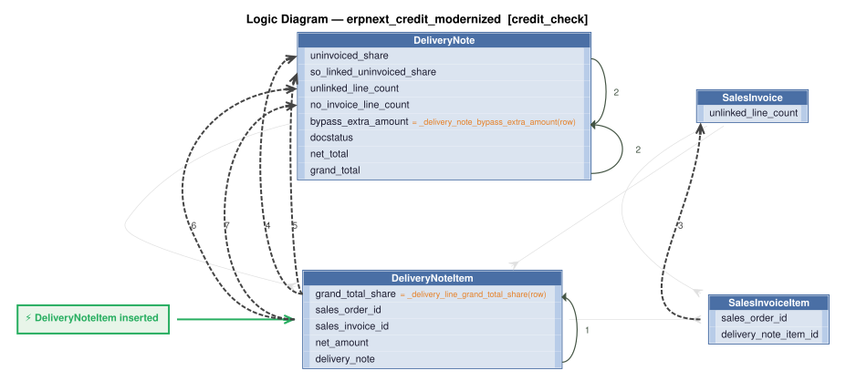

# Logic Flow — erpnext_credit_modernized [credit_check]

> Scoped to requirement: **credit_check**

<table>
<tr valign="top">
<td width="65%">



</td>
<td width="35%">

### Rules

1. `grand_total_share = _delivery_line_grand_total_share(row)` — Derive grand_total_share: line net_amount / note net_total x note grand_total (0 when the note's net_total is 0).<br>
2. `bypass_extra_amount = _delivery_note_bypass_extra_amount(row)` — Derive bypass_extra_amount: the note's grand_total if its net_total is 0; else the grand-total share of lines with no<br>
3. `unlinked_line_count = count(SalesInvoiceItem where sales_order_id, delivery_note_item_id)`<br>
4. `uninvoiced_share = sum(grand_total_share where sales_invoice_id)`<br>
5. `so_linked_uninvoiced_share = sum(grand_total_share where sales_invoice_id, sales_order_id)`<br>
6. `unlinked_line_count = count(DeliveryNoteItem where sales_order_id, sales_invoice_id)`<br>
7. `no_invoice_line_count = count(DeliveryNoteItem where sales_invoice_id)`

</td>
</tr>
</table>

## Requirements

```
## 2. The credit limit that applies

Feature: Credit Limit Lookup

For a customer and company, the first match wins:
1. The customer's own credit-limit row for that company, if its `credit_limit` is not zero.
2. Otherwise the customer's Customer Group's row for that company, but only if that row's `bypass_credit_limit_check` is off.
3. Otherwise the company's default `credit_limit`.

A limit of 0 or empty means no limit: no credit check is made.

---

## 4. The credit check

Feature: Credit Check

`check(customer, company, ignore_open_sales_orders, extra_amount)`:
1. Find the limit (section 2). If there is none, stop.
2. Outstanding is section 3 (omitting part 2 if `ignore_open_sales_orders`), plus `extra_amount`.
3. If the limit is above 0 and outstanding is strictly greater than the limit, the transaction is rejected with a message giving the customer, outstanding and limit. Outstanding equal to the limit is allowed.
4. A user who holds the credit controller role (Accounts Settings) is not rejected. If no credit controller role is set, nobody is excused.

---

## 5. Where the check runs

Feature: Credit Check On Documents

The customer's credit-limit row for the company is read for its `bypass_credit_limit_check` flag (off if there is no row).

* **Sales Order**: on submit, on update after submit, and when reopened from Closed. If the flag is on, no check is made. Otherwise `check(customer, company)`.
* **Delivery Note** (not a return; skipped when `per_billed` is 100): on submit.
  * Flag off: the check is made only if some line has neither a Sales Order nor a Sales Invoice link. `check(customer, company, ignore=false, extra=0)`.
  * Flag on: the check is made if some line has no Sales Invoice link. For each line with no Sales Invoice link, if the line has a Sales Order link or the note is a draft, add `line net amount / note net total × note grand total` to `extra`. If the note's net total is 0, `extra` is the note's grand total. `check(customer, company, ignore=true, extra)`.
* **Sales Invoice** (not a return, not an opening invoice): on submit. The check is made if the flag is on, or if some line has neither a Sales Order nor a Delivery Note link. `check(customer, company, ignore=flag)`.
* **Journal Entry**: on submit, for each customer that has a line with a debit above 0: `check(customer, company, ignore=flag)`.

version: 1.0
created: 2026-10-29T18:25:00
created_by: claude-opus-5-5 (valjhuber@gmail.com)
```

---
_Generated 2026-10-29 18:24_
