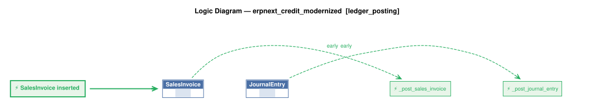

# Logic Flow — erpnext_credit_modernized [ledger_posting]

> Scoped to requirement: **ledger_posting**

<table>
<tr valign="top">
<td width="65%">



</td>
<td width="35%">

### Rules

1. `SalesInvoice` → `_post_sales_invoice` (early) — SalesInvoice event: on submit posts one LedgerEntry for the customer and company - a debit of grand_total, or a credit<br>
2. `JournalEntry` → `_post_journal_entry` (early) — JournalEntry event: on submit posts one LedgerEntry per customer line (party_type Customer) with the line's debit and

</td>
</tr>
</table>

## Requirements

```
## 8. Simplifications for this rebuild

* One ledger-entry table. Submitting a Sales Invoice posts a debit for its total; a return posts a credit. A Journal Entry line for a customer posts its debit or credit. Cancelling sets the cancelled flag.
* One currency; "base" amounts equal the document amounts.
* Documents are entered with their totals; no item, price or tax calculation.

version: 1.0
created: 2026-10-29T18:30:00
created_by: claude-opus-5-5 (valjhuber@gmail.com)
```

---
_Generated 2026-10-29 18:24_
