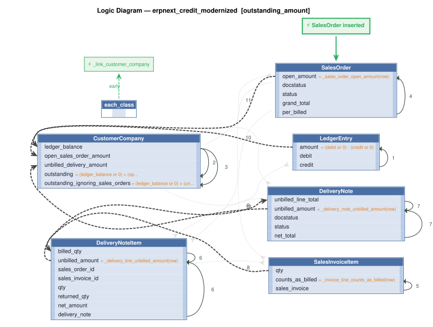

# Logic Flow — erpnext_credit_modernized [outstanding_amount]

> Scoped to requirement: **outstanding_amount**

<table>
<tr valign="top">
<td width="65%">



</td>
<td width="35%">

### Rules

1. `amount = (debit or 0) - (credit or 0)`<br>
2. `outstanding = (ledger_balance or 0) + (open_sales_order_amount or 0) + (unbilled_delivery_amount or 0)`<br>
3. `outstanding_ignoring_sales_orders = (ledger_balance or 0) + (unbilled_delivery_amount or 0)`<br>
4. `open_amount = _sales_order_open_amount(row)` — Derive open_amount: grand_total x (100 - per_billed) / 100 for a submitted Sales Order that is not Closed and is billed below 100%, else 0.<br>
5. `counts_as_billed = _invoice_line_counts_as_billed(row)` — Derive counts_as_billed: 1 when the line's Sales Invoice is submitted and is not a return, else 0 (feeds the delivery line's billed quantity).<br>
6. `unbilled_amount = _delivery_line_unbilled_amount(row)` — Derive unbilled_amount: for a line with no Sales Order and no Sales Invoice link whose qty exceeds billed + returned qty,<br>
7. `unbilled_amount = _delivery_note_unbilled_amount(row)` — Derive unbilled_amount: the sum of the lines' unbilled amounts for a submitted Delivery Note that is not Closed or Stopped and has net_total above 0, else 0.<br>
8. `billed_qty = sum(qty where counts_as_billed)`<br>
9. `unbilled_line_total = sum(unbilled_amount)`<br>
10. `ledger_balance = sum(amount where is_cancelled)`<br>
11. `open_sales_order_amount = sum(open_amount)`<br>
12. `unbilled_delivery_amount = sum(unbilled_amount)`<br>
13. `each_class` → `_link_customer_company` (early) — LedgerEntry / SalesOrder / DeliveryNote / CustomerCreditLimit event: sets customer_company (the

</td>
</tr>
</table>

## Requirements

```
## 3. Outstanding amount

For a customer and company, outstanding is the sum of three parts:
1. **Ledger balance**: the sum of `debit` minus the sum of `credit` over the customer's ledger entries for the company that are not cancelled.
2. **Open Sales Orders** (omitted when the caller says to ignore Sales Orders): for each submitted Sales Order of the customer and company that is not Closed and has `per_billed` below 100: `grand total × (100 − per_billed) / 100`.
3. **Delivered but not billed**: for each submitted Delivery Note of the customer and company that is not Closed or Stopped and has a net total above 0, and for each of its lines that has no link to a Sales Order and no link to a Sales Invoice, and whose quantity is greater than the billed quantity plus the returned quantity: `line net amount × (line quantity − billed quantity − returned quantity) / line quantity / note net total × note grand total`. Billed quantity is the quantity on submitted Sales Invoice lines that reference the delivery line, counting invoices that are not returns.

version: 1.0
created: 2026-10-29T18:20:00
created_by: claude-opus-5-5 (valjhuber@gmail.com)
```

---
_Generated 2026-10-29 18:24_
