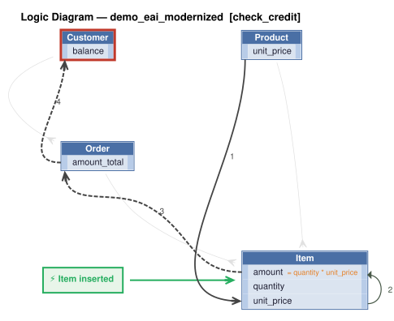
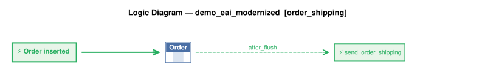

# Requirements Traceability Report

This report shows requirements, the rules created from them, and the tests created from those rules.

This project began as natural-language requirements, fleshed out by AI into a running system of business rules that are *executable documentation*. This report is how you govern the result.

A governable system is one you can **read**, **trust**, and **maintain**: each requirement is listed beside the rules that implement it (*read*); the tests and logic logs show those rules running (*trust*); re-run it after any change and it flags the gaps — an untested requirement, an untraced rule, a channel no test checks (*maintain*).

It is generated from the project's own files, nothing written by hand, so it is as current as the last run and covers the whole project, not a sample. Open **Background** (below the summary) for what the terms mean, how to read the report, and what it can and can't tell you.


**Project:** demo_eai_modernized &nbsp;|&nbsp; **Generated:** October 27, 2026 22:08 &nbsp;|&nbsp; **Rules:** 8 &nbsp;|&nbsp; **Test scenarios:** 35 &nbsp;|&nbsp; **Generator:** requirements_traceability_report.py 2.13

**Last test run:** October 27, 2026 22:07, took 2.4 s (0m before this report; test results and logic logs below are from that run)


&nbsp;
&nbsp;

## At a Glance

**✅ 5 requirement(s), all implemented; 5 tested; 35 of 35 scenarios passed; last run 0m ago.**

| | |
|---|---|
| Requirements | 5 (5 implemented) |
| Tested | 5 of 5 |
| Last test run | ✅ 35 passed, 0 failed (October 27, 2026 22:07, 0m ago); took 2.4 s |
| Rules | 8 (5 declarative, 0 Python functions, 3 Python events) |
| Rules shown running in a test log | 7 of 8 |
| Security | enabled (Keycloak provider); 11 role(s), 2 row-level grant(s) |
| Messages and APIs | 2 Kafka topic(s) in, 2 out; 2 HTTP endpoint(s) |
| Kafka | live (localhost:9092): subscribe tested through the broker; outbound messages checked in the log |

_Status: ✅ every requirement is implemented and tested, all scenarios pass, and the results are current. ⚠ a requirement is untested or unimplemented, there is no test run, or files changed since the last run. ❌ a scenario failed. This reports what was traced and tested, not that the system is correct._

**About this project** _(from [readme.md](../../readme.md))_

This app illustrates using IntegrationServices for B2B push-style integrations with APIs, and internal integration with messages.

**This sample** is a single API Logic Server providing APIs *and logic* — it both
subscribes and publishes, so there's no second project to stand up:

1. **Order Logic:** enforcing database integrity (Check Credit) and application
   integration (notify shipping)

2. A **Custom API** (`OrderB2B`), matching an agreed-upon format for B2B partners

3. **Kafka Subscribe:** listens on topic `order_b2b` for inbound orders from a
   message broker

4. **Kafka Publish:** publishes to topic `order_shipping` when an order ships —
   consumed by whatever downstream shipping system you plug in (not part of this
   demo)

5. **Standard APIs** for ad-hoc integration, user interfaces, etc

<details markdown>
<summary>Background: what this report is, and how to read it</summary>

&nbsp;

<details markdown>
<summary>Requirements are business policies, expressed in natural language</summary>

<br>

A **requirement** is a statement of business behavior - how data is computed, validated, and transmitted - written in plain language. It lives in the project at `docs/requirements/<name>/requirements.md`.  For example:

&nbsp;

```
On Placing Orders, Check Credit
    1. The Customer's balance does not exceed the credit limit
    2. The Customer's balance is the sum of the unshipped Order amount_total
    3. The Order's amount_total is the sum of the Item amount
    4. The Item amount is the quantity * unit_price
    5. The Item unit_price is copied from the Product unit_price
```

</details>

&nbsp;

<details markdown>
<summary>Rules implement requirements</summary>

<br>

A requirement is written at a high level, and AI fills in details as it builds — as it should — so the requirement no longer says exactly what the system does. The rules do. That's a Goldilocks answer to the question of what you review:

* **Requirements say too little** — incomplete by design; AI fills in the details.
* **Code says too much** — business language in, hundreds of lines of procedural code out. The work moves from writing to reading, and if you can't read it, you can't govern it.
* **Rules are just right** — close to the requirement's own level, but complete and deterministic.

Code could be treated like machine language — never read, only trusted — if it were produced deterministically. Generation from natural language isn't. Rules restore that contract: a readable source, deterministically executed.

The requirements above become rules like this:

```
Rule.copy(derive=models.Item.unit_price, from_parent=models.Product.unit_price)
Rule.formula(derive=models.Item.amount,
             as_expression=lambda row: row.quantity * row.unit_price)
Rule.sum(derive=models.Order.amount_total, as_sum_of=models.Item.amount)
Rule.sum(derive=models.Customer.balance, as_sum_of=models.Order.amount_total,
         where=lambda row: row.date_shipped is None)
Rule.constraint(
    validate=models.Customer,
    as_condition=lambda row: row.balance <= row.credit_limit,
    error_msg="balance ({row.balance}) exceeds credit limit ({row.credit_limit})")
```

Rules are ***executable documentation*** that you can read and trust:

* **Read:** rules stay near the requirement's level, so this report can list them side by side and you can check one against the other. 5 rules vs. ~200 lines in our [A/B test](https://github.com/ApiLogicServer/ApiLogicServer-src/blob/main/api_logic_server_cli/prototypes/manager/samples/basic_demo_logic_gov/logic/procedural/declarative-vs-procedural-comparison.md) — **~40x less to review**, whether generated or hand-coded.
* **Trust:** the document is enforced, not just descriptive.
    * **What you read is what runs** — no drift between description and behavior.
    * **Dependencies:** with code, you analyze every execution path to know it runs at the right times. With rules: if the rule is there, it runs, in the right order.
    * **All sources and paths:** the engine hooks into every commit — API, UI or agent — insert, update and delete, including related rows. No bypass.
    * **Seeing is believing:** each scenario in *Tests and Results* below embeds its logic log — every rule that ran, in order, with old and new values.

Better AI makes generating code easier. It doesn't change what you have to read. The problem is the representation, not the capability. And governance is active, not just process: the engine enforces the rules on every transaction, and this report — regenerated from the project itself — shows it happening.

&nbsp;

</details>

&nbsp;

<details markdown>
<summary>Process overview: creation and iteration</summary>

<br>


In two phases. First, `genai-logic create` builds a working system from the database: API, Admin App, data model. Then behavior is added from requirements — the typical sequence, each step a request to an AI assistant:

1. Write each requirement in natural language, in `docs/requirements/<name>/requirements.md`.
2. `implement reqs <name>` — creates the rules, API endpoints and Kafka integrations.
3. `create tests from rules` — writes the test scenarios and steps.
4. `run the tests` — starts the server if needed, runs the suite, reports pass/fail.
5. `run the requirements traceability report` — regenerates this report.

Optional: `create logic diagram for each requirement` (needs Graphviz).

What makes steps 3–5 possible: rules are high-level enough that AI can read them too. The tests, the logic diagrams and this report are all generated by reading the same rules you review — where logic is Python code, the report can only quote its docstring.

The report connects the chain: requirement → rules and handlers → tests → logic log. How *this* project was actually built is recorded under Provenance.

</details>

&nbsp;

<details markdown>
<summary>How to read this report</summary>

<br>

| If you are...  | Start with                                                        | Look for                                                                                     |
| -------------- | ----------------------------------------------------------------- | -------------------------------------------------------------------------------------------- |
| Business owner | *Requirements in detail*                                          | The requirement text, then the **Tests** line under it: does a test exist, and did it pass?  |
| Auditor        | *Coverage summary*, *Rule coverage by tests*, *Messages and APIs* | Gaps (untested, untraced), the date of the last test run, and how each rule was shown to run |
| Developer      | *Tests and Results*                                               | Each scenario's logic log: every rule that ran, in order, with old and new values            |

</details>

&nbsp;

<details markdown>
<summary>What this report can and can't tell you</summary>

<br>

**It shows**

- Which files and rules implement each requirement, read from the project's source.
- Which scenarios ran in the last test run, and whether each passed.
- Which rules the engine logged as running in each scenario.

**It doesn't show**

- Whether the requirements are right or complete. It traces what was written down.
- Whether an event did anything. Events run on every commit of their class and decide for themselves whether to act, so appearing in the log doesn't mean the event had an effect.
- Whether a constraint works. A constraint appears in the log only when it rejects a transaction, so look for a scenario that makes it reject.
- Whether a message arrived. Unless a test step looks for it on the broker or endpoint, a passing scenario doesn't prove delivery. The *Messages and APIs* table flags channels no test mentions.
- Whether the results are current. They are as old as the last test run, shown in the header, which also warns if files changed since.
- Which version of a requirement the code was built from, or which clause of a requirement a given rule serves.

</details>

&nbsp;

<details markdown>
<summary>Terms</summary>

<br>

| Term        | Meaning                                                                                              |
| ----------- | ---------------------------------------------------------------------------------------------------- |
| Requirement | A statement of business behavior, in plain language; the unit this report traces.                    |
| Rule        | A declaration about data (sum, count, formula, copy, constraint) that the engine enforces at every commit. |
| Event       | Python code the engine calls when a row of a given class changes (for example, to publish a message). |
| Handler     | Code that serves an API endpoint or consumes a Kafka topic.                                          |
| Scenario    | One Behave test: a short Given / When / Then script run against the live API.                        |
| Logic log   | The engine's record of every rule it ran in a transaction, nested to show cascades (an Item change adjusts its Order, which adjusts its Customer). |
| Phase       | The step of a commit: ROW LOGIC (derivations, constraints), COMMIT LOGIC (checks that need finished totals), AFTER_FLUSH LOGIC (events that need database-assigned keys, such as publishing). |
| Seen        | The engine reported running the rule in that scenario's log.                                         |

</details>

</details>


&nbsp;
&nbsp;

## Contents

- [Requirements Coverage](#requirements-coverage)
- [Data Model](#data-model)
- [Security (RBAC)](#security-rbac)
- [Messages and APIs](#messages-and-apis)
- [Tests and Results](#tests-and-results)
- [Provenance](#provenance)


&nbsp;
&nbsp;

## Requirements Coverage

Every requirement should have rules that implement it, and tests that prove it. This section checks that chain in both directions: a requirement missing rules or tests is a gap, and rules or tests that belong to no requirement are flagged too. The matching uses the `Feature:` names and `§N` tags that requirements, code and tests share.


&nbsp;

### Coverage summary

| Measure | Result |
|---|---|
| Requirements | 5 |
| Implemented (at least one file) | 5 of 5 |
| Tested (at least one scenario) | 5 of 5 |
| Implementation not traced to a requirement | `logic/logic_discovery/system/all_classes_stamping.py` |
| Tests not traced to a requirement | none |
| Test results (last run) | ✅ 35 passed, 0 failed; took 2.4 s |
| Scenarios with a logic log | 33 of 35 |
| Rules seen in at least one scenario's log | 7 of 8 (1 not counted: the engine's log does not name `all classes.early_row_event → handle_all()`, so it cannot be matched) |

_Test results are as current as the last run (see the header). A gap is any requirement with no implementation or no test._

<details markdown>
<summary>How to read this table</summary>

Test results are read from `logs/behave.log`, so they are only as current as that run. Not recorded here: which version of a requirement the code was built against, and which clause of a requirement a given rule serves.

</details>


&nbsp;

### Traceability matrix

| Requirement | Implemented by | Rules | Tests |
|---|---|---|---|
| §2 Core Business Logic & Reactive Integrity Rules (`app/logic.py`) | [logic/logic_discovery/check_credit.py](../../logic/logic_discovery/check_credit.py) | 5 | ✅ 10 scenario(s): 10 passed |
| §3 Event-Driven Order Shipping Notifications (`app/logic.py`, `app/messaging.py`) | [logic/logic_discovery/order_shipping.py](../../logic/logic_discovery/order_shipping.py)<br>[integration/kafka/kafka_publish_discovery/order_shipping.py](../../integration/kafka/kafka_publish_discovery/order_shipping.py) | 1 | ✅ 4 scenario(s): 4 passed |
| §4 B2B Order Intake & Kafka Integration (`app/integration.py`) | [logic/logic_discovery/order_b2b_consume.py](../../logic/logic_discovery/order_b2b_consume.py)<br>[integration/kafka/kafka_subscribe_discovery/order_b2b.py](../../integration/kafka/kafka_subscribe_discovery/order_b2b.py)<br>[integration/OrderB2bMapper.py](../../integration/OrderB2bMapper.py)<br>[api/api_discovery/order_b2b_kafka_consume_debug.py](../../api/api_discovery/order_b2b_kafka_consume_debug.py)<br>[api/api_discovery/order_b2b_service.py](../../api/api_discovery/order_b2b_service.py) | 1 | ✅ 10 scenario(s): 10 passed |
| §5 Security: Authentication & Row-Level Security (`app/security.py`) | [security/declare_security.py](../../security/declare_security.py) | 0 | ✅ 5 scenario(s): 5 passed |
| §6 REST API Contract (`app/api.py`) | [api/api_discovery/rest_api_contract.py](../../api/api_discovery/rest_api_contract.py) | 0 | ✅ 6 scenario(s): 6 passed |


&nbsp;

### Rule coverage by tests

| Rule | Requirement | Seen in |
|---|---|---|
| `Customer: credit_limit is None or balance <= credit_limit` | §2 Core Business Logic & Reactive Integrity Rules (`app/logic.py`) | 4: Order over the credit limit is rejected; Lowering the credit limit below the balance is rejected; Partner order over the credit limit is refused; +1 more |
| `Customer.balance = sum(Order.amount_total) where date_shipped is None` | §2 Core Business Logic & Reactive Integrity Rules (`app/logic.py`) | 25: Order placed within the credit limit; Item quantity change flows to the order total and balance; Shipping an order removes it from the balance; +22 more |
| `Order.amount_total = sum(Item.amount)` | §2 Core Business Logic & Reactive Integrity Rules (`app/logic.py`) | 23: Order placed within the credit limit; Item quantity change flows to the order total and balance; Shipping an order removes it from the balance; +20 more |
| `Item.amount = quantity * unit_price` | §2 Core Business Logic & Reactive Integrity Rules (`app/logic.py`) | 23: Order placed within the credit limit; Item quantity change flows to the order total and balance; Shipping an order removes it from the balance; +20 more |
| `Item.unit_price = copy of Product.unit_price` | §2 Core Business Logic & Reactive Integrity Rules (`app/logic.py`) | 23: Order placed within the credit limit; Item quantity change flows to the order total and balance; Shipping an order removes it from the balance; +20 more |
| `OrderB2bMessage.after_flush_row_event → _publish_order_b2b()` | §4 B2B Order Intake & Kafka Integration (`app/integration.py`) | 3: Inbound order message is persisted as an order; Inbound order message for an unknown account is rejected; A rejected inbound order message stays on its blob with the reason (live Kafka only) |
| `Order.after_flush_row_event → send_order_shipping()` | §3 Event-Driven Order Shipping Notifications (`app/logic.py`, `app/messaging.py`) | 23: Order placed within the credit limit; Item quantity change flows to the order total and balance; Shipping an order removes it from the balance; +20 more |
| `all classes.early_row_event → handle_all()` | (none) | n/a - cannot be matched to the engine's log |

_"Seen" means the engine's log shows the rule ran, not proof that it took effect._

<details markdown>
<summary>How to read this table</summary>

"Seen" means the engine reported running the rule in that scenario's logic log. A scenario can only contribute if it has a log (see the coverage summary): a test that does not open one writes into whichever log was open last, and its rules are then credited to that scenario, or to the shared log. An event's function runs on every commit of its class, and its own condition decides whether it acts, so seen does not mean it took effect. A constraint appears in the log only when it rejects a transaction, so it is seen only in scenarios that make it reject. "Not seen" therefore means no log shows it, not that no test ran it.

</details>


&nbsp;

### Requirements in detail

**8 rules** in 4 files: 5 declarative (sum, count, copy, formula and constraint expressions), 0 backed by a Python function, 3 events (Python).

_Declarative rules are read straight from their declarations. Functions and events are Python code, so for those the report shows the docstring — it does not analyze the code._

Each requirement is followed by the rules and handlers in the files that implement it. Logic diagrams are shown (click to expand) where they exist.

<details markdown>
<summary>How to create or refresh the logic diagrams</summary>

Needs Graphviz (`brew install graphviz`). Tell your AI assistant:

```
create logic diagram for each requirement
```

or run this from the Manager root (`genai-logic`):

```
python system/ApiLogicServer-Internal-Dev/logic_diagram_gv.py demo_eai_modernized --each
```

Each diagram is saved under `docs/requirements/<name>/logic_diagrams/`. Then regenerate this report (`python requirements_traceability_report.py run`, from `test/api_logic_server_behave`).

</details>

&nbsp;


#### §2 Core Business Logic & Reactive Integrity Rules (`app/logic.py`)

Tests: ✅ 10 scenario(s): 10 passed

```
Feature: Check Credit
Implemented via SQLAlchemy session hooks (`before_flush` and `after_flush`) so that every write path (REST CRUD, B2B endpoint, and Kafka consumer) enforces identical rules within a transaction:

1. **Product Price Snapshot**: When an `Item` is created or its `product_id` changes, `Item.unit_price` is copied from `Product.unit_price`. Subsequent changes to `Product.unit_price` do not retroactively alter existing items.
2. **Line-Item Extended Amount**: `Item.amount` is always calculated as `Item.quantity * Item.unit_price`.
3. **Order Total Rollup**: `Order.amount_total` is recalculated as the sum of `Item.amount` for all items on the order (defaulting to `0`) whenever items are added, updated, reassigned to another order, or deleted.
4. **Customer Balance Rollup (Unshipped Orders Only)**: `Customer.balance` is recalculated as the sum of `Order.amount_total` across all **unshipped** orders (`date_shipped IS NULL`) for that customer whenever affected orders or items change, an order is reassigned to a different customer, `date_shipped` is set/cleared, or an order is deleted.
5. **Credit Limit Enforcement**: Whenever a customer's `balance` is recalculated or an existing customer's `credit_limit` is updated, the system verifies `balance <= credit_limit`. If exceeded, `CreditError` is raised (`"{name}: balance {balance} exceeds credit limit {limit}"`), aborting the transaction.
6. **Referential & Cascade Rules**:
   * Creating/updating an `Item` with a non-existent `product_id` or an `Order` with a non-existent `customer_id` raises a `ValueError`.
   * Deleting an `Order` cascades deletion to all associated `Item` records.
```

| Rule / item | Type | Logic | Description | Where |
|---|---|---|---|---|
| `Customer: credit_limit is None or balance <= credit_limit` | constraint | declarative | Error: {row.name}: balance {row.balance} exceeds credit limit {row.credit_limit} | [check_credit.py](../../logic/logic_discovery/check_credit.py) |
| `Customer.balance = sum(Order.amount_total) where date_shipped is None` | sum | declarative |  | [check_credit.py](../../logic/logic_discovery/check_credit.py) |
| `Order.amount_total = sum(Item.amount)` | sum | declarative |  | [check_credit.py](../../logic/logic_discovery/check_credit.py) |
| `Item.amount = quantity * unit_price` | formula | declarative |  | [check_credit.py](../../logic/logic_discovery/check_credit.py) |
| `Item.unit_price = copy of Product.unit_price` | copy | declarative |  | [check_credit.py](../../logic/logic_discovery/check_credit.py) |

<details markdown>
<summary>Logic diagram: check_credit</summary>



</details>

#### §3 Event-Driven Order Shipping Notifications (`app/logic.py`, `app/messaging.py`)

Tests: ✅ 4 scenario(s): 4 passed

```
Feature: Order Shipping Notification
* **Shipping Trigger**: When an `Order` is created with a non-null `date_shipped` or updated so `date_shipped` transitions to a non-null date, an outbound message is queued in a session outbox.
* **Transactional Outbox Delivery**: Messages are only published in `after_commit` and discarded in `after_rollback`, preventing phantom notifications on failed transactions.
* **Payload Format**: `_shipping_message` publishes to the `order_shipping` topic with:
  {
    "order_id": 1,
    "order_date": "YYYY-MM-DD",
    "customer_name": "...",
    "total": 123.45,
    "items": [{"quantity": 2, "product_name": "...", "unit_price": 61.725}]
  }
* **Simulated vs. Live Broker Mode**: `publish` always records messages in the in-memory `published` list (inspectable via `GET /kafka_log`) and additionally produces to a live Kafka broker when `KAFKA_SERVER` is configured.

---
```

| Rule / item | Type | Logic | Description | Where |
|---|---|---|---|---|
| `Order.after_flush_row_event → send_order_shipping()` | after_flush_row_event | event (Python) | Order event: publish to topic order_shipping when date_shipped is set on insert or changes to a non-null date (old_row is None on insert). Runs after the flush, so the Order id and its items are final. | [order_shipping.py](../../logic/logic_discovery/order_shipping.py) |
| `order_shipping.py` | module |  | Feature: Order Shipping Notification | [order_shipping.py](../../integration/kafka/kafka_publish_discovery/order_shipping.py) |

<details markdown>
<summary>Logic diagram: order_shipping</summary>



</details>

#### §4 B2B Order Intake & Kafka Integration (`app/integration.py`)

Tests: ✅ 10 scenario(s): 10 passed

```
Feature: Order B2B Intake
* **Partner Payload Transformation (`process_order_b2b`)**:
  * Accepts `{ "Account": "<customer name>", "Notes": "...", "Items": [{ "Name": "<product name>", "QuantityOrdered": <int> }] }`.
  * Resolves `Account` by `Customer.name` and each item's `Name` by `Product.name`; raises `LookupError` (mapped to HTTP `422`) if either is unknown.
  * Validates that `Items` is non-empty and every `QuantityOrdered` is a positive integer (`> 0`); raises `ValueError` (mapped to HTTP `400`) otherwise.
  * Sets `Order.CreatedOn` to `date.today()` and commits the order and items atomically (rolling back if credit check or validation fails in `consume`).
* **Multi-Channel Intake**:
  1. **Synchronous REST (`POST /OrderB2B`)**: Processes a JSON request body and returns the created order (`201 Created`).
  2. **Asynchronous Kafka Consumer (`start_consumer`)**: Background daemon thread subscribed to topic `order_b2b` (consumer group `demo_eai_native`); logs and skips poison/rejected messages so a bad payload never halts the consumer.
  3. **Brokerless Debug Endpoint (`GET /consume_debug/<topic>?file=<path>`)**: Reads a payload file located within the project directory and runs the exact same `consume` pipeline.

---
```

| Rule / item | Type | Logic | Description | Where |
|---|---|---|---|---|
| `OrderB2bMessage.after_flush_row_event → _publish_order_b2b()` | after_flush_row_event | event (Python) | OrderB2bMessage event: publishes the raw blob to order_b2b_processed after Tx 1 commits, so Consumer 2 can parse it in a clean Tx 2 (2-message pattern). | [order_b2b_consume.py](../../logic/logic_discovery/order_b2b_consume.py) |
| `Kafka in: order_b2b` | kafka | handler (Python) | Consumer 1: save blob, commit. The row event publishes to order_b2b_processed. | [order_b2b.py](../../integration/kafka/kafka_subscribe_discovery/order_b2b.py) |
| `Kafka in: order_b2b_processed` | kafka | handler (Python) | Consumer 2: parse + persist the order, mark blob processed (atomic Tx 2). A poison or rejected message is logged and recorded on its blob (error_text); it never stops the consumer. | [order_b2b.py](../../integration/kafka/kafka_subscribe_discovery/order_b2b.py) |
| `OrderB2bMapper.py` | module |  | Feature: Order B2B Intake | [OrderB2bMapper.py](../../integration/OrderB2bMapper.py) |
| `HTTP in: GET /consume_debug/order_b2b` | http | handler (Python) | EAI debug (development only, no authentication): sends the message in ?file= to the topic, live through Kafka or simulated | [order_b2b_kafka_consume_debug.py](../../api/api_discovery/order_b2b_kafka_consume_debug.py) |
| `HTTP in: POST /consume_debug/order_b2b/reset` | http | handler (Python) | EAI debug (development only, destructive): purges the messages in the pipeline's topics | [order_b2b_kafka_consume_debug.py](../../api/api_discovery/order_b2b_kafka_consume_debug.py) |
| `order_b2b_service.py` | module |  | Feature: Order B2B Intake | [order_b2b_service.py](../../api/api_discovery/order_b2b_service.py) |

<details markdown>
<summary>Logic diagram: order_b2b_consume</summary>


</details>

#### §5 Security: Authentication & Row-Level Security (`app/security.py`)

Tests: ✅ 5 scenario(s): 5 passed

```
Feature: Security and Row Level Access
* **Keycloak RS256 Bearer Authentication (`authenticate`)**:
  * Validates `Authorization: Bearer <token>` against the Keycloak realm's JWKS endpoint (`{KEYCLOAK_URL}/realms/{KEYCLOAK_REALM}/protocol/openid-connect/certs`, defaulting to `http://localhost:8080` and realm `kcals`).
  * Unauthenticated requests receive `401 Unauthorized`, except for open operational/test routes: `/health`, `/kafka_log`, and `/consume_debug/<topic>`.
* **Role Assignment & Row-Level Security (`row_filter`)**:
  * Roles are extracted from JWT `realm_access.roles`, and usernames listed in `SALES_USERS` (default `"u1"`) are automatically granted the `sales` role.
  * When a user has the `sales` role, all queries, single-row lookups, updates, and deletes on `Customer` are restricted to rows satisfying:
    `credit_limit >= 3000 OR balance > 0`
  * Filtered-out customers are omitted from `GET /api/customer` list responses and return `404 Not Found` on `/api/customer/<id>` operations.

---
```

| Rule / item | Type | Logic | Description | Where |
|---|---|---|---|---|
| `Grant on Customer to role sales: credit_limit >= 3000` | grant | declarative |  | [declare_security.py](../../security/declare_security.py) |
| `Grant on Customer to role sales: balance > 0` | grant | declarative |  | [declare_security.py](../../security/declare_security.py) |

#### §6 REST API Contract (`app/api.py`)

Tests: ✅ 6 scenario(s): 6 passed

```
Feature: REST API Contract
* **Generic CRUD (`/api/<table>` & `/api/<table>/<int:id>`)**:
  * Supports `GET` (list with exact-match attribute filtering, `limit` default `100`, `offset` default `0`, ordered by `id`), `GET` by ID, `POST` (`201`), `PATCH`/`PUT` (`200`), and `DELETE` (`204`).
* **Write Protection on Derived Columns (`DERIVED`, `writable`)**:
  * Client-supplied values for `id`, `customer.balance`, `order.amount_total`, `item.amount`, and `item.unit_price` are silently ignored on create/update; unknown column names are rejected with `400 Bad Request`.
* **Error Mapping**:
  * `ValueError` and `CreditError` → `400 Bad Request`
  * Missing/invalid JWT → `401 Unauthorized`
  * Unknown table or row (including RLS-hidden rows) → `404 Not Found`
  * `LookupError` (unknown B2B `Account` or `Product`) → `422 Unprocessable Entity`
```

| Rule / item | Type | Logic | Description | Where |
|---|---|---|---|---|
| `rest_api_contract.py` | module |  | Feature: REST API Contract | [rest_api_contract.py](../../api/api_discovery/rest_api_contract.py) |

#### Rules not traced to a requirement

| Rule / item | Type | Logic | Description | Where |
|---|---|---|---|---|
| `all classes.early_row_event → handle_all()` | early_row_event_all_classes | event (Python) | Generic handler - executed for every row update across all classes. | [all_classes_stamping.py](../../logic/logic_discovery/system/all_classes_stamping.py) |


&nbsp;
&nbsp;

## Data Model

The tables the rules run over. Shaded columns are derived by rules — no code writes them.


_Generated from `docs/db.dbml` (parents above children; shaded rows are derived by rules). To use your own layout, save it as `docs/db_diagram.png`._


&nbsp;

### Derived columns

| Table | Column | Rule | Definition |
|---|---|---|---|
| Customer | balance | sum | `Customer.balance = sum(Order.amount_total) where date_shipped is None` |
| Order | amount_total | sum | `Order.amount_total = sum(Item.amount)` |
| Item | amount | formula | `Item.amount = quantity * unit_price` |
| Item | unit_price | copy | `Item.unit_price = copy of Product.unit_price` |


&nbsp;
&nbsp;

## Security (RBAC)

Who can do what: each role's permissions, and which rows each role can see.

**Security enabled: yes** (`SECURITY_ENABLED` in `config/default.env`).


&nbsp;

### Roles and CRUD (DefaultRolePermission)

| Role | Read | Insert | Update | Delete |
|---|---|---|---|---|
| sa | ✅ | ✅ | ✅ | ✅ |
| tenant | ✅ | — | — | ✅ |
| CS_ADMIN | ✅ | ✅ | ✅ | ✅ |
| manager | ✅ | ✅ | ✅ | — |
| teller | ✅ | ✅ | ✅ | — |
| customer | ✅ | ✅ | ✅ | — |
| readonly | ✅ | — | — | — |
| public | ✅ | — | — | — |
| default-roles-kcals | ✅ | ✅ | ✅ | — |
| uma_authorization | ✅ | ✅ | ✅ | — |
| sales | ✅ | ✅ | ✅ | ✅ |


&nbsp;

### Row-level grants (Grant)

| Table | Role | Filter | Requirement |
|---|---|---|---|
| Customer | sales | `credit_limit >= 3000` |  |
| Customer | sales | `balance > 0` |  |


&nbsp;
&nbsp;

## Messages and APIs

How data enters and leaves beyond the standard API: Kafka topics in and out, custom HTTP endpoints — and whether any test touches each one.

**Kafka mode: live (localhost:9092).** The tests sent inbound messages through a real broker: `/consume_debug` published them to topic `order_b2b`, the server's consumers processed them, and the tests then checked the results. Outbound `order_shipping` messages are checked in the server log, not read back from the topic.

| Direction | Channel | Name | Tests mention it | Handler | Tables created | Message shape | Requirement |
|---|---|---|---|---|---|---|---|
| ➡ in | Kafka | `order_b2b` | ✅ live | `order_b2b()` - Consumer 1: save blob, commit. The row event publishes to order_b2b_processed. | OrderB2bMessage | [order_b2b.json](../../integration/kafka/message_formats/order_b2b.json) | §4 B2B Order Intake & Kafka Integration (`app/integration.py`) |
| ➡ in | Kafka | `order_b2b_processed` | ✅ live | `order_b2b_processed()` - Consumer 2: parse + persist the order, mark blob processed (atomic Tx 2). A poison or rejected message is logged and recorded on its blob (error_text); it never stops the consumer. | Item, Order, OrderB2bMessage |  | §4 B2B Order Intake & Kafka Integration (`app/integration.py`) |
| ⬅ out | Kafka | `order_b2b_processed` | ✅ live | OrderB2bMessage.after_flush_row_event → _publish_order_b2b() - OrderB2bMessage event: publishes the raw blob to order_b2b_processed after Tx 1 commits, so Consumer 2 can parse it in a clean Tx 2 (2-message pattern). |  |  | §4 B2B Order Intake & Kafka Integration (`app/integration.py`) |
| ⬅ out | Kafka | `order_shipping` | ⚠ message checked in the log, not on the topic | Order.after_flush_row_event → send_order_shipping() - Order event: publish to topic order_shipping when date_shipped is set on insert or changes to a non-null date (old_row is None on insert). Runs after the flush, so the Order id and its items are final. |  | [order_shipping.json](../../integration/kafka/message_formats/order_shipping.json) | §3 Event-Driven Order Shipping Notifications (`app/logic.py`, `app/messaging.py`) |
| ➡ in | HTTP | `GET /consume_debug/order_b2b` | ✅ | `register_consume_debug()` - EAI debug (development only, no authentication): sends the message in ?file= to the topic, live through Kafka or simulated |  |  | §4 B2B Order Intake & Kafka Integration (`app/integration.py`) |
| ➡ in | HTTP | `POST /consume_debug/order_b2b/reset` | ⚠ no test mentions it | `register_queue_reset()` - EAI debug (development only, destructive): purges the messages in the pipeline's topics |  |  | §4 B2B Order Intake & Kafka Integration (`app/integration.py`) |

_"Tests mention it" checks the test sources, not delivery._

<details markdown>
<summary>How to read this column</summary>

A passing scenario proves a message reached a topic or an endpoint only if its steps look for it there. A handler that ran (see the logic log) is weaker evidence than a step that consumes the message. Channels no test mentions are flagged.

</details>

<details markdown>
<summary>How to read this table</summary>

Topics and endpoints are read from the discovery folders. The condition that triggers an outbound message lives in Python (see the rules under each requirement); here it is described by the handler's docstring. "Tables created" lists rows the handler's code constructs, following its calls within the project; blank means none were found, not that none exist.

</details>


<details markdown>
<summary>Message shape: order_b2b</summary>

```json
{
  "Account": "Alice",
  "Notes": "Kafka order from sales",
  "Items": [
    { "Name": "Widget",  "QuantityOrdered": 1 },
    { "Name": "Gadget",  "QuantityOrdered": 2 }
  ]
}
```
</details>

<details markdown>
<summary>Message shape: order_shipping</summary>

```json
{
  "order_id": 1,
  "order_date": "2026-04-06",
  "customer_name": "Alfreds Futterkiste",
  "total": 100.00,
  "items": [
    { "quantity": 2, "product_name": "Chai", "unit_price": 25.00 }
  ]
}
```
</details>


&nbsp;
&nbsp;

## Tests and Results

**✅ 35 scenario(s): 35 passed, 0 failed; took 2.4 s** (from the last run, `logs/behave.log`).

Each test drives the running system the way any client would — create an order, change a quantity, ship it — and checks the result.

**The logic log** is what makes them more than pass/fail. Business rules run inside the server on every commit, so the server records exactly what they did, and this report embeds that record for each scenario. Two things to look for:

1. **It shows every rule that runs.** Each line is one rule execution, with the row's state, old and new values. You see not just that a test passed, but which rules ran and what each one changed.
2. **The nesting shows multi-table chaining.** Indentation follows the cascade: a change to an Item adjusts its Order, which adjusts its Customer.

<details markdown>
<summary>How to read the logic log</summary>

Open a scenario's "Rules exercised and logic log" block to see it. The log is shown in full, attribute values included, because those values are what you diagnose from when a rule produces an unexpected result.

To read a log line:

```
....Order[16] {Update - Adjusting order: amount_total} id: 16, customer_id: 19, amount_total:  [0.0-->] 90.0

```

- The leading dots are the depth in the cascade: Item (2 dots), its Order (4), its Customer (6).
- `Order[16]` is the row; `{...}` is the rule or action that ran; the rest is the row's attribute values at that step.
- `[0.0-->] 90.0` marks a value the rules changed, with its old and new value.
- The log is in phases: **ROW LOGIC** (derivations and constraints, as rows change), **COMMIT LOGIC** (checks that need the finished aggregates), and **AFTER_FLUSH LOGIC** (events that need database-assigned keys, such as the Kafka publish).

More: [Logic Log](https://apilogicserver.github.io/Docs/Logic-Debug/#logic-log).

</details>

&nbsp;

<details markdown>
<summary>How to add more tests, and run them</summary>

**1. Have AI create them.** This project's context tells your AI assistant how (`.github/copilot-instructions.md`, `docs/training/testing.md`). Just say:

```

create tests from rules

```

The assistant reads `database/models.py`, the logic files and the custom APIs, then writes `.feature` files and step implementations under `test/api_logic_server_behave/features/`. Then say `run the tests` and `run the requirements traceability report` and the assistant does both.

Or, to have each requirement's tests linked in the Tests column above (it matches on `Feature:` name), say which names to use:

```

create tests from rules, one Feature per requirement, named exactly:
- Check Credit
- Order Shipping Notification
- Order B2B Intake
- Security and Row Level Access
- REST API Contract

```

_Tests with other names still run and appear below; they just aren't linked to a requirement._

**2. You can also define tests manually.** Add a `<name>.feature` file (Gherkin) under `test/api_logic_server_behave/features/` and its steps under `features/steps/`. The steps call the running API, so tests exercise the same rules as any client. See `docs/training/testing.md` for the patterns that keep tests repeatable.

**Or run them yourself** (server running, from `test/api_logic_server_behave`):

```

python behave_run.py --outfile=logs/behave.log
python requirements_traceability_report.py run

```

</details>

&nbsp;
&nbsp;

### Feature: Check Credit  

&nbsp;
&nbsp;

#### Scenario: Order placed within the credit limit ✅ (0.06 s)
&emsp;  Scenario: Order placed within the credit limit  
&emsp;&emsp;    Given a new customer with credit limit 1000  
&emsp;&emsp;    When an order is placed with 2 Widget  
&emsp;&emsp;    Then the item amount is 180  
&emsp;&emsp;    And the order total is 180  
&emsp;&emsp;    And the customer balance is 180  
&emsp;&emsp;    And Logic adjusts the customer balance from the order total  

<details markdown>
<summary>Rules exercised and logic log (2 transactions)</summary>


&nbsp;
&nbsp;


**Rules Used** in Scenario: Order placed within the credit limit
```
  Customer  
    1. Derive Customer.balance as Sum(Order.amount_total Where lambda row: row.date_shipped is None))  
  Order  
    2. RowEvent Order.send_order_shipping()  
    3. Derive Order.amount_total as Sum(Item.amount Where  - None)  
  Item  
    4. Derive Item.unit_price as Copy(product.unit_price)  
    5. Derive Item.amount as Formula (1): Rule.formula(derive=models.Item.amount, as_expres [...]  
```
**Logic Log** in Scenario: Order placed within the credit limit (2 transactions)
```
Logic Phase:		ROW LOGIC		(session=0x109e03410) (sqlalchemy before_flush)			 - 2026-10-27 22:07:39,196 - logic_logger - INFO
..Order[None] {Insert - client} id: None, notes: None, customer_id: 124, CreatedOn: None, date_shipped: None, amount_total: None  row: 0x109e1cb50  session: 0x109e03410  ins_upd_dlt: ins, initial: ins - 2026-10-27 22:07:39,196 - logic_logger - INFO
..Order[None] {server aggregate_defaults: amount_total } id: None, notes: None, customer_id: 124, CreatedOn: None, date_shipped: None, amount_total: 0  row: 0x109e1cb50  session: 0x109e03410  ins_upd_dlt: ins, initial: ins - 2026-10-27 22:07:39,196 - logic_logger - INFO
Logic Phase:		COMMIT LOGIC		(session=0x109e03410)   										 - 2026-10-27 22:07:39,196 - logic_logger - INFO
Logic Phase:		AFTER_FLUSH LOGIC	(session=0x109e03410)   										 - 2026-10-27 22:07:39,197 - logic_logger - INFO
..Order[72] {AfterFlush Event} id: 72, notes: None, customer_id: 124, CreatedOn: None, date_shipped: None, amount_total: 0  row: 0x109e1cb50  session: 0x109e03410  ins_upd_dlt: ins, initial: ins - 2026-10-27 22:07:39,197 - logic_logger - INFO


Logic Phase:		ROW LOGIC		(session=0x109dce360) (sqlalchemy before_flush)			 - 2026-10-27 22:07:39,200 - logic_logger - INFO
..Item[None] {Insert - client} id: None, order_id: 72, product_id: 2, quantity: 2, amount: None, unit_price: None  row: 0x109cabdd0  session: 0x109dce360  ins_upd_dlt: ins, initial: ins - 2026-10-27 22:07:39,200 - logic_logger - INFO
..Item[None] {copy_rules for role: product - unit_price} id: None, order_id: 72, product_id: 2, quantity: 2, amount: None, unit_price: 90.0000000000  row: 0x109cabdd0  session: 0x109dce360  ins_upd_dlt: ins, initial: ins - 2026-10-27 22:07:39,201 - logic_logger - INFO
..Item[None] {Formula amount} id: None, order_id: 72, product_id: 2, quantity: 2, amount: 180.0000000000, unit_price: 90.0000000000  row: 0x109cabdd0  session: 0x109dce360  ins_upd_dlt: ins, initial: ins - 2026-10-27 22:07:39,201 - logic_logger - INFO
....Order[72] {Update - Adjusting order: amount_total} id: 72, notes: None, customer_id: 124, CreatedOn: None, date_shipped: None, amount_total:  [0E-10-->] 180.0000000000  row: 0x109cba9d0  session: 0x109dce360  ins_upd_dlt: upd, initial: upd - 2026-10-27 22:07:39,201 - logic_logger - INFO
......Customer[124] {Update - Adjusting customer: balance} id: 124, name: Credit Test 1793164059153, balance:  [0E-10-->] 180.0000000000, credit_limit: 1000.0000000000, email: None, email_opt_out: None  row: 0x109e5d850  session: 0x109dce360  ins_upd_dlt: upd, initial: upd - 2026-10-27 22:07:39,202 - logic_logger - INFO
Logic Phase:		COMMIT LOGIC		(session=0x109dce360)   										 - 2026-10-27 22:07:39,202 - logic_logger - INFO
Logic Phase:		AFTER_FLUSH LOGIC	(session=0x109dce360)   										 - 2026-10-27 22:07:39,203 - logic_logger - INFO
....Order[72] {AfterFlush Event} id: 72, notes: None, customer_id: 124, CreatedOn: None, date_shipped: None, amount_total:  [0E-10-->] 180.0000000000  row: 0x109cba9d0  session: 0x109dce360  ins_upd_dlt: upd, initial: upd - 2026-10-27 22:07:39,203 - logic_logger - INFO

```
</details>

&nbsp;
&nbsp;

#### Scenario: Item quantity change flows to the order total and balance ✅ (0.03 s)
&emsp;  Scenario: Item quantity change flows to the order total and balance  
&emsp;&emsp;    Given a new customer with credit limit 1000  
&emsp;&emsp;    And an order is placed with 2 Widget  
&emsp;&emsp;    When the item quantity is changed to 5  
&emsp;&emsp;    Then the item amount is 450  
&emsp;&emsp;    And the order total is 450  
&emsp;&emsp;    And the customer balance is 450  

<details markdown>
<summary>Rules exercised and logic log (3 transactions)</summary>


&nbsp;
&nbsp;


**Rules Used** in Scenario: Item quantity change flows to the order total and balance
```
  Customer  
    1. Derive Customer.balance as Sum(Order.amount_total Where lambda row: row.date_shipped is None))  
  Order  
    2. RowEvent Order.send_order_shipping()  
    3. Derive Order.amount_total as Sum(Item.amount Where  - None)  
  Item  
    4. Derive Item.unit_price as Copy(product.unit_price)  
    5. Derive Item.amount as Formula (1): Rule.formula(derive=models.Item.amount, as_expres [...]  
```
**Logic Log** in Scenario: Item quantity change flows to the order total and balance (3 transactions)
```
Logic Phase:		ROW LOGIC		(session=0x109dcdbf0) (sqlalchemy before_flush)			 - 2026-10-27 22:07:39,219 - logic_logger - INFO
..Order[None] {Insert - client} id: None, notes: None, customer_id: 125, CreatedOn: None, date_shipped: None, amount_total: None  row: 0x109d2c0d0  session: 0x109dcdbf0  ins_upd_dlt: ins, initial: ins - 2026-10-27 22:07:39,219 - logic_logger - INFO
..Order[None] {server aggregate_defaults: amount_total } id: None, notes: None, customer_id: 125, CreatedOn: None, date_shipped: None, amount_total: 0  row: 0x109d2c0d0  session: 0x109dcdbf0  ins_upd_dlt: ins, initial: ins - 2026-10-27 22:07:39,220 - logic_logger - INFO
Logic Phase:		COMMIT LOGIC		(session=0x109dcdbf0)   										 - 2026-10-27 22:07:39,220 - logic_logger - INFO
Logic Phase:		AFTER_FLUSH LOGIC	(session=0x109dcdbf0)   										 - 2026-10-27 22:07:39,220 - logic_logger - INFO
..Order[73] {AfterFlush Event} id: 73, notes: None, customer_id: 125, CreatedOn: None, date_shipped: None, amount_total: 0  row: 0x109d2c0d0  session: 0x109dcdbf0  ins_upd_dlt: ins, initial: ins - 2026-10-27 22:07:39,220 - logic_logger - INFO


Logic Phase:		ROW LOGIC		(session=0x109dcf020) (sqlalchemy before_flush)			 - 2026-10-27 22:07:39,223 - logic_logger - INFO
..Item[None] {Insert - client} id: None, order_id: 73, product_id: 2, quantity: 2, amount: None, unit_price: None  row: 0x109d78c50  session: 0x109dcf020  ins_upd_dlt: ins, initial: ins - 2026-10-27 22:07:39,223 - logic_logger - INFO
..Item[None] {copy_rules for role: product - unit_price} id: None, order_id: 73, product_id: 2, quantity: 2, amount: None, unit_price: 90.0000000000  row: 0x109d78c50  session: 0x109dcf020  ins_upd_dlt: ins, initial: ins - 2026-10-27 22:07:39,223 - logic_logger - INFO
..Item[None] {Formula amount} id: None, order_id: 73, product_id: 2, quantity: 2, amount: 180.0000000000, unit_price: 90.0000000000  row: 0x109d78c50  session: 0x109dcf020  ins_upd_dlt: ins, initial: ins - 2026-10-27 22:07:39,224 - logic_logger - INFO
....Order[73] {Update - Adjusting order: amount_total} id: 73, notes: None, customer_id: 125, CreatedOn: None, date_shipped: None, amount_total:  [0E-10-->] 180.0000000000  row: 0x10a0700d0  session: 0x109dcf020  ins_upd_dlt: upd, initial: upd - 2026-10-27 22:07:39,224 - logic_logger - INFO
......Customer[125] {Update - Adjusting customer: balance} id: 125, name: Credit Test 1793164059213, balance:  [0E-10-->] 180.0000000000, credit_limit: 1000.0000000000, email: None, email_opt_out: None  row: 0x10a070c50  session: 0x109dcf020  ins_upd_dlt: upd, initial: upd - 2026-10-27 22:07:39,224 - logic_logger - INFO
Logic Phase:		COMMIT LOGIC		(session=0x109dcf020)   										 - 2026-10-27 22:07:39,224 - logic_logger - INFO
Logic Phase:		AFTER_FLUSH LOGIC	(session=0x109dcf020)   										 - 2026-10-27 22:07:39,224 - logic_logger - INFO
....Order[73] {AfterFlush Event} id: 73, notes: None, customer_id: 125, CreatedOn: None, date_shipped: None, amount_total:  [0E-10-->] 180.0000000000  row: 0x10a0700d0  session: 0x109dcf020  ins_upd_dlt: upd, initial: upd - 2026-10-27 22:07:39,225 - logic_logger - INFO


Logic Phase:		ROW LOGIC		(session=0x109dce7a0) (sqlalchemy before_flush)			 - 2026-10-27 22:07:39,228 - logic_logger - INFO
..Item[71] {Update - client} id: 71, order_id: 73, product_id: 2, quantity:  [2-->] 5, amount: 180.0000000000, unit_price: 90.0000000000  row: 0x109e5e9d0  session: 0x109dce7a0  ins_upd_dlt: upd, initial: upd - 2026-10-27 22:07:39,228 - logic_logger - INFO
..Item[71] {Formula amount} id: 71, order_id: 73, product_id: 2, quantity:  [2-->] 5, amount:  [180.0000000000-->] 450.0000000000, unit_price: 90.0000000000  row: 0x109e5e9d0  session: 0x109dce7a0  ins_upd_dlt: upd, initial: upd - 2026-10-27 22:07:39,228 - logic_logger - INFO
....Order[73] {Update - Adjusting order: amount_total} id: 73, notes: None, customer_id: 125, CreatedOn: None, date_shipped: None, amount_total:  [180.0000000000-->] 450.0000000000  row: 0x10a071750  session: 0x109dce7a0  ins_upd_dlt: upd, initial: upd - 2026-10-27 22:07:39,228 - logic_logger - INFO
......Customer[125] {Update - Adjusting customer: balance} id: 125, name: Credit Test 1793164059213, balance:  [180.0000000000-->] 450.0000000000, credit_limit: 1000.0000000000, email: None, email_opt_out: None  row: 0x10a072450  session: 0x109dce7a0  ins_upd_dlt: upd, initial: upd - 2026-10-27 22:07:39,228 - logic_logger - INFO
Logic Phase:		COMMIT LOGIC		(session=0x109dce7a0)   										 - 2026-10-27 22:07:39,229 - logic_logger - INFO
Logic Phase:		AFTER_FLUSH LOGIC	(session=0x109dce7a0)   										 - 2026-10-27 22:07:39,229 - logic_logger - INFO
....Order[73] {AfterFlush Event} id: 73, notes: None, customer_id: 125, CreatedOn: None, date_shipped: None, amount_total:  [180.0000000000-->] 450.0000000000  row: 0x10a071750  session: 0x109dce7a0  ins_upd_dlt: upd, initial: upd - 2026-10-27 22:07:39,229 - logic_logger - INFO

```
</details>

&nbsp;
&nbsp;

#### Scenario: Shipping an order removes it from the balance ✅ (0.03 s)
&emsp;  Scenario: Shipping an order removes it from the balance  
&emsp;&emsp;    Given a new customer with credit limit 1000  
&emsp;&emsp;    And an order is placed with 2 Widget  
&emsp;&emsp;    When the order is shipped  
&emsp;&emsp;    Then the customer balance is 0  

<details markdown>
<summary>Rules exercised and logic log (3 transactions)</summary>


&nbsp;
&nbsp;


**Rules Used** in Scenario: Shipping an order removes it from the balance
```
  Customer  
    1. Derive Customer.balance as Sum(Order.amount_total Where lambda row: row.date_shipped is None))  
  Order  
    2. RowEvent Order.send_order_shipping()  
    3. Derive Order.amount_total as Sum(Item.amount Where  - None)  
  Item  
    4. Derive Item.unit_price as Copy(product.unit_price)  
    5. Derive Item.amount as Formula (1): Rule.formula(derive=models.Item.amount, as_expres [...]  
```
**Logic Log** in Scenario: Shipping an order removes it from the balance (3 transactions)
```
Logic Phase:		ROW LOGIC		(session=0x109dcdae0) (sqlalchemy before_flush)			 - 2026-10-27 22:07:39,254 - logic_logger - INFO
..Order[None] {Insert - client} id: None, notes: None, customer_id: 126, CreatedOn: None, date_shipped: None, amount_total: None  row: 0x109d7bed0  session: 0x109dcdae0  ins_upd_dlt: ins, initial: ins - 2026-10-27 22:07:39,254 - logic_logger - INFO
..Order[None] {server aggregate_defaults: amount_total } id: None, notes: None, customer_id: 126, CreatedOn: None, date_shipped: None, amount_total: 0  row: 0x109d7bed0  session: 0x109dcdae0  ins_upd_dlt: ins, initial: ins - 2026-10-27 22:07:39,254 - logic_logger - INFO
Logic Phase:		COMMIT LOGIC		(session=0x109dcdae0)   										 - 2026-10-27 22:07:39,255 - logic_logger - INFO
Logic Phase:		AFTER_FLUSH LOGIC	(session=0x109dcdae0)   										 - 2026-10-27 22:07:39,255 - logic_logger - INFO
..Order[74] {AfterFlush Event} id: 74, notes: None, customer_id: 126, CreatedOn: None, date_shipped: None, amount_total: 0  row: 0x109d7bed0  session: 0x109dcdae0  ins_upd_dlt: ins, initial: ins - 2026-10-27 22:07:39,255 - logic_logger - INFO


Logic Phase:		ROW LOGIC		(session=0x109dce7a0) (sqlalchemy before_flush)			 - 2026-10-27 22:07:39,258 - logic_logger - INFO
..Item[None] {Insert - client} id: None, order_id: 74, product_id: 2, quantity: 2, amount: None, unit_price: None  row: 0x109c6b550  session: 0x109dce7a0  ins_upd_dlt: ins, initial: ins - 2026-10-27 22:07:39,258 - logic_logger - INFO
..Item[None] {copy_rules for role: product - unit_price} id: None, order_id: 74, product_id: 2, quantity: 2, amount: None, unit_price: 90.0000000000  row: 0x109c6b550  session: 0x109dce7a0  ins_upd_dlt: ins, initial: ins - 2026-10-27 22:07:39,259 - logic_logger - INFO
..Item[None] {Formula amount} id: None, order_id: 74, product_id: 2, quantity: 2, amount: 180.0000000000, unit_price: 90.0000000000  row: 0x109c6b550  session: 0x109dce7a0  ins_upd_dlt: ins, initial: ins - 2026-10-27 22:07:39,259 - logic_logger - INFO
....Order[74] {Update - Adjusting order: amount_total} id: 74, notes: None, customer_id: 126, CreatedOn: None, date_shipped: None, amount_total:  [0E-10-->] 180.0000000000  row: 0x109e1f250  session: 0x109dce7a0  ins_upd_dlt: upd, initial: upd - 2026-10-27 22:07:39,259 - logic_logger - INFO
......Customer[126] {Update - Adjusting customer: balance} id: 126, name: Credit Test 1793164059243, balance:  [0E-10-->] 180.0000000000, credit_limit: 1000.0000000000, email: None, email_opt_out: None  row: 0x10a0730d0  session: 0x109dce7a0  ins_upd_dlt: upd, initial: upd - 2026-10-27 22:07:39,259 - logic_logger - INFO
Logic Phase:		COMMIT LOGIC		(session=0x109dce7a0)   										 - 2026-10-27 22:07:39,259 - logic_logger - INFO
Logic Phase:		AFTER_FLUSH LOGIC	(session=0x109dce7a0)   										 - 2026-10-27 22:07:39,260 - logic_logger - INFO
....Order[74] {AfterFlush Event} id: 74, notes: None, customer_id: 126, CreatedOn: None, date_shipped: None, amount_total:  [0E-10-->] 180.0000000000  row: 0x109e1f250  session: 0x109dce7a0  ins_upd_dlt: upd, initial: upd - 2026-10-27 22:07:39,260 - logic_logger - INFO


Logic Phase:		ROW LOGIC		(session=0x109dce360) (sqlalchemy before_flush)			 - 2026-10-27 22:07:39,264 - logic_logger - INFO
..Order[74] {Update - client} id: 74, notes: None, customer_id: 126, CreatedOn: None, date_shipped:  [None-->] 2026-10-27 00:00:00, amount_total: 180.0000000000  row: 0x109d0aed0  session: 0x109dce360  ins_upd_dlt: upd, initial: upd - 2026-10-27 22:07:39,264 - logic_logger - INFO
....Customer[126] {Update - Adjusting customer: balance} id: 126, name: Credit Test 1793164059243, balance:  [180.0000000000-->] 0E-10, credit_limit: 1000.0000000000, email: None, email_opt_out: None  row: 0x10a070ed0  session: 0x109dce360  ins_upd_dlt: upd, initial: upd - 2026-10-27 22:07:39,264 - logic_logger - INFO
Logic Phase:		COMMIT LOGIC		(session=0x109dce360)   										 - 2026-10-27 22:07:39,264 - logic_logger - INFO
Logic Phase:		AFTER_FLUSH LOGIC	(session=0x109dce360)   										 - 2026-10-27 22:07:39,265 - logic_logger - INFO
..Order[74] {AfterFlush Event} id: 74, notes: None, customer_id: 126, CreatedOn: None, date_shipped:  [None-->] 2026-10-27 00:00:00, amount_total: 180.0000000000  row: 0x109d0aed0  session: 0x109dce360  ins_upd_dlt: upd, initial: upd - 2026-10-27 22:07:39,265 - logic_logger - INFO
..Order[74] {publish_kafka_message: topic='order_shipping', key={'id': 74}} id: 74, notes: None, customer_id: 126, CreatedOn: None, date_shipped:  [None-->] 2026-10-27 00:00:00, amount_total: 180.0000000000  row: 0x109d0aed0  session: 0x109dce360  ins_upd_dlt: upd, initial: upd - 2026-10-27 22:07:39,267 - logic_logger - INFO

```
</details>

&nbsp;
&nbsp;

#### Scenario: Moving an order to another customer moves the balance ✅ (0.03 s)
&emsp;  Scenario: Moving an order to another customer moves the balance  
&emsp;&emsp;    Given a new customer with credit limit 1000  
&emsp;&emsp;    And a second customer with credit limit 1000  
&emsp;&emsp;    And an order is placed with 2 Widget  
&emsp;&emsp;    When the order is moved to the second customer  
&emsp;&emsp;    Then the customer balance is 0  
&emsp;&emsp;    And the second customer balance is 180  

<details markdown>
<summary>Rules exercised and logic log (3 transactions)</summary>


&nbsp;
&nbsp;


**Rules Used** in Scenario: Moving an order to another customer moves the balance
```
  Customer  
    1. Derive Customer.balance as Sum(Order.amount_total Where lambda row: row.date_shipped is None))  
  Order  
    2. RowEvent Order.send_order_shipping()  
    3. Derive Order.amount_total as Sum(Item.amount Where  - None)  
  Item  
    4. Derive Item.unit_price as Copy(product.unit_price)  
    5. Derive Item.amount as Formula (1): Rule.formula(derive=models.Item.amount, as_expres [...]  
```
**Logic Log** in Scenario: Moving an order to another customer moves the balance (3 transactions)
```
Logic Phase:		ROW LOGIC		(session=0x109dcf020) (sqlalchemy before_flush)			 - 2026-10-27 22:07:39,283 - logic_logger - INFO
..Order[None] {Insert - client} id: None, notes: None, customer_id: 127, CreatedOn: None, date_shipped: None, amount_total: None  row: 0x109c38250  session: 0x109dcf020  ins_upd_dlt: ins, initial: ins - 2026-10-27 22:07:39,283 - logic_logger - INFO
..Order[None] {server aggregate_defaults: amount_total } id: None, notes: None, customer_id: 127, CreatedOn: None, date_shipped: None, amount_total: 0  row: 0x109c38250  session: 0x109dcf020  ins_upd_dlt: ins, initial: ins - 2026-10-27 22:07:39,283 - logic_logger - INFO
Logic Phase:		COMMIT LOGIC		(session=0x109dcf020)   										 - 2026-10-27 22:07:39,284 - logic_logger - INFO
Logic Phase:		AFTER_FLUSH LOGIC	(session=0x109dcf020)   										 - 2026-10-27 22:07:39,284 - logic_logger - INFO
..Order[75] {AfterFlush Event} id: 75, notes: None, customer_id: 127, CreatedOn: None, date_shipped: None, amount_total: 0  row: 0x109c38250  session: 0x109dcf020  ins_upd_dlt: ins, initial: ins - 2026-10-27 22:07:39,284 - logic_logger - INFO


Logic Phase:		ROW LOGIC		(session=0x109dcf130) (sqlalchemy before_flush)			 - 2026-10-27 22:07:39,287 - logic_logger - INFO
..Item[None] {Insert - client} id: None, order_id: 75, product_id: 2, quantity: 2, amount: None, unit_price: None  row: 0x109c04150  session: 0x109dcf130  ins_upd_dlt: ins, initial: ins - 2026-10-27 22:07:39,287 - logic_logger - INFO
..Item[None] {copy_rules for role: product - unit_price} id: None, order_id: 75, product_id: 2, quantity: 2, amount: None, unit_price: 90.0000000000  row: 0x109c04150  session: 0x109dcf130  ins_upd_dlt: ins, initial: ins - 2026-10-27 22:07:39,287 - logic_logger - INFO
..Item[None] {Formula amount} id: None, order_id: 75, product_id: 2, quantity: 2, amount: 180.0000000000, unit_price: 90.0000000000  row: 0x109c04150  session: 0x109dcf130  ins_upd_dlt: ins, initial: ins - 2026-10-27 22:07:39,287 - logic_logger - INFO
....Order[75] {Update - Adjusting order: amount_total} id: 75, notes: None, customer_id: 127, CreatedOn: None, date_shipped: None, amount_total:  [0E-10-->] 180.0000000000  row: 0x109e5ed50  session: 0x109dcf130  ins_upd_dlt: upd, initial: upd - 2026-10-27 22:07:39,288 - logic_logger - INFO
......Customer[127] {Update - Adjusting customer: balance} id: 127, name: Credit Test 1793164059273, balance:  [0E-10-->] 180.0000000000, credit_limit: 1000.0000000000, email: None, email_opt_out: None  row: 0x109e5f9d0  session: 0x109dcf130  ins_upd_dlt: upd, initial: upd - 2026-10-27 22:07:39,288 - logic_logger - INFO
Logic Phase:		COMMIT LOGIC		(session=0x109dcf130)   										 - 2026-10-27 22:07:39,288 - logic_logger - INFO
Logic Phase:		AFTER_FLUSH LOGIC	(session=0x109dcf130)   										 - 2026-10-27 22:07:39,288 - logic_logger - INFO
....Order[75] {AfterFlush Event} id: 75, notes: None, customer_id: 127, CreatedOn: None, date_shipped: None, amount_total:  [0E-10-->] 180.0000000000  row: 0x109e5ed50  session: 0x109dcf130  ins_upd_dlt: upd, initial: upd - 2026-10-27 22:07:39,288 - logic_logger - INFO


Logic Phase:		ROW LOGIC		(session=0x109dcf790) (sqlalchemy before_flush)			 - 2026-10-27 22:07:39,291 - logic_logger - INFO
..Order[75] {Update - client} id: 75, notes: None, customer_id:  [127-->] 128, CreatedOn: None, date_shipped: None, amount_total: 180.0000000000  row: 0x10a071450  session: 0x109dcf790  ins_upd_dlt: upd, initial: upd - 2026-10-27 22:07:39,292 - logic_logger - INFO
....Customer[128] {Update - Adjusting customer: balance, balance} id: 128, name: Credit Test 2 1793164059276, balance:  [0E-10-->] 180.0000000000, credit_limit: 1000.0000000000, email: None, email_opt_out: None  row: 0x10a0ac5d0  session: 0x109dcf790  ins_upd_dlt: upd, initial: upd - 2026-10-27 22:07:39,292 - logic_logger - INFO
....Customer[127] {Update - Adjusting Old customer} id: 127, name: Credit Test 1793164059273, balance:  [180.0000000000-->] 0E-10, credit_limit: 1000.0000000000, email: None, email_opt_out: None  row: 0x10a0ac850  session: 0x109dcf790  ins_upd_dlt: upd, initial: upd - 2026-10-27 22:07:39,292 - logic_logger - INFO
Logic Phase:		COMMIT LOGIC		(session=0x109dcf790)   										 - 2026-10-27 22:07:39,292 - logic_logger - INFO
Logic Phase:		AFTER_FLUSH LOGIC	(session=0x109dcf790)   										 - 2026-10-27 22:07:39,293 - logic_logger - INFO
..Order[75] {AfterFlush Event} id: 75, notes: None, customer_id:  [127-->] 128, CreatedOn: None, date_shipped: None, amount_total: 180.0000000000  row: 0x10a071450  session: 0x109dcf790  ins_upd_dlt: upd, initial: upd - 2026-10-27 22:07:39,293 - logic_logger - INFO

```
</details>

&nbsp;
&nbsp;

#### Scenario: Order over the credit limit is rejected ✅ (0.02 s)
&emsp;  Scenario: Order over the credit limit is rejected  
&emsp;&emsp;    Given a new customer with credit limit 100  
&emsp;&emsp;    When an order is placed with 2 Widget  
&emsp;&emsp;    Then the request is rejected with "exceeds credit limit"  
&emsp;&emsp;    And the customer balance is 0  

<details markdown>
<summary>Rules exercised and logic log (2 transactions)</summary>


&nbsp;
&nbsp;


**Rules Used** in Scenario: Order over the credit limit is rejected
```
  Customer  
    1. Derive Customer.balance as Sum(Order.amount_total Where lambda row: row.date_shipped is None))  
    2. Constraint Function: None  
  Order  
    3. RowEvent Order.send_order_shipping()  
    4. Derive Order.amount_total as Sum(Item.amount Where  - None)  
  Item  
    5. Derive Item.unit_price as Copy(product.unit_price)  
    6. Derive Item.amount as Formula (1): Rule.formula(derive=models.Item.amount, as_expres [...]  
```
**Logic Log** in Scenario: Order over the credit limit is rejected (2 transactions)
```
Logic Phase:		ROW LOGIC		(session=0x109dcfce0) (sqlalchemy before_flush)			 - 2026-10-27 22:07:39,306 - logic_logger - INFO
..Order[None] {Insert - client} id: None, notes: None, customer_id: 129, CreatedOn: None, date_shipped: None, amount_total: None  row: 0x109e5ef50  session: 0x109dcfce0  ins_upd_dlt: ins, initial: ins - 2026-10-27 22:07:39,306 - logic_logger - INFO
..Order[None] {server aggregate_defaults: amount_total } id: None, notes: None, customer_id: 129, CreatedOn: None, date_shipped: None, amount_total: 0  row: 0x109e5ef50  session: 0x109dcfce0  ins_upd_dlt: ins, initial: ins - 2026-10-27 22:07:39,306 - logic_logger - INFO
Logic Phase:		COMMIT LOGIC		(session=0x109dcfce0)   										 - 2026-10-27 22:07:39,306 - logic_logger - INFO
Logic Phase:		AFTER_FLUSH LOGIC	(session=0x109dcfce0)   										 - 2026-10-27 22:07:39,307 - logic_logger - INFO
..Order[76] {AfterFlush Event} id: 76, notes: None, customer_id: 129, CreatedOn: None, date_shipped: None, amount_total: 0  row: 0x109e5ef50  session: 0x109dcfce0  ins_upd_dlt: ins, initial: ins - 2026-10-27 22:07:39,307 - logic_logger - INFO


Logic Phase:		ROW LOGIC		(session=0x109dcf130) (sqlalchemy before_flush)			 - 2026-10-27 22:07:39,309 - logic_logger - INFO
..Item[None] {Insert - client} id: None, order_id: 76, product_id: 2, quantity: 2, amount: None, unit_price: None  row: 0x109e5c350  session: 0x109dcf130  ins_upd_dlt: ins, initial: ins - 2026-10-27 22:07:39,309 - logic_logger - INFO
..Item[None] {copy_rules for role: product - unit_price} id: None, order_id: 76, product_id: 2, quantity: 2, amount: None, unit_price: 90.0000000000  row: 0x109e5c350  session: 0x109dcf130  ins_upd_dlt: ins, initial: ins - 2026-10-27 22:07:39,310 - logic_logger - INFO
..Item[None] {Formula amount} id: None, order_id: 76, product_id: 2, quantity: 2, amount: 180.0000000000, unit_price: 90.0000000000  row: 0x109e5c350  session: 0x109dcf130  ins_upd_dlt: ins, initial: ins - 2026-10-27 22:07:39,310 - logic_logger - INFO
....Order[76] {Update - Adjusting order: amount_total} id: 76, notes: None, customer_id: 129, CreatedOn: None, date_shipped: None, amount_total:  [0E-10-->] 180.0000000000  row: 0x109e1d350  session: 0x109dcf130  ins_upd_dlt: upd, initial: upd - 2026-10-27 22:07:39,310 - logic_logger - INFO
......Customer[129] {Update - Adjusting customer: balance} id: 129, name: Credit Test 1793164059299, balance:  [0E-10-->] 180.0000000000, credit_limit: 100.0000000000, email: None, email_opt_out: None  row: 0x10a073c50  session: 0x109dcf130  ins_upd_dlt: upd, initial: upd - 2026-10-27 22:07:39,310 - logic_logger - INFO
......Customer[129] {Constraint Failure: Credit Test 1793164059299: balance 180.0000000000 exceeds credit limit 100.0000000000} id: 129, name: Credit Test 1793164059299, balance:  [0E-10-->] 180.0000000000, credit_limit: 100.0000000000, email: None, email_opt_out: None  row: 0x10a073c50  session: 0x109dcf130  ins_upd_dlt: upd, initial: upd - 2026-10-27 22:07:39,311 - logic_logger - INFO

```
</details>

&nbsp;
&nbsp;

#### Scenario: Balance equal to the credit limit is accepted ✅ (0.02 s)
&emsp;  Scenario: Balance equal to the credit limit is accepted  
&emsp;&emsp;    Given a new customer with credit limit 180  
&emsp;&emsp;    When an order is placed with 2 Widget  
&emsp;&emsp;    Then the request is accepted  
&emsp;&emsp;    And the customer balance is 180  

<details markdown>
<summary>Rules exercised and logic log (2 transactions)</summary>


&nbsp;
&nbsp;


**Rules Used** in Scenario: Balance equal to the credit limit is accepted
```
  Customer  
    1. Derive Customer.balance as Sum(Order.amount_total Where lambda row: row.date_shipped is None))  
  Order  
    2. RowEvent Order.send_order_shipping()  
    3. Derive Order.amount_total as Sum(Item.amount Where  - None)  
  Item  
    4. Derive Item.unit_price as Copy(product.unit_price)  
    5. Derive Item.amount as Formula (1): Rule.formula(derive=models.Item.amount, as_expres [...]  
```
**Logic Log** in Scenario: Balance equal to the credit limit is accepted (2 transactions)
```
Logic Phase:		ROW LOGIC		(session=0x109dcdae0) (sqlalchemy before_flush)			 - 2026-10-27 22:07:39,323 - logic_logger - INFO
..Order[None] {Insert - client} id: None, notes: None, customer_id: 130, CreatedOn: None, date_shipped: None, amount_total: None  row: 0x109e5fdd0  session: 0x109dcdae0  ins_upd_dlt: ins, initial: ins - 2026-10-27 22:07:39,323 - logic_logger - INFO
..Order[None] {server aggregate_defaults: amount_total } id: None, notes: None, customer_id: 130, CreatedOn: None, date_shipped: None, amount_total: 0  row: 0x109e5fdd0  session: 0x109dcdae0  ins_upd_dlt: ins, initial: ins - 2026-10-27 22:07:39,323 - logic_logger - INFO
Logic Phase:		COMMIT LOGIC		(session=0x109dcdae0)   										 - 2026-10-27 22:07:39,323 - logic_logger - INFO
Logic Phase:		AFTER_FLUSH LOGIC	(session=0x109dcdae0)   										 - 2026-10-27 22:07:39,323 - logic_logger - INFO
..Order[77] {AfterFlush Event} id: 77, notes: None, customer_id: 130, CreatedOn: None, date_shipped: None, amount_total: 0  row: 0x109e5fdd0  session: 0x109dcdae0  ins_upd_dlt: ins, initial: ins - 2026-10-27 22:07:39,323 - logic_logger - INFO


Logic Phase:		ROW LOGIC		(session=0x109dce7a0) (sqlalchemy before_flush)			 - 2026-10-27 22:07:39,326 - logic_logger - INFO
..Item[None] {Insert - client} id: None, order_id: 77, product_id: 2, quantity: 2, amount: None, unit_price: None  row: 0x109d78c50  session: 0x109dce7a0  ins_upd_dlt: ins, initial: ins - 2026-10-27 22:07:39,326 - logic_logger - INFO
..Item[None] {copy_rules for role: product - unit_price} id: None, order_id: 77, product_id: 2, quantity: 2, amount: None, unit_price: 90.0000000000  row: 0x109d78c50  session: 0x109dce7a0  ins_upd_dlt: ins, initial: ins - 2026-10-27 22:07:39,327 - logic_logger - INFO
..Item[None] {Formula amount} id: None, order_id: 77, product_id: 2, quantity: 2, amount: 180.0000000000, unit_price: 90.0000000000  row: 0x109d78c50  session: 0x109dce7a0  ins_upd_dlt: ins, initial: ins - 2026-10-27 22:07:39,327 - logic_logger - INFO
....Order[77] {Update - Adjusting order: amount_total} id: 77, notes: None, customer_id: 130, CreatedOn: None, date_shipped: None, amount_total:  [0E-10-->] 180.0000000000  row: 0x10a18ded0  session: 0x109dce7a0  ins_upd_dlt: upd, initial: upd - 2026-10-27 22:07:39,327 - logic_logger - INFO
......Customer[130] {Update - Adjusting customer: balance} id: 130, name: Credit Test 1793164059316, balance:  [0E-10-->] 180.0000000000, credit_limit: 180.0000000000, email: None, email_opt_out: None  row: 0x109cd2c50  session: 0x109dce7a0  ins_upd_dlt: upd, initial: upd - 2026-10-27 22:07:39,327 - logic_logger - INFO
Logic Phase:		COMMIT LOGIC		(session=0x109dce7a0)   										 - 2026-10-27 22:07:39,327 - logic_logger - INFO
Logic Phase:		AFTER_FLUSH LOGIC	(session=0x109dce7a0)   										 - 2026-10-27 22:07:39,328 - logic_logger - INFO
....Order[77] {AfterFlush Event} id: 77, notes: None, customer_id: 130, CreatedOn: None, date_shipped: None, amount_total:  [0E-10-->] 180.0000000000  row: 0x10a18ded0  session: 0x109dce7a0  ins_upd_dlt: upd, initial: upd - 2026-10-27 22:07:39,328 - logic_logger - INFO

```
</details>

&nbsp;
&nbsp;

#### Scenario: Lowering the credit limit below the balance is rejected ✅ (0.02 s)
&emsp;  Scenario: Lowering the credit limit below the balance is rejected  
&emsp;&emsp;    Given a new customer with credit limit 1000  
&emsp;&emsp;    And an order is placed with 2 Widget  
&emsp;&emsp;    When the credit limit is changed to 100  
&emsp;&emsp;    Then the request is rejected with "exceeds credit limit"  

<details markdown>
<summary>Rules exercised and logic log (3 transactions)</summary>


&nbsp;
&nbsp;


**Rules Used** in Scenario: Lowering the credit limit below the balance is rejected
```
  Customer  
    1. Derive Customer.balance as Sum(Order.amount_total Where lambda row: row.date_shipped is None))  
    2. Constraint Function: None  
  Order  
    3. RowEvent Order.send_order_shipping()  
    4. Derive Order.amount_total as Sum(Item.amount Where  - None)  
  Item  
    5. Derive Item.unit_price as Copy(product.unit_price)  
    6. Derive Item.amount as Formula (1): Rule.formula(derive=models.Item.amount, as_expres [...]  
```
**Logic Log** in Scenario: Lowering the credit limit below the balance is rejected (3 transactions)
```
Logic Phase:		ROW LOGIC		(session=0x109dcf460) (sqlalchemy before_flush)			 - 2026-10-27 22:07:39,339 - logic_logger - INFO
..Order[None] {Insert - client} id: None, notes: None, customer_id: 131, CreatedOn: None, date_shipped: None, amount_total: None  row: 0x10a070dd0  session: 0x109dcf460  ins_upd_dlt: ins, initial: ins - 2026-10-27 22:07:39,339 - logic_logger - INFO
..Order[None] {server aggregate_defaults: amount_total } id: None, notes: None, customer_id: 131, CreatedOn: None, date_shipped: None, amount_total: 0  row: 0x10a070dd0  session: 0x109dcf460  ins_upd_dlt: ins, initial: ins - 2026-10-27 22:07:39,339 - logic_logger - INFO
Logic Phase:		COMMIT LOGIC		(session=0x109dcf460)   										 - 2026-10-27 22:07:39,339 - logic_logger - INFO
Logic Phase:		AFTER_FLUSH LOGIC	(session=0x109dcf460)   										 - 2026-10-27 22:07:39,340 - logic_logger - INFO
..Order[78] {AfterFlush Event} id: 78, notes: None, customer_id: 131, CreatedOn: None, date_shipped: None, amount_total: 0  row: 0x10a070dd0  session: 0x109dcf460  ins_upd_dlt: ins, initial: ins - 2026-10-27 22:07:39,340 - logic_logger - INFO


Logic Phase:		ROW LOGIC		(session=0x109dce580) (sqlalchemy before_flush)			 - 2026-10-27 22:07:39,342 - logic_logger - INFO
..Item[None] {Insert - client} id: None, order_id: 78, product_id: 2, quantity: 2, amount: None, unit_price: None  row: 0x10a0733d0  session: 0x109dce580  ins_upd_dlt: ins, initial: ins - 2026-10-27 22:07:39,342 - logic_logger - INFO
..Item[None] {copy_rules for role: product - unit_price} id: None, order_id: 78, product_id: 2, quantity: 2, amount: None, unit_price: 90.0000000000  row: 0x10a0733d0  session: 0x109dce580  ins_upd_dlt: ins, initial: ins - 2026-10-27 22:07:39,343 - logic_logger - INFO
..Item[None] {Formula amount} id: None, order_id: 78, product_id: 2, quantity: 2, amount: 180.0000000000, unit_price: 90.0000000000  row: 0x10a0733d0  session: 0x109dce580  ins_upd_dlt: ins, initial: ins - 2026-10-27 22:07:39,343 - logic_logger - INFO
....Order[78] {Update - Adjusting order: amount_total} id: 78, notes: None, customer_id: 131, CreatedOn: None, date_shipped: None, amount_total:  [0E-10-->] 180.0000000000  row: 0x10a18d850  session: 0x109dce580  ins_upd_dlt: upd, initial: upd - 2026-10-27 22:07:39,343 - logic_logger - INFO
......Customer[131] {Update - Adjusting customer: balance} id: 131, name: Credit Test 1793164059333, balance:  [0E-10-->] 180.0000000000, credit_limit: 1000.0000000000, email: None, email_opt_out: None  row: 0x10a18c850  session: 0x109dce580  ins_upd_dlt: upd, initial: upd - 2026-10-27 22:07:39,343 - logic_logger - INFO
Logic Phase:		COMMIT LOGIC		(session=0x109dce580)   										 - 2026-10-27 22:07:39,343 - logic_logger - INFO
Logic Phase:		AFTER_FLUSH LOGIC	(session=0x109dce580)   										 - 2026-10-27 22:07:39,344 - logic_logger - INFO
....Order[78] {AfterFlush Event} id: 78, notes: None, customer_id: 131, CreatedOn: None, date_shipped: None, amount_total:  [0E-10-->] 180.0000000000  row: 0x10a18d850  session: 0x109dce580  ins_upd_dlt: upd, initial: upd - 2026-10-27 22:07:39,344 - logic_logger - INFO


Logic Phase:		ROW LOGIC		(session=0x109dcf020) (sqlalchemy before_flush)			 - 2026-10-27 22:07:39,347 - logic_logger - INFO
..Customer[131] {Update - client} id: 131, name: Credit Test 1793164059333, balance: 180.0000000000, credit_limit:  [1000.0000000000-->] 100, email: None, email_opt_out: None  row: 0x109e5e1d0  session: 0x109dcf020  ins_upd_dlt: upd, initial: upd - 2026-10-27 22:07:39,347 - logic_logger - INFO
..Customer[131] {Constraint Failure: Credit Test 1793164059333: balance 180.0000000000 exceeds credit limit 100} id: 131, name: Credit Test 1793164059333, balance: 180.0000000000, credit_limit:  [1000.0000000000-->] 100, email: None, email_opt_out: None  row: 0x109e5e1d0  session: 0x109dcf020  ins_upd_dlt: upd, initial: upd - 2026-10-27 22:07:39,347 - logic_logger - INFO

```
</details>

&nbsp;
&nbsp;

#### Scenario: Product price change does not alter existing items ✅ (0.02 s)
&emsp;  Scenario: Product price change does not alter existing items  
&emsp;&emsp;    Given a new customer with credit limit 1000  
&emsp;&emsp;    And a new product priced 50  
&emsp;&emsp;    And an order is placed with 2 of the new product  
&emsp;&emsp;    When the product price is changed to 80  
&emsp;&emsp;    Then the item unit price is 50  
&emsp;&emsp;    And the item amount is 100  

<details markdown>
<summary>Rules exercised and logic log (2 transactions)</summary>


&nbsp;
&nbsp;


**Rules Used** in Scenario: Product price change does not alter existing items
```
  Customer  
    1. Derive Customer.balance as Sum(Order.amount_total Where lambda row: row.date_shipped is None))  
  Order  
    2. RowEvent Order.send_order_shipping()  
    3. Derive Order.amount_total as Sum(Item.amount Where  - None)  
  Item  
    4. Derive Item.unit_price as Copy(product.unit_price)  
    5. Derive Item.amount as Formula (1): Rule.formula(derive=models.Item.amount, as_expres [...]  
```
**Logic Log** in Scenario: Product price change does not alter existing items (2 transactions)
```
Logic Phase:		ROW LOGIC		(session=0x10a1a88d0) (sqlalchemy before_flush)			 - 2026-10-27 22:07:39,358 - logic_logger - INFO
..Order[None] {Insert - client} id: None, notes: None, customer_id: 132, CreatedOn: None, date_shipped: None, amount_total: None  row: 0x109e5ed50  session: 0x10a1a88d0  ins_upd_dlt: ins, initial: ins - 2026-10-27 22:07:39,358 - logic_logger - INFO
..Order[None] {server aggregate_defaults: amount_total } id: None, notes: None, customer_id: 132, CreatedOn: None, date_shipped: None, amount_total: 0  row: 0x109e5ed50  session: 0x10a1a88d0  ins_upd_dlt: ins, initial: ins - 2026-10-27 22:07:39,358 - logic_logger - INFO
Logic Phase:		COMMIT LOGIC		(session=0x10a1a88d0)   										 - 2026-10-27 22:07:39,358 - logic_logger - INFO
Logic Phase:		AFTER_FLUSH LOGIC	(session=0x10a1a88d0)   										 - 2026-10-27 22:07:39,359 - logic_logger - INFO
..Order[79] {AfterFlush Event} id: 79, notes: None, customer_id: 132, CreatedOn: None, date_shipped: None, amount_total: 0  row: 0x109e5ed50  session: 0x10a1a88d0  ins_upd_dlt: ins, initial: ins - 2026-10-27 22:07:39,359 - logic_logger - INFO


Logic Phase:		ROW LOGIC		(session=0x109dcf8a0) (sqlalchemy before_flush)			 - 2026-10-27 22:07:39,361 - logic_logger - INFO
..Item[None] {Insert - client} id: None, order_id: 79, product_id: 10, quantity: 2, amount: None, unit_price: None  row: 0x109a03750  session: 0x109dcf8a0  ins_upd_dlt: ins, initial: ins - 2026-10-27 22:07:39,361 - logic_logger - INFO
..Item[None] {copy_rules for role: product - unit_price} id: None, order_id: 79, product_id: 10, quantity: 2, amount: None, unit_price: 50.0000000000  row: 0x109a03750  session: 0x109dcf8a0  ins_upd_dlt: ins, initial: ins - 2026-10-27 22:07:39,362 - logic_logger - INFO
..Item[None] {Formula amount} id: None, order_id: 79, product_id: 10, quantity: 2, amount: 100.0000000000, unit_price: 50.0000000000  row: 0x109a03750  session: 0x109dcf8a0  ins_upd_dlt: ins, initial: ins - 2026-10-27 22:07:39,362 - logic_logger - INFO
....Order[79] {Update - Adjusting order: amount_total} id: 79, notes: None, customer_id: 132, CreatedOn: None, date_shipped: None, amount_total:  [0E-10-->] 100.0000000000  row: 0x109e5ddd0  session: 0x109dcf8a0  ins_upd_dlt: upd, initial: upd - 2026-10-27 22:07:39,362 - logic_logger - INFO
......Customer[132] {Update - Adjusting customer: balance} id: 132, name: Credit Test 1793164059350, balance:  [0E-10-->] 100.0000000000, credit_limit: 1000.0000000000, email: None, email_opt_out: None  row: 0x109cb8ad0  session: 0x109dcf8a0  ins_upd_dlt: upd, initial: upd - 2026-10-27 22:07:39,362 - logic_logger - INFO
Logic Phase:		COMMIT LOGIC		(session=0x109dcf8a0)   										 - 2026-10-27 22:07:39,362 - logic_logger - INFO
Logic Phase:		AFTER_FLUSH LOGIC	(session=0x109dcf8a0)   										 - 2026-10-27 22:07:39,363 - logic_logger - INFO
....Order[79] {AfterFlush Event} id: 79, notes: None, customer_id: 132, CreatedOn: None, date_shipped: None, amount_total:  [0E-10-->] 100.0000000000  row: 0x109e5ddd0  session: 0x109dcf8a0  ins_upd_dlt: upd, initial: upd - 2026-10-27 22:07:39,363 - logic_logger - INFO

```
</details>

&nbsp;
&nbsp;

#### Scenario: Deleting an order deletes its items ✅ (0.02 s)
&emsp;  Scenario: Deleting an order deletes its items  
&emsp;&emsp;    Given a new customer with credit limit 1000  
&emsp;&emsp;    And an order is placed with 2 Widget  
&emsp;&emsp;    When the order is deleted  
&emsp;&emsp;    Then the order has no items  
&emsp;&emsp;    And the customer balance is 0  

<details markdown>
<summary>Rules exercised and logic log (3 transactions)</summary>


&nbsp;
&nbsp;


**Rules Used** in Scenario: Deleting an order deletes its items
```
  Customer  
    1. Derive Customer.balance as Sum(Order.amount_total Where lambda row: row.date_shipped is None))  
  Order  
    2. RowEvent Order.send_order_shipping()  
    3. Derive Order.amount_total as Sum(Item.amount Where  - None)  
  Item  
    4. Derive Item.unit_price as Copy(product.unit_price)  
    5. Derive Item.amount as Formula (1): Rule.formula(derive=models.Item.amount, as_expres [...]  
```
**Logic Log** in Scenario: Deleting an order deletes its items (3 transactions)
```
Logic Phase:		ROW LOGIC		(session=0x109dcf020) (sqlalchemy before_flush)			 - 2026-10-27 22:07:39,379 - logic_logger - INFO
..Order[None] {Insert - client} id: None, notes: None, customer_id: 133, CreatedOn: None, date_shipped: None, amount_total: None  row: 0x109e1cb50  session: 0x109dcf020  ins_upd_dlt: ins, initial: ins - 2026-10-27 22:07:39,379 - logic_logger - INFO
..Order[None] {server aggregate_defaults: amount_total } id: None, notes: None, customer_id: 133, CreatedOn: None, date_shipped: None, amount_total: 0  row: 0x109e1cb50  session: 0x109dcf020  ins_upd_dlt: ins, initial: ins - 2026-10-27 22:07:39,379 - logic_logger - INFO
Logic Phase:		COMMIT LOGIC		(session=0x109dcf020)   										 - 2026-10-27 22:07:39,379 - logic_logger - INFO
Logic Phase:		AFTER_FLUSH LOGIC	(session=0x109dcf020)   										 - 2026-10-27 22:07:39,380 - logic_logger - INFO
..Order[80] {AfterFlush Event} id: 80, notes: None, customer_id: 133, CreatedOn: None, date_shipped: None, amount_total: 0  row: 0x109e1cb50  session: 0x109dcf020  ins_upd_dlt: ins, initial: ins - 2026-10-27 22:07:39,380 - logic_logger - INFO


Logic Phase:		ROW LOGIC		(session=0x109dcf570) (sqlalchemy before_flush)			 - 2026-10-27 22:07:39,382 - logic_logger - INFO
..Item[None] {Insert - client} id: None, order_id: 80, product_id: 2, quantity: 2, amount: None, unit_price: None  row: 0x109e47dd0  session: 0x109dcf570  ins_upd_dlt: ins, initial: ins - 2026-10-27 22:07:39,382 - logic_logger - INFO
..Item[None] {copy_rules for role: product - unit_price} id: None, order_id: 80, product_id: 2, quantity: 2, amount: None, unit_price: 90.0000000000  row: 0x109e47dd0  session: 0x109dcf570  ins_upd_dlt: ins, initial: ins - 2026-10-27 22:07:39,383 - logic_logger - INFO
..Item[None] {Formula amount} id: None, order_id: 80, product_id: 2, quantity: 2, amount: 180.0000000000, unit_price: 90.0000000000  row: 0x109e47dd0  session: 0x109dcf570  ins_upd_dlt: ins, initial: ins - 2026-10-27 22:07:39,383 - logic_logger - INFO
....Order[80] {Update - Adjusting order: amount_total} id: 80, notes: None, customer_id: 133, CreatedOn: None, date_shipped: None, amount_total:  [0E-10-->] 180.0000000000  row: 0x10a18f950  session: 0x109dcf570  ins_upd_dlt: upd, initial: upd - 2026-10-27 22:07:39,383 - logic_logger - INFO
......Customer[133] {Update - Adjusting customer: balance} id: 133, name: Credit Test 1793164059372, balance:  [0E-10-->] 180.0000000000, credit_limit: 1000.0000000000, email: None, email_opt_out: None  row: 0x10a1b01d0  session: 0x109dcf570  ins_upd_dlt: upd, initial: upd - 2026-10-27 22:07:39,383 - logic_logger - INFO
Logic Phase:		COMMIT LOGIC		(session=0x109dcf570)   										 - 2026-10-27 22:07:39,383 - logic_logger - INFO
Logic Phase:		AFTER_FLUSH LOGIC	(session=0x109dcf570)   										 - 2026-10-27 22:07:39,384 - logic_logger - INFO
....Order[80] {AfterFlush Event} id: 80, notes: None, customer_id: 133, CreatedOn: None, date_shipped: None, amount_total:  [0E-10-->] 180.0000000000  row: 0x10a18f950  session: 0x109dcf570  ins_upd_dlt: upd, initial: upd - 2026-10-27 22:07:39,384 - logic_logger - INFO


Logic Phase:		ROW LOGIC		(session=0x109dcf130) (sqlalchemy before_flush)			 - 2026-10-27 22:07:39,387 - logic_logger - INFO
..Order[80] {Delete - client} id: 80, notes: None, customer_id: 133, CreatedOn: None, date_shipped: None, amount_total: 180.0000000000  row: 0x10a18ca50  session: 0x109dcf130  ins_upd_dlt: dlt, initial: dlt - 2026-10-27 22:07:39,387 - logic_logger - INFO
....Customer[133] {Update - Adjusting customer: balance} id: 133, name: Credit Test 1793164059372, balance:  [180.0000000000-->] 0E-10, credit_limit: 1000.0000000000, email: None, email_opt_out: None  row: 0x10a18fb50  session: 0x109dcf130  ins_upd_dlt: upd, initial: upd - 2026-10-27 22:07:39,387 - logic_logger - INFO
..Item[77] {Delete - client} id: 77, order_id: 80, product_id: 2, quantity: 2, amount: 180.0000000000, unit_price: 90.0000000000  row: 0x10a18e250  session: 0x109dcf130  ins_upd_dlt: dlt, initial: dlt - 2026-10-27 22:07:39,387 - logic_logger - INFO
..Item[77] {No adjustment on deleted parent: order} id: 77, order_id: 80, product_id: 2, quantity: 2, amount: 180.0000000000, unit_price: 90.0000000000  row: 0x10a18e250  session: 0x109dcf130  ins_upd_dlt: dlt, initial: dlt - 2026-10-27 22:07:39,387 - logic_logger - INFO
Logic Phase:		COMMIT LOGIC		(session=0x109dcf130)   										 - 2026-10-27 22:07:39,388 - logic_logger - INFO
Logic Phase:		AFTER_FLUSH LOGIC	(session=0x109dcf130)   										 - 2026-10-27 22:07:39,388 - logic_logger - INFO
..Order[80] {AfterFlush Event} id: 80, notes: None, customer_id: 133, CreatedOn: None, date_shipped: None, amount_total: 180.0000000000  row: 0x10a18ca50  session: 0x109dcf130  ins_upd_dlt: dlt, initial: dlt - 2026-10-27 22:07:39,388 - logic_logger - INFO

```
</details>

&nbsp;
&nbsp;

#### Scenario: Item for an unknown product is rejected ✅ (0.01 s)
&emsp;  Scenario: Item for an unknown product is rejected  
&emsp;&emsp;    Given a new customer with credit limit 1000  
&emsp;&emsp;    And an empty order  
&emsp;&emsp;    When an item is added for product id 999999  
&emsp;&emsp;    Then the request is rejected with "Missing Parent"  

<details markdown>
<summary>Rules exercised and logic log (1 transaction)</summary>


&nbsp;
&nbsp;


**Rules Used** in Scenario: Item for an unknown product is rejected
```
  Customer  
    1. Derive Customer.balance as Sum(Order.amount_total Where lambda row: row.date_shipped is None))  
  Order  
    2. RowEvent Order.send_order_shipping()  
```
**Logic Log** in Scenario: Item for an unknown product is rejected (1 transaction)
```
Logic Phase:		ROW LOGIC		(session=0x109dcf570) (sqlalchemy before_flush)			 - 2026-10-27 22:07:39,399 - logic_logger - INFO
..Order[None] {Insert - client} id: None, notes: None, customer_id: 134, CreatedOn: None, date_shipped: None, amount_total: None  row: 0x109cba1d0  session: 0x109dcf570  ins_upd_dlt: ins, initial: ins - 2026-10-27 22:07:39,399 - logic_logger - INFO
..Order[None] {server aggregate_defaults: amount_total } id: None, notes: None, customer_id: 134, CreatedOn: None, date_shipped: None, amount_total: 0  row: 0x109cba1d0  session: 0x109dcf570  ins_upd_dlt: ins, initial: ins - 2026-10-27 22:07:39,399 - logic_logger - INFO
Logic Phase:		COMMIT LOGIC		(session=0x109dcf570)   										 - 2026-10-27 22:07:39,400 - logic_logger - INFO
Logic Phase:		AFTER_FLUSH LOGIC	(session=0x109dcf570)   										 - 2026-10-27 22:07:39,400 - logic_logger - INFO
..Order[81] {AfterFlush Event} id: 81, notes: None, customer_id: 134, CreatedOn: None, date_shipped: None, amount_total: 0  row: 0x109cba1d0  session: 0x109dcf570  ins_upd_dlt: ins, initial: ins - 2026-10-27 22:07:39,400 - logic_logger - INFO

```
</details>

&nbsp;
&nbsp;

### Feature: Order B2B Intake  

&nbsp;
&nbsp;

#### Scenario: Partner order through the REST API is created ✅ (0.01 s)
&emsp;  Scenario: Partner order through the REST API is created  
&emsp;&emsp;    Given a new customer with credit limit 1000  
&emsp;&emsp;    When a partner order for the customer with 1 Widget and 2 Gadget is posted  
&emsp;&emsp;    Then the partner request answers 201  
&emsp;&emsp;    And the partner order total is 390  
&emsp;&emsp;    And the customer balance is 390  

<details markdown>
<summary>Rules exercised and logic log (1 transaction)</summary>


&nbsp;
&nbsp;


**Rules Used** in Scenario: Partner order through the REST API is created
```
  Customer  
    1. Derive Customer.balance as Sum(Order.amount_total Where lambda row: row.date_shipped is None))  
  Item  
    2. Derive Item.unit_price as Copy(product.unit_price)  
    3. Derive Item.amount as Formula (1): Rule.formula(derive=models.Item.amount, as_expres [...]  
  Order  
    4. RowEvent Order.send_order_shipping()  
    5. Derive Order.amount_total as Sum(Item.amount Where  - None)  
```
**Logic Log** in Scenario: Partner order through the REST API is created (1 transaction)
```
Logic Phase:		ROW LOGIC		(session=0x109dcfce0) (sqlalchemy before_flush)			 - 2026-10-27 22:07:39,410 - logic_logger - INFO
..Order[None] {Insert - client} id: None, notes: Test order, customer_id: 135, CreatedOn: 2026-10-27, date_shipped: None, amount_total: None  row: 0x109e1f3d0  session: 0x109dcfce0  ins_upd_dlt: ins, initial: ins - 2026-10-27 22:07:39,410 - logic_logger - INFO
..Order[None] {server aggregate_defaults: amount_total } id: None, notes: Test order, customer_id: 135, CreatedOn: 2026-10-27, date_shipped: None, amount_total: 0  row: 0x109e1f3d0  session: 0x109dcfce0  ins_upd_dlt: ins, initial: ins - 2026-10-27 22:07:39,411 - logic_logger - INFO
..Item[None] {Insert - client} id: None, order_id: None, product_id: 2, quantity: 1, amount: None, unit_price: None  row: 0x109e1f350  session: 0x109dcfce0  ins_upd_dlt: ins, initial: ins - 2026-10-27 22:07:39,411 - logic_logger - INFO
..Item[None] {copy_rules for role: product - unit_price} id: None, order_id: None, product_id: 2, quantity: 1, amount: None, unit_price: 90.0000000000  row: 0x109e1f350  session: 0x109dcfce0  ins_upd_dlt: ins, initial: ins - 2026-10-27 22:07:39,411 - logic_logger - INFO
..Item[None] {Formula amount} id: None, order_id: None, product_id: 2, quantity: 1, amount: 90.0000000000, unit_price: 90.0000000000  row: 0x109e1f350  session: 0x109dcfce0  ins_upd_dlt: ins, initial: ins - 2026-10-27 22:07:39,411 - logic_logger - INFO
....Order[None] {Update - Adjusting order: amount_total} id: None, notes: Test order, customer_id: 135, CreatedOn: 2026-10-27, date_shipped: None, amount_total:  [0-->] 90.0000000000  row: 0x109e1f3d0  session: 0x109dcfce0  ins_upd_dlt: upd, initial: upd - 2026-10-27 22:07:39,412 - logic_logger - INFO
......Customer[135] {Update - Adjusting customer: balance} id: 135, name: Credit Test 1793164059406, balance:  [0E-10-->] 90.0000000000, credit_limit: 1000.0000000000, email: None, email_opt_out: None  row: 0x109cabdd0  session: 0x109dcfce0  ins_upd_dlt: upd, initial: upd - 2026-10-27 22:07:39,412 - logic_logger - INFO
..Item[None] {Insert - client} id: None, order_id: None, product_id: 1, quantity: 2, amount: None, unit_price: None  row: 0x10a18d8d0  session: 0x109dcfce0  ins_upd_dlt: ins, initial: ins - 2026-10-27 22:07:39,412 - logic_logger - INFO
..Item[None] {copy_rules for role: product - unit_price} id: None, order_id: None, product_id: 1, quantity: 2, amount: None, unit_price: 150.0000000000  row: 0x10a18d8d0  session: 0x109dcfce0  ins_upd_dlt: ins, initial: ins - 2026-10-27 22:07:39,412 - logic_logger - INFO
..Item[None] {Formula amount} id: None, order_id: None, product_id: 1, quantity: 2, amount: 300.0000000000, unit_price: 150.0000000000  row: 0x10a18d8d0  session: 0x109dcfce0  ins_upd_dlt: ins, initial: ins - 2026-10-27 22:07:39,412 - logic_logger - INFO
....Order[None] {Update - Adjusting order: amount_total} id: None, notes: Test order, customer_id: 135, CreatedOn: 2026-10-27, date_shipped: None, amount_total:  [90.0000000000-->] 390.0000000000  row: 0x109e1f3d0  session: 0x109dcfce0  ins_upd_dlt: upd, initial: upd - 2026-10-27 22:07:39,412 - logic_logger - INFO
......Customer[135] {Update - Adjusting customer: balance} id: 135, name: Credit Test 1793164059406, balance:  [90.0000000000-->] 390.0000000000, credit_limit: 1000.0000000000, email: None, email_opt_out: None  row: 0x109cabdd0  session: 0x109dcfce0  ins_upd_dlt: upd, initial: upd - 2026-10-27 22:07:39,412 - logic_logger - INFO
Logic Phase:		COMMIT LOGIC		(session=0x109dcfce0)   										 - 2026-10-27 22:07:39,413 - logic_logger - INFO
Logic Phase:		AFTER_FLUSH LOGIC	(session=0x109dcfce0)   										 - 2026-10-27 22:07:39,413 - logic_logger - INFO
..Order[82] {AfterFlush Event} id: 82, notes: Test order, customer_id: 135, CreatedOn: 2026-10-27, date_shipped: None, amount_total: 390.0000000000  row: 0x109e1f3d0  session: 0x109dcfce0  ins_upd_dlt: ins, initial: ins - 2026-10-27 22:07:39,413 - logic_logger - INFO

```
</details>

&nbsp;
&nbsp;

#### Scenario: Partner order for an unknown account is refused ✅ (0.01 s)
&emsp;  Scenario: Partner order for an unknown account is refused  
&emsp;&emsp;    Given a new customer with credit limit 1000  
&emsp;&emsp;    When a partner order for account "No Such Account" with 1 Widget is posted  
&emsp;&emsp;    Then the partner request answers 422  

_No rules fired in this scenario's logic log._

&nbsp;
&nbsp;

#### Scenario: Partner order for an unknown product is refused ✅ (0.01 s)
&emsp;  Scenario: Partner order for an unknown product is refused  
&emsp;&emsp;    Given a new customer with credit limit 1000  
&emsp;&emsp;    When a partner order for the customer with 1 "No Such Product" is posted  
&emsp;&emsp;    Then the partner request answers 422  

_No rules fired in this scenario's logic log._

&nbsp;
&nbsp;

#### Scenario: Partner order with no items is refused ✅ (0.01 s)
&emsp;  Scenario: Partner order with no items is refused  
&emsp;&emsp;    Given a new customer with credit limit 1000  
&emsp;&emsp;    When a partner order for the customer with no items is posted  
&emsp;&emsp;    Then the partner request answers 400  

_No rules fired in this scenario's logic log._

&nbsp;
&nbsp;

#### Scenario: Partner order with a zero quantity is refused ✅ (0.01 s)
&emsp;  Scenario: Partner order with a zero quantity is refused  
&emsp;&emsp;    Given a new customer with credit limit 1000  
&emsp;&emsp;    When a partner order for the customer with 0 Widget is posted  
&emsp;&emsp;    Then the partner request answers 400  

_No rules fired in this scenario's logic log._

&nbsp;
&nbsp;

#### Scenario: Partner order over the credit limit is refused ✅ (0.01 s)
&emsp;  Scenario: Partner order over the credit limit is refused  
&emsp;&emsp;    Given a new customer with credit limit 100  
&emsp;&emsp;    When a partner order for the customer with 1 Widget and 2 Gadget is posted  
&emsp;&emsp;    Then the partner request answers 400  
&emsp;&emsp;    And the partner error mentions "exceeds credit limit"  
&emsp;&emsp;    And the customer balance is 0  

<details markdown>
<summary>Rules exercised and logic log (1 transaction)</summary>


&nbsp;
&nbsp;


**Rules Used** in Scenario: Partner order over the credit limit is refused
```
  Customer  
    1. Derive Customer.balance as Sum(Order.amount_total Where lambda row: row.date_shipped is None))  
    2. Constraint Function: None  
  Item  
    3. Derive Item.unit_price as Copy(product.unit_price)  
    4. Derive Item.amount as Formula (1): Rule.formula(derive=models.Item.amount, as_expres [...]  
  Order  
    5. Derive Order.amount_total as Sum(Item.amount Where  - None)  
```
**Logic Log** in Scenario: Partner order over the credit limit is refused (1 transaction)
```
Logic Phase:		ROW LOGIC		(session=0x109dcf020) (sqlalchemy before_flush)			 - 2026-10-27 22:07:39,446 - logic_logger - INFO
..Order[None] {Insert - client} id: None, notes: Test order, customer_id: 140, CreatedOn: 2026-10-27, date_shipped: None, amount_total: None  row: 0x109c06d50  session: 0x109dcf020  ins_upd_dlt: ins, initial: ins - 2026-10-27 22:07:39,447 - logic_logger - INFO
..Order[None] {server aggregate_defaults: amount_total } id: None, notes: Test order, customer_id: 140, CreatedOn: 2026-10-27, date_shipped: None, amount_total: 0  row: 0x109c06d50  session: 0x109dcf020  ins_upd_dlt: ins, initial: ins - 2026-10-27 22:07:39,447 - logic_logger - INFO
..Item[None] {Insert - client} id: None, order_id: None, product_id: 2, quantity: 1, amount: None, unit_price: None  row: 0x109cd1fd0  session: 0x109dcf020  ins_upd_dlt: ins, initial: ins - 2026-10-27 22:07:39,447 - logic_logger - INFO
..Item[None] {copy_rules for role: product - unit_price} id: None, order_id: None, product_id: 2, quantity: 1, amount: None, unit_price: 90.0000000000  row: 0x109cd1fd0  session: 0x109dcf020  ins_upd_dlt: ins, initial: ins - 2026-10-27 22:07:39,447 - logic_logger - INFO
..Item[None] {Formula amount} id: None, order_id: None, product_id: 2, quantity: 1, amount: 90.0000000000, unit_price: 90.0000000000  row: 0x109cd1fd0  session: 0x109dcf020  ins_upd_dlt: ins, initial: ins - 2026-10-27 22:07:39,447 - logic_logger - INFO
....Order[None] {Update - Adjusting order: amount_total} id: None, notes: Test order, customer_id: 140, CreatedOn: 2026-10-27, date_shipped: None, amount_total:  [0-->] 90.0000000000  row: 0x109c06d50  session: 0x109dcf020  ins_upd_dlt: upd, initial: upd - 2026-10-27 22:07:39,447 - logic_logger - INFO
......Customer[140] {Update - Adjusting customer: balance} id: 140, name: Credit Test 1793164059442, balance:  [0E-10-->] 90.0000000000, credit_limit: 100.0000000000, email: None, email_opt_out: None  row: 0x10a1b31d0  session: 0x109dcf020  ins_upd_dlt: upd, initial: upd - 2026-10-27 22:07:39,447 - logic_logger - INFO
..Item[None] {Insert - client} id: None, order_id: None, product_id: 1, quantity: 2, amount: None, unit_price: None  row: 0x109e47cd0  session: 0x109dcf020  ins_upd_dlt: ins, initial: ins - 2026-10-27 22:07:39,448 - logic_logger - INFO
..Item[None] {copy_rules for role: product - unit_price} id: None, order_id: None, product_id: 1, quantity: 2, amount: None, unit_price: 150.0000000000  row: 0x109e47cd0  session: 0x109dcf020  ins_upd_dlt: ins, initial: ins - 2026-10-27 22:07:39,448 - logic_logger - INFO
..Item[None] {Formula amount} id: None, order_id: None, product_id: 1, quantity: 2, amount: 300.0000000000, unit_price: 150.0000000000  row: 0x109e47cd0  session: 0x109dcf020  ins_upd_dlt: ins, initial: ins - 2026-10-27 22:07:39,448 - logic_logger - INFO
....Order[None] {Update - Adjusting order: amount_total} id: None, notes: Test order, customer_id: 140, CreatedOn: 2026-10-27, date_shipped: None, amount_total:  [90.0000000000-->] 390.0000000000  row: 0x109c06d50  session: 0x109dcf020  ins_upd_dlt: upd, initial: upd - 2026-10-27 22:07:39,448 - logic_logger - INFO
......Customer[140] {Update - Adjusting customer: balance} id: 140, name: Credit Test 1793164059442, balance:  [90.0000000000-->] 390.0000000000, credit_limit: 100.0000000000, email: None, email_opt_out: None  row: 0x10a1b31d0  session: 0x109dcf020  ins_upd_dlt: upd, initial: upd - 2026-10-27 22:07:39,448 - logic_logger - INFO
......Customer[140] {Constraint Failure: Credit Test 1793164059442: balance 390.0000000000 exceeds credit limit 100.0000000000} id: 140, name: Credit Test 1793164059442, balance:  [90.0000000000-->] 390.0000000000, credit_limit: 100.0000000000, email: None, email_opt_out: None  row: 0x10a1b31d0  session: 0x109dcf020  ins_upd_dlt: upd, initial: upd - 2026-10-27 22:07:39,448 - logic_logger - INFO

```
</details>

&nbsp;
&nbsp;

#### Scenario: Partner order without a token is refused ✅ (0.01 s)
&emsp;  Scenario: Partner order without a token is refused  
&emsp;&emsp;    Given a new customer with credit limit 1000  
&emsp;&emsp;    When a partner order for the customer with 1 Widget is posted without a token  
&emsp;&emsp;    Then the partner request answers 401  

_No rules fired in this scenario's logic log._

&nbsp;
&nbsp;

#### Scenario: Inbound order message is persisted as an order ✅ (0.53 s)
&emsp;  Scenario: Inbound order message is persisted as an order  
&emsp;&emsp;    Given a new customer with credit limit 1000  
&emsp;&emsp;    When an inbound order message for the customer is delivered to topic order_b2b  
&emsp;&emsp;    Then the inbound message is processed  
&emsp;&emsp;    And the customer balance is 390  

<details markdown>
<summary>Rules exercised and logic log (3 transactions)</summary>


&nbsp;
&nbsp;


**Rules Used** in Scenario: Inbound order message is persisted as an order
```
  OrderB2bMessage  
    1. RowEvent OrderB2bMessage._publish_order_b2b()  
  Customer  
    2. Derive Customer.balance as Sum(Order.amount_total Where lambda row: row.date_shipped is None))  
  Item  
    3. Derive Item.unit_price as Copy(product.unit_price)  
    4. Derive Item.amount as Formula (1): Rule.formula(derive=models.Item.amount, as_expres [...]  
  Order  
    5. RowEvent Order.send_order_shipping()  
    6. Derive Order.amount_total as Sum(Item.amount Where  - None)  
```
**Logic Log** in Scenario: Inbound order message is persisted as an order (3 transactions)
```
Logic Phase:		ROW LOGIC		(session=0x109dcf790) (sqlalchemy before_flush)			 - 2026-10-27 22:07:39,463 - logic_logger - INFO
..OrderB2bMessage[None] {Insert - client} id: None, received_at: 2026-10-28 05:07:39.463648, payload: {"Account": "Credit Test 1793164059457", "Notes": "Test order", "Items": [{"Name": "Widget", "QuantityOrdered": 1}, {"Name": "Gadget", "QuantityOrdered": 2}]}, is_processed: False, error_text: None  row: 0x109ddf120  session: 0x109dcf790  ins_upd_dlt: ins, initial: ins - 2026-10-27 22:07:39,463 - logic_logger - INFO
Logic Phase:		COMMIT LOGIC		(session=0x109dcf790)   										 - 2026-10-27 22:07:39,463 - logic_logger - INFO
Logic Phase:		AFTER_FLUSH LOGIC	(session=0x109dcf790)   										 - 2026-10-27 22:07:39,464 - logic_logger - INFO
..OrderB2bMessage[5] {AfterFlush Event} id: 5, received_at: 2026-10-28 05:07:39.463648, payload: {"Account": "Credit Test 1793164059457", "Notes": "Test order", "Items": [{"Name": "Widget", "QuantityOrdered": 1}, {"Name": "Gadget", "QuantityOrdered": 2}]}, is_processed: False, error_text: None  row: 0x109ddf120  session: 0x109dcf790  ins_upd_dlt: ins, initial: ins - 2026-10-27 22:07:39,464 - logic_logger - INFO


Logic Phase:		ROW LOGIC		(session=0x109dcff00) (sqlalchemy before_flush)			 - 2026-10-27 22:07:39,466 - logic_logger - INFO
..Order[None] {Insert - client} id: None, notes: Test order, customer_id: 142, CreatedOn: 2026-10-27, date_shipped: None, amount_total: None  row: 0x109d7b950  session: 0x109dcff00  ins_upd_dlt: ins, initial: ins - 2026-10-27 22:07:39,467 - logic_logger - INFO
..Order[None] {server aggregate_defaults: amount_total } id: None, notes: Test order, customer_id: 142, CreatedOn: 2026-10-27, date_shipped: None, amount_total: 0  row: 0x109d7b950  session: 0x109dcff00  ins_upd_dlt: ins, initial: ins - 2026-10-27 22:07:39,468 - logic_logger - INFO
..Item[None] {Insert - client} id: None, order_id: None, product_id: 2, quantity: 1, amount: None, unit_price: None  row: 0x109e5ef50  session: 0x109dcff00  ins_upd_dlt: ins, initial: ins - 2026-10-27 22:07:39,468 - logic_logger - INFO
..Item[None] {copy_rules for role: product - unit_price} id: None, order_id: None, product_id: 2, quantity: 1, amount: None, unit_price: 90.0000000000  row: 0x109e5ef50  session: 0x109dcff00  ins_upd_dlt: ins, initial: ins - 2026-10-27 22:07:39,468 - logic_logger - INFO
..Item[None] {Formula amount} id: None, order_id: None, product_id: 2, quantity: 1, amount: 90.0000000000, unit_price: 90.0000000000  row: 0x109e5ef50  session: 0x109dcff00  ins_upd_dlt: ins, initial: ins - 2026-10-27 22:07:39,468 - logic_logger - INFO
....Order[None] {Update - Adjusting order: amount_total} id: None, notes: Test order, customer_id: 142, CreatedOn: 2026-10-27, date_shipped: None, amount_total:  [0-->] 90.0000000000  row: 0x109d7b950  session: 0x109dcff00  ins_upd_dlt: upd, initial: upd - 2026-10-27 22:07:39,468 - logic_logger - INFO
......Customer[142] {Update - Adjusting customer: balance} id: 142, name: Credit Test 1793164059457, balance:  [0E-10-->] 90.0000000000, credit_limit: 1000.0000000000, email: None, email_opt_out: None  row: 0x109e1c9d0  session: 0x109dcff00  ins_upd_dlt: upd, initial: upd - 2026-10-27 22:07:39,469 - logic_logger - INFO
..Item[None] {Insert - client} id: None, order_id: None, product_id: 1, quantity: 2, amount: None, unit_price: None  row: 0x109e5dd50  session: 0x109dcff00  ins_upd_dlt: ins, initial: ins - 2026-10-27 22:07:39,469 - logic_logger - INFO
..Item[None] {copy_rules for role: product - unit_price} id: None, order_id: None, product_id: 1, quantity: 2, amount: None, unit_price: 150.0000000000  row: 0x109e5dd50  session: 0x109dcff00  ins_upd_dlt: ins, initial: ins - 2026-10-27 22:07:39,469 - logic_logger - INFO
..Item[None] {Formula amount} id: None, order_id: None, product_id: 1, quantity: 2, amount: 300.0000000000, unit_price: 150.0000000000  row: 0x109e5dd50  session: 0x109dcff00  ins_upd_dlt: ins, initial: ins - 2026-10-27 22:07:39,469 - logic_logger - INFO
....Order[None] {Update - Adjusting order: amount_total} id: None, notes: Test order, customer_id: 142, CreatedOn: 2026-10-27, date_shipped: None, amount_total:  [90.0000000000-->] 390.0000000000  row: 0x109d7b950  session: 0x109dcff00  ins_upd_dlt: upd, initial: upd - 2026-10-27 22:07:39,469 - logic_logger - INFO
......Customer[142] {Update - Adjusting customer: balance} id: 142, name: Credit Test 1793164059457, balance:  [90.0000000000-->] 390.0000000000, credit_limit: 1000.0000000000, email: None, email_opt_out: None  row: 0x109e1c9d0  session: 0x109dcff00  ins_upd_dlt: upd, initial: upd - 2026-10-27 22:07:39,469 - logic_logger - INFO
Logic Phase:		COMMIT LOGIC		(session=0x109dcff00)   										 - 2026-10-27 22:07:39,469 - logic_logger - INFO
Logic Phase:		AFTER_FLUSH LOGIC	(session=0x109dcff00)   										 - 2026-10-27 22:07:39,470 - logic_logger - INFO
..Order[83] {AfterFlush Event} id: 83, notes: Test order, customer_id: 142, CreatedOn: 2026-10-27, date_shipped: None, amount_total: 390.0000000000  row: 0x109d7b950  session: 0x109dcff00  ins_upd_dlt: ins, initial: ins - 2026-10-27 22:07:39,470 - logic_logger - INFO


Logic Phase:		ROW LOGIC		(session=0x109dcff00) (sqlalchemy before_flush)			 - 2026-10-27 22:07:39,470 - logic_logger - INFO
..OrderB2bMessage[5] {Update - client} id: 5, received_at: 2026-10-28 05:07:39.463648, payload: {"Account": "Credit Test 1793164059457", "Notes": "Test order", "Items": [{"Name": "Widget", "QuantityOrdered": 1}, {"Name": "Gadget", "QuantityOrdered": 2}]}, is_processed:  [False-->] True, error_text: None  row: 0x10a1dd590  session: 0x109dcff00  ins_upd_dlt: upd, initial: upd - 2026-10-27 22:07:39,471 - logic_logger - INFO
Logic Phase:		COMMIT LOGIC		(session=0x109dcff00)   										 - 2026-10-27 22:07:39,471 - logic_logger - INFO
Logic Phase:		AFTER_FLUSH LOGIC	(session=0x109dcff00)   										 - 2026-10-27 22:07:39,471 - logic_logger - INFO
..OrderB2bMessage[5] {AfterFlush Event} id: 5, received_at: 2026-10-28 05:07:39.463648, payload: {"Account": "Credit Test 1793164059457", "Notes": "Test order", "Items": [{"Name": "Widget", "QuantityOrdered": 1}, {"Name": "Gadget", "QuantityOrdered": 2}]}, is_processed:  [False-->] True, error_text: None  row: 0x10a1dd590  session: 0x109dcff00  ins_upd_dlt: upd, initial: upd - 2026-10-27 22:07:39,471 - logic_logger - INFO

```
</details>

&nbsp;
&nbsp;

#### Scenario: Inbound order message for an unknown account is rejected ✅ (0.53 s)
&emsp;  Scenario: Inbound order message for an unknown account is rejected  
&emsp;&emsp;    Given a new customer with credit limit 1000  
&emsp;&emsp;    When an inbound order message for an unknown account is delivered to topic order_b2b  
&emsp;&emsp;    Then the inbound message is rejected with "no Customer"  

<details markdown>
<summary>Rules exercised and logic log (1 transaction)</summary>


&nbsp;
&nbsp;


**Rules Used** in Scenario: Inbound order message for an unknown account is rejected
```
  OrderB2bMessage  
    1. RowEvent OrderB2bMessage._publish_order_b2b()  
```
**Logic Log** in Scenario: Inbound order message for an unknown account is rejected (1 transaction)
```
Logic Phase:		ROW LOGIC		(session=0x109dcf460) (sqlalchemy before_flush)			 - 2026-10-27 22:07:40,003 - logic_logger - INFO
..OrderB2bMessage[None] {Insert - client} id: None, received_at: 2026-10-28 05:07:40.002851, payload: {"Account": "No Such Account 1793164059997", "Notes": "Test order", "Items": [{"Name": "Widget", "QuantityOrdered": 1}, {"Name": "Gadget", "QuantityOrdered": 2}]}, is_processed: False, error_text: None  row: 0x109c77a70  session: 0x109dcf460  ins_upd_dlt: ins, initial: ins - 2026-10-27 22:07:40,003 - logic_logger - INFO
Logic Phase:		COMMIT LOGIC		(session=0x109dcf460)   										 - 2026-10-27 22:07:40,003 - logic_logger - INFO
Logic Phase:		AFTER_FLUSH LOGIC	(session=0x109dcf460)   										 - 2026-10-27 22:07:40,003 - logic_logger - INFO
..OrderB2bMessage[6] {AfterFlush Event} id: 6, received_at: 2026-10-28 05:07:40.002851, payload: {"Account": "No Such Account 1793164059997", "Notes": "Test order", "Items": [{"Name": "Widget", "QuantityOrdered": 1}, {"Name": "Gadget", "QuantityOrdered": 2}]}, is_processed: False, error_text: None  row: 0x109c77a70  session: 0x109dcf460  ins_upd_dlt: ins, initial: ins - 2026-10-27 22:07:40,004 - logic_logger - INFO

```
</details>

&nbsp;
&nbsp;

#### Scenario: A rejected inbound order message stays on its blob with the reason (live Kafka only) ✅ (0.53 s)
&emsp;  Scenario: A rejected inbound order message stays on its blob with the reason (live Kafka only)  
&emsp;&emsp;    Given a new customer with credit limit 100  
&emsp;&emsp;    When an inbound order message for the customer is delivered live to topic order_b2b  
&emsp;&emsp;    Then the inbound message blob is unprocessed and has error_text "exceeds credit limit"  

<details markdown>
<summary>Rules exercised and logic log (2 transactions)</summary>


&nbsp;
&nbsp;


**Rules Used** in Scenario: A rejected inbound order message stays on its blob with the reason (live Kafka only)
```
  OrderB2bMessage  
    1. RowEvent OrderB2bMessage._publish_order_b2b()  
  Customer  
    2. Derive Customer.balance as Sum(Order.amount_total Where lambda row: row.date_shipped is None))  
    3. Constraint Function: None  
  Item  
    4. Derive Item.unit_price as Copy(product.unit_price)  
    5. Derive Item.amount as Formula (1): Rule.formula(derive=models.Item.amount, as_expres [...]  
  Order  
    6. Derive Order.amount_total as Sum(Item.amount Where  - None)  
```
**Logic Log** in Scenario: A rejected inbound order message stays on its blob with the reason (live Kafka only) (2 transactions)
```
Logic Phase:		ROW LOGIC		(session=0x109dcf9b0) (sqlalchemy before_flush)			 - 2026-10-27 22:07:40,529 - logic_logger - INFO
..OrderB2bMessage[None] {Insert - client} id: None, received_at: 2026-10-28 05:07:40.529064, payload: {"Account": "Credit Test 1793164060519", "Notes": "Test order", "Items": [{"Name": "Widget", "QuantityOrdered": 1}, {"Name": "Gadget", "QuantityOrdered": 2}]}, is_processed: False, error_text: None  row: 0x10a0c0e10  session: 0x109dcf9b0  ins_upd_dlt: ins, initial: ins - 2026-10-27 22:07:40,529 - logic_logger - INFO
Logic Phase:		COMMIT LOGIC		(session=0x109dcf9b0)   										 - 2026-10-27 22:07:40,529 - logic_logger - INFO
Logic Phase:		AFTER_FLUSH LOGIC	(session=0x109dcf9b0)   										 - 2026-10-27 22:07:40,530 - logic_logger - INFO
..OrderB2bMessage[7] {AfterFlush Event} id: 7, received_at: 2026-10-28 05:07:40.529064, payload: {"Account": "Credit Test 1793164060519", "Notes": "Test order", "Items": [{"Name": "Widget", "QuantityOrdered": 1}, {"Name": "Gadget", "QuantityOrdered": 2}]}, is_processed: False, error_text: None  row: 0x10a0c0e10  session: 0x109dcf9b0  ins_upd_dlt: ins, initial: ins - 2026-10-27 22:07:40,530 - logic_logger - INFO


Logic Phase:		ROW LOGIC		(session=0x109dcebe0) (sqlalchemy before_flush)			 - 2026-10-27 22:07:40,536 - logic_logger - INFO
..Order[None] {Insert - client} id: None, notes: Test order, customer_id: 144, CreatedOn: 2026-10-27, date_shipped: None, amount_total: None  row: 0x10a0acad0  session: 0x109dcebe0  ins_upd_dlt: ins, initial: ins - 2026-10-27 22:07:40,536 - logic_logger - INFO
..Order[None] {server aggregate_defaults: amount_total } id: None, notes: Test order, customer_id: 144, CreatedOn: 2026-10-27, date_shipped: None, amount_total: 0  row: 0x10a0acad0  session: 0x109dcebe0  ins_upd_dlt: ins, initial: ins - 2026-10-27 22:07:40,536 - logic_logger - INFO
..Item[None] {Insert - client} id: None, order_id: None, product_id: 2, quantity: 1, amount: None, unit_price: None  row: 0x109a03750  session: 0x109dcebe0  ins_upd_dlt: ins, initial: ins - 2026-10-27 22:07:40,536 - logic_logger - INFO
..Item[None] {copy_rules for role: product - unit_price} id: None, order_id: None, product_id: 2, quantity: 1, amount: None, unit_price: 90.0000000000  row: 0x109a03750  session: 0x109dcebe0  ins_upd_dlt: ins, initial: ins - 2026-10-27 22:07:40,537 - logic_logger - INFO
..Item[None] {Formula amount} id: None, order_id: None, product_id: 2, quantity: 1, amount: 90.0000000000, unit_price: 90.0000000000  row: 0x109a03750  session: 0x109dcebe0  ins_upd_dlt: ins, initial: ins - 2026-10-27 22:07:40,537 - logic_logger - INFO
....Order[None] {Update - Adjusting order: amount_total} id: None, notes: Test order, customer_id: 144, CreatedOn: 2026-10-27, date_shipped: None, amount_total:  [0-->] 90.0000000000  row: 0x10a0acad0  session: 0x109dcebe0  ins_upd_dlt: upd, initial: upd - 2026-10-27 22:07:40,537 - logic_logger - INFO
......Customer[144] {Update - Adjusting customer: balance} id: 144, name: Credit Test 1793164060519, balance:  [0E-10-->] 90.0000000000, credit_limit: 100.0000000000, email: None, email_opt_out: None  row: 0x10a18e050  session: 0x109dcebe0  ins_upd_dlt: upd, initial: upd - 2026-10-27 22:07:40,537 - logic_logger - INFO
..Item[None] {Insert - client} id: None, order_id: None, product_id: 1, quantity: 2, amount: None, unit_price: None  row: 0x109c5ff50  session: 0x109dcebe0  ins_upd_dlt: ins, initial: ins - 2026-10-27 22:07:40,537 - logic_logger - INFO
..Item[None] {copy_rules for role: product - unit_price} id: None, order_id: None, product_id: 1, quantity: 2, amount: None, unit_price: 150.0000000000  row: 0x109c5ff50  session: 0x109dcebe0  ins_upd_dlt: ins, initial: ins - 2026-10-27 22:07:40,538 - logic_logger - INFO
..Item[None] {Formula amount} id: None, order_id: None, product_id: 1, quantity: 2, amount: 300.0000000000, unit_price: 150.0000000000  row: 0x109c5ff50  session: 0x109dcebe0  ins_upd_dlt: ins, initial: ins - 2026-10-27 22:07:40,538 - logic_logger - INFO
....Order[None] {Update - Adjusting order: amount_total} id: None, notes: Test order, customer_id: 144, CreatedOn: 2026-10-27, date_shipped: None, amount_total:  [90.0000000000-->] 390.0000000000  row: 0x10a0acad0  session: 0x109dcebe0  ins_upd_dlt: upd, initial: upd - 2026-10-27 22:07:40,538 - logic_logger - INFO
......Customer[144] {Update - Adjusting customer: balance} id: 144, name: Credit Test 1793164060519, balance:  [90.0000000000-->] 390.0000000000, credit_limit: 100.0000000000, email: None, email_opt_out: None  row: 0x10a18e050  session: 0x109dcebe0  ins_upd_dlt: upd, initial: upd - 2026-10-27 22:07:40,538 - logic_logger - INFO
......Customer[144] {Constraint Failure: Credit Test 1793164060519: balance 390.0000000000 exceeds credit limit 100.0000000000} id: 144, name: Credit Test 1793164060519, balance:  [90.0000000000-->] 390.0000000000, credit_limit: 100.0000000000, email: None, email_opt_out: None  row: 0x10a18e050  session: 0x109dcebe0  ins_upd_dlt: upd, initial: upd - 2026-10-27 22:07:40,538 - logic_logger - INFO

```
</details>

&nbsp;
&nbsp;

### Feature: Order Shipping Notification  

&nbsp;
&nbsp;

#### Scenario: Shipping an order publishes a shipping message ✅ (0.04 s)
&emsp;  Scenario: Shipping an order publishes a shipping message  
&emsp;&emsp;    Given a new customer with credit limit 1000  
&emsp;&emsp;    And an order is placed with 2 Widget  
&emsp;&emsp;    When the order is shipped  
&emsp;&emsp;    Then a shipping message is published for the order  

<details markdown>
<summary>Rules exercised and logic log (3 transactions)</summary>


&nbsp;
&nbsp;


**Rules Used** in Scenario: Shipping an order publishes a shipping message
```
  Customer  
    1. Derive Customer.balance as Sum(Order.amount_total Where lambda row: row.date_shipped is None))  
  Order  
    2. RowEvent Order.send_order_shipping()  
    3. Derive Order.amount_total as Sum(Item.amount Where  - None)  
  Item  
    4. Derive Item.unit_price as Copy(product.unit_price)  
    5. Derive Item.amount as Formula (1): Rule.formula(derive=models.Item.amount, as_expres [...]  
```
**Logic Log** in Scenario: Shipping an order publishes a shipping message (3 transactions)
```
Logic Phase:		ROW LOGIC		(session=0x109dcff00) (sqlalchemy before_flush)			 - 2026-10-27 22:07:41,065 - logic_logger - INFO
..Order[None] {Insert - client} id: None, notes: None, customer_id: 145, CreatedOn: None, date_shipped: None, amount_total: None  row: 0x10a267450  session: 0x109dcff00  ins_upd_dlt: ins, initial: ins - 2026-10-27 22:07:41,065 - logic_logger - INFO
..Order[None] {server aggregate_defaults: amount_total } id: None, notes: None, customer_id: 145, CreatedOn: None, date_shipped: None, amount_total: 0  row: 0x10a267450  session: 0x109dcff00  ins_upd_dlt: ins, initial: ins - 2026-10-27 22:07:41,065 - logic_logger - INFO
Logic Phase:		COMMIT LOGIC		(session=0x109dcff00)   										 - 2026-10-27 22:07:41,066 - logic_logger - INFO
Logic Phase:		AFTER_FLUSH LOGIC	(session=0x109dcff00)   										 - 2026-10-27 22:07:41,066 - logic_logger - INFO
..Order[84] {AfterFlush Event} id: 84, notes: None, customer_id: 145, CreatedOn: None, date_shipped: None, amount_total: 0  row: 0x10a267450  session: 0x109dcff00  ins_upd_dlt: ins, initial: ins - 2026-10-27 22:07:41,066 - logic_logger - INFO


Logic Phase:		ROW LOGIC		(session=0x109dcf570) (sqlalchemy before_flush)			 - 2026-10-27 22:07:41,071 - logic_logger - INFO
..Item[None] {Insert - client} id: None, order_id: 84, product_id: 2, quantity: 2, amount: None, unit_price: None  row: 0x10a1b3bd0  session: 0x109dcf570  ins_upd_dlt: ins, initial: ins - 2026-10-27 22:07:41,071 - logic_logger - INFO
..Item[None] {copy_rules for role: product - unit_price} id: None, order_id: 84, product_id: 2, quantity: 2, amount: None, unit_price: 90.0000000000  row: 0x10a1b3bd0  session: 0x109dcf570  ins_upd_dlt: ins, initial: ins - 2026-10-27 22:07:41,072 - logic_logger - INFO
..Item[None] {Formula amount} id: None, order_id: 84, product_id: 2, quantity: 2, amount: 180.0000000000, unit_price: 90.0000000000  row: 0x10a1b3bd0  session: 0x109dcf570  ins_upd_dlt: ins, initial: ins - 2026-10-27 22:07:41,072 - logic_logger - INFO
....Order[84] {Update - Adjusting order: amount_total} id: 84, notes: None, customer_id: 145, CreatedOn: None, date_shipped: None, amount_total:  [0E-10-->] 180.0000000000  row: 0x10a2805d0  session: 0x109dcf570  ins_upd_dlt: upd, initial: upd - 2026-10-27 22:07:41,072 - logic_logger - INFO
......Customer[145] {Update - Adjusting customer: balance} id: 145, name: Credit Test 1793164061051, balance:  [0E-10-->] 180.0000000000, credit_limit: 1000.0000000000, email: None, email_opt_out: None  row: 0x10a267f50  session: 0x109dcf570  ins_upd_dlt: upd, initial: upd - 2026-10-27 22:07:41,074 - logic_logger - INFO
Logic Phase:		COMMIT LOGIC		(session=0x109dcf570)   										 - 2026-10-27 22:07:41,074 - logic_logger - INFO
Logic Phase:		AFTER_FLUSH LOGIC	(session=0x109dcf570)   										 - 2026-10-27 22:07:41,075 - logic_logger - INFO
....Order[84] {AfterFlush Event} id: 84, notes: None, customer_id: 145, CreatedOn: None, date_shipped: None, amount_total:  [0E-10-->] 180.0000000000  row: 0x10a2805d0  session: 0x109dcf570  ins_upd_dlt: upd, initial: upd - 2026-10-27 22:07:41,075 - logic_logger - INFO


Logic Phase:		ROW LOGIC		(session=0x109dcef10) (sqlalchemy before_flush)			 - 2026-10-27 22:07:41,079 - logic_logger - INFO
..Order[84] {Update - client} id: 84, notes: None, customer_id: 145, CreatedOn: None, date_shipped:  [None-->] 2026-10-27 00:00:00, amount_total: 180.0000000000  row: 0x10a1b32d0  session: 0x109dcef10  ins_upd_dlt: upd, initial: upd - 2026-10-27 22:07:41,080 - logic_logger - INFO
....Customer[145] {Update - Adjusting customer: balance} id: 145, name: Credit Test 1793164061051, balance:  [180.0000000000-->] 0E-10, credit_limit: 1000.0000000000, email: None, email_opt_out: None  row: 0x10a1b2b50  session: 0x109dcef10  ins_upd_dlt: upd, initial: upd - 2026-10-27 22:07:41,080 - logic_logger - INFO
Logic Phase:		COMMIT LOGIC		(session=0x109dcef10)   										 - 2026-10-27 22:07:41,080 - logic_logger - INFO
Logic Phase:		AFTER_FLUSH LOGIC	(session=0x109dcef10)   										 - 2026-10-27 22:07:41,080 - logic_logger - INFO
..Order[84] {AfterFlush Event} id: 84, notes: None, customer_id: 145, CreatedOn: None, date_shipped:  [None-->] 2026-10-27 00:00:00, amount_total: 180.0000000000  row: 0x10a1b32d0  session: 0x109dcef10  ins_upd_dlt: upd, initial: upd - 2026-10-27 22:07:41,081 - logic_logger - INFO
..Order[84] {publish_kafka_message: topic='order_shipping', key={'id': 84}} id: 84, notes: None, customer_id: 145, CreatedOn: None, date_shipped:  [None-->] 2026-10-27 00:00:00, amount_total: 180.0000000000  row: 0x10a1b32d0  session: 0x109dcef10  ins_upd_dlt: upd, initial: upd - 2026-10-27 22:07:41,083 - logic_logger - INFO

```
</details>

&nbsp;
&nbsp;

#### Scenario: An unshipped order publishes nothing ✅ (0.02 s)
&emsp;  Scenario: An unshipped order publishes nothing  
&emsp;&emsp;    Given a new customer with credit limit 1000  
&emsp;&emsp;    When an order is placed with 2 Widget  
&emsp;&emsp;    Then no shipping message is published  

<details markdown>
<summary>Rules exercised and logic log (2 transactions)</summary>


&nbsp;
&nbsp;


**Rules Used** in Scenario: An unshipped order publishes nothing
```
  Customer  
    1. Derive Customer.balance as Sum(Order.amount_total Where lambda row: row.date_shipped is None))  
  Order  
    2. RowEvent Order.send_order_shipping()  
    3. Derive Order.amount_total as Sum(Item.amount Where  - None)  
  Item  
    4. Derive Item.unit_price as Copy(product.unit_price)  
    5. Derive Item.amount as Formula (1): Rule.formula(derive=models.Item.amount, as_expres [...]  
```
**Logic Log** in Scenario: An unshipped order publishes nothing (2 transactions)
```
Logic Phase:		ROW LOGIC		(session=0x109dcebe0) (sqlalchemy before_flush)			 - 2026-10-27 22:07:41,096 - logic_logger - INFO
..Order[None] {Insert - client} id: None, notes: None, customer_id: 146, CreatedOn: None, date_shipped: None, amount_total: None  row: 0x109cb8d50  session: 0x109dcebe0  ins_upd_dlt: ins, initial: ins - 2026-10-27 22:07:41,096 - logic_logger - INFO
..Order[None] {server aggregate_defaults: amount_total } id: None, notes: None, customer_id: 146, CreatedOn: None, date_shipped: None, amount_total: 0  row: 0x109cb8d50  session: 0x109dcebe0  ins_upd_dlt: ins, initial: ins - 2026-10-27 22:07:41,096 - logic_logger - INFO
Logic Phase:		COMMIT LOGIC		(session=0x109dcebe0)   										 - 2026-10-27 22:07:41,097 - logic_logger - INFO
Logic Phase:		AFTER_FLUSH LOGIC	(session=0x109dcebe0)   										 - 2026-10-27 22:07:41,097 - logic_logger - INFO
..Order[85] {AfterFlush Event} id: 85, notes: None, customer_id: 146, CreatedOn: None, date_shipped: None, amount_total: 0  row: 0x109cb8d50  session: 0x109dcebe0  ins_upd_dlt: ins, initial: ins - 2026-10-27 22:07:41,097 - logic_logger - INFO


Logic Phase:		ROW LOGIC		(session=0x109dcecf0) (sqlalchemy before_flush)			 - 2026-10-27 22:07:41,100 - logic_logger - INFO
..Item[None] {Insert - client} id: None, order_id: 85, product_id: 2, quantity: 2, amount: None, unit_price: None  row: 0x10a2677d0  session: 0x109dcecf0  ins_upd_dlt: ins, initial: ins - 2026-10-27 22:07:41,100 - logic_logger - INFO
..Item[None] {copy_rules for role: product - unit_price} id: None, order_id: 85, product_id: 2, quantity: 2, amount: None, unit_price: 90.0000000000  row: 0x10a2677d0  session: 0x109dcecf0  ins_upd_dlt: ins, initial: ins - 2026-10-27 22:07:41,101 - logic_logger - INFO
..Item[None] {Formula amount} id: None, order_id: 85, product_id: 2, quantity: 2, amount: 180.0000000000, unit_price: 90.0000000000  row: 0x10a2677d0  session: 0x109dcecf0  ins_upd_dlt: ins, initial: ins - 2026-10-27 22:07:41,101 - logic_logger - INFO
....Order[85] {Update - Adjusting order: amount_total} id: 85, notes: None, customer_id: 146, CreatedOn: None, date_shipped: None, amount_total:  [0E-10-->] 180.0000000000  row: 0x10a18e250  session: 0x109dcecf0  ins_upd_dlt: upd, initial: upd - 2026-10-27 22:07:41,101 - logic_logger - INFO
......Customer[146] {Update - Adjusting customer: balance} id: 146, name: Credit Test 1793164061088, balance:  [0E-10-->] 180.0000000000, credit_limit: 1000.0000000000, email: None, email_opt_out: None  row: 0x109e5e2d0  session: 0x109dcecf0  ins_upd_dlt: upd, initial: upd - 2026-10-27 22:07:41,101 - logic_logger - INFO
Logic Phase:		COMMIT LOGIC		(session=0x109dcecf0)   										 - 2026-10-27 22:07:41,102 - logic_logger - INFO
Logic Phase:		AFTER_FLUSH LOGIC	(session=0x109dcecf0)   										 - 2026-10-27 22:07:41,102 - logic_logger - INFO
....Order[85] {AfterFlush Event} id: 85, notes: None, customer_id: 146, CreatedOn: None, date_shipped: None, amount_total:  [0E-10-->] 180.0000000000  row: 0x10a18e250  session: 0x109dcecf0  ins_upd_dlt: upd, initial: upd - 2026-10-27 22:07:41,102 - logic_logger - INFO

```
</details>

&nbsp;
&nbsp;

#### Scenario: An order created already shipped publishes a shipping message ✅ (0.01 s)
&emsp;  Scenario: An order created already shipped publishes a shipping message  
&emsp;&emsp;    Given a new customer with credit limit 1000  
&emsp;&emsp;    When an order is created already shipped  
&emsp;&emsp;    Then a shipping message is published for the order  

<details markdown>
<summary>Rules exercised and logic log (1 transaction)</summary>


&nbsp;
&nbsp;


**Rules Used** in Scenario: An order created already shipped publishes a shipping message
```
  Customer  
    1. Derive Customer.balance as Sum(Order.amount_total Where lambda row: row.date_shipped is None))  
  Order  
    2. RowEvent Order.send_order_shipping()  
```
**Logic Log** in Scenario: An order created already shipped publishes a shipping message (1 transaction)
```
Logic Phase:		ROW LOGIC		(session=0x109dcf9b0) (sqlalchemy before_flush)			 - 2026-10-27 22:07:41,110 - logic_logger - INFO
..Order[None] {Insert - client} id: None, notes: None, customer_id: 147, CreatedOn: None, date_shipped: 2026-10-27 00:00:00, amount_total: None  row: 0x10a2673d0  session: 0x109dcf9b0  ins_upd_dlt: ins, initial: ins - 2026-10-27 22:07:41,111 - logic_logger - INFO
..Order[None] {server aggregate_defaults: amount_total } id: None, notes: None, customer_id: 147, CreatedOn: None, date_shipped: 2026-10-27 00:00:00, amount_total: 0  row: 0x10a2673d0  session: 0x109dcf9b0  ins_upd_dlt: ins, initial: ins - 2026-10-27 22:07:41,111 - logic_logger - INFO
Logic Phase:		COMMIT LOGIC		(session=0x109dcf9b0)   										 - 2026-10-27 22:07:41,111 - logic_logger - INFO
Logic Phase:		AFTER_FLUSH LOGIC	(session=0x109dcf9b0)   										 - 2026-10-27 22:07:41,111 - logic_logger - INFO
..Order[86] {AfterFlush Event} id: 86, notes: None, customer_id: 147, CreatedOn: None, date_shipped: 2026-10-27 00:00:00, amount_total: 0  row: 0x10a2673d0  session: 0x109dcf9b0  ins_upd_dlt: ins, initial: ins - 2026-10-27 22:07:41,111 - logic_logger - INFO
..Order[86] {publish_kafka_message: topic='order_shipping', key={'id': 86}} id: 86, notes: None, customer_id: 147, CreatedOn: None, date_shipped: 2026-10-27 00:00:00, amount_total: 0  row: 0x10a2673d0  session: 0x109dcf9b0  ins_upd_dlt: ins, initial: ins - 2026-10-27 22:07:41,113 - logic_logger - INFO

```
</details>

&nbsp;
&nbsp;

#### Scenario: Changing a shipped order does not publish again ✅ (0.02 s)
&emsp;  Scenario: Changing a shipped order does not publish again  
&emsp;&emsp;    Given a new customer with credit limit 1000  
&emsp;&emsp;    And an order is placed with 2 Widget  
&emsp;&emsp;    And the order is shipped  
&emsp;&emsp;    When the order notes are changed  
&emsp;&emsp;    Then one shipping message was published  

<details markdown>
<summary>Rules exercised and logic log (4 transactions)</summary>


&nbsp;
&nbsp;


**Rules Used** in Scenario: Changing a shipped order does not publish again
```
  Customer  
    1. Derive Customer.balance as Sum(Order.amount_total Where lambda row: row.date_shipped is None))  
  Order  
    2. RowEvent Order.send_order_shipping()  
    3. Derive Order.amount_total as Sum(Item.amount Where  - None)  
  Item  
    4. Derive Item.unit_price as Copy(product.unit_price)  
    5. Derive Item.amount as Formula (1): Rule.formula(derive=models.Item.amount, as_expres [...]  
```
**Logic Log** in Scenario: Changing a shipped order does not publish again (4 transactions)
```
Logic Phase:		ROW LOGIC		(session=0x109dcf8a0) (sqlalchemy before_flush)			 - 2026-10-27 22:07:41,123 - logic_logger - INFO
..Order[None] {Insert - client} id: None, notes: None, customer_id: 148, CreatedOn: None, date_shipped: None, amount_total: None  row: 0x109e5e2d0  session: 0x109dcf8a0  ins_upd_dlt: ins, initial: ins - 2026-10-27 22:07:41,124 - logic_logger - INFO
..Order[None] {server aggregate_defaults: amount_total } id: None, notes: None, customer_id: 148, CreatedOn: None, date_shipped: None, amount_total: 0  row: 0x109e5e2d0  session: 0x109dcf8a0  ins_upd_dlt: ins, initial: ins - 2026-10-27 22:07:41,124 - logic_logger - INFO
Logic Phase:		COMMIT LOGIC		(session=0x109dcf8a0)   										 - 2026-10-27 22:07:41,124 - logic_logger - INFO
Logic Phase:		AFTER_FLUSH LOGIC	(session=0x109dcf8a0)   										 - 2026-10-27 22:07:41,124 - logic_logger - INFO
..Order[87] {AfterFlush Event} id: 87, notes: None, customer_id: 148, CreatedOn: None, date_shipped: None, amount_total: 0  row: 0x109e5e2d0  session: 0x109dcf8a0  ins_upd_dlt: ins, initial: ins - 2026-10-27 22:07:41,124 - logic_logger - INFO


Logic Phase:		ROW LOGIC		(session=0x109dcfbd0) (sqlalchemy before_flush)			 - 2026-10-27 22:07:41,127 - logic_logger - INFO
..Item[None] {Insert - client} id: None, order_id: 87, product_id: 2, quantity: 2, amount: None, unit_price: None  row: 0x109e5f150  session: 0x109dcfbd0  ins_upd_dlt: ins, initial: ins - 2026-10-27 22:07:41,127 - logic_logger - INFO
..Item[None] {copy_rules for role: product - unit_price} id: None, order_id: 87, product_id: 2, quantity: 2, amount: None, unit_price: 90.0000000000  row: 0x109e5f150  session: 0x109dcfbd0  ins_upd_dlt: ins, initial: ins - 2026-10-27 22:07:41,128 - logic_logger - INFO
..Item[None] {Formula amount} id: None, order_id: 87, product_id: 2, quantity: 2, amount: 180.0000000000, unit_price: 90.0000000000  row: 0x109e5f150  session: 0x109dcfbd0  ins_upd_dlt: ins, initial: ins - 2026-10-27 22:07:41,128 - logic_logger - INFO
....Order[87] {Update - Adjusting order: amount_total} id: 87, notes: None, customer_id: 148, CreatedOn: None, date_shipped: None, amount_total:  [0E-10-->] 180.0000000000  row: 0x10a18fa50  session: 0x109dcfbd0  ins_upd_dlt: upd, initial: upd - 2026-10-27 22:07:41,128 - logic_logger - INFO
......Customer[148] {Update - Adjusting customer: balance} id: 148, name: Credit Test 1793164061116, balance:  [0E-10-->] 180.0000000000, credit_limit: 1000.0000000000, email: None, email_opt_out: None  row: 0x10a267d50  session: 0x109dcfbd0  ins_upd_dlt: upd, initial: upd - 2026-10-27 22:07:41,128 - logic_logger - INFO
Logic Phase:		COMMIT LOGIC		(session=0x109dcfbd0)   										 - 2026-10-27 22:07:41,128 - logic_logger - INFO
Logic Phase:		AFTER_FLUSH LOGIC	(session=0x109dcfbd0)   										 - 2026-10-27 22:07:41,129 - logic_logger - INFO
....Order[87] {AfterFlush Event} id: 87, notes: None, customer_id: 148, CreatedOn: None, date_shipped: None, amount_total:  [0E-10-->] 180.0000000000  row: 0x10a18fa50  session: 0x109dcfbd0  ins_upd_dlt: upd, initial: upd - 2026-10-27 22:07:41,129 - logic_logger - INFO


Logic Phase:		ROW LOGIC		(session=0x109dcf9b0) (sqlalchemy before_flush)			 - 2026-10-27 22:07:41,132 - logic_logger - INFO
..Order[87] {Update - client} id: 87, notes: None, customer_id: 148, CreatedOn: None, date_shipped:  [None-->] 2026-10-27 00:00:00, amount_total: 180.0000000000  row: 0x109c06d50  session: 0x109dcf9b0  ins_upd_dlt: upd, initial: upd - 2026-10-27 22:07:41,132 - logic_logger - INFO
....Customer[148] {Update - Adjusting customer: balance} id: 148, name: Credit Test 1793164061116, balance:  [180.0000000000-->] 0E-10, credit_limit: 1000.0000000000, email: None, email_opt_out: None  row: 0x10a1b13d0  session: 0x109dcf9b0  ins_upd_dlt: upd, initial: upd - 2026-10-27 22:07:41,132 - logic_logger - INFO
Logic Phase:		COMMIT LOGIC		(session=0x109dcf9b0)   										 - 2026-10-27 22:07:41,132 - logic_logger - INFO
Logic Phase:		AFTER_FLUSH LOGIC	(session=0x109dcf9b0)   										 - 2026-10-27 22:07:41,132 - logic_logger - INFO
..Order[87] {AfterFlush Event} id: 87, notes: None, customer_id: 148, CreatedOn: None, date_shipped:  [None-->] 2026-10-27 00:00:00, amount_total: 180.0000000000  row: 0x109c06d50  session: 0x109dcf9b0  ins_upd_dlt: upd, initial: upd - 2026-10-27 22:07:41,133 - logic_logger - INFO
..Order[87] {publish_kafka_message: topic='order_shipping', key={'id': 87}} id: 87, notes: None, customer_id: 148, CreatedOn: None, date_shipped:  [None-->] 2026-10-27 00:00:00, amount_total: 180.0000000000  row: 0x109c06d50  session: 0x109dcf9b0  ins_upd_dlt: upd, initial: upd - 2026-10-27 22:07:41,134 - logic_logger - INFO


Logic Phase:		ROW LOGIC		(session=0x109dcfce0) (sqlalchemy before_flush)			 - 2026-10-27 22:07:41,137 - logic_logger - INFO
..Order[87] {Update - client} id: 87, notes:  [None-->] changed after shipping, customer_id: 148, CreatedOn: None, date_shipped: 2026-10-27, amount_total: 180.0000000000  row: 0x109e5c550  session: 0x109dcfce0  ins_upd_dlt: upd, initial: upd - 2026-10-27 22:07:41,137 - logic_logger - INFO
Logic Phase:		COMMIT LOGIC		(session=0x109dcfce0)   										 - 2026-10-27 22:07:41,137 - logic_logger - INFO
Logic Phase:		AFTER_FLUSH LOGIC	(session=0x109dcfce0)   										 - 2026-10-27 22:07:41,138 - logic_logger - INFO
..Order[87] {AfterFlush Event} id: 87, notes:  [None-->] changed after shipping, customer_id: 148, CreatedOn: None, date_shipped: 2026-10-27, amount_total: 180.0000000000  row: 0x109e5c550  session: 0x109dcfce0  ins_upd_dlt: upd, initial: upd - 2026-10-27 22:07:41,138 - logic_logger - INFO

```
</details>

&nbsp;
&nbsp;

### Feature: REST API Contract  

&nbsp;
&nbsp;

#### Scenario: A client value for a derived column is ignored on create ✅ (0.01 s)
&emsp;  Scenario: A client value for a derived column is ignored on create  
&emsp;&emsp;    When a customer is created with a balance of 9999  
&emsp;&emsp;    Then the new customer balance is 0  

<details markdown>
<summary>Rules exercised and logic log (2 transactions)</summary>


&nbsp;
&nbsp;


**Rules Used** in Scenario: A client value for a derived column is ignored on create
```
  Customer  
    1. Derive Customer.balance as Sum(Order.amount_total Where lambda row: row.date_shipped is None))  
  Order  
    2. RowEvent Order.send_order_shipping()  
    3. Derive Order.amount_total as Sum(Item.amount Where  - None)  
  Item  
    4. Derive Item.unit_price as Copy(product.unit_price)  
    5. Derive Item.amount as Formula (1): Rule.formula(derive=models.Item.amount, as_expres [...]  
```
**Logic Log** in Scenario: A client value for a derived column is ignored on create (2 transactions)
```
Logic Phase:		ROW LOGIC		(session=0x109dcf790) (sqlalchemy before_flush)			 - 2026-10-27 22:07:41,173 - logic_logger - INFO
..Order[None] {Insert - client} id: None, notes: None, customer_id: 151, CreatedOn: None, date_shipped: None, amount_total: None  row: 0x109e470d0  session: 0x109dcf790  ins_upd_dlt: ins, initial: ins - 2026-10-27 22:07:41,173 - logic_logger - INFO
..Order[None] {server aggregate_defaults: amount_total } id: None, notes: None, customer_id: 151, CreatedOn: None, date_shipped: None, amount_total: 0  row: 0x109e470d0  session: 0x109dcf790  ins_upd_dlt: ins, initial: ins - 2026-10-27 22:07:41,173 - logic_logger - INFO
Logic Phase:		COMMIT LOGIC		(session=0x109dcf790)   										 - 2026-10-27 22:07:41,174 - logic_logger - INFO
Logic Phase:		AFTER_FLUSH LOGIC	(session=0x109dcf790)   										 - 2026-10-27 22:07:41,174 - logic_logger - INFO
..Order[89] {AfterFlush Event} id: 89, notes: None, customer_id: 151, CreatedOn: None, date_shipped: None, amount_total: 0  row: 0x109e470d0  session: 0x109dcf790  ins_upd_dlt: ins, initial: ins - 2026-10-27 22:07:41,174 - logic_logger - INFO


Logic Phase:		ROW LOGIC		(session=0x109dcfce0) (sqlalchemy before_flush)			 - 2026-10-27 22:07:41,177 - logic_logger - INFO
..Item[None] {Insert - client} id: None, order_id: 89, product_id: 2, quantity: 2, amount: None, unit_price: None  row: 0x10a219050  session: 0x109dcfce0  ins_upd_dlt: ins, initial: ins - 2026-10-27 22:07:41,177 - logic_logger - INFO
..Item[None] {copy_rules for role: product - unit_price} id: None, order_id: 89, product_id: 2, quantity: 2, amount: None, unit_price: 90.0000000000  row: 0x10a219050  session: 0x109dcfce0  ins_upd_dlt: ins, initial: ins - 2026-10-27 22:07:41,178 - logic_logger - INFO
..Item[None] {Formula amount} id: None, order_id: 89, product_id: 2, quantity: 2, amount: 180.0000000000, unit_price: 90.0000000000  row: 0x10a219050  session: 0x109dcfce0  ins_upd_dlt: ins, initial: ins - 2026-10-27 22:07:41,178 - logic_logger - INFO
....Order[89] {Update - Adjusting order: amount_total} id: 89, notes: None, customer_id: 151, CreatedOn: None, date_shipped: None, amount_total:  [0E-10-->] 180.0000000000  row: 0x10a070950  session: 0x109dcfce0  ins_upd_dlt: upd, initial: upd - 2026-10-27 22:07:41,178 - logic_logger - INFO
......Customer[151] {Update - Adjusting customer: balance} id: 151, name: Credit Test 1793164061167, balance:  [0E-10-->] 180.0000000000, credit_limit: 1000.0000000000, email: None, email_opt_out: None  row: 0x109e5d0d0  session: 0x109dcfce0  ins_upd_dlt: upd, initial: upd - 2026-10-27 22:07:41,178 - logic_logger - INFO
Logic Phase:		COMMIT LOGIC		(session=0x109dcfce0)   										 - 2026-10-27 22:07:41,178 - logic_logger - INFO
Logic Phase:		AFTER_FLUSH LOGIC	(session=0x109dcfce0)   										 - 2026-10-27 22:07:41,179 - logic_logger - INFO
....Order[89] {AfterFlush Event} id: 89, notes: None, customer_id: 151, CreatedOn: None, date_shipped: None, amount_total:  [0E-10-->] 180.0000000000  row: 0x10a070950  session: 0x109dcfce0  ins_upd_dlt: upd, initial: upd - 2026-10-27 22:07:41,179 - logic_logger - INFO

```
</details>

&nbsp;
&nbsp;

#### Scenario: A client value for a derived column is ignored on update ✅ (0.02 s)
&emsp;  Scenario: A client value for a derived column is ignored on update  
&emsp;&emsp;    Given a new customer with credit limit 1000  
&emsp;&emsp;    And an order is placed with 2 Widget  
&emsp;&emsp;    When the customer balance is patched to 777  
&emsp;&emsp;    Then the request is accepted  
&emsp;&emsp;    And the customer balance is 180  

<details markdown>
<summary>Rules exercised and logic log (2 transactions)</summary>


&nbsp;
&nbsp;


**Rules Used** in Scenario: A client value for a derived column is ignored on update
```
  Customer  
    1. Derive Customer.balance as Sum(Order.amount_total Where lambda row: row.date_shipped is None))  
  Order  
    2. RowEvent Order.send_order_shipping()  
    3. Derive Order.amount_total as Sum(Item.amount Where  - None)  
  Item  
    4. Derive Item.unit_price as Copy(product.unit_price)  
    5. Derive Item.amount as Formula (1): Rule.formula(derive=models.Item.amount, as_expres [...]  
```
**Logic Log** in Scenario: A client value for a derived column is ignored on update (2 transactions)
```
Logic Phase:		ROW LOGIC		(session=0x109dcf790) (sqlalchemy before_flush)			 - 2026-10-27 22:07:41,173 - logic_logger - INFO
..Order[None] {Insert - client} id: None, notes: None, customer_id: 151, CreatedOn: None, date_shipped: None, amount_total: None  row: 0x109e470d0  session: 0x109dcf790  ins_upd_dlt: ins, initial: ins - 2026-10-27 22:07:41,173 - logic_logger - INFO
..Order[None] {server aggregate_defaults: amount_total } id: None, notes: None, customer_id: 151, CreatedOn: None, date_shipped: None, amount_total: 0  row: 0x109e470d0  session: 0x109dcf790  ins_upd_dlt: ins, initial: ins - 2026-10-27 22:07:41,173 - logic_logger - INFO
Logic Phase:		COMMIT LOGIC		(session=0x109dcf790)   										 - 2026-10-27 22:07:41,174 - logic_logger - INFO
Logic Phase:		AFTER_FLUSH LOGIC	(session=0x109dcf790)   										 - 2026-10-27 22:07:41,174 - logic_logger - INFO
..Order[89] {AfterFlush Event} id: 89, notes: None, customer_id: 151, CreatedOn: None, date_shipped: None, amount_total: 0  row: 0x109e470d0  session: 0x109dcf790  ins_upd_dlt: ins, initial: ins - 2026-10-27 22:07:41,174 - logic_logger - INFO


Logic Phase:		ROW LOGIC		(session=0x109dcfce0) (sqlalchemy before_flush)			 - 2026-10-27 22:07:41,177 - logic_logger - INFO
..Item[None] {Insert - client} id: None, order_id: 89, product_id: 2, quantity: 2, amount: None, unit_price: None  row: 0x10a219050  session: 0x109dcfce0  ins_upd_dlt: ins, initial: ins - 2026-10-27 22:07:41,177 - logic_logger - INFO
..Item[None] {copy_rules for role: product - unit_price} id: None, order_id: 89, product_id: 2, quantity: 2, amount: None, unit_price: 90.0000000000  row: 0x10a219050  session: 0x109dcfce0  ins_upd_dlt: ins, initial: ins - 2026-10-27 22:07:41,178 - logic_logger - INFO
..Item[None] {Formula amount} id: None, order_id: 89, product_id: 2, quantity: 2, amount: 180.0000000000, unit_price: 90.0000000000  row: 0x10a219050  session: 0x109dcfce0  ins_upd_dlt: ins, initial: ins - 2026-10-27 22:07:41,178 - logic_logger - INFO
....Order[89] {Update - Adjusting order: amount_total} id: 89, notes: None, customer_id: 151, CreatedOn: None, date_shipped: None, amount_total:  [0E-10-->] 180.0000000000  row: 0x10a070950  session: 0x109dcfce0  ins_upd_dlt: upd, initial: upd - 2026-10-27 22:07:41,178 - logic_logger - INFO
......Customer[151] {Update - Adjusting customer: balance} id: 151, name: Credit Test 1793164061167, balance:  [0E-10-->] 180.0000000000, credit_limit: 1000.0000000000, email: None, email_opt_out: None  row: 0x109e5d0d0  session: 0x109dcfce0  ins_upd_dlt: upd, initial: upd - 2026-10-27 22:07:41,178 - logic_logger - INFO
Logic Phase:		COMMIT LOGIC		(session=0x109dcfce0)   										 - 2026-10-27 22:07:41,178 - logic_logger - INFO
Logic Phase:		AFTER_FLUSH LOGIC	(session=0x109dcfce0)   										 - 2026-10-27 22:07:41,179 - logic_logger - INFO
....Order[89] {AfterFlush Event} id: 89, notes: None, customer_id: 151, CreatedOn: None, date_shipped: None, amount_total:  [0E-10-->] 180.0000000000  row: 0x10a070950  session: 0x109dcfce0  ins_upd_dlt: upd, initial: upd - 2026-10-27 22:07:41,179 - logic_logger - INFO

```
</details>

&nbsp;
&nbsp;

#### Scenario: A client value for a derived item column is ignored on update ✅ (0.02 s)
&emsp;  Scenario: A client value for a derived item column is ignored on update  
&emsp;&emsp;    Given a new customer with credit limit 1000  
&emsp;&emsp;    And an order is placed with 2 Widget  
&emsp;&emsp;    When the item amount is patched to 1  
&emsp;&emsp;    Then the request is accepted  
&emsp;&emsp;    And the item amount is 180  

<details markdown>
<summary>Rules exercised and logic log (2 transactions)</summary>


&nbsp;
&nbsp;


**Rules Used** in Scenario: A client value for a derived item column is ignored on update
```
  Customer  
    1. Derive Customer.balance as Sum(Order.amount_total Where lambda row: row.date_shipped is None))  
  Order  
    2. RowEvent Order.send_order_shipping()  
    3. Derive Order.amount_total as Sum(Item.amount Where  - None)  
  Item  
    4. Derive Item.unit_price as Copy(product.unit_price)  
    5. Derive Item.amount as Formula (1): Rule.formula(derive=models.Item.amount, as_expres [...]  
```
**Logic Log** in Scenario: A client value for a derived item column is ignored on update (2 transactions)
```
Logic Phase:		ROW LOGIC		(session=0x109dcf790) (sqlalchemy before_flush)			 - 2026-10-27 22:07:41,173 - logic_logger - INFO
..Order[None] {Insert - client} id: None, notes: None, customer_id: 151, CreatedOn: None, date_shipped: None, amount_total: None  row: 0x109e470d0  session: 0x109dcf790  ins_upd_dlt: ins, initial: ins - 2026-10-27 22:07:41,173 - logic_logger - INFO
..Order[None] {server aggregate_defaults: amount_total } id: None, notes: None, customer_id: 151, CreatedOn: None, date_shipped: None, amount_total: 0  row: 0x109e470d0  session: 0x109dcf790  ins_upd_dlt: ins, initial: ins - 2026-10-27 22:07:41,173 - logic_logger - INFO
Logic Phase:		COMMIT LOGIC		(session=0x109dcf790)   										 - 2026-10-27 22:07:41,174 - logic_logger - INFO
Logic Phase:		AFTER_FLUSH LOGIC	(session=0x109dcf790)   										 - 2026-10-27 22:07:41,174 - logic_logger - INFO
..Order[89] {AfterFlush Event} id: 89, notes: None, customer_id: 151, CreatedOn: None, date_shipped: None, amount_total: 0  row: 0x109e470d0  session: 0x109dcf790  ins_upd_dlt: ins, initial: ins - 2026-10-27 22:07:41,174 - logic_logger - INFO


Logic Phase:		ROW LOGIC		(session=0x109dcfce0) (sqlalchemy before_flush)			 - 2026-10-27 22:07:41,177 - logic_logger - INFO
..Item[None] {Insert - client} id: None, order_id: 89, product_id: 2, quantity: 2, amount: None, unit_price: None  row: 0x10a219050  session: 0x109dcfce0  ins_upd_dlt: ins, initial: ins - 2026-10-27 22:07:41,177 - logic_logger - INFO
..Item[None] {copy_rules for role: product - unit_price} id: None, order_id: 89, product_id: 2, quantity: 2, amount: None, unit_price: 90.0000000000  row: 0x10a219050  session: 0x109dcfce0  ins_upd_dlt: ins, initial: ins - 2026-10-27 22:07:41,178 - logic_logger - INFO
..Item[None] {Formula amount} id: None, order_id: 89, product_id: 2, quantity: 2, amount: 180.0000000000, unit_price: 90.0000000000  row: 0x10a219050  session: 0x109dcfce0  ins_upd_dlt: ins, initial: ins - 2026-10-27 22:07:41,178 - logic_logger - INFO
....Order[89] {Update - Adjusting order: amount_total} id: 89, notes: None, customer_id: 151, CreatedOn: None, date_shipped: None, amount_total:  [0E-10-->] 180.0000000000  row: 0x10a070950  session: 0x109dcfce0  ins_upd_dlt: upd, initial: upd - 2026-10-27 22:07:41,178 - logic_logger - INFO
......Customer[151] {Update - Adjusting customer: balance} id: 151, name: Credit Test 1793164061167, balance:  [0E-10-->] 180.0000000000, credit_limit: 1000.0000000000, email: None, email_opt_out: None  row: 0x109e5d0d0  session: 0x109dcfce0  ins_upd_dlt: upd, initial: upd - 2026-10-27 22:07:41,178 - logic_logger - INFO
Logic Phase:		COMMIT LOGIC		(session=0x109dcfce0)   										 - 2026-10-27 22:07:41,178 - logic_logger - INFO
Logic Phase:		AFTER_FLUSH LOGIC	(session=0x109dcfce0)   										 - 2026-10-27 22:07:41,179 - logic_logger - INFO
....Order[89] {AfterFlush Event} id: 89, notes: None, customer_id: 151, CreatedOn: None, date_shipped: None, amount_total:  [0E-10-->] 180.0000000000  row: 0x10a070950  session: 0x109dcfce0  ins_upd_dlt: upd, initial: upd - 2026-10-27 22:07:41,179 - logic_logger - INFO

```
</details>

&nbsp;
&nbsp;

#### Scenario: An unknown column is rejected ✅ (0.00 s)
&emsp;  Scenario: An unknown column is rejected  
&emsp;&emsp;    When a customer is created with an unknown column  
&emsp;&emsp;    Then the request is rejected with "Unknown column"  

_No rules fired in this scenario's logic log._

&nbsp;
&nbsp;

#### Scenario: An order for a missing customer is rejected ✅ (0.01 s)
&emsp;  Scenario: An order for a missing customer is rejected  
&emsp;&emsp;    When an order is created for customer id 999999  
&emsp;&emsp;    Then the request is rejected with "Missing Parent"  

_No rules fired in this scenario's logic log._

&nbsp;
&nbsp;

#### Scenario: An unknown table is not found ✅ (0.00 s)
&emsp;  Scenario: An unknown table is not found  
&emsp;&emsp;    When the unknown table is requested  
&emsp;&emsp;    Then the request answers 404  

_No logic log for this scenario: the test does not open one, so no rules are shown for it (see "How to add more tests")._

&nbsp;
&nbsp;

### Feature: Security and Row Level Access  

&nbsp;
&nbsp;

#### Scenario: A request without a token is refused ✅ (0.00 s)
&emsp;  Scenario: A request without a token is refused  
&emsp;&emsp;    When customers are listed without a token  
&emsp;&emsp;    Then the security request answers 401  

_No logic log for this scenario: the test does not open one, so no rules are shown for it (see "How to add more tests")._

&nbsp;
&nbsp;

#### Scenario: Sales sees only customers with credit limit 3000 or more, or a balance ✅ (0.06 s)
&emsp;  Scenario: Sales sees only customers with credit limit 3000 or more, or a balance  
&emsp;&emsp;    Given customers with credit limit 1000, credit limit 3000, and credit limit 1000 with a balance  
&emsp;&emsp;    When customers are listed by the sales user  
&emsp;&emsp;    Then the sales list includes the credit limit 3000 customer  
&emsp;&emsp;    And the sales list includes the customer with a balance  
&emsp;&emsp;    And the sales list excludes the credit limit 1000 customer  

<details markdown>
<summary>Rules exercised and logic log (2 transactions)</summary>


&nbsp;
&nbsp;


**Rules Used** in Scenario: Sales sees only customers with credit limit 3000 or more, or a balance
```
  Customer  
    1. Derive Customer.balance as Sum(Order.amount_total Where lambda row: row.date_shipped is None))  
  Order  
    2. RowEvent Order.send_order_shipping()  
    3. Derive Order.amount_total as Sum(Item.amount Where  - None)  
  Item  
    4. Derive Item.unit_price as Copy(product.unit_price)  
    5. Derive Item.amount as Formula (1): Rule.formula(derive=models.Item.amount, as_expres [...]  
```
**Logic Log** in Scenario: Sales sees only customers with credit limit 3000 or more, or a balance (2 transactions)
```
Logic Phase:		ROW LOGIC		(session=0x109dce7a0) (sqlalchemy before_flush)			 - 2026-10-27 22:07:41,216 - logic_logger - INFO
..Order[None] {Insert - client} id: None, notes: None, customer_id: 154, CreatedOn: None, date_shipped: None, amount_total: None  row: 0x109e5ed50  session: 0x109dce7a0  ins_upd_dlt: ins, initial: ins - 2026-10-27 22:07:41,217 - logic_logger - INFO
..Order[None] {server aggregate_defaults: amount_total } id: None, notes: None, customer_id: 154, CreatedOn: None, date_shipped: None, amount_total: 0  row: 0x109e5ed50  session: 0x109dce7a0  ins_upd_dlt: ins, initial: ins - 2026-10-27 22:07:41,217 - logic_logger - INFO
Logic Phase:		COMMIT LOGIC		(session=0x109dce7a0)   										 - 2026-10-27 22:07:41,217 - logic_logger - INFO
Logic Phase:		AFTER_FLUSH LOGIC	(session=0x109dce7a0)   										 - 2026-10-27 22:07:41,217 - logic_logger - INFO
..Order[90] {AfterFlush Event} id: 90, notes: None, customer_id: 154, CreatedOn: None, date_shipped: None, amount_total: 0  row: 0x109e5ed50  session: 0x109dce7a0  ins_upd_dlt: ins, initial: ins - 2026-10-27 22:07:41,217 - logic_logger - INFO


Logic Phase:		ROW LOGIC		(session=0x109dcf130) (sqlalchemy before_flush)			 - 2026-10-27 22:07:41,222 - logic_logger - INFO
..Item[None] {Insert - client} id: None, order_id: 90, product_id: 2, quantity: 2, amount: None, unit_price: None  row: 0x109e5fd50  session: 0x109dcf130  ins_upd_dlt: ins, initial: ins - 2026-10-27 22:07:41,222 - logic_logger - INFO
..Item[None] {copy_rules for role: product - unit_price} id: None, order_id: 90, product_id: 2, quantity: 2, amount: None, unit_price: 90.0000000000  row: 0x109e5fd50  session: 0x109dcf130  ins_upd_dlt: ins, initial: ins - 2026-10-27 22:07:41,223 - logic_logger - INFO
..Item[None] {Formula amount} id: None, order_id: 90, product_id: 2, quantity: 2, amount: 180.0000000000, unit_price: 90.0000000000  row: 0x109e5fd50  session: 0x109dcf130  ins_upd_dlt: ins, initial: ins - 2026-10-27 22:07:41,223 - logic_logger - INFO
....Order[90] {Update - Adjusting order: amount_total} id: 90, notes: None, customer_id: 154, CreatedOn: None, date_shipped: None, amount_total:  [0E-10-->] 180.0000000000  row: 0x10a1b3cd0  session: 0x109dcf130  ins_upd_dlt: upd, initial: upd - 2026-10-27 22:07:41,223 - logic_logger - INFO
......Customer[154] {Update - Adjusting customer: balance} id: 154, name: RLS indebted 1793164061212, balance:  [0E-10-->] 180.0000000000, credit_limit: 1000.0000000000, email: None, email_opt_out: None  row: 0x10a1b0050  session: 0x109dcf130  ins_upd_dlt: upd, initial: upd - 2026-10-27 22:07:41,223 - logic_logger - INFO
Logic Phase:		COMMIT LOGIC		(session=0x109dcf130)   										 - 2026-10-27 22:07:41,223 - logic_logger - INFO
Logic Phase:		AFTER_FLUSH LOGIC	(session=0x109dcf130)   										 - 2026-10-27 22:07:41,224 - logic_logger - INFO
....Order[90] {AfterFlush Event} id: 90, notes: None, customer_id: 154, CreatedOn: None, date_shipped: None, amount_total:  [0E-10-->] 180.0000000000  row: 0x10a1b3cd0  session: 0x109dcf130  ins_upd_dlt: upd, initial: upd - 2026-10-27 22:07:41,224 - logic_logger - INFO

```
</details>

&nbsp;
&nbsp;

#### Scenario: A customer outside the sales filter is not found ✅ (0.03 s)
&emsp;  Scenario: A customer outside the sales filter is not found  
&emsp;&emsp;    Given customers with credit limit 1000, credit limit 3000, and credit limit 1000 with a balance  
&emsp;&emsp;    When the credit limit 1000 customer is requested by the sales user  
&emsp;&emsp;    Then the security request answers 404  

<details markdown>
<summary>Rules exercised and logic log (2 transactions)</summary>


&nbsp;
&nbsp;


**Rules Used** in Scenario: A customer outside the sales filter is not found
```
  Customer  
    1. Derive Customer.balance as Sum(Order.amount_total Where lambda row: row.date_shipped is None))  
  Order  
    2. RowEvent Order.send_order_shipping()  
    3. Derive Order.amount_total as Sum(Item.amount Where  - None)  
  Item  
    4. Derive Item.unit_price as Copy(product.unit_price)  
    5. Derive Item.amount as Formula (1): Rule.formula(derive=models.Item.amount, as_expres [...]  
```
**Logic Log** in Scenario: A customer outside the sales filter is not found (2 transactions)
```
Logic Phase:		ROW LOGIC		(session=0x109dcf460) (sqlalchemy before_flush)			 - 2026-10-27 22:07:41,300 - logic_logger - INFO
..Order[None] {Insert - client} id: None, notes: None, customer_id: 160, CreatedOn: None, date_shipped: None, amount_total: None  row: 0x10a18d7d0  session: 0x109dcf460  ins_upd_dlt: ins, initial: ins - 2026-10-27 22:07:41,300 - logic_logger - INFO
..Order[None] {server aggregate_defaults: amount_total } id: None, notes: None, customer_id: 160, CreatedOn: None, date_shipped: None, amount_total: 0  row: 0x10a18d7d0  session: 0x109dcf460  ins_upd_dlt: ins, initial: ins - 2026-10-27 22:07:41,300 - logic_logger - INFO
Logic Phase:		COMMIT LOGIC		(session=0x109dcf460)   										 - 2026-10-27 22:07:41,300 - logic_logger - INFO
Logic Phase:		AFTER_FLUSH LOGIC	(session=0x109dcf460)   										 - 2026-10-27 22:07:41,301 - logic_logger - INFO
..Order[92] {AfterFlush Event} id: 92, notes: None, customer_id: 160, CreatedOn: None, date_shipped: None, amount_total: 0  row: 0x10a18d7d0  session: 0x109dcf460  ins_upd_dlt: ins, initial: ins - 2026-10-27 22:07:41,301 - logic_logger - INFO


Logic Phase:		ROW LOGIC		(session=0x109dcf130) (sqlalchemy before_flush)			 - 2026-10-27 22:07:41,305 - logic_logger - INFO
..Item[None] {Insert - client} id: None, order_id: 92, product_id: 2, quantity: 2, amount: None, unit_price: None  row: 0x10a267d50  session: 0x109dcf130  ins_upd_dlt: ins, initial: ins - 2026-10-27 22:07:41,305 - logic_logger - INFO
..Item[None] {copy_rules for role: product - unit_price} id: None, order_id: 92, product_id: 2, quantity: 2, amount: None, unit_price: 90.0000000000  row: 0x10a267d50  session: 0x109dcf130  ins_upd_dlt: ins, initial: ins - 2026-10-27 22:07:41,306 - logic_logger - INFO
..Item[None] {Formula amount} id: None, order_id: 92, product_id: 2, quantity: 2, amount: 180.0000000000, unit_price: 90.0000000000  row: 0x10a267d50  session: 0x109dcf130  ins_upd_dlt: ins, initial: ins - 2026-10-27 22:07:41,306 - logic_logger - INFO
....Order[92] {Update - Adjusting order: amount_total} id: 92, notes: None, customer_id: 160, CreatedOn: None, date_shipped: None, amount_total:  [0E-10-->] 180.0000000000  row: 0x10a1b12d0  session: 0x109dcf130  ins_upd_dlt: upd, initial: upd - 2026-10-27 22:07:41,306 - logic_logger - INFO
......Customer[160] {Update - Adjusting customer: balance} id: 160, name: RLS indebted 1793164061296, balance:  [0E-10-->] 180.0000000000, credit_limit: 1000.0000000000, email: None, email_opt_out: None  row: 0x109e5edd0  session: 0x109dcf130  ins_upd_dlt: upd, initial: upd - 2026-10-27 22:07:41,306 - logic_logger - INFO
Logic Phase:		COMMIT LOGIC		(session=0x109dcf130)   										 - 2026-10-27 22:07:41,306 - logic_logger - INFO
Logic Phase:		AFTER_FLUSH LOGIC	(session=0x109dcf130)   										 - 2026-10-27 22:07:41,307 - logic_logger - INFO
....Order[92] {AfterFlush Event} id: 92, notes: None, customer_id: 160, CreatedOn: None, date_shipped: None, amount_total:  [0E-10-->] 180.0000000000  row: 0x10a1b12d0  session: 0x109dcf130  ins_upd_dlt: upd, initial: upd - 2026-10-27 22:07:41,307 - logic_logger - INFO

```
</details>

&nbsp;
&nbsp;

#### Scenario: A customer outside the sales filter cannot be updated by sales ✅ (0.02 s)
&emsp;  Scenario: A customer outside the sales filter cannot be updated by sales  
&emsp;&emsp;    Given customers with credit limit 1000, credit limit 3000, and credit limit 1000 with a balance  
&emsp;&emsp;    When the credit limit 1000 customer is updated by the sales user  
&emsp;&emsp;    Then the security request answers 404  

<details markdown>
<summary>Rules exercised and logic log (2 transactions)</summary>


&nbsp;
&nbsp;


**Rules Used** in Scenario: A customer outside the sales filter cannot be updated by sales
```
  Customer  
    1. Derive Customer.balance as Sum(Order.amount_total Where lambda row: row.date_shipped is None))  
  Order  
    2. RowEvent Order.send_order_shipping()  
    3. Derive Order.amount_total as Sum(Item.amount Where  - None)  
  Item  
    4. Derive Item.unit_price as Copy(product.unit_price)  
    5. Derive Item.amount as Formula (1): Rule.formula(derive=models.Item.amount, as_expres [...]  
```
**Logic Log** in Scenario: A customer outside the sales filter cannot be updated by sales (2 transactions)
```
Logic Phase:		ROW LOGIC		(session=0x109dcf460) (sqlalchemy before_flush)			 - 2026-10-27 22:07:41,300 - logic_logger - INFO
..Order[None] {Insert - client} id: None, notes: None, customer_id: 160, CreatedOn: None, date_shipped: None, amount_total: None  row: 0x10a18d7d0  session: 0x109dcf460  ins_upd_dlt: ins, initial: ins - 2026-10-27 22:07:41,300 - logic_logger - INFO
..Order[None] {server aggregate_defaults: amount_total } id: None, notes: None, customer_id: 160, CreatedOn: None, date_shipped: None, amount_total: 0  row: 0x10a18d7d0  session: 0x109dcf460  ins_upd_dlt: ins, initial: ins - 2026-10-27 22:07:41,300 - logic_logger - INFO
Logic Phase:		COMMIT LOGIC		(session=0x109dcf460)   										 - 2026-10-27 22:07:41,300 - logic_logger - INFO
Logic Phase:		AFTER_FLUSH LOGIC	(session=0x109dcf460)   										 - 2026-10-27 22:07:41,301 - logic_logger - INFO
..Order[92] {AfterFlush Event} id: 92, notes: None, customer_id: 160, CreatedOn: None, date_shipped: None, amount_total: 0  row: 0x10a18d7d0  session: 0x109dcf460  ins_upd_dlt: ins, initial: ins - 2026-10-27 22:07:41,301 - logic_logger - INFO


Logic Phase:		ROW LOGIC		(session=0x109dcf130) (sqlalchemy before_flush)			 - 2026-10-27 22:07:41,305 - logic_logger - INFO
..Item[None] {Insert - client} id: None, order_id: 92, product_id: 2, quantity: 2, amount: None, unit_price: None  row: 0x10a267d50  session: 0x109dcf130  ins_upd_dlt: ins, initial: ins - 2026-10-27 22:07:41,305 - logic_logger - INFO
..Item[None] {copy_rules for role: product - unit_price} id: None, order_id: 92, product_id: 2, quantity: 2, amount: None, unit_price: 90.0000000000  row: 0x10a267d50  session: 0x109dcf130  ins_upd_dlt: ins, initial: ins - 2026-10-27 22:07:41,306 - logic_logger - INFO
..Item[None] {Formula amount} id: None, order_id: 92, product_id: 2, quantity: 2, amount: 180.0000000000, unit_price: 90.0000000000  row: 0x10a267d50  session: 0x109dcf130  ins_upd_dlt: ins, initial: ins - 2026-10-27 22:07:41,306 - logic_logger - INFO
....Order[92] {Update - Adjusting order: amount_total} id: 92, notes: None, customer_id: 160, CreatedOn: None, date_shipped: None, amount_total:  [0E-10-->] 180.0000000000  row: 0x10a1b12d0  session: 0x109dcf130  ins_upd_dlt: upd, initial: upd - 2026-10-27 22:07:41,306 - logic_logger - INFO
......Customer[160] {Update - Adjusting customer: balance} id: 160, name: RLS indebted 1793164061296, balance:  [0E-10-->] 180.0000000000, credit_limit: 1000.0000000000, email: None, email_opt_out: None  row: 0x109e5edd0  session: 0x109dcf130  ins_upd_dlt: upd, initial: upd - 2026-10-27 22:07:41,306 - logic_logger - INFO
Logic Phase:		COMMIT LOGIC		(session=0x109dcf130)   										 - 2026-10-27 22:07:41,306 - logic_logger - INFO
Logic Phase:		AFTER_FLUSH LOGIC	(session=0x109dcf130)   										 - 2026-10-27 22:07:41,307 - logic_logger - INFO
....Order[92] {AfterFlush Event} id: 92, notes: None, customer_id: 160, CreatedOn: None, date_shipped: None, amount_total:  [0E-10-->] 180.0000000000  row: 0x10a1b12d0  session: 0x109dcf130  ins_upd_dlt: upd, initial: upd - 2026-10-27 22:07:41,307 - logic_logger - INFO

```
</details>

&nbsp;
&nbsp;

#### Scenario: A manager sees every customer ✅ (0.03 s)
&emsp;  Scenario: A manager sees every customer  
&emsp;&emsp;    Given customers with credit limit 1000, credit limit 3000, and credit limit 1000 with a balance  
&emsp;&emsp;    When customers are listed by the admin user  
&emsp;&emsp;    Then the admin list includes the credit limit 1000 customer  

<details markdown>
<summary>Rules exercised and logic log (2 transactions)</summary>


&nbsp;
&nbsp;


**Rules Used** in Scenario: A manager sees every customer
```
  Customer  
    1. Derive Customer.balance as Sum(Order.amount_total Where lambda row: row.date_shipped is None))  
  Order  
    2. RowEvent Order.send_order_shipping()  
    3. Derive Order.amount_total as Sum(Item.amount Where  - None)  
  Item  
    4. Derive Item.unit_price as Copy(product.unit_price)  
    5. Derive Item.amount as Formula (1): Rule.formula(derive=models.Item.amount, as_expres [...]  
```
**Logic Log** in Scenario: A manager sees every customer (2 transactions)
```
Logic Phase:		ROW LOGIC		(session=0x10a2887c0) (sqlalchemy before_flush)			 - 2026-10-27 22:07:41,322 - logic_logger - INFO
..Order[None] {Insert - client} id: None, notes: None, customer_id: 163, CreatedOn: None, date_shipped: None, amount_total: None  row: 0x10a18ce50  session: 0x10a2887c0  ins_upd_dlt: ins, initial: ins - 2026-10-27 22:07:41,322 - logic_logger - INFO
..Order[None] {server aggregate_defaults: amount_total } id: None, notes: None, customer_id: 163, CreatedOn: None, date_shipped: None, amount_total: 0  row: 0x10a18ce50  session: 0x10a2887c0  ins_upd_dlt: ins, initial: ins - 2026-10-27 22:07:41,322 - logic_logger - INFO
Logic Phase:		COMMIT LOGIC		(session=0x10a2887c0)   										 - 2026-10-27 22:07:41,323 - logic_logger - INFO
Logic Phase:		AFTER_FLUSH LOGIC	(session=0x10a2887c0)   										 - 2026-10-27 22:07:41,323 - logic_logger - INFO
..Order[93] {AfterFlush Event} id: 93, notes: None, customer_id: 163, CreatedOn: None, date_shipped: None, amount_total: 0  row: 0x10a18ce50  session: 0x10a2887c0  ins_upd_dlt: ins, initial: ins - 2026-10-27 22:07:41,323 - logic_logger - INFO


Logic Phase:		ROW LOGIC		(session=0x109dcebe0) (sqlalchemy before_flush)			 - 2026-10-27 22:07:41,328 - logic_logger - INFO
..Item[None] {Insert - client} id: None, order_id: 93, product_id: 2, quantity: 2, amount: None, unit_price: None  row: 0x10a267ad0  session: 0x109dcebe0  ins_upd_dlt: ins, initial: ins - 2026-10-27 22:07:41,328 - logic_logger - INFO
..Item[None] {copy_rules for role: product - unit_price} id: None, order_id: 93, product_id: 2, quantity: 2, amount: None, unit_price: 90.0000000000  row: 0x10a267ad0  session: 0x109dcebe0  ins_upd_dlt: ins, initial: ins - 2026-10-27 22:07:41,329 - logic_logger - INFO
..Item[None] {Formula amount} id: None, order_id: 93, product_id: 2, quantity: 2, amount: 180.0000000000, unit_price: 90.0000000000  row: 0x10a267ad0  session: 0x109dcebe0  ins_upd_dlt: ins, initial: ins - 2026-10-27 22:07:41,329 - logic_logger - INFO
....Order[93] {Update - Adjusting order: amount_total} id: 93, notes: None, customer_id: 163, CreatedOn: None, date_shipped: None, amount_total:  [0E-10-->] 180.0000000000  row: 0x10a1b14d0  session: 0x109dcebe0  ins_upd_dlt: upd, initial: upd - 2026-10-27 22:07:41,329 - logic_logger - INFO
......Customer[163] {Update - Adjusting customer: balance} id: 163, name: RLS indebted 1793164061318, balance:  [0E-10-->] 180.0000000000, credit_limit: 1000.0000000000, email: None, email_opt_out: None  row: 0x10a1b34d0  session: 0x109dcebe0  ins_upd_dlt: upd, initial: upd - 2026-10-27 22:07:41,329 - logic_logger - INFO
Logic Phase:		COMMIT LOGIC		(session=0x109dcebe0)   										 - 2026-10-27 22:07:41,329 - logic_logger - INFO
Logic Phase:		AFTER_FLUSH LOGIC	(session=0x109dcebe0)   										 - 2026-10-27 22:07:41,330 - logic_logger - INFO
....Order[93] {AfterFlush Event} id: 93, notes: None, customer_id: 163, CreatedOn: None, date_shipped: None, amount_total:  [0E-10-->] 180.0000000000  row: 0x10a1b14d0  session: 0x109dcebe0  ins_upd_dlt: upd, initial: upd - 2026-10-27 22:07:41,330 - logic_logger - INFO

```
</details>

&nbsp;&nbsp;  
/Users/val/dev/ApiLogicServer/ApiLogicServer-dev/build_and_test/genai-logic/samples/native_ai/demo_eai_modernized/test/api_logic_server_behave/behave_run.py completed at October 27, 2026 22:07:41  
Behave run time: 2.370 s  


&nbsp;
&nbsp;

## Provenance

| | |
|---|---|
| Generated | October 27, 2026 22:08 |
| Generator | `requirements_traceability_report.py` 2.13 |
| Report text from | reports/Requirements Traceability Report Template.md (sha256 ccda5d97612c) |
| Tests last ran | October 27, 2026 22:07 |
| Project | demo_eai_modernized |
| Project created | October 27, 2026 21:48:53 |
| Requirement files read | `docs/requirements/check_credit/requirements.md` (sha256 fe942035)<br>`docs/requirements/demo_eai/requirements.md` (sha256 56f80b26)<br>`docs/requirements/order_b2b_consume/requirements.md` (sha256 c849caca)<br>`docs/requirements/order_shipping/requirements.md` (sha256 cccee47a) |
| Regenerate | `python requirements_traceability_report.py run`, from `test/api_logic_server_behave` |

_The report is derived from the project's files and the last test run; nothing in it is stored anywhere else, so regenerating it always reflects the project as it is now._

