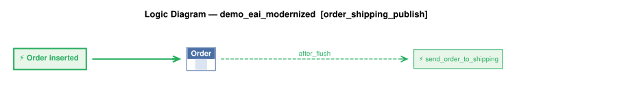

# Requirements Traceability Report

This report shows requirements, the rules created from them, and the tests created from those rules.

This project began as natural-language requirements, fleshed out by AI into a running system of business rules that are *executable documentation*. This report is how you govern the result.

A governable system is one you can **read**, **trust**, and **maintain**: each requirement is listed beside the rules that implement it (*read*); the tests and logic logs show those rules running (*trust*); re-run it after any change and it flags the gaps — an untested requirement, an untraced rule, a channel no test checks (*maintain*).

It is generated from the project's own files, nothing written by hand, so it is as current as the last run and covers the whole project, not a sample. Open **Background** (below the summary) for what the terms mean, how to read the report, and what it can and can't tell you.


**Project:** demo_eai_modernized &nbsp;|&nbsp; **Generated:** October 27, 2026 18:17 &nbsp;|&nbsp; **Rules:** 8 &nbsp;|&nbsp; **Test scenarios:** 13 &nbsp;|&nbsp; **Generator:** requirements_traceability_report.py 2.13

**Last test run:** October 27, 2026 18:17, took 2.3 s (0m before this report; test results and logic logs below are from that run)


&nbsp;
&nbsp;

## At a Glance

**✅ 5 requirement(s), all implemented; 5 tested; 13 of 13 scenarios passed; last run 0m ago.**

| | |
|---|---|
| Requirements | 5 (5 implemented) |
| Tested | 5 of 5 |
| Last test run | ✅ 13 passed, 0 failed (October 27, 2026 18:17, 0m ago); took 2.3 s |
| Rules | 8 (5 declarative, 0 Python functions, 3 Python events) |
| Rules shown running in a test log | 7 of 8 |
| Security | enabled (Keycloak provider); 11 role(s), 2 row-level grant(s) |
| Messages and APIs | 2 Kafka topic(s) in, 2 out; 3 HTTP endpoint(s) |
| Kafka | live (localhost:9092): subscribe tested through the broker; outbound messages checked in the log |

_Status: ✅ every requirement is implemented and tested, all scenarios pass, and the results are current. ⚠ a requirement is untested or unimplemented, there is no test run, or files changed since the last run. ❌ a scenario failed. This reports what was traced and tested, not that the system is correct._

**About this project** _(from [readme.md](../../readme.md))_

This app illustrates using IntegrationServices for B2B push-style integrations with APIs, and internal integration with messages.

**This sample** is a single API Logic Server providing APIs *and logic* — it both
subscribes and publishes, so there's no second project to stand up:

1. **Order Logic:** enforcing database integrity (Check Credit) and application
   integration (notify shipping)

2. A **Custom API** (`OrderB2B`), matching an agreed-upon format for B2B partners

3. **Kafka Subscribe:** listens on topic `order_b2b` for inbound orders from a
   message broker

4. **Kafka Publish:** publishes to topic `order_shipping` when an order ships —
   consumed by whatever downstream shipping system you plug in (not part of this
   demo)

5. **Standard APIs** for ad-hoc integration, user interfaces, etc

<details markdown>
<summary>Background: what this report is, and how to read it</summary>

&nbsp;

<details markdown>
<summary>Requirements are business policies, expressed in natural language</summary>

<br>

A **requirement** is a statement of business behavior - how data is computed, validated, and transmitted - written in plain language. It lives in the project at `docs/requirements/<name>/requirements.md`.  For example:

&nbsp;

```
On Placing Orders, Check Credit
    1. The Customer's balance does not exceed the credit limit
    2. The Customer's balance is the sum of the unshipped Order amount_total
    3. The Order's amount_total is the sum of the Item amount
    4. The Item amount is the quantity * unit_price
    5. The Item unit_price is copied from the Product unit_price
```

</details>

&nbsp;

<details markdown>
<summary>Rules implement requirements</summary>

<br>

A requirement is written at a high level, and AI fills in details as it builds — as it should — so the requirement no longer says exactly what the system does. The rules do. That's a Goldilocks answer to the question of what you review:

* **Requirements say too little** — incomplete by design; AI fills in the details.
* **Code says too much** — business language in, hundreds of lines of procedural code out. The work moves from writing to reading, and if you can't read it, you can't govern it.
* **Rules are just right** — close to the requirement's own level, but complete and deterministic.

Code could be treated like machine language — never read, only trusted — if it were produced deterministically. Generation from natural language isn't. Rules restore that contract: a readable source, deterministically executed.

The requirements above become rules like this:

```
Rule.copy(derive=models.Item.unit_price, from_parent=models.Product.unit_price)
Rule.formula(derive=models.Item.amount,
             as_expression=lambda row: row.quantity * row.unit_price)
Rule.sum(derive=models.Order.amount_total, as_sum_of=models.Item.amount)
Rule.sum(derive=models.Customer.balance, as_sum_of=models.Order.amount_total,
         where=lambda row: row.date_shipped is None)
Rule.constraint(
    validate=models.Customer,
    as_condition=lambda row: row.balance <= row.credit_limit,
    error_msg="balance ({row.balance}) exceeds credit limit ({row.credit_limit})")
```

Rules are ***executable documentation*** that you can read and trust:

* **Read:** rules stay near the requirement's level, so this report can list them side by side and you can check one against the other. 5 rules vs. ~200 lines in our [A/B test](https://github.com/ApiLogicServer/ApiLogicServer-src/blob/main/api_logic_server_cli/prototypes/manager/samples/basic_demo_logic_gov/logic/procedural/declarative-vs-procedural-comparison.md) — **~40x less to review**, whether generated or hand-coded.
* **Trust:** the document is enforced, not just descriptive.
    * **What you read is what runs** — no drift between description and behavior.
    * **Dependencies:** with code, you analyze every execution path to know it runs at the right times. With rules: if the rule is there, it runs, in the right order.
    * **All sources and paths:** the engine hooks into every commit — API, UI or agent — insert, update and delete, including related rows. No bypass.
    * **Seeing is believing:** each scenario in *Tests and Results* below embeds its logic log — every rule that ran, in order, with old and new values.

Better AI makes generating code easier. It doesn't change what you have to read. The problem is the representation, not the capability. And governance is active, not just process: the engine enforces the rules on every transaction, and this report — regenerated from the project itself — shows it happening.

&nbsp;

</details>

&nbsp;

<details markdown>
<summary>Process overview: creation and iteration</summary>

<br>


In two phases. First, `genai-logic create` builds a working system from the database: API, Admin App, data model. Then behavior is added from requirements — the typical sequence, each step a request to an AI assistant:

1. Write each requirement in natural language, in `docs/requirements/<name>/requirements.md`.
2. `implement reqs <name>` — creates the rules, API endpoints and Kafka integrations.
3. `create tests from rules` — writes the test scenarios and steps.
4. `run the tests` — starts the server if needed, runs the suite, reports pass/fail.
5. `run the requirements traceability report` — regenerates this report.

Optional: `create logic diagram for each requirement` (needs Graphviz).

What makes steps 3–5 possible: rules are high-level enough that AI can read them too. The tests, the logic diagrams and this report are all generated by reading the same rules you review — where logic is Python code, the report can only quote its docstring.

The report connects the chain: requirement → rules and handlers → tests → logic log. How *this* project was actually built is recorded under Provenance.

</details>

&nbsp;

<details markdown>
<summary>How to read this report</summary>

<br>

| If you are...  | Start with                                                        | Look for                                                                                     |
| -------------- | ----------------------------------------------------------------- | -------------------------------------------------------------------------------------------- |
| Business owner | *Requirements in detail*                                          | The requirement text, then the **Tests** line under it: does a test exist, and did it pass?  |
| Auditor        | *Coverage summary*, *Rule coverage by tests*, *Messages and APIs* | Gaps (untested, untraced), the date of the last test run, and how each rule was shown to run |
| Developer      | *Tests and Results*                                               | Each scenario's logic log: every rule that ran, in order, with old and new values            |

</details>

&nbsp;

<details markdown>
<summary>What this report can and can't tell you</summary>

<br>

**It shows**

- Which files and rules implement each requirement, read from the project's source.
- Which scenarios ran in the last test run, and whether each passed.
- Which rules the engine logged as running in each scenario.

**It doesn't show**

- Whether the requirements are right or complete. It traces what was written down.
- Whether an event did anything. Events run on every commit of their class and decide for themselves whether to act, so appearing in the log doesn't mean the event had an effect.
- Whether a constraint works. A constraint appears in the log only when it rejects a transaction, so look for a scenario that makes it reject.
- Whether a message arrived. Unless a test step looks for it on the broker or endpoint, a passing scenario doesn't prove delivery. The *Messages and APIs* table flags channels no test mentions.
- Whether the results are current. They are as old as the last test run, shown in the header, which also warns if files changed since.
- Which version of a requirement the code was built from, or which clause of a requirement a given rule serves.

</details>

&nbsp;

<details markdown>
<summary>Terms</summary>

<br>

| Term        | Meaning                                                                                              |
| ----------- | ---------------------------------------------------------------------------------------------------- |
| Requirement | A statement of business behavior, in plain language; the unit this report traces.                    |
| Rule        | A declaration about data (sum, count, formula, copy, constraint) that the engine enforces at every commit. |
| Event       | Python code the engine calls when a row of a given class changes (for example, to publish a message). |
| Handler     | Code that serves an API endpoint or consumes a Kafka topic.                                          |
| Scenario    | One Behave test: a short Given / When / Then script run against the live API.                        |
| Logic log   | The engine's record of every rule it ran in a transaction, nested to show cascades (an Item change adjusts its Order, which adjusts its Customer). |
| Phase       | The step of a commit: ROW LOGIC (derivations, constraints), COMMIT LOGIC (checks that need finished totals), AFTER_FLUSH LOGIC (events that need database-assigned keys, such as publishing). |
| Seen        | The engine reported running the rule in that scenario's log.                                         |

</details>

</details>


&nbsp;
&nbsp;

## Contents

- [Requirements Coverage](#requirements-coverage)
- [Data Model](#data-model)
- [Security (RBAC)](#security-rbac)
- [Messages and APIs](#messages-and-apis)
- [Tests and Results](#tests-and-results)
- [Provenance](#provenance)


&nbsp;
&nbsp;

## Requirements Coverage

Every requirement should have rules that implement it, and tests that prove it. This section checks that chain in both directions: a requirement missing rules or tests is a gap, and rules or tests that belong to no requirement are flagged too. The matching uses the `Feature:` names and `§N` tags that requirements, code and tests share.


&nbsp;

### Coverage summary

| Measure | Result |
|---|---|
| Requirements | 5 |
| Implemented (at least one file) | 5 of 5 |
| Tested (at least one scenario) | 5 of 5 |
| Implementation not traced to a requirement | `logic/logic_discovery/system/all_classes_stamping.py` |
| Tests not traced to a requirement | none |
| Test results (last run) | ✅ 13 passed, 0 failed; took 2.3 s |
| Scenarios with a logic log | 13 of 13 |
| Rules seen in at least one scenario's log | 7 of 8 (1 not counted: the engine's log does not name `all classes.early_row_event → handle_all()`, so it cannot be matched) |

_Test results are as current as the last run (see the header). A gap is any requirement with no implementation or no test._

<details markdown>
<summary>How to read this table</summary>

Test results are read from `logs/behave.log`, so they are only as current as that run. Not recorded here: which version of a requirement the code was built against, and which clause of a requirement a given rule serves.

</details>


&nbsp;

### Traceability matrix

| Requirement | Implemented by | Rules | Tests |
|---|---|---|---|
| §1 Business Logic — Check Credit | [logic/logic_discovery/check_credit.py](../../logic/logic_discovery/check_credit.py) | 5 | ✅ 7 scenario(s): 7 passed |
| §2 B2B API — Accept orders from external partners | [api/api_discovery/order_b2b_service.py](../../api/api_discovery/order_b2b_service.py) | 0 | ✅ 2 scenario(s): 2 passed |
| §3 Kafka Subscribe — Inbound orders from sales channel | [logic/logic_discovery/order_b2b_consume.py](../../logic/logic_discovery/order_b2b_consume.py)<br>[integration/kafka/kafka_subscribe_discovery/order_b2b.py](../../integration/kafka/kafka_subscribe_discovery/order_b2b.py)<br>[integration/OrderB2bMapper.py](../../integration/OrderB2bMapper.py)<br>[api/api_discovery/order_b2b_kafka_consume_debug.py](../../api/api_discovery/order_b2b_kafka_consume_debug.py) | 1 | ✅ 2 scenario(s): 2 passed |
| §4 Kafka Publish — Notify shipping on dispatch | [logic/logic_discovery/order_shipping_publish.py](../../logic/logic_discovery/order_shipping_publish.py)<br>[integration/kafka/kafka_publish_discovery/order_shipping.py](../../integration/kafka/kafka_publish_discovery/order_shipping.py) | 1 | ✅ 1 scenario(s): 1 passed |
| §5 Security | [security/declare_security.py](../../security/declare_security.py) | 0 | ✅ 1 scenario(s): 1 passed |


&nbsp;

### Rule coverage by tests

| Rule | Requirement | Seen in |
|---|---|---|
| `Item.unit_price = copy of Product.unit_price` | §1 Business Logic — Check Credit | 12: Good Order within credit limit; Alter Item Quantity; Change Order Customer; +9 more |
| `Item.amount = quantity * unit_price` | §1 Business Logic — Check Credit | 12: Good Order within credit limit; Alter Item Quantity; Change Order Customer; +9 more |
| `Order.amount_total = sum(Item.amount)` | §1 Business Logic — Check Credit | 12: Good Order within credit limit; Alter Item Quantity; Change Order Customer; +9 more |
| `Customer.balance = sum(Order.amount_total) where date_shipped is None` | §1 Business Logic — Check Credit | 12: Good Order within credit limit; Alter Item Quantity; Change Order Customer; +9 more |
| `Customer: balance is None or credit_limit is None or balance <= credit_limit` | §1 Business Logic — Check Credit | 3: Exceed Credit Limit fails; Kafka Consume Bad order_b2b (live Kafka only); B2B Exceed Credit via OrderB2B |
| `OrderB2bMessage.after_flush_row_event → _publish_order_b2b()` | §3 Kafka Subscribe — Inbound orders from sales channel | 2: Kafka Consume Valid order_b2b; Kafka Consume Bad order_b2b (live Kafka only) |
| `Order.after_flush_row_event → send_order_to_shipping()` | §4 Kafka Publish — Notify shipping on dispatch | 10: Good Order within credit limit; Alter Item Quantity; Change Order Customer; +7 more |
| `all classes.early_row_event → handle_all()` | (none) | n/a - cannot be matched to the engine's log |

_"Seen" means the engine's log shows the rule ran, not proof that it took effect._

<details markdown>
<summary>How to read this table</summary>

"Seen" means the engine reported running the rule in that scenario's logic log. A scenario can only contribute if it has a log (see the coverage summary): a test that does not open one writes into whichever log was open last, and its rules are then credited to that scenario, or to the shared log. An event's function runs on every commit of its class, and its own condition decides whether it acts, so seen does not mean it took effect. A constraint appears in the log only when it rejects a transaction, so it is seen only in scenarios that make it reject. "Not seen" therefore means no log shows it, not that no test ran it.

</details>


&nbsp;

### Requirements in detail

**8 rules** in 4 files: 5 declarative (sum, count, copy, formula and constraint expressions), 0 backed by a Python function, 3 events (Python).

_Declarative rules are read straight from their declarations. Functions and events are Python code, so for those the report shows the docstring — it does not analyze the code._

Each requirement is followed by the rules and handlers in the files that implement it. Logic diagrams are shown (click to expand) where they exist.

<details markdown>
<summary>How to create or refresh the logic diagrams</summary>

Needs Graphviz (`brew install graphviz`). Tell your AI assistant:

```
create logic diagram for each requirement
```

or run this from the Manager root (`genai-logic`):

```
python system/ApiLogicServer-Internal-Dev/logic_diagram_gv.py demo_eai_modernized --each
```

Each diagram is saved under `docs/requirements/<name>/logic_diagrams/`. Then regenerate this report (`python requirements_traceability_report.py run`, from `test/api_logic_server_behave`).

</details>

&nbsp;


#### §1 Business Logic — Check Credit

Tests: ✅ 7 scenario(s): 7 passed

```
Feature: Check Credit

  Scenario: Place an order
    Given a customer with a credit limit
    When an order is placed
    Then copy the price from the product
    And multiply by quantity to get the item amount
    And sum item amounts to get the order total
    And sum unpaid order totals to get the customer balance
    And reject if balance exceeds the credit limit
```

| Rule / item | Type | Logic | Description | Where |
|---|---|---|---|---|
| `Item.unit_price = copy of Product.unit_price` | copy | declarative |  | [check_credit.py](../../logic/logic_discovery/check_credit.py) |
| `Item.amount = quantity * unit_price` | formula | declarative |  | [check_credit.py](../../logic/logic_discovery/check_credit.py) |
| `Order.amount_total = sum(Item.amount)` | sum | declarative |  | [check_credit.py](../../logic/logic_discovery/check_credit.py) |
| `Customer.balance = sum(Order.amount_total) where date_shipped is None` | sum | declarative |  | [check_credit.py](../../logic/logic_discovery/check_credit.py) |
| `Customer: balance is None or credit_limit is None or balance <= credit_limit` | constraint | declarative | Error: balance ({row.balance}) exceeds credit limit ({row.credit_limit}) | [check_credit.py](../../logic/logic_discovery/check_credit.py) |

<details markdown>
<summary>Logic diagram: check_credit</summary>


</details>

#### §2 B2B API — Accept orders from external partners

Tests: ✅ 2 scenario(s): 2 passed

```
Feature: B2B Order Integration

  Scenario: Accept order from external partner
    Given an inbound B2B order in partner format (message_formats/order_b2b.json)
    When the order is received via a Custom API endpoint named OrderB2B
    Then map Account to Customer by name
    And map Items.Name to Product by name
    And map Items.QuantityOrdered to Item.quantity
```

| Rule / item | Type | Logic | Description | Where |
|---|---|---|---|---|
| `HTTP in: POST /api/OrderB2B/OrderB2B` | http | handler (Python) | API service OrderB2B: accepts external partner orders and maps Account/Items into Order and Item rows. | [order_b2b_service.py](../../api/api_discovery/order_b2b_service.py) |

#### §3 Kafka Subscribe — Inbound orders from sales channel

Tests: ✅ 2 scenario(s): 2 passed

```
Feature: Kafka Subscribe Order Integration

  Scenario: Accept inbound orders from sales channel
    Given an inbound order message in JSON format (message_formats/order_b2b.json)
    When the message is received from Kafka topic order_b2b
    Then map Account to Customer by name
    And map Items.Name to Product by name
    And map Items.QuantityOrdered to Item.quantity
```

| Rule / item | Type | Logic | Description | Where |
|---|---|---|---|---|
| `OrderB2bMessage.after_flush_row_event → _publish_order_b2b()` | after_flush_row_event | event (Python) | OrderB2bMessage event: publishes the raw blob to order_b2b_processed after Tx 1 commits, so Consumer 2 can parse it in a clean Tx 2 (2-message pattern). | [order_b2b_consume.py](../../logic/logic_discovery/order_b2b_consume.py) |
| `Kafka in: order_b2b` | kafka | handler (Python) | Kafka subscribe order_b2b: Consumer 1 saves the raw payload into OrderB2bMessage (Tx 1) so the row_event bridge publishes to order_b2b_processed. | [order_b2b.py](../../integration/kafka/kafka_subscribe_discovery/order_b2b.py) |
| `Kafka in: order_b2b_processed` | kafka | handler (Python) | Kafka subscribe order_b2b: Consumer 2 parses the payload, persists Order and Item rows, and marks OrderB2bMessage processed (Tx 2). | [order_b2b.py](../../integration/kafka/kafka_subscribe_discovery/order_b2b.py) |
| `OrderB2bMapper.py` | module |  | Feature: Kafka Subscribe Order Integration | [OrderB2bMapper.py](../../integration/OrderB2bMapper.py) |
| `HTTP in: GET /consume_debug/order_b2b` | http | handler (Python) | EAI debug (development only, no authentication): sends the message in ?file= to the topic, live through Kafka or simulated | [order_b2b_kafka_consume_debug.py](../../api/api_discovery/order_b2b_kafka_consume_debug.py) |
| `HTTP in: POST /consume_debug/order_b2b/reset` | http | handler (Python) | EAI debug (development only, destructive): purges the messages in the pipeline's topics | [order_b2b_kafka_consume_debug.py](../../api/api_discovery/order_b2b_kafka_consume_debug.py) |

<details markdown>
<summary>Logic diagram: order_b2b_consume</summary>


</details>

#### §4 Kafka Publish — Notify shipping on dispatch

Tests: ✅ 1 scenario(s): 1 passed

```
Feature: Kafka Publish Shipping Notification

  Scenario: Notify shipping when an order is dispatched
    Given an Order exists
    When date_shipped is set
    Then publish to Kafka topic order_shipping
    And use message_formats/order_shipping.json as the message shape
    And use by-example publish rather than key-only publish
```

| Rule / item | Type | Logic | Description | Where |
|---|---|---|---|---|
| `Order.after_flush_row_event → send_order_to_shipping()` | after_flush_row_event | event (Python) | Order publish: sends the Order to Kafka topic order_shipping when date_shipped is set and differs from its prior value (old_row is None on insert), using the by-example message in message_formats/order_shipping.json. | [order_shipping_publish.py](../../logic/logic_discovery/order_shipping_publish.py) |
| `order_shipping.py` | module |  | Feature: Kafka Publish Shipping Notification | [order_shipping.py](../../integration/kafka/kafka_publish_discovery/order_shipping.py) |

<details markdown>
<summary>Logic diagram: order_shipping_publish</summary>



</details>

#### §5 Security

Tests: ✅ 1 scenario(s): 1 passed

```
Feature: Row-Level Security
  Scenario: Sales role sees limited customers
    Given a user with the sales role
    When querying the Customer list
    Then only return customers where credit_limit >= 3000 or balance > 0
```

| Rule / item | Type | Logic | Description | Where |
|---|---|---|---|---|
| `Grant on Customer to role sales: credit_limit >= 3000` | grant | declarative |  | [declare_security.py](../../security/declare_security.py) |
| `Grant on Customer to role sales: balance > 0` | grant | declarative |  | [declare_security.py](../../security/declare_security.py) |

#### Rules not traced to a requirement

| Rule / item | Type | Logic | Description | Where |
|---|---|---|---|---|
| `all classes.early_row_event → handle_all()` | early_row_event_all_classes | event (Python) | Generic handler - executed for every row update across all classes. | [all_classes_stamping.py](../../logic/logic_discovery/system/all_classes_stamping.py) |


&nbsp;
&nbsp;

## Data Model

The tables the rules run over. Shaded columns are derived by rules — no code writes them.


_Generated from `docs/db.dbml` (parents above children; shaded rows are derived by rules). To use your own layout, save it as `docs/db_diagram.png`._


&nbsp;

### Derived columns

| Table | Column | Rule | Definition |
|---|---|---|---|
| Item | unit_price | copy | `Item.unit_price = copy of Product.unit_price` |
| Item | amount | formula | `Item.amount = quantity * unit_price` |
| Order | amount_total | sum | `Order.amount_total = sum(Item.amount)` |
| Customer | balance | sum | `Customer.balance = sum(Order.amount_total) where date_shipped is None` |


&nbsp;
&nbsp;

## Security (RBAC)

Who can do what: each role's permissions, and which rows each role can see.

**Security enabled: yes** (`SECURITY_ENABLED` in `config/default.env`).


&nbsp;

### Roles and CRUD (DefaultRolePermission)

| Role | Read | Insert | Update | Delete |
|---|---|---|---|---|
| sa | ✅ | ✅ | ✅ | ✅ |
| tenant | ✅ | — | — | ✅ |
| CS_ADMIN | ✅ | ✅ | ✅ | ✅ |
| manager | ✅ | ✅ | ✅ | — |
| sales | ✅ | — | — | — |
| teller | ✅ | ✅ | ✅ | — |
| customer | ✅ | ✅ | ✅ | — |
| readonly | ✅ | — | — | — |
| public | ✅ | — | — | — |
| default-roles-kcals | ✅ | ✅ | ✅ | — |
| uma_authorization | ✅ | ✅ | ✅ | — |


&nbsp;

### Row-level grants (Grant)

| Table | Role | Filter | Requirement |
|---|---|---|---|
| Customer | sales | `credit_limit >= 3000` | §5 |
| Customer | sales | `balance > 0` | §5 |


&nbsp;
&nbsp;

## Messages and APIs

How data enters and leaves beyond the standard API: Kafka topics in and out, custom HTTP endpoints — and whether any test touches each one.

**Kafka mode: live (localhost:9092).** The tests sent inbound messages through a real broker: `/consume_debug` published them to topic `order_b2b`, the server's consumers processed them, and the tests then checked the results. Outbound `order_shipping` messages are checked in the server log, not read back from the topic.

| Direction | Channel | Name | Tests mention it | Handler | Tables created | Message shape | Requirement |
|---|---|---|---|---|---|---|---|
| ➡ in | Kafka | `order_b2b` | ✅ live | `order_b2b()` - Kafka subscribe order_b2b: Consumer 1 saves the raw payload into OrderB2bMessage (Tx 1) so the row_event bridge publishes to order_b2b_processed. | OrderB2bMessage | [order_b2b.json](../../integration/kafka/message_formats/order_b2b.json) | §3 Kafka Subscribe — Inbound orders from sales channel |
| ➡ in | Kafka | `order_b2b_processed` | ✅ live | `order_b2b_processed()` - Kafka subscribe order_b2b: Consumer 2 parses the payload, persists Order and Item rows, and marks OrderB2bMessage processed (Tx 2). | Item, Order, OrderB2bMessage |  | §3 Kafka Subscribe — Inbound orders from sales channel |
| ⬅ out | Kafka | `order_b2b_processed` | ✅ live | OrderB2bMessage.after_flush_row_event → _publish_order_b2b() - OrderB2bMessage event: publishes the raw blob to order_b2b_processed after Tx 1 commits, so Consumer 2 can parse it in a clean Tx 2 (2-message pattern). |  |  | §3 Kafka Subscribe — Inbound orders from sales channel |
| ⬅ out | Kafka | `order_shipping` | ⚠ message checked in the log, not on the topic | Order.after_flush_row_event → send_order_to_shipping() - Order publish: sends the Order to Kafka topic order_shipping when date_shipped is set and differs from its prior value (old_row is None on insert), using the by-example message in message_formats/order_shipping.json. |  | [order_shipping.json](../../integration/kafka/message_formats/order_shipping.json) | §4 Kafka Publish — Notify shipping on dispatch |
| ➡ in | HTTP | `GET /consume_debug/order_b2b` | ✅ | `register_consume_debug()` - EAI debug (development only, no authentication): sends the message in ?file= to the topic, live through Kafka or simulated |  |  | §3 Kafka Subscribe — Inbound orders from sales channel |
| ➡ in | HTTP | `POST /consume_debug/order_b2b/reset` | ✅ | `register_queue_reset()` - EAI debug (development only, destructive): purges the messages in the pipeline's topics |  |  | §3 Kafka Subscribe — Inbound orders from sales channel |
| ➡ in | HTTP | `POST /api/OrderB2B/OrderB2B` | ✅ | `OrderB2B()` - API service OrderB2B: accepts external partner orders and maps Account/Items into Order and Item rows. |  |  | §2 B2B API — Accept orders from external partners |

_"Tests mention it" checks the test sources, not delivery._

<details markdown>
<summary>How to read this column</summary>

A passing scenario proves a message reached a topic or an endpoint only if its steps look for it there. A handler that ran (see the logic log) is weaker evidence than a step that consumes the message. Channels no test mentions are flagged.

</details>

<details markdown>
<summary>How to read this table</summary>

Topics and endpoints are read from the discovery folders. The condition that triggers an outbound message lives in Python (see the rules under each requirement); here it is described by the handler's docstring. "Tables created" lists rows the handler's code constructs, following its calls within the project; blank means none were found, not that none exist.

</details>


<details markdown>
<summary>Message shape: order_b2b</summary>

```json
{
  "Account": "Alice",
  "Notes": "Kafka order from sales",
  "Items": [
    { "Name": "Widget",  "QuantityOrdered": 1 },
    { "Name": "Gadget",  "QuantityOrdered": 2 }
  ]
}
```
</details>

<details markdown>
<summary>Message shape: order_shipping</summary>

```json
{
  "order_id": 1,
  "order_date": "2026-04-06",
  "customer_name": "Alfreds Futterkiste",
  "total": 100.00,
  "items": [
    { "quantity": 2, "product_name": "Chai", "unit_price": 25.00 }
  ]
}
```
</details>


&nbsp;
&nbsp;

## Tests and Results

**✅ 13 scenario(s): 13 passed, 0 failed; took 2.3 s** (from the last run, `logs/behave.log`).

Each test drives the running system the way any client would — create an order, change a quantity, ship it — and checks the result.

**The logic log** is what makes them more than pass/fail. Business rules run inside the server on every commit, so the server records exactly what they did, and this report embeds that record for each scenario. Two things to look for:

1. **It shows every rule that runs.** Each line is one rule execution, with the row's state, old and new values. You see not just that a test passed, but which rules ran and what each one changed.
2. **The nesting shows multi-table chaining.** Indentation follows the cascade: a change to an Item adjusts its Order, which adjusts its Customer.

<details markdown>
<summary>How to read the logic log</summary>

Open a scenario's "Rules exercised and logic log" block to see it. The log is shown in full, attribute values included, because those values are what you diagnose from when a rule produces an unexpected result.

To read a log line:

```
....Order[16] {Update - Adjusting order: amount_total} id: 16, customer_id: 19, amount_total:  [0.0-->] 90.0

```

- The leading dots are the depth in the cascade: Item (2 dots), its Order (4), its Customer (6).
- `Order[16]` is the row; `{...}` is the rule or action that ran; the rest is the row's attribute values at that step.
- `[0.0-->] 90.0` marks a value the rules changed, with its old and new value.
- The log is in phases: **ROW LOGIC** (derivations and constraints, as rows change), **COMMIT LOGIC** (checks that need the finished aggregates), and **AFTER_FLUSH LOGIC** (events that need database-assigned keys, such as the Kafka publish).

More: [Logic Log](https://apilogicserver.github.io/Docs/Logic-Debug/#logic-log).

</details>

&nbsp;

<details markdown>
<summary>How to add more tests, and run them</summary>

**1. Have AI create them.** This project's context tells your AI assistant how (`.github/copilot-instructions.md`, `docs/training/testing.md`). Just say:

```

create tests from rules

```

The assistant reads `database/models.py`, the logic files and the custom APIs, then writes `.feature` files and step implementations under `test/api_logic_server_behave/features/`. Then say `run the tests` and `run the requirements traceability report` and the assistant does both.

Or, to have each requirement's tests linked in the Tests column above (it matches on `Feature:` name), say which names to use:

```

create tests from rules, one Feature per requirement, named exactly:
- Check Credit
- B2B Order Integration
- Kafka Subscribe Order Integration
- Kafka Publish Shipping Notification
- Row-Level Security

```

_Tests with other names still run and appear below; they just aren't linked to a requirement._

**2. You can also define tests manually.** Add a `<name>.feature` file (Gherkin) under `test/api_logic_server_behave/features/` and its steps under `features/steps/`. The steps call the running API, so tests exercise the same rules as any client. See `docs/training/testing.md` for the patterns that keep tests repeatable.

**Or run them yourself** (server running, from `test/api_logic_server_behave`):

```

python behave_run.py --outfile=logs/behave.log
python requirements_traceability_report.py run

```

</details>

&nbsp;
&nbsp;

### Feature: Check Credit  

&nbsp;
&nbsp;

#### Scenario: Good Order within credit limit ✅ (0.20 s)
&emsp;  Scenario: Good Order within credit limit  
&emsp;&emsp;    Given a customer with credit_limit 1000 and balance 0  
&emsp;&emsp;    When an unshipped order is placed with 2 items of unit_price 150  
&emsp;&emsp;    Then the item amount is 300  
&emsp;&emsp;    And the order amount_total is 300  
&emsp;&emsp;    And the customer balance is 300  

<details markdown>
<summary>Rules exercised and logic log (2 transactions)</summary>


&nbsp;
&nbsp;


**Rules Used** in Scenario: Good Order within credit limit
```
  Customer  
    1. Derive Customer.balance as Sum(Order.amount_total Where Rule.sum(derive=models.Customer.balance, as_sum_of=models.Order.amount_total, where=lambda row: row.date_shipped is None))  
  Order  
    2. RowEvent Order.send_order_to_shipping()  
    3. Derive Order.amount_total as Sum(Item.amount Where  - None)  
  Item  
    4. Derive Item.amount as Formula (1): Rule.formula(derive=models.Item.amount, as_expres [...]  
    5. Derive Item.unit_price as Copy(product.unit_price)  
```
**Logic Log** in Scenario: Good Order within credit limit (2 transactions)
```
Logic Phase:		ROW LOGIC		(session=0x10ca716e0) (sqlalchemy before_flush)			 - 2026-10-27 18:17:28,148 - logic_logger - INFO
..Order[None] {Insert - client} id: None, notes: Test Order, customer_id: 19, CreatedOn: None, date_shipped: None, amount_total: None  row: 0x10ca0a650  session: 0x10ca716e0  ins_upd_dlt: ins, initial: ins - 2026-10-27 18:17:28,149 - logic_logger - INFO
..Order[None] {server aggregate_defaults: amount_total } id: None, notes: Test Order, customer_id: 19, CreatedOn: None, date_shipped: None, amount_total: 0  row: 0x10ca0a650  session: 0x10ca716e0  ins_upd_dlt: ins, initial: ins - 2026-10-27 18:17:28,149 - logic_logger - INFO
Logic Phase:		COMMIT LOGIC		(session=0x10ca716e0)   										 - 2026-10-27 18:17:28,150 - logic_logger - INFO
Logic Phase:		AFTER_FLUSH LOGIC	(session=0x10ca716e0)   										 - 2026-10-27 18:17:28,150 - logic_logger - INFO
..Order[15] {AfterFlush Event} id: 15, notes: Test Order, customer_id: 19, CreatedOn: None, date_shipped: None, amount_total: 0  row: 0x10ca0a650  session: 0x10ca716e0  ins_upd_dlt: ins, initial: ins - 2026-10-27 18:17:28,150 - logic_logger - INFO


Logic Phase:		ROW LOGIC		(session=0x10c710710) (sqlalchemy before_flush)			 - 2026-10-27 18:17:28,174 - logic_logger - INFO
..Item[None] {Insert - client} id: None, order_id: 15, product_id: 7, quantity: 2, amount: None, unit_price: None  row: 0x10ca0a8d0  session: 0x10c710710  ins_upd_dlt: ins, initial: ins - 2026-10-27 18:17:28,175 - logic_logger - INFO
..Item[None] {copy_rules for role: product - unit_price} id: None, order_id: 15, product_id: 7, quantity: 2, amount: None, unit_price: 150.0000000000  row: 0x10ca0a8d0  session: 0x10c710710  ins_upd_dlt: ins, initial: ins - 2026-10-27 18:17:28,176 - logic_logger - INFO
..Item[None] {Formula amount} id: None, order_id: 15, product_id: 7, quantity: 2, amount: 300.0000000000, unit_price: 150.0000000000  row: 0x10ca0a8d0  session: 0x10c710710  ins_upd_dlt: ins, initial: ins - 2026-10-27 18:17:28,176 - logic_logger - INFO
....Order[15] {Update - Adjusting order: amount_total} id: 15, notes: Test Order, customer_id: 19, CreatedOn: None, date_shipped: None, amount_total:  [0E-10-->] 300.0000000000  row: 0x10cade950  session: 0x10c710710  ins_upd_dlt: upd, initial: upd - 2026-10-27 18:17:28,176 - logic_logger - INFO
......Customer[19] {Update - Adjusting customer: balance} id: 19, name: CheckCredit Cust 1793150248042, balance:  [0E-10-->] 300.0000000000, credit_limit: 1000.0000000000, email: None, email_opt_out: None  row: 0x10cadeed0  session: 0x10c710710  ins_upd_dlt: upd, initial: upd - 2026-10-27 18:17:28,177 - logic_logger - INFO
Logic Phase:		COMMIT LOGIC		(session=0x10c710710)   										 - 2026-10-27 18:17:28,177 - logic_logger - INFO
Logic Phase:		AFTER_FLUSH LOGIC	(session=0x10c710710)   										 - 2026-10-27 18:17:28,178 - logic_logger - INFO
....Order[15] {AfterFlush Event} id: 15, notes: Test Order, customer_id: 19, CreatedOn: None, date_shipped: None, amount_total:  [0E-10-->] 300.0000000000  row: 0x10cade950  session: 0x10c710710  ins_upd_dlt: upd, initial: upd - 2026-10-27 18:17:28,178 - logic_logger - INFO

```
</details>

&nbsp;
&nbsp;

#### Scenario: Alter Item Quantity ✅ (0.18 s)
&emsp;  Scenario: Alter Item Quantity  
&emsp;&emsp;    Given a customer with credit_limit 1000 and an unshipped order of 2 items at unit_price 150  
&emsp;&emsp;    When the item quantity is updated to 4  
&emsp;&emsp;    Then the item amount is 600  
&emsp;&emsp;    And the order amount_total is 600  
&emsp;&emsp;    And the customer balance is 600  

<details markdown>
<summary>Rules exercised and logic log (3 transactions)</summary>


&nbsp;
&nbsp;


**Rules Used** in Scenario: Alter Item Quantity
```
  Customer  
    1. Derive Customer.balance as Sum(Order.amount_total Where Rule.sum(derive=models.Customer.balance, as_sum_of=models.Order.amount_total, where=lambda row: row.date_shipped is None))  
  Order  
    2. RowEvent Order.send_order_to_shipping()  
    3. Derive Order.amount_total as Sum(Item.amount Where  - None)  
  Item  
    4. Derive Item.amount as Formula (1): Rule.formula(derive=models.Item.amount, as_expres [...]  
    5. Derive Item.unit_price as Copy(product.unit_price)  
```
**Logic Log** in Scenario: Alter Item Quantity (3 transactions)
```
Logic Phase:		ROW LOGIC		(session=0x10ca7e030) (sqlalchemy before_flush)			 - 2026-10-27 18:17:28,316 - logic_logger - INFO
..Order[None] {Insert - client} id: None, notes: Test Order, customer_id: 20, CreatedOn: None, date_shipped: None, amount_total: None  row: 0x10c9b5450  session: 0x10ca7e030  ins_upd_dlt: ins, initial: ins - 2026-10-27 18:17:28,316 - logic_logger - INFO
..Order[None] {server aggregate_defaults: amount_total } id: None, notes: Test Order, customer_id: 20, CreatedOn: None, date_shipped: None, amount_total: 0  row: 0x10c9b5450  session: 0x10ca7e030  ins_upd_dlt: ins, initial: ins - 2026-10-27 18:17:28,317 - logic_logger - INFO
Logic Phase:		COMMIT LOGIC		(session=0x10ca7e030)   										 - 2026-10-27 18:17:28,317 - logic_logger - INFO
Logic Phase:		AFTER_FLUSH LOGIC	(session=0x10ca7e030)   										 - 2026-10-27 18:17:28,318 - logic_logger - INFO
..Order[16] {AfterFlush Event} id: 16, notes: Test Order, customer_id: 20, CreatedOn: None, date_shipped: None, amount_total: 0  row: 0x10c9b5450  session: 0x10ca7e030  ins_upd_dlt: ins, initial: ins - 2026-10-27 18:17:28,318 - logic_logger - INFO


Logic Phase:		ROW LOGIC		(session=0x10ca7c6b0) (sqlalchemy before_flush)			 - 2026-10-27 18:17:28,338 - logic_logger - INFO
..Item[None] {Insert - client} id: None, order_id: 16, product_id: 7, quantity: 2, amount: None, unit_price: None  row: 0x10cadfdd0  session: 0x10ca7c6b0  ins_upd_dlt: ins, initial: ins - 2026-10-27 18:17:28,339 - logic_logger - INFO
..Item[None] {copy_rules for role: product - unit_price} id: None, order_id: 16, product_id: 7, quantity: 2, amount: None, unit_price: 150.0000000000  row: 0x10cadfdd0  session: 0x10ca7c6b0  ins_upd_dlt: ins, initial: ins - 2026-10-27 18:17:28,340 - logic_logger - INFO
..Item[None] {Formula amount} id: None, order_id: 16, product_id: 7, quantity: 2, amount: 300.0000000000, unit_price: 150.0000000000  row: 0x10cadfdd0  session: 0x10ca7c6b0  ins_upd_dlt: ins, initial: ins - 2026-10-27 18:17:28,340 - logic_logger - INFO
....Order[16] {Update - Adjusting order: amount_total} id: 16, notes: Test Order, customer_id: 20, CreatedOn: None, date_shipped: None, amount_total:  [0E-10-->] 300.0000000000  row: 0x10cb38850  session: 0x10ca7c6b0  ins_upd_dlt: upd, initial: upd - 2026-10-27 18:17:28,340 - logic_logger - INFO
......Customer[20] {Update - Adjusting customer: balance} id: 20, name: CheckCredit OrderCust 1793150248243, balance:  [0E-10-->] 300.0000000000, credit_limit: 1000.0000000000, email: None, email_opt_out: None  row: 0x10ccd0250  session: 0x10ca7c6b0  ins_upd_dlt: upd, initial: upd - 2026-10-27 18:17:28,340 - logic_logger - INFO
Logic Phase:		COMMIT LOGIC		(session=0x10ca7c6b0)   										 - 2026-10-27 18:17:28,340 - logic_logger - INFO
Logic Phase:		AFTER_FLUSH LOGIC	(session=0x10ca7c6b0)   										 - 2026-10-27 18:17:28,341 - logic_logger - INFO
....Order[16] {AfterFlush Event} id: 16, notes: Test Order, customer_id: 20, CreatedOn: None, date_shipped: None, amount_total:  [0E-10-->] 300.0000000000  row: 0x10cb38850  session: 0x10ca7c6b0  ins_upd_dlt: upd, initial: upd - 2026-10-27 18:17:28,341 - logic_logger - INFO


Logic Phase:		ROW LOGIC		(session=0x10ca7d370) (sqlalchemy before_flush)			 - 2026-10-27 18:17:28,362 - logic_logger - INFO
..Item[16] {Update - client} id: 16, order_id: 16, product_id: 7, quantity:  [2-->] 4, amount: 300.0000000000, unit_price: 150.0000000000  row: 0x10cadcd50  session: 0x10ca7d370  ins_upd_dlt: upd, initial: upd - 2026-10-27 18:17:28,362 - logic_logger - INFO
..Item[16] {Formula amount} id: 16, order_id: 16, product_id: 7, quantity:  [2-->] 4, amount:  [300.0000000000-->] 600.0000000000, unit_price: 150.0000000000  row: 0x10cadcd50  session: 0x10ca7d370  ins_upd_dlt: upd, initial: upd - 2026-10-27 18:17:28,362 - logic_logger - INFO
....Order[16] {Update - Adjusting order: amount_total} id: 16, notes: Test Order, customer_id: 20, CreatedOn: None, date_shipped: None, amount_total:  [300.0000000000-->] 600.0000000000  row: 0x10c9fdb50  session: 0x10ca7d370  ins_upd_dlt: upd, initial: upd - 2026-10-27 18:17:28,363 - logic_logger - INFO
......Customer[20] {Update - Adjusting customer: balance} id: 20, name: CheckCredit OrderCust 1793150248243, balance:  [300.0000000000-->] 600.0000000000, credit_limit: 1000.0000000000, email: None, email_opt_out: None  row: 0x10ca551d0  session: 0x10ca7d370  ins_upd_dlt: upd, initial: upd - 2026-10-27 18:17:28,363 - logic_logger - INFO
Logic Phase:		COMMIT LOGIC		(session=0x10ca7d370)   										 - 2026-10-27 18:17:28,363 - logic_logger - INFO
Logic Phase:		AFTER_FLUSH LOGIC	(session=0x10ca7d370)   										 - 2026-10-27 18:17:28,364 - logic_logger - INFO
....Order[16] {AfterFlush Event} id: 16, notes: Test Order, customer_id: 20, CreatedOn: None, date_shipped: None, amount_total:  [300.0000000000-->] 600.0000000000  row: 0x10c9fdb50  session: 0x10ca7d370  ins_upd_dlt: upd, initial: upd - 2026-10-27 18:17:28,364 - logic_logger - INFO

```
</details>

&nbsp;
&nbsp;

#### Scenario: Change Order Customer ✅ (0.17 s)
&emsp;  Scenario: Change Order Customer  
&emsp;&emsp;    Given two customers with credit_limit 1000 and an order of 300 on the first customer  
&emsp;&emsp;    When the order is reassigned to the second customer  
&emsp;&emsp;    Then the first customer balance is 0  
&emsp;&emsp;    And the second customer balance is 300  

<details markdown>
<summary>Rules exercised and logic log (3 transactions)</summary>


&nbsp;
&nbsp;


**Rules Used** in Scenario: Change Order Customer
```
  Customer  
    1. Derive Customer.balance as Sum(Order.amount_total Where Rule.sum(derive=models.Customer.balance, as_sum_of=models.Order.amount_total, where=lambda row: row.date_shipped is None))  
  Order  
    2. RowEvent Order.send_order_to_shipping()  
    3. Derive Order.amount_total as Sum(Item.amount Where  - None)  
  Item  
    4. Derive Item.amount as Formula (1): Rule.formula(derive=models.Item.amount, as_expres [...]  
    5. Derive Item.unit_price as Copy(product.unit_price)  
```
**Logic Log** in Scenario: Change Order Customer (3 transactions)
```
Logic Phase:		ROW LOGIC		(session=0x10c9a3570) (sqlalchemy before_flush)			 - 2026-10-27 18:17:28,512 - logic_logger - INFO
..Order[None] {Insert - client} id: None, notes: Test Order, customer_id: 21, CreatedOn: None, date_shipped: None, amount_total: None  row: 0x10ca0b3d0  session: 0x10c9a3570  ins_upd_dlt: ins, initial: ins - 2026-10-27 18:17:28,512 - logic_logger - INFO
..Order[None] {server aggregate_defaults: amount_total } id: None, notes: Test Order, customer_id: 21, CreatedOn: None, date_shipped: None, amount_total: 0  row: 0x10ca0b3d0  session: 0x10c9a3570  ins_upd_dlt: ins, initial: ins - 2026-10-27 18:17:28,512 - logic_logger - INFO
Logic Phase:		COMMIT LOGIC		(session=0x10c9a3570)   										 - 2026-10-27 18:17:28,512 - logic_logger - INFO
Logic Phase:		AFTER_FLUSH LOGIC	(session=0x10c9a3570)   										 - 2026-10-27 18:17:28,513 - logic_logger - INFO
..Order[17] {AfterFlush Event} id: 17, notes: Test Order, customer_id: 21, CreatedOn: None, date_shipped: None, amount_total: 0  row: 0x10ca0b3d0  session: 0x10c9a3570  ins_upd_dlt: ins, initial: ins - 2026-10-27 18:17:28,513 - logic_logger - INFO


Logic Phase:		ROW LOGIC		(session=0x10ca7d8c0) (sqlalchemy before_flush)			 - 2026-10-27 18:17:28,531 - logic_logger - INFO
..Item[None] {Insert - client} id: None, order_id: 17, product_id: 7, quantity: 2, amount: None, unit_price: None  row: 0x10c9d86d0  session: 0x10ca7d8c0  ins_upd_dlt: ins, initial: ins - 2026-10-27 18:17:28,531 - logic_logger - INFO
..Item[None] {copy_rules for role: product - unit_price} id: None, order_id: 17, product_id: 7, quantity: 2, amount: None, unit_price: 150.0000000000  row: 0x10c9d86d0  session: 0x10ca7d8c0  ins_upd_dlt: ins, initial: ins - 2026-10-27 18:17:28,532 - logic_logger - INFO
..Item[None] {Formula amount} id: None, order_id: 17, product_id: 7, quantity: 2, amount: 300.0000000000, unit_price: 150.0000000000  row: 0x10c9d86d0  session: 0x10ca7d8c0  ins_upd_dlt: ins, initial: ins - 2026-10-27 18:17:28,532 - logic_logger - INFO
....Order[17] {Update - Adjusting order: amount_total} id: 17, notes: Test Order, customer_id: 21, CreatedOn: None, date_shipped: None, amount_total:  [0E-10-->] 300.0000000000  row: 0x10cb3b5d0  session: 0x10ca7d8c0  ins_upd_dlt: upd, initial: upd - 2026-10-27 18:17:28,532 - logic_logger - INFO
......Customer[21] {Update - Adjusting customer: balance} id: 21, name: First Cust 1793150248421, balance:  [0E-10-->] 300.0000000000, credit_limit: 1000.0000000000, email: None, email_opt_out: None  row: 0x10cb3b3d0  session: 0x10ca7d8c0  ins_upd_dlt: upd, initial: upd - 2026-10-27 18:17:28,533 - logic_logger - INFO
Logic Phase:		COMMIT LOGIC		(session=0x10ca7d8c0)   										 - 2026-10-27 18:17:28,533 - logic_logger - INFO
Logic Phase:		AFTER_FLUSH LOGIC	(session=0x10ca7d8c0)   										 - 2026-10-27 18:17:28,533 - logic_logger - INFO
....Order[17] {AfterFlush Event} id: 17, notes: Test Order, customer_id: 21, CreatedOn: None, date_shipped: None, amount_total:  [0E-10-->] 300.0000000000  row: 0x10cb3b5d0  session: 0x10ca7d8c0  ins_upd_dlt: upd, initial: upd - 2026-10-27 18:17:28,534 - logic_logger - INFO


Logic Phase:		ROW LOGIC		(session=0x10ca7d150) (sqlalchemy before_flush)			 - 2026-10-27 18:17:28,552 - logic_logger - INFO
..Order[17] {Update - client} id: 17, notes: Test Order, customer_id:  [21-->] 22, CreatedOn: None, date_shipped: None, amount_total: 300.0000000000  row: 0x10cb39fd0  session: 0x10ca7d150  ins_upd_dlt: upd, initial: upd - 2026-10-27 18:17:28,553 - logic_logger - INFO
....Customer[22] {Update - Adjusting customer: balance, balance} id: 22, name: Second Cust 1793150248440, balance:  [0E-10-->] 300.0000000000, credit_limit: 1000.0000000000, email: None, email_opt_out: None  row: 0x10cadf5d0  session: 0x10ca7d150  ins_upd_dlt: upd, initial: upd - 2026-10-27 18:17:28,553 - logic_logger - INFO
....Customer[21] {Update - Adjusting Old customer} id: 21, name: First Cust 1793150248421, balance:  [300.0000000000-->] 0E-10, credit_limit: 1000.0000000000, email: None, email_opt_out: None  row: 0x10caddc50  session: 0x10ca7d150  ins_upd_dlt: upd, initial: upd - 2026-10-27 18:17:28,554 - logic_logger - INFO
Logic Phase:		COMMIT LOGIC		(session=0x10ca7d150)   										 - 2026-10-27 18:17:28,554 - logic_logger - INFO
Logic Phase:		AFTER_FLUSH LOGIC	(session=0x10ca7d150)   										 - 2026-10-27 18:17:28,554 - logic_logger - INFO
..Order[17] {AfterFlush Event} id: 17, notes: Test Order, customer_id:  [21-->] 22, CreatedOn: None, date_shipped: None, amount_total: 300.0000000000  row: 0x10cb39fd0  session: 0x10ca7d150  ins_upd_dlt: upd, initial: upd - 2026-10-27 18:17:28,554 - logic_logger - INFO

```
</details>

&nbsp;
&nbsp;

#### Scenario: Delete Order Item ✅ (0.16 s)
&emsp;  Scenario: Delete Order Item  
&emsp;&emsp;    Given a customer with credit_limit 1000 and an unshipped order of 2 items at unit_price 150  
&emsp;&emsp;    When the item is deleted  
&emsp;&emsp;    Then the order amount_total is 0  
&emsp;&emsp;    And the customer balance is 0  

<details markdown>
<summary>Rules exercised and logic log (3 transactions)</summary>


&nbsp;
&nbsp;


**Rules Used** in Scenario: Delete Order Item
```
  Customer  
    1. Derive Customer.balance as Sum(Order.amount_total Where Rule.sum(derive=models.Customer.balance, as_sum_of=models.Order.amount_total, where=lambda row: row.date_shipped is None))  
  Order  
    2. RowEvent Order.send_order_to_shipping()  
    3. Derive Order.amount_total as Sum(Item.amount Where  - None)  
  Item  
    4. Derive Item.amount as Formula (1): Rule.formula(derive=models.Item.amount, as_expres [...]  
    5. Derive Item.unit_price as Copy(product.unit_price)  
```
**Logic Log** in Scenario: Delete Order Item (3 transactions)
```
Logic Phase:		ROW LOGIC		(session=0x10ca7d370) (sqlalchemy before_flush)			 - 2026-10-27 18:17:28,664 - logic_logger - INFO
..Order[None] {Insert - client} id: None, notes: Test Order, customer_id: 23, CreatedOn: None, date_shipped: None, amount_total: None  row: 0x10c8c8e50  session: 0x10ca7d370  ins_upd_dlt: ins, initial: ins - 2026-10-27 18:17:28,665 - logic_logger - INFO
..Order[None] {server aggregate_defaults: amount_total } id: None, notes: Test Order, customer_id: 23, CreatedOn: None, date_shipped: None, amount_total: 0  row: 0x10c8c8e50  session: 0x10ca7d370  ins_upd_dlt: ins, initial: ins - 2026-10-27 18:17:28,665 - logic_logger - INFO
Logic Phase:		COMMIT LOGIC		(session=0x10ca7d370)   										 - 2026-10-27 18:17:28,665 - logic_logger - INFO
Logic Phase:		AFTER_FLUSH LOGIC	(session=0x10ca7d370)   										 - 2026-10-27 18:17:28,665 - logic_logger - INFO
..Order[18] {AfterFlush Event} id: 18, notes: Test Order, customer_id: 23, CreatedOn: None, date_shipped: None, amount_total: 0  row: 0x10c8c8e50  session: 0x10ca7d370  ins_upd_dlt: ins, initial: ins - 2026-10-27 18:17:28,666 - logic_logger - INFO


Logic Phase:		ROW LOGIC		(session=0x10ca7e9c0) (sqlalchemy before_flush)			 - 2026-10-27 18:17:28,684 - logic_logger - INFO
..Item[None] {Insert - client} id: None, order_id: 18, product_id: 7, quantity: 2, amount: None, unit_price: None  row: 0x10c9fff50  session: 0x10ca7e9c0  ins_upd_dlt: ins, initial: ins - 2026-10-27 18:17:28,684 - logic_logger - INFO
..Item[None] {copy_rules for role: product - unit_price} id: None, order_id: 18, product_id: 7, quantity: 2, amount: None, unit_price: 150.0000000000  row: 0x10c9fff50  session: 0x10ca7e9c0  ins_upd_dlt: ins, initial: ins - 2026-10-27 18:17:28,685 - logic_logger - INFO
..Item[None] {Formula amount} id: None, order_id: 18, product_id: 7, quantity: 2, amount: 300.0000000000, unit_price: 150.0000000000  row: 0x10c9fff50  session: 0x10ca7e9c0  ins_upd_dlt: ins, initial: ins - 2026-10-27 18:17:28,685 - logic_logger - INFO
....Order[18] {Update - Adjusting order: amount_total} id: 18, notes: Test Order, customer_id: 23, CreatedOn: None, date_shipped: None, amount_total:  [0E-10-->] 300.0000000000  row: 0x10cb3a550  session: 0x10ca7e9c0  ins_upd_dlt: upd, initial: upd - 2026-10-27 18:17:28,685 - logic_logger - INFO
......Customer[23] {Update - Adjusting customer: balance} id: 23, name: CheckCredit OrderCust 1793150248593, balance:  [0E-10-->] 300.0000000000, credit_limit: 1000.0000000000, email: None, email_opt_out: None  row: 0x10cadcb50  session: 0x10ca7e9c0  ins_upd_dlt: upd, initial: upd - 2026-10-27 18:17:28,685 - logic_logger - INFO
Logic Phase:		COMMIT LOGIC		(session=0x10ca7e9c0)   										 - 2026-10-27 18:17:28,686 - logic_logger - INFO
Logic Phase:		AFTER_FLUSH LOGIC	(session=0x10ca7e9c0)   										 - 2026-10-27 18:17:28,686 - logic_logger - INFO
....Order[18] {AfterFlush Event} id: 18, notes: Test Order, customer_id: 23, CreatedOn: None, date_shipped: None, amount_total:  [0E-10-->] 300.0000000000  row: 0x10cb3a550  session: 0x10ca7e9c0  ins_upd_dlt: upd, initial: upd - 2026-10-27 18:17:28,686 - logic_logger - INFO


Logic Phase:		ROW LOGIC		(session=0x10ca7e690) (sqlalchemy before_flush)			 - 2026-10-27 18:17:28,706 - logic_logger - INFO
..Item[18] {Delete - client} id: 18, order_id: 18, product_id: 7, quantity: 2, amount: 300.0000000000, unit_price: 150.0000000000  row: 0x10cb3a2d0  session: 0x10ca7e690  ins_upd_dlt: dlt, initial: dlt - 2026-10-27 18:17:28,707 - logic_logger - INFO
....Order[18] {Update - Adjusting order: amount_total} id: 18, notes: Test Order, customer_id: 23, CreatedOn: None, date_shipped: None, amount_total:  [300.0000000000-->] 0E-10  row: 0x10cadc550  session: 0x10ca7e690  ins_upd_dlt: upd, initial: upd - 2026-10-27 18:17:28,707 - logic_logger - INFO
......Customer[23] {Update - Adjusting customer: balance} id: 23, name: CheckCredit OrderCust 1793150248593, balance:  [300.0000000000-->] 0E-10, credit_limit: 1000.0000000000, email: None, email_opt_out: None  row: 0x10ca0a9d0  session: 0x10ca7e690  ins_upd_dlt: upd, initial: upd - 2026-10-27 18:17:28,707 - logic_logger - INFO
Logic Phase:		COMMIT LOGIC		(session=0x10ca7e690)   										 - 2026-10-27 18:17:28,708 - logic_logger - INFO
Logic Phase:		AFTER_FLUSH LOGIC	(session=0x10ca7e690)   										 - 2026-10-27 18:17:28,708 - logic_logger - INFO
....Order[18] {AfterFlush Event} id: 18, notes: Test Order, customer_id: 23, CreatedOn: None, date_shipped: None, amount_total:  [300.0000000000-->] 0E-10  row: 0x10cadc550  session: 0x10ca7e690  ins_upd_dlt: upd, initial: upd - 2026-10-27 18:17:28,708 - logic_logger - INFO

```
</details>

&nbsp;
&nbsp;

#### Scenario: Ship Order updates balance ✅ (0.16 s)
&emsp;  Scenario: Ship Order updates balance  
&emsp;&emsp;    Given a customer with credit_limit 1000 and an unshipped order of 2 items at unit_price 150  
&emsp;&emsp;    When the order date_shipped is set to "2026-10-27"  
&emsp;&emsp;    Then the customer balance is 0  

<details markdown>
<summary>Rules exercised and logic log (3 transactions)</summary>


&nbsp;
&nbsp;


**Rules Used** in Scenario: Ship Order updates balance
```
  Customer  
    1. Derive Customer.balance as Sum(Order.amount_total Where Rule.sum(derive=models.Customer.balance, as_sum_of=models.Order.amount_total, where=lambda row: row.date_shipped is None))  
  Order  
    2. RowEvent Order.send_order_to_shipping()  
    3. Derive Order.amount_total as Sum(Item.amount Where  - None)  
  Item  
    4. Derive Item.amount as Formula (1): Rule.formula(derive=models.Item.amount, as_expres [...]  
    5. Derive Item.unit_price as Copy(product.unit_price)  
```
**Logic Log** in Scenario: Ship Order updates balance (3 transactions)
```
Logic Phase:		ROW LOGIC		(session=0x10ca7e8b0) (sqlalchemy before_flush)			 - 2026-10-27 18:17:28,831 - logic_logger - INFO
..Order[None] {Insert - client} id: None, notes: Test Order, customer_id: 24, CreatedOn: None, date_shipped: None, amount_total: None  row: 0x10c98ac50  session: 0x10ca7e8b0  ins_upd_dlt: ins, initial: ins - 2026-10-27 18:17:28,831 - logic_logger - INFO
..Order[None] {server aggregate_defaults: amount_total } id: None, notes: Test Order, customer_id: 24, CreatedOn: None, date_shipped: None, amount_total: 0  row: 0x10c98ac50  session: 0x10ca7e8b0  ins_upd_dlt: ins, initial: ins - 2026-10-27 18:17:28,831 - logic_logger - INFO
Logic Phase:		COMMIT LOGIC		(session=0x10ca7e8b0)   										 - 2026-10-27 18:17:28,832 - logic_logger - INFO
Logic Phase:		AFTER_FLUSH LOGIC	(session=0x10ca7e8b0)   										 - 2026-10-27 18:17:28,832 - logic_logger - INFO
..Order[19] {AfterFlush Event} id: 19, notes: Test Order, customer_id: 24, CreatedOn: None, date_shipped: None, amount_total: 0  row: 0x10c98ac50  session: 0x10ca7e8b0  ins_upd_dlt: ins, initial: ins - 2026-10-27 18:17:28,832 - logic_logger - INFO


Logic Phase:		ROW LOGIC		(session=0x10ca7c5a0) (sqlalchemy before_flush)			 - 2026-10-27 18:17:28,853 - logic_logger - INFO
..Item[None] {Insert - client} id: None, order_id: 19, product_id: 7, quantity: 2, amount: None, unit_price: None  row: 0x10c967f50  session: 0x10ca7c5a0  ins_upd_dlt: ins, initial: ins - 2026-10-27 18:17:28,853 - logic_logger - INFO
..Item[None] {copy_rules for role: product - unit_price} id: None, order_id: 19, product_id: 7, quantity: 2, amount: None, unit_price: 150.0000000000  row: 0x10c967f50  session: 0x10ca7c5a0  ins_upd_dlt: ins, initial: ins - 2026-10-27 18:17:28,854 - logic_logger - INFO
..Item[None] {Formula amount} id: None, order_id: 19, product_id: 7, quantity: 2, amount: 300.0000000000, unit_price: 150.0000000000  row: 0x10c967f50  session: 0x10ca7c5a0  ins_upd_dlt: ins, initial: ins - 2026-10-27 18:17:28,854 - logic_logger - INFO
....Order[19] {Update - Adjusting order: amount_total} id: 19, notes: Test Order, customer_id: 24, CreatedOn: None, date_shipped: None, amount_total:  [0E-10-->] 300.0000000000  row: 0x10cb383d0  session: 0x10ca7c5a0  ins_upd_dlt: upd, initial: upd - 2026-10-27 18:17:28,855 - logic_logger - INFO
......Customer[24] {Update - Adjusting customer: balance} id: 24, name: CheckCredit OrderCust 1793150248749, balance:  [0E-10-->] 300.0000000000, credit_limit: 1000.0000000000, email: None, email_opt_out: None  row: 0x10cb38050  session: 0x10ca7c5a0  ins_upd_dlt: upd, initial: upd - 2026-10-27 18:17:28,855 - logic_logger - INFO
Logic Phase:		COMMIT LOGIC		(session=0x10ca7c5a0)   										 - 2026-10-27 18:17:28,855 - logic_logger - INFO
Logic Phase:		AFTER_FLUSH LOGIC	(session=0x10ca7c5a0)   										 - 2026-10-27 18:17:28,856 - logic_logger - INFO
....Order[19] {AfterFlush Event} id: 19, notes: Test Order, customer_id: 24, CreatedOn: None, date_shipped: None, amount_total:  [0E-10-->] 300.0000000000  row: 0x10cb383d0  session: 0x10ca7c5a0  ins_upd_dlt: upd, initial: upd - 2026-10-27 18:17:28,856 - logic_logger - INFO


Logic Phase:		ROW LOGIC		(session=0x10ca7d8c0) (sqlalchemy before_flush)			 - 2026-10-27 18:17:28,878 - logic_logger - INFO
..Order[19] {Update - client} id: 19, notes: Test Order, customer_id: 24, CreatedOn: None, date_shipped:  [None-->] 2026-10-27 00:00:00, amount_total: 300.0000000000  row: 0x10c9752d0  session: 0x10ca7d8c0  ins_upd_dlt: upd, initial: upd - 2026-10-27 18:17:28,879 - logic_logger - INFO
....Customer[24] {Update - Adjusting customer: balance} id: 24, name: CheckCredit OrderCust 1793150248749, balance:  [300.0000000000-->] 0E-10, credit_limit: 1000.0000000000, email: None, email_opt_out: None  row: 0x10ccd0050  session: 0x10ca7d8c0  ins_upd_dlt: upd, initial: upd - 2026-10-27 18:17:28,879 - logic_logger - INFO
Logic Phase:		COMMIT LOGIC		(session=0x10ca7d8c0)   										 - 2026-10-27 18:17:28,879 - logic_logger - INFO
Logic Phase:		AFTER_FLUSH LOGIC	(session=0x10ca7d8c0)   										 - 2026-10-27 18:17:28,880 - logic_logger - INFO
..Order[19] {AfterFlush Event} id: 19, notes: Test Order, customer_id: 24, CreatedOn: None, date_shipped:  [None-->] 2026-10-27 00:00:00, amount_total: 300.0000000000  row: 0x10c9752d0  session: 0x10ca7d8c0  ins_upd_dlt: upd, initial: upd - 2026-10-27 18:17:28,880 - logic_logger - INFO
..Order[19] {publish_kafka_message: topic='order_shipping', key={'id': 19}} id: 19, notes: Test Order, customer_id: 24, CreatedOn: None, date_shipped:  [None-->] 2026-10-27 00:00:00, amount_total: 300.0000000000  row: 0x10c9752d0  session: 0x10ca7d8c0  ins_upd_dlt: upd, initial: upd - 2026-10-27 18:17:28,888 - logic_logger - INFO

```
</details>

&nbsp;
&nbsp;

#### Scenario: Unship Order updates balance ✅ (0.17 s)
&emsp;  Scenario: Unship Order updates balance  
&emsp;&emsp;    Given a customer with credit_limit 1000 and a shipped order of 2 items at unit_price 150  
&emsp;&emsp;    When the order date_shipped is cleared  
&emsp;&emsp;    Then the customer balance is 300  

<details markdown>
<summary>Rules exercised and logic log (4 transactions)</summary>


&nbsp;
&nbsp;


**Rules Used** in Scenario: Unship Order updates balance
```
  Customer  
    1. Derive Customer.balance as Sum(Order.amount_total Where Rule.sum(derive=models.Customer.balance, as_sum_of=models.Order.amount_total, where=lambda row: row.date_shipped is None))  
  Order  
    2. RowEvent Order.send_order_to_shipping()  
    3. Derive Order.amount_total as Sum(Item.amount Where  - None)  
  Item  
    4. Derive Item.amount as Formula (1): Rule.formula(derive=models.Item.amount, as_expres [...]  
    5. Derive Item.unit_price as Copy(product.unit_price)  
```
**Logic Log** in Scenario: Unship Order updates balance (4 transactions)
```
Logic Phase:		ROW LOGIC		(session=0x10ca7f9b0) (sqlalchemy before_flush)			 - 2026-10-27 18:17:28,992 - logic_logger - INFO
..Order[None] {Insert - client} id: None, notes: Test Order, customer_id: 25, CreatedOn: None, date_shipped: None, amount_total: None  row: 0x10cb39750  session: 0x10ca7f9b0  ins_upd_dlt: ins, initial: ins - 2026-10-27 18:17:28,992 - logic_logger - INFO
..Order[None] {server aggregate_defaults: amount_total } id: None, notes: Test Order, customer_id: 25, CreatedOn: None, date_shipped: None, amount_total: 0  row: 0x10cb39750  session: 0x10ca7f9b0  ins_upd_dlt: ins, initial: ins - 2026-10-27 18:17:28,992 - logic_logger - INFO
Logic Phase:		COMMIT LOGIC		(session=0x10ca7f9b0)   										 - 2026-10-27 18:17:28,993 - logic_logger - INFO
Logic Phase:		AFTER_FLUSH LOGIC	(session=0x10ca7f9b0)   										 - 2026-10-27 18:17:28,993 - logic_logger - INFO
..Order[20] {AfterFlush Event} id: 20, notes: Test Order, customer_id: 25, CreatedOn: None, date_shipped: None, amount_total: 0  row: 0x10cb39750  session: 0x10ca7f9b0  ins_upd_dlt: ins, initial: ins - 2026-10-27 18:17:28,993 - logic_logger - INFO


Logic Phase:		ROW LOGIC		(session=0x10ca7f790) (sqlalchemy before_flush)			 - 2026-10-27 18:17:29,014 - logic_logger - INFO
..Item[None] {Insert - client} id: None, order_id: 20, product_id: 7, quantity: 2, amount: None, unit_price: None  row: 0x10cb396d0  session: 0x10ca7f790  ins_upd_dlt: ins, initial: ins - 2026-10-27 18:17:29,014 - logic_logger - INFO
..Item[None] {copy_rules for role: product - unit_price} id: None, order_id: 20, product_id: 7, quantity: 2, amount: None, unit_price: 150.0000000000  row: 0x10cb396d0  session: 0x10ca7f790  ins_upd_dlt: ins, initial: ins - 2026-10-27 18:17:29,015 - logic_logger - INFO
..Item[None] {Formula amount} id: None, order_id: 20, product_id: 7, quantity: 2, amount: 300.0000000000, unit_price: 150.0000000000  row: 0x10cb396d0  session: 0x10ca7f790  ins_upd_dlt: ins, initial: ins - 2026-10-27 18:17:29,015 - logic_logger - INFO
....Order[20] {Update - Adjusting order: amount_total} id: 20, notes: Test Order, customer_id: 25, CreatedOn: None, date_shipped: None, amount_total:  [0E-10-->] 300.0000000000  row: 0x10ccd26d0  session: 0x10ca7f790  ins_upd_dlt: upd, initial: upd - 2026-10-27 18:17:29,015 - logic_logger - INFO
......Customer[25] {Update - Adjusting customer: balance} id: 25, name: CheckCredit ShippedCust 1793150248914, balance:  [0E-10-->] 300.0000000000, credit_limit: 1000.0000000000, email: None, email_opt_out: None  row: 0x10c9fff50  session: 0x10ca7f790  ins_upd_dlt: upd, initial: upd - 2026-10-27 18:17:29,015 - logic_logger - INFO
Logic Phase:		COMMIT LOGIC		(session=0x10ca7f790)   										 - 2026-10-27 18:17:29,015 - logic_logger - INFO
Logic Phase:		AFTER_FLUSH LOGIC	(session=0x10ca7f790)   										 - 2026-10-27 18:17:29,016 - logic_logger - INFO
....Order[20] {AfterFlush Event} id: 20, notes: Test Order, customer_id: 25, CreatedOn: None, date_shipped: None, amount_total:  [0E-10-->] 300.0000000000  row: 0x10ccd26d0  session: 0x10ca7f790  ins_upd_dlt: upd, initial: upd - 2026-10-27 18:17:29,016 - logic_logger - INFO


Logic Phase:		ROW LOGIC		(session=0x10ca7f570) (sqlalchemy before_flush)			 - 2026-10-27 18:17:29,037 - logic_logger - INFO
..Order[20] {Update - client} id: 20, notes: Test Order, customer_id: 25, CreatedOn: None, date_shipped:  [None-->] 2026-10-26 00:00:00, amount_total: 300.0000000000  row: 0x10ca0b750  session: 0x10ca7f570  ins_upd_dlt: upd, initial: upd - 2026-10-27 18:17:29,037 - logic_logger - INFO
....Customer[25] {Update - Adjusting customer: balance} id: 25, name: CheckCredit ShippedCust 1793150248914, balance:  [300.0000000000-->] 0E-10, credit_limit: 1000.0000000000, email: None, email_opt_out: None  row: 0x10cd34ed0  session: 0x10ca7f570  ins_upd_dlt: upd, initial: upd - 2026-10-27 18:17:29,038 - logic_logger - INFO
Logic Phase:		COMMIT LOGIC		(session=0x10ca7f570)   										 - 2026-10-27 18:17:29,038 - logic_logger - INFO
Logic Phase:		AFTER_FLUSH LOGIC	(session=0x10ca7f570)   										 - 2026-10-27 18:17:29,038 - logic_logger - INFO
..Order[20] {AfterFlush Event} id: 20, notes: Test Order, customer_id: 25, CreatedOn: None, date_shipped:  [None-->] 2026-10-26 00:00:00, amount_total: 300.0000000000  row: 0x10ca0b750  session: 0x10ca7f570  ins_upd_dlt: upd, initial: upd - 2026-10-27 18:17:29,038 - logic_logger - INFO
..Order[20] {publish_kafka_message: topic='order_shipping', key={'id': 20}} id: 20, notes: Test Order, customer_id: 25, CreatedOn: None, date_shipped:  [None-->] 2026-10-26 00:00:00, amount_total: 300.0000000000  row: 0x10ca0b750  session: 0x10ca7f570  ins_upd_dlt: upd, initial: upd - 2026-10-27 18:17:29,040 - logic_logger - INFO


Logic Phase:		ROW LOGIC		(session=0x10ca7fac0) (sqlalchemy before_flush)			 - 2026-10-27 18:17:29,060 - logic_logger - INFO
..Order[20] {Update - client} id: 20, notes: Test Order, customer_id: 25, CreatedOn: None, date_shipped:  [2026-10-26-->] None, amount_total: 300.0000000000  row: 0x10ccd3ad0  session: 0x10ca7fac0  ins_upd_dlt: upd, initial: upd - 2026-10-27 18:17:29,061 - logic_logger - INFO
....Customer[25] {Update - Adjusting customer: balance} id: 25, name: CheckCredit ShippedCust 1793150248914, balance:  [0E-10-->] 300.0000000000, credit_limit: 1000.0000000000, email: None, email_opt_out: None  row: 0x10cd378d0  session: 0x10ca7fac0  ins_upd_dlt: upd, initial: upd - 2026-10-27 18:17:29,061 - logic_logger - INFO
Logic Phase:		COMMIT LOGIC		(session=0x10ca7fac0)   										 - 2026-10-27 18:17:29,061 - logic_logger - INFO
Logic Phase:		AFTER_FLUSH LOGIC	(session=0x10ca7fac0)   										 - 2026-10-27 18:17:29,062 - logic_logger - INFO
..Order[20] {AfterFlush Event} id: 20, notes: Test Order, customer_id: 25, CreatedOn: None, date_shipped:  [2026-10-26-->] None, amount_total: 300.0000000000  row: 0x10ccd3ad0  session: 0x10ca7fac0  ins_upd_dlt: upd, initial: upd - 2026-10-27 18:17:29,062 - logic_logger - INFO

```
</details>

&nbsp;
&nbsp;

#### Scenario: Exceed Credit Limit fails ✅ (0.11 s)
&emsp;  Scenario: Exceed Credit Limit fails  
&emsp;&emsp;    Given a customer with credit_limit 1000 and balance 0  
&emsp;&emsp;    When an unshipped order is placed with 10 items of unit_price 150  
&emsp;&emsp;    Then the transaction is rejected with credit limit constraint  

<details markdown>
<summary>Rules exercised and logic log (2 transactions)</summary>


&nbsp;
&nbsp;


**Rules Used** in Scenario: Exceed Credit Limit fails
```
  Customer  
    1. Derive Customer.balance as Sum(Order.amount_total Where Rule.sum(derive=models.Customer.balance, as_sum_of=models.Order.amount_total, where=lambda row: row.date_shipped is None))  
    2. Constraint Function: None  
  Order  
    3. RowEvent Order.send_order_to_shipping()  
    4. Derive Order.amount_total as Sum(Item.amount Where  - None)  
  Item  
    5. Derive Item.amount as Formula (1): Rule.formula(derive=models.Item.amount, as_expres [...]  
    6. Derive Item.unit_price as Copy(product.unit_price)  
```
**Logic Log** in Scenario: Exceed Credit Limit fails (2 transactions)
```
Logic Phase:		ROW LOGIC		(session=0x10ca7e140) (sqlalchemy before_flush)			 - 2026-10-27 18:17:29,168 - logic_logger - INFO
..Order[None] {Insert - client} id: None, notes: Test Order, customer_id: 26, CreatedOn: None, date_shipped: None, amount_total: None  row: 0x10c8f82d0  session: 0x10ca7e140  ins_upd_dlt: ins, initial: ins - 2026-10-27 18:17:29,169 - logic_logger - INFO
..Order[None] {server aggregate_defaults: amount_total } id: None, notes: Test Order, customer_id: 26, CreatedOn: None, date_shipped: None, amount_total: 0  row: 0x10c8f82d0  session: 0x10ca7e140  ins_upd_dlt: ins, initial: ins - 2026-10-27 18:17:29,169 - logic_logger - INFO
Logic Phase:		COMMIT LOGIC		(session=0x10ca7e140)   										 - 2026-10-27 18:17:29,169 - logic_logger - INFO
Logic Phase:		AFTER_FLUSH LOGIC	(session=0x10ca7e140)   										 - 2026-10-27 18:17:29,170 - logic_logger - INFO
..Order[21] {AfterFlush Event} id: 21, notes: Test Order, customer_id: 26, CreatedOn: None, date_shipped: None, amount_total: 0  row: 0x10c8f82d0  session: 0x10ca7e140  ins_upd_dlt: ins, initial: ins - 2026-10-27 18:17:29,170 - logic_logger - INFO


Logic Phase:		ROW LOGIC		(session=0x10ca7f680) (sqlalchemy before_flush)			 - 2026-10-27 18:17:29,190 - logic_logger - INFO
..Item[None] {Insert - client} id: None, order_id: 21, product_id: 7, quantity: 10, amount: None, unit_price: None  row: 0x10ca33c50  session: 0x10ca7f680  ins_upd_dlt: ins, initial: ins - 2026-10-27 18:17:29,190 - logic_logger - INFO
..Item[None] {copy_rules for role: product - unit_price} id: None, order_id: 21, product_id: 7, quantity: 10, amount: None, unit_price: 150.0000000000  row: 0x10ca33c50  session: 0x10ca7f680  ins_upd_dlt: ins, initial: ins - 2026-10-27 18:17:29,191 - logic_logger - INFO
..Item[None] {Formula amount} id: None, order_id: 21, product_id: 7, quantity: 10, amount: 1500.0000000000, unit_price: 150.0000000000  row: 0x10ca33c50  session: 0x10ca7f680  ins_upd_dlt: ins, initial: ins - 2026-10-27 18:17:29,191 - logic_logger - INFO
....Order[21] {Update - Adjusting order: amount_total} id: 21, notes: Test Order, customer_id: 26, CreatedOn: None, date_shipped: None, amount_total:  [0E-10-->] 1500.0000000000  row: 0x10cade550  session: 0x10ca7f680  ins_upd_dlt: upd, initial: upd - 2026-10-27 18:17:29,191 - logic_logger - INFO
......Customer[26] {Update - Adjusting customer: balance} id: 26, name: CheckCredit Cust 1793150249090, balance:  [0E-10-->] 1500.0000000000, credit_limit: 1000.0000000000, email: None, email_opt_out: None  row: 0x10cb3bcd0  session: 0x10ca7f680  ins_upd_dlt: upd, initial: upd - 2026-10-27 18:17:29,191 - logic_logger - INFO
......Customer[26] {Constraint Failure: balance (1500.0000000000) exceeds credit limit (1000.0000000000)} id: 26, name: CheckCredit Cust 1793150249090, balance:  [0E-10-->] 1500.0000000000, credit_limit: 1000.0000000000, email: None, email_opt_out: None  row: 0x10cb3bcd0  session: 0x10ca7f680  ins_upd_dlt: upd, initial: upd - 2026-10-27 18:17:29,192 - logic_logger - INFO

```
</details>

&nbsp;
&nbsp;

### Feature: Kafka Subscribe Order Integration  

&nbsp;
&nbsp;

#### Scenario: Kafka Consume Valid order_b2b ✅ (0.26 s)
&emsp;  Scenario: Kafka Consume Valid order_b2b  
&emsp;&emsp;    Given a fresh customer for order_b2b with credit_limit 5000  
&emsp;&emsp;    When a valid order_b2b message is delivered for that customer  
&emsp;&emsp;    Then the OrderB2bMessage row is recorded with is_processed True  
&emsp;&emsp;    And an Order is created for that customer with amount_total 390  

<details markdown>
<summary>Rules exercised and logic log (3 transactions)</summary>


&nbsp;
&nbsp;


**Rules Used** in Scenario: Kafka Consume Valid order_b2b
```
  OrderB2bMessage  
    1. RowEvent OrderB2bMessage._publish_order_b2b()  
  Customer  
    2. Derive Customer.balance as Sum(Order.amount_total Where Rule.sum(derive=models.Customer.balance, as_sum_of=models.Order.amount_total, where=lambda row: row.date_shipped is None))  
  Item  
    3. Derive Item.amount as Formula (1): Rule.formula(derive=models.Item.amount, as_expres [...]  
    4. Derive Item.unit_price as Copy(product.unit_price)  
  Order  
    5. Derive Order.amount_total as Sum(Item.amount Where  - None)  
    6. RowEvent Order.send_order_to_shipping()  
```
**Logic Log** in Scenario: Kafka Consume Valid order_b2b (3 transactions)
```
Logic Phase:		ROW LOGIC		(session=0x10ca7f570) (sqlalchemy before_flush)			 - 2026-10-27 18:17:29,414 - logic_logger - INFO
..OrderB2bMessage[None] {Insert - client} id: None, received_at: None, payload: {..., is_processed: False, error_text: None  row: 0x10c75b800  session: 0x10ca7f570  ins_upd_dlt: ins, initial: ins - 2026-10-27 18:17:29,414 - logic_logger - INFO
..OrderB2bMessage[None] {server_defaults: received_at } id: None, received_at: 2026-10-27, payload: {..., is_processed: False, error_text: None  row: 0x10c75b800  session: 0x10ca7f570  ins_upd_dlt: ins, initial: ins - 2026-10-27 18:17:29,414 - logic_logger - INFO
Logic Phase:		COMMIT LOGIC		(session=0x10ca7f570)   										 - 2026-10-27 18:17:29,414 - logic_logger - INFO
Logic Phase:		AFTER_FLUSH LOGIC	(session=0x10ca7f570)   										 - 2026-10-27 18:17:29,415 - logic_logger - INFO
..OrderB2bMessage[2] {AfterFlush Event} id: 2, received_at: 2026-10-27, payload: {..., is_processed: False, error_text: None  row: 0x10c75b800  session: 0x10ca7f570  ins_upd_dlt: ins, initial: ins - 2026-10-27 18:17:29,415 - logic_logger - INFO


Logic Phase:		ROW LOGIC		(session=0x10ca7fce0) (sqlalchemy before_flush)			 - 2026-10-27 18:17:29,421 - logic_logger - INFO
..Order[None] {Insert - client} id: None, notes: Valid order_b2b via consume_debug -> order_b2b_processed, customer_id: 27, CreatedOn: None, date_shipped: None, amount_total: None  row: 0x10ca56dd0  session: 0x10ca7fce0  ins_upd_dlt: ins, initial: ins - 2026-10-27 18:17:29,421 - logic_logger - INFO
..Order[None] {server aggregate_defaults: amount_total } id: None, notes: Valid order_b2b via consume_debug -> order_b2b_processed, customer_id: 27, CreatedOn: None, date_shipped: None, amount_total: 0  row: 0x10ca56dd0  session: 0x10ca7fce0  ins_upd_dlt: ins, initial: ins - 2026-10-27 18:17:29,421 - logic_logger - INFO
..Item[None] {Insert - client} id: None, order_id: None, product_id: 1, quantity: 2, amount: None, unit_price: None  row: 0x10ca56850  session: 0x10ca7fce0  ins_upd_dlt: ins, initial: ins - 2026-10-27 18:17:29,422 - logic_logger - INFO
..Item[None] {copy_rules for role: product - unit_price} id: None, order_id: None, product_id: 1, quantity: 2, amount: None, unit_price: 150.0000000000  row: 0x10ca56850  session: 0x10ca7fce0  ins_upd_dlt: ins, initial: ins - 2026-10-27 18:17:29,422 - logic_logger - INFO
..Item[None] {Formula amount} id: None, order_id: None, product_id: 1, quantity: 2, amount: 300.0000000000, unit_price: 150.0000000000  row: 0x10ca56850  session: 0x10ca7fce0  ins_upd_dlt: ins, initial: ins - 2026-10-27 18:17:29,422 - logic_logger - INFO
....Order[None] {Update - Adjusting order: amount_total} id: None, notes: Valid order_b2b via consume_debug -> order_b2b_processed, customer_id: 27, CreatedOn: None, date_shipped: None, amount_total:  [0-->] 300.0000000000  row: 0x10ca56dd0  session: 0x10ca7fce0  ins_upd_dlt: upd, initial: upd - 2026-10-27 18:17:29,422 - logic_logger - INFO
......Customer[27] {Update - Adjusting customer: balance} id: 27, name: KafkaB2BCust 1793150249281, balance:  [0E-10-->] 300.0000000000, credit_limit: 5000.0000000000, email: None, email_opt_out: None  row: 0x10cd36f50  session: 0x10ca7fce0  ins_upd_dlt: upd, initial: upd - 2026-10-27 18:17:29,422 - logic_logger - INFO
..Item[None] {Insert - client} id: None, order_id: None, product_id: 2, quantity: 1, amount: None, unit_price: None  row: 0x10c8ca950  session: 0x10ca7fce0  ins_upd_dlt: ins, initial: ins - 2026-10-27 18:17:29,423 - logic_logger - INFO
..Item[None] {copy_rules for role: product - unit_price} id: None, order_id: None, product_id: 2, quantity: 1, amount: None, unit_price: 90.0000000000  row: 0x10c8ca950  session: 0x10ca7fce0  ins_upd_dlt: ins, initial: ins - 2026-10-27 18:17:29,423 - logic_logger - INFO
..Item[None] {Formula amount} id: None, order_id: None, product_id: 2, quantity: 1, amount: 90.0000000000, unit_price: 90.0000000000  row: 0x10c8ca950  session: 0x10ca7fce0  ins_upd_dlt: ins, initial: ins - 2026-10-27 18:17:29,423 - logic_logger - INFO
....Order[None] {Update - Adjusting order: amount_total} id: None, notes: Valid order_b2b via consume_debug -> order_b2b_processed, customer_id: 27, CreatedOn: None, date_shipped: None, amount_total:  [300.0000000000-->] 390.0000000000  row: 0x10ca56dd0  session: 0x10ca7fce0  ins_upd_dlt: upd, initial: upd - 2026-10-27 18:17:29,423 - logic_logger - INFO
......Customer[27] {Update - Adjusting customer: balance} id: 27, name: KafkaB2BCust 1793150249281, balance:  [300.0000000000-->] 390.0000000000, credit_limit: 5000.0000000000, email: None, email_opt_out: None  row: 0x10cd36f50  session: 0x10ca7fce0  ins_upd_dlt: upd, initial: upd - 2026-10-27 18:17:29,423 - logic_logger - INFO
Logic Phase:		COMMIT LOGIC		(session=0x10ca7fce0)   										 - 2026-10-27 18:17:29,423 - logic_logger - INFO
Logic Phase:		AFTER_FLUSH LOGIC	(session=0x10ca7fce0)   										 - 2026-10-27 18:17:29,424 - logic_logger - INFO
..Order[22] {AfterFlush Event} id: 22, notes: Valid order_b2b via consume_debug -> order_b2b_processed, customer_id: 27, CreatedOn: None, date_shipped: None, amount_total: 390.0000000000  row: 0x10ca56dd0  session: 0x10ca7fce0  ins_upd_dlt: ins, initial: ins - 2026-10-27 18:17:29,424 - logic_logger - INFO


Logic Phase:		ROW LOGIC		(session=0x10ca7fce0) (sqlalchemy before_flush)			 - 2026-10-27 18:17:29,425 - logic_logger - INFO
..OrderB2bMessage[2] {Update - client} id: 2, received_at: 2026-10-27 00:00:00, payload: {..., is_processed:  [False-->] True, error_text: None  row: 0x10c75b330  session: 0x10ca7fce0  ins_upd_dlt: upd, initial: upd - 2026-10-27 18:17:29,425 - logic_logger - INFO
Logic Phase:		COMMIT LOGIC		(session=0x10ca7fce0)   										 - 2026-10-27 18:17:29,425 - logic_logger - INFO
Logic Phase:		AFTER_FLUSH LOGIC	(session=0x10ca7fce0)   										 - 2026-10-27 18:17:29,425 - logic_logger - INFO
..OrderB2bMessage[2] {AfterFlush Event} id: 2, received_at: 2026-10-27 00:00:00, payload: {..., is_processed:  [False-->] True, error_text: None  row: 0x10c75b330  session: 0x10ca7fce0  ins_upd_dlt: upd, initial: upd - 2026-10-27 18:17:29,425 - logic_logger - INFO

```
</details>

&nbsp;
&nbsp;

#### Scenario: Kafka Consume Bad order_b2b (live Kafka only) ✅ (0.17 s)
&emsp;  Scenario: Kafka Consume Bad order_b2b (live Kafka only)  
&emsp;&emsp;    Given a fresh customer for order_b2b with credit_limit 100  
&emsp;&emsp;    When an over-limit order_b2b message is delivered via live Kafka for that customer  
&emsp;&emsp;    Then the OrderB2bMessage row is recorded with is_processed False and error_text  

<details markdown>
<summary>Rules exercised and logic log (2 transactions)</summary>


&nbsp;
&nbsp;


**Rules Used** in Scenario: Kafka Consume Bad order_b2b (live Kafka only)
```
  OrderB2bMessage  
    1. RowEvent OrderB2bMessage._publish_order_b2b()  
  Customer  
    2. Constraint Function: None  
    3. Derive Customer.balance as Sum(Order.amount_total Where Rule.sum(derive=models.Customer.balance, as_sum_of=models.Order.amount_total, where=lambda row: row.date_shipped is None))  
  Item  
    4. Derive Item.amount as Formula (1): Rule.formula(derive=models.Item.amount, as_expres [...]  
    5. Derive Item.unit_price as Copy(product.unit_price)  
  Order  
    6. Derive Order.amount_total as Sum(Item.amount Where  - None)  
```
**Logic Log** in Scenario: Kafka Consume Bad order_b2b (live Kafka only) (2 transactions)
```
Logic Phase:		ROW LOGIC		(session=0x10ca7f9b0) (sqlalchemy before_flush)			 - 2026-10-27 18:17:29,610 - logic_logger - INFO
..OrderB2bMessage[None] {Insert - client} id: None, received_at: None, payload: {..., is_processed: False, error_text: None  row: 0x10c86e850  session: 0x10ca7f9b0  ins_upd_dlt: ins, initial: ins - 2026-10-27 18:17:29,610 - logic_logger - INFO
..OrderB2bMessage[None] {server_defaults: received_at } id: None, received_at: 2026-10-27, payload: {..., is_processed: False, error_text: None  row: 0x10c86e850  session: 0x10ca7f9b0  ins_upd_dlt: ins, initial: ins - 2026-10-27 18:17:29,610 - logic_logger - INFO
Logic Phase:		COMMIT LOGIC		(session=0x10ca7f9b0)   										 - 2026-10-27 18:17:29,611 - logic_logger - INFO
Logic Phase:		AFTER_FLUSH LOGIC	(session=0x10ca7f9b0)   										 - 2026-10-27 18:17:29,611 - logic_logger - INFO
..OrderB2bMessage[3] {AfterFlush Event} id: 3, received_at: 2026-10-27, payload: {..., is_processed: False, error_text: None  row: 0x10c86e850  session: 0x10ca7f9b0  ins_upd_dlt: ins, initial: ins - 2026-10-27 18:17:29,611 - logic_logger - INFO


Logic Phase:		ROW LOGIC		(session=0x10ca7f680) (sqlalchemy before_flush)			 - 2026-10-27 18:17:29,616 - logic_logger - INFO
..Order[None] {Insert - client} id: None, notes: Over-limit order_b2b via live Kafka -> order_b2b_processed, customer_id: 28, CreatedOn: None, date_shipped: None, amount_total: None  row: 0x10cb39dd0  session: 0x10ca7f680  ins_upd_dlt: ins, initial: ins - 2026-10-27 18:17:29,616 - logic_logger - INFO
..Order[None] {server aggregate_defaults: amount_total } id: None, notes: Over-limit order_b2b via live Kafka -> order_b2b_processed, customer_id: 28, CreatedOn: None, date_shipped: None, amount_total: 0  row: 0x10cb39dd0  session: 0x10ca7f680  ins_upd_dlt: ins, initial: ins - 2026-10-27 18:17:29,616 - logic_logger - INFO
..Item[None] {Insert - client} id: None, order_id: None, product_id: 1, quantity: 2, amount: None, unit_price: None  row: 0x10ccd29d0  session: 0x10ca7f680  ins_upd_dlt: ins, initial: ins - 2026-10-27 18:17:29,617 - logic_logger - INFO
..Item[None] {copy_rules for role: product - unit_price} id: None, order_id: None, product_id: 1, quantity: 2, amount: None, unit_price: 150.0000000000  row: 0x10ccd29d0  session: 0x10ca7f680  ins_upd_dlt: ins, initial: ins - 2026-10-27 18:17:29,617 - logic_logger - INFO
..Item[None] {Formula amount} id: None, order_id: None, product_id: 1, quantity: 2, amount: 300.0000000000, unit_price: 150.0000000000  row: 0x10ccd29d0  session: 0x10ca7f680  ins_upd_dlt: ins, initial: ins - 2026-10-27 18:17:29,617 - logic_logger - INFO
....Order[None] {Update - Adjusting order: amount_total} id: None, notes: Over-limit order_b2b via live Kafka -> order_b2b_processed, customer_id: 28, CreatedOn: None, date_shipped: None, amount_total:  [0-->] 300.0000000000  row: 0x10cb39dd0  session: 0x10ca7f680  ins_upd_dlt: upd, initial: upd - 2026-10-27 18:17:29,617 - logic_logger - INFO
......Customer[28] {Update - Adjusting customer: balance} id: 28, name: KafkaB2BCust 1793150249540, balance:  [0E-10-->] 300.0000000000, credit_limit: 100.0000000000, email: None, email_opt_out: None  row: 0x10cd37850  session: 0x10ca7f680  ins_upd_dlt: upd, initial: upd - 2026-10-27 18:17:29,618 - logic_logger - INFO
......Customer[28] {Constraint Failure: balance (300.0000000000) exceeds credit limit (100.0000000000)} id: 28, name: KafkaB2BCust 1793150249540, balance:  [0E-10-->] 300.0000000000, credit_limit: 100.0000000000, email: None, email_opt_out: None  row: 0x10cd37850  session: 0x10ca7f680  ins_upd_dlt: upd, initial: upd - 2026-10-27 18:17:29,618 - logic_logger - INFO

```
</details>

&nbsp;
&nbsp;

### Feature: B2B Order Integration  

&nbsp;
&nbsp;

#### Scenario: B2B Valid Order via OrderB2B ✅ (0.17 s)
&emsp;  Scenario: B2B Valid Order via OrderB2B  
&emsp;&emsp;    Given a B2B customer with credit_limit 5000  
&emsp;&emsp;    When a B2B order payload is posted to OrderB2B for 2 Gadget and 1 Widget  
&emsp;&emsp;    Then the OrderB2B response status is 200  
&emsp;&emsp;    And the B2B customer balance increases by 390  

<details markdown>
<summary>Rules exercised and logic log (1 transaction)</summary>


&nbsp;
&nbsp;


**Rules Used** in Scenario: B2B Valid Order via OrderB2B
```
  Customer  
    1. Derive Customer.balance as Sum(Order.amount_total Where Rule.sum(derive=models.Customer.balance, as_sum_of=models.Order.amount_total, where=lambda row: row.date_shipped is None))  
  Item  
    2. Derive Item.amount as Formula (1): Rule.formula(derive=models.Item.amount, as_expres [...]  
    3. Derive Item.unit_price as Copy(product.unit_price)  
  Order  
    4. Derive Order.amount_total as Sum(Item.amount Where  - None)  
    5. RowEvent Order.send_order_to_shipping()  
```
**Logic Log** in Scenario: B2B Valid Order via OrderB2B (1 transaction)
```
Logic Phase:		ROW LOGIC		(session=0x10ca7fbd0) (sqlalchemy before_flush)			 - 2026-10-27 18:17:29,777 - logic_logger - INFO
..Product[2] {Update - client} id: 2, name: Widget, count_suppliers: 0, unit_price: 90.0000000000  row: 0x10d86f9a0  session: 0x10ca7fbd0  ins_upd_dlt: upd, initial: upd - 2026-10-27 18:17:29,778 - logic_logger - INFO
..Order[None] {Insert - client} id: None, notes: B2B Endpoint Test Order, customer_id: 29, CreatedOn: None, date_shipped: None, amount_total: None  row: 0x10d867e50  session: 0x10ca7fbd0  ins_upd_dlt: ins, initial: ins - 2026-10-27 18:17:29,778 - logic_logger - INFO
..Order[None] {server aggregate_defaults: amount_total } id: None, notes: B2B Endpoint Test Order, customer_id: 29, CreatedOn: None, date_shipped: None, amount_total: 0  row: 0x10d867e50  session: 0x10ca7fbd0  ins_upd_dlt: ins, initial: ins - 2026-10-27 18:17:29,778 - logic_logger - INFO
..Item[None] {Insert - client} id: None, order_id: None, product_id: 1, quantity: 2, amount: None, unit_price: None  row: 0x10cadded0  session: 0x10ca7fbd0  ins_upd_dlt: ins, initial: ins - 2026-10-27 18:17:29,778 - logic_logger - INFO
..Item[None] {copy_rules for role: product - unit_price} id: None, order_id: None, product_id: 1, quantity: 2, amount: None, unit_price: 150.0000000000  row: 0x10cadded0  session: 0x10ca7fbd0  ins_upd_dlt: ins, initial: ins - 2026-10-27 18:17:29,778 - logic_logger - INFO
..Item[None] {Formula amount} id: None, order_id: None, product_id: 1, quantity: 2, amount: 300.0000000000, unit_price: 150.0000000000  row: 0x10cadded0  session: 0x10ca7fbd0  ins_upd_dlt: ins, initial: ins - 2026-10-27 18:17:29,778 - logic_logger - INFO
....Order[None] {Update - Adjusting order: amount_total} id: None, notes: B2B Endpoint Test Order, customer_id: 29, CreatedOn: None, date_shipped: None, amount_total:  [0-->] 300.0000000000  row: 0x10d867e50  session: 0x10ca7fbd0  ins_upd_dlt: upd, initial: upd - 2026-10-27 18:17:29,778 - logic_logger - INFO
......Customer[29] {Update - Adjusting customer: balance} id: 29, name: B2B Cust 1793150249716, balance:  [0E-10-->] 300.0000000000, credit_limit: 5000.0000000000, email: None, email_opt_out: None  row: 0x10ca32ad0  session: 0x10ca7fbd0  ins_upd_dlt: upd, initial: upd - 2026-10-27 18:17:29,778 - logic_logger - INFO
..Item[None] {Insert - client} id: None, order_id: None, product_id: None, quantity: 1, amount: None, unit_price: None  row: 0x10cd375d0  session: 0x10ca7fbd0  ins_upd_dlt: ins, initial: ins - 2026-10-27 18:17:29,779 - logic_logger - INFO
..Item[None] {copy_rules for role: product - unit_price} id: None, order_id: None, product_id: None, quantity: 1, amount: None, unit_price: 90.0000000000  row: 0x10cd375d0  session: 0x10ca7fbd0  ins_upd_dlt: ins, initial: ins - 2026-10-27 18:17:29,779 - logic_logger - INFO
..Item[None] {Formula amount} id: None, order_id: None, product_id: None, quantity: 1, amount: 90.0000000000, unit_price: 90.0000000000  row: 0x10cd375d0  session: 0x10ca7fbd0  ins_upd_dlt: ins, initial: ins - 2026-10-27 18:17:29,779 - logic_logger - INFO
....Order[None] {Update - Adjusting order: amount_total} id: None, notes: B2B Endpoint Test Order, customer_id: 29, CreatedOn: None, date_shipped: None, amount_total:  [300.0000000000-->] 390.0000000000  row: 0x10d867e50  session: 0x10ca7fbd0  ins_upd_dlt: upd, initial: upd - 2026-10-27 18:17:29,779 - logic_logger - INFO
......Customer[29] {Update - Adjusting customer: balance} id: 29, name: B2B Cust 1793150249716, balance:  [300.0000000000-->] 390.0000000000, credit_limit: 5000.0000000000, email: None, email_opt_out: None  row: 0x10ca32ad0  session: 0x10ca7fbd0  ins_upd_dlt: upd, initial: upd - 2026-10-27 18:17:29,779 - logic_logger - INFO
Logic Phase:		COMMIT LOGIC		(session=0x10ca7fbd0)   										 - 2026-10-27 18:17:29,779 - logic_logger - INFO
Logic Phase:		AFTER_FLUSH LOGIC	(session=0x10ca7fbd0)   										 - 2026-10-27 18:17:29,780 - logic_logger - INFO
..Order[23] {AfterFlush Event} id: 23, notes: B2B Endpoint Test Order, customer_id: 29, CreatedOn: None, date_shipped: None, amount_total: 390.0000000000  row: 0x10d867e50  session: 0x10ca7fbd0  ins_upd_dlt: ins, initial: ins - 2026-10-27 18:17:29,780 - logic_logger - INFO

```
</details>

&nbsp;
&nbsp;

#### Scenario: B2B Exceed Credit via OrderB2B ✅ (0.14 s)
&emsp;  Scenario: B2B Exceed Credit via OrderB2B  
&emsp;&emsp;    Given a B2B customer with credit_limit 200  
&emsp;&emsp;    When a B2B order payload is posted to OrderB2B for 2 Gadget and 1 Widget  
&emsp;&emsp;    Then the OrderB2B response status is 400  

<details markdown>
<summary>Rules exercised and logic log (1 transaction)</summary>


&nbsp;
&nbsp;


**Rules Used** in Scenario: B2B Exceed Credit via OrderB2B
```
  Customer  
    1. Constraint Function: None  
    2. Derive Customer.balance as Sum(Order.amount_total Where Rule.sum(derive=models.Customer.balance, as_sum_of=models.Order.amount_total, where=lambda row: row.date_shipped is None))  
  Item  
    3. Derive Item.amount as Formula (1): Rule.formula(derive=models.Item.amount, as_expres [...]  
    4. Derive Item.unit_price as Copy(product.unit_price)  
  Order  
    5. Derive Order.amount_total as Sum(Item.amount Where  - None)  
```
**Logic Log** in Scenario: B2B Exceed Credit via OrderB2B (1 transaction)
```
Logic Phase:		ROW LOGIC		(session=0x10ca7f570) (sqlalchemy before_flush)			 - 2026-10-27 18:17:29,939 - logic_logger - INFO
..Product[2] {Update - client} id: 2, name: Widget, count_suppliers: 0, unit_price: 90.0000000000  row: 0x10ce4fa10  session: 0x10ca7f570  ins_upd_dlt: upd, initial: upd - 2026-10-27 18:17:29,940 - logic_logger - INFO
..Order[None] {Insert - client} id: None, notes: B2B Endpoint Test Order, customer_id: 30, CreatedOn: None, date_shipped: None, amount_total: None  row: 0x10ce4bd50  session: 0x10ca7f570  ins_upd_dlt: ins, initial: ins - 2026-10-27 18:17:29,940 - logic_logger - INFO
..Order[None] {server aggregate_defaults: amount_total } id: None, notes: B2B Endpoint Test Order, customer_id: 30, CreatedOn: None, date_shipped: None, amount_total: 0  row: 0x10ce4bd50  session: 0x10ca7f570  ins_upd_dlt: ins, initial: ins - 2026-10-27 18:17:29,940 - logic_logger - INFO
..Item[None] {Insert - client} id: None, order_id: None, product_id: 1, quantity: 2, amount: None, unit_price: None  row: 0x10c977750  session: 0x10ca7f570  ins_upd_dlt: ins, initial: ins - 2026-10-27 18:17:29,940 - logic_logger - INFO
..Item[None] {copy_rules for role: product - unit_price} id: None, order_id: None, product_id: 1, quantity: 2, amount: None, unit_price: 150.0000000000  row: 0x10c977750  session: 0x10ca7f570  ins_upd_dlt: ins, initial: ins - 2026-10-27 18:17:29,940 - logic_logger - INFO
..Item[None] {Formula amount} id: None, order_id: None, product_id: 1, quantity: 2, amount: 300.0000000000, unit_price: 150.0000000000  row: 0x10c977750  session: 0x10ca7f570  ins_upd_dlt: ins, initial: ins - 2026-10-27 18:17:29,940 - logic_logger - INFO
....Order[None] {Update - Adjusting order: amount_total} id: None, notes: B2B Endpoint Test Order, customer_id: 30, CreatedOn: None, date_shipped: None, amount_total:  [0-->] 300.0000000000  row: 0x10ce4bd50  session: 0x10ca7f570  ins_upd_dlt: upd, initial: upd - 2026-10-27 18:17:29,940 - logic_logger - INFO
......Customer[30] {Update - Adjusting customer: balance} id: 30, name: B2B Cust 1793150249881, balance:  [0E-10-->] 300.0000000000, credit_limit: 200.0000000000, email: None, email_opt_out: None  row: 0x10d867dd0  session: 0x10ca7f570  ins_upd_dlt: upd, initial: upd - 2026-10-27 18:17:29,940 - logic_logger - INFO
......Customer[30] {Constraint Failure: balance (300.0000000000) exceeds credit limit (200.0000000000)} id: 30, name: B2B Cust 1793150249881, balance:  [0E-10-->] 300.0000000000, credit_limit: 200.0000000000, email: None, email_opt_out: None  row: 0x10d867dd0  session: 0x10ca7f570  ins_upd_dlt: upd, initial: upd - 2026-10-27 18:17:29,941 - logic_logger - INFO

```
</details>

&nbsp;
&nbsp;

### Feature: Kafka Publish Shipping Notification  

&nbsp;
&nbsp;

#### Scenario: Kafka Publish order_shipping on ship ✅ (0.14 s)
&emsp;  Scenario: Kafka Publish order_shipping on ship  
&emsp;&emsp;    Given a customer with credit_limit 5000 and an unshipped order of 2 items at unit_price 150  
&emsp;&emsp;    When the order date_shipped is updated to "2026-10-27" to trigger order_shipping  
&emsp;&emsp;    Then the order_shipping message is published with order_id, customer_name, total, and items  

<details markdown>
<summary>Rules exercised and logic log (3 transactions)</summary>


&nbsp;
&nbsp;


**Rules Used** in Scenario: Kafka Publish order_shipping on ship
```
  Customer  
    1. Derive Customer.balance as Sum(Order.amount_total Where Rule.sum(derive=models.Customer.balance, as_sum_of=models.Order.amount_total, where=lambda row: row.date_shipped is None))  
  Order  
    2. RowEvent Order.send_order_to_shipping()  
    3. Derive Order.amount_total as Sum(Item.amount Where  - None)  
  Item  
    4. Derive Item.amount as Formula (1): Rule.formula(derive=models.Item.amount, as_expres [...]  
    5. Derive Item.unit_price as Copy(product.unit_price)  
```
**Logic Log** in Scenario: Kafka Publish order_shipping on ship (3 transactions)
```
Logic Phase:		ROW LOGIC		(session=0x10ca7d8c0) (sqlalchemy before_flush)			 - 2026-10-27 18:17:30,021 - logic_logger - INFO
..Order[None] {Insert - client} id: None, notes: Test Order, customer_id: 31, CreatedOn: None, date_shipped: None, amount_total: None  row: 0x10ca577d0  session: 0x10ca7d8c0  ins_upd_dlt: ins, initial: ins - 2026-10-27 18:17:30,021 - logic_logger - INFO
..Order[None] {server aggregate_defaults: amount_total } id: None, notes: Test Order, customer_id: 31, CreatedOn: None, date_shipped: None, amount_total: 0  row: 0x10ca577d0  session: 0x10ca7d8c0  ins_upd_dlt: ins, initial: ins - 2026-10-27 18:17:30,021 - logic_logger - INFO
Logic Phase:		COMMIT LOGIC		(session=0x10ca7d8c0)   										 - 2026-10-27 18:17:30,021 - logic_logger - INFO
Logic Phase:		AFTER_FLUSH LOGIC	(session=0x10ca7d8c0)   										 - 2026-10-27 18:17:30,022 - logic_logger - INFO
..Order[24] {AfterFlush Event} id: 24, notes: Test Order, customer_id: 31, CreatedOn: None, date_shipped: None, amount_total: 0  row: 0x10ca577d0  session: 0x10ca7d8c0  ins_upd_dlt: ins, initial: ins - 2026-10-27 18:17:30,022 - logic_logger - INFO


Logic Phase:		ROW LOGIC		(session=0x10ca7e9c0) (sqlalchemy before_flush)			 - 2026-10-27 18:17:30,040 - logic_logger - INFO
..Item[None] {Insert - client} id: None, order_id: 24, product_id: 7, quantity: 2, amount: None, unit_price: None  row: 0x10ca0b050  session: 0x10ca7e9c0  ins_upd_dlt: ins, initial: ins - 2026-10-27 18:17:30,041 - logic_logger - INFO
..Item[None] {copy_rules for role: product - unit_price} id: None, order_id: 24, product_id: 7, quantity: 2, amount: None, unit_price: 150.0000000000  row: 0x10ca0b050  session: 0x10ca7e9c0  ins_upd_dlt: ins, initial: ins - 2026-10-27 18:17:30,041 - logic_logger - INFO
..Item[None] {Formula amount} id: None, order_id: 24, product_id: 7, quantity: 2, amount: 300.0000000000, unit_price: 150.0000000000  row: 0x10ca0b050  session: 0x10ca7e9c0  ins_upd_dlt: ins, initial: ins - 2026-10-27 18:17:30,041 - logic_logger - INFO
....Order[24] {Update - Adjusting order: amount_total} id: 24, notes: Test Order, customer_id: 31, CreatedOn: None, date_shipped: None, amount_total:  [0E-10-->] 300.0000000000  row: 0x10d887bd0  session: 0x10ca7e9c0  ins_upd_dlt: upd, initial: upd - 2026-10-27 18:17:30,042 - logic_logger - INFO
......Customer[31] {Update - Adjusting customer: balance} id: 31, name: CheckCredit OrderCust 1793150249945, balance:  [0E-10-->] 300.0000000000, credit_limit: 5000.0000000000, email: None, email_opt_out: None  row: 0x10c9ffa50  session: 0x10ca7e9c0  ins_upd_dlt: upd, initial: upd - 2026-10-27 18:17:30,042 - logic_logger - INFO
Logic Phase:		COMMIT LOGIC		(session=0x10ca7e9c0)   										 - 2026-10-27 18:17:30,043 - logic_logger - INFO
Logic Phase:		AFTER_FLUSH LOGIC	(session=0x10ca7e9c0)   										 - 2026-10-27 18:17:30,043 - logic_logger - INFO
....Order[24] {AfterFlush Event} id: 24, notes: Test Order, customer_id: 31, CreatedOn: None, date_shipped: None, amount_total:  [0E-10-->] 300.0000000000  row: 0x10d887bd0  session: 0x10ca7e9c0  ins_upd_dlt: upd, initial: upd - 2026-10-27 18:17:30,043 - logic_logger - INFO


Logic Phase:		ROW LOGIC		(session=0x10ca7f460) (sqlalchemy before_flush)			 - 2026-10-27 18:17:30,063 - logic_logger - INFO
..Order[24] {Update - client} id: 24, notes: Test Order, customer_id: 31, CreatedOn: None, date_shipped:  [None-->] 2026-10-27 00:00:00, amount_total: 300.0000000000  row: 0x10cb399d0  session: 0x10ca7f460  ins_upd_dlt: upd, initial: upd - 2026-10-27 18:17:30,063 - logic_logger - INFO
....Customer[31] {Update - Adjusting customer: balance} id: 31, name: CheckCredit OrderCust 1793150249945, balance:  [300.0000000000-->] 0E-10, credit_limit: 5000.0000000000, email: None, email_opt_out: None  row: 0x10ce6e950  session: 0x10ca7f460  ins_upd_dlt: upd, initial: upd - 2026-10-27 18:17:30,064 - logic_logger - INFO
Logic Phase:		COMMIT LOGIC		(session=0x10ca7f460)   										 - 2026-10-27 18:17:30,064 - logic_logger - INFO
Logic Phase:		AFTER_FLUSH LOGIC	(session=0x10ca7f460)   										 - 2026-10-27 18:17:30,064 - logic_logger - INFO
..Order[24] {AfterFlush Event} id: 24, notes: Test Order, customer_id: 31, CreatedOn: None, date_shipped:  [None-->] 2026-10-27 00:00:00, amount_total: 300.0000000000  row: 0x10cb399d0  session: 0x10ca7f460  ins_upd_dlt: upd, initial: upd - 2026-10-27 18:17:30,064 - logic_logger - INFO
..Order[24] {publish_kafka_message: topic='order_shipping', key={'id': 24}} id: 24, notes: Test Order, customer_id: 31, CreatedOn: None, date_shipped:  [None-->] 2026-10-27 00:00:00, amount_total: 300.0000000000  row: 0x10cb399d0  session: 0x10ca7f460  ins_upd_dlt: upd, initial: upd - 2026-10-27 18:17:30,066 - logic_logger - INFO

```
</details>

&nbsp;
&nbsp;

### Feature: Row-Level Security  

&nbsp;
&nbsp;

#### Scenario: Sales role sees filtered customers ✅ (0.02 s)
&emsp;  Scenario: Sales role sees filtered customers  
&emsp;&emsp;    Given a user logged in with the sales role  
&emsp;&emsp;    When the sales user requests the Customer list  
&emsp;&emsp;    Then every returned customer has credit_limit >= 3000 or balance > 0  
&emsp;&emsp;    And customer "Diana" with balance 0 and credit_limit 1000 is excluded  

_No rules fired in this scenario's logic log._
&nbsp;&nbsp;  
/Users/val/dev/ApiLogicServer/ApiLogicServer-dev/build_and_test/genai-logic/samples/native_ai/demo_eai_modernized/test/api_logic_server_behave/behave_run.py completed at October 27, 2026 18:17:30  
Behave run time: 2.261 s  


&nbsp;
&nbsp;

## Provenance

| | |
|---|---|
| Generated | October 27, 2026 18:17 |
| Generator | `requirements_traceability_report.py` 2.13 |
| Report text from | reports/Requirements Traceability Report Template.md (sha256 ccda5d97612c) |
| Tests last ran | October 27, 2026 18:17 |
| Project | demo_eai_modernized |
| Project created | October 27, 2026 18:03:07 |
| Requirement files read | `docs/requirements/check_credit/requirements.md` (sha256 2ce6b340)<br>`docs/requirements/demo_eai/requirements.md` (sha256 9b9f797f)<br>`docs/requirements/order_b2b_consume/requirements.md` (sha256 e9c4bc11)<br>`docs/requirements/order_shipping_publish/requirements.md` (sha256 c0f83958) |
| Regenerate | `python requirements_traceability_report.py run`, from `test/api_logic_server_behave` |

_The report is derived from the project's files and the last test run; nothing in it is stored anywhere else, so regenerating it always reflects the project as it is now._

