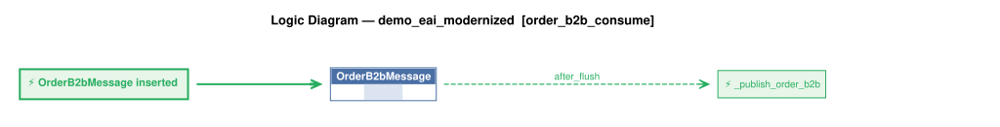

# Logic Flow — demo_eai_modernized [order_b2b_consume]

> Scoped to requirement: **order_b2b_consume**

<table>
<tr valign="top">
<td width="65%">



</td>
<td width="35%">

### Rules

1. `OrderB2bMessage` → `_publish_order_b2b` (after_flush) — OrderB2bMessage event: publishes the raw blob to order_b2b_processed after Tx 1 commits, so

</td>
</tr>
</table>

## Requirements

```
Feature: Order B2B Intake

* **Partner Payload Transformation (`process_order_b2b`)**:
  * Accepts `{ "Account": "<customer name>", "Notes": "...", "Items": [{ "Name": "<product name>", "QuantityOrdered": <int> }] }`.
  * Resolves `Account` by `Customer.name` and each item's `Name` by `Product.name`; raises `LookupError` (mapped to HTTP `422`) if either is unknown.
  * Validates that `Items` is non-empty and every `QuantityOrdered` is a positive integer (`> 0`); raises `ValueError` (mapped to HTTP `400`) otherwise.
  * Sets `Order.CreatedOn` to `date.today()` and commits the order and items atomically (rolling back if credit check or validation fails in `consume`).
* **Multi-Channel Intake**:
  1. **Synchronous REST (`POST /OrderB2B`)**: Processes a JSON request body and returns the created order (`201 Created`).
  2. **Asynchronous Kafka Consumer (`start_consumer`)**: Background daemon thread subscribed to topic `order_b2b` (consumer group `demo_eai_native`); logs and skips poison/rejected messages so a bad payload never halts the consumer.
  3. **Brokerless Debug Endpoint (`GET /consume_debug/<topic>?file=<path>`)**: Reads a payload file located within the project directory and runs the exact same `consume` pipeline.
```

---
_Generated 2026-10-27 21:53_
