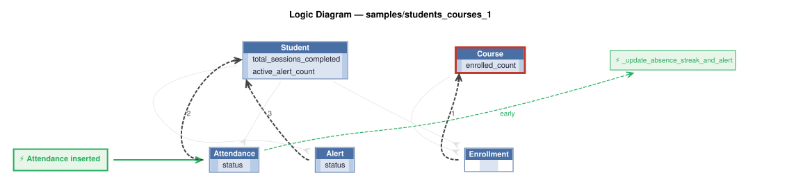

# Logic Flow — samples/students_courses_1

<table>
<tr valign="top">
<td width="65%">



</td>
<td width="35%">

### Rules

1. `enrolled_count = count(Enrollment)`<br>
2. `total_sessions_completed = count(Attendance where status)`<br>
3. `active_alert_count = count(Alert where status)`<br>
4. constraint: `Course`<br>
5. `Attendance` → `_update_absence_streak_and_alert` (early) — Attendance event: recomputes Student.consecutive_absences as a reset-on-attendance

</td>
</tr>
</table>

## Requirements

```
Use Case: Course Attendance & Drop-Off Requirements

## Narrative & Scope
Students enroll in courses with scheduled class sessions. Attendance at each scheduled session is tracked for adherence.

## Rules & Constraints
1. **Enrollment Capacity**:
   - `Course.enrolled_count = count(Enrollment where course_id = Course.id)` — the number of distinct students enrolled in the course (corrected 2026-10-13 by `students_courses_attendance_sweep`; previously counted Attendance records, which grew every session).
   - `Course.enrolled_count <= Course.max_capacity`.
2. **Absence Tracking**:
   - `Student.consecutive_absences` is a running streak of consecutive `absent` Attendance rows: it increments by 1 for each `absent` Attendance row recorded directly after an `absent` one, restarts at 1 after a non-absent row, and resets to 0 on any non-`absent` Attendance row (`attended` or `excused`). (Streak semantics written back 2026-10-13; the column name implies this, a plain count never resets.)
   - `Student.total_sessions_completed = count(Attendance where status == 'attended')`.
3. **Course Drop-Off Alert**:
   - If a student has a `consecutive_absences` value of 2 or more, a `course_dropoff` alert is automatically dispatched for advisor follow-up.
   - The 'absent' rows this depends on are written by the Attendance Sweep (`docs/requirements/students_courses_attendance_sweep/requirements.md`); attendance rows are otherwise written only on check-in.

version: 1.2
created: 2026-09-27T00:00:00
created_by: claude-sonnet-5 (valjhuber@gmail.com)
```

---
_Generated 2026-10-13 17:44_
